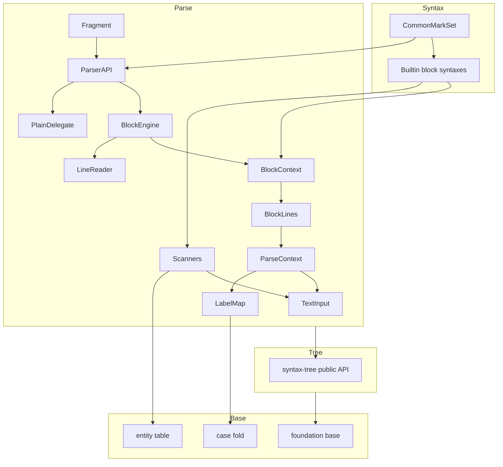
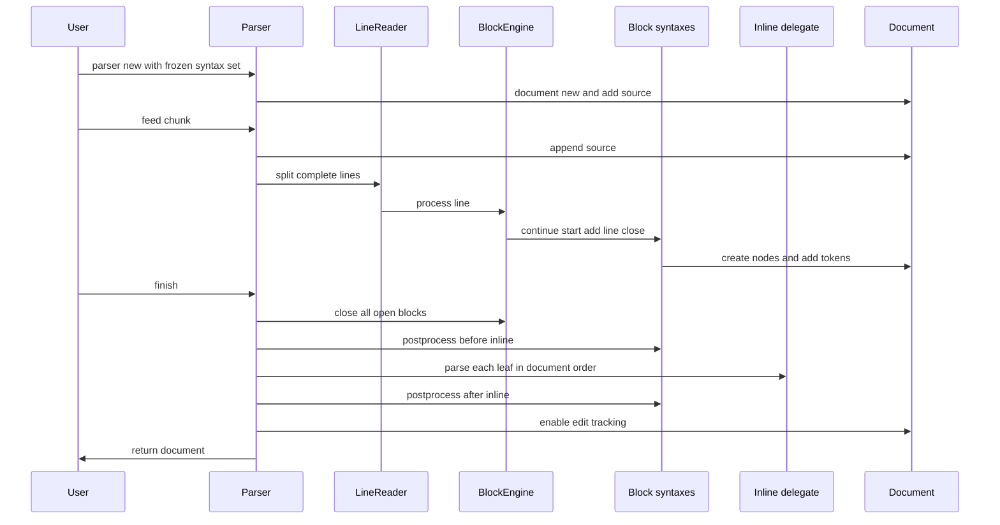
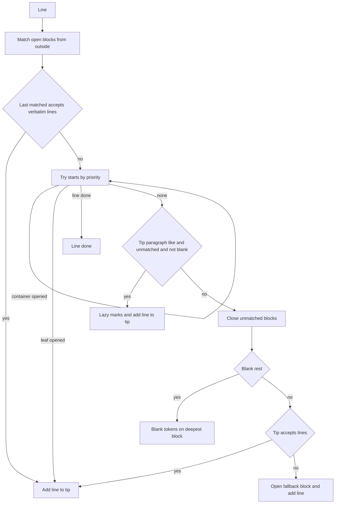
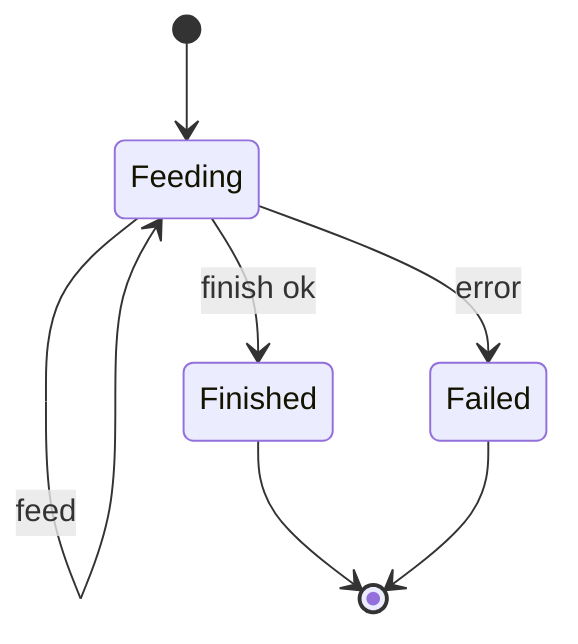
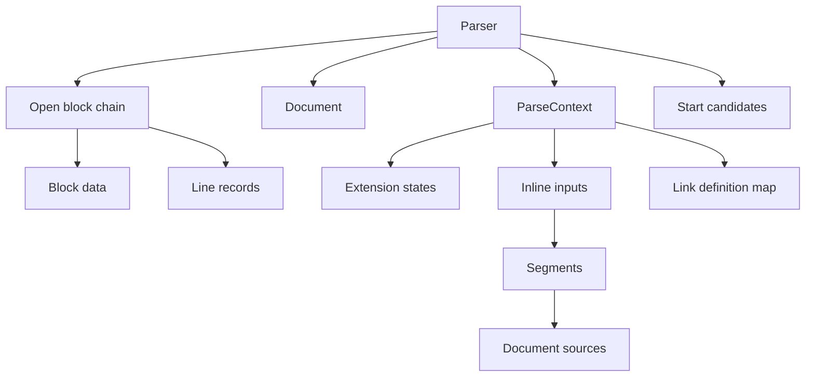

# Design Document: block-parser

## Overview
**Purpose**：`block-parser` は、Amark の利用者と拡張の実装者に、Markdown のテキストからブロック構造を確定させて `syntax-tree` の構文木を組み立てるパーサの入口と、個別の構文の知識を持たない汎用のブロック構文エンジン、公開のブロック構文 API を提供する。CommonMark の全ブロック構文とリンク参照定義は、この API の上の組み込み拡張として実装し、元の表記をすべて構文トークンとして記録する。

**Users**：利用者は、一括のパース、逐次の入力、断片のパースを使う。拡張の実装者は、ブロック構文・段落の先頭の消費・後処理・パースの間の状態のスロットと、行・トークン・テキストの走査の API を使う。`inline-parser` は、インラインへの委譲の取り決め、区間の並びのテキスト、走査と解読の関数、リンク参照定義の表を使う。`html-renderer` は組み込みのノード型の HTML 出力を構文拡張 `amark.core.html` として提供し、この spec の CommonMark の構文セットの構築関数がそれを `amark.core` の直後に加える。`markdown-renderer` の同じ形の `amark.core.markdown` はその直後に加わる（構築関数の一覧への 1 行の追加は `markdown-renderer` のタスク 3.7 が行う）。`markdown-renderer` は公開された役割の番号で表記を区別し、`scan.h` のバイト列の HTML ブロックの条件とタグの走査で、HTML ブロックとして再パースされるかを判定する。

**Impact**：`syntax-tree` の上に、公開ヘッダ 5 つ（`parser.h`、`block.h`、`scan.h`、`commonmark.h`、`entity.h`）、`src/parse/`、`src/syntax/` を追加し、`foundation` の共通基盤に case fold と文字参照の表を足す。

### Goals
- CommonMark 0.31.2 のブロック構造（タブ、不正な文字、4 章、5 章）を、組み込み拡張だけで正しく解析する。
- 無編集の文書のすべてのバイトを構文トークンで覆い、`amark_document_check_tokens` に通す（単純な委譲先を使った場合を含む）。
- GFM 相当の表、脚注の定義、タスクリストを、公開 API だけで書けるフックを提供する。
- 入れ子の深さの上限 D を固定したとき、時間とメモリを O(n·D) に収め、再帰を使わない。

### Non-Goals
- インライン構文の解析と区切り文字の処理、CommonMark spec 全体の HTML での準拠（`inline-parser`）
- HTML と Markdown の出力、出力のスロットの形（`html-renderer`、`markdown-renderer`）
- GFM 相当の構文の配布（検証用の構文はこの spec と `inline-parser` のテストの中にだけ置く）
- パーサの中断と再開（パースの途中の状態の保存）、複数のスレッドでの 1 つの文書のパース

## Boundary Commitments

### This Spec Owns
- 公開ヘッダ `include/amark/{parser,block,scan,commonmark,entity}.h` と、`amark.h`・`extension.h`・`unicode.h` への追記
- `src/parse/` のすべて：パーサの入口、行の読み取り、ブロック構文エンジン、ブロックの文脈の API、行の記録・解釈し直し・段落の先頭の消費、パースの文脈（拡張の状態、後処理、トークンの記録の補助、インラインの入力の登録と委譲）、区間の並びのテキスト、リンクと HTML のタグの走査、ラベルの正規化と表、単純な委譲先、断片のパース
- `src/syntax/` のブロックの組み込み拡張（構文ごとに 1 ファイル）と、CommonMark の構文セットを作る関数（`src/syntax/commonmark.c`）。構築関数が加える拡張の順（`amark.core` → 出力の core 拡張 → 構文の拡張）の規則。ただし `commonmark.c` の出力の core 拡張の一覧に `amark_markdown_core_extension()` を足す 1 行は、`markdown-renderer` のタスク 3.7 が編集する（この spec は 1 行で足せる配列の形と順の規則を持つ）
- HTML ブロックの開始と終わりの条件と HTML のタグの走査の規則（`src/parse/scan_html.c` の 1 つの実装）。バイト列の版と区間の並びの版の両方を `scan.h` で公開し、`commonmark.html_block`、`inline-parser` の raw HTML、`markdown-renderer` の判定はすべてこの実装を使う
- `inline-parser` の依頼で加えた宛先の括弧の入れ子の上限、エンジンの役割の範囲の分け方、`amark_test_parse_gfm`、`amark_test_parse_check` の唯一の実装（`inline-parser` は実装せず、使うだけ）
- スロットの種類 `AMARK_SLOT_BLOCK_SYNTAX`（1）、`AMARK_SLOT_PARAGRAPH_CONSUMER`（2）、`AMARK_SLOT_POSTPROCESS`（3）、`AMARK_SLOT_PARSE_STATE`（4）とその構造体
- 組み込みのブロック構文の構文トークンの役割の番号（`commonmark.h`。0x0001–0x00FF に収める）と、エンジンが使う役割の番号の範囲 0xFF00–0xFFFF の割り当て（ブロックのエンジン 0xFF00–0xFF0F をこの spec が使い、インラインのエンジン 0xFF10–0xFF1F を `inline-parser` に割り当て、0xFF20–0xFFFF を予約する。`block.h` の注記）
- `src/base/` への追加：case fold（`case_fold_tables.inc`、`amark_unicode_case_fold`）、文字参照（`entity.c`、`entity_tables.inc`）と、その生成手順（`tools/gen_unicode_tables.py` の拡張、`tools/gen_entity_table.py`）
- テスト：`tests/parse/`、`tests/syntax/`、`tests/base/` の追加分、テスト用の補助 `tests/support/parse_check.{h,c}`（INTERFACE ライブラリ `amark_test_parse`）、GFM 相当のブロックの検証用の構文 `tests/parse/gfm_block_ext.{h,c}`（INTERFACE ライブラリ `amark_test_parse_gfm`。`inline-parser` のテストが再利用する）、`fuzz/block_parse_fuzz.c`、`bench/`（`bench/CMakeLists.txt` と、その中のベンチマークの登録関数 `amark_add_bench`。`bench/CMakeLists.txt` は他の spec も追記する。下の「共同で編集するファイル」）
- 共有のテスト生成スクリプト `tests/support/gen_examples.cmake`：spec.txt の例の形式（32 個のバッククォートの区切り）を読む唯一のパーサ。この spec が先に実装して作り、データの形式・テストの名前の規則・基本の ARGS（`EXPECT=dump`、`DUMP_FLAGS=`）・基本の検査の経路の契約を持つ。`inline-parser` は同じファイルに `EXPECT=html`、`FACTORY=`、`CHECK=` を追加で足す（SyntaxTests の「`gen_examples.cmake` の契約」。拡張は追加だけで、基本の経路の出力を変えない）
- **共同で編集するファイル**：`bench/CMakeLists.txt` はこの spec が作り、登録関数 `amark_add_bench` の定義とベンチマークの登録（`amark_add_bench(...)` の行）だけを持つ。オプション `AMARK_BUILD_BENCH` と `add_subdirectory(bench)` は `bench/CMakeLists.txt` ではなく最上位の `CMakeLists.txt` に置く（下記の `foundation` の拡張点）。`inline-parser`（`inline_pathological`）など他の spec は、`bench/CMakeLists.txt` に `amark_add_bench(...)` の行を追記するだけで、関数と構成を変えない。`tests/support/gen_examples.cmake` は上のとおり `inline-parser` が拡張する。最上位の `CMakeLists.txt` の `AMARK_BUILD_BENCH` と `add_subdirectory(bench)`、`.gitattributes` の `tests/syntax/data/spec_blocks.txt export-ignore` は、`foundation` が所有するファイルへの追記で、`foundation` の Downstream Extension Points の表に載る拡張点として行う（表への行の追加は `foundation` の spec が行う。この spec はその行の内容に従い、拡張点の外の編集をしない）

### Out of Boundary
- インライン構文のエンジンと公開インライン構文 API、インラインの構文トークンの役割の番号（`inline-parser`）。この spec は委譲の取り決めだけを定める
- CommonMark の構文セットへのインラインの組み込み拡張の追加（`inline-parser` が `amark_syntax_set_add_commonmark` に足す）と、既定の委譲先の差し替え（`inline-parser`）
- HTML と Markdown の出力のスロットの構造体と番号、その中身、組み込みのノード型の出力の拡張（`amark.core.html` は `html-renderer`、`amark.core.markdown` は `markdown-renderer`）。この spec は構築関数でそれを加えるだけ。`amark.core.markdown` を一覧に足す 1 行の編集とその順のテストは `markdown-renderer`（タスク 3.7）が行い、この spec のタスクには含めない
- ノード型・構文トークン・編集の追跡・取り込みの仕組みそのもの（`syntax-tree`。必要な追加は Upstream Changes として示す）
- spec.txt 全体と CommonMark の準拠テストのランナー（`inline-parser`）

### Allowed Dependencies
- `foundation` の公開 API（error、allocator、buffer、utf8、unicode）と内部 API（`base/allocator_internal.h`、`base/buffer_internal.h`）
- `syntax-tree` の公開 API（`node.h`、`document.h`、`token.h`、`iterator.h`、`dump.h`、`extension.h`）。`src/parse/` は `tree/tree.h` を使わない
- `html-renderer` の公開 API `amark_html_core_extension()`（`html.h`）：`src/syntax/commonmark.c` の構築関数だけが使う（roadmap の順で `html-renderer` は先に実装される）。`markdown-renderer` の公開 API `amark_markdown_core_extension()`（`markdown.h`）も同じ場所だけが使い、その 1 行は `markdown-renderer` のタスク 3.7 が足す（この spec の実装の時点では使わない）
- テスト時：Naos、`amark_add_test`、`amark_add_generated_tests`、`amark_test_support`、`amark_test_tree`、`amark_test_html_gfm`（`html-renderer` の検証用のノード型の記述子。GfmHookTests だけ）、`amark_add_fuzzer`
- C99 の標準ライブラリ
- レイヤーの規則：`src/parse/` は `src/render/` と `src/syntax/` を参照しない。`src/syntax/` は公開ヘッダだけを使う（`src/parse/` の内部ヘッダに依存しない）。`src/base/` の追加分は他のレイヤーを参照しない

### Revalidation Triggers
独立に変わりうる継ぎ目ごとに分ける（spec は分けない）。

**ブロックのエンジンと公開ブロック構文 API**
- ブロック構文・段落の先頭の消費・後処理・パースの状態のスロットの構造体、コールバックの契約、優先度の値の変更 → 利用者の拡張、`inline-parser` の検証用拡張
- インラインへの委譲の取り決め（`amark_inline_delegate_t`、`amark_text_input_t`、呼ぶ順序）の変更 → `inline-parser`
- 役割の番号、トークンの所有の規則（空行、遅延継続、葉のインデント）の変更 → `markdown-renderer`、`inline-parser`
- エンジンの役割の番号の範囲の分け方（ブロック 0xFF00–0xFF0F、インライン 0xFF10–0xFF1F）の変更 → `inline-parser`、`markdown-renderer`
- 入れ子の深さの既定の上限の変更 → 利用者（文書化された値）
- パーサの生成の入口（`amark_parser_create` が構文セットを借りるだけであること、所有権を受け取る `amark_parser_create_take_syntax_set` の契約）の変更 → 利用者、`inline-parser` と `markdown-renderer` のテスト

**`scan.h` の走査（バイト列と区間の並び）**
- HTML ブロックの開始と終わりの条件、HTML のタグの走査（バイト列の版と区間の並びの版）の契約の変更 → `markdown-renderer`（HTML ブロックと保護の判定）、`inline-parser`（raw HTML）
- `amark_label_map_t`、`amark_label_normalize`、リンクの宛先・タイトル・ラベルの走査と解読の関数の契約の変更 → `inline-parser`
- 宛先の括弧の入れ子の上限（`AMARK_SCAN_MAX_LINK_PAREN_DEPTH`）の変更 → `inline-parser`（インラインのリンク）、利用者（文書化された値）

**実行時の文字データ（case fold、文字参照）**
- `amark_unicode_case_fold` の契約、または元データの版（Unicode 17.0.0 の `CaseFolding.txt` の状態 C と F）の変更 → ラベルの正規化（この spec）、`inline-parser`（ラベルの照合）、`foundation`（`tools/gen_unicode_tables.py --check`）
- `amark_char_ref_decode` の契約、または名前付き文字参照の表（WHATWG `entities.json`）の版の変更 → `inline-parser`（文字参照のインライン）、`html-renderer` と `markdown-renderer`（出力の照合のデータ）

**CommonMark の構文セットの構築関数**
- 組み込み拡張の名前、構築関数が加える拡張の順（出力の core 拡張の位置を含む）、ノード型と拡張の対応表の変更 → `html-renderer`、`markdown-renderer`、`inline-parser`
- `amark_html_core_extension()` の名前・登録の規則の変更（`html-renderer` 側の変更）、`amark_markdown_core_extension()` の名前・登録の規則の変更（`markdown-renderer` 側の変更）→ この spec の構築関数
- 便宜の関数（`amark_syntax_set_create_commonmark`、`amark_parser_create_commonmark`、`amark_parse_commonmark`）の所有の規則の変更 → 利用者、`inline-parser` の `FACTORY=` の関数

**GFM 相当の検証用ライブラリとテストの補助**
- `amark_test_parse_gfm`（`gfm_block_ext.h` の取得関数、拡張の名前、テスト用の役割の番号、脚注の定義の表の関数、表のセルの区間とトークンの規則）の変更 → `inline-parser` のテスト（`amark_test_gfm`）
- `amark_test_parse_gfm` の依存（Naos に依存しないこと、`AMARK_FUZZ` か `AMARK_BUILD_TESTS` が ON なら定義されること）の変更 → `inline-parser`（`inline_parse`）と `markdown-renderer`（`md_roundtrip`、`md_edit`）のファジングターゲット（`amark_test_gfm` を通して間接にリンクする）
- `amark_test_parse_check` と `AMARK_CHECK_PARSE` の契約の変更 → `inline-parser` のテスト（`amark_test_check_example`）、`markdown-renderer` のテスト
- `tests/support/gen_examples.cmake` の基本の契約（データの形式、テストの名前の規則、`n=`、`EXPECT=dump`、`DUMP_FLAGS=`、予約した名前と拡張の規則）の変更 → `inline-parser`（拡張する側）、`markdown-renderer`（`CHECK=` の利用者）

**ベンチマークの基盤**
- オプション `AMARK_BUILD_BENCH` の名前と既定値、`bench/CMakeLists.txt` の `amark_add_bench` の引数の変更 → `bench/CMakeLists.txt` に追記する spec（`inline-parser` の `inline_pathological`）、`foundation`（Downstream Extension Points の表の行）

## Architecture

### Architecture Pattern & Boundary Map
**Selected pattern**：段階のコールバックを持つ汎用エンジン。エンジンは 1 行の処理の 5 段階（照合、開始、遅延継続、行の追加、閉鎖）と、ブロック構文の性質の印だけを知る。構文ごとの知識は `src/syntax/` のコールバックに閉じる。



**Dependency direction（`src/parse/` の中）**：`text_input` → `label` → `scan_link` / `scan_html` → `parse_context` → `line_reader` → `block_lines` → `block_context` → `block_engine` → `inline_plain` → `parser` → `fragment`。左のファイルは右のファイルの関数を呼ばない。`src/syntax/` は公開ヘッダだけを include し、`src/parse/` はそれを知らない（`commonmark.c` だけが `parser.h` の公開関数と `html.h` の `amark_html_core_extension()`、`markdown-renderer` のタスク 3.7 の後は `markdown.h` の `amark_markdown_core_extension()` を呼ぶ）。違反はレビューでエラーとする。

**Architecture Integration**：
- Domain boundaries：エンジン（`src/parse/`）、構文（`src/syntax/`）、文字データ（`src/base/`）。構文の知識はエンジンに置かない。
- Existing patterns preserved：エラーコードと出力引数、強い保証（パーサの失敗だけは例外。下記）、不透明型、`struct_size`、グローバルのアロケータの経由、その設定のほかにグローバルな可変状態なし、内部関数も `amark_`、ライセンスヘッダ。
- Steering compliance：構文ごとに 1 ファイル、組み込みも公開 API だけ、parse → tree の一方向。

### Technology Stack

| Layer | Choice / Version | Role in Feature | Notes |
|-------|------------------|-----------------|-------|
| Language | C99 | ライブラリ、テスト、ファジング、ベンチマーク | `amark_target_defaults()` |
| Base | `foundation`（error、allocator、buffer、utf8、unicode） | 確保、UTF-8 の復号、文字の分類 | case fold と文字参照を追加 |
| Tree | `syntax-tree`（公開 API） | ノード、トークン、追跡、構文セット | 上流の変更 2 件（Upstream Changes） |
| Data | Unicode 17.0.0 `CaseFolding.txt`、WHATWG `entities.json` | case fold、文字参照の表 | 生成物をリポジトリに入れる |
| Test | Naos v0.4.0、`amark_add_generated_tests` | 単体テスト、データ駆動のテスト | CommonMark 0.31.2 の例をテストデータにする |
| Fuzz / Bench | `amark_add_fuzzer`、`bench/`（C のプログラム） | ファジング、計算量の確認 | — |

## File Structure Plan

### Directory Structure
```
include/amark/
├── parser.h          # パーサ、オプション、パースの文脈、拡張の状態、後処理のスロット、インラインへの委譲、
│                     # 断片のパース、ラベルの正規化と表
├── block.h           # ブロック構文と段落の先頭の消費のスロット、ブロックの文脈の API、行の記録、エンジンの役割
├── scan.h            # 区間の並びのテキスト、走査（ラベル、宛先、タイトル、HTML のタグ、HTML ブロックの条件）、
│                     # トークンの記録と解読
├── commonmark.h      # 組み込み拡張の取得、CommonMark の構文セット、便宜の関数、役割の番号、優先度
└── entity.h          # 文字参照の解読
src/parse/
├── parse.h           # struct amark_parser / amark_parse_context / amark_block_context と内部関数
├── text_input.c      # amark_text_input_t：区間の追加、論理的な位置とソースのオフセットの対応
├── label.c           # amark_label_normalize と amark_label_map_t（AVL 木）
├── scan_link.c       # リンクのラベル・宛先・タイトルの走査
├── scan_html.c       # HTML の開始タグと終了タグの走査、HTML ブロックの開始と終わりの条件（バイト列と区間の並びの
│                     # 両方の版。規則はこのファイルの 1 つの実装）
├── parse_context.c   # 拡張の状態、トークンの記録の補助、テキストの解読、インラインの入力の登録、後処理の実行
├── line_reader.c     # 入力のチャンクから行を切り出す（LF/CR/CRLF、チャンクの境目、BOM）
├── block_lines.c     # 行の記録、解釈し直し、段落の先頭の消費の調停（再開の状態）
├── block_context.c   # ブロック構文に見せる API：行の位置と列、消費、開く・閉じる、ブロックのデータ、空行の印
├── block_engine.c    # 1 行の処理の 5 段階、開始の候補の並べ替え、深さの上限、終了時の閉鎖
├── inline_plain.c    # 単純な委譲先と既定の委譲先
├── parser.c          # amark_parser_t の生成・入力・終了・解放、インラインの段階、追跡の有効化
└── fragment.c        # 断片のパースと挿入
src/syntax/
├── thematic_break.c            # commonmark.thematic_break
├── atx_heading.c               # commonmark.atx_heading
├── setext_heading.c            # commonmark.setext_heading
├── indented_code.c             # commonmark.indented_code
├── fenced_code.c               # commonmark.fenced_code
├── html_block.c                # commonmark.html_block（7 種類。条件の判定は scan.h の関数）
├── link_reference_definition.c # commonmark.link_reference_definition（段落の先頭の消費）
├── paragraph.c                 # commonmark.paragraph（受け皿、段落の類）
├── block_quote.c               # commonmark.block_quote
├── list_item.c                 # commonmark.list_item（リストとリスト項目）
└── commonmark.c                # 拡張の一覧（出力の core 拡張を含む）、構文セットへの追加、便宜の関数
src/base/
├── case_fold_tables.inc        # 生成物：完全な case fold の表
├── entity.c                    # amark_char_ref_decode：名前付きと数値の文字参照
└── entity_tables.inc           # 生成物：名前付き文字参照の表（名前の昇順）
tools/
└── gen_entity_table.py         # entities.json から entity_tables.inc を生成する（保守者用）
tests/
├── support/
│   ├── parse_check.h           # パースして、被覆・不変条件・逐次の入力の一致・ダンプを確かめる補助
│   ├── parse_check.c
│   ├── gen_examples.cmake      # spec.txt の例の形式のデータからテストを生成する共有のスクリプト（唯一のパーサ。
│   │                           # inline-parser が EXPECT=html、FACTORY=、CHECK= を追加で足す）
│   └── data/
│       └── gen_examples_selftest.txt  # 生成の自己テスト（NUL、CR、タブ、n=、見出しの名前）
├── base/
│   ├── case_fold_test.c
│   └── entity_test.c
├── parse/
│   ├── CMakeLists.txt
│   ├── test_syntaxes.h         # エンジンのテスト用の最小の構文（コンテナ、葉、段落の類、消費、後処理）
│   ├── test_syntaxes.c
│   ├── parser_api_test.c       # 生成、オプション、状態の誤り、構文セットの所有、追跡
│   ├── line_reader_test.c      # 改行コード、チャンクの境目、BOM、最後の行
│   ├── engine_test.c           # 照合、開始の優先度、包含による閉鎖、遅延継続、空行、深さの上限
│   ├── block_api_test.c        # 消費と部分的なタブ、ブロックのデータ、解釈し直し、先頭の消費の再開
│   ├── postprocess_test.c      # 後処理の段階と順序、拡張の状態、追跡を記録しないこと
│   ├── delegate_test.c         # 委譲の順序、区間、失敗の伝播、単純な委譲先
│   ├── text_scan_test.c        # 区間の並び、走査、解読とトークン、HTML のバイト列の版と区間の並びの版の一致、
│   │                           # HTML ブロックの条件
│   ├── label_test.c            # 正規化と表
│   ├── fragment_test.c         # ブロックとインラインの文脈、定義の解決、全か無か、追跡
│   ├── gfm_block_ext.h         # 表、脚注の定義、タスクリストのパースのスロット（ノード型は amark_test_html_gfm のもの）。
│   │                           # INTERFACE ライブラリ amark_test_parse_gfm として公開（取得関数、脚注の定義の表）
│   ├── gfm_block_ext.c
│   ├── gfm_hooks_test.c        # 検証用の構文の木とトークン、HTML の検証用拡張と組み合わせた出力
│   ├── oom_test.c              # 確保失敗の総当たり
│   └── scale_test.c            # 計算量のカウンタ、深い入れ子（INTERNAL）
└── syntax/
    ├── CMakeLists.txt
    └── data/
        ├── thematic_break.txt  # 構文ごとの入力と期待するダンプ（トークンつき）
        ├── ...                 # 構文ごとに 1 ファイル（atx_heading、setext_heading、indented_code、fenced_code、
        │                       # html_block、link_reference_definition、paragraph、block_quote、list_item、
        │                       # tabs_and_chars、lossless）
        └── spec_blocks.txt     # CommonMark 0.31.2 の 2.2、2.3、4 章、5 章の例（n= で spec の番号）と、期待するブロックの構造
fuzz/
├── block_parse_fuzz.c
└── corpus/block_parse/
bench/
├── CMakeLists.txt              # amark_add_bench()。他の spec は登録の行を追記する
└── block_pathological.c        # 病的な入力の大きさを倍々にしたときの時間を表示する
```

### Modified Files
- `include/amark/amark.h` — `entity.h`、`scan.h`、`parser.h`、`block.h`、`commonmark.h` を、`foundation` が定める正準の順（`amark.h` の include の順の規則）のそれぞれの位置に追加する（`inline-parser` の `inline.h` は後で `block.h` と `commonmark.h` の間に入る）。 依存の順（左は右を include しない）：`entity.h` → `scan.h` → `parser.h`（`extension.h` も include）→ `block.h` → `commonmark.h`。
- `include/amark/extension.h` — `syntax-tree` が置いたスロットの種類の一覧で割り当てた番号 1–4 で、スロットの種類 `AMARK_SLOT_BLOCK_SYNTAX`、`AMARK_SLOT_PARAGRAPH_CONSUMER`、`AMARK_SLOT_POSTPROCESS`、`AMARK_SLOT_PARSE_STATE` を追記する。
- `include/amark/unicode.h`、`src/base/unicode.c` — `amark_unicode_case_fold()` を追加する。
- `tools/gen_unicode_tables.py` — `CaseFolding.txt`（状態 C と F）を読み、`case_fold_tables.inc` を出力する。`--check` の対象に加える。
- `src/CMakeLists.txt` — `amark_objects` に `src/parse/*.c`、`src/syntax/*.c`、`src/base/entity.c` を追加する。
- `tests/CMakeLists.txt` — `add_subdirectory(parse)` を `tests/` の中で条件なしに追加し、Naos を使う INTERFACE ライブラリ `amark_test_parse`（INTERFACE のソース `support/parse_check.c`）の定義と `add_subdirectory(syntax)` は `if(AMARK_BUILD_TESTS)` の中に置く（`foundation` の規則 7.7。`tests/` とその下は `AMARK_FUZZ` だけが ON の構成でも入る）。`tests/parse/CMakeLists.txt` は INTERFACE ライブラリ `amark_test_parse_gfm`（INTERFACE のソース `${CMAKE_CURRENT_SOURCE_DIR}/gfm_block_ext.c`、インクルード `tests/parse/`、`amark_test_html_gfm` に依存）を条件なしに定義し（`AMARK_FUZZ` か `AMARK_BUILD_TESTS` が ON なら必ず定義される）、Naos を使う `tests/parse/` のテスト（`gfm_hooks_test` などの単体テスト）は `if(AMARK_BUILD_TESTS)` の中に置く。`amark_test_parse_gfm` は Naos に依存しない（Naos のヘッダを include せず、Naos をリンクしない）。`inline-parser` の `amark_test_gfm` を通して `inline_parse`（`inline-parser`）と `md_roundtrip`・`md_edit`（`markdown-renderer`）のファジングターゲットに間接にリンクされるため（7.7、7.8）。ターゲットは全体で見えるので、`inline-parser` の `tests/extensions/` からリンクできる。`tests/syntax/CMakeLists.txt` は `tests/support/gen_examples.cmake` を生成スクリプトとして使う（SyntaxTests）。`tests/base/CMakeLists.txt` に case fold と文字参照のテストを足す。
- `fuzz/CMakeLists.txt` — `amark_add_fuzzer(block_parse SOURCES block_parse_fuzz.c CORPUS corpus/block_parse)`。
- `CMakeLists.txt`（最上位）— オプション `AMARK_BUILD_BENCH`（既定 OFF）と、ON のときの `add_subdirectory(bench)`。`foundation` の Downstream Extension Points の表に載る拡張点への追記。
- `.gitattributes` — `tests/syntax/data/spec_blocks.txt export-ignore`。同じく `foundation` の拡張点への追記。
- 上流の変更（`syntax-tree` の所有。`syntax-tree` の spec に反映済みで、`syntax-tree` のタスクが実装する）：`amark_document_take_syntax_set`、`amark_node_import_children`、スロットの種類の一覧（Integration の節）。

## System Flows

### パースの全体

- 行は改行が確定したときに処理する（末尾の CR は次のチャンクの先頭を見るまで保留する）。最後の行は終了の指示で処理する。
- 失敗した段階で処理を止め、パーサは失敗の状態になる。

### 1 行の処理（BlockEngine）

- 開始を試すとき、照合できなかったブロックはまだ閉じない。`amark_block_open` が呼ばれた時点で、照合できなかったブロックと、新しいブロックを受け入れられない祖先を閉じる（3.3）。
- 中断の判定（`amark_block_interrupting`）は「最後に照合したブロックが段落の類で、それが最も内側の開いているブロック」のとき真。遅延継続の可能性（`amark_block_lazy_possible`）は「最も内側の開いているブロックが段落の類」のとき真。
- 深さが上限に達しているとき、`AMARK_BLOCK_SYNTAX_CONTAINER` の印を持つ構文の開始は試さない（12.2）。

### パーサの状態

- `Finished` と `Failed` では `feed` と `finish` は `AMARK_ERROR_INVALID_STATE`。`Failed` に入る前の失敗のエラーコードはそのまま返す。

## Requirements Traceability

| Requirement | Summary | Components | Interfaces | Flows |
|-------------|---------|------------|------------|-------|
| 1.1 | 一括のパースとグローバルのアロケータ | ParserAPI | `amark_parse` | パースの全体 |
| 1.2 | CommonMark の便宜の関数と所有 | CommonMarkSet, ParserAPI | `amark_parse_commonmark`, `amark_parser_create_take_syntax_set` | パースの全体 |
| 1.3 | 逐次の入力と一括の一致 | ParserAPI, LineReader | `amark_parser_feed`, `amark_parser_finish` | パースの全体 |
| 1.4 | 凍結していない構文セット | ParserAPI | `amark_parser_create` | — |
| 1.5 | 終了後の操作 | ParserAPI | 状態 | パーサの状態 |
| 1.6 | 確保の失敗 | ParserAPI, 全コンポーネント | `Failed` | パーサの状態 |
| 1.7 | スレッドと構文セットの共有 | ParserAPI, BlockEngine | 構文セットは読み取りだけ | — |
| 1.9 | 借りる生成と所有権を受け取る生成の分離 | ParserAPI, CommonMarkSet | `amark_parser_create`（`const`）, `amark_parser_create_take_syntax_set`（非 `const`） | — |
| 1.8 | 追跡を無効のまま | ParserAPI | `AMARK_PARSE_NO_EDIT_TRACKING` | — |
| 2.1 | 改行コード | LineReader, BlockContext, Builtin syntaxes | 行の記録、`LINE_ENDING` | — |
| 2.2 | タブと部分的なタブ | BlockContext | `amark_block_consume_columns` | — |
| 2.3 | NUL の置き換え | ParseContext | `amark_parse_add_text` | — |
| 2.4 | BOM | LineReader, BlockEngine | `AMARK_ROLE_ENGINE_BOM` | — |
| 2.5 | 不正な UTF-8 | ParseContext, LabelMap | `amark_parse_add_text`, `amark_label_normalize` | — |
| 2.6 | 改行で終わらない最後の行 | LineReader | `finish` | — |
| 2.7 | 空の入力 | ParserAPI | — | — |
| 3.1 | 外側からの照合 | BlockEngine | `continue_line` | 1 行の処理 |
| 3.2 | 優先度の順の開始 | BlockEngine | `priority` | 1 行の処理 |
| 3.3 | 包含による閉鎖と親の決定 | BlockContext | `amark_block_open` | 1 行の処理 |
| 3.4 | 遅延継続 | BlockEngine | `AMARK_BLOCK_SYNTAX_PARAGRAPH` | 1 行の処理 |
| 3.5 | 空行の扱いと記録 | BlockEngine, BlockContext | `amark_block_last_line_blank` | 1 行の処理 |
| 3.6 | 終わりでの閉鎖 | BlockEngine | `finish` | パースの全体 |
| 3.7 | 構文の知識を持たない | BlockEngine | 性質の印 | — |
| 3.8 | 構文を取り除いたとき | BlockEngine, CommonMarkSet | `amark_syntax_set_remove` | — |
| 4.1 | ブロック構文の定義と登録 | BlockContext | `amark_block_syntax_t` | — |
| 4.2 | 段落の中断の指定 | BlockEngine, BlockContext | `AMARK_BLOCK_START_INTERRUPTS`, `amark_block_interrupting` | 1 行の処理 |
| 4.3 | 入れ子に開く、ブロックのデータ | BlockContext | `amark_block_open`, `amark_block_data` | — |
| 4.4 | 解釈し直し | BlockLines | `amark_block_reinterpret` | — |
| 4.5 | 段落の先頭の消費 | BlockLines | `amark_paragraph_consumer_t`, `amark_block_settle_paragraph` | — |
| 4.6 | 行の問い合わせと消費 | BlockContext | `amark_block_column` など | — |
| 4.7 | インラインの入力の登録と先頭の消費 | ParseContext | `amark_parse_add_inline_segment`, `amark_parse_consume_inline_prefix` | — |
| 4.8 | コールバックの失敗 | BlockEngine, ParserAPI | エラーコードの伝播 | パーサの状態 |
| 4.9 | 近道を使わない | Builtin syntaxes | 公開ヘッダだけ | — |
| 5.1 | 後処理の登録と段階 | ParseContext | `amark_postprocess_t` | パースの全体 |
| 5.2 | 終了時の順序 | ParserAPI | `finish` | パースの全体 |
| 5.3 | 拡張の状態 | ParseContext | `amark_parse_state_slot_t`, `amark_parse_extension_state` | — |
| 5.4 | 状態とデータの解放 | ParserAPI, ParseContext | `finish`, `amark_parser_destroy` | — |
| 5.5 | 後処理を記録しない | ParserAPI | 追跡の有効化の時点 | パースの全体 |
| 6.1 | 文書の順の委譲 | ParserAPI, ParseContext | `amark_inline_delegate_t.parse` | パースの全体 |
| 6.2 | 区間の並び | TextInput | `amark_text_input_t` | — |
| 6.3 | パースの文脈 | ParseContext | `amark_parse_document` など | — |
| 6.4 | 委譲先の指定 | ParserAPI | `amark_parse_options_t.inline_delegate` | — |
| 6.5 | 単純な委譲先 | PlainDelegate | `amark_inline_delegate_plain` | — |
| 6.6 | 委譲先の失敗 | ParserAPI | エラーコードの伝播 | パーサの状態 |
| 7.1 | 全ブロック構文 | Builtin syntaxes | 各拡張 | — |
| 7.2 | 構文ごとの拡張 | Builtin syntaxes | `commonmark.*` | — |
| 7.3 | 構文セットを作る手段 | CommonMarkSet | `amark_syntax_set_add_commonmark`, `amark_syntax_set_create_commonmark` | — |
| 7.4 | 取り除きと置き換え | CommonMarkSet | 拡張の名前 | — |
| 7.5 | 属性とリテラル | Builtin syntaxes | `amark_node_set_*` | — |
| 7.6 | 出力のスロットを足せる構造 | Builtin syntaxes, CommonMarkSet | 静的なスロットの一覧、対応表、出力の core 拡張の配列 | — |
| 7.7 | バイト列の HTML ブロックの条件とタグの走査 | Scanners | `amark_scan_html_block_start`, `amark_scan_html_block_end`, `amark_scan_html_open_tag_bytes`, `amark_scan_html_closing_tag_bytes` | — |
| 7.8 | HTML の規則の 1 つの実装 | Scanners, Builtin syntaxes | `scan_html.c` の内部の走査、`commonmark.html_block` | — |
| 8.1, 8.2 | 定義の取り出しと空の段落 | LinkRefDef, BlockLines | 段落の先頭の消費 | — |
| 8.3 | ラベルの正規化 | LabelMap, CaseFold | `amark_label_normalize` | — |
| 8.4, 8.5 | 最初の定義、表の参照 | LabelMap, ParseContext | `amark_parse_link_definitions` | — |
| 8.6 | 正規化と表の公開 | LabelMap | `amark_label_map_*` | — |
| 8.7 | エスケープと文字参照 | Scanners, ParseContext, Entity | `amark_parse_add_decoded`, `amark_char_ref_decode` | — |
| 9.1 | 全バイトの被覆 | 全構文, BlockEngine, PlainDelegate | `amark_document_check_tokens` | — |
| 9.2 | コンテナの接頭辞 | BlockQuote, ListItem | `AMARK_TOKEN_FLAG_CONTAINER_PREFIX` | — |
| 9.3 | 遅延継続の印 | BlockEngine | `AMARK_ROLE_ENGINE_LAZY` | 1 行の処理 |
| 9.4 | 表記の種類ごとのトークン | 全構文, BlockContext | 役割の番号 | — |
| 9.5 | 役割の番号の公開 | Builtin syntaxes | `commonmark.h` | — |
| 9.6 | 空行のトークンの所有 | BlockEngine | `AMARK_ROLE_ENGINE_BLANK_*` | 1 行の処理 |
| 9.7 | エンジンの役割の範囲の分け方 | BlockEngine, Builtin syntaxes | `block.h` の範囲の注記（0xFF00–0xFF0F / 0xFF10–0xFF1F） | — |
| 10.1, 10.2 | 断片のパース | Fragment | `amark_parse_fragment` | — |
| 10.3 | 挿入先の定義 | Fragment, LabelMap | `AMARK_FRAGMENT_TARGET_DEFINITIONS` | — |
| 10.4 | 全か無か | Fragment | `amark_node_import_children`（上流） | — |
| 10.5 | 挿入の記録 | Fragment | `syntax-tree` の挿入の規則 | — |
| 11.1 | 追跡を有効にして返す | ParserAPI | `amark_document_set_edit_tracking` | パースの全体 |
| 11.2 | 不変条件 | 全コンポーネント | `amark_tree_check`（テスト） | — |
| 11.3 | パーサからの独立 | ParserAPI | `amark_document_take_syntax_set`（上流） | — |
| 12.1, 12.2 | 深さの上限と劣化 | BlockEngine | `max_container_depth` | 1 行の処理 |
| 12.3 | 計算量 | BlockEngine, BlockLines, LabelMap | 内部のカウンタ | — |
| 12.4 | スタックを使い果たさない | 全コンポーネント | 再帰なし | — |
| 12.5 | ファジングと計算量のテスト | ParseTests, Fuzz, Bench | `block_parse_fuzz` | — |
| 12.6 | 宛先の括弧の入れ子の上限 | Scanners | `AMARK_SCAN_MAX_LINK_PAREN_DEPTH`, `amark_scan_link_destination` | — |
| 13.1, 13.2, 13.3, 13.4 | GFM 相当のフック | GfmHookTests | 公開 API | — |
| 13.5 | 検証用の構文の再利用 | GfmHookTests | `amark_test_parse_gfm`, `amark_test_gfm_*_extension`, `amark_test_gfm_footnote_definitions` | — |
| 13.6 | セルの中の `\|` | GfmHookTests | セルの区間と `AMARK_TEST_GFM_ROLE_CELL_PIPE_ESCAPE` | — |
| 14.1, 14.2, 14.3, 14.4 | 検証 | SyntaxTests, ParseCheck | `gen_examples.cmake`, `amark_test_parse_check` | — |
| 14.5 | 文書を返す検査の補助 | ParseCheck | `amark_test_parse_check`（関数）, `AMARK_CHECK_PARSE` | — |
| 14.6 | 共有のテスト生成スクリプト | SyntaxTests | `tests/support/gen_examples.cmake` | — |

## Components and Interfaces

| Component | Domain/Layer | Intent | Req Coverage | Key Dependencies (P0/P1) | Contracts |
|-----------|--------------|--------|--------------|--------------------------|-----------|
| ParserAPI | Parse | パーサの生成・入力・終了、インラインの段階、追跡 | 1.1–1.8, 2.7, 4.8, 5.2, 5.4, 5.5, 6.1, 6.4, 6.6, 11.1–11.3 | BlockEngine (P0), ParseContext (P0) | Service, State |
| LineReader | Parse | チャンクから行を切り出す | 1.3, 2.1, 2.4, 2.6 | — | Service, State |
| BlockEngine | Parse | 1 行の処理の 5 段階と閉鎖 | 3.1–3.8, 4.2, 9.3, 9.6, 9.7, 12.1–12.3 | BlockContext (P0), LineReader (P0) | Service |
| BlockContext | Parse | ブロック構文に見せる行とブロックの操作 | 2.2, 3.3, 3.5, 4.1–4.3, 4.6 | BlockLines (P0), syntax-tree (P0) | Service |
| BlockLines | Parse | 行の記録、解釈し直し、先頭の消費の調停 | 4.4, 4.5, 8.1, 8.2, 12.3 | ParseContext (P0) | Service, State |
| ParseContext | Parse | 拡張の状態、トークンの補助、インラインの入力、後処理 | 2.3, 2.5, 4.7, 5.1, 5.3, 6.3, 8.5, 8.7 | TextInput (P0), LabelMap (P0) | Service |
| TextInput | Parse | 区間の並びのテキスト | 6.2 | — | Service |
| Scanners | Parse | リンクと HTML のタグの走査、HTML ブロックの条件 | 7.7, 7.8, 8.7, 12.6 | TextInput (P0), Entity (P1) | Service |
| LabelMap | Parse | ラベルの正規化と表 | 2.5, 8.3–8.6 | CaseFold (P0) | Service |
| PlainDelegate | Parse | 単純な委譲先 | 6.5, 9.1 | ParseContext (P0) | Service |
| Fragment | Parse | 断片のパースと挿入 | 10.1–10.5 | ParserAPI (P0), syntax-tree import (P0) | Service |
| CommonMarkSet | Syntax | 拡張の一覧と構文セット、便宜の関数 | 1.2, 3.8, 7.2–7.4, 7.6 | Builtin syntaxes (P0), ParserAPI (P0) | Service |
| Builtin syntaxes | Syntax | CommonMark の各ブロック構文 | 4.9, 7.1, 7.5, 7.8, 8.1, 8.2, 9.1, 9.2, 9.4, 9.5, 9.7 | BlockContext (P0), Scanners (P0) | Service |
| CaseFold / Entity | Base | 文字データ | 8.3, 8.7 | 生成スクリプト (P2) | Service, Batch |
| ParseCheck | Test | パースの検査の補助（文書を返す） | 14.3, 14.5 | 公開 API (P0) | Service |
| ParseTests / SyntaxTests / Fuzz / Bench | Test | 要件の検証 | 12.5, 14.1–14.4 | ParseCheck (P0) | Batch |
| GfmHookTests | Test | GFM 相当のフックの検証と、再利用できる検証用の構文（`amark_test_parse_gfm`） | 13.1–13.6 | ParseCheck (P0), amark_test_html_gfm (P0) | Service, Batch |

### 共通の規約
- `foundation` と `syntax-tree` の規約に従う：失敗しうる関数は `amark_error_t` を返し、出力引数は最後で `out_` で始める。必須のポインタ引数が NULL なら `AMARK_ERROR_INVALID_ARGUMENT`。解放の関数は NULL を受け付ける。公開の構造体は先頭に `size_t struct_size`（スロットの構造体は `amark_slot_t` の `struct_size`）を持ち、ライブラリは知っている最小のサイズ以上であることを確かめる。
- **パーサの失敗の例外**：`amark_parser_feed` と `amark_parser_finish` は、確保の失敗とコールバックの失敗のとき、強い保証ではなく「リークせず、パーサが `Failed` の状態になる」保証とする（入力の途中まで組み立てた木を巻き戻すと、行ごとに複製が必要になるため）。`Failed` のパーサは解放だけを受け付ける。利用者は入力を最初から与え直す。この例外は `parser.h` に文書化する。
- コールバックに渡す `amark_block_context_t *` と `amark_parse_context_t *` は、そのコールバックの間だけ有効。行の内容のポインタも同じ。
- ブロック構文のコールバックが `AMARK_ERROR_NONE` 以外を返したら、エンジンは処理を止めてそのエラーコードを返す（4.8）。

### Parse

#### ParserAPI

| Field | Detail |
|-------|--------|
| Intent | パーサの生成・入力・終了・解放と、終了時の段階の実行 |
| Requirements | 1.1–1.8, 2.7, 4.8, 5.2, 5.4, 5.5, 6.1, 6.4, 6.6, 11.1–11.3 |

**Responsibilities & Constraints**
- 生成：構文セット（必須、凍結済み。凍結していなければ `AMARK_ERROR_INVALID_STATE`）、オプション（NULL なら既定）を受け取る。文書を作り（`amark_document_create`）、空のソースを登録する（ソースの識別子は 0）。構文セットのスロットの索引から、ブロック構文を（優先度、構文セットの順）で整列した候補の表と、段落の先頭の消費・後処理・パースの状態の表を作る。パースの状態のスロットの `init` を構文セットの順に呼ぶ。`amark_parser_create` は構文セットを `const` で借りるだけで、所有権を扱わない（文書も所有しない）。所有権の受け渡しは、非 `const` の構文セットを受け取る別の入口 `amark_parser_create_take_syntax_set` だけが行う。これは `amark_parser_create` と同じ内部の生成（`amark_parser_build`、`const` で受ける）を行い、その最後の段階（他のすべての確保と `init` の後）で、呼び出し側から非 `const` のまま受け取った `syntax` で `amark_document_take_syntax_set(parser->document, syntax)` を呼び、構文セットの所有権を文書へ渡す。`const` を外すキャストはどこにもない。`syntax-tree` の規則で、この呼び出しは確保をせず、静的な構文セット（`amark_syntax_set_core()`）、文書が使っていない構文セット、2 回目の受け渡しだけを `AMARK_ERROR_INVALID_ARGUMENT` で拒否する。新しい文書には 2 回目は起こらないので、拒否されるのは静的な構文セットだけである。拒否されたら初期化済みの状態を逆順に破棄し、文書を解放して `AMARK_ERROR_INVALID_ARGUMENT` を返す（所有権は呼び出し側に残る）。受け渡しを `amark_parser_create_take_syntax_set` の最後に置くことで、「生成が失敗したら所有権は呼び出し側に残り、成功したら文書のものになる」が 1 か所で決まる。
- 入力：バイト列をソースに追加し（`amark_document_append_source`）、LineReader が切り出した完全な行を BlockEngine に渡す。
- 終了：最後の行を処理し、開いているブロックをすべて閉じる → 後処理（インラインの前）→ インラインの段階 → 後処理（インラインの後）→ パースの状態の `deinit` とパースの間のデータの解放 → 追跡の有効化（オプションで無効にしない限り）→ 文書を返す。構文セットの所有権は生成のときに文書へ渡してあるので、返した文書はそれを保持し続け、パーサと独立する（11.3）。
- インラインの段階：根から前順にたどり、インラインの入力が登録されたノードごとに `delegate->parse` を呼ぶ。`begin` は最初の呼び出しの前に 1 回、`end` は最後（失敗のときも）に 1 回。
- 解放：終了していなければ文書を解放する。文書が構文セットを所有していれば（`amark_parser_create_take_syntax_set` の生成が成功した後）、`amark_document_destroy` がノードの後でそれを解放する。生成が成功した後は、パースの成否によらず構文セットは文書のものである（`parser.h` に文書化する）。

**Contracts**: Service [x] / State [x]

##### Service Interface
```c
/* include/amark/parser.h（scan.h を include する。amark_parse_context_t、amark_text_input_t、
   amark_label_map_t の typedef は scan.h が 1 か所で前方宣言する。C99 は typedef の重複を許さない） */
typedef struct amark_parser amark_parser_t;

#define AMARK_PARSE_NO_EDIT_TRACKING    0x01u   /* 返す文書の追跡を無効のままにする */
#define AMARK_PARSE_DEFAULT_MAX_DEPTH   128u
#define AMARK_PARSE_MAX_DEPTH_LIMIT     65535u

typedef struct amark_inline_delegate {
    size_t struct_size;
    amark_error_t (*begin)(amark_parse_context_t *ctx, void *user_data, void **out_session);   /* 任意 */
    amark_error_t (*parse)(amark_parse_context_t *ctx, void *session, amark_node_t *leaf,
                           const amark_text_input_t *input);                                /* 必須 */
    void (*end)(amark_parse_context_t *ctx, void *session);                                 /* 任意 */
    void *user_data;
} amark_inline_delegate_t;

typedef struct amark_parse_options {
    size_t struct_size;
    uint32_t flags;
    size_t max_container_depth;                     /* 0 なら AMARK_PARSE_DEFAULT_MAX_DEPTH */
    const amark_inline_delegate_t *inline_delegate; /* NULL なら amark_inline_delegate_default() */
} amark_parse_options_t;

AMARK_API void amark_parse_options_init(amark_parse_options_t *options);

/* 構文セットを借りる（変更も解放もしない）。呼び出し側は文書より長く構文セットを保つ */
AMARK_API amark_error_t amark_parser_create(const amark_syntax_set_t *syntax, const amark_parse_options_t *options,
                                            amark_parser_t **out_parser);
/* amark_parser_create と同じ生成の後、構文セットの所有権を受け取って文書へ渡す。
   成功したら所有権は文書のもの、失敗したら呼び出し側に残る */
AMARK_API amark_error_t amark_parser_create_take_syntax_set(amark_syntax_set_t *syntax, const amark_parse_options_t *options,
                                                            amark_parser_t **out_parser);
AMARK_API amark_error_t amark_parser_feed(amark_parser_t *parser, const char *data, size_t length);
AMARK_API amark_error_t amark_parser_finish(amark_parser_t *parser, amark_document_t **out_document);
AMARK_API void amark_parser_destroy(amark_parser_t *parser);

AMARK_API amark_error_t amark_parse(const amark_syntax_set_t *syntax, const char *data, size_t length,
                                    const amark_parse_options_t *options,
                                    amark_document_t **out_document);   /* new + feed + finish + free */

AMARK_API const amark_inline_delegate_t *amark_inline_delegate_default(void);
AMARK_API const amark_inline_delegate_t *amark_inline_delegate_plain(void);
```
- Preconditions：`syntax` は NULL でない凍結済みの構文セット（NULL は `AMARK_ERROR_INVALID_ARGUMENT`）。`max_container_depth` が上限を超える、`inline_delegate` の `parse` が NULL、`struct_size` が不足、未知の `flags` のビットは `AMARK_ERROR_INVALID_ARGUMENT`。`flags` の 0x02 は使わない（以前の所有権の印。未知のビットとして拒否する）。`amark_parser_create_take_syntax_set` の `syntax` はヒープに作られた構文セット（静的な構文セットは型の上でも `const` なので渡せず、仮に渡されても `amark_document_take_syntax_set` が拒否し、生成が `AMARK_ERROR_INVALID_ARGUMENT` で失敗する）。生成が失敗したとき、所有権は呼び出し側に残る。`amark_parse` は借りるだけで、所有権を受け取る一括の版は持たない（必要なら `amark_parse_commonmark` か、`amark_parser_create_take_syntax_set` と feed と finish を使う）。
- Postconditions：`finish` の成功で、文書は無編集で、追跡は有効（印がなければ）。`feed` の `data` が NULL で `length` が 0 なら何もしない。
- Invariants：同じ入力は、区切り方によらず同じ木とトークンになる（1.3）。

##### State Management
- State model：`Feeding` →（finish）→ `Finished`、どこからでも（失敗）→ `Failed`（パーサの状態の図）。
- Concurrency strategy：パーサと文書は 1 つのスレッドから使う。構文セットは読み取りだけで共有できる（1.7）。

**Implementation Notes**
- Integration：`amark_inline_delegate_default()` は、この spec では `amark_inline_delegate_plain()` と同じものを返す。`inline-parser` が自分のエンジンを返すように変える。この spec のテストは単純な委譲先を明示して使う。
- Risks：拡張の `init` の途中で失敗したら、初期化済みのものの `deinit` を逆順に呼ぶ。

#### LineReader

| Field | Detail |
|-------|--------|
| Intent | 追加されたバイトから完全な行を切り出す |
| Requirements | 1.3, 2.1, 2.4, 2.6 |

**Responsibilities & Constraints**
- 行は `{line_start, content_end, line_ending_length}`（ソースのオフセット）。改行は LF、CR、CRLF。チャンクの末尾の CR は、次のチャンクの先頭が LF かどうかを見るまで行を確定しない。
- BOM：ソースの先頭の 3 バイトが `EF BB BF` なら、エンジンが根に `BOM` のトークン（役割 `AMARK_ROLE_ENGINE_BOM`）を記録し、1 行目は 3 バイト目の後から始まる。3 バイトが揃うまで（または終了まで）判定を保留する。
- 終了時に、改行で終わらない最後の行（長さが 0 より大きいもの）を返す（2.6）。
- 状態は `{scan_offset, pending_cr, bom_checked}` だけ。行の内容はソースを参照する（複製しない）。

**Contracts**: Service [x] / State [x]
```c
/* src/parse/parse.h */
typedef struct amark_line { size_t start; size_t content_end; size_t ending_length; } amark_line_t;
bool amark_line_reader_next(amark_line_reader_t *reader, const char *data, size_t length, bool final,
                            amark_line_t *out_line);
```

#### BlockEngine

| Field | Detail |
|-------|--------|
| Intent | 1 行の処理の 5 段階、開始の候補の順、深さの上限、終了時の閉鎖 |
| Requirements | 3.1–3.8, 4.2, 9.3, 9.6, 12.1–12.3 |

**Responsibilities & Constraints**
- 開いているブロックの鎖（根から最も内側の葉まで）を配列で持つ。各要素は `{node, handler, block_data, last_line_blank, open_line}`。
- **照合**：根の次から順に `handler->continue_line` を呼ぶ。`AMARK_BLOCK_CONTINUE_NO` の最初の要素より内側は照合できなかったもの。`AMARK_BLOCK_CONTINUE_CLOSE_LINE` はそのブロックを閉じ、行の処理を終える（閉じたフェンス）。`continue_line` が NULL なら常に照合する。
- **開始**：最後に照合したブロックが `AMARK_BLOCK_SYNTAX_VERBATIM_LINES` でなければ、候補を順に試す。中断中（`interrupting`）は `AMARK_BLOCK_START_INTERRUPTS` を持たない候補を飛ばす。`trigger` があり、行の最初の非空白の文字が含まれなければ飛ばす（`trigger` を NULL にした候補は常に試す）。`AMARK_BLOCK_START_NONE` を返した候補が行の位置を進めた、またはブロックを開いた場合は `AMARK_ERROR_INVALID_STATE`（段落の先頭の消費だけは許す）。`CONTAINER` を返したら候補の先頭から試し直す（行の残りで）。
- **遅延継続**：開始がなく、最も内側の開いているブロックが `AMARK_BLOCK_SYNTAX_PARAGRAPH` で、照合できなかったブロックがあり、行の残りが空行でなければ、照合できなかった各コンテナ（`CONTAINER` の印）に長さ 0 の `LAZY_CONTINUATION`（`CONTAINER_PREFIX`、役割 `AMARK_ROLE_ENGINE_LAZY`、位置は行の先頭）を記録し、最も内側のブロックの `add_line` を呼ぶ（行の記録は `lazy`）。
- **行の追加**：それ以外は照合できなかったブロックを閉じ、行の残りが空行なら、残りの空白を `SPACE`（`AMARK_ROLE_ENGINE_BLANK_SPACE`）、改行を `LINE_ENDING`（`AMARK_ROLE_ENGINE_BLANK_ENDING`）として最も内側の開いているブロックに記録する（9.6）。空行でなく、最も内側が `add_line` を持てばそれを呼び、持たなければ受け皿（`AMARK_BLOCK_SYNTAX_FALLBACK` の最初の候補）の `start` を呼んでから `add_line` を呼ぶ。受け皿がなければ、残りのバイトと改行を最も内側のブロックに `TEXT`（`AMARK_ROLE_ENGINE_UNCLAIMED`）と `LINE_ENDING` として記録する（被覆を保つ）。
- **空行の印**：空行のとき、最も内側の照合したブロックの `last_line_blank` を、`AMARK_BLOCK_SYNTAX_IGNORE_BLANK` がなければ真にし、祖先の印を偽にする（cmark と同じ規則）。構文は `amark_block_set_last_line_blank` で上書きできる。
- **閉鎖**：ブロックを閉じるとき、内側から順に `handler->close` を呼ぶ。終了時は鎖のすべてを内側から閉じる（3.6）。
- **深さ**：鎖のうち `CONTAINER` の印を持つブロックの数が `max_container_depth` 以上なら、`CONTAINER` の候補の開始を試さない（12.2）。
- 再帰を使わない（12.4）。鎖と候補の表は配列で持つ。
- INTERNAL のカウンタ：照合の呼び出しの回数、開始の試行の回数、記録したトークンの数（12.3 のテスト用）。

**Contracts**: Service [x]
```c
/* src/parse/parse.h */
amark_error_t amark_engine_process_line(amark_parser_t *parser, const amark_line_t *line);
amark_error_t amark_engine_finish(amark_parser_t *parser);
```

#### BlockContext

| Field | Detail |
|-------|--------|
| Intent | ブロック構文が使う行の参照・消費・ブロックの操作の公開 API |
| Requirements | 2.2, 3.3, 3.5, 4.1–4.3, 4.6 |

**Responsibilities & Constraints**
- 行の位置は「バイトの位置」と「列」の組で持つ。タブを途中まで消費したとき、残りの列を持つ（`partial_tab_columns`）。列は行の先頭（1 行目は BOM の後）から数える。
- 消費の関数は、消費した部分をトークンとして指定したノードに記録する。タブの一部だけを消費したときは `PARTIAL_TAB`（`tab_column_offset`、`tab_columns`）のトークンを作り、残りの列を次の消費に回す（2.2）。
- `amark_block_open`：照合できなかったブロックを閉じ、さらに親が新しい型を受け入れられる（`amark_node_can_contain`）まで閉じながら上へたどり、ノードを作って親の末尾に付け、鎖の最も内側に加える（3.3）。根まで受け入れられなければ `AMARK_ERROR_INVALID_ARGUMENT`。同じ開始の呼び出しの中で複数回呼べる（4.3。例：リストとリスト項目）。
- ブロックのデータ：`handler->block_data_size` の大きさで 0 で埋めて確保し、パースの終わりまで保つ（閉じた後も `close` と後の構文が読める）。`deinit_block_data` があればパースの終わりに呼ぶ。 0 で埋めた状態を初期状態とし、`init` のコールバックは設けない。`deinit_block_data` は中身だけを破棄し、`block_data` の領域は解放しない（領域はエンジンが解放する）。0 で埋めたままのデータ（開いた直後に失敗した場合）も受け付けなければならない。

**Contracts**: Service [x]

##### Service Interface
```c
/* include/amark/block.h */
typedef struct amark_block_context amark_block_context_t;
typedef struct amark_block_syntax amark_block_syntax_t;

/* 性質の印（ハンドラとしての性質） */
#define AMARK_BLOCK_SYNTAX_CONTAINER      0x01u  /* 子のブロックを持つ。深さに数え、遅延継続の印の対象 */
#define AMARK_BLOCK_SYNTAX_PARAGRAPH      0x02u  /* 段落の類：遅延継続、中断の対象、先頭の消費、解釈し直し */
#define AMARK_BLOCK_SYNTAX_VERBATIM_LINES 0x04u  /* 照合した後に開始を試さない（コードブロック、HTML ブロック） */
#define AMARK_BLOCK_SYNTAX_IGNORE_BLANK   0x08u  /* 空行の印を立てない */
#define AMARK_BLOCK_SYNTAX_FALLBACK       0x10u  /* 受け皿：どの開始も成立しない空でない行を受ける */
/* 開始の性質 */
#define AMARK_BLOCK_START_INTERRUPTS      0x100u /* 段落の類を中断しうる（最終的な判断は start が行う） */

typedef enum amark_block_start_result {
    AMARK_BLOCK_START_NONE = 0,       /* 成立しない。位置を進めず、ブロックを開かない */
    AMARK_BLOCK_START_CONTAINER = 1,  /* コンテナを開いた。行の残りで開始を試し続ける */
    AMARK_BLOCK_START_LEAF = 2,       /* 葉を開いた。行の残りはその add_line に渡る */
    AMARK_BLOCK_START_LINE_DONE = 3   /* 行の残り（改行を含む）をすべて記録し終えた */
} amark_block_start_result_t;

typedef enum amark_block_continue_result {
    AMARK_BLOCK_CONTINUE_NO = 0,
    AMARK_BLOCK_CONTINUE_YES = 1,         /* 照合した（接頭辞を消費して記録してよい） */
    AMARK_BLOCK_CONTINUE_CLOSE_LINE = 2   /* 照合し、行の残りを記録し、このブロックを閉じる */
} amark_block_continue_result_t;

struct amark_block_syntax {
    amark_slot_t base;                      /* kind = AMARK_SLOT_BLOCK_SYNTAX */
    const char *name;                       /* 診断用。例："atx_heading" */
    uint32_t flags;
    int32_t priority;                       /* 小さいほど先に試す。同じ値は構文セットの順 */
    const unsigned char *trigger;           /* 256 ビットの集合（32 バイト）。NULL なら常に試す */
    size_t block_data_size;
    amark_error_t (*start)(amark_block_context_t *ctx, void *user_data, amark_block_start_result_t *out_result);
    amark_error_t (*continue_line)(amark_block_context_t *ctx, amark_node_t *node, void *block_data, void *user_data,
                                   amark_block_continue_result_t *out_result);
    amark_error_t (*add_line)(amark_block_context_t *ctx, amark_node_t *node, void *block_data, void *user_data);
    amark_error_t (*close)(amark_block_context_t *ctx, amark_node_t *node, void *block_data, void *user_data);
    void (*deinit_block_data)(void *block_data, void *user_data);
    void *user_data;
};
/* start が NULL の構文は、他の構文が amark_block_open の handler に指定するだけのもの（例：リスト） */

/* 行の参照（start、continue_line、add_line の間だけ） */
AMARK_API const char *amark_block_line(const amark_block_context_t *ctx, size_t *out_length); /* 行の内容（改行を除く） */
AMARK_API size_t amark_block_offset(const amark_block_context_t *ctx);     /* 行の中のバイトの位置 */
AMARK_API size_t amark_block_column(const amark_block_context_t *ctx);     /* 現在の列 */
AMARK_API unsigned amark_block_partial_tab(const amark_block_context_t *ctx);/* 途中のタブの残りの列（なければ 0） */
AMARK_API size_t amark_block_indent(const amark_block_context_t *ctx);       /* 最初の非空白までの列の数 */
AMARK_API size_t amark_block_first_nonspace(const amark_block_context_t *ctx);/* そのバイトの位置 */
AMARK_API bool amark_block_is_blank(const amark_block_context_t *ctx);       /* 残りが空白とタブだけ */
AMARK_API bool amark_block_interrupting(const amark_block_context_t *ctx);
AMARK_API bool amark_block_lazy_possible(const amark_block_context_t *ctx);
AMARK_API amark_source_id_t amark_block_source(const amark_block_context_t *ctx);
AMARK_API size_t amark_block_line_source_offset(const amark_block_context_t *ctx);   /* 行の先頭のソース上の位置 */

/* 消費と記録（指定したノードにトークンを記録する） */
AMARK_API amark_error_t amark_block_consume_columns(amark_block_context_t *ctx, amark_node_t *owner, size_t columns,
                                                    uint16_t role, uint32_t token_flags);   /* 空白とタブだけ */
AMARK_API amark_error_t amark_block_consume_bytes(amark_block_context_t *ctx, amark_node_t *owner, size_t length,
                                                  amark_token_kind_t kind, uint16_t role, uint32_t token_flags);
AMARK_API amark_error_t amark_block_consume_rest(amark_block_context_t *ctx, amark_node_t *owner,
                                                 amark_token_kind_t kind, uint16_t role);     /* 行末まで */
AMARK_API amark_error_t amark_block_consume_line_ending(amark_block_context_t *ctx, amark_node_t *owner, uint16_t role);

/* ブロックの操作 */
AMARK_API amark_error_t amark_block_open(amark_block_context_t *ctx, const amark_block_syntax_t *handler,
                                         amark_node_type_t type, amark_node_t **out_node);
AMARK_API amark_error_t amark_block_close(amark_block_context_t *ctx, amark_node_t *node); /* 開いた子孫も閉じる */
AMARK_API amark_node_t *amark_block_container(const amark_block_context_t *ctx); /* 最後に照合したブロック */
AMARK_API amark_node_t *amark_block_tip(const amark_block_context_t *ctx);       /* 最も内側の開いているブロック */
AMARK_API const amark_block_syntax_t *amark_block_handler(const amark_block_context_t *ctx, const amark_node_t *node);
AMARK_API void *amark_block_data(const amark_block_context_t *ctx, const amark_node_t *node);   /* なければ NULL */
AMARK_API bool amark_block_last_line_blank(const amark_block_context_t *ctx, const amark_node_t *node);
AMARK_API void amark_block_set_last_line_blank(amark_block_context_t *ctx, amark_node_t *node, bool blank);
AMARK_API size_t amark_block_line_number(const amark_block_context_t *ctx);     /* 1 から数える */
AMARK_API size_t amark_block_open_line(const amark_block_context_t *ctx, const amark_node_t *node);
AMARK_API amark_parse_context_t *amark_block_parse_context(amark_block_context_t *ctx);
```
- Preconditions：消費の長さが行の残りを超える、`consume_columns` が空白とタブ以外に及ぶ、`owner` が別の文書のノードなら `AMARK_ERROR_INVALID_ARGUMENT`（位置は変えない）。行の参照と消費は `close` の中では使えない（`AMARK_ERROR_INVALID_STATE`、参照は「なし」を返す）。
- Postconditions：`consume_*` の後、位置と列が進む。`consume_rest` と `consume_line_ending` の後は行の処理が終わったものとして扱える（`LINE_DONE`、`CLOSE_LINE` を返すときに使う）。

#### BlockLines

| Field | Detail |
|-------|--------|
| Intent | 葉の行の記録、解釈し直し、段落の先頭の消費の調停 |
| Requirements | 4.4, 4.5, 8.1, 8.2, 12.3 |

**Responsibilities & Constraints**
- 行の記録：`add_line` の中で `amark_block_append_line` を呼ぶと、現在の位置から行末までを記録として葉に保存する（内容は複製しない）。
- 解釈し直し：`amark_block_reinterpret(ctx, node, first_line, handler, type, out)`。`node` は開いている段落の類。`first_line` が 0 なら新しいノードが `node` の位置を取り（`node` は木から外して解放し、ブロックのデータも破棄する）、そうでなければ `node` は `[0, first_line)` の行を残して閉じられ、新しいノードがその後に置かれて `[first_line, n)` の行を受け取る。新しいノードは開いた状態で、鎖の `node` の位置に入る（4.4）。葉のトークンは閉じるときに記録するので、移すのは行の記録だけ。
- 段落の先頭の消費：`amark_block_settle_paragraph(ctx, node, final, &result)`。構文セットの順に消費の処理を呼ぶ。処理ごと・段落ごとに再開の状態（`state_size`）と「調べた行の数」を保つ。結果が `CONSUMED(n)` なら先頭の n 行を段落から外し、すべての処理の再開の状態をやり直して、先頭から繰り返す。`PENDING` は状態を保存して次の処理へ、`NONE` はこの段落についてその処理を再び呼ばない（先頭が変わるまで）。`final` のとき処理は `PENDING` を返してはならない。段落の行がなくなったら、`result.empty` を真にする（呼び出し側が段落を捨てる。8.2）。`final` でないとき、`result.settled_lines` は保留中の定義に属さない最初の行の番号。
- 計算量：各処理は各行を定数回だけ調べる（再開の状態があるため）。INTERNAL のカウンタ（調べた行の数）で確かめる（12.3）。

**Contracts**: Service [x] / State [x]
```c
/* include/amark/block.h（続き） */
typedef struct amark_block_line_info {
    size_t struct_size;
    amark_source_id_t source;
    size_t line_start;            /* 物理的な行の先頭のソース上の位置 */
    size_t content_start;         /* 記録した時点の位置（ソース上） */
    unsigned content_partial_tab; /* content_start のタブの残りの列（0 なら途中でない） */
    size_t content_column;        /* content_start の列 */
    size_t content_end;           /* 改行の直前 */
    size_t ending_length;         /* 0、1、2 */
    bool lazy;
} amark_block_line_info_t;

AMARK_API amark_error_t amark_block_append_line(amark_block_context_t *ctx, amark_node_t *node);
AMARK_API size_t amark_block_line_count(const amark_block_context_t *ctx, const amark_node_t *node);
AMARK_API amark_error_t amark_block_line_at(const amark_block_context_t *ctx, const amark_node_t *node, size_t index,
                                            amark_block_line_info_t *out_line);
AMARK_API amark_error_t amark_block_reinterpret(amark_block_context_t *ctx, amark_node_t *node, size_t first_line,
                                                const amark_block_syntax_t *handler, amark_node_type_t type,
                                                amark_node_t **out_node);

typedef enum amark_consume_result_kind {
    AMARK_CONSUME_NONE = 0, AMARK_CONSUME_PENDING = 1, AMARK_CONSUME_LINES = 2
} amark_consume_result_kind_t;

typedef struct amark_paragraph_consumer {
    amark_slot_t base;            /* kind = AMARK_SLOT_PARAGRAPH_CONSUMER */
    size_t state_size;            /* 段落ごとの再開の状態。0 で始まり、CONSUME_LINES と NONE でやり直される */
    /* 段落の行 [0, line_count) を先頭から見る。scanned_lines 行までは以前の呼び出しで調べてある。
       CONSUME_LINES のとき *out_lines に消費した行の数を入れ、段落の前に作ったノードにトークンを記録済みであること */
    amark_error_t (*consume)(amark_block_context_t *ctx, amark_node_t *paragraph, void *state, size_t scanned_lines,
                             bool final, void *user_data, amark_consume_result_kind_t *out_kind, size_t *out_lines);
    void *user_data;
} amark_paragraph_consumer_t;

typedef struct amark_settle_result {
    size_t struct_size;
    bool empty;                   /* 段落に行が残っていない */
    size_t settled_lines;         /* final でないとき：保留中の消費に属さない最初の行 */
} amark_settle_result_t;

AMARK_API amark_error_t amark_block_settle_paragraph(amark_block_context_t *ctx, amark_node_t *paragraph, bool final,
                                                     amark_settle_result_t *out_result);
AMARK_API amark_error_t amark_block_discard(amark_block_context_t *ctx, amark_node_t *node); /* 空の葉を捨てる */
AMARK_API amark_error_t amark_block_record_line_range(amark_block_context_t *ctx, amark_node_t *owner,
                                                      const amark_block_line_info_t *line, size_t from, size_t to,
                                                      amark_token_kind_t kind, uint16_t role);
    /* 行の記録の [from, to)（ソース上の位置）を記録する。from が content_start で部分的なタブがあれば
       PARTIAL_TAB を作る。kind が TEXT なら NUL と不正な UTF-8 を REPLACED に分ける */
```
- 段落の先頭の消費と解釈し直しは、`close` と `start`、`continue_line`、`add_line` の中で使える。`start` の中で消費だけを行って `NONE` を返してよい（エンジンは中断の判定を計算し直して、残りの候補を試す）。

#### ParseContext

| Field | Detail |
|-------|--------|
| Intent | パースの間の文脈：拡張の状態、トークンの補助、インラインの入力、後処理、リンク参照定義の表 |
| Requirements | 2.3, 2.5, 4.7, 5.1, 5.3, 6.3, 8.5, 8.7 |

**Responsibilities & Constraints**
- パースの状態のスロットごとに、`size` の領域を 0 で埋めて確保し、`init` を呼ぶ。`amark_parse_extension_state` は、その拡張のスロットの領域を返す（なければ NULL）。
- インラインの入力：ノードを鍵とする内部の表に、ノードごとの `amark_text_input_t` を持つ。後処理がインラインの入力を持つノードを解放・置換するときは、`amark_parse_discard_inline_input` または `amark_parse_move_inline_input` を呼ぶ（呼ばずに解放した場合の動作は規定しない。`parser.h` に文書化する）。
- トークンの補助：`amark_parse_add_text` は、範囲を正しい UTF-8 の部分（`TEXT`）と、NUL と不正な UTF-8 の部分（`REPLACED`）に分けて記録し、値（NUL と不正なバイトは U+FFFD）を出力のバッファに追加する（2.3、2.5）。`amark_parse_add_decoded` は、区間の並びの論理的な範囲を、エスケープ（`ESCAPE`。ASCII の句読点の前の `\` だけ）、文字参照（`CHAR_REF`）、改行（`LINE_ENDING`、値は LF）、その他（`TEXT` / `REPLACED`）に分けて記録し、解読した値を追加する（8.7）。区間の間の隙間（接頭辞など）は記録しない。
- 後処理：構文セットの順に、指定の段階のものを実行する。
- リンク参照定義の表：パーサが 1 つ持つ `amark_label_map_t`（値は link_definition のノード）。

**Contracts**: Service [x]
```c
/* include/amark/parser.h（続き） */
typedef struct amark_parse_state_slot {
    amark_slot_t base;              /* kind = AMARK_SLOT_PARSE_STATE */
    size_t size;
    amark_error_t (*init)(amark_parse_context_t *ctx, void *state, void *user_data);  /* 任意 */
    void (*deinit)(amark_parse_context_t *ctx, void *state, void *user_data);        /* 任意。失敗時も呼ぶ */
    void *user_data;
} amark_parse_state_slot_t;

typedef enum amark_postprocess_phase {
    AMARK_POSTPROCESS_BEFORE_INLINE = 1, AMARK_POSTPROCESS_AFTER_INLINE = 2
} amark_postprocess_phase_t;

typedef struct amark_postprocess {
    amark_slot_t base;              /* kind = AMARK_SLOT_POSTPROCESS */
    amark_postprocess_phase_t phase;
    amark_error_t (*run)(amark_parse_context_t *ctx, amark_node_t *root, void *user_data);
    void *user_data;
} amark_postprocess_t;

AMARK_API amark_document_t *amark_parse_document(const amark_parse_context_t *ctx);
AMARK_API const amark_parse_options_t *amark_parse_get_options(const amark_parse_context_t *ctx);
AMARK_API void *amark_parse_extension_state(amark_parse_context_t *ctx, const amark_extension_t *extension);
AMARK_API amark_label_map_t *amark_parse_link_definitions(amark_parse_context_t *ctx);

/* インラインの入力 */
AMARK_API amark_error_t amark_parse_add_inline_segment(amark_parse_context_t *ctx, amark_node_t *leaf,
                                                       const amark_text_segment_t *segment);
AMARK_API const amark_text_input_t *amark_parse_inline_input(const amark_parse_context_t *ctx, const amark_node_t *leaf);
AMARK_API amark_error_t amark_parse_consume_inline_prefix(amark_parse_context_t *ctx, amark_node_t *leaf, size_t length,
                                                          amark_node_t *owner, amark_token_kind_t kind, uint16_t role);
AMARK_API void amark_parse_discard_inline_input(amark_parse_context_t *ctx, amark_node_t *leaf);
AMARK_API amark_error_t amark_parse_move_inline_input(amark_parse_context_t *ctx, amark_node_t *from, amark_node_t *to);

/* トークンの補助 */
AMARK_API amark_error_t amark_parse_add_token(amark_parse_context_t *ctx, amark_node_t *owner, amark_token_kind_t kind,
                                              uint16_t role, uint32_t flags, amark_source_id_t source,
                                              size_t offset, size_t length);
AMARK_API amark_error_t amark_parse_add_text(amark_parse_context_t *ctx, amark_node_t *owner, uint16_t role,
                                             amark_source_id_t source, size_t offset, size_t length,
                                             amark_buffer_t *out_value);   /* out_value は NULL 可 */
```
- `consume_inline_prefix`：入力の先頭の `length` バイト（論理的な位置）を `owner` に記録して入力から除く（4.7。タスクリストの `[ ]` など）。入力の長さを超えたら `AMARK_ERROR_INVALID_ARGUMENT`。
- 後処理の中の変更は追跡が無効なので記録されない（5.5）。

#### TextInput と Scanners

| Field | Detail |
|-------|--------|
| Intent | 区間の並びのテキストと、その上の走査と解読。バイト列の上の HTML ブロックの条件とタグの走査 |
| Requirements | 6.2, 7.7, 7.8, 8.7, 12.6 |

**Responsibilities & Constraints**
- `amark_text_input_t` は、区間 `{source, offset, length, leading_columns}` の並び。区間をつないだものが論理的なテキストで、位置は論理的なバイトの位置（`leading_columns` は仮想の空白で、位置には数えず、`amark_text_input_leading_columns` で問い合わせる）。区間の間の隙間は内容に含まない（6.2）。
- 段落の類の入力：各行の区間は、行頭の空白の後から、最後の行を除いて改行の終わりまで。最後の行は末尾の空白の前まで。インラインのエンジンは行の間の改行を区間の中に見る。
- 走査はすべて論理的な位置で行い、区間の境目をまたげる（複数行のタイトル）。CommonMark 0.31.2 の文法：ラベル（999 文字以下、エスケープされていない `[` を含まない、空白以外を含む）、宛先（`<...>` か、括弧の釣り合う空白なしの並び）、タイトル（`"`、`'`、`(...)`。空行を含まない）、HTML の開始タグと終了タグ（属性、引用符、`/>`）。
- 走査は確保しない。結果は位置で返す。
- 宛先の括弧の入れ子の上限（12.6）：括弧の釣り合う空白なしの形の宛先で、エスケープされていない `(` の入れ子の深さが `AMARK_SCAN_MAX_LINK_PAREN_DEPTH`（32）を超えたら、その並びを宛先としない（`false`）。CommonMark 0.31.2 は実装が括弧の入れ子に上限を設けることを許し、少なくとも 3 段を求める。値は cmark と同じ 32 で、spec の全例を満たす。深さの数は 32 を超えないので、走査の状態は入力によらず有界で、走査は 1 回の前進で終わる（O(宛先の長さ)）。リンク参照定義（この spec）とインラインのリンク（`inline-parser`）は同じ関数を使うので、同じ上限になる。山括弧の形には括弧の数の制限はない。

**Contracts**: Service [x]
```c
/* include/amark/scan.h（document.h、token.h、buffer.h を include する） */
typedef struct amark_parse_context amark_parse_context_t;
typedef struct amark_text_input amark_text_input_t;
typedef struct amark_label_map amark_label_map_t;

typedef struct amark_text_segment {
    size_t struct_size;
    amark_source_id_t source;
    size_t offset;
    size_t length;
    unsigned leading_columns;
} amark_text_segment_t;

AMARK_API amark_error_t amark_text_input_create(amark_document_t *document, amark_text_input_t **out_input);
AMARK_API void amark_text_input_destroy(amark_text_input_t *input);
AMARK_API amark_error_t amark_text_input_add(amark_text_input_t *input, const amark_text_segment_t *segment);
AMARK_API size_t amark_text_input_length(const amark_text_input_t *input);
AMARK_API size_t amark_text_input_segment_count(const amark_text_input_t *input);
AMARK_API amark_error_t amark_text_input_segment_at(const amark_text_input_t *input, size_t index,
                                                    amark_text_segment_t *out_segment);
/* 論理的な位置 pos から、同じ区間の中で連続するバイト列を返す（pos が長さ以上なら NULL と 0） */
AMARK_API const char *amark_text_input_chunk(const amark_text_input_t *input, size_t pos, size_t *out_length);
AMARK_API int amark_text_input_byte(const amark_text_input_t *input, size_t pos);            /* 範囲外は -1 */
AMARK_API bool amark_text_input_source_offset(const amark_text_input_t *input, size_t pos,
                                              amark_source_id_t *out_source, size_t *out_offset);
AMARK_API unsigned amark_text_input_leading_columns(const amark_text_input_t *input, size_t segment_index);

/* 括弧の釣り合う形の宛先で許す、エスケープされていない括弧の入れ子の最大の深さ（cmark と同じ） */
#define AMARK_SCAN_MAX_LINK_PAREN_DEPTH 32

AMARK_API bool amark_scan_link_label(const amark_text_input_t *input, size_t pos, size_t *out_end);
AMARK_API bool amark_scan_link_destination(const amark_text_input_t *input, size_t pos, size_t *out_end,
                                           bool *out_angle);
AMARK_API bool amark_scan_link_title(const amark_text_input_t *input, size_t pos, size_t *out_end);
AMARK_API bool amark_scan_html_open_tag(const amark_text_input_t *input, size_t pos, size_t *out_end);
AMARK_API bool amark_scan_html_closing_tag(const amark_text_input_t *input, size_t pos, size_t *out_end);

/* バイト列の版（区間の並びを作らずに使える。確保しない。規則は上の 2 つと同じ 1 つの実装） */
AMARK_API bool amark_scan_html_open_tag_bytes(const char *data, size_t length, size_t *out_end);
AMARK_API bool amark_scan_html_closing_tag_bytes(const char *data, size_t length, size_t *out_end);

/* HTML ブロックの条件（CommonMark 0.31.2 の 4.6 節。種類は 1–7） */
#define AMARK_SCAN_HTML_BLOCK_KIND_MIN 1
#define AMARK_SCAN_HTML_BLOCK_KIND_MAX 7
/* line は字下げを除いた行の内容（改行を含まない）。interrupting なら種類 7 は不成立。out_kind は NULL 可 */
AMARK_API bool amark_scan_html_block_start(const char *line, size_t length, bool interrupting, int *out_kind);
/* 種類 1–5 の終わりの条件。種類 6・7 と範囲外は false */
AMARK_API bool amark_scan_html_block_end(int kind, const char *line, size_t length);

#define AMARK_DECODE_ESCAPES   0x01u
#define AMARK_DECODE_CHAR_REFS 0x02u
AMARK_API amark_error_t amark_parse_add_decoded(amark_parse_context_t *ctx, amark_node_t *owner,
                                                const amark_text_input_t *input, size_t start, size_t end,
                                                uint16_t role, uint32_t decode_flags, amark_buffer_t *out_value);
```
- `out_end` は走査した構文の直後の位置。失敗なら false で出力を変えない。

**HTML ブロックの条件とバイト列の走査（7.7、7.8）**
- 目的：区間の並び（`amark_text_input_t`）を作れない呼び出し側（`markdown-renderer` の HTML ブロックのリテラルと行頭の保護の判定、`inline-parser` の `amark_inline_scan_raw_html` のバイト列の版）が、パーサと同じ規則で判定できるようにする。確保せず、文書もパースの文脈も要らない純粋な関数。
- `amark_scan_html_block_start(line, length, interrupting, out_kind)`：`line` は 0–3 列の字下げを除いた後の行の内容（呼び出し側が字下げを除く。改行を含めない。途中に CR か LF があればそこを行の終わりとみなす）。先頭が `<` で、CommonMark 0.31.2 の 4.6 節の開始の条件 1–7 のどれかを満たせば、満たす最小の種類を `*out_kind` に入れて true。種類 1 のタグ名（`pre`、`script`、`style`、`textarea`）と種類 6 のタグ名の一覧は大文字小文字を区別しない。種類 7 は、完全な開始タグか終了タグ（タグ名が種類 1 のものでない）の後に空白とタブだけが続くこと。`interrupting` が true（段落の類を中断する場面）なら種類 7 は不成立。成立しなければ false で `*out_kind` を変えない。`out_kind` は NULL 可。
- `amark_scan_html_block_end(kind, line, length)`：種類 1–5 の終わりの条件（行のどこかに、種類 1 は `</pre>`・`</script>`・`</style>`・`</textarea>` のどれか（大文字小文字を区別しない）、2 は `-->`、3 は `?>`、4 は `>`、5 は `]]>` を含む）を満たせば true。種類 6・7（空行の前で終わる。空行の判定は呼び出し側）と範囲外の値は false。開始の行では、`<` からの残りを渡す（`<!-->` のように開始と終わりが重なる場合も CommonMark の参照実装と同じく同じ行で終わる）。
- `amark_scan_html_open_tag_bytes` / `amark_scan_html_closing_tag_bytes`：`data[0]` から、区間の並びの版と同じ規則（タグの名前、属性の名前と 3 種類の値、空白と改行、`/>`）で走査し、成立すれば直後の位置を `*out_end` に入れて true。バイト列の中の改行は空白として扱う（区間の並びの版が区間の境目の改行を扱うのと同じ）。
- 1 つの実装（7.8）：`scan_html.c` の内部の走査は、読み取りの抽象（連続したバイト列か、区間の並びの論理的な位置の上で 1 バイトずつ読む）を受け取る 1 組の関数で、タグの規則と開始・終わりの条件を 1 か所に持つ。公開の 4 つの関数と `amark_scan_html_open_tag` / `_closing_tag` は、この内部の走査に読み取りを渡すだけの薄い包みで、規則を複製しない。テストで、同じ内容の区間の並び（1 区間と、行で分けた複数の区間）とバイト列に対して、両方の版が同じ真偽と同じ終わりの位置を返すことを確かめる。
- `commonmark.html_block` は、`amark_block_line` と `amark_block_first_nonspace` で得た行の `<` からのバイト列を `amark_scan_html_block_start`（`interrupting` は `amark_block_interrupting`）と `amark_scan_html_block_end` に渡すだけで、独自の判定を持たない。
- 計算量：どの関数も 1 回の前進で終わり O(length)。タグ名の一覧の照合は長さで絞った後の比較。

#### LabelMap

| Field | Detail |
|-------|--------|
| Intent | ラベルの正規化と、正規化したラベルで引ける表 |
| Requirements | 2.5, 8.3–8.6 |

**Responsibilities & Constraints**
- 正規化：前後の空白（空白、タブ、改行）を除き、内部の連続する空白を 1 つの空白にし、各符号位置を `amark_unicode_case_fold` で畳み込む。不正な UTF-8 と NUL は U+FFFD として扱う。エスケープは解かない（CommonMark と cmark の規則）。
- 表：正規化したラベルの（長さ、バイト列）の順の AVL 木。キーは複製して持つ。`add` は既にあれば何もせず `*out_added = false`（8.4）。値は呼び出し側のポインタ（所有しない）。

**Contracts**: Service [x]
```c
/* include/amark/parser.h（続き） */
AMARK_API amark_error_t amark_label_normalize(const char *label, size_t length, amark_buffer_t *out);
AMARK_API amark_error_t amark_label_map_create(amark_label_map_t **out_map);
AMARK_API void amark_label_map_destroy(amark_label_map_t *map);
AMARK_API amark_error_t amark_label_map_add(amark_label_map_t *map, const char *key, size_t length, void *value,
                                            bool *out_added);   /* key は正規化済み */
AMARK_API void *amark_label_map_find(const amark_label_map_t *map, const char *key, size_t length);
AMARK_API size_t amark_label_map_count(const amark_label_map_t *map);
```

#### PlainDelegate

| Field | Detail |
|-------|--------|
| Intent | インラインの中身をテキストと softbreak として扱う委譲先 |
| Requirements | 6.5, 9.1 |

**Responsibilities & Constraints**
- 区間ごとに、改行の前までを text（値は `amark_parse_add_text`、`TEXT` / `REPLACED`）、改行を softbreak（`LINE_ENDING`）にする。空の text は作らない。役割は 0。
- CommonMark のインラインの意味（エスケープ、強調）は解釈しない。ブロックの構造の検証とロスレス性の検証のための委譲先である。

#### Fragment

| Field | Detail |
|-------|--------|
| Intent | Markdown の断片をブロックかインラインの文脈でパースし、既存の文書に挿入する |
| Requirements | 10.1–10.5 |

**Responsibilities & Constraints**
- 挿入先の文書の構文セットで、一時的な文書をパースする（ブロックの文脈は通常のパース。インラインの文脈は、断片の全体を 1 つの区間として一時的な段落のインラインの入力にし、委譲先だけを実行する）。
- `AMARK_FRAGMENT_TARGET_DEFINITIONS`：パースの前に、挿入先の文書の木の link_definition を前順にたどって表に登録する（10.3）。
- 挿入：`amark_node_import_children(parent, before, scratch_parent)`（`syntax-tree` の 4.10、4.11）で、一時的な文書の根（ブロック）または一時的な段落（インライン）の子をすべて取り込んで挿入する。`syntax-tree` は根を `source_parent` にすることを認めている（`amark_node_import` は根を拒否するので使わない）。`syntax-tree` が型の対応付けと包含の検査、ソースの複製（ソースごとに 1 回）、ノードの複製をつなぎ込みの前にすべて行うので、包含の規則に反するノードや確保の失敗があれば何も挿入されず、挿入先の文書は変わらない（10.4。包含の違反は `AMARK_ERROR_INVALID_ARGUMENT`）。この spec は挿入の前に独自の検査や巻き戻しを持たない。挿入の編集の記録は `syntax-tree` の規則に従う（追跡が有効なら、`parent` に `CHILDREN`、各ノードに `RELOCATED`。10.5）。断片が空で子がなければ、何も挿入せず成功する。一時的な文書は最後に解放する（取り込んだノードのトークンは挿入先に複製したソースを参照するので、解放の影響を受けない）。
- 一時的な文書は挿入先の文書の構文セットを参照するだけで、所有しない（`amark_parser_create` で借りる）。

**Contracts**: Service [x]
```c
/* include/amark/parser.h（続き） */
typedef enum amark_fragment_context { AMARK_FRAGMENT_BLOCK = 1, AMARK_FRAGMENT_INLINE = 2 } amark_fragment_context_t;
#define AMARK_FRAGMENT_TARGET_DEFINITIONS 0x01u

AMARK_API amark_error_t amark_parse_fragment(amark_node_t *parent, amark_node_t *before,
                                             amark_fragment_context_t context, const char *data, size_t length,
                                             const amark_parse_options_t *options, uint32_t fragment_flags);
```
- Preconditions：`before` は NULL か `parent` の子。`parent` の文書の構文セットを借りて使う（所有権は扱わない）。
- Postconditions：成功なら、得たノードがその順で挿入され、各ノードは取り込んだソースを参照するトークンを持つ。失敗なら挿入先の木は変わらない。

### Syntax

#### CommonMarkSet

| Field | Detail |
|-------|--------|
| Intent | 組み込み拡張の取得、CommonMark の構文セットの組み立て、便宜の関数 |
| Requirements | 1.2, 3.8, 7.2–7.4, 7.6 |

**Responsibilities & Constraints**
- `amark_syntax_set_add_commonmark`：凍結していない構文セットの末尾に、次の順で拡張を加える。(1) 組み込みのノード型の出力の core 拡張：`amark_html_core_extension()`（`amark.core.html`）、その直後に `amark_markdown_core_extension()`（`amark.core.markdown`）。構築関数の中の「出力の core 拡張の一覧」は取得関数の静的な配列で、要素の数は配列から求める（追加でループや失敗時の取り除きの処理を変えない）。この spec のタスク 8.1 は `amark.core.html` だけの配列で実装し、`amark.core.markdown` の 1 行と、拡張の順（`amark.core`、`amark.core.html`、`amark.core.markdown`、構文の拡張）を確かめるテストは `markdown-renderer` のタスク 3.7 が足す（`markdown-renderer` の登録の規則 4）。この spec の側に追加のタスクは要らない。構文セットは `amark.core` を先頭に持つので、出力の core 拡張は `amark.core` の直後になる。(2) ブロックの構文の拡張：`commonmark.block_quote`、`commonmark.list_item`、`commonmark.atx_heading`、`commonmark.setext_heading`、`commonmark.thematic_break`、`commonmark.fenced_code`、`commonmark.indented_code`、`commonmark.html_block`、`commonmark.link_reference_definition`、`commonmark.paragraph`。(3) `inline-parser` はこの後に自分のインラインの拡張を足す。途中で失敗したら加えたものを取り除く。利用者の構文セットにすでに同じ名前の拡張があれば `AMARK_ERROR_INVALID_ARGUMENT`（構文セットは変えない）。
- 便宜の関数は、構文セットを作って加えて凍結し、非 `const` の構文セットを保持したまま `amark_parser_create_take_syntax_set` でパーサに渡す（所有権の受け渡しは、非 `const` の構文セットを持つこの経路だけで起こる）。パーサの生成が失敗したら所有権は便宜の関数に残るので、それを解放して失敗を返す。`amark_parse_commonmark` は `amark_parser_create_commonmark`、feed、finish、free の組み合わせで、feed か finish が失敗したら、構文セットはすでに文書のものなので、パーサの解放が文書ごと解放する。生成が成功した後は文書が構文セットを所有し、返した文書はそれを保持し続ける（1.2。ParserAPI）。
- 各構文のファイルは、`static const amark_slot_t *const slots[]` と `static const amark_extension_t` を持ち、取得の関数で返す。組み込みのノード型の出力は構文ではなくノード型に従うので、構文の拡張は出力のスロットを持たない（出力は `amark.core.html` などが持つ）。特定の構文だけが独自の出力を必要とする場合は、そのファイルの `slots[]` に足せば、構文セットの順で core の出力を上書きする（7.6）。

**Contracts**: Service [x]
```c
/* include/amark/commonmark.h */
AMARK_API const amark_extension_t *amark_commonmark_block_quote(void);
AMARK_API const amark_extension_t *amark_commonmark_list_item(void);
AMARK_API const amark_extension_t *amark_commonmark_atx_heading(void);
AMARK_API const amark_extension_t *amark_commonmark_setext_heading(void);
AMARK_API const amark_extension_t *amark_commonmark_thematic_break(void);
AMARK_API const amark_extension_t *amark_commonmark_fenced_code(void);
AMARK_API const amark_extension_t *amark_commonmark_indented_code(void);
AMARK_API const amark_extension_t *amark_commonmark_html_block(void);
AMARK_API const amark_extension_t *amark_commonmark_link_reference_definition(void);
AMARK_API const amark_extension_t *amark_commonmark_paragraph(void);

AMARK_API amark_error_t amark_syntax_set_add_commonmark(amark_syntax_set_t *set);
AMARK_API amark_error_t amark_syntax_set_create_commonmark(amark_syntax_set_t **out_set);
AMARK_API amark_error_t amark_parser_create_commonmark(const amark_parse_options_t *options,
                                                       amark_parser_t **out_parser);
AMARK_API amark_error_t amark_parse_commonmark(const char *data, size_t length, const amark_parse_options_t *options,
                                               amark_document_t **out_document);
```

**ノード型と、それを作る組み込み拡張の対応（9.5、7.6。表記の区別と、構文ごとの出力を足す場合の場所）**

| Node type | Extensions | 備考 |
|-----------|------------|------|
| block_quote | `commonmark.block_quote` | |
| list、item | `commonmark.list_item` | |
| heading | `commonmark.atx_heading`、`commonmark.setext_heading` | 表記は役割の番号で区別する |
| thematic_break | `commonmark.thematic_break` | |
| code_block | `commonmark.fenced_code`、`commonmark.indented_code` | 表記は役割の番号で区別する |
| html_block | `commonmark.html_block` | |
| link_definition | `commonmark.link_reference_definition` | |
| paragraph | `commonmark.paragraph` | |
| document | なし（エンジンが作る） | 出力は `amark.core.html` などが持つ |

- 組み込みのノード型の出力はすべて出力の core 拡張にあるため、同じノード型を 2 つの構文が作っても出力の重複は起きない。

#### Builtin syntaxes

| Field | Detail |
|-------|--------|
| Intent | CommonMark 0.31.2 の各ブロック構文を公開 API だけで実装する |
| Requirements | 4.9, 7.1, 7.5, 8.1, 8.2, 9.1, 9.2, 9.4, 9.5 |

**Responsibilities & Constraints（構文ごと）**

| Extension（ファイル） | 性質・優先度 | 開始 / 継続 / 閉鎖の要点 | 記録するトークン（所有者） |
|----------------------|--------------|--------------------------|----------------------------|
| block_quote | CONTAINER、IGNORE_BLANK、INTERRUPTS、100、`>` | 開始：インデント 0–3 と `>`、任意の空白 1 列。継続：同じ（遅延継続はエンジン） | インデント、`>`、空白（すべて接頭辞、引用） |
| list_item（リスト：CONTAINER、start なし） | 項目：CONTAINER、INTERRUPTS、700、`-+*0-9` | 開始：マーカーと詰め物（1–4 列、5 以上や空行なら 1 列）。親が同じ種類（文字、区切り）のリストでなければリストを開く。中断中は空の項目と 1 以外の順序付きを拒否。継続：空行（子がなく最初の行なら不成立）か内容のインデント以上。閉鎖（リスト）：タイトの判定、種類と開始番号 | マーカーの前の空白、マーカー、詰め物、続く行のインデント（接頭辞、項目） |
| atx_heading | INTERRUPTS、200、`#` | 1–6 個の `#` と空白か行末。閉じる列の判定 | インデント、開きの `#`、空白、閉じの空白と `#`、末尾の空白、改行（見出し）。中身はインラインの区間 |
| setext_heading | INTERRUPTS、500、`=-` | 中断中で、最も内側が段落の類のとき、下線を判定し、先頭の消費（final）の後に残りがあれば `reinterpret(0)` して下線を記録し閉じる。残りがなければ NONE | 下線の行のインデント、下線、末尾の空白、改行（見出し）。内容の行は段落と同じ |
| thematic_break | INTERRUPTS、600、`*-_` | 3 つ以上の同じ文字と空白だけ | インデント、文字の並び、間の空白、末尾の空白、改行 |
| fenced_code | VERBATIM_LINES、IGNORE_BLANK、INTERRUPTS、300、`` `~ `` | 3 つ以上のフェンス、情報文字列（バッククォートのフェンスでは `` ` `` を含まない）。継続：閉じるフェンスなら CLOSE_LINE、それ以外は開きのインデント分まで空白を除く | インデント、フェンス、空白、情報文字列（解読）、末尾の空白、改行、内容の行のインデントの除去分、内容、改行、閉じのフェンスの行 |
| indented_code | VERBATIM_LINES、800 | インデント 4 列以上、中断不可、`lazy_possible` のとき不成立、空行でない。継続：4 列以上か空行。閉鎖：末尾の空行をリテラルから除く | 4 列のインデント（部分的なタブ）、内容、改行、末尾の空行（役割 TRAILING_BLANK） |
| html_block | VERBATIM_LINES、INTERRUPTS（種類 7 は中断中に不成立）、400、`<` | 7 種類の開始の条件と終わりの条件（1–5 は同じ行でも終わる、6 と 7 は空行の前で終わる）。判定は `amark_scan_html_block_start` / `_end`（Scanners）に行の `<` からのバイト列を渡すだけで、種類はブロックのデータに持つ | 内容（インデントを含む）、改行 |
| link_reference_definition | 段落の先頭の消費（再開の状態つき） | ラベル、`:`、宛先、任意のタイトル、行末。表に最初の定義を登録 | 各部分のマーカー、テキスト（解読）、空白、改行（link_definition） |
| paragraph | PARAGRAPH、FALLBACK | 継続：空行でない。閉鎖：先頭の消費（final）、空なら捨てる、トークンとインラインの入力 | 各行のインデント、最後の行の末尾の空白と改行（段落）。中身はインラインの区間 |

- **属性とリテラル**（7.5）：見出しのレベル、リストの種類・開始番号・タイト（リストの閉鎖で決める）、コードブロックの情報文字列（解読した値）とリテラル（改行は LF、部分的なタブは空白に展開、NUL と不正な UTF-8 は U+FFFD、各行の末尾に LF）、HTML ブロックのリテラル、link_definition のラベル（生の内容。改行は LF）・宛先・タイトル（解読した値）。
- **役割の番号**（9.5。`commonmark.h`）：

| 範囲 / 値 | 名前（`AMARK_CM_ROLE_*`） | 使う構文 |
|-----------|---------------------------|----------|
| 1–4 | `INDENT`、`TRAILING_SPACE`、`LINE_ENDING`、`CONTENT` | 葉の共通（インデント、行末の空白、葉の改行、リテラルの内容） |
| 0x10–0x13 | `ATX_OPEN`、`ATX_OPEN_SPACE`、`ATX_CLOSE_SPACE`、`ATX_CLOSE` | atx_heading |
| 0x20 | `SETEXT_UNDERLINE` | setext_heading |
| 0x30–0x31 | `THEMATIC_MARKER`、`THEMATIC_SPACE` | thematic_break |
| 0x40–0x46 | `FENCE_OPEN`、`FENCE_SPACE`、`FENCE_INFO`、`FENCE_CONTENT_INDENT`、`FENCE_CLOSE`、`FENCE_CLOSE_INDENT`、`FENCE_CLOSE_TRAILING` | fenced_code |
| 0x50–0x51 | `CODE_INDENT`、`CODE_TRAILING_BLANK` | indented_code |
| 0x60–0x6A | `DEF_LABEL_OPEN`、`DEF_LABEL`、`DEF_LABEL_CLOSE`、`DEF_COLON`、`DEF_SPACE`、`DEF_DEST_OPEN`、`DEF_DEST`、`DEF_DEST_CLOSE`、`DEF_TITLE_OPEN`、`DEF_TITLE`、`DEF_TITLE_CLOSE` | link_reference_definition |
| 0x70–0x72 | `QUOTE_INDENT`、`QUOTE_MARKER`、`QUOTE_SPACE` | block_quote |
| 0x80–0x85 | `ITEM_INDENT`、`ITEM_BULLET`、`ITEM_ORDERED`、`ITEM_PADDING`、`ITEM_CONTINUATION`、`ITEM_EMPTY_PADDING` | list_item |
| 0x90 | `PARA_INDENT` | paragraph |
| 0xFF00–0xFF0F | `AMARK_ROLE_ENGINE_*`（`block.h`）：`BLANK_SPACE` 0xFF01、`BLANK_ENDING` 0xFF02、`LAZY` 0xFF03、`BOM` 0xFF04、`UNCLAIMED` 0xFF05 | ブロックのエンジン |
| 0xFF10–0xFF1F | `AMARK_ROLE_INLINE_*`（`inline.h`。`inline-parser` が定める） | インラインのエンジン（この spec は範囲を割り当てるだけ） |
| 0xFF20–0xFFFF | — | 予約 |

- **役割の番号の範囲**（9.7）：組み込みのブロック構文の役割は 0x0001–0x00FF に収める（0x0100–0x01FF は `inline-parser` の組み込みのインライン構文の `AMARK_CM_ROLE_*`）。エンジンの範囲 0xFF00–0xFFFF は、ブロックのエンジン 0xFF00–0xFF0F（この spec）、インラインのエンジン 0xFF10–0xFF1F（`inline-parser`）に分け、0xFF20–0xFFFF を予約する。この分け方を `block.h` のエンジンの役割の定義の前に注記として書く（下記）。範囲の外の値をこの spec のエンジンが使わないことは、ブロックのエンジンの役割の値がすべて 0xFF00–0xFF0F にあることをテストで確かめる。

```c
/* include/amark/block.h（エンジンの役割） */
/* 役割の番号の範囲（構文トークンの role。0 は素のテキスト）：
     0x0001–0x00FF  組み込みのブロック構文（commonmark.h の AMARK_CM_ROLE_*。block-parser）
     0x0100–0x01FF  組み込みのインライン構文（commonmark.h の AMARK_CM_ROLE_*。inline-parser）
     0xFF00–0xFFFF  パーサのエンジン。次のように分ける：
       0xFF00–0xFF0F  ブロックのエンジン（このヘッダの AMARK_ROLE_ENGINE_*）
       0xFF10–0xFF1F  インラインのエンジン（inline.h の AMARK_ROLE_INLINE_*。inline-parser）
       0xFF20–0xFFFF  予約（割り当てるときは block-parser の spec を更新する） */
#define AMARK_ROLE_ENGINE_BLANK_SPACE   0xFF01u
#define AMARK_ROLE_ENGINE_BLANK_ENDING  0xFF02u
#define AMARK_ROLE_ENGINE_LAZY          0xFF03u
#define AMARK_ROLE_ENGINE_BOM           0xFF04u
#define AMARK_ROLE_ENGINE_UNCLAIMED     0xFF05u
```

- 組み込みの優先度は `AMARK_CM_PRIORITY_*`（`commonmark.h`）として公開する。
- 組み込みの構文は `include/amark/` のヘッダだけを include する（4.9）。

### Base

#### CaseFold / Entity

| Field | Detail |
|-------|--------|
| Intent | ラベルの正規化と文字参照の解読に使う文字データ |
| Requirements | 8.3, 8.7 |

**Contracts**: Service [x] / Batch [x]
```c
/* include/amark/unicode.h（追記） */
AMARK_API size_t amark_unicode_case_fold(uint32_t codepoint, uint32_t out[3]);
/* 完全な case fold（CaseFolding.txt の C と F）。書いた符号位置の数（1–3）を返す。対応がなければ自身を 1 つ */

/* include/amark/entity.h */
#define AMARK_CHAR_REF_MAX_UTF8 8
AMARK_API size_t amark_char_ref_decode(const char *text, size_t length, char out[AMARK_CHAR_REF_MAX_UTF8],
                                       size_t *out_length);
/* text の先頭の &name; / &#digits; / &#xhex; を解読し、消費したバイト数を返す（文字参照でなければ 0）。
   名前は HTML5 の名前付き文字参照（セミコロンつき）。数値の 0、サロゲート、U+10FFFF 超は U+FFFD */
```
- 生成：`tools/gen_unicode_tables.py` に `CaseFolding.txt` の読み取りを足し、`case_fold_tables.inc`（`{codepoint, count, mapping[3]}` の昇順の表）を出力する。`tools/gen_entity_table.py --entities <entities.json> [--check]`（`--fetch` で固定の URL から取得）で `entity_tables.inc`（名前の昇順、二分探索）を出力する。どちらも生成物をリポジトリに入れ、ビルドでは実行しない。

### Test

#### ParseCheck

| Field | Detail |
|-------|--------|
| Intent | パースの結果の検査をまとめ、検査した文書を返す補助 |
| Requirements | 14.3, 14.5 |

**Contracts**: Service [x]
```c
/* tests/support/parse_check.h */
typedef struct amark_test_parse_spec {
    const amark_syntax_set_t *syntax;       /* NULL ならテスト用の構文セット（amark.core とすべての構文の拡張。出力の拡張なし） */
    const amark_inline_delegate_t *delegate; /* NULL なら単純な委譲先 */
    uint32_t dump_flags;                  /* AMARK_DUMP_TOKENS など */
} amark_test_parse_spec_t;

/* input を一括でパースし、(1) amark_document_check_tokens が OK、(2) amark_tree_check が成功（INTERNAL のときだけ）、
   (3) 1 バイトずつ・2 分割・ランダムな区切りの逐次の入力のダンプ（spec->dump_flags）が一括と一致、を確かめる。
   すべて通れば AMARK_ERROR_NONE を返し、一括でパースした文書を *out_document に渡す（呼び出し側が amark_document_destroy で解放する）。
   パースが失敗したらそのエラーコードを、検査が失敗したら入力・失敗した検査・両方のダンプを表示して
   AMARK_ERROR_INVALID_STATE を返す。どちらの失敗でも *out_document は NULL で、リークしない */
amark_error_t amark_test_parse_check(const amark_test_parse_spec_t *spec, const char *input, size_t length,
                                     amark_document_t **out_document);

/* amark_test_parse_check が AMARK_ERROR_NONE を返すことを Naos で確かめ、(4) 文書のダンプが expected_dump と
   バイト単位で一致することを確かめて（違えば入力・期待・実際を表示）、文書を解放する */
#define AMARK_CHECK_PARSE(spec, input, input_length, expected_dump) /* ... */
```
- `tests/support/parse_check.c` は INTERFACE ライブラリ `amark_test_parse` のソース（`amark_test_tree` と同じ方式）。
- 返す文書の構文セットの寿命：`spec->syntax` が NULL のとき、補助はテスト用の構文セットを作り、非 `const` のまま `amark_parser_create_take_syntax_set` でパーサに渡すので、返した文書がそれを所有する（逐次の入力の比較のためのパースは、同じ構文セットを `amark_parser_create` で借りる）。`spec->syntax` を指定したときは、呼び出し側が文書より長く構文セットを保つ。
- `inline-parser` は、この関数の上に HTML の照合を重ねる（`amark_test_check_example`）。そのため、検査の内容（被覆、不変条件、逐次の一致）と期待のダンプの照合を分け、期待との照合はマクロだけが行う。

#### SyntaxTests、ParseTests、Fuzz、Bench
- **`gen_examples.cmake` の契約**（`tests/support/gen_examples.cmake`。spec.txt の例の形式の唯一のパーサ。この spec が作り、`inline-parser` のタスク 1.4 が拡張する。14.1、14.6）：
  - 呼び出し：`foundation` の `amark_add_generated_tests(<target> GENERATOR ${PROJECT_SOURCE_DIR}/tests/support/gen_examples.cmake DATA ... [ARGS ...] ...)`。`foundation` が渡す `AMARK_TESTGEN_INPUT`、`AMARK_TESTGEN_OUTPUT`、`AMARK_TESTGEN_SUITE`、`AMARK_TESTGEN_MODULE` を使い、`AMARK_TESTGEN_MODULE`（`AmarkTestGen.cmake`）を include して 16 進の補助でバイト列を埋め込む。
  - データの形式（基本。拡張で変えない）：
    - 例の開始は、32 個のバッククォートの後に ` example` が続く行（その後に空白で区切った語を続けてよい）。例の終わりは 32 個のバッククォートだけの行。開始と終わりの間の最初の `.` だけの行が、入力と期待の区切り。
    - 入力と期待は、それぞれの行に LF を付けて連結したバイト列（spec.txt と同じ）。両方の `→`（U+2192）をタブ（0x09）に置き換える。
    - ファイルは `file(READ ... HEX)` で読み、LF だけで行に分けるので、データの中の CR、NUL などのバイトはそのまま入力と期待に残る。
    - 例の外の、`#` から `######` で始まる見出しの行を節の名前にする。例の外のその他の行（spec の文章）は無視する。
    - テストの名前は `ex<4 桁の番号>_<節の名前の C の識別子>`。番号はファイルの中の例の通し番号（1 から。spec.txt では spec の例の番号と一致）。開始の行の語 `n=<N>` で番号を明示でき、以後の例は N+1 から続く（spec の一部を写したデータで spec の番号を保つため。spec.txt には現れないので、spec.txt の番号の付け方は変わらない）。C の識別子は、見出しの `#` と前後の空白を除き、ASCII の英数字以外の並びを 1 つの `_` にし、小文字にして前後の `_` を除いたもの（見出しがなければ `top`）。
    - 開始の行の `n=` 以外の語は予約し、未知の語は `FATAL_ERROR`。閉じのない例、区切りのない例、同じテストの名前の重複も、データのファイル名と行番号を示して `FATAL_ERROR`。
  - ARGS（基本。この spec が実装する）：
    - `EXPECT=dump`（既定。省略してよい）：期待はダンプ。
    - `DUMP_FLAGS=<C の式>`（既定 `0`）：`amark_test_parse_spec_t` の `dump_flags`（例：`AMARK_DUMP_TOKENS`）。
    - 基本の検査の経路：各テストは `amark_test_parse_spec_t spec = { NULL, NULL, <DUMP_FLAGS> };`（テスト用の構文セットと単純な委譲先）で `AMARK_CHECK_PARSE(&spec, input, input_length, expected)` を呼ぶ。生成するソースは `<amark/amark.h>` と `parse_check.h` を include するので、呼び出し側は `LIBRARIES amark_test_parse` をリンクする。
    - 未知の ARGS の名前は `FATAL_ERROR`。`FACTORY`、`CHECK` の名前と `EXPECT=html` は `inline-parser` のために予約し、この spec の版では「`inline-parser` の拡張が必要」と示して `FATAL_ERROR` にする。
  - 拡張の規則（`inline-parser` との取り決め。追加だけで行う）：
    - `inline-parser` は `EXPECT=html`、`FACTORY=<C の関数名>`、`CHECK=<C の関数名>` を足し、`FACTORY=` か `CHECK=` があるときの経路（`amark_test_check_example` か `<CHECK>` の呼び出しと、そのための include と宣言）を加える。`FACTORY=` と `CHECK=` がどちらもないとき（基本の経路）に生成するソースは、この spec の版とバイト単位で同じに保つ。
    - データの形式、テストの名前の規則、`n=`、`EXPECT=dump` と `DUMP_FLAGS=` の基本の経路での意味は変えない。開始の行の新しい語や ARGS の新しい名前は追加してよい。`DUMP_FLAGS=` を `FACTORY=` / `CHECK=` と組み合わせたときの扱いは `inline-parser` が決める。
    - 生成スクリプトの内部の構造は、基本の経路の出力が変わらない限り `inline-parser` が変えてよい。この spec の自己テスト（`tests/support/data/gen_examples_selftest.txt`）は拡張の後も通る。
  - 登録（`tests/syntax/CMakeLists.txt`）：`data/` の構文ごとのファイルを構成時に集め（`spec_blocks.txt` を除く）、`amark_add_generated_tests(syntax GENERATOR ${PROJECT_SOURCE_DIR}/tests/support/gen_examples.cmake DATA <構文ごとのファイル> ARGS DUMP_FLAGS=AMARK_DUMP_TOKENS INTERNAL LIBRARIES amark_test_parse)` と、`amark_add_generated_tests(syntax_spec GENERATOR ... DATA data/spec_blocks.txt ARGS DUMP_FLAGS=0 INTERNAL LIBRARIES amark_test_parse)` で登録する。
- `spec_blocks.txt`：CommonMark 0.31.2 の 2.2（タブ）、2.3（不正な文字）、4 章、5 章のすべての例の入力と、期待するブロックの構造のダンプ（単純な委譲先のインライン、トークンなし）。各例の開始の行に `n=<spec の例の番号>` を書き、spec の例の番号を名前にする。CC-BY-SA 4.0 のテストデータとして扱い、ファイルの先頭に出典と許諾を書き、`export-ignore` を付ける（14.4）。
#### GfmHookTests（`amark_test_parse_gfm`）

| Field | Detail |
|-------|--------|
| Intent | GFM 相当のブロックの構文を公開 API だけで書けることの検証と、他の spec のテストが再利用する検証用の構文の提供 |
| Requirements | 13.1–13.6 |

**Responsibilities & Constraints**
- 検証用の構文（テストの中だけ、`tests/parse/gfm_block_ext.{h,c}`）：パースのスロットだけを持つ拡張 `test.block.table`、`test.block.footnote_def`、`test.block.tasklist`。ノード型は新たに定義せず、`html-renderer` の `amark_test_html_gfm`（`tests/html/support/gfm_html_ext.h`）が公開する記述子（`test.table`、`test.table_row`、`test.table_cell`、`test.footnote_def`、`test.task_item`）を使う。こうして、同じ構文セットに HTML の検証用拡張と並べれば、パースから出力まで組み合わせて使える。
- 公開 API（`include/amark/` のヘッダ）と `gfm_html_ext.h` だけを include し、`src/` の内部ヘッダと `test_syntaxes.h` を使わない（4.9、13.4）。
- INTERFACE ライブラリ `amark_test_parse_gfm`（INTERFACE のソース `gfm_block_ext.c`、インクルード `tests/parse/`、`amark_test_html_gfm` に依存）として公開し、`tests/parse/` の `gfm_hooks_test` と `inline-parser` の `tests/extensions/`（`amark_test_gfm`）がリンクする。`amark` と `amark_internal` のどちらとも組める。配布するライブラリとインストールの規則には含めない（`tests/` はインストールしない。13.5）。
- Naos に依存しない（`foundation` の規則 7.7、7.8）：`gfm_block_ext.{h,c}` は Naos のヘッダを include せず、`amark_test_parse_gfm` は Naos をリンクせず、依存（`amark_test_html_gfm`）も Naos に依存しない。`inline-parser` の `amark_test_gfm` を通して `inline_parse`（`inline-parser`）と `md_roundtrip`・`md_edit`（`markdown-renderer`）のファジングターゲットに間接にリンクされるので、`AMARK_FUZZ` か `AMARK_BUILD_TESTS` が ON なら必ず定義する（`tests/CMakeLists.txt` の `add_subdirectory(parse)` は条件なし、`tests/parse/CMakeLists.txt` の中で `amark_test_parse_gfm` は条件なしに定義し、Naos を使う `gfm_hooks_test` などのテストは `if(AMARK_BUILD_TESTS)` の中）。Naos を使う検査の補助（`amark_test_parse` の `AMARK_CHECK_PARSE` など）はこのライブラリに含めない。
  - 表：段落の最後の行と区切りの行で `reinterpret`、行の `add_line` で行とセルを作ってセルの区間を登録する。行をセルに分けるとき、エスケープされた `|`（直前が `\` の `|`）では区切らない。セルの区間を登録するとき、セルの中の `\|` の `\` を区間から除き（`\` の前後で区間を分ける）、その `\` を `MARKER`（役割 `AMARK_TEST_GFM_ROLE_CELL_PIPE_ESCAPE`）としてセルに記録する。`|` は後ろの区間の先頭に残る（13.6）。インラインのエンジンには `|` だけが見えるので、コードスパンの中でも `\|` が `|` になる（GFM の規則。cmark-gfm の `unescape_pipes` と同じ結果）。区間の隙間は `\` のトークンが覆うので、被覆は保たれる。
  - 脚注の定義：`[^label]:` のコンテナ、4 列のインデントで継続、拡張の状態の `amark_label_map_t`（パースの状態のスロットの `init` で作り、`deinit` で解放する。値は `test.footnote_def` のノード）に、正規化したラベルで最初の定義だけを登録する。
  - タスクリスト：インラインの前の後処理で、項目の最初の段落の `[ ]` / `[x]` を `amark_parse_consume_inline_prefix` で記録し、item を `test.task_item` に置き換える（子とトークンを移し、`amark_parse_move_inline_input` を使う）。
- 脚注の定義の表の参照：`amark_test_gfm_footnote_definitions(ctx)` は、`amark_parse_extension_state(ctx, amark_test_gfm_footnote_def_extension())` の状態が持つ表を返す。構文セットに脚注の定義の拡張がなければ NULL。表と値のノードはパースの文脈が有効な間（インラインの委譲と後処理の中）だけ使える。`inline-parser` の `test.inline.footnote_ref` は、これを `amark_inline_lookup_label` に渡して引く。

**Contracts**: Service [x] / Batch [x]
```c
/* tests/parse/gfm_block_ext.h（INTERFACE ライブラリ amark_test_parse_gfm） */
#include <amark/amark.h>

/* テスト用の役割の番号（テストの中だけ。組み込みとエンジンの範囲と重ならない値） */
#define AMARK_TEST_GFM_ROLE_TABLE_PIPE          0x0E01u  /* 行の | */
#define AMARK_TEST_GFM_ROLE_TABLE_DELIMITER     0x0E02u  /* 区切りの行の - と : */
#define AMARK_TEST_GFM_ROLE_CELL_PIPE_ESCAPE    0x0E03u  /* セルの中の \| の \（MARKER） */
#define AMARK_TEST_GFM_ROLE_FOOTNOTE_MARKER     0x0E10u  /* [^label]: の各部分 */
#define AMARK_TEST_GFM_ROLE_TASK_MARKER         0x0E20u  /* [ ] / [x] */

const amark_extension_t *amark_test_gfm_table_extension(void);        /* test.block.table */
const amark_extension_t *amark_test_gfm_footnote_def_extension(void); /* test.block.footnote_def */
const amark_extension_t *amark_test_gfm_tasklist_extension(void);     /* test.block.tasklist */

/* パースの間の脚注の定義の表（キーは正規化したラベル、値は test.footnote_def のノード）。
   構文セットに test.block.footnote_def がなければ NULL */
amark_label_map_t *amark_test_gfm_footnote_definitions(amark_parse_context_t *ctx);
```
- 3 つの拡張は互いに独立で、構文セットに任意の組み合わせで加えられる（`inline-parser` の `amark_test_gfm_set_create` は CommonMark の拡張の後に 3 つを加える）。各拡張の名前と取得関数の名前は Revalidation Triggers の対象。

## Data Models

### Domain Model

- 集約の境界はパーサ。パースの間だけのデータ（鎖、ブロックのデータ、行の記録、インラインの入力、拡張の状態、表）はパーサが所有し、終了か解放で消える。文書は終了の後、パーサから独立する。
- 不変条件：(1) 鎖の各要素の親子は木の親子と一致する。(2) 行の記録とインラインの区間は、追加済みのソースの範囲を参照する。(3) 閉じたブロックは鎖にない。(4) 葉のトークンは閉じた後にだけ記録される（コンテナの接頭辞と遅延継続の印、空行のトークンを除く）。

### Logical Data Model（内部）
```c
/* src/parse/parse.h */
typedef struct amark_open_block {
    amark_node_t *node;
    const amark_block_syntax_t *handler;
    void *block_data;
    bool last_line_blank;
    size_t open_line;
} amark_open_block_t;

typedef struct amark_node_entry {          /* ノードを鍵とする内部の表の要素（開いた順の配列 ＋ 索引） */
    const amark_node_t *node;
    const amark_block_syntax_t *handler;
    void *block_data;
    amark_block_line_info_t *lines; size_t line_count, line_capacity;
    void **consumer_states; size_t *consumer_scanned; uint8_t *consumer_done;
    amark_text_input_t *inline_input;
} amark_node_entry_t;

struct amark_parser {
    const amark_syntax_set_t *syntax;
    /* amark_parser_create_take_syntax_set の構文セットは生成の最後に文書へ渡すので、パーサは所有の印を持たない */
    amark_parse_options_t options;
    amark_document_t *document;
    amark_source_id_t source;
    amark_line_reader_t reader;
    amark_open_block_t *chain; size_t chain_length, chain_capacity, container_depth;
    const amark_block_syntax_t **candidates; size_t candidate_count;
    struct amark_parse_context *ctx;        /* 拡張の状態、表、後処理の一覧 */
    enum { AMARK_FEEDING, AMARK_FINISHED, AMARK_FAILED } state;
    size_t stat_continue_calls, stat_start_calls, stat_consumer_lines;   /* INTERNAL のテスト用 */
};
```

## Error Handling

### Error Strategy
- 引数の誤り（NULL、未知の印、上限外の深さ、不足した `struct_size`、範囲外の消費、別の文書のノード）は `AMARK_ERROR_INVALID_ARGUMENT` で、パーサの状態を変えない。
- 状態の誤り（凍結していない構文セット、終了後の操作、`close` の中の行の操作、副作用のある `NONE`）は `AMARK_ERROR_INVALID_STATE`。
- 確保の失敗とコールバック・委譲先の失敗は、そのエラーコードを返してパーサを `Failed` にする（共通の規約の例外）。拡張の状態の `deinit`、委譲先の `end`、ブロックのデータの `deinit_block_data` は失敗時にも呼ぶ。リークしない。
- 不正な入力（不正な UTF-8、NUL、深すぎる入れ子）はエラーにしない（2.5、12.2）。

### Error Categories and Responses
- **利用者の誤り**：→ `INVALID_ARGUMENT` / `INVALID_STATE`、パーサを変えない。
- **拡張の誤り**：副作用のある `NONE`、根まで受け入れられない `open` → `INVALID_STATE` / `INVALID_ARGUMENT` をパースの失敗として返す。
- **資源の不足**：→ `OUT_OF_MEMORY` / `OVERFLOW`、`Failed`。
- **規定しない使い方（文書化する）**：コールバックの外での文脈の使用、インラインの入力を持つノードを `discard` / `move` なしに後処理で解放すること、パースの間の利用者による木の変更（後処理を除く）。

### Monitoring
- テストとファジングで、ロスレス性の検証（`amark_document_check_tokens`）と木の不変条件の検査（`amark_tree_check`）を常に行う。INTERNAL のカウンタで計算量を見る。

## Testing Strategy

### Unit Tests（`tests/parse/`、`tests/base/`）
- **parser_api**：一括のパースの確保が、設定したテスト用アロケータを通ること（1.1）、便宜の関数で返した文書がパーサの解放後も構文セットを保つこと（1.2、11.3）、凍結していない構文セット（1.4）、終了後の `feed` と二重の `finish`（1.5）、追跡が有効で返ることと `NO_EDIT_TRACKING`（1.8、11.1）、空の入力（2.7）、2 つのパーサの交互の操作が干渉しないこと（1.7）。
- **line_reader**：LF/CR/CRLF の混在、チャンクの境目の CR と LF、BOM の 3 バイトの分割、改行で終わらない最後の行（2.1、2.4、2.6、1.3）。
- **engine**（`test_syntaxes`）：外側からの照合と照合できなかったブロックの閉鎖（3.1）、優先度と同じ値での構文セットの順（3.2）、受け入れられない親を閉じながらたどること（3.3）、遅延継続と印（3.4、9.3）、空行の印と `IGNORE_BLANK`（3.5）、終わりでの閉鎖の順（3.6）、構文を取り除いた構文セットで他が変わらないこと（3.8）、深さの上限での劣化（12.1、12.2）。
- **block_api**：部分的なタブの消費とトークン（2.2、4.6）、複数のブロックを入れ子に開くこととブロックのデータ（4.3）、中断の指定（4.2）、`reinterpret` の 0 行目と途中の行（4.4）、消費の処理の `PENDING` の再開・`NONE`・`final`（4.5）、コールバックの失敗の伝播と副作用のある `NONE`（4.8）。
- **postprocess**：段階の順序と構文セットの順（5.1、5.2）、拡張の状態の生成と解放（失敗時を含む）（5.3、5.4）、後処理の変更が記録されないこと（5.5）。
- **delegate**：文書の順の呼び出し、区間に接頭辞と行頭の空白が含まれないこと、`begin` / `end` の回数、失敗の伝播、委譲先の指定、単純な委譲先の木（6.1–6.6）、`consume_inline_prefix`（4.7）。
- **text_scan**：区間をまたぐタイトル、宛先の括弧の釣り合い、宛先の括弧の入れ子の深さ 32 が成立し 33 が失敗すること（12.6）、ラベルの 999 文字、HTML の属性、HTML ブロックの 7 種類の開始の条件の境界（大文字のタグ名、種類 1 と 6 のタグ名の区別、`interrupting` での種類 7 の不成立、種類 7 の後の空白以外）と種類 1–5 の終わりの条件・種類 6・7 と範囲外の false（7.7）、タグの走査のバイト列の版と区間の並びの版（1 区間と行で分けた区間）が同じ真偽と終わりの位置を返すこと（7.8）、解読の `ESCAPE` / `CHAR_REF` / `LINE_ENDING` / `REPLACED` のトークンと値（8.7、2.3、2.5）。
- **label**：`ẞ` と `SS`、空白の正規化、不正な UTF-8、最初の登録の優先（8.3、8.4、8.6）。
- **case_fold / entity**：C と F の対応、対応のない文字、名前付き参照の代表と存在しない名前、数値の境界（0、サロゲート、10FFFF、桁数）（8.3、8.7）。

### Integration Tests（`tests/syntax/`、`tests/parse/`）
- **構文ごとのデータ**（`data/<construct>.txt`）：各構文の成立と不成立、属性とリテラル、トークン（役割の番号、接頭辞の印、部分的なタブ）を `AMARK_DUMP_TOKENS` のダンプで照合する（7.1、7.5、9.2、9.4、9.5、14.1）。`lossless.txt`：タブ、CRLF、末尾の空白、遅延継続、NUL、BOM、不正な UTF-8 を組み合わせた入力（2.1–2.5、9.1、9.6）。
- **spec_blocks**：CommonMark 0.31.2 のタブ、不正な文字、4 章、5 章の全例のブロックの構造（7.1、14.2）。
- すべてのデータ駆動のテストは `AMARK_CHECK_PARSE` を使い、被覆と逐次の入力の一致を確かめる（9.1、1.3、14.3）。
- **fragment**：ブロックとインラインの文脈、挿入先の定義の解決、包含に反する断片で木が変わらないこと、追跡の記録（10.1–10.5）。
- **gfm_hooks**：3 つの検証用の構文が公開ヘッダだけで書けて期待する木とトークンになること、`amark_test_html_gfm` と同じ構文セットに並べて HTML まで出力できること（13.1–13.4）。`amark_test_parse_gfm` をリンクしたテストから取得関数で構文セットを作れること、委譲先の中で `amark_test_gfm_footnote_definitions` が登録したラベルの定義を返し、拡張のない構文セットでは NULL を返すこと（13.5）。セルの中の `a \| b` が 1 つのセルになり、区間が `a ` と `| b`、`\` が `AMARK_TEST_GFM_ROLE_CELL_PIPE_ESCAPE` の `MARKER` としてセルに記録され、被覆が保たれること（13.6）。
- **parse_check**：`amark_test_parse_check` が検査の後に一括の文書を返し、指定しない構文セットのときも返した文書が単独で解放できる（テスト用アロケータのブロック数が 0）こと、パースの失敗でエラーコードと NULL を返すこと（14.5）。
- **engine_roles**：ブロックのエンジンが記録する役割の値がすべて 0xFF00–0xFF0F にあり、組み込みのブロック構文の役割の値がすべて 0x0001–0x00FF にあること（9.7）。
- **commonmark_set**：構築関数の構文セットの拡張の順（`amark.core`、`amark.core.html`、構文の拡張）、同じ名前の拡張がある構文セットの拒否、便宜の関数の文書で HTML が出力できること（7.3、7.6）。`amark.core.markdown` を含む順の確認は、それを足す `markdown-renderer` のタスク 3.7 がこのテストを更新して行う。
- **oom**：`AMARK_CHECK_OOM_SWEEP` で、パーサの生成、各構文を含む文書の一括と逐次のパース、断片のパースについて、メモリ不足が返ってリークがないこと（1.6）。

### Performance / Robustness
- **scale**（INTERNAL）：深さ 128 の引用と、深さ 64 のリストに 10 万行の遅延継続行と空行、10 万個のリンク参照定義、10 万個の `[` で始まる段落、深い括弧（`(` の 10 万個の並び）を宛先に持つリンク参照定義、表の検証用の構文で 10 万行の段落、それぞれ入力を倍にしたときのカウンタ（照合、開始、消費の走査の行、トークン）の比が 2.2 倍以下（12.3）。深さ 65535 の上限での深い入力がスタックを使い果たさないこと（12.4）。
- **fuzz**（`block_parse_fuzz`）：入力の先頭のバイトで区切りの規則と深さの上限を選び、一括と逐次でパースし、被覆、不変条件、ダンプの一致を確かめる。確保の失敗を注入する回もある（12.5）。
- **bench**：`block_pathological` が上記の入力の大きさを 1、2、4、8 倍にして時間を表示する（CI では実行しない）。`bench/CMakeLists.txt` は `amark_add_bench(<name> SOURCES <source>... [INTERNAL])` を定義する（実行ファイルを作り、`amark_target_defaults()` を適用し、`amark`（`INTERNAL` なら `amark_internal`）をリンクし、出力を `${PROJECT_BINARY_DIR}/bin` に置く。CTest には登録しない）。この spec は `amark_add_bench(block_pathological SOURCES block_pathological.c INTERNAL)` を置き、`inline-parser` などは同じ形の 1 行を追記する。

## Security Considerations
- 信頼できない入力に対して、範囲の検査、サイズの計算の桁あふれの検査（`amark_size_add` / `amark_size_mul`）、再帰の不使用、深さの上限、決定的な平衡木（衝突を狙った入力への耐性）で、時間とメモリを入力の大きさにほぼ比例させる。
- NUL は値の中で U+FFFD に置き換える（CommonMark 2.3）。HTML の安全性（生の HTML の出力の抑制）は `html-renderer` の責務。

## Performance & Scalability
- 1 行の処理は、照合が O(D)、開始の試行が O(候補の数)（`trigger` で大半を飛ばす）、トークンの記録が償却定数時間。全体で O(n·D)、D は入れ子の深さの上限（既定 128）。
- 段落の先頭の消費は、再開の状態により各行を定数回だけ調べる。ラベルの表は O(L log n)。
- メモリは入力の大きさに比例する（ソース、トークン、行の記録、インラインの区間）。パースの間だけのデータは終了で解放する。
- 目安：1 MiB の一般的な Markdown を、一般的な開発機でインラインの単純な委譲先を使って 50 ms 以内にパースする（bench で確認し、目標は文書化するだけで CI では判定しない）。

## Integration & Upstream Changes
- **`syntax-tree` への追加（2026-11-25 に `syntax-tree` の spec に反映済み。実装は `syntax-tree` のタスク 3.4、5.5 が行う）**：
  1. `AMARK_API amark_error_t amark_document_take_syntax_set(amark_document_t *document, amark_syntax_set_t *set);`（`syntax-tree` の 1.10、1.11。非 `const` の受け取りのまま）— 文書が使っている、ヒープに作られた凍結済みの構文セットの所有権を受け取り、`amark_document_destroy` でノードとソースの後に解放する。静的な構文セット、文書が使っていない構文セット、2 回目の受け渡しは `AMARK_ERROR_INVALID_ARGUMENT` で、所有権は呼び出し側に残る。確保をしない。この spec は、非 `const` の構文セットを受け取る `amark_parser_create_take_syntax_set` の生成の最後でだけ呼ぶ（ParserAPI。1.2、1.9、11.3）。
  2. `AMARK_API amark_error_t amark_node_import_children(amark_node_t *parent, amark_node_t *before, const amark_node_t *source_parent);`（`syntax-tree` の 4.10、4.11）— `source_parent`（根でもよい）の子をすべて、ソースごとに 1 回だけ複製して取り込み、`before` の前（NULL なら末尾）に順に挿入する。型の対応付け・包含の検査・確保をつなぎ込みの前に終え、全か無か。記録は `parent` に `CHILDREN`、各複製に `RELOCATED`。この spec は断片のパースで使う（Fragment。10.1、10.2、10.4、10.5）。
  3. スロットの種類の通し番号の一覧（`syntax-tree` の 8.13）。この spec は、一覧で割り当てた 1–4 の種類を追記する（予定どおりの追記）。
- **`foundation` の生成手順への追加**（foundation の design が予定している作業）：case fold の表と関数、文字参照の表と関数、`.gitattributes` の `export-ignore`。
- **`foundation` の Downstream Extension Points（2026-11-25 の横断レビュー r1）**：この spec の最上位の `CMakeLists.txt` への追記（オプション `AMARK_BUILD_BENCH` と `add_subdirectory(bench)`）と、`.gitattributes` への `tests/syntax/data/spec_blocks.txt export-ignore` の追記は、`foundation` の Downstream Extension Points の表の行として載る（行の追加は `foundation` の spec が行う。この spec はその表の拡張点の範囲で編集する）。`amark.h` への追加は `foundation` の正準の順に従う。
- **スロットの種類の番号**：spec ごとの範囲は設けず、通し番号で `block-parser` 1–4、`inline-parser` 5–10、`html-renderer` 11–12（`AMARK_SLOT_HTML_NODE` 11、`AMARK_SLOT_HTML_HOOKS` 12。`html-renderer` の design と一致）、`markdown-renderer` 13–14。この一覧は `syntax-tree` の `extension.h` に注記として置かれた（上記 3）。
- **`html-renderer` との関係**：構築関数は `amark_html_core_extension()` を `amark.core` の直後に加える（`html-renderer` の登録の規則 4）。
- **`markdown-renderer` からの依頼（2026-11-25 に反映。`markdown-renderer` の design の Integration & Upstream Changes の `block-parser` の 1、2）**：
  1. `scan.h` に、区間の並びを作らずに使えるバイト列の `amark_scan_html_block_start`、`amark_scan_html_block_end`、`amark_scan_html_open_tag_bytes`、`amark_scan_html_closing_tag_bytes` を公開し、`commonmark.html_block` と区間の並びの版のタグの走査は `scan_html.c` の同じ内部の走査を使う（TextInput と Scanners、Builtin syntaxes の html_block。7.7、7.8）。この spec のタスク 1.1、3.4、7.9 で実装する。
  2. 構築関数の出力の core 拡張の一覧に `amark_markdown_core_extension()` を `amark_html_core_extension()` の直後として足す。一覧は 1 行で足せる配列として、この spec のタスク 8.1 が用意する。1 行の編集と順のテストは `markdown-renderer` のタスク 3.7 が行い（`src/syntax/commonmark.c` と `tests/syntax/` の commonmark_set のテストのその部分だけ）、この spec にタスクは足さない（CommonMarkSet）。
- **`inline-parser` からの依頼（2026-11-25 に反映。`inline-parser` の design の Integration & Upstream Changes の 1–4）**：
  1. `amark_scan_link_destination` の括弧の入れ子の上限 32 を `scan.h` の `AMARK_SCAN_MAX_LINK_PAREN_DEPTH` として公開する（TextInput と Scanners。12.6）。
  2. エンジンの役割の範囲を、ブロックのエンジン 0xFF00–0xFF0F、インラインのエンジン 0xFF10–0xFF1F に分け、`block.h` の注記に書く（Builtin syntaxes の役割の番号。9.7）。
  3. `tests/parse/gfm_block_ext.{h,c}` を INTERFACE ライブラリ `amark_test_parse_gfm` として公開し、3 つの拡張の取得関数、`amark_test_gfm_footnote_definitions`、セルの中の `\|` の扱いを提供する（GfmHookTests。13.5、13.6）。
  4. `amark_test_parse_check` を、検査の後に一括の文書を返す関数の形にし、`AMARK_CHECK_PARSE` をその上のマクロにする（ParseCheck。14.5）。
  - この spec は `inline-parser` より先に実装されるので、これらはこの spec のタスク（1.1、1.4、3.3、6.2、7.10、9.1–9.3、10.2）で実装する。これら 4 つ（宛先の括弧の入れ子の上限、役割の範囲の分け方、`amark_test_parse_gfm`、`amark_test_parse_check`）の所有者と唯一の実装者はこの spec で、`inline-parser` はそれを使うだけで、同じものを実装しない。`inline-parser` のタスク 1.2、1.3 が同じ作業を実装として書いている重複は、`inline-parser` の側で、実装済みのものを確かめる作業に直す（この spec の変更は要らない）。
- **`inline-parser` との共有のテスト基盤（2026-11-25 の横断レビュー r1）**：spec.txt の例の形式のパーサは `tests/support/gen_examples.cmake` の 1 つだけにする。この spec が先に作り（タスク 1.4）、`inline-parser` のタスク 1.4 が `EXPECT=html`、`FACTORY=`、`CHECK=` を追加で足す（SyntaxTests の契約）。`bench/CMakeLists.txt` はこの spec が作り、`inline-parser` は `amark_add_bench` の 1 行を追記する。
- **`inline-parser` が行うこと**：`amark_inline_delegate_default()` を自分のエンジンに変える。`amark_syntax_set_add_commonmark` にインラインの組み込み拡張を足す。走査・解読・ラベルの表・`amark_unicode_case_fold`・`amark_char_ref_decode` を使い、重複して実装しない。
