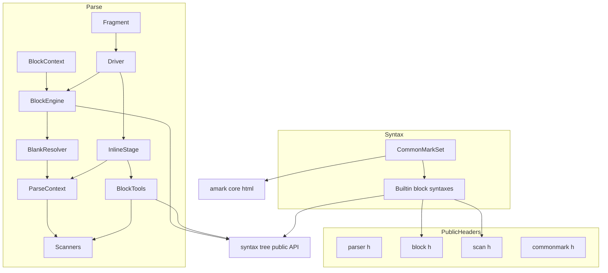
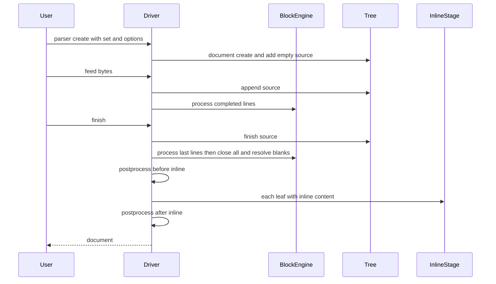
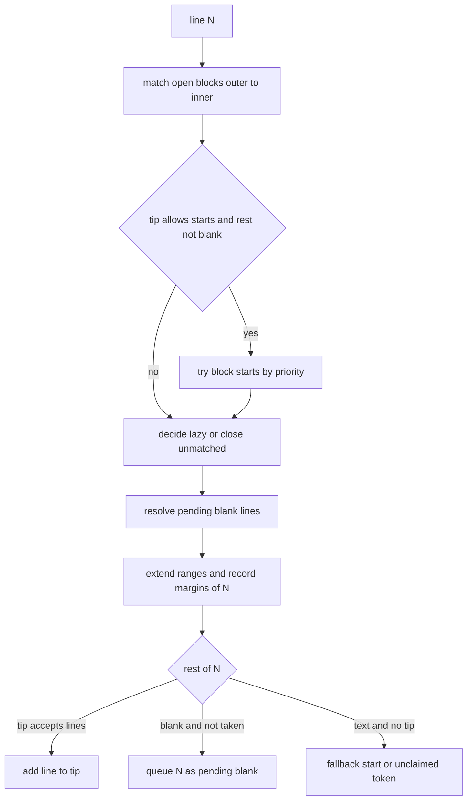
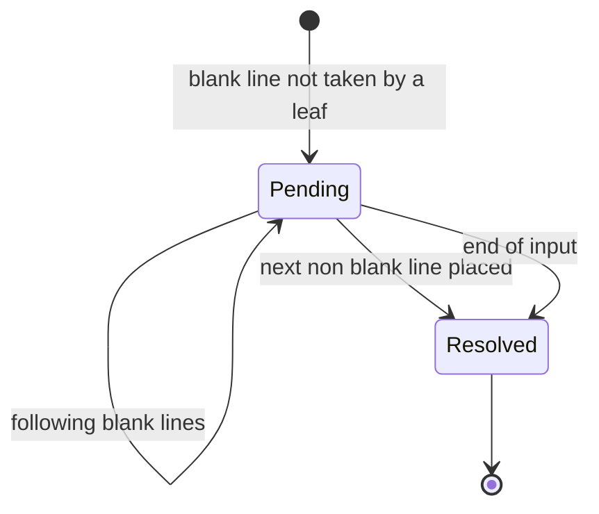
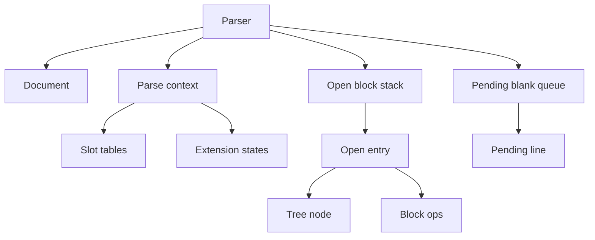

# Design Document: block-parser

## Overview
**Purpose**：`block-parser` は、Markdown のバイト列から CommonMark のブロック構造を確定させ、`syntax-tree` の構文木を組み立てるパーサの入口を提供する。エンジンは個別の構文を知らず、構文セットに登録されたブロック構文のスロットを優先度の順に試すだけである。CommonMark の各ブロック構文とリンク参照定義は、同じ公開 API の上の組み込み拡張として実装する。パーサは、元の表記を `syntax-tree` の配置の層（行の範囲、帯、空行、葉自身の表記、中身の部分）と綴りの層（中身のトークン）に、行と列の単位で過不足なく記録する。

**Users**：アプリケーションの開発者は、文字列全体か逐次の入力をパースし、断片をパースして既存の文書へ差し込む（msgstr の差し込み）。拡張の実装者は、ブロック構文、段落の消費、後処理、パースの間の状態を公開のスロットで定義する。`inline-parser` は、葉の中身を受け取ってインラインを解析し、この spec の走査の関数と検証の部品を再利用する。`markdown-renderer` は、この spec の記録の規約と HTML ブロックの判定を使う。

**Impact**：公開ヘッダ 4 つ（`scan.h`、`parser.h`、`block.h`、`commonmark.h`）、`src/parse/`、`src/syntax/` のブロック構文と CommonMark の構文セットの構築、`tests/parse/`、`tests/syntax/`、共有のテストの生成手順、`fuzz/block_parse_fuzz.c`、`bench/` を新しく作る。`syntax-tree` と `html-renderer` の公開 API には何も足さない。前の版の design（構文トークンのモデル）は引き継がない（research.md の「前の版の design を持ち込まない」）。

### Goals
- 中身の全体を綴る委譲先でパースした無編集の文書が、`amark_document_check_lossless` の行ごとの分割と中身の被覆の両方に通り、根の `amark_node_verbatim` が真になる。
- 逐次の入力が、区切りの位置によらず一括のパースと同じ木、記録、行の表を作る。
- CommonMark 0.31.2 のブロック構造と値と style を、公開 API の上の組み込み拡張だけで作る。リストのタイトは空行から導かれる値が cmark と一致する。
- 深さの上限を固定すれば、パースの時間と記録の数が入力の大きさに線形になる。

### Non-Goals
- インラインの解析、区切り文字の処理、CommonMark spec の全例の HTML の照合（`inline-parser`）
- HTML と Markdown の出力、帯と表記の合成、エスケープ（`html-renderer`、`markdown-renderer`）
- 記録の形と検査、値の導出、定義の索引、ラベルの正規化、タイトの導出（`syntax-tree`）
- GFM 相当の構文の配布（検証用の部品はテストの中にだけ置く）

## Boundary Commitments

### This Spec Owns
- 公開ヘッダ `scan.h`、`parser.h`、`block.h`、`commonmark.h` と、そこで定める型、関数、マクロ
- スロットの種類 1–4（`AMARK_SLOT_BLOCK_SYNTAX`、`AMARK_SLOT_PARAGRAPH_CONSUMER`、`AMARK_SLOT_POSTPROCESS`、`AMARK_SLOT_PARSE_STATE`）の中身の構造体と意味
- パーサの寿命、逐次の入力、パースの段階（ブロック → インラインの前の後処理 → インライン → インラインの後の後処理）、パースの文脈
- ブロック構文エンジン（照合、開始、遅延継続、閉鎖、空行の保留と解決、深さの上限）と、現在の行の問い合わせと記録の関数
- インラインへの委譲の取り決め、既定の委譲先の選び方、単純な委譲先
- 断片のパース（ブロック、インライン）
- CommonMark の 10 のブロック構文の組み込み拡張、その記録の規約（帯、空行、葉自身の表記、中身、トークンの種類と役割の番号）、style と値の記録
- CommonMark の構文セットの構築関数と、その組み立ての順
- 走査の関数（HTML ブロックの条件、HTML のタグ、リンクのラベル・宛先・タイトル、値を綴る単位、中身の走査）
- `tests/parse/`、`tests/syntax/`、`tests/support/gen_spec_examples.cmake`、ブロックの GFM 相当の検証用の部品（`amark_test_parse_gfm`）、パースの検査の補助（`amark_test_parse`）、`fuzz/block_parse_fuzz.c`、`bench/`

### Out of Boundary
- インラインの解析とインライン構文のスロット（種類 5–10、`inline-parser`）。インラインの構文拡張を構築関数に足すのは `inline-parser` が行う（Downstream Extension Points）。
- `amark.core.html` と検証用のノード型の記述子と HTML の部品（`html-renderer`）。この spec は構築関数にその拡張を足し、検証用の部品から型を参照するだけで、型を登録しない。
- `amark.core.markdown` と、構築関数への追加（`markdown-renderer`）
- 行への分割、記録の検査、値の導出、定義の索引と参照の解決、ラベルの正規化、ロスレス性の検証、タイトの導出（`syntax-tree`）

### Allowed Dependencies
- `foundation` の公開 API と内部ヘッダ（`base/*_internal.h`）
- `syntax-tree` の公開 API（`node.h`、`document.h`、`value.h`、`spelling.h`、`iterator.h`、`dump.h`、`extension.h`、`unicode.h`、`entity.h`）。`src/parse/` は `src/tree/` の内部ヘッダを使わない。
- `html-renderer` の公開 API（`html.h` の `amark_html_core_extension`）。`src/syntax/commonmark.c` だけが使う。
- テストだけ：`amark_test_support`、`amark_test_tree`、`amark_test_html_gfm`、Naos、`src/tree/tree.h` の `amark_tree_check`（INTERNAL のテストとファジング）
- 層の向き：`src/base` ← `src/tree` ← `src/parse` ← `src/syntax`。`src/syntax/` は公開ヘッダと `src/syntax/` の中の内部ヘッダだけを使う。`src/parse/` は `src/syntax/` と `src/render/` を参照しない。
- `src/parse/` の中の向き：Scanners → ParseContext → BlankResolver → BlockEngine → BlockContext。BlockTools は Scanners と公開 API だけ。InlineStage → ParseContext、BlockTools。Driver → BlockEngine、InlineStage、ParseContext。Fragment → Driver。右から左への呼び出しはしない（エンジンは構文のコールバックに BlockContext の構造体を渡すだけで、`block_context.c` の関数を呼ばない）。違反はレビューでエラーとする。

### Revalidation Triggers
- スロットの構造体（`amark_block_syntax_slot_t`、`amark_block_ops_t`、`amark_paragraph_consumer_slot_t`、`amark_postprocess_slot_t`、`amark_parse_state_slot_t`）のフィールド、印、コールバックの契約の変更 → 利用者の拡張、`inline-parser`、検証用の部品
- インラインへの委譲の型（`amark_inline_parse_fn_t`）、渡す葉と中身の定義、パースの文脈の関数の変更 → `inline-parser`
- 記録の規約（帯、空行、葉自身の表記、中身、役割の番号）の変更 → `markdown-renderer`、`inline-parser`
- 走査の関数の規則の変更 → `inline-parser`、`markdown-renderer`
- CommonMark の構文セットの組み立ての順、拡張の名前、Downstream Extension Points の形の変更 → `inline-parser`、`markdown-renderer`、`html-renderer`
- パースの検査の補助と共有の生成手順の形の変更 → `inline-parser`、`markdown-renderer`
- 上流の変更：`syntax-tree` の記録の順序と検査の規則、空行の持ち主の規則、行の表 → このエンジンと記録の規約。`amark.core.html` の名前と取得関数、検証用のノード型 → 構築関数と検証用の部品

## Architecture

### Existing Architecture Analysis
- `src/parse/`、`src/syntax/`、`tests/parse/`、`tests/syntax/`、`bench/` はまだない。`include/amark/amark.h` と `cmake/scripts/check_public_headers.cmake` は、正規の順の 4 番目の組として `scan.h parser.h block.h inline.h commonmark.h` の位置をすでに持つ（ない見出しは飛ばされる）。`inline.h` は `inline-parser` が足す。
- `html-renderer` は承認済みで、まだ実装がない。この spec の構築関数と GFM 相当の検証は、`amark_html_core_extension()` と `amark_test_html_gfm` の実装を前提にする（tasks の順で扱う）。
- `foundation` の Downstream Extension Points は、この spec に `AMARK_BUILD_BENCH` と `bench/`、`tests/syntax/data/spec_blocks.txt` の `export-ignore` を割り当てている。case fold と文字参照の表は `syntax-tree` が足したので、この spec では足さない。

### Architecture Pattern & Boundary Map



**Architecture Integration**：
- **パターン**：構文定義駆動のエンジン。エンジンは開いているブロックの列（開いたブロックのスタック）と、現在の行の位置（列）と、行の持ち主の決まっていない空行の列だけを持つ。構文の判断は、スロットのコールバック（開始、継続、行の受け入れ、閉じ）に任せる。
- **記録の分担**：コンテナの帯はエンジンが記録する（構文は `amark_block_advance` で帯の列を進めるだけ）。葉自身の表記と中身は、構文が現在の行の関数（`amark_block_token`、`amark_block_content`）で記録する。空行の記録はエンジンが持ち主を決めて記録する。中身のトークンは、葉が閉じるとき（構造が決まった後）に構文が記録する。
- **新しい概念**：
  - **持ち主の決まった列**（owned column）：現在の行で、すでに帯か表記か中身として記録した列の終わり。次の記録はここから始まる。`amark_block_skip` で進めた列は持ち主が決まらず、次の記録（空行、葉の表記）に含まれる。
  - **保留の空行**：持ち主が次の行まで決まらない空行（BlankResolver）。
- **Steering compliance**：C99、`amark_` / `AMARK_`、`AMARK_API`、不透明型（パーサ、パースの文脈、ブロックの文脈）、公開の構造体の `struct_size`、グローバルな可変状態なし（構文の表は `static const`）、組み込みの構文も公開 API だけを使う、開いた集合（印、役割の番号）は `#define`、閉じた集合（開始の結果、継続の結果、後処理の段階）は `typedef enum`（0 は不正）。

### Technology Stack

| Layer | Choice / Version | Role in Feature | Notes |
|-------|------------------|-----------------|-------|
| Language | C99 | ライブラリ、テスト、ファジング、ベンチマーク | `amark_target_defaults()` |
| Tree | `syntax-tree`（実装済み） | 行の表、記録、値の導出、索引、検証 | 公開 API だけ |
| Renderer | `html-renderer`（`amark_html_core_extension`、`amark_test_html_gfm`） | 構文セットの構成、検証用のノード型 | 実装の後に統合 |
| Reference | CommonMark Spec 0.31.2、cmark 0.31.x `blocks.c` | 規則と手順の基準 | コードは取り込まない |
| Test | Naos v0.4.0、`amark_add_test`、`amark_add_generated_tests`、`amark_test_tree` | 単体、生成テスト | 生成の手順を新しく作る |
| Fuzz / Bench | `amark_add_fuzzer`、`AMARK_BUILD_BENCH` | 任意の入力と区切り、計算量 | `bench/` はこの spec が所有 |

## File Structure Plan

### Directory Structure
```
include/amark/
├── scan.h                 # Scanners：HTML ブロックの条件、HTML のタグ、リンクのラベル・宛先・タイトル、値の単位、中身の走査
├── parser.h               # ParserApi：オプション、パーサ、一括のパース、断片、パースの文脈、後処理と状態のスロット、単純な委譲先
├── block.h                # BlockApi：ブロック構文のスロット、ブロックの振る舞い、段落の消費のスロット、現在の行の問い合わせと記録、BlockTools
└── commonmark.h           # CommonMarkApi：構文セットの構築、CommonMark でのパース、拡張の取得、役割の番号
src/parse/
├── parse.h                # 内部の構造体（パーサ、文脈、開いたブロック、保留の空行、統計）と、ファイルをまたぐ内部関数
├── scan_html.c            # Scanners：HTML ブロックの開始と終わりの条件、開始タグと終了タグ
├── scan_link.c            # Scanners：リンクのラベル、宛先（括弧の深さ 32）、タイトル
├── scan_value.c           # Scanners：値を綴る単位、中身の走査
├── context.c              # ParseContext：スロットの表（優先度で並べたブロック構文）、拡張の状態、定義の検索
├── blank.c                # BlankResolver：保留の空行の列と解決
├── engine.c               # BlockEngine：1 行の処理、開いたブロックのスタック、閉鎖、遅延継続、帯の記録
├── block_context.c        # BlockContext：現在の行の問い合わせ、進める、記録、開く、段落の消費・置き換え・解放・切り出し
├── block_tools.c          # BlockTools：amark_block_retype、amark_block_cover_content
├── inline_stage.c         # InlineStage：葉の列挙と委譲、既定の委譲先、単純な委譲先
├── parser.c               # Driver：パーサの寿命、feed と finish、段階の実行、一括のパース
└── fragment.c             # Fragment：ブロックとインラインの断片
src/syntax/
├── commonmark_blocks.h    # src/syntax/ の中だけの共有：10 の拡張の extern 宣言、字下げと空白の補助
├── commonmark.c           # CommonMarkSet：組み立ての表、構築関数、CommonMark でのパース、拡張の取得
├── block_quote.c          # commonmark.block_quote
├── list.c                 # commonmark.list（list と item）
├── thematic_break.c       # commonmark.thematic_break
├── atx_heading.c          # commonmark.atx_heading
├── setext_heading.c       # commonmark.setext_heading
├── indented_code.c        # commonmark.indented_code
├── fenced_code.c          # commonmark.fenced_code
├── html_block.c           # commonmark.html_block
├── paragraph.c            # commonmark.paragraph（受け皿）
└── link_reference_definition.c   # commonmark.link_reference_definition（段落の消費）
tests/support/
└── gen_spec_examples.cmake        # SpecExampleGen：spec の例の形式からテストを生成する共有の手順
tests/parse/
├── CMakeLists.txt         # テストの登録、amark_test_parse（Naos）、amark_test_parse_gfm（Naos なし、INTERFACE）
├── support/parse_check.{h,c}      # ParseTestSupport
├── support/gfm_parse_ext.{h,c}    # GfmParseExt：表、脚注の定義、タスクリストのパースの部品
├── data/engine_cases.txt          # エンジンの規則（照合、遅延継続、空行の持ち主、深さ）のケース
├── data/input_cases.txt           # 改行の種類、タブ、NUL、不正な UTF-8、BOM、最後の行
├── parser_api_test.c      # 入口、逐次の入力、状態の誤り、オプション、所有
├── block_api_test.c       # 検証用の構文によるスロットと現在の行の関数の契約
├── blank_test.c           # 保留の空行の解決とタイトの導出
├── postprocess_test.c     # 後処理の順、状態、BlockTools
├── inline_stage_test.c    # 委譲の順、渡す中身、文脈、単純な委譲先、失敗
├── fragment_test.c        # ブロックとインラインの断片、定義、全か無か
├── scan_test.c            # 走査の関数
├── gfm_parse_test.c       # 表、脚注の定義、タスクリスト（HTML の部品と組み合わせる）
├── oom_test.c             # 確保の失敗の総当たり（INTERNAL）
└── scale_test.c           # 計算量のカウンタと深さ（INTERNAL）
tests/syntax/
├── CMakeLists.txt
├── data/<構文>_cases.txt  # 構文ごと（block_quote、list、atx_heading など 10 個）の記録の規約、値、style のケースと、組み合わせの combined_cases.txt
├── data/spec_blocks.txt   # 0.31.2 のブロックの章の例と、値だけの期待するダンプ（export-ignore）
└── commonmark_set_test.c  # 構築関数、組み立ての順、取り除きと置き換え、HTML の出力の有無
fuzz/
├── block_parse_fuzz.c     # 任意の入力と区切り
└── corpus/block_parse/    # 種
bench/
├── CMakeLists.txt         # amark_add_bench()、ブロックのベンチマークの登録
└── block_bench.c          # 病的な入力の生成と時間の計測
```

### Modified Files
- `CMakeLists.txt`（最上位）— オプション `AMARK_BUILD_BENCH`（既定 `OFF`）と、ON のときの `add_subdirectory(bench)`（`add_subdirectory(fuzz)` の後。foundation の拡張点）
- `src/CMakeLists.txt` — `src/parse/*.c` と `src/syntax/` のブロック構文のファイルをライブラリのソースに足す
- `include/amark/amark.h` — 4 番目の組の位置に `scan.h`、`parser.h`、`block.h`、`commonmark.h` をこの順で含める
- `tests/CMakeLists.txt` — `add_subdirectory(parse)`（`AMARK_FUZZ` だけの構成でも `amark_test_parse_gfm` を定義するので条件なし。Naos を使うターゲットは中で `AMARK_BUILD_TESTS` のときだけ）と `add_subdirectory(syntax)`
- `tests/headers/cxx_include_test.cpp` — 4 つのヘッダの関数を呼ぶ
- `fuzz/CMakeLists.txt` — `amark_add_fuzzer(block_parse SOURCES block_parse_fuzz.c CORPUS corpus/block_parse)`
- `.gitattributes` — `tests/syntax/data/spec_blocks.txt export-ignore`

## System Flows

### パースの全体



- 確定した行だけを処理する（行の表が CR と LF の間の区切りを扱う）。区切りの位置で結果は変わらない（1.3）。
- 失敗したら以後の段階を行わず、パーサは解放だけを受け付ける（1.6）。

### 1 行の処理



- **照合**：開いたブロックを外側から `continue_line` で照合する。YES ならコンテナの帯の列を行の局所の表に置く。NO で止まる。LINE_DONE は行を使い切り、そのブロックを行の後で閉じる。
- **開始**：照合の後、最も内側の照合したブロック（現在のコンテナ）が `AMARK_BLOCK_NO_STARTS` でなく、行の残りが空白でなければ、開始を優先度の順に試す（Components の BlockEngine）。
- **置き場所**：遅延継続か、照合できなかったブロックを閉じるかを決める。ここで開いたままのブロックの列（最終の列）が決まる。
- **解決**：保留の空行を、最終の列で解決する（BlankResolver）。保留の行はこの行の帯より先に記録する。
- **記録**：最終の列のブロックの行の範囲を N まで広げ、帯を記録する。遅延継続なら、照合できなかったコンテナに LAZY の帯を記録する。

### 保留の空行



- 保留の間に、空でない帯（引用の `>`）だけをすぐ記録する。空の帯、空行の記録、`BLANK_IF_CONTINUED` の葉への追加は解決のときに行う。

## Requirements Traceability

| Requirement | Summary | Components | Interfaces | Flows |
|-------------|---------|------------|------------|-------|
| 1.1, 1.2, 1.3, 1.4, 1.5, 1.6, 1.7, 1.8 | パーサの公開 API | ParserApi, Driver, CommonMarkSet | `amark_parse`、`amark_parser_*`、`amark_parse_commonmark` | パースの全体 |
| 2.1, 2.2, 2.3, 2.4, 2.5, 2.6 | 行と文字 | Driver, BlockContext, Scanners, Builtins | 行の表、`amark_scan_content_run`、記録の規約 | 1 行の処理 |
| 3.1, 3.2, 3.3, 3.4, 3.5, 3.6, 3.7, 3.8 | 汎用のエンジン | BlockEngine, BlankResolver, ParseContext | `amark_block_syntax_slot_t`、`amark_block_ops_t` | 1 行の処理、保留の空行 |
| 4.1, 4.2, 4.3, 4.4, 4.5, 4.6, 4.7, 4.8, 4.9, 4.10 | ブロック構文 API | BlockApi, BlockContext, BlockEngine | block.h の関数 | 1 行の処理 |
| 5.1, 5.2, 5.3, 5.4, 5.5 | 後処理と状態 | Driver, ParseContext, BlockTools | `amark_postprocess_slot_t`、`amark_parse_state_slot_t`、`amark_block_retype` | パースの全体 |
| 6.1, 6.2, 6.3, 6.4, 6.5, 6.6 | インラインへの委譲 | InlineStage, ParseContext | `amark_inline_parse_fn_t`、`amark_parse_inline_plain` | パースの全体 |
| 7.1, 7.2, 7.3, 7.4, 7.5, 7.6, 7.7, 7.8 | CommonMark のブロック構文 | Builtins, CommonMarkSet, Scanners | commonmark.h、scan.h | — |
| 8.1, 8.2, 8.3, 8.4, 8.5, 8.6, 8.7 | リンク参照定義 | Builtins（link_reference_definition）, BlockContext, Scanners | `amark_block_split_lines`、`amark_scan_link_*`、`amark_scan_value_run` | — |
| 9.1, 9.2, 9.3, 9.4, 9.5, 9.6, 9.7, 9.8 | 配置と綴りの記録 | BlockEngine, BlankResolver, Builtins, BlockTools | 記録の規約、役割の番号 | 保留の空行 |
| 10.1, 10.2, 10.3, 10.4 | 断片 | Fragment, ParseContext | `amark_parse_block_fragment`、`amark_parse_inline_fragment` | — |
| 11.1, 11.2, 11.3, 11.4 | 返す文書 | Driver, Builtins | — | パースの全体 |
| 12.1, 12.2, 12.3, 12.4, 12.5, 12.6 | 限度と計算量 | BlockEngine, BlankResolver, Scanners, ParseFuzz, BlockBench | `AMARK_PARSE_DEFAULT_MAX_DEPTH`、`AMARK_SCAN_MAX_LINK_PAREN_DEPTH` | — |
| 13.1, 13.2, 13.3, 13.4, 13.5 | 拡張 API の表現力 | GfmParseExt | 公開 API | — |
| 14.1, 14.2, 14.3, 14.4, 14.5, 14.6 | 検証 | ParseTestSupport, SpecExampleGen, ParseTests, SyntaxTests | `amark_test_parse_check` | — |

## Components and Interfaces

| Component | Domain | Intent | Req Coverage | Key Dependencies | Contracts |
|-----------|--------|--------|--------------|------------------|-----------|
| ParserApi | Public | パーサ、オプション、文脈、後処理と状態のスロット | 1.1–1.8, 5.1, 5.4, 6.3, 6.4, 10.1–10.3 | Driver (P0) | Service |
| BlockApi | Public | ブロック構文のスロットと現在の行の関数 | 4.1–4.10 | BlockContext (P0) | Service |
| Scanners | Parse | 共有の走査の関数 | 7.8, 8.6, 8.7, 12.5, 2.3 | `amark_char_ref_decode` (P0) | Service |
| ParseContext | Parse | スロットの表、拡張の状態、定義の検索 | 5.4, 5.5, 6.3, 10.3 | Tree (P0) | Service, State |
| BlankResolver | Parse | 保留の空行と、その持ち主の解決 | 3.5, 7.7, 9.4, 9.5 | Tree (P0) | State |
| BlockEngine | Parse | 1 行の処理と開いたブロックのスタック | 3.1–3.8, 9.2, 9.3, 12.1–12.4 | BlankResolver (P0), ParseContext (P0) | State |
| BlockContext | Parse | 現在の行の問い合わせと記録、段落の類の操作 | 4.3–4.8 | BlockEngine (P0) | Service |
| BlockTools | Parse | 型の置き換えと中身の被覆 | 5.3, 9.7, 13.3 | Tree (P0), Scanners (P1) | Service |
| InlineStage | Parse | 葉の委譲と単純な委譲先 | 6.1–6.6 | ParseContext (P0) | Service |
| Driver | Parse | 寿命と段階 | 1.1–1.8, 2.1, 2.4–2.6, 5.2, 5.5, 11.1–11.3 | BlockEngine (P0) | Service, State |
| Fragment | Parse | 断片のパースと差し込み | 10.1–10.4 | Driver (P0), Tree (P0) | Service |
| CommonMarkSet | Syntax | 構文セットの構築と拡張の表 | 1.2, 7.2–7.4 | `amark_html_core_extension` (P0) | Service |
| Builtins | Syntax | 10 のブロック構文と記録の規約 | 2.2, 2.3, 7.1, 7.5–7.7, 8.1–8.6, 9.1–9.8, 11.4 | BlockApi (P0), Scanners (P0) | Service |
| SpecExampleGen | Tests | spec の例の形式の生成手順 | 14.2, 14.6 | AmarkTestGen (P0) | Batch |
| ParseTestSupport | Tests | パースの検査の補助 | 14.3, 14.5 | `amark_tree_check` (P0) | Service |
| GfmParseExt | Tests | 表、脚注の定義、タスクリストのパースの部品 | 13.1–13.5 | `amark_test_html_gfm` (P0) | Service |
| ParseTests / SyntaxTests | Tests | 単体、ケース、spec の例 | 14.1–14.4, 全般 | ParseTestSupport (P0) | — |
| ParseFuzz / BlockBench | Tests | 堅牢性と計算量 | 12.3, 12.6 | Driver (P0) | Batch |

### 共通の規約
- 失敗しうる関数は `amark_error_t` を返し、結果を出力引数で返す。必須の引数が NULL なら `AMARK_ERROR_INVALID_ARGUMENT`。公開の構造体は先頭に `size_t struct_size` を持ち、小さすぎる値は不正な引数とする。スロットの構造体は先頭に `amark_slot_t base` を持ち、`base.struct_size` がその構造体の大きさ以上であることを、パーサの生成で確かめる。
- コールバックが返したエラーは、そのままパースの結果になる（4.9、6.6）。
- 不透明型 `amark_parser_t`、`amark_parse_context_t`、`amark_block_context_t` は `parser.h` と `block.h` が宣言する。文脈は、それを渡したコールバックの呼び出しの間だけ有効である。
- 記録はすべて `syntax-tree` の記録の関数（`amark_block_*`、`amark_node_add_content_token`、`amark_node_record_*`）で行い、値の設定の関数（`amark_node_set_*`）を使わない（11.1）。

### Public headers

#### ParserApi（`parser.h`）

| Field | Detail |
|-------|--------|
| Intent | パーサの入口、オプション、断片、パースの文脈、後処理と状態のスロット |
| Requirements | 1.1–1.8, 5.1, 5.4, 6.3–6.5, 10.1–10.3 |

**Contracts**: Service [x]

```c
typedef struct amark_parser amark_parser_t;
typedef struct amark_parse_context amark_parse_context_t;

/* インラインの委譲先：leaf（インラインを受け入れる中身を持つ葉）の中身を解析し、
 * インラインの子と中身のトークンを記録する */
typedef amark_error_t (*amark_inline_parse_fn_t)(amark_parse_context_t *context, amark_node_t *leaf,
                                                 void *user_data);

#define AMARK_PARSE_DEFAULT_MAX_DEPTH 128u
#define AMARK_PARSE_MAX_DEPTH_LIMIT   1024u

typedef struct amark_parse_options
{
    size_t struct_size;
    uint32_t flags;                       /* 予約。0 以外は不正な引数 */
    uint32_t max_depth;                   /* 0 は既定、1–AMARK_PARSE_MAX_DEPTH_LIMIT */
    amark_inline_parse_fn_t inline_parse; /* NULL は既定の委譲先 */
    void *inline_user_data;
} amark_parse_options_t;

AMARK_API void amark_parse_options_init(amark_parse_options_t *options);
AMARK_API amark_error_t amark_parser_create(const amark_syntax_set_t *set, const amark_parse_options_t *options,
                                            amark_parser_t **out);      /* options は NULL 可 */
AMARK_API void amark_parser_destroy(amark_parser_t *parser);
AMARK_API amark_error_t amark_parser_feed(amark_parser_t *parser, const char *bytes, size_t length);
AMARK_API amark_error_t amark_parser_finish(amark_parser_t *parser, amark_document_t **out);
AMARK_API amark_error_t amark_parse(const amark_syntax_set_t *set, const amark_parse_options_t *options,
                                    const char *bytes, size_t length, amark_document_t **out);

#define AMARK_FRAGMENT_TARGET_DEFINITIONS 0x01u
AMARK_API amark_error_t amark_parse_block_fragment(amark_node_t *parent, amark_node_t *before,
                                                   const char *bytes, size_t length,
                                                   const amark_parse_options_t *options, uint32_t flags);
AMARK_API amark_error_t amark_parse_inline_fragment(amark_node_t *leaf, const char *bytes, size_t length,
                                                    const amark_parse_options_t *options, uint32_t flags);

AMARK_API amark_document_t *amark_parse_context_document(const amark_parse_context_t *context);
AMARK_API const amark_parse_options_t *amark_parse_context_options(const amark_parse_context_t *context);
AMARK_API void *amark_parse_context_state(const amark_parse_context_t *context,
                                          const amark_extension_t *extension);   /* なければ NULL */
AMARK_API amark_error_t amark_parse_context_find_definition(const amark_parse_context_t *context,
                                                            const char *label, size_t length,
                                                            amark_node_t **out);  /* なければ *out = NULL */
AMARK_API amark_error_t amark_parse_inline_plain(amark_parse_context_t *context, amark_node_t *leaf,
                                                 void *user_data);              /* 単純な委譲先 */

typedef enum amark_postprocess_phase
{
    AMARK_POSTPROCESS_BEFORE_INLINE = 1, AMARK_POSTPROCESS_AFTER_INLINE = 2
} amark_postprocess_phase_t;

typedef struct amark_postprocess_slot            /* base.kind = AMARK_SLOT_POSTPROCESS */
{
    amark_slot_t base;
    amark_postprocess_phase_t phase;
    amark_error_t (*run)(amark_parse_context_t *context, amark_node_t *root, void *user_data);
    void *user_data;
} amark_postprocess_slot_t;

#define AMARK_PARSE_MAX_STATE_SIZE 65536u
typedef struct amark_parse_state_slot            /* base.kind = AMARK_SLOT_PARSE_STATE。1 つの拡張に 1 つまで */
{
    amark_slot_t base;
    size_t state_size;                            /* 1–AMARK_PARSE_MAX_STATE_SIZE。0 で埋めて渡す */
    amark_error_t (*init)(amark_parse_context_t *context, void *state, void *user_data);   /* NULL 可 */
    void (*deinit)(amark_parse_context_t *context, void *state, void *user_data);          /* NULL 可 */
    void *user_data;
} amark_parse_state_slot_t;
```
- **生成**（1.4、1.7）：凍結していない構文セットは `AMARK_ERROR_INVALID_STATE`。オプションの `flags` が 0 でない、`max_depth` が上限を超える、スロットの構造体が小さい、必須のコールバックがない、1 つの拡張に状態のスロットが 2 つ以上は `AMARK_ERROR_INVALID_ARGUMENT`。構文セットは借りるだけで、変更も解放もしない。
- **文書**：生成で `amark_document_create(set)` と、空のソースの `amark_document_add_source(NULL, 0, 0)`（ソース 0）を行う。返した文書は利用者が所有し、構文セットの所有を渡すなら利用者が `amark_document_take_syntax_set` を呼ぶ（1.7）。
- **状態の遷移**：`feed` と `finish` は、終了の後と失敗の後に `AMARK_ERROR_INVALID_STATE` を返す（1.5、1.6）。失敗したパーサは、文書と拡張の状態を `destroy` で解放する。
- **断片**：挿入先の文書の構文セットを使う。Fragment を参照する。
- **文脈**：
  - パースの間（ブロック構文、段落の消費、後処理、委譲先、状態の `init`）に渡す。
  - `amark_parse_context_find_definition` は、パースしている文書を `amark_document_find_definition` で引き、なければ、断片で `AMARK_FRAGMENT_TARGET_DEFINITIONS` のときは挿入先の文書も引く（10.3）。

**Implementation Notes**
- Integration：`inline-parser` は `amark_inline_parse_fn_t` の形でエンジンを提供する。既定の委譲先は InlineStage の 1 か所で決める（Downstream Extension Points）。
- Validation：`parser_api_test`、`inline_stage_test`。
- Risks：既定の委譲先が後で変わる。この spec のテストは `amark_parse_inline_plain` を明示する。

#### BlockApi（`block.h`）

| Field | Detail |
|-------|--------|
| Intent | ブロック構文のスロット、ブロックの振る舞い、段落の消費、現在の行の関数、BlockTools |
| Requirements | 4.1–4.10, 5.3, 9.7 |

**Contracts**: Service [x]

```c
typedef struct amark_block_context amark_block_context_t;

typedef enum amark_block_start
{
    AMARK_BLOCK_START_NONE = 1,      /* 開かなかった（列を進めていてはならない） */
    AMARK_BLOCK_START_OPENED = 2,    /* ブロックを開いた。行の残りでさらに開始を試す */
    AMARK_BLOCK_START_LINE_DONE = 3  /* 行を使い切った */
} amark_block_start_t;

typedef enum amark_block_continue
{
    AMARK_BLOCK_CONTINUE_NO = 1,
    AMARK_BLOCK_CONTINUE_YES = 2,
    AMARK_BLOCK_CONTINUE_LINE_DONE = 3   /* 行を使い切った。ブロックは行の後で閉じる */
} amark_block_continue_t;

/* ブロックの振る舞いの印 */
#define AMARK_BLOCK_ACCEPTS_LINES      0x01u /* 行の残りを add_line で受け取る（葉の類） */
#define AMARK_BLOCK_LAZY               0x02u /* 段落の類：遅延継続を受け、中断されうる。段落の消費の対象 */
#define AMARK_BLOCK_NO_STARTS          0x04u /* 現在のコンテナである間、開始を試さない（コード、HTML） */
#define AMARK_BLOCK_BLANK_IF_CONTINUED 0x08u /* 空行は、後に中身の行が続くときだけ add_line に渡す */
#define AMARK_BLOCK_FIRST_MARGIN       0x10u /* 開いた行の帯に AMARK_MARGIN_FIRST を付ける */

#define AMARK_BLOCK_MAX_DATA_SIZE 4096u

typedef struct amark_block_ops
{
    size_t struct_size;
    uint32_t flags;
    size_t data_size;                 /* 開いたブロックごとのデータ。0 で埋めて渡す */
    amark_error_t (*continue_line)(amark_block_context_t *ctx, amark_node_t *block, void *data,
                                   void *user_data, amark_block_continue_t *result);   /* NULL は常に NO */
    amark_error_t (*add_line)(amark_block_context_t *ctx, amark_node_t *block, void *data, void *user_data);
    amark_error_t (*close)(amark_block_context_t *ctx, amark_node_t *block, void *data, void *user_data);
    void (*deinit)(void *data, void *user_data);
    void *user_data;
} amark_block_ops_t;

#define AMARK_BLOCK_SYNTAX_INTERRUPTS 0x01u /* 現在のコンテナが LAZY でも試す（段落を中断しうる） */
#define AMARK_BLOCK_SYNTAX_CONTAINER  0x02u /* コンテナを開きうる。深さの上限では試さない */
#define AMARK_BLOCK_SYNTAX_FALLBACK   0x04u /* 受け皿：どの開始も取らない空でない行で最後に試す */

typedef struct amark_block_syntax_slot           /* base.kind = AMARK_SLOT_BLOCK_SYNTAX */
{
    amark_slot_t base;
    int32_t priority;                             /* 小さい順。同じなら構文セットの順 */
    uint32_t flags;
    amark_error_t (*start)(amark_block_context_t *ctx, void *user_data, amark_block_start_t *result);
    void *user_data;
} amark_block_syntax_slot_t;

typedef struct amark_paragraph_consumer_slot     /* base.kind = AMARK_SLOT_PARAGRAPH_CONSUMER */
{
    amark_slot_t base;
    amark_error_t (*consume)(amark_block_context_t *ctx, amark_node_t *leaf, void *user_data);
    void *user_data;
} amark_paragraph_consumer_slot_t;

#define AMARK_BLOCK_REST UINT32_MAX              /* 行の残りのすべての列 */
#define AMARK_BLOCK_ROLE_UNCLAIMED 0xFFFFu       /* 取り手のない行の残りの役割 */

/* 現在の行の問い合わせ */
AMARK_API amark_parse_context_t *amark_block_parse_context(const amark_block_context_t *ctx);
AMARK_API amark_line_id_t amark_block_line(const amark_block_context_t *ctx);       /* 行がなければ AMARK_LINE_NONE */
AMARK_API amark_error_t amark_block_line_bytes(const amark_block_context_t *ctx, const char **bytes, size_t *length);
AMARK_API uint32_t amark_block_column(const amark_block_context_t *ctx);            /* 位置（列） */
AMARK_API uint32_t amark_block_owned_column(const amark_block_context_t *ctx);      /* 持ち主の決まった列の終わり */
AMARK_API size_t amark_block_offset(const amark_block_context_t *ctx, uint32_t *tab_rest); /* 位置のバイトとタブの残りの列 */
AMARK_API uint32_t amark_block_indent(const amark_block_context_t *ctx);            /* 位置から最初の空白でない文字までの列 */
AMARK_API size_t amark_block_nonspace(const amark_block_context_t *ctx);            /* 最初の空白でない文字のバイト（なければ長さ） */
AMARK_API bool amark_block_is_blank(const amark_block_context_t *ctx);              /* 位置から行の終わりが空白とタブだけ */
AMARK_API amark_node_t *amark_block_container(const amark_block_context_t *ctx);    /* 現在のコンテナ */
AMARK_API amark_node_t *amark_block_tip(const amark_block_context_t *ctx);          /* 最も内側の開いたブロック */
AMARK_API bool amark_block_all_matched(const amark_block_context_t *ctx);
AMARK_API bool amark_block_maybe_lazy(const amark_block_context_t *ctx);            /* tip が LAZY */
AMARK_API void *amark_block_data(const amark_block_context_t *ctx, const amark_node_t *open_block);
AMARK_API size_t amark_block_depth(const amark_block_context_t *ctx);

/* 進める */
AMARK_API amark_error_t amark_block_advance(amark_block_context_t *ctx, uint32_t columns);  /* 現在のコンテナの帯 */
AMARK_API amark_error_t amark_block_skip(amark_block_context_t *ctx, uint32_t columns);     /* 持ち主を決めずに進める */

/* 現在の行の記録（持ち主の決まった列から、位置 + columns まで。位置も進む） */
AMARK_API amark_error_t amark_block_token(amark_block_context_t *ctx, amark_node_t *block, uint32_t columns,
                                          amark_spell_kind_t kind, amark_facet_t facet, uint16_t role);
AMARK_API amark_error_t amark_block_content(amark_block_context_t *ctx, amark_node_t *leaf, uint32_t columns);
AMARK_API amark_error_t amark_block_close_after_line(amark_block_context_t *ctx, amark_node_t *open_block);

/* 開く、段落の類の操作 */
AMARK_API amark_error_t amark_block_open(amark_block_context_t *ctx, amark_node_type_t type,
                                         const amark_block_ops_t *ops, amark_line_id_t first_line,
                                         amark_node_t **out);   /* first_line は AMARK_LINE_NONE で現在の行 */
AMARK_API amark_error_t amark_block_consume_paragraph(amark_block_context_t *ctx, amark_node_t *leaf,
                                                      bool *has_lines);
AMARK_API amark_error_t amark_block_convert(amark_block_context_t *ctx, amark_node_t *leaf, amark_node_type_t type,
                                            const amark_block_ops_t *ops, amark_node_t **out);
AMARK_API amark_error_t amark_block_release_lines(amark_block_context_t *ctx, amark_node_t *leaf,
                                                  uint32_t count, bool *removed);
AMARK_API amark_error_t amark_block_split_lines(amark_block_context_t *ctx, amark_node_t *leaf, uint32_t count,
                                                amark_node_type_t type, amark_node_t **out);

/* BlockTools（文脈なしに使える） */
AMARK_API amark_error_t amark_block_retype(amark_node_t *block, amark_node_type_t type, amark_node_t **out);
AMARK_API amark_error_t amark_block_cover_content(amark_node_t *leaf, amark_facet_t facet, uint16_t role);
```

- **コールバックの契約**（4.1–4.3）：
  - `start`：位置は照合と前の開始の後。開かないなら列を進めず、何も記録しない。開くときは `amark_block_open` を、外側から順に何度でも呼べる（リストと項目）。`amark_block_advance` で進めた列は、この行で最後に開いたコンテナの帯になる（コンテナでないブロックに進めた列は `AMARK_ERROR_INVALID_STATE`）。
  - `continue_line`：コンテナは帯の列を `amark_block_advance` で進め、空行で帯を空にするなら `amark_block_skip` で進める（同じ呼び出しで skip の後に advance はできない）。葉は判断だけをし、記録しない。ただし LINE_DONE を返すときは、その行の葉自身の表記を記録してよい（閉じのフェンス）。
  - `add_line`：行の残り（持ち主の決まった列から行の終わりまで）を、すべて表記か中身として記録する。保留の空行の再生でも呼ばれる（そのときの行と位置は保留した行のもの）。
  - `close`：子がすべて閉じた後に呼ぶ。中身のトークンはここで記録する（9.7。構造が決まった後）。LAZY の葉では、先に段落の消費を行う。
  - `deinit`：データの資源を解放する。閉じた後とパーサの解放で 1 回だけ呼ぶ。
- **現在の行の関数**（4.4、4.5）：
  - 位置は列で、タブの途中にもなる。`amark_block_offset` は位置のバイトと、位置がタブの途中ならそのタブの残りの列を返す。
  - `amark_block_token` と `amark_block_content` は、`[持ち主の決まった列, 位置 + columns)` を `amark_block_add_token` と `amark_block_add_content` で記録し、位置と持ち主の決まった列を進める。`columns` が `AMARK_BLOCK_REST` なら行の終わりまで。記録の前に、対象のブロックの行の範囲を現在の行まで広げる。空の範囲のトークンは記録しない（何もしない）が、空の範囲の中身の部分は空の行として記録する。
  - `amark_block_skip` で進めた列（項目が空行で進めた列）は、持ち主の決まった列と位置の間に残る。葉は、それを自分のトークンに含める（コードの INDENT）か、`amark_block_token(ctx, leaf, 0, AMARK_SPELL_SPACE, AMARK_FACET_NONE, 0)` で SPACE にしてから中身を記録する（HTML ブロック）。
  - 行のない文脈（入力の終わりの閉鎖、後処理の前の段落の消費）では、行の問い合わせは `AMARK_LINE_NONE` か 0 を、進める関数と記録の関数は `AMARK_ERROR_INVALID_STATE` を返す。
- **開く**（3.3、4.3）：その行で最初の `amark_block_open` は、照合できなかったブロックを閉じる。続いて、`type` を子として受け入れない現在のコンテナを閉じながら上へたどり、受け入れるブロックの最後の子にノードを足し、行の範囲を `[first_line, 現在の行]` にし、スタックに積む。深さが上限を超えるなら `AMARK_ERROR_LIMIT_EXCEEDED`。
- **段落の類の操作**（4.6–4.8）：対象は開いている LAZY の葉に限る（それ以外は不正な引数）。
  - `amark_block_consume_paragraph`：段落の消費のスロットを今実行する。葉に行が残らなければ木とスタックから除き、`*has_lines = false`。
  - `amark_block_convert`：葉のすべての行を `amark_block_move_lines` で新しい型の葉に移し、木とスタックで置き換えて、元のノードを解放する。新しい葉は `ops` とゼロのデータで開いたままになる。
  - `amark_block_release_lines`：葉の末尾の `count` 行を `amark_block_remove_lines` で除く。行が残らなければ木とスタックから除き、`*removed = true`。呼び出し側は、除いた行を自分のブロックに記録し直す（表）。
  - `amark_block_split_lines`：段落の消費の中だけで使える。葉のまだ切り出していない最初の `count` 行の、構造のレイアウトのトークン（項目なし）と中身の部分を、新しい `type` の葉に写して記録し、葉の前に挿入する。葉からの行の除去は、消費のスロットが戻った後に 1 回で行う（research.md の「リンク参照定義の葉は、記録を写して作る」）。項目を綴るトークンのある行は不正な引数とする。
- **BlockTools**（5.3、9.7）：
  - `amark_block_retype`：中身を持たないブロックを、同じ行の範囲、帯、空行、レイアウトのトークンを記録の関数で写した `type` のノードに置き換え、子をすべて移し、元のノードを解放する。値と style は写さない。中身を持つ葉と、`type` が帯を持てないのに帯がある場合は不正な引数とする。確保に失敗したら何も変えない。
  - `amark_block_cover_content`：葉の中身の全体を、`amark_scan_content_run`（印なし）の単位で、葉自身の中身のトークン（`facet`、`role`）として記録する。トークンがすでにある葉は不正な引数とする。

**Implementation Notes**
- Integration：組み込みの構文と検証用の部品は、この表の関数だけを使う（4.10）。
- Validation：`block_api_test` の検証用の構文が、各コールバックの契約と誤用の誤りを確かめる。
- Risks：拡張が `add_line` で行の残りを記録し忘れると、ロスレス性の検証で抜けとして見つかる（テストの補助がすべてのパースで検証する）。

#### Scanners（`scan.h`）

| Field | Detail |
|-------|--------|
| Intent | ブロックとインラインと書き戻しが共有する走査の規則 |
| Requirements | 2.3, 7.8, 8.6, 8.7, 12.5 |

**Contracts**: Service [x]

```c
/* HTML ブロック（CommonMark 0.31.2 の 7 種類）。bytes は行の最初の空白でない文字から行の終わりまで */
AMARK_API int amark_scan_html_block_start(const char *bytes, size_t length, bool interrupts_paragraph); /* 0 か 1–7 */
AMARK_API bool amark_scan_html_block_end(int kind, const char *bytes, size_t length);  /* 種類 1–5 の終わりの条件を含むか */
AMARK_API bool amark_scan_html_open_tag(const char *bytes, size_t length, size_t *end);
AMARK_API bool amark_scan_html_closing_tag(const char *bytes, size_t length, size_t *end);

/* リンク。bytes は連続したバイト列（改行は LF） */
#define AMARK_SCAN_MAX_LINK_PAREN_DEPTH 32
#define AMARK_SCAN_MAX_LINK_LABEL 999
AMARK_API bool amark_scan_link_label(const char *bytes, size_t length, size_t *end);  /* "[" から "]" の後まで */
AMARK_API bool amark_scan_link_destination(const char *bytes, size_t length, size_t *end, bool *angle);
AMARK_API bool amark_scan_link_title(const char *bytes, size_t length, size_t *end);  /* 引用符を含む */

/* 値を綴る単位 */
#define AMARK_SCAN_ESCAPES   0x01u
#define AMARK_SCAN_CHAR_REFS 0x02u
AMARK_API amark_spell_kind_t amark_scan_value_run(const char *bytes, size_t length, size_t position,
                                                  uint32_t flags, size_t *end);
AMARK_API amark_error_t amark_scan_content_run(const amark_node_t *leaf, size_t position, uint32_t flags,
                                               amark_content_token_t *out);
```
- **HTML**：開始の条件は 1 行の上で判定する。種類 7 は `interrupts_paragraph` が真なら成立しない。開始タグと終了タグは CommonMark の生の HTML の規則（属性、引用した値、改行を含みうる空白）で走査し、`*end` は `>` の後の位置。
- **リンク**：
  - ラベル：`[` で始まり、エスケープされていない `[` を含まず、`]` で終わる。中身は 999 文字以下で、空白（空白、タブ、LF、CR）でない文字を 1 つ以上含む（8.6）。
  - 宛先：`<…>`（改行と、エスケープされていない `<` `>` を含まない。空でもよい）か、空でない、制御文字と空白を含まず、エスケープされていない括弧の入れ子が釣り合い 32 以下の並び（12.5）。
  - タイトル：`"…"`、`'…'`、`(…)`。空行を含まない。
- **値の単位**（8.7、2.3）：`position` から始まる 1 つの単位の種類を返し、`*end` に終わりを入れる。
  - LF の 1 バイトは LINE_BREAK。
  - NUL と不正な UTF-8 の列（最大の部分の単位）は REPLACED。
  - `AMARK_SCAN_ESCAPES` のとき `\` と ASCII の句読点は ESCAPE。
  - `AMARK_SCAN_CHAR_REFS` のとき、`&` から `;` までで `amark_char_ref_decode` が解読できるものは CHAR_REF。
  - それ以外は、次の単位の前までの TEXT（NUL と不正な UTF-8 を含まない）。
- **中身の単位**：`leaf` の中身の上で、値の単位に加えて、配置済みの中身の部分の端がタブを切るときの空白を TAB_REMAINDER として返す。配置済みの中身の行の間の仮想の改行と、自由な中身の LF は LINE_BREAK。`*out` は `struct_size` を呼び出し側が入れ、`start`、`end`、`kind` を書く（`facet`、`role` は 0）。
- 走査の関数は確保をせず、文書を変えない。HTML ブロックの組み込みの構文も、この関数で判定する（7.8）。

#### CommonMarkApi（`commonmark.h`）

| Field | Detail |
|-------|--------|
| Intent | CommonMark の構文セットの構築、CommonMark でのパース、拡張の取得、役割の番号 |
| Requirements | 1.2, 7.2–7.4, 9.8 |

**Contracts**: Service [x]

```c
AMARK_API amark_error_t amark_syntax_set_create_commonmark(amark_syntax_set_t **out);  /* 凍結しない */
AMARK_API amark_error_t amark_syntax_set_add_commonmark(amark_syntax_set_t *set);
AMARK_API amark_error_t amark_parse_commonmark(const char *bytes, size_t length,
                                               const amark_parse_options_t *options, amark_document_t **out);
AMARK_API size_t amark_commonmark_extension_count(void);
AMARK_API const amark_extension_t *amark_commonmark_extension_at(size_t index);
AMARK_API const amark_extension_t *amark_commonmark_extension(const char *name);   /* なければ NULL */

/* 組み込みの構文の役割の番号（記録の規約） */
#define AMARK_CODE_BLOCK_ROLE_INDENT 1u
#define AMARK_CODE_BLOCK_ROLE_FENCE_OPEN 2u
#define AMARK_CODE_BLOCK_ROLE_FENCE_CLOSE 3u
#define AMARK_HEADING_ROLE_OPEN 1u
#define AMARK_HEADING_ROLE_CLOSE 2u
#define AMARK_HEADING_ROLE_UNDERLINE 3u
#define AMARK_LINK_DEFINITION_ROLE_LABEL_OPEN 1u
#define AMARK_LINK_DEFINITION_ROLE_LABEL_CLOSE 2u
#define AMARK_LINK_DEFINITION_ROLE_COLON 3u
#define AMARK_LINK_DEFINITION_ROLE_ANGLE_OPEN 4u
#define AMARK_LINK_DEFINITION_ROLE_ANGLE_CLOSE 5u
#define AMARK_LINK_DEFINITION_ROLE_TITLE_OPEN 6u
#define AMARK_LINK_DEFINITION_ROLE_TITLE_CLOSE 7u
```
- 拡張の取得は、ブロック構文の 10 の拡張（下の CommonMarkSet の表の順）を返す。名前は `commonmark.` で始まる。

### Parse

#### ParseContext

| Field | Detail |
|-------|--------|
| Intent | スロットの表、拡張の状態、定義の検索 |
| Requirements | 5.4, 5.5, 6.3, 10.3 |

**Responsibilities & Constraints**
- パーサの生成で、構文セットのスロットを種類ごとに列挙して検査する。ブロック構文は優先度で安定に並べ（同じ優先度は構文セットの順）、受け皿（FALLBACK）は優先度によらず最後に、最初の 1 つだけを使う。
- 状態のスロットの `state_size` の領域を 0 で確保し、構文セットの順に `init` を呼ぶ。解放は逆の順に `deinit` を呼ぶ（5.5）。`init` が失敗したら、それまでに `init` したものを逆の順に `deinit` して失敗を返す。

##### State Management
- 文脈は、文書、オプションの写し（既定を埋めたもの）、スロットの表、状態の表（拡張 → 領域）、断片の挿入先の文書（なければ NULL）を持つ。パーサが所有し、パーサの解放で解放する。

#### BlankResolver

| Field | Detail |
|-------|--------|
| Intent | 持ち主の決まらない空行を保留し、次の行で解決する |
| Requirements | 3.5, 7.7, 9.4, 9.5 |

**Responsibilities & Constraints**
- **空行**：照合と置き場所の後で、行の残り（帯の後）が空白とタブだけ（0 列でもよい）で、どの葉もその行を中身として取らない行。取る葉は、照合した `ACCEPTS_LINES` の葉のうち `BLANK_IF_CONTINUED` でないもの（フェンスのコード、HTML の種類 1–5）で、その行はすぐに中身になり、保留しない。
- **保留**：空行 ℓ について次を覚える。
  - その行の照合した列（ノードの列）と、各コンテナの帯の列と、帯が空かどうか
  - 持ち主の決まった列 c（空でない帯の最後の終わり）と、照合の後の位置
  - 照合した `BLANK_IF_CONTINUED` の葉（インデントされたコード）があれば、その葉
  
  空でない帯（その行で開いたコンテナの FIRST の帯を含む）はその場で記録し、そのコンテナの行の範囲を ℓ まで広げる。空でない帯を持つコンテナの祖先は、その行に空でない帯を持つ（research.md）。
- **解決**：次の空でない行 N の置き場所が決まった時点（1 行の処理の「解決」）か、入力の終わりで、保留の行を順に解決する。
  1. ℓ の列の各ブロック X は、X がその時点で開いているか、ℓ に空でない帯を持つときに、ℓ を含む。含むブロックは列の浅い側に連続する。
  2. `BLANK_IF_CONTINUED` の葉が N でも開いているなら、ℓ はその葉の中身になる。含むすべてのコンテナに空の帯を記録し（範囲を ℓ まで広げる）、保留した行と位置で葉の `add_line` を呼ぶ。空行の記録はしない。
  3. そうでなければ、含むコンテナのうち帯を記録していないものに、長さ 0 の PRESENT の帯を列 c で記録する。含むブロックのうち最も深いもの（文書を含む）に、空行 `{ℓ, c, 行の幅}` を記録する（範囲を ℓ まで広げる）。項目が `amark_block_skip` で進めた列は、この空行に含まれる（9.5）。
- **タイト**（7.7）：リストの tight は記録しない。この持ち主の規則で、兄弟の項目の間の空行はリストが、項目の中の兄弟の子の間の空行は項目が持ち、`syntax-tree` の導出が cmark と同じ結果を返す。

##### State Management
- 保留の列は、行と、深さまでのブロックと帯の列を持つ。大きさは保留の行の数 × 深さで、深さの上限で有界である。

#### BlockEngine

| Field | Detail |
|-------|--------|
| Intent | 1 行の処理と、開いたブロックのスタック |
| Requirements | 3.1–3.8, 9.2, 9.3, 12.1–12.4 |

**Responsibilities & Constraints**
- **スタック**：根（文書）から tip までの開いたブロックの列。各要素は、ノード、`ops`、データ、この行の照合の結果、この行の帯の列を持つ。再帰を使わない（12.4）。
- **照合**（3.1）：根を除く各要素の `continue_line` を外側から呼ぶ。`continue_line` が NULL なら NO。最後に照合した要素が現在のコンテナになる。
- **開始**（3.2、4.2）：現在のコンテナが `NO_STARTS` でなく、行の残りが空白でない間、次を繰り返す。
  - 優先度の順に `start` を試す。現在のコンテナが LAZY なら `INTERRUPTS` のない構文を、深さが上限なら `CONTAINER` の構文を飛ばす。
  - OPENED なら、開いたブロックが `ACCEPTS_LINES` でない限り、先頭から試し直す。LINE_DONE か、`ACCEPTS_LINES` のブロックが開いたら止める。
- **置き場所**（3.3、3.4）：
  - 新しいブロックが開かず、照合できなかったブロックがあり、行の残りが空白でなく、tip が LAZY なら、遅延継続とする。照合できなかった MARGINS のコンテナに、最後に照合した帯の終わりの列（なければ 0）で LAZY の帯を記録し、tip の `add_line` を呼ぶ（9.3）。
  - そうでなければ、まだなら照合できなかったブロックを閉じる。現在のコンテナ X が `ACCEPTS_LINES` でなく、行の残りが空白でなければ、受け皿の `start` を試す（段落を開く）。ここまでで最終の列が決まる。
- **行の受け入れ**（解決と帯の記録の後）：現在のコンテナ X が `ACCEPTS_LINES` なら `add_line` を呼ぶ（空行で `BLANK_IF_CONTINUED` なら保留する）。受け皿がなく、行の残りが空白でなければ、行の残りを X のレイアウトのトークン（TEXT、項目なし、`AMARK_BLOCK_ROLE_UNCLAIMED`）にする。行の残りが空白で、どの葉も取らなければ、空行として保留する。
- **帯の記録**（9.2）：最終の列の各コンテナに、照合で進めた列を PRESENT の帯として記録する。開いた行では、`FIRST_MARGIN` の振る舞いなら `AMARK_MARGIN_FIRST` を付ける。空行の行の帯は BlankResolver が扱う。
- **閉じる**（3.6）：子から順に、LAZY の葉なら段落の消費を行い、行が残らなければ木から除き、`close` を呼び、`deinit` を呼んでスタックから外す。入力の終わりでは根を除くすべてを閉じ、保留の空行を解決する。
- **行の範囲**：文書の範囲は、確定したすべての行にする（行ごとに広げる）。ほかのブロックは、行を含めると決まった時点で広げる。
- **3.7、3.8**：エンジンは構文の型を知らず、`ops` の印とノード型の包含の規則（`amark_node_can_contain`）だけで判断する。

##### State Management
- 統計（内部）：行ごとの照合の回数、記録の数、保留の行の数を数え、scale_test が線形を確かめる。

#### BlockContext

| Field | Detail |
|-------|--------|
| Intent | 構文のコールバックに渡す現在の行の文脈と、その関数 |
| Requirements | 4.3–4.8 |

**Responsibilities & Constraints**
- 文脈は、行の番号、行のバイト、位置（列）、持ち主の決まった列、照合の状態、開いたブロックのスタックへの参照、呼び出しの種類（開始、継続、行の受け入れ、閉じ、消費）を持つ。呼び出しの種類で使えない関数は `AMARK_ERROR_INVALID_STATE` を返す（`amark_block_split_lines` は消費の中だけ、`amark_block_advance` と `skip` は開始と継続の中だけ）。
- 列とバイトの変換は、行の中のタブの位置から行う（`amark_document_column_to_byte` と同じ規則）。行ごとに 1 回だけ計算する。

#### BlockTools、InlineStage

| Field | Detail |
|-------|--------|
| Intent | 型の置き換えと中身の被覆。インラインの委譲 |
| Requirements | 5.3, 6.1–6.6, 9.7, 13.3 |

**Responsibilities & Constraints**
- **InlineStage**（6.1、6.2）：
  - インラインの前の後処理の後、根から再帰なしに前順にたどる。
  - `AMARK_NODE_TYPE_CONTENT` の印を持ち、`accepts` に `AMARK_CONTENT_INLINE` を持つ型の葉で、中身が空でないものについて、委譲先を呼ぶ。中身は、通常のパースでは配置済み、インラインの断片では自由（改行は LF）で、どちらも中身のトークンとインラインの子を持たない。委譲先は両方の状態を扱う（`amark_scan_content_run` は両方を走査する）。
  - 委譲先が木の構造をたどる間の順を変えないよう、次の葉を呼び出しの前に求める。
- **既定の委譲先**：内部関数 `amark_parse_default_inline()` が返す。この spec の時点では `amark_parse_inline_plain`。`inline-parser` がここを自分のエンジンに置き換える（Downstream Extension Points）。
- **単純な委譲先**（6.5）：中身の各行を text のノード（TEXT、REPLACED、TAB_REMAINDER のトークン、項目 literal）に、行の間の改行を softbreak のノード（LINE_BREAK のトークン）にする。空の行はノードを作らない。先にノードをすべて足し、後でトークンを記録する（構造を先に作る）。
- **段落の中身の末尾の空白**（6.2）：中身に残す。インラインのエンジンは、それを構造の空白（SPACE）として綴る（cmark はインラインの段階で除く。research.md）。

#### Driver

| Field | Detail |
|-------|--------|
| Intent | パーサの寿命と段階の実行 |
| Requirements | 1.1–1.8, 2.1, 2.4–2.6, 5.2, 5.5, 11.1–11.3 |

**Responsibilities & Constraints**
- **feed**：`amark_document_append_source(source 0)` の後、まだ処理していない確定した行を順に BlockEngine に渡す（1.3）。
- **finish**（5.2）：`amark_document_finish_source` → 残りの行 → すべて閉じて保留を解決 → インラインの前の後処理（構文セットの順）→ InlineStage → インラインの後の後処理 → 状態の `deinit` → 文書を返す。パーサは文書の所有を手放す（11.3）。
- **入力の扱い**（2.1、2.4–2.6）：行への分割、改行の種類、BOM は行の表に任せる。空の入力は行のない文書で、根は子を持たない。
- **一括のパース**：生成、feed、finish、解放。

#### Fragment

| Field | Detail |
|-------|--------|
| Intent | 断片をパースして挿入先へ差し込む |
| Requirements | 10.1–10.4 |

**Responsibilities & Constraints**
- **ブロックの断片**（10.1）：挿入先の文書の構文セットで一時の文書をパースし（Driver の同じ段階）、`amark_node_import_children(parent, before, 一時の根)` で子と参照する行を取り込む。取り込みは全か無かなので、置けない型があれば挿入先は変わらない（10.4）。一時の根の空行は取り込まない（research.md）。
- **インラインの断片**（10.2）：`leaf` は中身を持ち、インラインを受け入れる型の葉でなければ不正な引数。一時の文書の根に同じ型の葉を作り、`amark_block_set_free_content(bytes)` を中身にし、インラインの前の後処理、委譲、インラインの後の後処理を行い、`amark_block_replace_content(leaf, 一時の葉)` で置き換える。`leaf` の行の範囲、帯、葉自身の表記、style は残る。
- **定義**（10.3）：`AMARK_FRAGMENT_TARGET_DEFINITIONS` なら、文脈の定義の検索が挿入先の文書も引く。
- 一時の文書は、成功でも失敗でも解放する。

### Syntax

#### CommonMarkSet

| Field | Detail |
|-------|--------|
| Intent | CommonMark の構文セットの組み立てと、組み込みの拡張の表 |
| Requirements | 1.2, 7.2–7.4 |

**Responsibilities & Constraints**
- **組み立ての順**（7.3）：`amark.core`（構文セットの先頭）→ 出力の拡張の表 → 構文の拡張の表。
  - 出力の拡張の表：`amark_html_core_extension()`。
  - 構文の拡張の表（優先度）：`commonmark.block_quote`（100）、`commonmark.atx_heading`（200）、`commonmark.fenced_code`（300）、`commonmark.html_block`（400）、`commonmark.setext_heading`（500）、`commonmark.thematic_break`（600）、`commonmark.list`（700）、`commonmark.indented_code`（800）、`commonmark.paragraph`（受け皿）、`commonmark.link_reference_definition`（段落の消費）。
- `amark_syntax_set_create_commonmark`：新しい構文セットに順に足す。凍結しないので、利用者が拡張を足してから凍結する。
- `amark_syntax_set_add_commonmark`：まだない出力の拡張を、`amark.core` の直後（2 番目の拡張の前、なければ末尾）に表の順で足し、構文の拡張を末尾に足す。凍結した構文セットは `AMARK_ERROR_INVALID_STATE`、名前の重複は不正な引数。失敗したら構文セットを変えない（複製に足してから入れ替える）。
- `amark_parse_commonmark`：構文セットを作って凍結し、`amark_parse` でパースし、文書に所有を渡す（1.2）。失敗したら構文セットを解放する。
- 取り除きと置き換え（7.4）は `syntax-tree` の `amark_syntax_set_remove` と `_replace` で行う。名前で引けるのは表の名前である。

**Implementation Notes**
- Integration：Downstream Extension Points の 1 と 2 は、この 2 つの表に 1 行ずつ足す形にする。
- Validation：`commonmark_set_test` が、順、凍結しないこと、足す関数の挿入の位置、HTML の出力ができること、取り除いた構文が認識されず他が変わらないこと（3.8）を確かめる。

#### Builtin block syntaxes と記録の規約

| Field | Detail |
|-------|--------|
| Intent | 10 のブロック構文と、その記録の規約（`markdown-renderer` との契約） |
| Requirements | 2.2, 2.3, 7.1, 7.5–7.7, 8.1–8.6, 9.1–9.8, 11.4 |

**Responsibilities & Constraints**
- 各構文は `src/syntax/<名前>.c` の 1 ファイルに、スロットと `ops` の `static const` の表を持つ。公開 API と `commonmark_blocks.h` だけを使う。規則は CommonMark 0.31.2 に従う（7.1）。
- 以下で「始まり」は持ち主の決まった列、「字下げ」は始まりから最初の空白でない文字までの空白（3 列まで）を指す。空の範囲のトークンは記録しない。値は `amark_node_record_*` で記録するか、トークンから導かれる。
- 印：`INTERRUPTS` を持つのは block_quote、atx_heading、fenced_code、html_block、setext_heading、thematic_break、list。`CONTAINER` を持つのは block_quote と list。受け皿は paragraph。

| 構文（型） | 帯 | 葉自身の表記（レイアウトのトークン） | 中身と中身のトークン | 値と style |
|---|---|---|---|---|
| block_quote | 各行：始まりから字下げ、`>`、後の空白 1 列（タブを切ってよい）まで。遅延継続は LAZY | なし | — | なし |
| list（list） | なし（通り抜け） | なし | — | type、start（順序付き）、style bullet か delimiter。tight は記録しない |
| list（item） | 最初の行（FIRST）：始まりから字下げ、記号、記号の後の空白（1–4 列。5 列以上なら 1 列、後が空白だけなら 0 列）まで。続く行：始まりから項目の幅。空行：長さ 0、項目が進めた列は空行かコードの表記へ。遅延継続は LAZY | なし | — | なし |
| paragraph | — | 各行の字下げを SPACE | 各行：最初の空白でない文字から行の終わり（末尾の空白を含む） | なし |
| atx_heading | — | 字下げ SPACE、`#` の列 MARKER（OPEN）、後の空白 SPACE、閉じの前の空白 SPACE、閉じの `#` の列 MARKER（CLOSE）、末尾の空白 SPACE | 前後の空白と閉じの記号を除いた見出しの文字列（空なら中身なし） | level、style form=atx、closing |
| setext_heading | — | 段落の各行の SPACE を引き継ぐ。下線の行：字下げ SPACE、下線 MARKER（UNDERLINE）、末尾の空白 SPACE | 段落の中身を引き継ぐ | level（`=` は 1、`-` は 2）、style form=setext |
| thematic_break | — | 始まりから行の終わりまでを、記号の連続ごとの MARKER と空白の連続ごとの SPACE で覆う | なし | style char、count、spaced（記号の間に空白があるか） |
| indented_code | — | 中身の行：始まりから 4 列の位置までを SPACE（INDENT）。空行で字下げが 4 列未満なら行の終わりまで | 4 列の後から行の終わり（タブの残りは TAB_REMAINDER）。閉じるときに中身の全体を `amark_block_cover_content(literal)`。末尾の空行は中身に含めない | style form=indented |
| fenced_code | — | 開きの行：字下げ SPACE、フェンス MARKER（FENCE_OPEN）、空白 SPACE、情報文字列を `amark_scan_value_run`（エスケープと文字参照）の単位で項目 info を綴るトークン、末尾の空白 SPACE。中身の行：フェンスの字下げまでの空白を SPACE（INDENT）。閉じの行：字下げ SPACE、フェンス MARKER（FENCE_CLOSE）、末尾の空白 SPACE | 中身の行の残り（空行は空の部分）。閉じるときに中身の全体を被覆（literal） | style form=fenced、fence_char、fence_length（開きのフェンスの長さ） |
| html_block | — | 項目が空行で進めた列があれば SPACE | 各行：位置から行の終わり（先頭の空白を含む）。閉じるときに被覆（literal） | なし |
| link_reference_definition（link_definition） | — | 段落から写した各行の字下げ SPACE | 定義の行の中身。下の表の中身のトークンで覆う | style angle、title_quote（タイトルがあるとき） |

- **document**：帯もトークンもない。行の範囲は確定したすべての行。空行の持ち主になりうる。
- **リンク参照定義の中身のトークン**（8.3）：

| 部分 | 種類（項目、役割） |
|---|---|
| `[` と `]` | DELIMITER（なし、LABEL_OPEN / LABEL_CLOSE） |
| ラベルの中 | `amark_scan_value_run`（印なし）の単位：TEXT、REPLACED、LINE_BREAK（項目 label） |
| `:` | DELIMITER（なし、COLON） |
| 部分の間の空白と改行 | SPACE、LINE_BREAK（なし） |
| `<` と `>` | DELIMITER（なし、ANGLE_OPEN / ANGLE_CLOSE） |
| 宛先の中 | エスケープと文字参照の単位（項目 destination） |
| タイトルの引用符 | DELIMITER（なし、TITLE_OPEN / TITLE_CLOSE） |
| タイトルの中 | エスケープと文字参照の単位。改行は LINE_BREAK（項目 title） |
| 末尾の空白 | SPACE（なし） |

- **段落の消費**（8.1、8.2）：`commonmark.link_reference_definition` の `consume` は、葉の中身のバイト列の先頭から定義を 1 つずつ走査する（ラベル、`:`、空白と改行 1 つまで、宛先、空白を挟んだタイトル、行の終わりまで空白）。タイトルがその行で成り立たなければ、宛先の行の終わりで定義を終える。成り立った定義ごとに、使った行の数で `amark_block_split_lines` を呼び、新しい葉の中身に上の表のトークンを記録し、style を記録する。値（ラベル、宛先、タイトル）はトークンから導かれる（8.3）。同じラベルの定義も、すべて葉として残す（8.4）。
- **定義の索引**（8.5）：パーサは定義の表を作らない。`link_definition` が木にあれば、`syntax-tree` の索引が文書の順で最初の定義を引く。
- **リスト項目の継続**（9.5）：空行でなく、字下げが幅以上なら `amark_block_advance(幅)` で YES。空行なら、字下げが幅以上なら `amark_block_skip(幅)` で YES、そうでなく子があれば `amark_block_skip(字下げ)` で YES、どちらでもなければ NO。空行でなく字下げが幅未満なら NO（cmark の順）。
- **リストの開始**：記号を走査し、現在のコンテナが同じ種類と記号のリストでなければ list を開いてから item を開き、帯の列を進める。段落を中断するとき（現在のコンテナが LAZY）は、空の項目と 1 以外で始まる順序付きのリストを開かない。
- **setext**：現在のコンテナが LAZY の段落（すべて照合）で下線の行なら、`amark_block_consume_paragraph` で定義を取り出し、行が残れば `amark_block_convert` で heading にし、下線の行のトークンを記録して LINE_DONE を返す。残らなければ NONE を返す（その行は普通の行になる）。
- **HTML ブロック**：開始は `amark_scan_html_block_start`（段落を中断するときは種類 7 を除く）。種類 1–5 は空行も中身にし、`add_line` で終わりの条件を含む行なら `amark_block_close_after_line`。種類 6、7 は空行で NO。
- **フェンスのコード**：開きの行のトークンを `start` で記録して LINE_DONE。`continue_line` は閉じのフェンスなら閉じの行のトークンを記録して LINE_DONE、そうでなければ YES。
- **インデントされたコード**：`INTERRUPTS` を持たず、`amark_block_maybe_lazy` なら開かない。`ACCEPTS_LINES | NO_STARTS | BLANK_IF_CONTINUED`。
- **NUL と不正な UTF-8**（2.3）：構造の判定では普通の文字とする。中身のトークンと項目を綴るレイアウトのトークンでは REPLACED で綴る。

**Implementation Notes**
- Integration：`markdown-renderer` は、この表を帯と表記の読み方の契約として使う（9.8）。
- Validation：`tests/syntax/data/<構文>_cases.txt` が、構文ごとに配置、綴り、style を含む期待するダンプと照合する。`combined_cases.txt` が入れ子と組み合わせを照合する。
- Risks：表と実装のずれ。表の各行に対応するケースを置く。

### Test

#### SpecExampleGen（`tests/support/gen_spec_examples.cmake`）

| Field | Detail |
|-------|--------|
| Intent | spec の例の形式のデータから Naos のテストを生成する共有の手順 |
| Requirements | 14.2, 14.6 |

**Contracts**: Batch [x]
- 形式：CommonMark の spec.txt と同じ。`` ```````````````````````````````` example`` で始まる行（後に空白で区切った語を書ける。最初の語が `[A-Za-z0-9_]+` ならテストの名前、残りはオプションの文字列）、Markdown の行、`.` だけの行、期待する出力の行、`` ```````````````````````````````` `` の行。例の外の行は読み飛ばす。Markdown と期待する出力の `→` はタブに戻し、行は LF でつなぎ、最後の行の後にも LF を付ける。
- 名前がなければ `example_<ファイルの中の通し番号>` とする。名前の重複と形の崩れは生成の失敗にする。
- 引数：`CHECK=<関数名>`（既定 `parse_test_check_example`）、`INCLUDE=<ヘッダ名>`（既定 `parse_check.h`）。各例で `CHECK(name, options, markdown, markdown_length, expected, expected_length)` を呼ぶ。
- `amark_add_generated_tests(... GENERATOR ${PROJECT_SOURCE_DIR}/tests/support/gen_spec_examples.cmake ...)` で使う。`AmarkTestGen.cmake` の 16 進の扱いでバイトを失わない。

#### ParseTestSupport（`tests/parse/support/parse_check.{h,c}`、`amark_test_parse`）

| Field | Detail |
|-------|--------|
| Intent | パースの検査と、他の spec が重ねる照合の土台 |
| Requirements | 14.3, 14.5 |

**Contracts**: Service [x]
```c
#define AMARK_TEST_PARSE_CHECK_LOSSLESS 0x01u   /* 既定で立てる */
amark_error_t amark_test_parse_check(const amark_syntax_set_t *set, const amark_parse_options_t *options,
                                     const char *input, size_t length, uint32_t flags,
                                     amark_document_t **out, char **reason);
void amark_test_parse_free_reason(char *reason);
amark_error_t parse_test_check_example(const char *name, const char *options, const char *markdown,
                                       size_t markdown_length, const char *expected, size_t expected_length);
```
- `amark_test_parse_check`：
  1. 一括でパースする。オプションの委譲先が NULL なら `amark_parse_inline_plain` を使う。
  2. `amark_tree_check` で不変条件を、`amark_document_check_lossless(source 0)` でロスレス性を、`amark_node_verbatim(根)` が真であることを確かめる。
  3. 1 バイトずつの逐次の入力と、CR と LF の間を含む 3 つの区切りで、`AMARK_DUMP_LAYOUT | AMARK_DUMP_SPELLING | AMARK_DUMP_STYLE | AMARK_DUMP_LINES` のダンプが一致することを確かめる。
  4. 一括の文書を返す。不一致は理由を返す。
- `parse_test_check_example`：オプションの語 `values`（ダンプの印なし）、`layout`、`spelling`、`style`（それぞれの印。既定は 4 つすべて）、`noeol`（最後の LF を除く）、`crlf`（LF を CRLF にする）、`cr` を解釈し、CommonMark の構文セットで `amark_test_parse_check` を行い、ダンプを期待値と比べる。未知の語は失敗にする。
- `amark_tree_check` を使うので、これを使うテストは INTERNAL で登録する。

#### GfmParseExt（`tests/parse/support/gfm_parse_ext.{h,c}`、`amark_test_parse_gfm`）

| Field | Detail |
|-------|--------|
| Intent | GFM 相当のブロックの構文を公開 API だけで書けることの検証と、他の spec の再利用 |
| Requirements | 13.1–13.5 |

**Responsibilities & Constraints**
- INTERFACE ライブラリ。公開 API と `gfm_html_ext.h`（型の記述子）だけを使い、Naos と `src/` に依存しない（ファジングから使える）。検証用のノード型は登録しない。構文セットには、使う型の `amark_test_html_gfm` の HTML の部品の拡張を必ず含める（13.5）。
- 部品ごとに拡張の記述子を返す関数と、構文セットの補助 `amark_test_parse_gfm_set_create(&set)`（CommonMark の構文セット ＋ HTML の部品 ＋ パースの部品、凍結しない）を公開する。
- **表**（13.1、13.4）：
  - ブロック構文（優先度 450、`INTERRUPTS`）：現在のコンテナが LAZY の段落（すべて照合）で、行が区切りの行（`|`、`-`、`:`、空白）で、段落の最後の行のセルの数と一致するとき、`amark_block_consume_paragraph` の後に `amark_block_release_lines(1)` で最後の行を受け取り、`test.table` を `first_line` を見出しの行にして開く。
  - 記録：見出しの行に `test.table_row`（header を記録）と `test.table_cell` を作り、記録の関数で行と列に記録する。区切りの行は `test.table` 自身のレイアウトのトークン（`|` と `-` と `:` を MARKER、空白を SPACE）。align を記録する。
  - 続く行：`ACCEPTS_LINES` の `add_line` で行ごとに row と cell を作る。`|` は row のレイアウトのトークン（MARKER）、セルの前後の空白はセルの SPACE、セルの文字列はセルの中身の部分にする。セルの中の `\|` の `\` はセルのレイアウトのトークン（ESCAPE、項目なし、役割 1）とし、前後の 2 つの中身の部分の間に置く。空行で NO。
- **脚注の定義**（13.2）：ブロック構文（優先度 650、`CONTAINER`）で `[^label]:` の行に `test.footnote_def`（`FIRST_MARGIN`）を開く。最初の行の帯は `[^label]:` と後の空白。label を記録し、パースの状態（`amark_parse_state_slot_t`）に `amark_label_normalize` で正規化したラベル → ノードの表を作る。続く行は 4 列の字下げを帯にし、空行は項目と同じ扱い。`amark_test_parse_gfm_find_footnote(context, label, length, &node)` を公開する（インラインの脚注の参照が使う）。
- **タスクリスト**（13.3）：インラインの前の後処理で、最初の子が段落で中身が `[ ]`、`[x]`、`[X]` と空白で始まる item を `amark_block_retype` で `test.task_item` にし、`amark_block_trim_content_start` で `[x]` を MARKER、後の空白を SPACE の段落のトークンにし、checked と style mark を記録する。

### Data と ParseTests、SyntaxTests、ParseFuzz、BlockBench
- 内容は Testing Strategy を参照する。`tests/parse/CMakeLists.txt` と `tests/syntax/CMakeLists.txt` は、`amark_add_test`（INTERNAL）と、`amark_add_generated_tests(... GENERATOR gen_spec_examples.cmake DATA data/*.txt LIBRARIES amark_test_parse ...)` で登録する。
- `bench/CMakeLists.txt` は `amark_add_bench(<name> SOURCES ...)`（`amark_target_defaults`、`amark` をリンク、`${PROJECT_BINARY_DIR}/bin` に出力、CTest に登録しない）を定義し、`block_bench` を足す。後続の spec はこの関数でベンチマークを足す。

## Data Models

### Domain Model



**不変条件**：
- スタックの各要素のノードは、根から順に親子の関係にあり、根につながる。
- 開いているブロックの行の範囲は、そのブロックに記録した最後の行まで（末尾の空行を含めない）。
- 保留の行の番号は、処理した最後の空でない行より後で、昇順に並ぶ。保留の行の空の帯と空行は、まだ記録していない。
- パーサの記録は値の設定でなく、綴りを捨てた印を立てない（11.1）。

### Logical Data Model（内部、`src/parse/parse.h`）
- **開いた要素**：`{ node, ops, data, matched u8, margin_start u32, margin_end u32, opened_line_id }`
- **保留の行**：`{ line, owned_column, cursor, tentative_leaf, entries[深さ] { node, margin_start, margin_end, nonempty } }`
- **行の局所の状態**：`{ line, bytes, length, width, cursor, owned, tab_index, last_matched, all_matched, opened_this_line }`
- 配列は倍々に伸ばす。

## Error Handling

### Error Strategy
- パーサの生成でスロットとオプションを検査し、パースの途中の誤用は呼び出しの種類と状態で検出する。
- 失敗はそこでパースを止め、パーサを失敗の状態にする。以後の `feed` と `finish` は `AMARK_ERROR_INVALID_STATE` を返し、`destroy` だけが文書、状態、データを解放する（1.6）。
- 断片のパースは、一時の文書の上で失敗しても挿入先を変えない（10.4）。

### Error Categories and Responses
- `AMARK_ERROR_INVALID_ARGUMENT`：NULL、小さい `struct_size`、未知のオプション、スロットの検査の違反、範囲の外の列、段落の類でない葉への操作、`syntax-tree` の記録の検査の違反（そのまま返す）
- `AMARK_ERROR_INVALID_STATE`：凍結していない構文セット、終了と失敗の後の呼び出し、呼び出しの種類で使えない関数、凍結した構文セットへの追加
- `AMARK_ERROR_LIMIT_EXCEEDED`：`CONTAINER` の印のない構文が深さの上限を超えて開いた、行の表と中身の大きさの上限（`syntax-tree`）
- `AMARK_ERROR_OUT_OF_MEMORY`、`AMARK_ERROR_OVERFLOW`：確保と大きさの計算
- 拡張のコールバックのエラー：そのまま返す

### Monitoring
- 内部の統計（照合、記録、保留）は INTERNAL のテストだけが読む。

## Testing Strategy

### Unit Tests（`tests/parse/`、INTERNAL）
- **parser_api_test**：一括と逐次（1 バイトずつ、CR と LF の間、UTF-8 の途中）の結果の一致（1.3）、凍結していない構文セットと未知のオプションの誤り（1.4）、終了の後の誤り（1.5）、構文セットを借りるだけで、`amark_parse_commonmark` の文書が所有すること（1.2、1.7）、2 つのスレッドで 1 つの構文セットを共有するパース（1.8）。
- **block_api_test**：テストの中の構文で、開始の結果、継続の結果、段落の中断の印と判断、入れ子の開始、ブロックごとのデータ、位置とタブの途中の問い合わせ、帯と表記と中身の記録、`release_lines`、`convert`、`consume_paragraph`、`split_lines`、コールバックの失敗の伝播、呼び出しの種類の誤用（4.1–4.9）。
- **blank_test**：空行の持ち主（文書、引用、リスト、項目）、項目の空行の cmark の順（空白だけの行を持つ項目の中のコードの値）、インデントされたコードの末尾の空行、タイトの導出が cmark と一致する例（research.md の 4 例を含む）（3.5、7.7、9.4、9.5）。
- **postprocess_test**：段階の順と構文セットの順、状態の `init` と `deinit` の順、失敗の伝播、`amark_block_retype` と `amark_block_trim_content_start` の後のロスレス性（5.1–5.5）。
- **inline_stage_test**：委譲の文書の順、渡す葉と中身（配置済み、段落の先頭の空白を除き、末尾の空白を含む）、文脈の関数、単純な委譲先の木とトークン、委譲先の失敗の伝播（6.1–6.6）。
- **fragment_test**：ブロックの断片の取り込みと行の数、インラインの断片で中身が自由になり行の範囲・帯・style が残ること、挿入先の定義での解決、置けない型と途中の失敗で挿入先のダンプが変わらないこと（10.1–10.4）。
- **scan_test**：HTML ブロックの 7 種類と終わりの条件、タグ、ラベル（999 文字、空白だけ）、宛先（括弧の深さ 32 と 33）、タイトル、値の単位、中身の単位（タブの途中の端）（7.8、8.6、8.7、12.5）。

### Integration Tests（`tests/parse/`、`tests/syntax/`）
- **data/input_cases.txt**：LF、CRLF、CR、改行のない最後の行、空の入力、BOM、タブの分け合い（`>\t\tfoo`）、NUL と不正な UTF-8 の中身と情報文字列（2.1–2.6）。
- **data/engine_cases.txt**：照合と閉鎖、遅延継続の LAZY の帯の列、深さの上限で段落になること（3.1–3.7、9.3、12.2）。受け皿のない構文セットの取り手のない表記は `block_api_test` で確かめる（3.8）。
- **data/<構文>_cases.txt、combined_cases.txt**：記録の規約の表の各行と、値と style（7.5、7.6、9.1–9.8）、リンク参照定義（複数行、同じラベル、すべてが定義の段落、setext の前の定義）（8.1–8.4）、コンテナの入れ子と遅延継続の組み合わせ（9.1、11.2）。
- **data/spec_blocks.txt**：0.31.2 のタブ、ブロックと行、コンテナブロック、葉ブロックの章の例と、値だけの期待するダンプ（14.2）。
- **commonmark_set_test**：組み立ての順、`add_commonmark` の挿入の位置、構文を取り除いたときと置き換えたとき（3.8、7.2–7.4）、`amark_render_html` でパースした文書を出力できること。
- **gfm_parse_test**：表（`\|` を含む）、脚注の定義の表と検索、タスクリストを、`amark_test_html_gfm` と組み合わせて HTML の出力とロスレス性で確かめる（13.1–13.5）。
- すべてのパースのテストは `amark_test_parse_check` を通す（14.3）。期待するダンプのデータの組で照合する（14.1）。

### Robustness Tests
- **oom_test**：生成、feed、finish、断片の各経路で n 回目の確保を失敗させ、メモリ不足が返り、リークがなく、以後が状態の誤りになることを確かめる（1.6）。
- **block_parse_fuzz**：入力の先頭のバイトで区切りの位置と委譲先を選び、逐次の入力と一括のパースのダンプの一致、`amark_tree_check`、ロスレス性の検証を確かめる（12.6）。

### Performance
- **scale_test**：深い入れ子（上限まで）、10 万のリンク参照定義の段落、1 MiB の 1 行、10 万の空行、10 万の遅延継続行、10 万の項目で、エンジンの統計と `syntax-tree` の統計が入力の大きさに線形であることを確かめる。深さの上限の入れ子でスタックを使い果たさない（12.3、12.4）。
- **block_bench**：同じ入力の時間を計る（CI では実行しない）。

## Security Considerations
- 入力は信頼しない。走査はすべて長さで境界を確かめ、NUL を終端として扱わない。括弧の入れ子とラベルの長さと深さに上限がある。

## Performance & Scalability
- 1 行の処理は、深さに比例する照合と、行の長さに比例する走査である。深さを固定すれば、全体は入力の大きさに線形になる。
- 上から木にブロックを足す挿入は深さに比例する（`syntax-tree`）。深さの上限で有界になる。
- 段落の消費は、写しと 1 回の行の除去で段落の大きさに線形である。setext の置き換えと表の解放は、段落ごとに 1 回である。

## Downstream Extension Points
この spec が所有するファイルのうち、後続の spec が追加を行う箇所。追加の実装とテストは追加する spec が持つ。

| 追加する spec | ファイル | 追加の内容 | 受け入れる形 |
|---|---|---|---|
| `markdown-renderer` | `src/syntax/commonmark.c` | 出力の拡張の表への `amark.core.markdown` の追加（`amark.core.html` の後） | 表への 1 行 |
| `inline-parser` | `src/syntax/commonmark.c` | 構文の拡張の表への CommonMark のインライン構文の拡張の追加（ブロック構文の後） | 表への行 |
| `inline-parser` | `src/parse/inline_stage.c` | 既定の委譲先 `amark_parse_default_inline()` をインラインのエンジンにする | 関数の本体の置き換え |
| `inline-parser` | `tests/parse/support/gfm_parse_ext.{h,c}` を使う側 | インラインの部品（取り消し線、脚注の参照、拡張オートリンク）は自分のテストの部品として足し、この部品を変えない | 再利用だけ |
| 後続の spec | `bench/CMakeLists.txt` | `amark_add_bench` によるベンチマークの追加 | 関数の呼び出し |

## Migration Strategy
- 前の版の design の旧モデルのファイルは作られていないので、削除するものはない。新しいファイルは File Structure Plan のとおりに作る。
