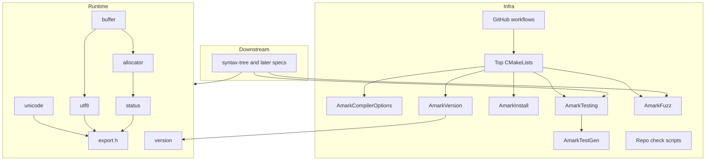
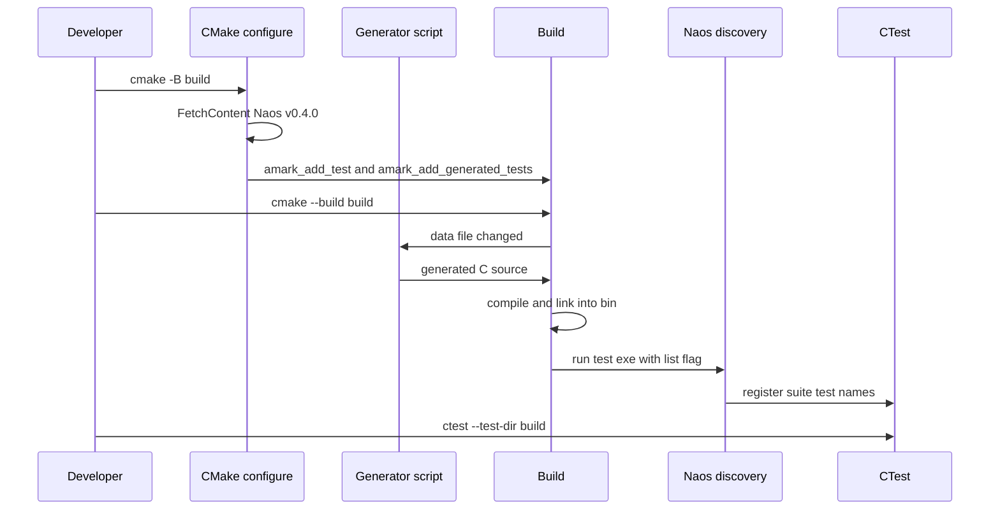
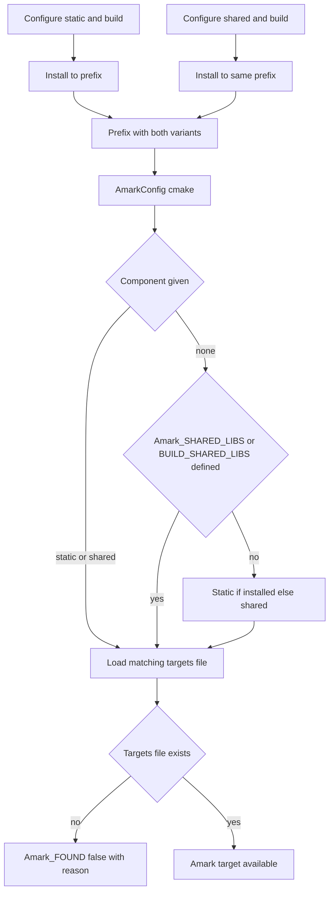
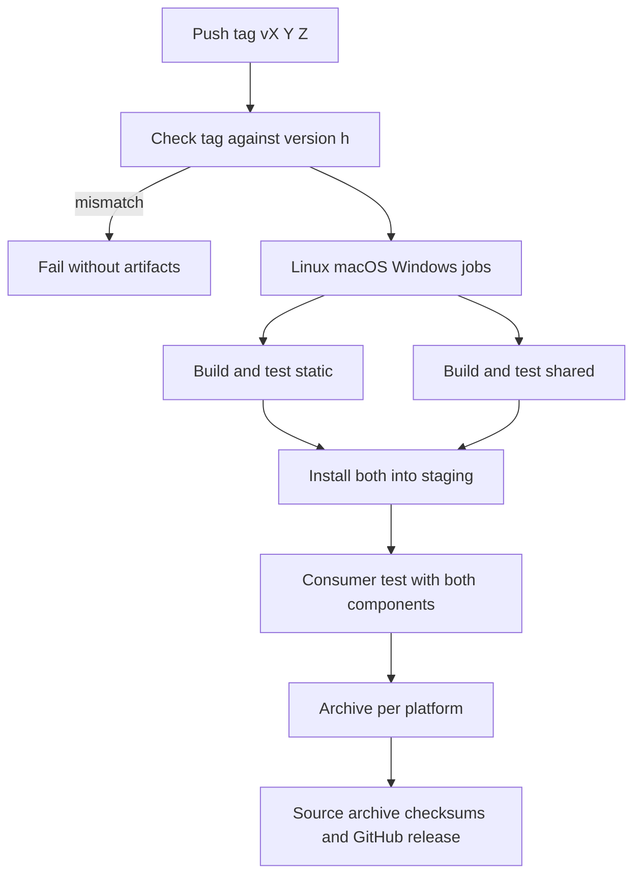

# Design Document: foundation

## Overview
**Purpose**：`foundation` は、Amark の開発者と利用者に、3 つの OS で静的/動的ライブラリとしてビルド・テスト・配布できる土台と、すべてのモジュールが従う共通ランタイム（エラー、メモリ、バッファ、UTF-8、文字の分類、版）を提供する。

**Users**：後続の spec（`syntax-tree`、`html-renderer`、`block-parser`、`inline-parser`、`markdown-renderer`）の開発者は、テスト・ファジング・テスト生成の仕組みと共通ランタイムをそのまま使う。Amark を組み込むアプリケーションの開発者は、4 つの取り込み方法と公開 API の規約（接頭辞、エクスポート、不透明型、アロケータ）を使う。拡張の実装者は、公開の共通ランタイムを使って構文を実装する。

**Impact**：コードのないリポジトリに、ビルド構成、CI/CD、ライセンス、共通ランタイムを追加する。

### Goals
- `cmake -B build && cmake --build build && ctest --test-dir build` が 5 つのコンパイラ環境で、静的版・動的版のどちらでも通る。
- 4 つの取り込み方法（`find_package`、`add_subdirectory`、FetchContent、pkg-config）が自動テストで保証される。
- 後続の spec が、テスト・データ駆動のテスト・ファジングターゲットを CMake の関数 1 つで追加できる。
- 共通ランタイムの規約（状態コード、出力引数、アロケータ、所有権）を、後続の spec がそのまま従える形で確定する。

### Non-Goals
- ノード型、構文トークン、パーサ、レンダラ、拡張レジストリ
- CommonMark の spec.txt の取り込みと準拠テスト（`inline-parser`）
- Unicode の case fold、HTML の文字参照の表（必要とする spec が、この spec の生成手順の上に追加する）
- ABI の差分の自動検査（abidiff など）、ベンチマークの基盤（`bench/` は後続の spec が必要に応じて作る）
- CLI、他言語のバインディング

## Boundary Commitments

### This Spec Owns
- トップレベルの `CMakeLists.txt`、`cmake/` のすべてのモジュール、ビルドのオプション、install と export、`AmarkConfig.cmake`、`amark.pc`
- コンパイラの警告設定と C99 の適用、サニタイザの適用の仕組み
- テストの仕組み：Naos の取得、`amark_add_test()`、`amark_add_generated_tests()`、テスト用の補助ライブラリ（`amark_test_support`）、テスト生成の補助（`AmarkTestGen.cmake`）
- リポジトリ全体の検査：ライセンスヘッダ、公開ヘッダの単独コンパイル、エクスポートされたシンボル、パッケージの取り込み
- ファジングの仕組み：`amark_add_fuzzer()`、libFuzzer のない環境の代替の `main`、短時間実行のターゲット
- `.github/workflows/` の CI とリリースのワークフロー
- `LICENSE`、`README.md`、`.gitattributes`、`.gitignore`、ソースのライセンスヘッダの規約
- 公開ヘッダの配置規約と `include/amark/{amark,export,version,status,allocator,buffer,utf8,unicode}.h`
- `src/runtime/` のすべて（版、状態コード、アロケータ、バッファ、UTF-8、文字の分類と Unicode の表）と `tools/gen_unicode_tables.py`
- ライブラリ全体のエラーとメモリ管理の規約（後続の spec が従う）

### Out of Boundary
- `src/tree/`、`src/parse/`、`src/render/`、`src/syntax/` の中身と、それぞれの公開ヘッダ
- spec.txt、準拠テスト、往復のプロパティテスト、検証用拡張（`tests/spec/`、`tests/extensions/` など）
- 特定の構文だけが使う文字データ（case fold、HTML の文字参照）と、その生成手順への追加（`block-parser` が Downstream Extension Points の拡張点に追加する）
- spec.txt の `export-ignore` と CI の `AMARK_REQUIRE_SPEC_TESTS=ON`（`inline-parser` が追加する）
- `bench/` の中身、最上位の `AMARK_BUILD_BENCH` と `add_subdirectory(bench)`、`spec_blocks.txt` の `export-ignore`（`block-parser` が追加する）
- 入れ子の深さの上限の値など、パーサ固有の制限（状態コード `AMARK_ERROR_LIMIT_EXCEEDED` だけを用意する）

### Allowed Dependencies
- 実行時：C99 の標準ライブラリだけ（`<stddef.h>`、`<stdint.h>`、`<stdbool.h>`、`<stdlib.h>`、`<string.h>`、`<limits.h>`）
- ビルド時：CMake 3.21 以上、C99 のコンパイラ。C++ のコンパイラは、あれば公開ヘッダの C++ の検査に使う（なくてもよい）
- テスト時：Naos v0.4.0（FetchContent）、pkg-config（あれば）
- 保守者のツール：Python 3.8 以上（Unicode の表の生成だけ。ビルドとテストでは使わない）
- レイヤーの規則：`src/runtime/` は他のレイヤー（tree、parse、render、syntax）を参照しない。公開ヘッダは他の公開ヘッダだけを include する

### Revalidation Triggers
- 状態コードの追加・意味の変更、出力引数の規約の変更 → すべての後続の spec
- `amark_allocator_t` のフィールドの追加、`amark_buffer_t` の API の変更 → `syntax-tree`、`html-renderer`、`markdown-renderer`
- `amark_add_test()` / `amark_add_generated_tests()` / `amark_add_fuzzer()` の引数の変更、テスト生成の補助の契約の変更、ファジングターゲットがリンクするテスト用の補助ライブラリの規則（FuzzInfra の「ファジング用の補助ライブラリの規則」）の変更 → テストやファジングターゲットを持つすべての spec
- 文字の分類の定義の変更、Unicode の版の更新、準拠対象の CommonMark の版の変更 → `inline-parser`、`block-parser`
- 公開ヘッダの配置、`amark.h` の構成と正規の include の順（PublicHeaders）、`AMARK_API` の規則の変更 → すべての後続の spec
- インストールの配置、パッケージの選択の規則の変更 → 利用者とリリースのワークフロー
- 下の Downstream Extension Points の拡張点（生成スクリプトの表の一覧と出力の形、`.gitattributes` の規則、`ci.yml` の構成の段、状態コードの末尾への追加、最上位の `CMakeLists.txt` のオプションとサブディレクトリの組み立て）の形の変更 → その拡張点に追加する spec（`block-parser`、`inline-parser`、`markdown-renderer`）

### Downstream Extension Points
この spec が所有するファイルのうち、後続の spec が追加を行うことが予定されている箇所（2026-11-25 に確認、同日の cross-spec review r1 で `block-parser` の 2 行を追加）。ファイル全体の所有と、追加を受け入れる形（拡張点）はこの spec が持ち、追加した部分の実装・テスト・保守は追加する spec が持つ。これらの追加はこの spec のタスクに含めない。追加する spec は拡張点の形を変えず、形の変更が必要ならこの spec の改訂として依頼する。

| 追加する spec | 対象のファイル | 追加の内容 | 受け入れる拡張点 |
|---|---|---|---|
| `block-parser` | `tools/gen_unicode_tables.py`、`include/amark/unicode.h`、`src/runtime/unicode.c` | `CaseFolding.txt`（状態 C と F）の読み取り、`src/runtime/case_fold_tables.inc`、`amark_unicode_case_fold()`、`--check` の対象への追加 | UnicodeTableGen の拡張（別の UCD のファイルを読む生成の関数と別の `.inc`）、`unicode.h` の末尾への関数の追加 |
| `block-parser` | `tools/gen_entity_table.py`（新規）、`src/runtime/entity.c`、`src/runtime/entity_tables.inc`、`include/amark/entity.h` | WHATWG `entities.json` からの名前付き文字参照の表と生成手順 | UnicodeTableGen と同じ方式（保守者が手で実行、生成物をリポジトリに入れる、`--check`、ビルドでは実行しない）。`src/runtime/` のレイヤーの規則に従う |
| `block-parser` | `CMakeLists.txt`（最上位） | オプション `AMARK_BUILD_BENCH`（既定 `OFF`）と、それが ON のときの `add_subdirectory(bench)`。`bench/` の中身（`bench/CMakeLists.txt` を含む）は `block-parser` が所有し、他の spec のベンチマークの追加は `block-parser` の拡張点で受け入れる | BuildCore のオプションの表とサブディレクトリの組み立て（新しいオプションは組み込み時に既定で無効、`add_subdirectory(fuzz)` の後に置く） |
| `block-parser` | `.gitattributes` | `tests/syntax/data/spec_blocks.txt` の `export-ignore` | RepoDocs の「配布しないテストデータには `export-ignore` を付ける」規則 |
| `inline-parser` | `.gitattributes` | `tests/spec/data/` の spec.txt と NOTICE.txt の `export-ignore` | RepoDocs の「配布しないテストデータには `export-ignore` を付ける」規則 |
| `inline-parser` | `.github/workflows/ci.yml` | 全ジョブの構成に `-DAMARK_REQUIRE_SPEC_TESTS=ON` を加える | CIWorkflow の構成の段（構成のオプションを追加できる） |
| `markdown-renderer` | `include/amark/status.h`、`src/runtime/status.c` | `AMARK_ERROR_UNREPRESENTABLE` | 状態コードの末尾への追加（10.7）。2026-11-25 にこの spec に取り込み済み（値 6、要件 10.9、タスク 2.1） |

- 表のほかに、すべての後続の spec が行う定型の追加として、`src/CMakeLists.txt` へのソース、`include/amark/amark.h` への公開ヘッダ（PublicHeaders の正規の順の自分の位置に）、`tests/CMakeLists.txt` と `fuzz/CMakeLists.txt` へのサブディレクトリ（FuzzInfra の「ファジング用の補助ライブラリの規則」に従う）がある。
- 上の追加で `src/runtime/` に入るファイルは、This Spec Owns の「`src/runtime/` のすべて」の例外として、追加する spec が所有する。ライセンスヘッダ、`amark_` 接頭辞、アロケータの経由、レイヤーの規則などの規約はこの spec のものに従う。

## Architecture

### Architecture Pattern & Boundary Map
**Selected pattern**：レイヤードな C ライブラリ ＋ CMake のモジュールによるインフラ。共通ランタイムは最下層で、上位のレイヤーを知らない。インフラ（`cmake/`）は、後続の spec が自分のソースとテストを足すための関数を提供し、個々のモジュールの知識を持たない。



**Dependency direction（実行時のコード）**：`export.h` → `version` / `status` → `allocator` → `utf8` / `unicode` → `buffer` → （後続：tree → parse / render → syntax）。左のものは右のものを参照しない。違反はレビューでエラーとして扱う。

**Architecture Integration**：
- Domain boundaries：インフラはファイル単位で責務を分ける（ビルドの中核、パッケージ、テスト、テスト生成、ファジング、検査、ワークフロー）。共通ランタイムは 1 つの機能につき 1 つの公開ヘッダと 1 つのソースにする。
- Steering compliance：C99、`amark_` / `AMARK_` 接頭辞、`AMARK_API`、既定で hidden の可視性、不透明型、アロケータの経由、状態コード、`include/amark/`、`src/runtime/`、`_internal.h`、`amark__` 接頭辞、ライセンスヘッダ。

### Technology Stack

| Layer | Choice / Version | Role in Feature | Notes |
|-------|------------------|-----------------|-------|
| Language | C99（MSVC では `/std:c11`、Visual Studio 2019 16.8 以降） | ライブラリ、テスト、ファジング | MSVC に C99 のモードがないため。C99 の範囲の厳密さは GCC/Clang の `-std=c99 -Wpedantic` で担保 |
| Build | CMake ≥ 3.21 | 構成、install、export、テストの登録 | `PROJECT_IS_TOP_LEVEL`、`$<TARGET_RUNTIME_DLLS>` を使う |
| Test | Naos v0.4.0、CTest | 単体テスト、テストの登録 | FetchContent、タグ固定 |
| Packaging | CMake のパッケージ設定、pkg-config | 利用者の取り込み | `write_basic_package_version_file` |
| Fuzz | libFuzzer（Clang）／代替の `main` | ファジング、コーパスの再生 | AppleClang、GCC、MSVC は代替 |
| CI/CD | GitHub Actions | マトリクスのビルドとテスト、サニタイザ、リリース | MinGW は MSYS2 UCRT64 |
| Data | Unicode 17.0.0 UCD | 文字の分類の表 | 生成物をリポジトリに入れる |
| Maintainer tool | Python ≥ 3.8 | Unicode の表の生成 | ビルドとテストでは使わない |

## File Structure Plan

### Directory Structure
```
.
├── CMakeLists.txt                 # プロジェクト定義、オプション、各モジュールとサブディレクトリの組み立て
├── LICENSE                        # MIT、Copyright (c) The Amark Authors
├── README.md                      # 概要、対応環境、ビルド、取り込み、ライセンスの骨子
├── .gitattributes                 # 改行を LF に統一、テストデータとコーパスをバイナリ扱い、export-ignore
├── .gitignore                     # build*/ など
├── cmake/
│   ├── AmarkVersion.cmake         # version.h から版を読み、矛盾を検出する
│   ├── AmarkCompilerOptions.cmake # amark_target_defaults()：C99、警告、可視性。サニタイザの適用
│   ├── AmarkInstall.cmake         # install と export、パッケージ設定と pc の生成
│   ├── AmarkConfig.cmake.in       # find_package(Amark) の入口。種類（静的/動的）の選択
│   ├── amark.pc.in                # pkg-config のテンプレート
│   ├── AmarkTesting.cmake         # Naos の取得、amark_add_test()、amark_add_generated_tests()
│   ├── AmarkTestGen.cmake         # 生成スクリプトが include する補助（スクリプトモード専用）
│   ├── AmarkFuzz.cmake            # amark_add_fuzzer()、libFuzzer の検出、短時間実行のターゲット
│   └── scripts/
│       ├── check_license_headers.cmake   # ライセンスヘッダの検査（CTest から実行）
│       ├── check_exported_symbols.cmake  # 動的ライブラリのエクスポートの検査
│       ├── run_package_test.cmake        # 取り込みのテストの実行（install、利用者の構成・ビルド・実行）
│       └── check_version_tag.cmake       # リリースのタグと version.h の照合
├── include/amark/
│   ├── amark.h                    # すべての公開ヘッダをまとめる
│   ├── export.h                   # AMARK_API、AMARK_BEGIN_DECLS / AMARK_END_DECLS
│   ├── version.h                  # 版のマクロ（版の唯一の定義）と実行時の版の関数
│   ├── status.h                   # amark_status_t と amark_status_string()
│   ├── allocator.h                # amark_allocator_t と確保の関数
│   ├── buffer.h                   # amark_buffer_t（不透明型）
│   ├── utf8.h                     # UTF-8 の復号・検証・符号化
│   └── unicode.h                  # 文字の分類、Unicode の版のマクロ
├── src/
│   ├── CMakeLists.txt             # amark_objects、amark、amark_internal のターゲット
│   └── runtime/
│       ├── version.c
│       ├── status.c
│       ├── allocator.c            # 既定のアロケータ、解決、確保の関数
│       ├── alloc_internal.h       # amark__allocator_resolve()、桁あふれの検査つきの算術
│       ├── buffer.c
│       ├── buffer_internal.h      # struct amark_buffer の定義、埋め込み用の初期化と破棄
│       ├── utf8.c
│       ├── unicode.c              # 分類の関数（ASCII の早道と二分探索）
│       └── unicode_tables.inc     # 生成物：Zs、P+S の範囲の表（ライセンスヘッダつき）
├── tools/
│   └── gen_unicode_tables.py      # UCD から unicode_tables.inc を生成する（保守者用）
├── tests/
│   ├── CMakeLists.txt             # テストの組み立て、検査のテスト、各サブディレクトリ（AMARK_FUZZ だけでも入る。FuzzInfra の規則）
│   ├── support/
│   │   ├── test_allocator.h       # テスト用アロケータと確保失敗の総当たりの補助
│   │   ├── test_allocator.c
│   │   └── test_check.h           # バイト列とバッファの比較のマクロ
│   ├── runtime/
│   │   ├── CMakeLists.txt
│   │   ├── version_test.c
│   │   ├── status_test.c
│   │   ├── allocator_test.c
│   │   ├── buffer_test.c          # 公開 API のテスト
│   │   ├── buffer_internal_test.c # 埋め込み用の内部 API のテスト（INTERNAL）
│   │   ├── utf8_test.c
│   │   ├── unicode_test.c
│   │   ├── gen_utf8_cases.cmake   # UTF-8 のテストベクタからテストを生成するスクリプト
│   │   └── data/utf8_cases.txt    # UTF-8 のテストベクタ（テスト生成の仕組みの最初の利用者）
│   ├── testgen/
│   │   ├── CMakeLists.txt
│   │   ├── gen_bytes.cmake       # 生成の補助の自己テスト用のスクリプト
│   │   ├── testgen_test.c         # 生成されたデータがバイト単位で一致することの検査
│   │   └── data/bytes.bin        # NUL、CR、不正な UTF-8、`;`、`[` を含むデータ
│   ├── headers/
│   │   ├── CMakeLists.txt         # 公開ヘッダごとの単独コンパイルの検査を生成する
│   │   └── cxx_include_test.cpp   # C++ から amark.h を使う検査
│   └── package/
│       ├── CMakeLists.txt         # 取り込みのテストの登録
│       └── consumer/
│           ├── CMakeLists.txt     # AMARK_CONSUME_MODE に従って Amark を取り込む利用者のプロジェクト
│           └── main.c             # 版の照合とバッファの利用
├── fuzz/
│   ├── CMakeLists.txt
│   ├── standalone_main.c          # libFuzzer のない環境の代替の main
│   ├── utf8_fuzz.c                # 復号・後ろ向きの復号・検証・符号化の性質
│   ├── buffer_fuzz.c              # 操作列の解釈と、確保の失敗の注入
│   └── corpus/
│       ├── utf8/                  # 種のファイル
│       └── buffer/
└── .github/workflows/
    ├── ci.yml                     # マトリクス、サニタイザ、ファジング、二重インストール
    └── release.yml                # タグで成果物を作って公開する
```

### Modified Files
- なし（greenfield）。後続の spec は `src/CMakeLists.txt` にソースを、`include/amark/amark.h` に自分の公開ヘッダを（PublicHeaders の正規の順の自分の位置に）、`tests/CMakeLists.txt` と `fuzz/CMakeLists.txt` にサブディレクトリを追加する。

## System Flows

### テストのビルドと登録

- 実行ファイルと Amark の DLL は、どちらも `${PROJECT_BINARY_DIR}/bin`（マルチ構成では構成ごとのサブディレクトリ）に出力され、一覧の取得の時点で DLL が見つかる。
- データファイルか生成スクリプトが変わると、構成し直さずに生成とテストの一覧が更新される。

### 静的版と動的版の二重インストールと選択


### リリース

- `Publish` は、すべての先行ジョブが成功したときだけ実行する（要件 6.4）。

## Requirements Traceability

| Requirement | Summary | Components | Interfaces | Flows |
|-------------|---------|------------|------------|-------|
| 1.1 | 5 つの環境で構成・ビルド・テストが通る | BuildCore、CIWorkflow | 最上位の CMakeLists | テストのビルド |
| 1.2 | C99、言語拡張なし | CompilerOptions | `amark_target_defaults()` | — |
| 1.3 | CMake 3.21 未満で失敗 | BuildCore | `cmake_minimum_required` | — |
| 1.4 | 最上位で警告をエラーに | CompilerOptions | `AMARK_WARNINGS_AS_ERRORS` | — |
| 1.5 | 組み込み時は既定で無効、利用者を変えない | CompilerOptions、PackageTests | ターゲット単位の PRIVATE の設定 | — |
| 1.6 | 明示の指定に従う | CompilerOptions | `AMARK_WARNINGS_AS_ERRORS` | — |
| 1.7 | 実行時は C 標準ライブラリだけ | BuildCore、Runtime 全体 | — | — |
| 2.1, 2.2 | 静的版・動的版のビルド | BuildCore | `BUILD_SHARED_LIBS` | — |
| 2.3 | `amark` と `Amark::amark` | BuildCore、Packaging | ターゲット | — |
| 2.4 | 公開 API だけのエクスポート | Export、CompilerOptions、SymbolCheck | `AMARK_API`、hidden | — |
| 2.5 | Windows で定義なしに DLL を使える | Export、BuildCore、Packaging | `AMARK_SHARED`（INTERFACE） | — |
| 2.6 | ABI の互換性番号 | VersionMod、BuildCore | `SOVERSION` | — |
| 2.7 | 両方を並べてインストール | Packaging | 出力名、エクスポートファイル名 | 二重インストール |
| 3.1 | インストールの内容 | Packaging | install 規則 | — |
| 3.2 | `find_package(Amark)` | Packaging、PackageTests | `AmarkConfig.cmake` | 二重インストール |
| 3.3 | add_subdirectory と FetchContent | BuildCore、PackageTests | `AMARK_BUILD_TESTS`、`AMARK_INSTALL`、`AMARK_FUZZ` の既定 | — |
| 3.4 | pkg-config | Packaging、PackageTests | `amark.pc`、`amark-<variant>.pc` | — |
| 3.5 | 版の互換性の判定 | Packaging | `AmarkConfigVersion.cmake` | — |
| 3.6 | 種類の選択と既定の規則 | Packaging、ReleaseWorkflow | `COMPONENTS`、`Amark_SHARED_LIBS` | 二重インストール |
| 3.7 | 要求した種類がない | Packaging、PackageTests | `Amark_NOT_FOUND_MESSAGE` | 二重インストール |
| 4.1 | Naos の固定と、テスト時だけの取得 | Testing | FetchContent | テストのビルド |
| 4.2 | 個別の CTest のテスト | Testing | `naos_add_executable` | テストのビルド |
| 4.3 | 公開・内部の両方のテスト | BuildCore、Testing | `amark_internal`、`INTERNAL` | — |
| 4.4 | Windows の DLL を見つけられる | Testing、BuildCore | 共通の出力ディレクトリ | テストのビルド |
| 4.5, 4.6 | テスト用アロケータ、確保失敗の総当たり | TestSupport | `amark_test_allocator_t`、`AMARK_CHECK_OOM_SWEEP` | — |
| 4.7, 4.8 | データからのテスト生成、再生成 | Testing、TestGen | `amark_add_generated_tests()`、`AmarkTestGen.cmake` | テストのビルド |
| 4.9 | 公開ヘッダの単独コンパイル（C、C++） | HeaderChecks | `tests/headers` | — |
| 4.10 | エクスポートの検査 | SymbolCheck | `check_exported_symbols.cmake` | — |
| 4.11 | 4 つの取り込み方法のテスト | PackageTests | `run_package_test.cmake` | — |
| 4.12 | ツールがないときはスキップ | PackageTests、SymbolCheck | `SKIP_REGULAR_EXPRESSION` | — |
| 5.1 | マトリクスのビルドとテスト | CIWorkflow | `ci.yml` の `build` | — |
| 5.2 | サニタイザのジョブ | CIWorkflow、CompilerOptions | `AMARK_SANITIZE` | — |
| 5.3 | ファジングの短時間実行 | CIWorkflow、FuzzInfra | `amark_fuzz_smoke` | — |
| 5.4 | 失敗の報告とログ | CIWorkflow | `--output-on-failure`、ログの保存 | — |
| 5.5 | 各環境での取り込みのテスト | CIWorkflow、PackageTests | `package` ラベル | — |
| 6.1, 6.2 | 成果物、ソース、チェックサム、公開 | ReleaseWorkflow | `release.yml` | リリース |
| 6.3 | タグと版の照合 | ReleaseWorkflow | `check_version_tag.cmake` | リリース |
| 6.4 | 失敗時は公開しない | ReleaseWorkflow | ジョブの依存 | リリース |
| 6.5 | LICENSE を含め、テストデータを含めない | ReleaseWorkflow、Packaging、RepoDocs | install 規則、`export-ignore` | リリース |
| 7.1, 7.2, 7.3 | ファジングの既定、libFuzzer、代替 | FuzzInfra | `AMARK_FUZZ`、`amark_add_fuzzer()` | — |
| 7.4 | コーパスの再生の登録 | FuzzInfra | `fuzz.<name>.corpus` | — |
| 7.5 | ターゲットの追加の容易さ | FuzzInfra | `amark_add_fuzzer()` | — |
| 7.6 | UTF-8 とバッファのターゲット | FuzzTargets | `utf8_fuzz`、`buffer_fuzz` | — |
| 7.7 | ファジング用の補助ライブラリが Naos に依存せず、ファジングだけの構成が通ること | FuzzInfra、BuildCore、Testing、CIWorkflow | ファジング用の補助ライブラリの規則、`fuzz` ジョブ | — |
| 7.8 | リンク対象のライブラリの欠落と Naos への依存の検出 | FuzzInfra | `amark_add_fuzzer()` の `LIBRARIES` の検査 | — |
| 8.1, 8.2 | LICENSE と README | RepoDocs | — | — |
| 8.3, 8.4 | ライセンスヘッダとその検査 | LicenseCheck | `check_license_headers.cmake` | — |
| 8.5 | テストデータのバイトの同一性 | RepoDocs | `.gitattributes` | — |
| 9.1 | `amark/` と `amark.h` | PublicHeaders | `amark.h` | — |
| 9.2 | C++ から使える | Export、HeaderChecks | `AMARK_BEGIN_DECLS` | — |
| 9.3 | 接頭辞 | PublicHeaders、SymbolCheck | 命名規約 | — |
| 9.4, 9.5 | コンパイル時と実行時の版 | Version | `AMARK_VERSION_*`、`amark_version_number()` | — |
| 9.6 | 版の唯一の定義 | VersionMod、Packaging | `amark_read_version()` | — |
| 9.7 | `amark.h` の正規の include の順 | PublicHeaders | `amark.h` | — |
| 10.1, 10.2, 10.3, 10.4, 10.5, 10.6, 10.7 | 状態コードと失敗の規約 | Status、Error conventions | `amark_status_t`、`amark_status_string()` | — |
| 10.9 | 表現できないことの状態コード | Status | `AMARK_ERROR_UNREPRESENTABLE`、`amark_status_string()` | — |
| 10.8 | グローバルな可変状態を持たない | Runtime 全体 | 規約 | — |
| 11.1, 11.2, 11.3, 11.4, 11.5, 11.6, 11.7, 11.8 | アロケータ | Allocator | `amark_allocator_t`、`amark_alloc()` など | — |
| 12.1, 12.2, 12.3, 12.4, 12.5, 12.6, 12.7, 12.8 | バッファ | Buffer | `amark_buffer_*` | — |
| 13.1, 13.2, 13.3, 13.4, 13.5, 13.6, 13.7 | UTF-8 | Utf8 | `amark_utf8_*` | — |
| 14.1, 14.2, 14.3, 14.4, 14.5, 14.6 | 文字の分類 | Unicode | `amark_unicode_*`、`amark_ascii_is_punctuation()` | — |
| 14.7 | 表の生成手順 | UnicodeTableGen | `tools/gen_unicode_tables.py` | — |

## Components and Interfaces

| Component | Domain/Layer | Intent | Req Coverage | Key Dependencies (P0/P1) | Contracts |
|-----------|--------------|--------|--------------|--------------------------|-----------|
| BuildCore | Infra | プロジェクト、オプション、ライブラリのターゲット | 1.1, 1.3, 1.7, 2.1–2.3, 2.5, 2.6, 3.3, 4.3, 4.4, 7.7 | CompilerOptions (P0), VersionMod (P0) | Service |
| CompilerOptions | Infra | C99、警告、可視性、サニタイザ | 1.2, 1.4–1.6, 2.4, 5.2 | — | Service |
| VersionMod | Infra | 版の読み取りと派生値 | 2.6, 9.6 | Version (P0) | Service |
| Packaging | Infra | install、export、パッケージ設定、pc | 2.3, 2.5, 2.7, 3.1–3.7, 6.5, 9.6 | BuildCore (P0) | Service |
| Testing | Infra | Naos の統合とテストの登録 | 4.1–4.4, 4.7, 4.8, 7.7 | Naos (P0), BuildCore (P0) | Service |
| TestGen | Infra | 生成スクリプトの補助 | 4.7, 4.8 | — | Service |
| TestSupport | Test | テスト用アロケータ、比較のマクロ | 4.5, 4.6 | Naos (P0), allocator.h (P0) | Service |
| HeaderChecks | Test | 公開ヘッダの単独コンパイル | 4.9, 9.2 | PublicHeaders (P0) | Batch |
| SymbolCheck | Test | エクスポートの検査 | 2.4, 4.10, 4.12, 9.3 | nm 等 (P1) | Batch |
| LicenseCheck | Test | ライセンスヘッダの検査 | 8.3, 8.4 | — | Batch |
| PackageTests | Test | 4 つの取り込み方法の検査 | 1.5, 3.2–3.4, 3.7, 4.11, 4.12, 5.5 | Packaging (P0) | Batch |
| FuzzInfra | Infra | ファジングの仕組み | 5.3, 7.1–7.5, 7.7, 7.8 | BuildCore (P0) | Service |
| FuzzTargets | Fuzz | ランタイムのファジング | 7.6 | Utf8, Buffer (P0) | Batch |
| CIWorkflow | CI | マトリクス、サニタイザ、ファジング、二重インストール | 1.1, 5.1–5.5, 7.7 | BuildCore (P0) | Batch |
| ReleaseWorkflow | CI | 成果物の作成と公開 | 6.1–6.5, 3.6 | Packaging (P0) | Batch |
| RepoDocs | Repo | LICENSE、README、gitattributes | 6.5, 8.1, 8.2, 8.5 | — | — |
| PublicHeaders / Export | Runtime | 配置、まとめのヘッダ、エクスポート、正規の include の順 | 2.4, 2.5, 9.1–9.3, 9.7 | — | Service |
| Version | Runtime | 版のマクロと関数 | 9.4, 9.5 | Export (P0) | Service |
| Status | Runtime | 状態コード | 10.1–10.7, 10.9 | Export (P0) | Service |
| Allocator | Runtime | 差し替え可能なアロケータ | 11.1–11.8 | Status (P0) | Service |
| Buffer | Runtime | 伸長できるバイトバッファ | 12.1–12.8 | Allocator (P0), Utf8 (P1) | Service, State |
| Utf8 | Runtime | UTF-8 の処理 | 13.1–13.7 | Export (P0) | Service |
| Unicode | Runtime | 文字の分類 | 14.1–14.6 | Export (P0) | Service |
| UnicodeTableGen | Tool | 表の生成 | 14.5, 14.7 | Python, UCD (P2) | Batch |

### Infra

#### BuildCore

| Field | Detail |
|-------|--------|
| Intent | プロジェクトの定義、オプション、`amark` のターゲットの組み立て |
| Requirements | 1.1, 1.3, 1.7, 2.1–2.3, 2.5, 2.6, 3.3, 4.3, 4.4 |

**Responsibilities & Constraints**
- `cmake_minimum_required(VERSION 3.21)`、`project(amark VERSION <version.h の版> LANGUAGES C)`。
- オプション（既定値の「最上位」は `PROJECT_IS_TOP_LEVEL`）：

| Option | Default | Content |
|---|---|---|
| `BUILD_SHARED_LIBS` | `OFF` | `ON` で `amark` を動的ライブラリにする（最上位のときだけ `option` で宣言する。組み込み時は利用者の値に従う） |
| `AMARK_BUILD_TESTS` | 最上位 かつ `BUILD_TESTING` | テストを作り、Naos を取得する |
| `AMARK_PACKAGE_TESTS` | `AMARK_BUILD_TESTS` | 取り込みのテストを登録する（入れ子のビルドで時間がかかるため個別に切れる） |
| `AMARK_INSTALL` | 最上位 | install 規則を作る |
| `AMARK_WARNINGS_AS_ERRORS` | 最上位 | 警告をエラーにする |
| `AMARK_SANITIZE` | 空 | `address`、`undefined` のリスト。最上位のときだけ有効 |
| `AMARK_FUZZ` | `OFF` | ファジングターゲットを作る |
| `AMARK_FUZZ_SMOKE_SECONDS` | `60` | 短時間実行の各ターゲットの秒数 |

- ターゲット：
  - `amark_objects`（OBJECT）：`src/` の全ソース。`amark_target_defaults()` を適用。`POSITION_INDEPENDENT_CODE` は `BUILD_SHARED_LIBS` に従う。PRIVATE に `AMARK_BUILDING`、動的版のときは `AMARK_SHARED` も定義する。インクルードは `include/` と `src/`。
  - `amark`（`BUILD_SHARED_LIBS` に従う）：`$<TARGET_OBJECTS:amark_objects>` から作る。PUBLIC のインクルードは `$<BUILD_INTERFACE:include>` と `$<INSTALL_INTERFACE:${CMAKE_INSTALL_INCLUDEDIR}>`。動的版のときは INTERFACE に `AMARK_SHARED`、`VERSION` と `SOVERSION`、`C_VISIBILITY_PRESET hidden`。`DEBUG_POSTFIX d`。MSVC 形式（`CMAKE_STATIC_LIBRARY_SUFFIX` と `CMAKE_IMPORT_LIBRARY_SUFFIX` と接頭辞が同じ）のとき、静的版の `OUTPUT_NAME` を `amark_static` にする。
  - `Amark::amark`：`amark` のエイリアス。
  - `amark_internal`（STATIC、`AMARK_BUILD_TESTS` か `AMARK_FUZZ` のときだけ）：同じオブジェクトから作る。PUBLIC のインクルードに `include/` と `src/`。`AMARK_SHARED` を伝えない（テスト側の宣言は dllimport にならず、静的にリンクされる）。
- `AMARK_BUILD_TESTS` のとき、`amark` の `RUNTIME_OUTPUT_DIRECTORY` を `${PROJECT_BINARY_DIR}/bin` にする（テストと同じディレクトリ）。組み込み時は変更しない。
- 後続の spec は、`src/CMakeLists.txt` の `amark_objects` にソースを追加するだけでライブラリに入る。

**Contracts**: Service [x]

##### Service Interface（CMake）
```cmake
# src/CMakeLists.txt で後続の spec が使う形
target_sources(amark_objects PRIVATE tree/node.c ...)
```
- Postconditions：`amark` と `amark_internal` に自動的に含まれる。

**Implementation Notes**
- Integration：`include(CTest)` は最上位のときだけ行う。`AmarkTesting.cmake` と `AmarkFuzz.cmake` は常に include する（関数を常に定義し、無効なときは何もしない）。`add_subdirectory(tests)` と `add_subdirectory(fuzz)` はどちらも `AMARK_FUZZ` か `AMARK_BUILD_TESTS` のときに、この順で行う（ファジングターゲットがリンクする補助ライブラリを `tests/` で先に定義するため。FuzzInfra の「ファジング用の補助ライブラリの規則」）。後続の spec が追加するサブディレクトリ（`bench/` など）はこの後に置く。
- Risks：OBJECT ライブラリを `target_link_libraries` でつなぐと export の対象に入るため、`target_sources` と `$<TARGET_OBJECTS>` を使う。

#### CompilerOptions

| Field | Detail |
|-------|--------|
| Intent | Amark のターゲットに C99、警告、可視性を適用し、サニタイザをまとめて有効にする |
| Requirements | 1.2, 1.4–1.6, 2.4, 5.2 |

**Responsibilities & Constraints**
- `amark_target_defaults(<target>)`：Amark が作るすべての C のターゲット（ライブラリ、テスト、ファジング）に適用する。
  - `C_STANDARD 99`、`C_STANDARD_REQUIRED ON`、`C_EXTENSIONS OFF`。MSVC では `/std:c11` と `/utf-8`。
  - `AMARK_WARNINGS_AS_ERRORS` が ON：GCC/Clang に `-Wall -Wextra -Wpedantic -Werror`、MSVC に `/W4 /WX`。OFF のときも警告は出す（`-Wall -Wextra -Wpedantic`、`/W4`）。
  - すべて PRIVATE。INTERFACE の設定は作らない（利用者のターゲットに伝わらない）。
  - `C_VISIBILITY_PRESET hidden`、`VISIBILITY_INLINES_HIDDEN ON`。
- `AMARK_SANITIZE`：最上位のときだけ、ディレクトリ単位で `-fsanitize=<list>`、`-fno-omit-frame-pointer`、`-fno-sanitize-recover=all` をコンパイルとリンクに加える（Naos も対象）。MSVC は `address` だけを受け付ける。未知の値やコンパイラが対応しない値は構成の段階でエラーにする。

**Contracts**: Service [x]
```cmake
amark_target_defaults(<target>)
```

#### VersionMod

| Field | Detail |
|-------|--------|
| Intent | `version.h` を唯一の版の定義として読み、派生値を作る |
| Requirements | 2.6, 9.6 |

**Responsibilities & Constraints**
- `amark_read_version(<header>)`：`#define AMARK_VERSION_MAJOR <n>` などの行を読み、`AMARK_VERSION`（`X.Y.Z`）、`AMARK_VERSION_MAJOR/MINOR/PATCH`、`AMARK_SOVERSION` を設定する。`AMARK_VERSION_STRING` が 3 つの数から作った文字列と一致しなければ `FATAL_ERROR`。
- `AMARK_SOVERSION`：メジャー版が 0 のとき `0.<minor>`、それ以外は `<major>`。
- パッケージの互換性：メジャー版が 0 なら `SameMinorVersion`、それ以外は `SameMajorVersion`。
- スクリプトモード（`check_version_tag.cmake`）からも include できる。

#### Packaging

| Field | Detail |
|-------|--------|
| Intent | install 規則、エクスポート、パッケージ設定、pkg-config のファイル |
| Requirements | 2.3, 2.5, 2.7, 3.1–3.7, 6.5, 9.6 |

**Responsibilities & Constraints**
- `AMARK_INSTALL` のときだけ規則を作る。配置は `GNUInstallDirs` に従う。

| Path | Content |
|---|---|
| `include/amark/` | 公開ヘッダ（`include/amark/*.h` のすべて） |
| `lib/`（DLL は `bin/`） | ライブラリ。MSVC の Debug と RelWithDebInfo の動的版では PDB も `bin/` に |
| `lib/cmake/Amark/` | `AmarkConfig.cmake`、`AmarkConfigVersion.cmake`、`AmarkTargets-<variant>.cmake`、`AmarkTargets-<variant>-<config>.cmake` |
| `lib/pkgconfig/` | `amark-<variant>.pc` と `amark.pc` |
| `share/licenses/amark/LICENSE` | ライセンス |

- `<variant>` は `static` か `shared`。エクスポートの名前空間は `Amark::`、エクスポートするターゲットは `amark`（取り込み側では `Amark::amark`）。
- **`AmarkConfig.cmake` の選択の規則**（要件 3.6、3.7）：
  1. `find_package(Amark COMPONENTS static)` または `shared` が指定されたら、その種類。両方の指定はエラー。
  2. 指定がなく、`Amark_SHARED_LIBS` が定義されていればその真偽。
  3. それもなく、`BUILD_SHARED_LIBS` が定義されていればその真偽。ただし、その種類がインストールされていなければ、もう一方を使う。
  4. どれもなければ、静的版があれば静的版、なければ動的版。
  5. 1 か 2 で選んだ種類のファイルがなければ、`Amark_FOUND` を FALSE にし、`Amark_NOT_FOUND_MESSAGE` に「要求された種類」と「インストールされている種類」を示す。
- 読み込んだ種類を `Amark_SHARED_LIBS_USED`（真偽）として利用者に返す。
- **pkg-config**：`amark-<variant>.pc` を種類ごとに生成する。`Libs: -L${libdir} -l<出力名>`、動的版は `Cflags: -I${includedir} -DAMARK_SHARED`。`amark.pc` は最後にインストールした種類と同じ内容を持つ（リリースでは動的版を後にインストールする）。特定の種類が必要な利用者は `amark-static` / `amark-shared` を使う。出力名は構成ごとに `file(GENERATE)` で埋める（Debug の `d` を反映する）。
- `Version` は `AMARK_VERSION` から埋める。

**Contracts**: Service [x]
```cmake
find_package(Amark 0.1 REQUIRED)                       # 規則 2–4 で選ぶ
find_package(Amark 0.1 REQUIRED COMPONENTS shared)     # 動的版を要求
target_link_libraries(app PRIVATE Amark::amark)
```

#### Testing

| Field | Detail |
|-------|--------|
| Intent | Naos を取得し、テストの実行ファイルの作成と CTest への登録を 1 つの関数にまとめる |
| Requirements | 4.1–4.4, 4.7, 4.8 |

**Responsibilities & Constraints**
- `AMARK_BUILD_TESTS` が OFF なら Naos を取得せず、`AMARK_FUZZ` だけが ON の構成でも同じ（7.7）。
- `AMARK_BUILD_TESTS` のときだけ、`FetchContent_Declare(Naos GIT_REPOSITORY https://github.com/vabelorg/naos.git GIT_TAG v0.4.0)` と `FetchContent_MakeAvailable(Naos)` を行う。タグの値は `AmarkTesting.cmake` の 1 か所にだけ書く。
- `amark_add_test()`：`naos_add_executable()` で作り、`amark_target_defaults()` を適用し、`RUNTIME_OUTPUT_DIRECTORY` を `${PROJECT_BINARY_DIR}/bin` にする。既定で `amark` を、`INTERNAL` のときは `amark_internal` をリンクする（両方はリンクしない）。常に `amark_test_support` をリンクする。
- `amark_add_generated_tests()`：`DATA` の各ファイルについて、`add_custom_command` で `${CMAKE_CURRENT_BINARY_DIR}/<target>_gen/<suite>.c` を生成する。`DEPENDS` はデータ、生成スクリプト、`AmarkTestGen.cmake`。スイートの名前は `<target>` の接頭辞とデータのファイル名（拡張子なし）を C の識別子にしたもの。生成したスイートと `EXTRA_SUITES` を `NAOS_DECLARE_SUITE` と `NAOS_MAIN` に並べた `main` のソースも構成時に生成する（データファイルの一覧は構成時に決まり、中身の変更は再構成を要さない）。
- 生成スクリプトの呼び出し：`cmake -DAMARK_TESTGEN_INPUT=<data> -DAMARK_TESTGEN_OUTPUT=<c> -DAMARK_TESTGEN_SUITE=<suite> -DAMARK_TESTGEN_MODULE=<AmarkTestGen.cmake の絶対パス> [-D<ARGS>...] -P <generator>`。

**Contracts**: Service [x]
```cmake
amark_add_test(<target>
    SOURCES <source>...            # NAOS_MAIN を含む
    [INTERNAL]                     # amark_internal をリンクし src/ を include できる
    [LIBRARIES <library>...]
    [LABELS <label>...])

amark_add_generated_tests(<target>
    GENERATOR <script.cmake>
    DATA <file>...
    [SOURCES <source>...]          # 手書きのスイート（NAOS_MAIN は書かない）
    [EXTRA_SUITES <suite>...]      # SOURCES にあるスイートの名前
    [ARGS <name>=<value>...]       # 生成スクリプトへ -D で渡す
    [INTERNAL] [LIBRARIES <library>...] [LABELS <label>...])
```
- Preconditions：`AMARK_BUILD_TESTS` が ON（OFF のときは何もしない。`AMARK_FUZZ` だけが ON の構成で `tests/` に入っても、Naos を必要とせずに呼べる）。
- Postconditions：各テストが `<target>.<suite>.<test>` で CTest に登録される。

#### TestGen

| Field | Detail |
|-------|--------|
| Intent | 生成スクリプトが任意のバイト列を失わずに C のソースへ変換するための補助 |
| Requirements | 4.7, 4.8 |

**Responsibilities & Constraints**
- スクリプトモードの CMake からだけ include される（`include(${AMARK_TESTGEN_MODULE})`）。
- データは常に 16 進の文字列（2 文字で 1 バイト、小文字）で扱い、NUL、`;`、`[`、`]`、CR を失わない。

**Contracts**: Service [x]
```cmake
amark_testgen_read_lines_hex(<out_list> <file>)
#   ファイルを LF で行に分け、各行を 16 進の文字列で返す。LF は含めず、CR は残す。
#   最後の行が LF で終わらない場合もその行を返す。空の行は空の要素になる。
amark_testgen_hex(<out_var> <text>)              # ASCII の文字列を 16 進に（区切りの行との比較用）
amark_testgen_join_lines_hex(<out_var> <list>)   # 行の 16 進を LF でつなぐ
amark_testgen_byte_array(<out_var> NAME <c_name> HEX <hex>)
#   "static const unsigned char <c_name>[] = {...};" と
#   "static const size_t <c_name>_size = <n>;" の C のコードを返す。長さ 0 にも対応する。
amark_testgen_c_identifier(<out_var> <text>)     # [A-Za-z0-9_] 以外を _ に、先頭が数字なら _ を前に
amark_testgen_c_string(<out_var> <ascii_text>)   # テスト名や注記の短い ASCII の文字列を C のリテラルに
amark_testgen_write(<file> <content>)            # 内容が同じなら書き換えない（再コンパイルを避ける）
```
- 性能の目標：約 200KB のデータの行の分割と配列の生成が、一般的な開発機で 10 秒以内。
- 生成される C のソースは `amark_target_defaults()` の警告設定でコンパイルできなければならない（未使用の変数を作らない）。

#### FuzzInfra

| Field | Detail |
|-------|--------|
| Intent | ファジングターゲットの追加、libFuzzer の有無の吸収、コーパスの再生、短時間実行 |
| Requirements | 5.3, 7.1–7.5, 7.7, 7.8 |

**Responsibilities & Constraints**
- libFuzzer の対応は、`AMARK_FUZZ` が ON のときに `-fsanitize=fuzzer` で小さなプログラムをリンクできるかで判定する（`check_c_source_compiles`）。対応するときは、最上位のディレクトリ単位で `-fsanitize=fuzzer-no-link` をコンパイルとリンクに加える（ライブラリにもカバレッジの計測を入れる）。
- `amark_add_fuzzer()`：
  - libFuzzer あり：実行ファイルに `-fsanitize=fuzzer` をリンクする。
  - libFuzzer なし（`AMARK_FUZZ` が OFF の場合を含む）：`amark_fuzz_standalone`（`fuzz/standalone_main.c` の OBJECT ライブラリ）をリンクする。
  - `AMARK_BUILD_TESTS` のとき：`CORPUS` のファイルを `file(GLOB ... CONFIGURE_DEPENDS)` で集め、`fuzz.<name>.corpus` という CTest のテストとして、すべてのファイルを引数に実行する。ラベル `fuzz`。
  - 既定で `amark_internal` をリンクする（内部関数も対象にでき、静的版の計測が入る）。
  - `LIBRARIES` の検査（7.8）：各要素について、`TARGET` でなければ `message(FATAL_ERROR "amark_add_fuzzer(<name>): LIBRARIES target '<lib>' is not defined; fuzzer support libraries must be defined in tests/ whenever AMARK_FUZZ or AMARK_BUILD_TESTS is ON")` で構成を失敗させる。ターゲットの `LINK_LIBRARIES` か `INTERFACE_LINK_LIBRARIES` に `Naos::naos`（または `naos`）が直接含まれていても、名前を示して失敗させる（直接の依存だけを見る。推移的な依存は CI の `fuzz` ジョブの構成で検出する）。検査はテストを有効にした通常の構成でも行い、ファジングだけの構成で初めて壊れることを防ぐ。
- ファジング用の補助ライブラリの規則（7.7、後続の spec も従う）：
  - ファジングターゲットが `LIBRARIES` でリンクするテスト用の補助ライブラリ（例：後続の spec の `amark_test_gfm`）は Naos に依存してはならない（`Naos::naos` をリンクせず、Naos のヘッダを include しない）。Naos に依存する検査の補助は、ファジングターゲットにリンクしない別のターゲットに分ける。
  - そのような補助ライブラリは `AMARK_FUZZ` か `AMARK_BUILD_TESTS` が ON なら必ず定義する。`tests/` とその下のサブディレクトリは両方の場合に入り、Naos に依存するターゲット（`amark_test_support`、`amark_header_check`、検査のテストなど）は `if(AMARK_BUILD_TESTS)` の中に置く。`amark_add_test()` と `amark_add_generated_tests()` は OFF のとき何もしないので、そのまま呼んでよい。
  - この spec のファジングターゲット（`utf8_fuzz`、`buffer_fuzz`）は `amark_internal` だけをリンクし、`buffer_fuzz` の失敗を注入するアロケータは `buffer_fuzz.c` の中に持つ（`amark_test_support` は Naos をリンクするため使わない）。
  - CI の `fuzz` ジョブは `-DAMARK_BUILD_TESTS=OFF` で構成し、ファジングだけの構成が Naos なしに構成・ビルドできることを常に確かめる。
- `amark_fuzz_smoke`（libFuzzer ありのときだけ）：各ターゲットを、コーパスをビルドディレクトリにコピーした場所で `-max_total_time=${AMARK_FUZZ_SMOKE_SECONDS}` で順に実行するカスタムターゲット。ソースツリーのコーパスは書き換えない。
- `standalone_main.c`：各引数のファイルを読み、`LLVMFuzzerTestOneInput` を 1 回ずつ呼ぶ。`LLVMFuzzerInitialize` は弱いシンボルに頼らず、使わない（C99 の範囲）。読めないファイルがあれば非 0 で終わる。

**Contracts**: Service [x]
```cmake
amark_add_fuzzer(<name>
    SOURCES <source>...            # int LLVMFuzzerTestOneInput(const uint8_t *data, size_t size) を定義
    CORPUS <directory>
    [LIBRARIES <library>...])
```

#### PackageTests

| Field | Detail |
|-------|--------|
| Intent | 4 つの取り込み方法で利用者のプロジェクトが構成・ビルド・実行できることを CTest で検査する |
| Requirements | 1.5, 3.2–3.4, 3.7, 4.11, 4.12, 5.5 |

**Responsibilities & Constraints**
- CTest のテスト `package.find_package`、`package.find_package_wrong_variant`、`package.add_subdirectory`、`package.fetchcontent`、`package.pkg_config`（ラベル `package`）。各テストは `cmake -P run_package_test.cmake` を、`MODE`、ジェネレータ、C コンパイラ、構成（`$<CONFIG>`）、`BUILD_SHARED_LIBS`、Amark のソースとビルドのディレクトリ、作業ディレクトリを `-D` で渡して実行する。
- `find_package` と `pkg_config`：作業ディレクトリの接頭辞へ `cmake --install` してから、利用者のプロジェクトを構成・ビルド・実行する。`PREFIX` が与えられたら install を省き、その接頭辞を使う（CI とリリースの二重インストールの検査で使う。`COMPONENT` も渡せる）。
- `find_package_wrong_variant`：インストールされていない種類を `COMPONENTS` で要求し、構成が「見つからない」で失敗し、メッセージに種類が含まれることを確かめる。
- `add_subdirectory` と `fetchcontent`：ソースツリーを直接取り込む（FetchContent は `SOURCE_DIR` を使い、ネットワークを使わない）。`FETCHCONTENT_FULLY_DISCONNECTED=ON` で構成し、Naos の取得が起きないこと、`AMARK_BUILD_TESTS`・`AMARK_INSTALL`・`AMARK_FUZZ` が OFF であること、`amark` の `COMPILE_OPTIONS` と `INTERFACE_COMPILE_OPTIONS` に `-Werror` や `/WX` がないことを利用者の CMakeLists が確かめる。
- 利用者の `main.c` は、`AMARK_VERSION_STRING` と `amark_version_string()` の一致、バッファへの追加と内容の照合を行い、成功なら 0 を返す。Windows の動的版では `$<TARGET_RUNTIME_DLLS>` を実行ファイルの隣にコピーする（pkg-config の場合は、実行時に接頭辞の `bin/` を `PATH` に加える）。
- pkg-config がなければ `AMARK_SKIP: pkg-config not found` を出して終わり、テストは `SKIP_REGULAR_EXPRESSION` でスキップになる。

**Contracts**: Batch [x]
- Trigger：`ctest`（ラベル `package`）
- Input：上記の `-D` の値
- Output：成功なら終了コード 0。失敗なら入れ子の構成やビルドの出力をそのまま表示する
- Idempotency：作業ディレクトリを毎回消してから使う

#### SymbolCheck、LicenseCheck、HeaderChecks

- **SymbolCheck**（2.4, 4.10, 4.12, 9.3）：動的版のときだけ `abi.exported_symbols` を登録する。ELF と Mach-O では `CMAKE_NM`（Linux は `-D --defined-only`、macOS は `-gU` で、先頭の `_` を除く）、Windows では `dumpbin /exports`、`llvm-readobj --coff-exports`、`CMAKE_OBJDUMP -p` のうち見つかったもので一覧を取る。すべてのシンボルが `^amark_[a-z0-9][a-z0-9_]*$` に一致し、`amark__` で始まらないことを確かめる。ツールがなければ `AMARK_SKIP:` でスキップ。
- **LicenseCheck**（8.3, 8.4）：`lint.license_headers`。`include/`、`src/`、`tests/`、`fuzz/`、`bench/`、`tools/` の `*.c`、`*.h`、`*.cpp`、`*.inc` を調べ、先頭の 2 行が次と一致することを確かめる。`data/` と `corpus/` の下は対象外。欠けているファイルをすべて列挙して失敗する。
  ```c
  /* SPDX-License-Identifier: MIT
   * Copyright (c) The Amark Authors */
  ```
- **HeaderChecks**（4.9, 9.2）：構成時に `include/amark/*.h` のそれぞれについて、そのヘッダを 2 回 include するだけの C のソースを生成し、OBJECT ライブラリ `amark_header_check` としてコンパイルする（失敗はビルドの失敗になる）。C++ のコンパイラがあれば（`check_language(CXX)`）、`cxx_include_test.cpp` を C++11 の Naos のテストとしてビルドし、`amark.h` から `amark_version_number()`、`amark_status_string()`、`amark_buffer_*` を呼んで、C の名前でリンクできることを確かめる。

#### CIWorkflow

| Field | Detail |
|-------|--------|
| Intent | すべての push とプルリクエストで、全環境・サニタイザ・ファジング・二重インストールを検査する |
| Requirements | 1.1, 5.1–5.5 |

**Responsibilities & Constraints**
- トリガ：既定のブランチへの push、`pull_request`。同じ参照の古い実行は取り消す（`concurrency`）。`permissions: contents: read`。
- ジョブ：

| Job | Runner / Environment | Matrix | Content |
|---|---|---|---|
| `build` | ubuntu（GCC、Clang、Ninja）、macos（AppleClang、Ninja）、windows（MSVC、Visual Studio のジェネレータ）、windows（MSYS2 UCRT64 の GCC、Ninja、pkgconf） | 各環境 × `BUILD_SHARED_LIBS` ∈ {OFF, ON}、ubuntu の GCC だけ Release も | 構成、ビルド、`ctest --output-on-failure`（package を含む全ラベル） |
| `sanitizers` | ubuntu（Clang と GCC） | — | `-DAMARK_SANITIZE="address;undefined"`、Debug、全テスト。`ASAN_OPTIONS=detect_leaks=1` |
| `fuzz` | ubuntu（Clang） | — | `-DAMARK_FUZZ=ON -DAMARK_BUILD_TESTS=OFF -DAMARK_SANITIZE="address;undefined"`、`cmake --build build --target amark_fuzz_smoke`（テストを無効にして、ファジングだけの構成が Naos なしに通ることも確かめる。7.7） |
| `package-dual` | ubuntu（GCC）、windows（MSVC） | — | 静的版と動的版を同じ接頭辞にインストールし、`run_package_test.cmake` を `PREFIX` と `COMPONENT` ∈ {static, shared, なし} で実行 |

- 失敗の報告（5.4）：どのジョブが失敗してもワークフローは失敗になる（`fail-fast: false` で全ジョブを最後まで走らせる）。失敗時は `Testing/Temporary/LastTest.log` と、ファジングのクラッシュ入力を成果物として保存する。
- アクションはメジャー版のタグで固定する（`actions/checkout`、`actions/upload-artifact`、`msys2/setup-msys2`）。
- 拡張点：各ジョブの構成の段は、後続の spec が構成のオプションを追加できる形にする（例：`inline-parser` が全ジョブに `-DAMARK_REQUIRE_SPEC_TESTS=ON` を加える。Downstream Extension Points）。この spec はそのオプションを定義しない。

#### ReleaseWorkflow

| Field | Detail |
|-------|--------|
| Intent | `v<major>.<minor>.<patch>` のタグから成果物を作り、GitHub リリースに公開する |
| Requirements | 3.6, 6.1–6.5 |

**Responsibilities & Constraints**
- トリガ：`push: tags: ['v[0-9]+.[0-9]+.[0-9]+']`。`permissions: contents: write` は公開のジョブだけ。
- `verify`：`cmake -DTAG=<tag> -P cmake/scripts/check_version_tag.cmake`。不一致なら 2 つの版を示して失敗する。
- `package`（`verify` に依存）：ubuntu（GCC、x86_64）、macos（`CMAKE_OSX_ARCHITECTURES="arm64;x86_64"`）、windows（MSVC x64）。各環境で、静的版と動的版をそれぞれ Release で構成・ビルド・テストし、静的版、動的版の順に同じ接頭辞へインストールする。二重インストールの検査（`run_package_test.cmake` の `PREFIX` と `COMPONENT`）を通してから、`amark-<version>-<platform>.tar.gz`（Windows は `.zip`）にまとめる。`<platform>` は `linux-x86_64`、`macos-universal`、`windows-x64-msvc`。
- `publish`（すべての `package` に依存）：`git archive --prefix=amark-<version>/` でソースのアーカイブを作り、全成果物の `SHA256SUMS` を作り、`gh release create <tag>` で添付する。どれかの先行ジョブが失敗すれば実行されない。
- 成果物の中身は install 規則だけで決まる（テストもテストデータも含まない）。ソースのアーカイブでは、`.gitattributes` の `export-ignore` が付いたテストデータを除く。

#### RepoDocs

- `LICENSE`：MIT の全文、`Copyright (c) The Amark Authors`。
- `README.md`：概要、対応環境（3 OS と 5 つのコンパイラ環境）、ビルド（構成・ビルド・テスト、主なオプション）、取り込み（4 つの方法の例と、種類の選択の規則）、ライセンスの節を持つ骨子。
- `.gitattributes`：`* text=auto eol=lf`。`tests/**/data/**` と `fuzz/corpus/**` は `-text`（バイナリ扱い）。後続の spec がテストデータを置くときは、`data/` の下に置けば同じ扱いになる。配布しないテストデータには `export-ignore` を付ける（spec.txt は `inline-parser`、`spec_blocks.txt` は `block-parser` が追加する。Downstream Extension Points）。

### Test

#### TestSupport

| Field | Detail |
|-------|--------|
| Intent | メモリの扱いを検査するテスト用アロケータと、比較のマクロ |
| Requirements | 4.5, 4.6 |

**Responsibilities & Constraints**
- 静的ライブラリ `amark_test_support`。Amark の関数を呼ばず、公開ヘッダの型だけを使う（`amark` と `amark_internal` のどちらと組み合わせても重複しない）。`Naos::naos` をリンクするため、`AMARK_BUILD_TESTS` のときだけ定義し、ファジングターゲットにはリンクしない（FuzzInfra の「ファジング用の補助ライブラリの規則」）。
- 確保ごとに小さな前置きの領域を付け、サイズと目印を記録する。見知らぬポインタの解放や二重解放を検出して `NAOS_FAIL` にする。

**Contracts**: Service [x]
```c
typedef struct amark_test_allocator {
    amark_allocator_t base;        /* amark_test_allocator_get() が返すもの */
    size_t fail_at;                /* この回数目の確保（allocate と reallocate）を失敗させる。0 なら失敗させない */
    size_t calls;                  /* 確保の呼び出しの回数 */
    size_t failures;               /* 注入した失敗の回数 */
    size_t live_blocks;            /* 解放されていないブロックの数 */
    size_t live_bytes;
    size_t peak_bytes;
} amark_test_allocator_t;

void amark_test_allocator_init(amark_test_allocator_t *t);
const amark_allocator_t *amark_test_allocator_get(amark_test_allocator_t *t);
void amark_test_allocator_reset_counters(amark_test_allocator_t *t);

/* 対象の処理：渡されたアロケータだけを使い、成功でも失敗でも、作ったものをすべて解放してから戻る */
typedef amark_status_t (*amark_test_oom_scenario_t)(const amark_allocator_t *allocator, void *context);

typedef struct amark_test_oom_result {
    size_t iterations;             /* 失敗を注入した回数 */
    size_t wrong_status_at;        /* メモリ不足以外が返った最初の回（0 ならなし） */
    size_t leak_at;                /* リークした最初の回（0 ならなし） */
    amark_status_t final_status;   /* 失敗を注入しない最後の実行の結果 */
} amark_test_oom_result_t;

amark_test_oom_result_t amark_test_oom_sweep(amark_test_oom_scenario_t scenario, void *context, size_t max_iterations);

/* 呼び出し側の行で報告するマクロ：final_status が AMARK_OK、wrong_status_at と leak_at が 0 */
#define AMARK_CHECK_OOM_SWEEP(scenario, context) /* ... */
#define AMARK_CHECK_BYTES_EQ(data, size, expected_literal) /* NAOS_CHECK_MEM_EQ を使う */
#define AMARK_CHECK_BUFFER_EQ(buffer, expected_literal)    /* amark_buffer_data/length と比較 */
```
- `amark_test_oom_sweep`：`fail_at = 1, 2, ...` と増やしながら実行し、失敗が注入されなかった回で終える。各回で、戻り値が `AMARK_ERROR_OUT_OF_MEMORY` であることと `live_blocks == 0` を確かめる。`max_iterations` を超えたら打ち切って結果に示す。
- `AMARK_CHECK_BUFFER_EQ` は `buffer.h` の関数を呼ぶため、ヘッダ `test_check.h` のマクロとして呼び出し側で展開される（`amark_test_support` 自体は Amark の関数に依存しない）。

### Runtime

#### 公開 API の共通の規約（Error conventions を含む）
- 公開の関数と型は `amark_`、マクロと定数は `AMARK_`、モジュールをまたぐ内部の関数は `amark__`。typedef した型の名前は末尾に `_t` を付ける（構造体と列挙のタグには付けない）。公開の関数にはすべて `AMARK_API` を付ける。
- 公開ヘッダは `AMARK_BEGIN_DECLS` / `AMARK_END_DECLS`（C++ のときの `extern "C"`）で宣言を囲む。インクルードガードは `AMARK_<NAME>_H`。
- 失敗しうる関数は `amark_status_t` を返す。結果は最後の引数の出力引数（名前は `out_` で始める）で返す。
- 失敗したとき：操作の対象のオブジェクトは呼び出し前の有効な状態のまま（強い保証）。オブジェクトのポインタを返す出力引数には NULL を入れる。それ以外の出力引数は関数ごとに文書化する。
- 必須のポインタ引数が NULL なら `AMARK_ERROR_INVALID_ARGUMENT` を返す。解放の関数は NULL を受け付けて何もしない。
- 失敗し得ない関数（問い合わせ、分類、復号）は値を直接返す。確保の関数（`amark_alloc` など）は `malloc` に倣い、失敗を NULL で示す。
- グローバルな可変状態を持たない。静的なデータはすべて `const`。同じオブジェクトを複数のスレッドから同時に使う場合の同期は利用者の責任。
- 公開の構造体は、先頭に `size_t struct_size` を置く。ライブラリは `struct_size` が知っている最小のサイズ以上であることを確かめ、自分の知らない末尾のフィールドを読まない。
- ソースの先頭にはライセンスヘッダを置く（LicenseCheck の書式）。

#### PublicHeaders / Export

**Contracts**: Service [x]
```c
/* include/amark/export.h */
#if defined(_WIN32) || defined(__CYGWIN__)
#  if defined(AMARK_SHARED) && defined(AMARK_BUILDING)
#    define AMARK_API __declspec(dllexport)
#  elif defined(AMARK_SHARED)
#    define AMARK_API __declspec(dllimport)
#  else
#    define AMARK_API
#  endif
#elif defined(__GNUC__) && __GNUC__ >= 4
#  define AMARK_API __attribute__((visibility("default")))
#else
#  define AMARK_API
#endif

#ifdef __cplusplus
#  define AMARK_BEGIN_DECLS extern "C" {
#  define AMARK_END_DECLS }
#else
#  define AMARK_BEGIN_DECLS
#  define AMARK_END_DECLS
#endif
```
- 可視性の属性は C99 の範囲外なので、この条件付きの定義だけを例外として認める。他のファイルでコンパイラ固有の機能を使わない。
- `amark.h` の正規の include の順（9.7）：この spec が `amark.h` を所有し、全 spec の公開ヘッダを並べる唯一の順を次のとおり定める。後続の spec は「この spec の正規の順」の自分の群の位置に、群の中の順のとおりに追加する（「`extension.h` の後に」のような個別の指定ではなく、この順を参照する）。群の中の順は所有する spec の依存の順（左は右を include しない）に合わせてある。

| 群 | 所有する spec | ヘッダ（この順） |
|---|---|---|
| 1. 共通ランタイム | `foundation` | `export.h`、`version.h`、`status.h`、`allocator.h`、`buffer.h`、`utf8.h`、`unicode.h` |
| 2. 構文木 | `syntax-tree` | `node.h`、`document.h`、`token.h`、`iterator.h`、`dump.h`、`extension.h` |
| 3. レンダラの共通部と HTML | `html-renderer` | `render.h`、`html.h` |
| 4. パーサ | `block-parser`、`inline-parser` | `entity.h`、`scan.h`、`parser.h`、`block.h`、`inline.h`（`inline-parser`）、`commonmark.h` |
| 5. Markdown の出力 | `markdown-renderer` | `markdown.h` |

  - 各公開ヘッダは単独でコンパイルできる（4.9）ので、この順は正しさのためではなく、`amark.h` の内容を一意にして並行する spec の追加の衝突を避けるためのもの。実装の時点でまだ存在しない群は飛ばし、後から来る spec はその群の位置に挿入する（末尾に足すとは限らない）。
  - 新しい公開ヘッダを持つ spec が増えるとき、またはこの表にない公開ヘッダを足すときは、この表の改訂として依頼する（Revalidation Trigger）。

#### Version

**Contracts**: Service [x]
```c
/* include/amark/version.h — 版の唯一の定義。CMake がこの書式の行を読む */
#define AMARK_VERSION_MAJOR 0
#define AMARK_VERSION_MINOR 1
#define AMARK_VERSION_PATCH 0
#define AMARK_VERSION_STRING "0.1.0"
#define AMARK_VERSION_ENCODE(major, minor, patch) \
    ((long)(major) * 1000000L + (long)(minor) * 1000L + (long)(patch))
#define AMARK_VERSION_NUMBER \
    AMARK_VERSION_ENCODE(AMARK_VERSION_MAJOR, AMARK_VERSION_MINOR, AMARK_VERSION_PATCH)

AMARK_API long amark_version_number(void);        /* リンクされたライブラリの AMARK_VERSION_NUMBER */
AMARK_API const char *amark_version_string(void); /* 静的な文字列。解放しない */
```
- マイナー版とパッチ版は 0–999。

#### Status

**Contracts**: Service [x]
```c
typedef enum amark_status {
    AMARK_OK = 0,
    AMARK_ERROR_OUT_OF_MEMORY = 1,     /* アロケータが確保に失敗した */
    AMARK_ERROR_INVALID_ARGUMENT = 2,  /* NULL の必須引数、範囲外の値、不完全なアロケータ */
    AMARK_ERROR_OVERFLOW = 3,          /* サイズの計算が size_t を超える */
    AMARK_ERROR_LIMIT_EXCEEDED = 4,    /* 文書化された上限（入れ子の深さなど）を超えた */
    AMARK_ERROR_INVALID_STATE = 5,     /* オブジェクトの状態がその操作を許さない */
    AMARK_ERROR_UNREPRESENTABLE = 6    /* 対象を要求された形式で意味を変えずに表せない（例：Markdown の出力） */
} amark_status_t;

AMARK_API const char *amark_status_string(amark_status_t status);
/* 例："out of memory"、"unrepresentable"。未知の値には "unknown status"。静的な文字列で、NULL を返さない */
```
- 値は固定し、変更しない。新しいコードは末尾に追加する（追加は Revalidation Trigger）。利用者は未知の非 0 の値を一般的な失敗として扱う。
- `AMARK_ERROR_UNREPRESENTABLE`（10.9）は 2026-11-25 に `markdown-renderer` の依頼で追加した。0–5 の次の空き値 6 を使う。説明の文字列は `"unrepresentable"`。共通ランタイム自身はこのコードを返さない。どの操作がいつ返すか（`amark_markdown_render` など）と、理由の報告は、返す spec が定める。

#### Allocator

| Field | Detail |
|-------|--------|
| Intent | すべての確保を利用者が差し替えられるようにする |
| Requirements | 11.1–11.8 |

**Contracts**: Service [x]
```c
typedef struct amark_allocator {
    size_t struct_size;   /* sizeof(amark_allocator_t) を入れる */
    void *user_data;      /* コールバックにそのまま渡す */
    void *(*allocate)(void *user_data, size_t size);
    void *(*reallocate)(void *user_data, void *ptr, size_t new_size);
    void (*deallocate)(void *user_data, void *ptr);
} amark_allocator_t;

AMARK_API const amark_allocator_t *amark_allocator_default(void); /* malloc/realloc/free に基づく */
AMARK_API amark_status_t amark_allocator_check(const amark_allocator_t *allocator);

AMARK_API void *amark_alloc(const amark_allocator_t *allocator, size_t size);
AMARK_API void *amark_alloc_array(const amark_allocator_t *allocator, size_t count, size_t size);
AMARK_API void *amark_realloc(const amark_allocator_t *allocator, void *ptr, size_t new_size);
AMARK_API void amark_free(const amark_allocator_t *allocator, void *ptr);
```
- `allocator` が NULL なら既定のアロケータ。
- `amark_allocator_check`：NULL なら `AMARK_OK`。`struct_size` が v1 の最小のサイズ（`deallocate` の末尾まで）未満か、コールバックのどれかが NULL なら `AMARK_ERROR_INVALID_ARGUMENT`。
- コールバックへの保証：`size` と `new_size` は 0 にならない（0 は 1 として扱う）。`reallocate` と `deallocate` に NULL は渡らない（`amark_realloc(a, NULL, n)` は `allocate` を、`amark_free(a, NULL)` は何もしない）。返すメモリは任意のオブジェクトの型に合う境界に揃っていること（`malloc` と同じ）。
- `amark_alloc_array`：`count * size` が桁あふれするとき、コールバックを呼ばずに NULL を返す。
- オブジェクトは作成時に受け取ったアロケータを検査し、内部に値でコピーして保持する（`user_data` の寿命は利用者の責任）。`reallocate` が失敗したとき、元のブロックは有効なまま。

**内部の契約**（`src/runtime/alloc_internal.h`）
```c
amark_status_t amark__allocator_resolve(const amark_allocator_t *in, amark_allocator_t *out); /* 検査して既定を補い、v1 の形にコピー */
bool amark__size_add(size_t a, size_t b, size_t *out);   /* 桁あふれなら false */
bool amark__size_mul(size_t a, size_t b, size_t *out);
```

**Implementation Notes**
- Risks：`allocate` などの名前は、`malloc` や `free` を関数形式のマクロで置き換えるデバッグ用ツールと衝突しないように選んだ。将来、サイズつきの解放などを任意のフィールドとして末尾に追加できる（`struct_size` で判定）。

#### Buffer

| Field | Detail |
|-------|--------|
| Intent | NUL を含む任意のバイト列を安全に組み立てる |
| Requirements | 12.1–12.8 |

**Contracts**: Service [x] / State [x]
```c
typedef struct amark_buffer amark_buffer_t;   /* 不透明型 */

AMARK_API amark_status_t amark_buffer_new(const amark_allocator_t *allocator, amark_buffer_t **out_buffer);
AMARK_API void amark_buffer_free(amark_buffer_t *buffer);

AMARK_API const char *amark_buffer_data(const amark_buffer_t *buffer);  /* NULL にならない。常に NUL 終端 */
AMARK_API size_t amark_buffer_length(const amark_buffer_t *buffer);

AMARK_API amark_status_t amark_buffer_reserve(amark_buffer_t *buffer, size_t additional);
AMARK_API amark_status_t amark_buffer_append(amark_buffer_t *buffer, const void *data, size_t size);
AMARK_API amark_status_t amark_buffer_append_byte(amark_buffer_t *buffer, unsigned char byte);
AMARK_API amark_status_t amark_buffer_append_repeat(amark_buffer_t *buffer, unsigned char byte, size_t count);
AMARK_API amark_status_t amark_buffer_append_cstr(amark_buffer_t *buffer, const char *text);
AMARK_API amark_status_t amark_buffer_append_codepoint(amark_buffer_t *buffer, uint32_t codepoint);
AMARK_API amark_status_t amark_buffer_truncate(amark_buffer_t *buffer, size_t length);
AMARK_API void amark_buffer_clear(amark_buffer_t *buffer);
AMARK_API amark_status_t amark_buffer_detach(amark_buffer_t *buffer, char **out_data, size_t *out_length);
```
- State model：`{data, length, capacity, allocator}`。不変条件は `length < capacity`（容量 0 のときは `data` が静的な空文字列を指す）と `data[length] == '\0'`。
- 伸長：必要な容量の 2 倍か必要量の大きい方へ伸ばす（再確保の回数は対数的）。計算の桁あふれは `AMARK_ERROR_OVERFLOW`、確保の失敗は `AMARK_ERROR_OUT_OF_MEMORY`。どちらも内容を変えない。
- `append(buffer, NULL, 0)` は成功。`data` が NULL で `size` が 0 でなければ `AMARK_ERROR_INVALID_ARGUMENT`。`data` がバッファ自身の内容を指していても正しく動く。
- `append_codepoint`：`amark_utf8_encode` と同じ規則（範囲外とサロゲートは U+FFFD）。
- `truncate`：`length` が現在の長さを超えたら `AMARK_ERROR_INVALID_ARGUMENT`。容量は減らさない。`clear` は長さを 0 にする。
- `detach`：内容（NUL 終端）と長さを返し、所有権を呼び出し側に移す。取り出したメモリは `amark_free(<作成時のアロケータ>, data)` で解放する。容量 0 のときは 1 バイトを確保して返す（確保に失敗したら `AMARK_ERROR_OUT_OF_MEMORY`、出力引数は NULL と 0）。成功後、バッファは空の状態で使い続けられる。

**内部の契約**（`src/runtime/buffer_internal.h`）
```c
struct amark_buffer { char *data; size_t length; size_t capacity; amark_allocator_t allocator; };
void amark__buffer_init(amark_buffer_t *buffer, const amark_allocator_t *resolved_allocator); /* 確保しない */
void amark__buffer_destroy(amark_buffer_t *buffer);
```
- 内部のモジュールは、構造体に `amark_buffer_t` を値で埋め込み、公開の追加の関数をそのまま使える。

#### Utf8

| Field | Detail |
|-------|--------|
| Intent | 不正な入力に強い UTF-8 の復号・検証・符号化 |
| Requirements | 13.1–13.7 |

**Contracts**: Service [x]
```c
#define AMARK_UTF8_REPLACEMENT 0xFFFDu
#define AMARK_UTF8_MAX_LENGTH 4

AMARK_API size_t amark_utf8_decode(const char *text, size_t length, uint32_t *out_codepoint);
AMARK_API size_t amark_utf8_decode_before(const char *text, size_t position, uint32_t *out_codepoint);
AMARK_API bool amark_utf8_validate(const char *text, size_t length, size_t *out_error_offset);
AMARK_API size_t amark_utf8_encode(uint32_t codepoint, char out[AMARK_UTF8_MAX_LENGTH]);
```
- `decode`：`length` が 0 か `text` が NULL なら 0 を返し、`out_codepoint` に書かない。それ以外は 1–4 を返す。不正な並びは「最大部分の置き換え」（Unicode Standard 第 3 章）に従い、U+FFFD と、その最大部分のバイト数（不正な先頭バイトや単独の継続バイトは 1）を返す。正しい並びの範囲：`C2–DF` ＋ 1、`E0 A0–BF`、`E1–EC 80–BF`、`ED 80–9F`、`EE–EF 80–BF` ＋ 1、`F0 90–BF`、`F1–F3 80–BF`、`F4 80–8F` ＋ 2。`out_codepoint` は NULL でもよい（長さだけを知る）。U+0000 はそのまま 0 として返す（NUL の置き換えはパーサの責任）。
- `decode_before`：`text[0..position)` の末尾の文字を復号する。`position` が 0 なら 0。直前の最大 3 バイトの継続バイトをさかのぼって最も近い非継続バイトを探し、そこから `decode` してちょうど `position` に届けばその結果を、届かなければ（または見つからなければ）最後の 1 バイトを U+FFFD として返す。この規則は、先頭から `decode` を繰り返したときの区切りと常に一致する（先頭バイトは必ず区切りの始まりになるため）。
- `validate`：正しければ true と `*out_error_offset = length`、不正なら false と最初の不正な並びの開始位置。`out_error_offset` は NULL でもよい。
- `encode`：1–4 を返す。サロゲート（U+D800–DFFF）と U+10FFFF を超える値は U+FFFD（3 バイト）を書く。
- 入力を書き換えない。`length` の外を読まない。NUL 終端を要求しない。

#### Unicode

| Field | Detail |
|-------|--------|
| Intent | CommonMark 0.31.2 の文字の分類 |
| Requirements | 14.1–14.6 |

**Contracts**: Service [x]
```c
#define AMARK_UNICODE_VERSION_MAJOR 17
#define AMARK_UNICODE_VERSION_MINOR 0
#define AMARK_UNICODE_VERSION_UPDATE 0

AMARK_API bool amark_unicode_is_whitespace(uint32_t codepoint);   /* Zs、U+0009、U+000A、U+000C、U+000D */
AMARK_API bool amark_unicode_is_punctuation(uint32_t codepoint);  /* 一般カテゴリ P* または S* */
AMARK_API bool amark_ascii_is_punctuation(uint32_t codepoint);    /* U+0021–2F、3A–40、5B–60、7B–7E */
```
- U+0080 未満は表を引かずに判定する。それ以外は `unicode_tables.inc` の範囲の表（`{first, last}` の昇順）を二分探索する。サロゲートと U+10FFFF を超える値は常に false。
- 分類の定義を変えるのは、準拠対象の CommonMark の版を変えるときだけ（Revalidation Trigger）。

#### UnicodeTableGen

| Field | Detail |
|-------|--------|
| Intent | UCD から分類の表を生成する保守者用の手順 |
| Requirements | 14.5, 14.7 |

**Contracts**: Batch [x]
- Trigger：保守者が手で実行する（`python3 tools/gen_unicode_tables.py --ucd-dir <dir> [--check]`。`--fetch` で unicode.org から固定の版の `UnicodeData.txt` を取得する）。
- Input：`UnicodeData.txt`（範囲の項目 `<..., First>` / `<..., Last>` を展開する）。
- Output：`src/runtime/unicode_tables.inc`（ライセンスヘッダ、Unicode の版、生成の手順を書いたコメント、`static const amark__unicode_range_t amark__unicode_zs[]`、`amark__unicode_punct[]`）。`--check` は生成結果と既存のファイルを比べ、違えば非 0 で終わる。
- 拡張：表の定義は、スクリプト内の「名前とカテゴリの集合」の一覧で決まる。後続の spec は一覧に項目を足すか、別の UCD のファイル（`CaseFolding.txt` など）を読む生成の関数を足して、同じ出力ファイルか別の `.inc` に書き出す。`block-parser` が `CaseFolding.txt` と `case_fold_tables.inc` を、同じ方式の別のスクリプトで文字参照の表を追加する予定（Downstream Extension Points）。追加した生成の関数も `--check` と Unicode の版の照合の対象にする。
- Unicode の版はスクリプトの定数 1 か所と `unicode.h` のマクロで持ち、スクリプトは両者が一致しなければ失敗する。

## Data Models
- 永続的なデータはない。共通ランタイムの状態は `amark_buffer_t`（State model は Buffer を参照）と、オブジェクトにコピーされる `amark_allocator_t` だけ。
- Unicode の範囲の表：`typedef struct { uint32_t first; uint32_t last; } amark__unicode_range_t;` の昇順で重ならない配列。隣り合う範囲は生成時に結合する。

## Error Handling

### Error Strategy
- 公開 API は Error conventions（上記）に従う。異常終了しない、リークしない、失敗時は状態を変えない。
- ビルドとテストのインフラは、構成の段階で検出できる誤り（古い CMake、未知のサニタイザ、版の矛盾、`amark_add_test` の引数の誤り）を `FATAL_ERROR` で、理由と直し方を示して止める。
- 実行の段階のツールの不足（pkg-config、nm）はスキップ（`AMARK_SKIP:`）として報告し、失敗と区別する。

### Error Categories and Responses
- **利用者の誤り**：NULL の必須引数、範囲外の切り詰め、不完全なアロケータ → `AMARK_ERROR_INVALID_ARGUMENT`。
- **資源の不足**：確保の失敗 → `AMARK_ERROR_OUT_OF_MEMORY`、サイズの桁あふれ → `AMARK_ERROR_OVERFLOW`。
- **表現できない対象**：→ `AMARK_ERROR_UNREPRESENTABLE`。共通ランタイムは定義と説明だけを持ち、返すのは後続の spec（`markdown-renderer`）。
- **入力の不正**：不正な UTF-8 はエラーではなく U+FFFD として扱い、処理を続ける。

### Monitoring
- CI のログ（`--output-on-failure`、`LastTest.log`）、サニタイザの報告、ファジングのクラッシュ入力を成果物として保存する。

## Testing Strategy

### Unit Tests（Naos、`tests/runtime/`）
- **allocator**：NULL で既定のアロケータになること、`struct_size` 不足とコールバックの欠落の拒否（11.5）、`amark_alloc_array` の桁あふれでコールバックが呼ばれないこと（11.7）、0 のサイズが 1 になりコールバックに 0 が渡らないこと。
- **buffer**：NUL を含む追加と常に NUL 終端であること（12.1, 12.2）、各操作（12.3）、テスト用アロケータで再確保の回数が追加の総量の対数に収まること（12.7）、`AMARK_CHECK_OOM_SWEEP` で全操作のメモリ不足時に内容が変わらずリークしないこと（12.4, 11.4）、`SIZE_MAX` 付近の予約が `AMARK_ERROR_OVERFLOW` で内容が変わらないこと（12.5）、長すぎる切り詰めの拒否（12.6）、`detach` と `amark_free` の組み合わせ（12.8）、自分自身の内容の追加、2 つのバッファの交互の操作が干渉しないこと（10.8）。`buffer_internal_test.c`（INTERNAL）で埋め込み用の初期化と破棄。
- **utf8**：データ駆動のテストベクタ（`data/utf8_cases.txt`、`amark_add_generated_tests`）で、正しい 1–4 バイト、境界値、冗長な表現、サロゲート、U+10FFFF 超、途中で切れた並び、単独の継続バイトのそれぞれの符号位置と消費バイト数（13.1, 13.2）。`decode_before` と前向きの区切りの一致（13.3）、`validate` の位置（13.4）、`encode` の全境界と不正な値（13.5）、長さ 0 と途中の NUL（13.6, 13.7）。
- **unicode**：各 Zs の文字と 4 つの制御文字（14.1）、P と S の代表（`$`、`+`、`^`、`€`、`¡`、`「`、絵文字の記号）と非該当（文字、数字、結合文字）（14.2）、ASCII 句読点の 32 文字すべてと隣接する値（14.3）、サロゲートと U+110000 以上（14.4）、`AMARK_UNICODE_VERSION_*` が 17.0.0 であること（14.5）。
- **version / status**：マクロと実行時の値の一致（9.4, 9.5）、全コードの説明と未知のコード（10.3）、値が固定されていること（10.7 のため 0–6 の値を直接検査する）、`AMARK_ERROR_UNREPRESENTABLE` が 6 で他のコードと異なり、説明が `"unrepresentable"` であること（10.9）。

### Integration Tests（CTest）
- `package.*`：4 つの取り込み方法と、要求した種類がない場合（3.2–3.4, 3.7, 1.5, 4.11）。
- `abi.exported_symbols`：動的版のエクスポートが `amark_` だけ（2.4, 4.10）。
- `amark_header_check` と `cxx_include_test`：公開ヘッダの単独コンパイルと C++ からのリンク（4.9, 9.2）。
- `lint.license_headers`：ライセンスヘッダの欠落の検出（8.3, 8.4）。
- `testgen_test`：NUL、CR、不正な UTF-8、`;`、`[`、LF で終わらない最後の行を含むデータが、生成されたテストの中でバイト単位で一致すること（4.7）。
- `fuzz.utf8.corpus`、`fuzz.buffer.corpus`：コーパスの再生（7.4）。

### Fuzzing
- `utf8_fuzz`：任意の入力で、`decode` の連続が入力全体を重なりなく覆うこと、各区切りで `decode_before` が同じ区切りと値を返すこと、`validate` の結果と `decode` が U+FFFD を返した位置の一致、正しい部分の `encode` で元のバイト列に戻ること。
- `buffer_fuzz`：入力をバッファの操作列として解釈し、内部の失敗を注入するアロケータで実行して、毎回不変条件（NUL 終端、長さ）を確かめる。

### CI（環境の検証）
- 5 つの環境 × 静的/動的で全テスト（1.1, 5.1）、サニタイザ（5.2）、ファジングの短時間実行（5.3）、二重インストールでの種類の選択（2.7, 3.6）。

## Security Considerations
- 信頼できない入力（Markdown の文書）を扱うライブラリの土台として、共通ランタイムの関数はすべて境界を検査し、サイズの計算の桁あふれを検出する。サニタイザとファジングを CI で常に実行する。
- リリースのワークフローは、公開のジョブだけに書き込みの権限を与える。成果物にはチェックサムを付ける。

## Performance & Scalability
- `amark_buffer_append` は償却定数時間。再確保は対数回。
- UTF-8 の復号は 1 文字あたり定数時間。文字の分類は ASCII で定数、それ以外は固定の大きさの表の二分探索（上限は約 11 回の比較）。
- テスト生成の補助：約 200KB のデータを 10 秒以内に処理する。
