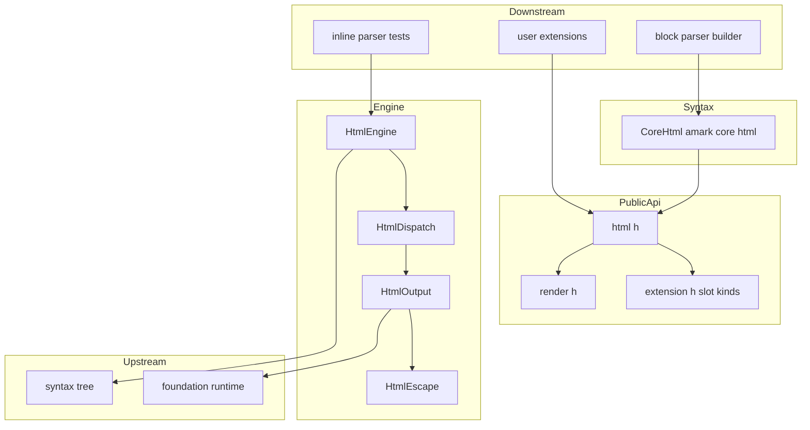
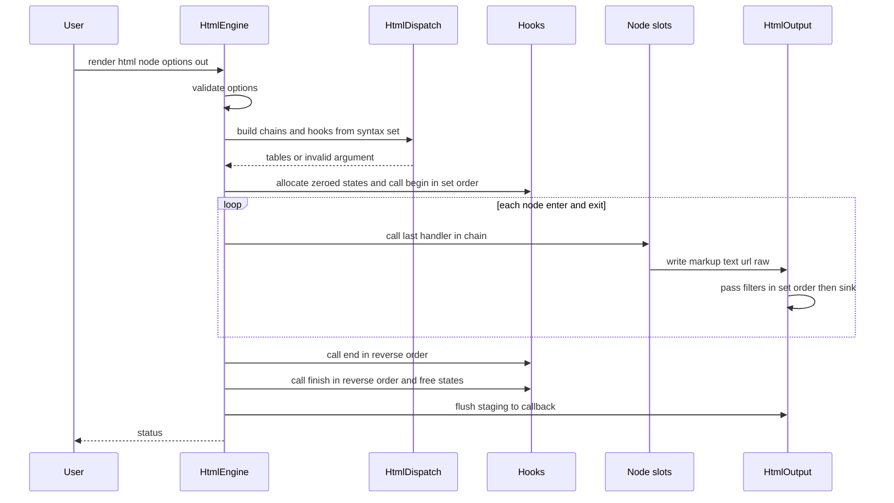
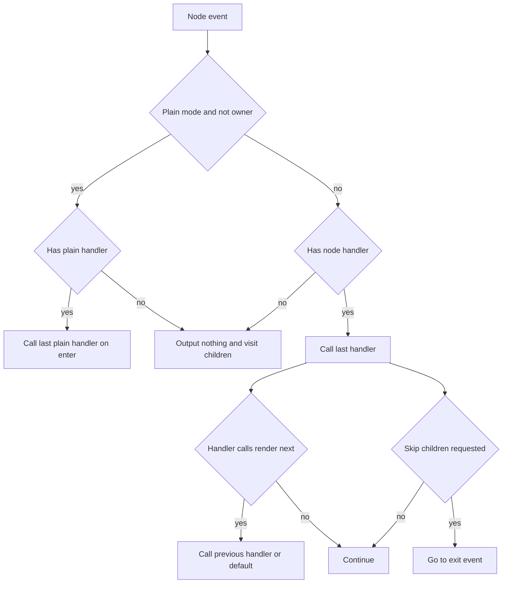
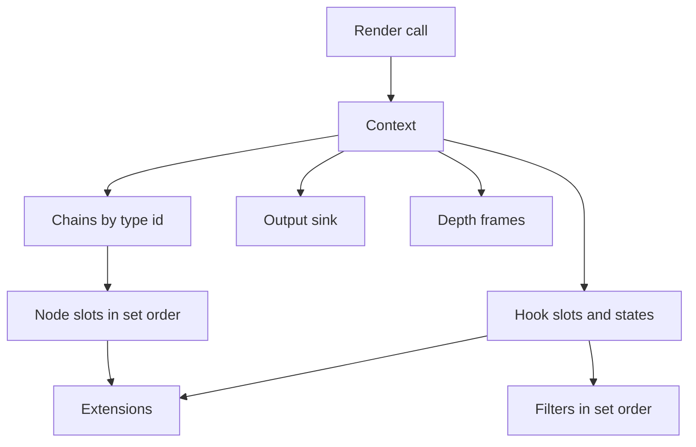

# Design Document: html-renderer

## Overview
**Purpose**：`html-renderer` は、Amark の利用者と後続の spec に、`syntax-tree` の構文木（パースしたもの、手で組み立てたもの、編集したもの）を CommonMark の参照実装（cmark）と同じ HTML に出力する手段を提供する。出力はノード型ごとの「HTML の出力のスロット」で駆動し、組み込みのノード型の出力も同じスロットで提供する。

**Users**：利用者（CMS、静的サイトジェネレータ、ドキュメントツールの開発者）は、出力の入口とオプション（安全モード、ソース位置、改行の扱い）を使う。拡張の実装者は、ノード型ごとの出力のスロット、前の処理の呼び出し、出力の前後のフック、出力のフィルタ、出力の文脈（タイトさ、テキストだけのモード、入れ子の出力、拡張ごとの状態）を使う。`block-parser` は CommonMark の構文セットに組み込みの HTML 出力の構文拡張を含め、`inline-parser` は準拠テストでこの出力を使い、`markdown-renderer` はこの spec と同じ形のスロットを定義する。

**Impact**：公開ヘッダ 2 つ（`render.h`、`html.h`）、`extension.h` へのスロットの種類の番号の追記、`src/render/` の HTML のエンジン、`src/syntax/` の組み込みの HTML 出力の構文拡張 `amark.core.html`、`tests/html/`、`fuzz/html_render_fuzz.c` を追加する。

### Goals
- 組み込みの 19 のノード型の HTML が、cmark 0.31.1（CommonMark 0.31.2）の `html.c` と 1 対 1 に対応する。
- エンジンは個別のノード型を知らず、組み込みの出力も利用者と同じ公開のスロットと出力の文脈だけで書かれる。
- 表、取り消し線、タスクリスト、脚注、タグフィルタの cmark-gfm 相当の HTML を、テストにだけ置く拡張で、公開 API だけで出力できる。
- 深さ 10 万の木を、呼び出しのスタックを深さに比例して使わずに、ノードの数と出力の大きさに線形の時間で出力する。

### Non-Goals
- パース、CommonMark の構文の構文拡張、CommonMark の構文セットの構築関数（`block-parser`、`inline-parser`）
- CommonMark spec の準拠テストのランナー（`inline-parser`）と、GFM 相当の構文のパースの部分
- Markdown の出力（`markdown-renderer`）。ただし、スロットの形を揃えるための規約をこの設計に記す
- レンダラのオブジェクト（構文セットごとの表の使い回し）、出力の要素への任意の属性の追加の API、XHTML 以外の書式の選択

## Boundary Commitments

### This Spec Owns
- 公開ヘッダ `include/amark/render.h`（レンダラが共有する出力先の型）と `include/amark/html.h`（オプション、入口、スロットの構造体、出力の文脈の API、ユーティリティ、組み込みの HTML 出力の構文拡張の取得）
- `include/amark/extension.h` への追記：スロットの種類の番号 `AMARK_SLOT_HTML_NODE`、`AMARK_SLOT_HTML_HOOKS`（この spec の範囲は 0x0300–0x03FF）
- `src/render/` の HTML のエンジンのすべて：出力先と書き出しと分類つきのフィルタ、スロットの検査と連鎖の表、部分木のたどり、出力の文脈、前後のフックと拡張ごとの状態、入れ子の出力、エスケープと URL のユーティリティ
- 組み込みの HTML 出力の構文拡張 `amark.core.html`（名前、19 のノード型のスロット、公開の取得関数）と、その実装 `src/syntax/html_core.c`、`html_blocks.c`、`html_inlines.c`
- 組み込みの HTML 出力の登録の規則（下記「組み込みの HTML 出力の登録の規則」）
- `tests/html/` のテスト、テスト専用の HTML の検証用拡張 `tests/html/support/gfm_html_ext.{h,c}`（INTERFACE ライブラリ `amark_test_html_gfm`）、`fuzz/html_render_fuzz.c`
- ケースのデータからテストを生成する共有のスクリプト `tests/html/gen_html_cases.cmake` と、そのケースの形式・引数・検査関数の形の契約（下記「HtmlTests / HtmlFuzz」）。`markdown-renderer` が同じスクリプトを再利用する

### Out of Boundary
- `src/syntax/` の構文のファイル（`atx_heading.c` など）と、CommonMark の構文セットの構築関数。それらの作成と、構築関数への `amark.core.html` の追加は、それを所有する spec（`block-parser`）が行う
- `tests/extensions/` の GFM 相当の検証用拡張の本体（パースのスロットとの組み合わせ。`inline-parser`）。この spec の `amark_test_html_gfm` は、その HTML の部分として再利用できる形で提供するだけ
- CommonMark spec の全例との照合（`inline-parser`）
- Markdown の出力とそのスロットの具体的な構造体（`markdown-renderer`）
- 木の変更（出力は木を変えない）、ノード型の登録とレジストリの API（`syntax-tree`）

### Allowed Dependencies
- `foundation` の公開 API：`export.h`、`status.h`、`allocator.h`、`buffer.h`、`utf8.h`。内部 API：`runtime/alloc_internal.h`（`amark__size_add`、`amark__size_mul`）、`runtime/buffer_internal.h`（`amark__buffer_init`、`amark__buffer_destroy`）。`src/render/` だけが内部 API を使う
- `syntax-tree` の公開 API：`node.h`、`document.h`、`extension.h`（`amark_syntax_set_find_node_type`、`amark_syntax_set_slot_count`、`amark_syntax_set_slot_at`、`amark_node_source_span`、`amark_document_position`、`amark_document_source_data`、`amark_document_allocator`、属性とリテラルの取得関数）。`src/tree/` の内部ヘッダは使わない
- テスト時：Naos、`amark_add_test()`、`amark_add_generated_tests()`、`AmarkTestGen.cmake`、`amark_test_support`（`AMARK_CHECK_OOM_SWEEP`、`AMARK_CHECK_BUFFER_EQ`、`amark_test_allocator`）、`amark_test_tree`（`amark_test_tree_build`）、`amark_add_fuzzer()`
- レイヤーの規則：`src/render/` は `src/syntax/` と `src/parse/` を参照しない。`src/syntax/html_*.c` は公開ヘッダだけを include する（`src/render/` の内部ヘッダを使わない）。公開ヘッダは他の公開ヘッダだけを include する

### Revalidation Triggers
- `amark_html_node_slot` / `amark_html_hooks_slot` のフィールド、スロットの種類の番号、連鎖・フック・フィルタの順の規則の変更 → 利用者の拡張、`inline-parser` の検証用拡張、`markdown-renderer`（形を揃える）
- 出力の文脈の API（書き出し、タイトさ、テキストだけのモード、入れ子の出力、状態）の意味の変更 → 利用者の拡張、`inline-parser`
- 組み込みの出力の表の変更（cmark との対応）、エスケープの規則、危険な URL の規則の変更 → `inline-parser` の準拠テスト
- `amark.core.html` の名前・取得関数・登録の規則の変更 → `block-parser`（構文セットの構築関数）
- `render.h` の型の変更 → `markdown-renderer`
- `syntax-tree` のスロットの見出し、構文セットの列挙、ソース上の範囲の API の変更 → この spec
- `gen_html_cases.cmake` のケースの形式（見出し・区切りの行、オプションの語の扱い）、引数（`CHECK=`、`INCLUDE=`）、生成するテストが呼ぶ検査関数の形の変更 → `markdown-renderer`（同じスクリプトで `tests/markdown/data/*_cases.txt` を生成する）
- `amark_test_html_gfm` の依存（Naos に依存しないこと）の変更 → `inline-parser`（`inline_parse`）と `markdown-renderer`（`md_roundtrip`、`md_edit`）のファジングターゲット（中間のライブラリ `amark_test_parse_gfm`（`block-parser`）と `amark_test_gfm`（`inline-parser`）を通して間接にリンクする）
- `foundation` の `amark.h` の正規の include の順の変更 → この spec（`amark.h` への追加の位置）

## Architecture

### Architecture Pattern & Boundary Map
**Selected pattern**：スロット駆動のレンダラ。エンジン（`src/render/`）は、文書の構文セットから HTML のスロットを集めて型の識別子ごとの連鎖の表を作り、部分木を反復でたどって各ノードの連鎖の最後の処理を呼ぶ。エンジンは個別のノード型を知らない。組み込みのノード型の出力は、`src/syntax/` の出力の構文拡張 `amark.core.html` が、公開のスロットと出力の文脈だけで実装する。



**Dependency direction（`src/render/` の中）**：`html_escape.c` → `html_output.c` → `html_dispatch.c` → `html_render.c`。左のファイルは右のファイルの関数を呼ばない。`html_internal.h` は文脈の構造体と、ファイル間の `amark__html_*` の宣言を持つ。`src/syntax/html_blocks.c` と `html_inlines.c` → `html_core.c`（拡張の表）。`src/syntax/` から `src/render/` への依存は公開ヘッダ（`html.h`）だけ。違反はレビューでエラーとする。

**Architecture Integration**：
- Domain boundaries：エンジン（汎用）と組み込みの出力（個別のノード型）をレイヤーで分ける。エンジンの中は「書き出し」「スロットの解決」「たどりと文脈」に分ける。
- Existing patterns preserved：`foundation` の状態コード・出力引数・アロケータ・`struct_size`、`syntax-tree` のスロットの見出しと構文セットの順、`amark.core` が組み込みのノード型をまとめる形。
- Steering compliance：C99、`amark_` / `AMARK_` / `amark__`、`AMARK_API`、不透明型、グローバルな可変状態なし（静的なデータは `const`）、ライセンスヘッダ、組み込みも公開 API だけを使う。

### 組み込みの HTML 出力の登録の規則
1. 組み込みの 19 のノード型の HTML の処理は、この spec が `src/syntax/html_blocks.c`（ブロックの 10 型）と `src/syntax/html_inlines.c`（インラインの 9 型）に実装し、`src/syntax/html_core.c` の構文拡張 `amark.core.html` のスロットとしてだけ登録する。処理の関数は公開しない（スロットを通してだけ使う）。
2. `amark.core.html` はノード型とパースのスロットを持たず、HTML のスロット（`AMARK_SLOT_HTML_NODE` を 19 個）だけを持つ。公開の `amark_html_core_extension()` で取得する。
3. CommonMark の構文の構文拡張（`block-parser` と `inline-parser` が `src/syntax/` に置く `commonmark.*`）は、組み込みのノード型の HTML のスロットを持たない。特定の構文だけが独自の HTML を必要とする場合（CommonMark にはない）は、その構文拡張に HTML のスロットを足してよく、順の規則で `amark.core.html` を上書きする。
4. CommonMark の構文セットの構築関数（`block-parser` が所有）は、`amark.core.html` を `amark.core` の直後（最初に追加する構文拡張）に追加する。この spec は構築関数のファイルを編集しない。
5. 利用者が `amark_syntax_set_new` から自分で構文セットを作る場合は、組み込みのノード型を出力するために `amark.core.html` を追加する。追加しなければ、組み込みのノード型は出力の処理を持たない型として扱われる（要件 9.4）。
6. 組み込みの出力を差し替える利用者は、`amark.core.html` より後に同じノード型の HTML のスロットを持つ構文拡張を追加する（`amark_syntax_set_replace` で `amark.core.html` を置き換えてもよい）。

### Technology Stack

| Layer | Choice / Version | Role in Feature | Notes |
|-------|------------------|-----------------|-------|
| Language | C99 | ライブラリ、テスト、ファジング | `amark_target_defaults()` |
| Runtime | `foundation`（status、allocator、buffer、utf8） | 確保、出力の組み立て | 新しい依存なし |
| Tree | `syntax-tree`（node、document、extension） | 木の参照、スロットの列挙、ソース上の範囲 | 内部ヘッダは使わない |
| Reference | cmark 0.31.1 `html.c` / houdini（規則だけ） | 出力とエスケープの規則の基準 | コードは取り込まない |
| Test | Naos v0.4.0、`amark_test_support`、`amark_test_tree`、`amark_add_generated_tests` | 手で組み立てた木の出力の照合 | `amark_test_html_gfm` を追加 |
| Fuzz | `amark_add_fuzzer` | 木の操作列からの出力 | `fuzz/html_render_fuzz.c` |

## File Structure Plan

### Directory Structure
```
include/amark/
├── render.h              # amark_write_fn（レンダラが共有する出力先の書き出しの関数の型）
└── html.h                # オプション、入口、スロットの構造体、出力の文脈の API、ユーティリティ、amark_html_core_extension()
src/render/
├── html_internal.h       # struct amark_html_context、連鎖の表、フックの記録、ファイル間の amark__html_* の宣言
├── html_escape.c         # HTML のエスケープ、href のエスケープ、危険な URL の判定（文脈を使わない純粋な関数）
├── html_output.c         # 出力先（バッファ／書き出しの関数と中継のバッファ）、分類つきの書き出し、フィルタの連鎖、cr の追跡、sourcepos の書き出し
├── html_dispatch.c       # スロットの検査、型の識別子ごとの連鎖の表とフックの一覧の構築と解放
└── html_render.c         # 入口、オプションの検査、反復のたどり、深さごとの文脈、テキストだけのモード、render_next、入れ子の出力、フックと状態
src/syntax/
├── html_core_internal.h  # 19 のスロットの extern 宣言（amark__html_slot_<type>）。html_core.c だけが使う
├── html_core.c           # amark.core.html の構文拡張の表と amark_html_core_extension()
├── html_blocks.c         # document、block_quote、list、item、code_block、html_block、paragraph、heading、thematic_break、link_definition のスロット
└── html_inlines.c        # text、softbreak、linebreak、code、html_inline、emph、strong、link、image のスロット（テキストだけのモードを含む）
tests/html/
├── CMakeLists.txt        # テストの登録、amark_test_html_gfm（INTERFACE）の定義、生成テスト
├── support/
│   ├── html_test_support.h   # 構文セットと文書の用意、S 式から組み立てて出力する補助、AMARK_CHECK_HTML
│   ├── html_test_support.c
│   ├── gfm_html_ext.h        # 検証用のノード型の記述子と HTML のスロット（表、取り消し線、タスク項目、脚注、タグフィルタ）
│   └── gfm_html_ext.c
├── gen_html_cases.cmake      # data/*_cases.txt から Naos のテストを生成する（共有。markdown-renderer も使う。形式は契約）
├── data/block_cases.txt      # ブロックの組み込みの型の S 式と期待する HTML の組（cmark の html.c の各分岐）
├── data/inline_cases.txt     # インラインの組み込みの型の S 式と期待する HTML の組
├── render_entry_test.c       # 入口、出力先、失敗の扱い、決定性、部分木と切り離したノード
├── safe_mode_test.c          # 生の HTML の省略、危険な URL、生の HTML の許可、拡張の生の HTML
├── options_test.c            # sourcepos、ソフトブレーク、未知のオプション、既定
├── escape_test.c             # エスケープと URL のユーティリティの全バイト
├── slot_test.c               # 登録、順、render_next、処理のない型、子の省略、不正なスロット
├── context_test.c            # 書き出しの手段、cr、タイトさ、テキストだけのモード、入れ子の出力、誤用
├── hooks_filter_test.c       # 前後のフック、状態と後始末、フィルタの順と分類、部分木の出力でのフック
├── gfm_html_test.c           # 表、取り消し線、タスクリスト、脚注、タグフィルタ（2 方式）
├── oom_test.c                # 確保失敗の総当たり
└── scale_test.c              # 深い木、計算量
fuzz/
├── html_render_fuzz.c        # 入力を木の操作列と出力のオプションとして解釈して出力する
└── corpus/html_render/       # 種のファイル
```

### Modified Files
- `include/amark/amark.h` — `foundation` の design が定める `amark.h` の正規の include の順（`foundation` のヘッダ → 木のヘッダ → `render.h`、`html.h` → `entity.h`、`scan.h`、`parser.h`、`block.h`、`inline.h`、`commonmark.h` → `markdown.h`）の「`render.h`、`html.h`」の位置に、この 2 つをこの順で追加する。
- `include/amark/extension.h` — スロットの種類の番号の節に `AMARK_SLOT_HTML_NODE`（0x0301）、`AMARK_SLOT_HTML_HOOKS`（0x0302）と、この spec の範囲（0x0300–0x03FF）の注記を追記する。
- `src/CMakeLists.txt` — `amark_objects` に `src/render/html_*.c` と `src/syntax/html_*.c` を追加する。
- `tests/CMakeLists.txt` — `add_subdirectory(html)` を追加する。
- `fuzz/CMakeLists.txt` — `amark_add_fuzzer(html_render SOURCES html_render_fuzz.c CORPUS corpus/html_render)` を追加する。

## System Flows

### 1 回の出力

- どこかで失敗したら、たどりを止めて `end` を呼ばずに `finish` だけを呼び、状態と表を解放する。出力先がバッファなら、長さを呼び出し前に戻す。
- 失敗は文脈に記録され（最初の失敗を保持）、処理が書き出しの失敗を無視して成功を返しても、出力全体は失敗になる。

### ノードの処理の選び方

- テキストだけのモードは、それを開始したノード（owner）の子孫に適用し、owner の出るときの処理は通常のモードで呼ぶ。テキストだけのモードでは、処理を入るときだけ呼ぶ（出るときは呼ばない）。

## Requirements Traceability

| Requirement | Summary | Components | Interfaces | Flows |
|-------------|---------|------------|------------|-------|
| 1.1 | 任意の部分木の出力 | HtmlEngine | `amark_render_html`, `amark_render_html_to` | 1 回の出力 |
| 1.2, 1.3 | バッファへの追加、書き出しの関数 | HtmlOutput | `amark_buffer`, `amark_write_fn` | 1 回の出力 |
| 1.4, 1.5 | 失敗の扱い | HtmlOutput, HtmlEngine | 状態コード、最初の失敗の保持 | 1 回の出力 |
| 1.6, 1.7 | 木を変えない、決定性 | HtmlEngine | const のノード | — |
| 2.1–2.9 | 組み込みの出力 | CoreHtml | 組み込みの出力の表 | — |
| 3.1–3.4 | 安全モード | CoreHtml, HtmlOutput, HtmlEscape | `amark_html_write_raw`, `amark_html_write_url`, `amark_html_url_is_safe` | — |
| 3.5 | 拡張の生の HTML | HtmlOutput | `amark_html_write_raw` | — |
| 3.6 | 常にエスケープ | HtmlOutput, CoreHtml | `amark_html_write_escaped` | — |
| 4.1, 4.2 | sourcepos | HtmlOutput, CoreHtml | `amark_html_write_sourcepos` | — |
| 4.3–4.5 | ソフトブレーク | CoreHtml | `AMARK_HTML_HARDBREAKS`, `AMARK_HTML_NOBREAKS` | — |
| 4.6, 4.7 | 未知のオプション、既定 | HtmlEngine | `amark_html_options` | 1 回の出力 |
| 5.1–5.4 | ユーティリティ | HtmlEscape | `amark_html_escape`, `amark_html_escape_href`, `amark_html_url_is_safe` | — |
| 6.1, 6.7, 6.8 | ノード型ごとのスロット | HtmlDispatch | `amark_html_node_slot` | 処理の選び方 |
| 6.2, 6.3 | 順と前の処理 | HtmlDispatch, HtmlEngine | `amark_html_render_next` | 処理の選び方 |
| 6.4, 6.5 | 処理のない型、子の省略 | HtmlEngine | `amark_html_skip_children` | 処理の選び方 |
| 6.6 | 不正なスロット | HtmlDispatch | 検査の規則 | 1 回の出力 |
| 7.1, 7.2 | 書き出しの手段 | HtmlOutput | `amark_html_write*`, `amark_html_cr`, `amark_html_flags` | — |
| 7.3 | タイトさ | HtmlEngine | `amark_html_set_tight_children`, `amark_html_tight` | — |
| 7.4–7.6 | テキストだけのモード | HtmlEngine, CoreHtml | `amark_html_enter_plain`, `render_plain` | 処理の選び方 |
| 7.7, 7.8 | 入れ子の出力 | HtmlEngine | `amark_html_render_subtree`, `AMARK_HTML_MAX_NESTING` | — |
| 7.9 | 誤用 | HtmlEngine | 不正な引数 | — |
| 8.1–8.3 | 前後のフック | HtmlDispatch, HtmlEngine | `amark_html_hooks_slot` | 1 回の出力 |
| 8.4, 8.5 | 拡張ごとの状態 | HtmlEngine | `amark_html_state`, `amark_html_current_extension` | 1 回の出力 |
| 8.6, 8.7 | フィルタ | HtmlOutput | `filter`, `amark_html_filter_forward` | 1 回の出力 |
| 8.8 | 部分木の出力でのフック | HtmlEngine | 入口 | 1 回の出力 |
| 9.1, 9.2 | 組み込みの構文拡張 | CoreHtml | `amark_html_core_extension` | — |
| 9.3, 9.4 | 上書き、含まれない場合 | HtmlDispatch | 連鎖の規則 | 処理の選び方 |
| 10.1–10.6 | GFM 相当の表現力 | GfmHtmlExt, GfmHtmlTests | 公開のスロットと文脈 | — |
| 11.1 | 規約 | 全コンポーネント | 不透明型、`struct_size` | — |
| 11.2 | 文書のアロケータ | HtmlEngine, HtmlOutput | `amark_document_allocator` | — |
| 11.3, 11.4 | 深い木、線形の時間 | HtmlEngine, HtmlDispatch | 反復のたどり、連鎖の表 | — |
| 11.5 | スレッド | 全コンポーネント | グローバルな可変状態なし | — |
| 11.6 | UTF-8 | HtmlEscape, CoreHtml | バイトを変えないエスケープ | — |

## Components and Interfaces

| Component | Domain/Layer | Intent | Req Coverage | Key Dependencies (P0/P1) | Contracts |
|-----------|--------------|--------|--------------|--------------------------|-----------|
| HtmlApi | Public headers | 公開の型と関数の宣言、スロットの種類の番号 | 11.1 | extension.h (P0) | Service |
| HtmlEscape | Render | エスケープと URL の判定の純粋な関数 | 3.2, 3.4, 5.1–5.4, 11.6 | buffer (P0) | Service |
| HtmlOutput | Render | 出力先、分類つきの書き出し、フィルタ、cr、sourcepos | 1.2–1.5, 3.5, 3.6, 4.1, 4.2, 7.1, 7.2, 8.6, 8.7, 11.2 | HtmlEscape (P0), buffer (P0), document (P1) | Service, State |
| HtmlDispatch | Render | スロットの検査と連鎖の表、フックの一覧 | 6.1–6.3, 6.6–6.8, 8.1, 9.3, 9.4, 11.4 | syntax set (P0) | Service |
| HtmlEngine | Render | 入口、たどり、文脈、テキストだけのモード、入れ子、フックと状態 | 1.1, 1.4–1.7, 4.6, 4.7, 6.3–6.5, 7.3–7.9, 8.1–8.5, 8.8, 11.2–11.5 | HtmlDispatch (P0), HtmlOutput (P0), node (P0) | Service, State |
| CoreHtml | Syntax | `amark.core.html` と 19 の型の出力 | 2.1–2.9, 3.1–3.3, 3.6, 4.1, 4.3–4.5, 7.6, 9.1, 9.2 | html.h (P0) | Service |
| HtmlTestSupport | Test | 構文セットと木の用意、出力の照合 | 10.6 の基盤 | amark_test_tree (P0) | Service |
| GfmHtmlExt | Test | GFM 相当の HTML の検証用の型とスロット | 10.1–10.6 | html.h (P0) | Service |
| HtmlTests / HtmlFuzz | Test / Fuzz | 要件の検証 | 全要件 | HtmlTestSupport (P0) | Batch |

### Public headers

#### HtmlApi

| Field | Detail |
|-------|--------|
| Intent | 公開の型・関数・定数を、依存の順に宣言する |
| Requirements | 11.1 |

**Responsibilities & Constraints**
- `render.h` は `status.h` と `<stddef.h>` だけを include する。`html.h` は `node.h`、`buffer.h`、`extension.h`、`render.h` を include する。どちらも `AMARK_BEGIN_DECLS` / `AMARK_END_DECLS` で囲み、ガードは `AMARK_RENDER_H`、`AMARK_HTML_H`。
- 公開の構造体（`amark_html_options`、`amark_html_node_slot`、`amark_html_hooks_slot`）は先頭に大きさのフィールドを持つ（スロットは `amark_slot_header` の `struct_size`）。ライブラリは v1 の最小の大きさ以上であることを確かめ、知らない末尾のフィールドを読まない。

**Contracts**: Service [x]
```c
/* include/amark/render.h */
/* 出力先の書き出しの関数。length は 0 にならない。AMARK_OK 以外を返すと出力を止め、その値を利用者に返す */
typedef amark_status (*amark_write_fn)(void *user_data, const char *data, size_t length);

/* include/amark/extension.h（追記） */
/* 0x0300–0x03FF：html-renderer */
#define AMARK_SLOT_HTML_NODE  0x0301u   /* amark_html_node_slot */
#define AMARK_SLOT_HTML_HOOKS 0x0302u   /* amark_html_hooks_slot */
```

### Render

#### HtmlEscape

| Field | Detail |
|-------|--------|
| Intent | cmark と同じ規則のエスケープと危険な URL の判定 |
| Requirements | 3.2, 3.4, 5.1–5.4, 11.6 |

**Responsibilities & Constraints**
- HTML のエスケープ：`&` → `&amp;`、`<` → `&lt;`、`>` → `&gt;`、`"` → `&quot;`。他のバイト（`'`、`/`、0x80 以上を含む）はそのまま。
- href のエスケープ：英数字と `-_.+!*(),%#@?=;:/$~` はそのまま。`&` → `&amp;`、`'` → `&#x27;`。それ以外のすべてのバイト（制御文字、空白、`"<>[\]^`` ` ``{|}`、0x80 以上）は `%XX`（大文字の 16 進）。`%` は検査せずそのまま。
- 危険な URL：ASCII の大文字と小文字を区別せず、先頭が `data:image/png`、`data:image/gif`、`data:image/jpeg`、`data:image/webp` なら安全、`javascript:`、`vbscript:`、`file:`、`data:` なら危険、それ以外は安全。前置きの空白は取り除かない（cmark と同じ）。
- すべて文書・構文セット・文脈なしに使え、確保は出力のバッファだけ。エスケープは UTF-8 の多バイトの並びのバイトを変えない（href は 0x80 以上を百分率符号化するので、出力は ASCII）。

**Contracts**: Service [x]
```c
/* include/amark/html.h */
AMARK_API amark_status amark_html_escape(amark_buffer *out, const char *data, size_t length);
AMARK_API amark_status amark_html_escape_href(amark_buffer *out, const char *data, size_t length);
AMARK_API bool amark_html_url_is_safe(const char *data, size_t length);   /* 危険なスキームなら false */
```
- Preconditions：`out` が NULL、または `data` が NULL で `length` が 0 でなければ `AMARK_ERROR_INVALID_ARGUMENT`。
- Postconditions：失敗時（メモリ不足など）は `out` を呼び出し前の長さに戻す。
- 内部の契約（`html_internal.h`）：`const char *amark__html_escape_byte(unsigned char c)`（置き換えの文字列。そのままなら NULL）、`bool amark__html_href_safe_byte(unsigned char c)` を `html_output.c` に提供し、出力先へ直接エスケープしながら書けるようにする（中間のバッファを作らない。`html_escape.c` は文脈を知らない）。

#### HtmlOutput

| Field | Detail |
|-------|--------|
| Intent | 出力先への分類つきの書き出し、フィルタの連鎖、cr の判定、sourcepos |
| Requirements | 1.2–1.5, 3.5, 3.6, 4.1, 4.2, 7.1, 7.2, 8.6, 8.7, 11.2 |

**Responsibilities & Constraints**
- 出力先：
  - バッファ：開始時の長さを記録し、直接追加する。失敗で終わったら `amark_buffer_truncate` で戻す。
  - 書き出しの関数：埋め込みの中継のバッファ（文書のアロケータ）にためて、8 KiB を超えたら渡し、終わりに残りを渡す。書き出しの関数の失敗は最初の失敗として記録する。
- 書き出し（すべての書き出しは分類を持つ）：

| 関数 | 分類 | 内容 |
|------|------|------|
| `amark_html_write` / `amark_html_write_cstr` | MARKUP | そのまま |
| `amark_html_write_escaped` | TEXT | HTML のエスケープ |
| `amark_html_write_url` | TEXT | `AMARK_HTML_UNSAFE` か安全な URL なら href のエスケープ、危険なら何も書かない |
| `amark_html_write_raw` | RAW / MARKUP | `AMARK_HTML_UNSAFE` ならそのまま（RAW）、そうでなければ `<!-- raw HTML omitted -->`（MARKUP） |
| `amark_html_cr` | MARKUP | この出力の呼び出しで書いた最後のバイト（フィルタの前）が LF でなく、すでに 1 バイト以上書いていれば LF |
| `amark_html_write_sourcepos` | MARKUP | `AMARK_HTML_SOURCEPOS` があり、ノードがソース上の範囲を持てば ` data-sourcepos="SL:SC-EL:EC"` |

- sourcepos の値：`amark_node_source_span` の範囲で、終わりの側の LF と CR のバイトを（開始より後ろの範囲で）取り除き、開始の位置と「最後のバイトの位置」（列は最後のバイトを含む、1 から数えるバイト単位）を `amark_document_position` で求める。範囲が空なら終わりは開始と同じ位置。
- フィルタ：フックのスロットのうち `filter` を持つものを構文セットの順に並べる。書き出しは最初のフィルタに渡り、フィルタは `amark_html_filter_forward` で次へ（最後は出力先へ）渡す。渡さなければ省く。フィルタの中からは `amark_html_filter_forward` 以外の書き出しを呼べない（`AMARK_ERROR_INVALID_STATE`）。`cr` の判定と「最後のバイト」はフィルタの前の書き出しで追跡する。
- 長さ 0 の書き出しは成功し、フィルタにも出力先にも渡さない。
- 最初の失敗を文脈に保持し、以後の書き出しは何もせずにその失敗を返す。

**Contracts**: Service [x] / State [x]
```c
/* include/amark/html.h */
typedef struct amark_html_context amark_html_context;   /* 不透明。出力の処理・フック・フィルタの呼び出しの間だけ有効 */

typedef enum amark_html_chunk_kind {
    AMARK_HTML_CHUNK_MARKUP = 1,   /* レンダラや拡張が書いたマークアップ */
    AMARK_HTML_CHUNK_TEXT = 2,     /* エスケープしたテキストと属性の値（URL を含む） */
    AMARK_HTML_CHUNK_RAW = 3       /* 生の HTML（AMARK_HTML_UNSAFE のときだけ現れる） */
} amark_html_chunk_kind;

AMARK_API amark_status amark_html_write(amark_html_context *ctx, const char *data, size_t length);
AMARK_API amark_status amark_html_write_cstr(amark_html_context *ctx, const char *text);
AMARK_API amark_status amark_html_write_escaped(amark_html_context *ctx, const char *data, size_t length);
AMARK_API amark_status amark_html_write_url(amark_html_context *ctx, const char *data, size_t length);
AMARK_API amark_status amark_html_write_raw(amark_html_context *ctx, const char *data, size_t length);
AMARK_API amark_status amark_html_cr(amark_html_context *ctx);
AMARK_API amark_status amark_html_write_sourcepos(amark_html_context *ctx, const amark_node *node);
AMARK_API amark_status amark_html_filter_forward(amark_html_context *ctx, amark_html_chunk_kind kind,
                                                 const char *data, size_t length);
```
- Preconditions：`ctx` が NULL、`data` が NULL で `length` が 0 でない、`kind` が未知、`node` が NULL か別の文書のもの → `AMARK_ERROR_INVALID_ARGUMENT`。フィルタの外での `amark_html_filter_forward` → `AMARK_ERROR_INVALID_STATE`。
- State model：`{sink: buffer か (fn, user_data, staging), start_length, last_byte, wrote_any, filters[], filter_index（フィルタの中なら現在の位置、外なら NONE）, error}`。

#### HtmlDispatch

| Field | Detail |
|-------|--------|
| Intent | 構文セットの HTML のスロットを検査し、型ごとの連鎖とフックの一覧を作る |
| Requirements | 6.1–6.3, 6.6–6.8, 8.1, 9.3, 9.4, 11.4 |

**Responsibilities & Constraints**
- `AMARK_SLOT_HTML_NODE` のスロットを `amark_syntax_set_slot_at` で構文セットの順に列挙し、各スロットを検査する：`struct_size` が v1 の最小（`user_data` の末尾）以上、`node_type` と `render` が NULL でない、`amark_syntax_set_find_node_type` で型が見つかる。違反は `AMARK_ERROR_INVALID_ARGUMENT`。
- 連鎖の表：型の識別子で引く配列（大きさは見つかった最大の識別子 ＋ 1）。各要素は、その型のスロットを構文セットの順に並べた一覧（通常の処理の連鎖）と、`render_plain` を持つものだけの一覧（テキストだけのモードの連鎖）を指す。スロットのない型は空。
- `AMARK_SLOT_HTML_HOOKS` のスロットを構文セットの順に列挙し、検査する：`struct_size` が v1 の最小以上、`state_size` が `AMARK_HTML_MAX_STATE_SIZE`（64 KiB）以下、1 つの構文拡張に 2 つ以上ない。違反は `AMARK_ERROR_INVALID_ARGUMENT`。
- 確保は文書のアロケータ。構築と解放は 1 回の出力の中で完結する。計算量はスロットの数 × 名前の検索（`syntax-tree` の名前の索引）に比例する。
- 拡張が HTML のスロットだけを持っても、他の種類のスロットを持っても、同じ規則で扱う（6.8）。

**Contracts**: Service [x]
```c
/* include/amark/html.h */
typedef amark_status (*amark_html_node_fn)(amark_html_context *ctx, const amark_node *node,
                                           bool entering, void *user_data);
typedef amark_status (*amark_html_plain_fn)(amark_html_context *ctx, const amark_node *node, void *user_data);

typedef struct amark_html_node_slot {
    amark_slot_header header;             /* kind = AMARK_SLOT_HTML_NODE、struct_size = sizeof(amark_html_node_slot) */
    const char *node_type;                /* ノード型の名前（"heading"、"test.table" など） */
    amark_html_node_fn render;            /* 必須。入るときと出るときに呼ぶ（葉も両方） */
    amark_html_plain_fn render_plain;     /* 任意。テキストだけのモードで入るときに呼ぶ */
    void *user_data;
} amark_html_node_slot;

#define AMARK_HTML_MAX_STATE_SIZE 65536u

typedef struct amark_html_hooks_slot {
    amark_slot_header header;             /* kind = AMARK_SLOT_HTML_HOOKS */
    size_t state_size;                    /* 1 回の出力の間の状態の大きさ。0 なら状態なし */
    amark_status (*begin)(amark_html_context *ctx, void *state, void *user_data);   /* 任意 */
    amark_status (*end)(amark_html_context *ctx, void *state, void *user_data);     /* 任意 */
    void (*finish)(amark_html_context *ctx, void *state, void *user_data);          /* 任意。後始末 */
    amark_status (*filter)(amark_html_context *ctx, void *state, amark_html_chunk_kind kind,
                           const char *data, size_t length, void *user_data);        /* 任意 */
    void *user_data;
} amark_html_hooks_slot;
```
- 内部の契約（`html_internal.h`）：`amark__html_dispatch_build(ctx)`、`amark__html_dispatch_free(ctx)`、`amark__html_chain_of(ctx, type, plain)`。

#### HtmlEngine

| Field | Detail |
|-------|--------|
| Intent | 入口、部分木のたどり、出力の文脈、テキストだけのモード、前の処理、入れ子の出力、フックと状態 |
| Requirements | 1.1, 1.4–1.7, 4.6, 4.7, 6.3–6.5, 7.3–7.9, 8.1–8.5, 8.8, 11.2–11.5 |

**Responsibilities & Constraints**
- 入口：`node` と出力先を検査する（NULL は `AMARK_ERROR_INVALID_ARGUMENT`）。`options` が NULL なら既定（フラグ 0）。`struct_size` が v1 の最小未満か、未知のフラグのビットがあれば `AMARK_ERROR_INVALID_ARGUMENT` で何も出力しない。文脈は呼び出し側のスタックに置き、確保は文書のアロケータ（`amark_document_allocator`）だけで行う。
- 手順：連鎖の表とフックの一覧の構築 → 状態の確保（すべて 0 で埋める）→ `begin` を構文セットの順 → 部分木の出力 → `end` を逆の順 → `finish` を逆の順（成否にかかわらず、状態の確保に成功していれば全スロット）→ 解放 → 中継のバッファの残りを渡す。失敗した時点で以降の `begin` / たどり / `end` を飛ばし、`finish` と解放は行う。
- たどり：親・最初の子・次の兄弟のリンクで反復する（`amark_iter` は使わない）。根の部分木の外へ出ない。各ノードで入るとき（子を持てる型も葉も）と出るときに処理を呼ぶ。子の省略が求められたら、子へ降りずに出るときへ進む。
- 深さごとの文脈：動的な配列（文書のアロケータ、倍々に伸ばす）に `{tight_children}` を持つ。`amark_html_tight` は親の要素の値、部分木の根では false。入れ子の出力は配列の新しい基点から始め、外側の値を見ない。
- 呼び出しの文脈：処理を呼ぶ前に `{node, entering, chain, position, plain, extension}` を保存して設定し、戻ったら元に戻す。`amark_html_render_next` は現在の `node` と `entering` に一致するときだけ、`position - 1` の処理を呼ぶ（0 なら何もしない）。`amark_html_current_extension` は現在の処理を持つ構文拡張。フックの中ではそのフックの構文拡張。
- テキストだけのモード：入るときの処理の中で `amark_html_enter_plain` が呼ばれたら、処理が戻った後、そのノードを owner として子孫をテキストだけのモードで出力する。子孫では、入るときにテキストだけのモードの連鎖の最後を呼び（なければ何もしない）、出るときは何も呼ばない。owner を出るときに通常のモードに戻り、owner の出るときの処理を通常どおり呼ぶ。すでにテキストだけのモードなら何もしない。
- 入れ子の出力：`amark_html_render_subtree` は、同じ文書の任意のノード（切り離したものを含む）の部分木を、同じ出力先・オプション・フィルタ・状態で、通常のモード・新しい深さの文脈から出力する。フックは呼ばない。入れ子が `AMARK_HTML_MAX_NESTING`（32）を超えたら `AMARK_ERROR_LIMIT_EXCEEDED`。
- 誤用：処理の外での `amark_html_render_next` / `amark_html_skip_children` / `amark_html_enter_plain` / `amark_html_set_tight_children`、フィルタの中での `amark_html_render_subtree` → `AMARK_ERROR_INVALID_STATE`（void の関数は何もしない）。現在のノードでない `node` の `render_next`、別の文書のノードの `render_subtree` → `AMARK_ERROR_INVALID_ARGUMENT`。出るときの `skip_children` と `enter_plain`、`set_tight_children` は何もしない。
- 木を変更しない（const のノードだけを扱う）。グローバルな可変状態を持たない。同じ文書を複数のスレッドで同時に出力することは保証しない（`syntax-tree` の規則に従う）。異なる文書は独立。

**Contracts**: Service [x] / State [x]
```c
/* include/amark/html.h */
#define AMARK_HTML_SOURCEPOS  0x01u   /* ブロックの要素に data-sourcepos を出す */
#define AMARK_HTML_HARDBREAKS 0x02u   /* ソフトブレークを <br /> に */
#define AMARK_HTML_NOBREAKS   0x04u   /* ソフトブレークを空白に（HARDBREAKS が優先） */
#define AMARK_HTML_UNSAFE     0x08u   /* 生の HTML と危険な URL を出す */

typedef struct amark_html_options {
    size_t struct_size;
    uint32_t flags;
} amark_html_options;

AMARK_API void amark_html_options_init(amark_html_options *options);   /* struct_size を設定し、flags を 0 に */

AMARK_API amark_status amark_render_html(const amark_node *node, const amark_html_options *options,
                                         amark_buffer *out);
AMARK_API amark_status amark_render_html_to(const amark_node *node, const amark_html_options *options,
                                            amark_write_fn write, void *user_data);

/* 出力の文脈 */
AMARK_API uint32_t amark_html_flags(const amark_html_context *ctx);
AMARK_API const amark_node *amark_html_root(const amark_html_context *ctx);     /* 利用者が指定した部分木の根 */
AMARK_API amark_status amark_html_render_next(amark_html_context *ctx, const amark_node *node, bool entering);
AMARK_API amark_status amark_html_render_plain_next(amark_html_context *ctx, const amark_node *node);
AMARK_API void amark_html_skip_children(amark_html_context *ctx);
AMARK_API void amark_html_set_tight_children(amark_html_context *ctx, bool tight);
AMARK_API bool amark_html_tight(const amark_html_context *ctx);
AMARK_API void amark_html_enter_plain(amark_html_context *ctx);
AMARK_API bool amark_html_in_plain(const amark_html_context *ctx);

#define AMARK_HTML_MAX_NESTING 32
AMARK_API amark_status amark_html_render_subtree(amark_html_context *ctx, const amark_node *node);

AMARK_API const amark_extension *amark_html_current_extension(const amark_html_context *ctx);
AMARK_API void *amark_html_state(amark_html_context *ctx, const amark_extension *extension);
/* extension のフックのスロットの状態。フックのスロットがないか state_size が 0 なら NULL */
```
- Postconditions：成功なら、出力先に部分木の HTML が追加されている。失敗なら、バッファは呼び出し前の長さで、確保したものはすべて解放されている（書き出しの関数には途中までの出力が渡っていてよい）。
- Invariants：出力は同じ木・構文セット・オプションに対して決定的（構文セットの順と木の順だけで決まる）。

##### State Management
- State model：`{document, allocator, root, flags, dispatch（連鎖の表、フックの一覧と状態）, output（HtmlOutput の状態）, depth の配列, plain_owner, call（現在の呼び出しの文脈）, nesting, error}`。1 回の出力の呼び出しの中だけに存在する。
- Concurrency strategy：文脈は呼び出しごとに独立。共有するのは凍結した構文セットと `const` の静的データ（`amark.core.html` の表、エスケープの表）だけ。

**Implementation Notes**
- Integration：`html_render.c` が `amark__html_dispatch_build` と HtmlOutput の初期化・終了を呼ぶ。数の書式（`start`、行と列）は `snprintf` を使わず、内部の 10 進の変換で書く（ロケールに依存しない）。
- Validation：`render_entry_test`、`slot_test`、`context_test`、`hooks_filter_test`、`oom_test`、`scale_test`。
- Risks：連鎖の呼び出しの深さは同じ型のスロットの数に、入れ子の出力の深さは `AMARK_HTML_MAX_NESTING` に比例してスタックを使う（ノードの深さには比例しない）。

### Syntax

#### CoreHtml

| Field | Detail |
|-------|--------|
| Intent | 組み込みの 19 のノード型の cmark 互換の HTML を、公開のスロットだけで提供する |
| Requirements | 2.1–2.9, 3.1–3.3, 3.6, 4.1, 4.3–4.5, 7.6, 9.1, 9.2 |

**Responsibilities & Constraints**
- `amark.core.html`：名前 `"amark.core.html"`、ノード型 0、`AMARK_SLOT_HTML_NODE` のスロット 19（ノード型の識別子の順）、静的な `const` の記憶域。`amark_html_core_extension()` はそのポインタを返す（解放しない）。
- 出力の表（cmark 0.31.1 の `html.c` と対応。`cr` は `amark_html_cr`、sourcepos は `amark_html_write_sourcepos`、エスケープは `amark_html_write_escaped`）：

| 型 | 入るとき | 出るとき | テキストだけのモード |
|----|----------|----------|----------------------|
| document | なし | なし | なし |
| block_quote | `cr` `<blockquote` sp `>\n` | `cr` `</blockquote>\n` | なし |
| list | `cr`、bullet は `<ul`、ordered で start = 1 は `<ol`、それ以外は `<ol start="N"`、sp、`>\n` | `</ul>\n` / `</ol>\n` | なし |
| item | `cr` `<li` sp `>`、親が list なら `set_tight_children(tight)` | `</li>\n` | なし |
| code_block | `cr` `<pre` sp `><code>`、情報文字列が空でなければ `><code class="` ＋（`language-` で始まらなければ `language-`）＋ 最初の空白類（空白、タブ、LF、VT、FF、CR）までの語のエスケープ ＋ `">`。リテラルのエスケープ、`</code></pre>\n`。子を省く | なし | なし |
| html_block | `cr`、`write_raw(リテラル)`、`cr` | なし | なし |
| paragraph | `tight` でなければ `cr` `<p` sp `>` | `tight` でなければ `</p>\n` | なし |
| heading | `cr` `<hN` sp `>` | `</hN>\n` | なし |
| thematic_break | `cr` `<hr` sp ` />\n` | なし | なし |
| link_definition | 何も出さず、子を省く | なし | なし |
| text | リテラルのエスケープ | なし | リテラルのエスケープ |
| softbreak | HARDBREAKS なら `<br />\n`、NOBREAKS なら空白、それ以外は LF | なし | 空白 |
| linebreak | `<br />\n` | なし | 空白 |
| code | `<code>` リテラルのエスケープ `</code>` | なし | リテラルのエスケープ |
| html_inline | `write_raw(リテラル)` | なし | リテラルのエスケープ |
| emph | `<em>` | `</em>` | なし（子は出す） |
| strong | `<strong>` | `</strong>` | なし（子は出す） |
| link | `<a href="` `write_url(宛先)`、タイトルが空でなければ `" title="` タイトルのエスケープ、`">` | `</a>` | なし（子は出す） |
| image | `` | なし（子は出す） |

  （sp は `amark_html_write_sourcepos(ctx, node)`。葉の型は入るときだけ出力する。）
- 段落のタイトさは `amark_html_tight(ctx)` で判定する（item が設定する）。cmark の「段落の祖父母がタイトなリスト」と同じ結果になる。
- 公開 API（`html.h`、`node.h`）だけを使う。`src/render/` の内部ヘッダを使わない。

**Contracts**: Service [x]
```c
/* include/amark/html.h */
AMARK_API const amark_extension *amark_html_core_extension(void);   /* "amark.core.html"。静的、解放しない */

/* src/syntax/html_core_internal.h（html_core.c だけが include する） */
extern const amark_html_node_slot amark__html_slot_document;   /* … 19 の型のそれぞれ */
```

**Implementation Notes**
- Integration：`block-parser` の CommonMark の構文セットの構築関数が `amark_html_core_extension()` を最初に追加する（登録の規則 4）。この spec のテストは `amark_syntax_set_new` → `amark_syntax_set_append(set, amark_html_core_extension())` → 凍結で構文セットを作る。
- Validation：`data/block_cases.txt` と `data/inline_cases.txt` の生成テストが表の各分岐を照合する。
- Risks：cmark の版を上げるときは表を再照合する（Revalidation Trigger）。

### Renderer slot conventions（`markdown-renderer` と揃える形）
- スロットの種類を「ノード型ごとの出力」と「出力の前後のフックとフィルタ」の 2 つにし、ノード型は名前で指定する。
- 同じ型の処理は構文セットの順に連鎖し、最後のものを使う。前の処理は文脈の `render_next` で呼ぶ。処理を持たない型は自身を出さずに子を出す。
- 出力の文脈は不透明で、呼び出しの間だけ有効。子の省略、入れ子の出力（上限つき）、拡張ごとの 1 回の出力の間の状態、`begin`（構文セットの順）／`end`・`finish`（逆の順）を持つ。
- 入口は `amark_render_<format>(node, options, amark_buffer *)` と `amark_render_<format>_to(node, options, amark_write_fn, user_data)`。オプションは `struct_size` と `flags` を持ち、未知のビットを拒否する。
- 出力の形式が求める固有の文脈（HTML のタイトさとテキストだけのモード、Markdown の接頭辞など）は、各レンダラが文脈の API として足す。

### Test

#### HtmlTestSupport

| Field | Detail |
|-------|--------|
| Intent | テストで構文セット・文書・木を用意し、出力を期待値と照合する |
| Requirements | 10.6 の基盤（全テストが使う） |

**Responsibilities & Constraints**
- `html_test_make_set(extra_extensions[], count, &set)`：`amark_syntax_set_new` → `amark.core.html` → 追加の拡張 → 凍結。`html_test_render_sexpr(set, sexpr, flags, attr_fn, &buffer)`：文書を作り、`amark_test_tree_build` で木を組み立てて出力する。`AMARK_CHECK_HTML(set, sexpr, flags, expected_literal)`：出力と期待値を比べ、違えば両方を表示して失敗する。
- `amark` と `amark_internal` のどちらとも組める（公開 API だけを使う）。

#### GfmHtmlExt

| Field | Detail |
|-------|--------|
| Intent | GFM 相当の構文の HTML を公開のスロットだけで出力する検証用の部品 |
| Requirements | 10.1–10.6 |

**Responsibilities & Constraints**
- INTERFACE ライブラリ `amark_test_html_gfm`（INTERFACE のソース `support/gfm_html_ext.c`、インクルード `support/`）。公開 API（`html.h`、`node.h`、`extension.h`）だけを使い、`src/` を include しない。
- `amark_test_html_gfm` は Naos に依存しない（Naos のヘッダを include せず、Naos をリンクしない）。`amark_test_parse_gfm` と `amark_test_gfm` を通してファジングターゲットに間接にリンクされるため、`foundation` の規則（ファジングターゲットが使うテストの補助ライブラリは Naos に依存せず、`AMARK_FUZZ` か `AMARK_BUILD_TESTS` が ON のとき定義する）に従い、`tests/html/CMakeLists.txt` はこのライブラリを `AMARK_FUZZ` だけが ON の構成でも定義する。Naos を使う照合の補助（`html_test_support`、`AMARK_CHECK_HTML`）は別のファイルに置き、このライブラリに含めない。
- ノード型（名前は `test.` で始まる）と型のデータ、HTML のスロット、拡張の記述子を、部品ごとに公開する（`inline-parser` がパースのスロットと組み合わせて再利用できる）。

| 部品 | ノード型（データ） | 出力 |
|------|--------------------|------|
| 表 | `test.table`（列の数、列ごとの揃え）、`test.table_row`（見出しの行か）、`test.table_cell` | `<table>\n`、見出しの行を `<thead>\n<tr>\n … </tr>\n</thead>\n`、最初の本体の行の前に `<tbody>\n`、`<th>` / `<td>` に `align="…"`、表の終わりに本体があれば `</tbody>\n`、`</table>\n`（cmark-gfm の形） |
| 取り消し線 | `test.strikethrough` | `<del>` / `</del>`。テキストだけのモードでは子だけ |
| タスクリスト | `test.task_item`（チェック済みか。LIST_ITEM を provides） | `cr` `<li` sp `>` ＋ `<input type="checkbox" disabled="" /> ` または `<input type="checkbox" checked="" disabled="" /> `、親が list なら `set_tight_children` |
| 脚注 | `test.footnote_ref`（ラベル）、`test.footnote_def`（ラベル、BLOCK を受け入れる） | 参照：状態に出現順の番号を記録して `<sup class="footnote-ref"><a href="#fn-L" id="fnref-L" data-footnote-ref>N</a></sup>`。定義：状態に記録して子を省く。`end` のフック：参照された定義を番号の順に `<section class="footnotes" data-footnotes>\n<ol>\n<li id="fn-L">\n` ＋ 子の `render_subtree` ＋ 戻りのリンク（最後の段落の `</p>` の直前。paragraph の処理の連鎖で差し込む）＋ `</li>\n` … `</ol>\n</section>\n`。`finish` で状態の配列を解放 |
| タグフィルタ（差し替え） | — | html_block と html_inline の処理を差し替え、`AMARK_HTML_UNSAFE` のとき対象のタグ名の `<` を `&lt;` にしたリテラルを書く。安全モードでは `render_next` に委ねる |
| タグフィルタ（フィルタ） | — | フックのスロットの `filter` で、RAW の書き出しの対象のタグ名の `<` を `&lt;` にして `filter_forward` する。他の分類はそのまま |

- 戻りのリンクの差し込み：脚注の拡張の paragraph のスロットが、状態の「出力中の定義の最後の段落」と一致するノードを出るときだけ、戻りのリンクを書いてから `render_next` を呼ぶ。

#### HtmlTests / HtmlFuzz
- 内容は Testing Strategy を参照する。`tests/html/CMakeLists.txt` は `amark_add_test` でテストごとの実行ファイルを、`amark_add_generated_tests(html_builtin GENERATOR gen_html_cases.cmake DATA data/block_cases.txt data/inline_cases.txt SOURCES support/html_test_support.c …)` で生成テストを登録する（すべて公開 API だけを使い、`INTERNAL` を要さない）。
- `data/*_cases.txt` の形式：`### <name> [<flag>...]` の行、S 式の行、`---` の行、期待する HTML の行、`===` の行。フラグは `unsafe`、`hardbreaks`、`nobreaks`。CommonMark の spec.txt の文章は写さず、この spec の表から作る。
- **共有のケースの生成スクリプト（契約）**：`gen_html_cases.cmake` は HTML に固有の知識を持たない汎用のスクリプトとして作り、`markdown-renderer` が `${PROJECT_SOURCE_DIR}/tests/html/gen_html_cases.cmake` をそのまま `GENERATOR` に指定して再利用する（`gen_md_cases.cmake` のような別の実装は作らない）。次をこのスクリプトの契約とし、変更は Revalidation Triggers に従う。
  - 形式：ケースは `### <name> [<option>...]` の見出しの行で始まり、S 式の行（1 行以上）、`---` の行、期待する出力の行（0 行以上）、`===` の行で終わる。見出しより前の行と、ケースの間の空行は読み飛ばす。`<name>` は `[A-Za-z0-9_]+` で、ファイルの中で重複しない（重複と形の崩れは生成の失敗にする）。期待する出力は、区切りの間の行を LF でつないだバイト列（最後の行の後にも LF）で、`AmarkTestGen.cmake` の 16 進の扱いでバイトを失わない。
  - オプション：見出しの `<name>` の後の語は、スクリプトが解釈せず、空白 1 つでつないだ文字列として検査関数に渡す（HTML のフラグ `unsafe` や Markdown の `bullet=*` のような `key=value` のどちらも同じに扱う）。未知の語の拒否は検査関数の責任。
  - 引数（`amark_add_generated_tests` の `ARGS`）：`CHECK=<C の関数名>`（必須ではなく、既定は `html_test_check_case`）、`INCLUDE=<ヘッダ名>`（既定は `html_test_support.h`）。
  - 生成するテスト：ケースごとに 1 つの Naos のテスト `<name>` を作り、`#include "<INCLUDE>"` の後で `CHECK(name, options, sexpr, sexpr_length, expected, expected_length)`（すべて `const char *` と `size_t`、文字列は NUL 終端でもある）を呼ぶ。照合と失敗の報告は検査関数が行う。この spec の検査関数 `html_test_check_case` は `html_test_support.c` に置き、オプションを `AMARK_HTML_*` のフラグに変換して `AMARK_CHECK_HTML` と同じ照合をする。

## Data Models

### Domain Model

- 集約の境界は 1 回の出力の呼び出し。文脈・表・状態は呼び出しの中で作って壊す。木と構文セットは読むだけ。
- 不変条件：(1) 連鎖の各要素は検査済みのスロットを構文セットの順に持つ。(2) フックのスロットは拡張ごとに高々 1 つで、状態はそれと 1 対 1。(3) 最初の失敗の後は何も出力先に渡らない。(4) バッファの出力先は、失敗で終われば呼び出し前の長さ。

### Logical Data Model（内部）
```c
/* src/render/html_internal.h */
typedef struct amark__html_handler {
    const amark_html_node_slot *slot;
    const amark_extension *extension;
} amark__html_handler;

typedef struct amark__html_chain {      /* handlers[] の範囲 */
    size_t first, count;                /* 通常の処理の連鎖 */
    size_t plain_first, plain_count;    /* render_plain を持つものの連鎖（plain_handlers[] の範囲） */
} amark__html_chain;

typedef struct amark__html_hook {
    const amark_html_hooks_slot *slot;
    const amark_extension *extension;
    void *state;                        /* state_size が 0 なら NULL */
} amark__html_hook;

typedef struct amark__html_call {
    const amark_node *node;
    bool entering, plain, active;
    const amark__html_handler *chain;   /* 現在の連鎖の先頭 */
    size_t position;                    /* 現在の処理の位置 */
    const amark_extension *extension;
    bool skip_children, start_plain;
} amark__html_call;

struct amark_html_context {
    const amark_document *document;
    const amark_allocator *allocator;
    const amark_node *root;
    uint32_t flags;
    amark__html_handler *handlers, *plain_handlers;
    amark__html_chain *chains; size_t chain_count;
    amark__html_hook *hooks; size_t hook_count;
    size_t *filter_hooks; size_t filter_count; size_t filter_index;   /* フィルタの外は SIZE_MAX */
    amark_buffer *out; size_t out_start;          /* バッファの出力先 */
    amark_write_fn write; void *write_user_data;  /* 書き出しの関数の出力先 */
    amark_buffer staging;                         /* amark__buffer_init で埋め込む */
    unsigned char last_byte; bool wrote_any;
    unsigned char *tight; size_t depth, depth_capacity, depth_base;
    const amark_node *plain_owner;
    amark__html_call call;
    size_t nesting;
    amark_status error;
};
```

## Error Handling

### Error Strategy
- 公開の関数は `foundation` の規約に従う。入口は、検査（オプション、スロット）を出力の前にすべて行い、違反なら何も出力しない。
- 出力の途中の失敗（確保、書き出しの関数、処理、フック、フィルタ）は、最初の失敗を文脈に保持して以降の出力を止め、`finish` と解放を行ってから返す。バッファの出力先は呼び出し前の長さに戻す。
- サイズの計算（深さの配列、中継のバッファ、状態）は `amark__size_add` / `amark__size_mul` で検査し、桁あふれは `AMARK_ERROR_OVERFLOW`。

### Error Categories and Responses
- **利用者の誤り**：NULL の必須引数、未知のオプション、不正なスロット、別の文書のノード、現在のノードでない `render_next` → `AMARK_ERROR_INVALID_ARGUMENT`。
- **状態の誤り**：処理やフィルタの外での文脈の操作 → `AMARK_ERROR_INVALID_STATE`。
- **上限**：入れ子の出力の深さ → `AMARK_ERROR_LIMIT_EXCEEDED`。
- **資源の不足**：`AMARK_ERROR_OUT_OF_MEMORY` / `AMARK_ERROR_OVERFLOW`。
- **利用者の関数の失敗**：書き出しの関数・処理・フック・フィルタが返した値をそのまま返す。
- **規定しない使い方（文書化する）**：文脈を呼び出しの外に持ち出して使うこと、出力の処理の中での木の変更、同じ文書の同時の出力。

### Monitoring
- テストとファジングで、サニタイザとテスト用アロケータ（リークの検出）を使う。

## Testing Strategy

### Unit Tests（Naos、`tests/html/`）
- **builtin（生成テスト）**：`data/block_cases.txt` と `data/inline_cases.txt` で、19 の型のすべての分岐（ul/ol/start=1/start=0/start=7、空と空でない情報文字列と `language-` で始まる情報文字列とタブで区切った情報文字列、タイトとルーズのリスト、項目の中の段落と引用の中の段落、タイトルの有無、画像の代替テキストの中の強調・コード・リンク・改行・生の HTML、入れ子のリスト、リンク参照定義が何も出さないこと、文書の子だけが出ること）を、cmark の出力と同じ期待値で照合する（2.1–2.9、7.6）。
- **render_entry**：バッファの既存の内容の後ろへの追加（1.2）、書き出しの関数の連結がバッファの出力と一致し 8 KiB を超える出力が複数回に分かれること（1.3）、書き出しの関数の失敗が直ちに返ること（1.4）、処理の失敗でバッファが元の長さに戻ること（1.5）、出力の前後で木のダンプが同じこと（1.6）、2 回の出力が同じバイト列になること（1.7）、木の途中のノードと切り離したノードの出力（1.1）。
- **safe_mode**：既定で html_block と html_inline がコメントになること（3.1）、`javascript:`、`JAVASCRIPT:`、`vbscript:`、`file:`、`data:text/html`、`data:image/svg+xml` が空の宛先、`data:image/png` などが残ること（3.2、3.4）、`AMARK_HTML_UNSAFE` での生の出力と危険な URL のエスケープ（3.3）、拡張の `write_raw` が同じ規則に従うこと（3.5）、テキスト・タイトル・情報文字列・代替テキストの `<"&>` がすべてエスケープされること（3.6）。
- **options**：トークンを付けた木で、引用・リスト・項目・見出し・コードブロック・区切り線・段落の sourcepos の値（終わりの改行を除き、最後のバイトを含む列）（4.1）、トークンのないノードに属性が出ないこと（4.2）、HARDBREAKS・NOBREAKS・両方（4.3–4.5）、未知のビットと小さい `struct_size` の拒否で何も出ないこと（4.6）、NULL のオプションの既定（4.7）。
- **escape**：0x00–0xFF の全バイトについて HTML のエスケープと href のエスケープの結果を表と照合（5.1、5.2）、危険な URL の判定の境界（`data:image/pn`、`javascript`、空）（5.3）、文書なしで使えること（5.4）、多バイトの UTF-8 の並びが HTML のエスケープで変わらないこと（11.6）。
- **slot**：拡張の型の処理の登録（6.1）、後の拡張の処理が使われること（6.2）、`render_next` での包み込みと、最初の処理からの `render_next` が何もしないこと（6.3、9.3）、処理のない型が子だけを出すこと（6.4）、子の省略（6.5）、`render` が NULL・小さい `struct_size`・構文セットにない型の名前・1 つの拡張の 2 つのフックのスロットの拒否で何も出ないこと（6.6）、組み込みと拡張の型が同じ規則で連鎖すること（6.7）、HTML のスロットだけの拡張とパースの種類の偽のスロットを持つ拡張（6.8）、`amark.core.html` を含まない構文セットで組み込みの型が子だけを出すこと（9.4）。
- **context**：各書き出しの分類と内容（7.1）、`cr` の振る舞い（出力の最初、LF の後）とオプションの問い合わせ（7.2）、独自のコンテナの型が設定したタイトさを子の段落が使い、孫が使わないこと（7.3）、独自の型がテキストだけのモードを開始し owner の出るときは通常で呼ばれること（7.4）、独自の型のテキストだけのモードの処理と、持たない型が子だけを出すこと（7.5）、切り離したノードの入れ子の出力が同じフィルタと状態を使うこと（7.7）、33 段の入れ子の出力で上限を超えること（7.8）、処理の外の操作・現在でないノードの `render_next`・別の文書のノードの拒否（7.9）。
- **hooks_filter**：`begin` の出力が先頭、`end` の出力が末尾に来ること（8.1、8.2）、3 つの拡張での順（8.3）、状態が 0 で始まり、失敗の場合も `finish` が呼ばれること（8.4）、ノードの処理から自分の拡張の状態を引けること（8.5）、フィルタが分類つきで受け取り、変えて渡す・省くこと（8.6）、2 つのフィルタの順（8.7）、部分木の出力でもフックとフィルタが動くこと（8.8）、フィルタの中の通常の書き出しの拒否。
- **gfm_html**：`amark_test_html_gfm` の部品で、表（揃えと本体なしの表）、取り消し線、タイトとルーズのタスクリスト、脚注（同じ参照の 2 回目、参照されない定義、定義の中の複数の段落）、タグフィルタの 2 方式（`<script>`、`</style>`、`<SCRIPT >`、対象外の `<scripts>`、テキストの `&lt;script&gt;` が変わらないこと）の出力を cmark-gfm と同じ形の期待値で照合する（10.1–10.6）。

### Integration / Robustness Tests
- **oom_test**：`AMARK_CHECK_OOM_SWEEP` で、組み込みの全型を含む木の出力（バッファと書き出しの関数）、フックの状態を持つ拡張、入れ子の出力について、メモリ不足が返りリークがなく、バッファが元の長さであること（1.5、11.2）。テスト用アロケータで文書を作り、出力の確保が文書のアロケータを通ることを確かめる（11.2）。
- **scale_test**：深さ 10 万の引用の鎖と強調の鎖を出力し、期待する長さとタグの数になること（11.3）。ノードの数を 10 倍にしたときの出力の時間がおおむね 10 倍以内であること、HTML のスロットを 1000 持つ構文セットで出力できること（11.4）。
- **スレッド**：2 つのスレッドで別々の文書を同じ構文セットで出力するテストは、C99 にスレッドの API がないため書かない。グローバルな可変状態がないことを、静的なデータがすべて `const` であることのレビューと、エクスポートの検査で確かめる（11.5）。
- 公開ヘッダの単独コンパイルと C++ からの利用、エクスポートの検査、ライセンスヘッダの検査（`foundation` の仕組み。11.1）。

### Fuzzing
- `html_render_fuzz`：入力の先頭のバイトをオプション、残りを木の組み立ての操作列（組み込みの型の生成と挿入、リテラルと属性の設定、切り離し）として解釈し、確保の失敗を注入するアロケータでバッファと書き出しの関数の両方へ出力する。異常終了・リークがなく、成功した出力が正しい UTF-8 で、安全モードでは生の HTML のリテラルと危険な URL が出力に現れないことを確かめる（3.1、3.2、11.6）。

## Security Considerations
- 既定は安全モード。生の HTML は `write_raw` の 1 か所で置き換え、危険な URL は `write_url` の 1 か所で判定するため、拡張も同じ規則に乗る。拡張が `amark_html_write`（MARKUP）に利用者の文字列を渡すことは拡張の責任であり、API の文書で `write_escaped` / `write_url` / `write_raw` を使うよう示す。
- 安全モードは cmark と同じ範囲の対策（生の HTML の除去と危険なスキームの除去）であり、属性の値の CSS や任意の HTML の無害化は行わない（文書化する）。

## Performance & Scalability
- 出力は、部分木のノードの数（各ノードで連鎖の表を定数時間で引く）、出力の大きさ（エスケープは 1 バイトあたり定数時間、中継のバッファは償却定数時間）、構文セットのスロットの数（表の構築）の和に比例する。
- 確保の回数：表の構築で定数回、深さの配列は対数回、中継のバッファは 1 回（書き出しの関数の出力先のとき）。
- 呼び出しのスタックは、木の深さによらず、同じ型のスロットの数と入れ子の出力の深さ（32 以下）に比例する。
