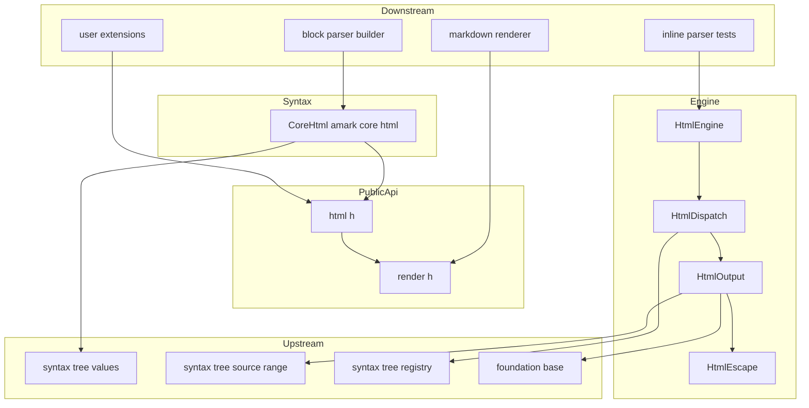
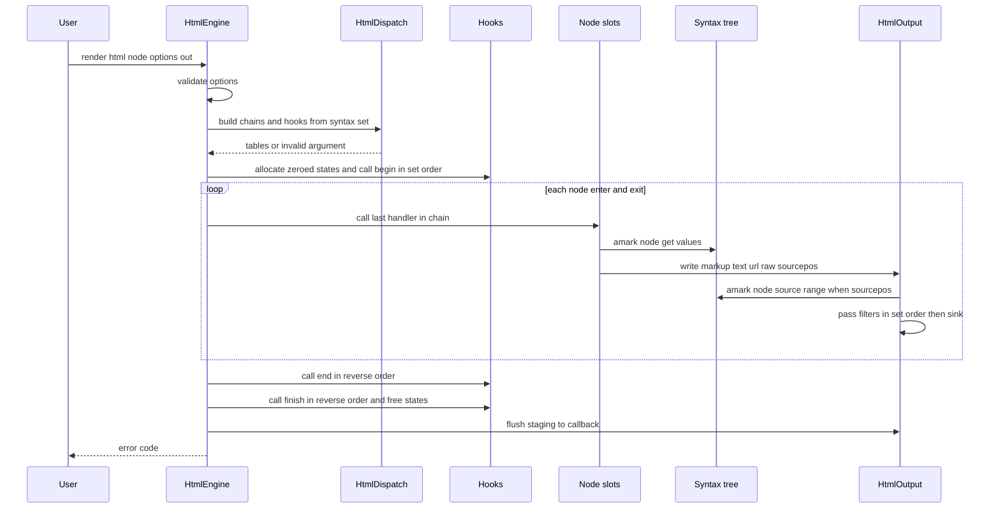
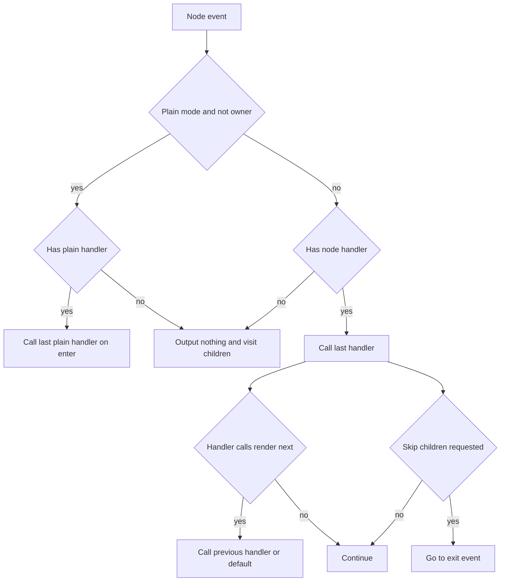
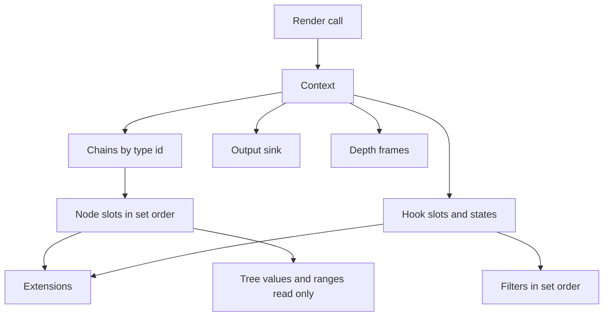

# Design Document: html-renderer

## Overview
**Purpose**：`html-renderer` は、`syntax-tree` の構文木（パースしたもの、手で組み立てたもの、編集したもの）を、CommonMark の参照実装（cmark 0.31.1、CommonMark 0.31.2）と同じ HTML に出力する手段を、利用者と後続の spec に提供する。出力はノード型ごとの「HTML の出力のスロット」で駆動する。組み込みのノード型の出力も、同じスロットで提供する。

**Users**：
- 利用者（CMS、静的サイトジェネレータ、ドキュメントツールの開発者）は、出力の入口とオプション（安全モード、ソース位置、改行の扱い）を使う。
- 拡張の実装者は、ノード型ごとの出力のスロット、前の処理の呼び出し、出力の前後のフック、出力のフィルタ、出力の文脈（タイトさ、テキストだけのモード、入れ子の出力、拡張ごとの状態）を使う。
- `block-parser` は CommonMark の構文セットに組み込みの HTML 出力の構文拡張を含め、`inline-parser` は準拠テストでこの出力を使い、`markdown-renderer` はこの spec と同じ形のスロットと出力先の型を使う。

**Impact**：公開ヘッダ 2 つ（`render.h`、`html.h`）、`src/render/` の HTML のエンジン、`src/syntax/` の組み込みの HTML 出力の構文拡張 `amark.core.html`、`tests/html/`、`fuzz/html_render_fuzz.c` を新しく作る。`syntax-tree` の公開 API には何も足さない。前の版の design（構文トークンのモデル）は引き継がない（research.md の「前の版の design を持ち込まない」）。

### Goals
- 組み込みの 19 のノード型の HTML が、cmark 0.31.1 の `html.c` と 1 対 1 に対応する。
- 出力に使う値、タイト、位置を、すべて `syntax-tree` の公開の問い合わせ（`amark_node_get`、`amark_node_source_range`）から取る。綴りを解析しない。
- エンジンは個別のノード型を知らず、組み込みの出力も利用者と同じ公開のスロットと出力の文脈だけで書かれる。
- 表、取り消し線、タスクリスト、脚注、タグフィルタの cmark-gfm 相当の HTML を、テストにだけ置く拡張で、公開 API だけで出力できる。
- 深さ 10 万の木を、呼び出しのスタックを深さに比例して使わずに出力する。

### Non-Goals
- パース、CommonMark の構文の構文拡張、CommonMark の構文セットの構築関数（`block-parser`、`inline-parser`）
- CommonMark spec の準拠テストのランナー（`inline-parser`）と、GFM 相当の構文のパースの部分
- 値の導出、参照の解決、タイトの導出、位置の求め方（`syntax-tree`）
- Markdown の出力（`markdown-renderer`）。ただし、スロットの形を揃えるための規約をこの設計に記す
- レンダラのオブジェクト（構文セットごとの表の使い回し）、出力の要素への任意の属性の追加の API、インラインのソース位置の属性

## Boundary Commitments

### This Spec Owns
- 公開ヘッダ `include/amark/render.h`（レンダラが共有する出力先の書き出しの関数の型）と `include/amark/html.h`（オプション、入口、スロットの構造体、出力の文脈の API、ユーティリティ、組み込みの HTML 出力の構文拡張の取得）
- スロットの種類 `AMARK_SLOT_HTML_NODE`（11）と `AMARK_SLOT_HTML_HOOKS`（12）の意味と、そのスロットの構造体（番号は `syntax-tree` の `extension.h` にすでにある）
- `src/render/` の HTML のエンジンのすべて：出力先、分類つきの書き出し、フィルタ、スロットの検査と連鎖の表、部分木のたどり、出力の文脈、前後のフックと拡張ごとの状態、入れ子の出力、エスケープと URL のユーティリティ
- ソース位置の属性の書式（`syntax-tree` の範囲から作る規則）と、解決できない参照のリンクと画像の出力の規則
- 組み込みの HTML 出力の構文拡張 `amark.core.html`（名前、19 のノード型のスロット、公開の取得関数）と、その実装 `src/syntax/html_core.c`、`html_blocks.c`、`html_inlines.c`
- 組み込みの HTML 出力の登録の規則（下記）
- `tests/html/` のテスト、テスト専用の HTML の検証用拡張 `tests/html/support/gfm_html_ext.{h,c}`（INTERFACE ライブラリ `amark_test_html_gfm`。検証用のノード型の記述子を含む）、`fuzz/html_render_fuzz.c`
- ケースのデータからテストを生成する共有のスクリプト `tests/html/gen_html_cases.cmake` と、その形式・引数・検査関数の形の契約（「HtmlTests」）

### Out of Boundary
- `src/syntax/` の構文のファイル（`atx_heading.c` など）と、CommonMark の構文セットの構築関数。構築関数への `amark.core.html` の追加は、それを所有する spec（`block-parser`）が行う
- 検証用のノード型を作るパースのスロット（`block-parser`、`inline-parser`）と、それらを組み合わせた GFM 相当の検証
- CommonMark spec の全例との照合（`inline-parser`）
- 値の導出、参照の解決、リストのタイトの導出、ソース上の範囲の計算（`syntax-tree`）。この spec は結果を使うだけで、同じ規則を持たない
- Markdown の出力とそのスロットの具体的な構造体（`markdown-renderer`）
- 木の変更（出力は木を変えない）、ノード型の登録とレジストリの API、スロットの種類の番号の一覧（`syntax-tree`）

### Allowed Dependencies
- `foundation` の公開 API：`export.h`、`error.h`、`allocator.h`、`buffer.h`、`utf8.h`。内部 API：`base/allocator_internal.h`（`amark_size_add`、`amark_size_mul`）、`base/buffer_internal.h`（`amark_buffer_init`、`amark_buffer_deinit`）。内部 API を使うのは `src/render/` だけ
- `syntax-tree` の公開 API だけ：
  - `node.h`：`amark_node_get_type`、`amark_node_type_desc`、`amark_node_document`、`amark_node_parent`、`amark_node_first_child`、`amark_node_next`、ノード型の識別子の定数
  - `document.h`：`amark_document_syntax_set`、`amark_node_source_range`、`amark_label_normalize`（検証用拡張の脚注だけ）
  - `value.h`：`amark_node_get`、`amark_value_t`、組み込みの型の項目の番号と列挙の値のマクロ
  - `extension.h`：`amark_slot_t`、`amark_extension_t`、`amark_node_type_desc_t`、`amark_facet_desc_t`、`AMARK_SLOT_HTML_NODE`、`AMARK_SLOT_HTML_HOOKS`、`amark_syntax_set_find_node_type`、`amark_syntax_set_slot_count`、`amark_syntax_set_slot_at`
  - `src/tree/` の内部ヘッダ、`spelling.h` の綴りの読み取り、`iterator.h` は使わない
- テスト時：Naos、`amark_add_test`、`amark_add_generated_tests`、`AmarkTestGen.cmake`、`amark_test_support`（`AMARK_CHECK_OOM_SWEEP`、`AMARK_CHECK_BUFFER_EQ`、テスト用アロケータ）、`amark_test_tree`（`amark_test_tree_build`）、`amark_add_fuzzer`
- レイヤーの規則：`src/render/` は `src/syntax/` と `src/parse/` を参照しない。`src/syntax/html_*.c` は公開ヘッダと `src/syntax/` の中の内部ヘッダだけを include する。公開ヘッダは他の公開ヘッダだけを include する

### Revalidation Triggers
- `amark_html_node_slot_t` / `amark_html_hooks_slot_t` のフィールド、連鎖・フック・フィルタの順の規則の変更 → 利用者の拡張、`block-parser` と `inline-parser` の検証用拡張、`markdown-renderer`（形を揃える）
- 出力の文脈の API（書き出し、タイトさ、テキストだけのモード、入れ子の出力、状態）の意味の変更 → 利用者の拡張、`inline-parser`
- 組み込みの出力の表（cmark との対応）、エスケープ、危険な URL、解決できない参照の扱いの変更 → `inline-parser` の準拠テスト
- `amark.core.html` の名前・取得関数・登録の規則の変更 → `block-parser`（構文セットの構築関数）、`markdown-renderer`
- `render.h` の型の変更 → `markdown-renderer`
- 検証用のノード型（`test.table`、`test.table_row`、`test.table_cell`、`test.strikethrough`、`test.task_item`、`test.footnote_ref`、`test.footnote_def`）の名前、項目、印、包含の変更 → `block-parser`、`inline-parser`、`markdown-renderer` の検証用拡張とテスト
- `amark_test_html_gfm` の依存（Naos に依存しないこと）の変更 → それをリンクするファジングターゲット（`inline-parser`、`markdown-renderer`）
- `gen_html_cases.cmake` のケースの形式、引数、生成するテストが呼ぶ検査関数の形の変更 → `markdown-renderer`
- 上流からの変更でこの spec を見直すもの：`syntax-tree` の `amark_node_get` の取得の規則（参照の解決、`UNRESOLVED`、タイトの導出）、`amark_node_source_range` の範囲の規則と計算量、組み込みの型の項目の番号、`amark_slot_t` と構文セットの列挙、`foundation` の `amark.h` の正規の順

## Architecture

### Existing Architecture Analysis
- `src/render/` と `src/syntax/` はまだない。`include/amark/amark.h` と `cmake/scripts/check_public_headers.cmake` は、正規の順の 3 番目の組として `render.h html.h` の位置をすでに持つ（組がないうちは飛ばされる）。
- `syntax-tree` の木は、値（facet）を `amark_node_get` で返す。値は綴りから導かれ、参照の形のリンクの宛先とタイトルは定義の索引で解決される（定義がなければ状態 `AMARK_VALUE_UNRESOLVED`）。リストの tight は空行から導かれる（上書きできる）。`amark_node_get` は確保に失敗しうる（導いた値のキャッシュ、索引の更新）。
- `amark_node_source_range` は、ブロックは行の範囲と記録の列から、インラインは中身の上のトークンから範囲を求める。部分木をたどるので、1 回の問い合わせはその部分木の大きさに比例する（`syntax-tree` の tasks.md の Implementation Notes 13.1）。
- `extension.h` はスロットの種類 11、12 を html-renderer に割り当て済みで、構文拡張のスロットは `const amark_slot_t *const *slots` の配列である。
- テスト用の木の組み立て（`tests/support/tree_builder.h`）は新しいダンプの形式を読み、値を `amark_node_record_*` で、配置と中身を `amark_block_*` で入れる。Naos に依存する。

### Architecture Pattern & Boundary Map
**Selected pattern**：スロット駆動のレンダラ。エンジン（`src/render/`）は、文書の構文セットから HTML のスロットを集めて型の識別子ごとの連鎖の表を作り、部分木を反復でたどって各ノードの連鎖の最後の処理を呼ぶ。エンジンは個別のノード型を知らない。組み込みのノード型の出力は、`src/syntax/` の出力の構文拡張 `amark.core.html` が、公開のスロット、出力の文脈、`syntax-tree` の公開の問い合わせだけで実装する。



**Dependency direction（`src/render/` の中）**：`html_escape.c` → `html_output.c` → `html_dispatch.c` → `html_render.c`。左のファイルは右のファイルの関数を呼ばない。`html_internal.h` は文脈の構造体と、ファイル間の内部関数の宣言を持つ。`src/syntax/html_blocks.c` と `html_inlines.c` → `html_core.c`（拡張の表と値の読み取りの補助）。`src/syntax/` から `src/render/` への依存は公開ヘッダ（`html.h`）だけ。違反はレビューでエラーとする。

**Architecture Integration**：
- **境界**：エンジン（汎用）と組み込みの出力（個別のノード型）をレイヤーで分ける。エンジンの中は「書き出し」「スロットの解決」「たどりと文脈」に分ける。値と位置の意味は `syntax-tree` だけが持ち、この spec はその結果を HTML の書式にするだけにする。
- **受け継ぐ形**：`foundation` のエラーコード・出力引数・アロケータ・`struct_size`、`syntax-tree` のスロットの基底（`amark_slot_t`）と構文セットの順、`amark.core` が組み込みのノード型をまとめる形。
- **Steering compliance**：C99、`amark_` / `AMARK_`、`AMARK_API`、不透明型、アロケータの設定のほかにグローバルな可変状態なし（静的なデータは `const`）、ライセンスヘッダ、組み込みも公開 API だけを使う、開いた集合（フラグ）は `#define`、閉じた集合（ソフトブレーク、書き出しの分類）は `typedef enum`。

### 組み込みの HTML 出力の登録の規則
1. 組み込みの 19 のノード型の HTML の処理は、`src/syntax/html_blocks.c`（ブロックの 10 型）と `src/syntax/html_inlines.c`（インラインの 9 型）に実装し、`src/syntax/html_core.c` の構文拡張 `amark.core.html` のスロットとしてだけ登録する。処理の関数は公開しない。
2. `amark.core.html` はノード型とパースのスロットを持たず、`AMARK_SLOT_HTML_NODE` のスロットを 19 個だけ持つ。公開の `amark_html_core_extension()` で取得する。
3. CommonMark の構文の構文拡張（`commonmark.*`）は、組み込みのノード型の HTML のスロットを持たない。
4. CommonMark の構文セットの構築関数（`block-parser` が所有）は、`amark.core.html` を `amark.core` の直後に追加する。この spec は構築関数のファイルを編集しない。
5. 利用者が `amark_syntax_set_create` から自分で構文セットを作る場合は、`amark.core.html` を追加する。追加しなければ、組み込みのノード型は出力の処理を持たない型になる（10.4）。静的な `amark_syntax_set_core()` も HTML のスロットを持たない。
6. 組み込みの出力を差し替える利用者は、`amark.core.html` より後に同じノード型の HTML のスロットを持つ構文拡張を追加する（`amark_syntax_set_replace` で置き換えてもよい）。

### Technology Stack

| Layer | Choice / Version | Role in Feature | Notes |
|-------|------------------|-----------------|-------|
| Language | C99 | ライブラリ、テスト、ファジング | `amark_target_defaults()` |
| Base | `foundation`（error、allocator、buffer、utf8） | 確保、出力の組み立て | 新しい依存なし |
| Tree | `syntax-tree`（node、document、value、extension） | 値、位置、関係、スロットの列挙 | 公開 API だけ |
| Reference | cmark 0.31.1 `html.c`、houdini、`_scan_dangerous_url`（規則だけ）、cmark-gfm 0.29 の拡張 | 出力とエスケープの規則の基準 | コードは取り込まない |
| Test | Naos v0.4.0、`amark_test_support`、`amark_test_tree`、`amark_add_generated_tests` | 手で組み立てた木の出力の照合 | `amark_test_html_gfm` を追加 |
| Fuzz | `amark_add_fuzzer` | 木の操作列からの出力 | `fuzz/html_render_fuzz.c` |

## File Structure Plan

### Directory Structure
```
include/amark/
├── render.h              # amark_write_fn_t（レンダラが共有する出力先の書き出しの関数の型）
└── html.h                # オプション、入口、スロットの構造体、出力の文脈の API、ユーティリティ、amark_html_core_extension()
src/render/
├── html_internal.h       # struct amark_html_context、連鎖の表、フックの記録、ファイル間の内部関数の宣言
├── html_escape.c         # HtmlEscape：HTML のエスケープ、href のエスケープ、危険な URL の判定（文脈を使わない）
├── html_output.c         # HtmlOutput：出力先、分類つきの書き出し、フィルタの連鎖、cr の追跡、ソース位置の属性
├── html_dispatch.c       # HtmlDispatch：スロットの検査、型の識別子ごとの連鎖の表とフックの一覧
└── html_render.c         # HtmlEngine：入口、オプションの検査、反復のたどり、文脈、テキストだけのモード、render_next、入れ子の出力、フックと状態
src/syntax/
├── html_core.h           # 19 のスロットの extern 宣言と、値を読む補助の宣言（src/syntax/html_*.c だけが使う）
├── html_core.c           # amark.core.html の表、amark_html_core_extension()、値を読む補助
├── html_blocks.c         # document、block_quote、list、item、code_block、html_block、paragraph、heading、thematic_break、link_definition
└── html_inlines.c        # text、softbreak、linebreak、code、html_inline、emph、strong、link、image（テキストだけのモードを含む）
tests/html/
├── CMakeLists.txt        # テストの登録、amark_test_html_gfm（INTERFACE、Naos に依存しない）、生成テスト
├── support/
│   ├── html_test_support.h   # 構文セットと文書の用意、S 式から組み立てて出力する補助、AMARK_CHECK_HTML、html_test_check_case
│   ├── html_test_support.c
│   ├── gfm_html_ext.h        # 検証用のノード型の記述子と HTML のスロットと拡張の記述子
│   └── gfm_html_ext.c
├── gen_html_cases.cmake      # data/*_cases.txt から Naos のテストを生成する（共有の契約）
├── data/block_cases.txt      # ブロックの組み込みの型の S 式と期待する HTML の組
├── data/inline_cases.txt     # インラインの組み込みの型の S 式と期待する HTML の組
├── output_test.c             # HtmlOutput の単体（INTERNAL）：出力先、分類つきの書き出し、cr、最初の失敗、フィルタの中継、ソース位置の属性
├── dispatch_test.c           # HtmlDispatch の単体（INTERNAL）：スロットの検査、連鎖の表の順、フックの一覧
├── render_entry_test.c       # 入口、出力先、失敗の扱い、決定性、部分木と切り離したノード
├── values_test.c             # 値の編集、参照の解決と追従、解決できない参照、タイトの導出と上書き、設定できない値
├── safe_mode_test.c          # 生の HTML の省略、危険な URL、生の HTML の許可、拡張の生の HTML、エスケープ
├── options_test.c            # ソース位置の属性、ソフトブレーク、未知のオプション、既定
├── escape_test.c             # エスケープと URL のユーティリティの全バイト
├── slot_test.c               # 登録、順、render_next、処理のない型、子の省略、不正なスロット、amark.core.html の有無
├── context_test.c            # 書き出しの手段、cr、タイトさ、テキストだけのモード、入れ子の出力、誤用
├── hooks_filter_test.c       # 前後のフック、状態と後始末、フィルタの順と分類、部分木の出力でのフック
├── gfm_html_test.c           # 表、取り消し線、タスクリスト、脚注、タグフィルタ（2 方式）
├── oom_test.c                # 確保失敗の総当たり
└── scale_test.c              # 深い木、計算量
fuzz/
├── html_render_fuzz.c        # 入力を木の操作列と出力のオプションとして解釈して出力する
└── corpus/html_render/       # 種のファイル
```

### Modified Files
- `include/amark/amark.h` — 3 番目の組（Renderer and HTML）の位置に `render.h`、`html.h` をこの順で含める（`extension.h` の後）。
- `src/CMakeLists.txt` — ライブラリのソースの一覧に `src/render/html_*.c` と `src/syntax/html_*.c` を足す。
- `tests/CMakeLists.txt` — `add_subdirectory(html)` を足す（`AMARK_FUZZ` だけの構成でも `amark_test_html_gfm` を定義するため、条件なしに加える。Naos を使うターゲットは `tests/html/CMakeLists.txt` の中で `AMARK_BUILD_TESTS` のときだけ定義する）。
- `tests/headers/cxx_include_test.cpp` — `html.h` の関数（`amark_html_options_init`、`amark_html_escape`、`amark_html_core_extension` など）を呼ぶテストを足す。
- `fuzz/CMakeLists.txt` — `amark_add_fuzzer(html_render SOURCES html_render_fuzz.c CORPUS corpus/html_render)` を足す。

## System Flows

### 1 回の出力

- どこかで失敗したら、たどりを止めて `end` を呼ばずに `finish` だけを呼び、状態と表を解放する。出力先がバッファなら、長さを呼び出し前に戻す。
- 失敗は文脈に記録する（最初の失敗を保持する）。処理が書き出しの失敗を無視して成功を返しても、出力全体は失敗になる。値と位置の問い合わせの失敗（`AMARK_ERROR_OUT_OF_MEMORY`）も、処理が返して同じ経路で止まる。

### ノードの処理の選び方

- テキストだけのモードは、それを開始したノード（owner）の子孫に適用し、owner の出るときの処理は通常のモードで呼ぶ。テキストだけのモードでは、処理を入るときだけ呼ぶ。

## Requirements Traceability

| Requirement | Summary | Components | Interfaces | Flows |
|-------------|---------|------------|------------|-------|
| 1.1 | 任意の部分木の出力 | HtmlEngine | `amark_render_html`、`amark_render_html_to` | 1 回の出力 |
| 1.2, 1.3 | バッファへの追加、書き出しの関数 | HtmlOutput | `amark_buffer_t`、`amark_write_fn_t` | 1 回の出力 |
| 1.4, 1.5 | 失敗の扱い | HtmlOutput, HtmlEngine, CoreHtml | 最初の失敗の保持、問い合わせの失敗の伝播 | 1 回の出力 |
| 1.6, 1.7 | 木を変えない、決定性 | HtmlEngine, CoreHtml | const のノード、読み取りの問い合わせだけ | — |
| 2.1–2.9 | 組み込みの出力 | CoreHtml | 組み込みの出力の表 | — |
| 3.1, 3.2 | 値に従う出力 | CoreHtml | `amark_html_core_get`（`amark_node_get`） | — |
| 3.3, 3.4, 3.5 | 参照の解決、追従、解決できない参照 | CoreHtml | `amark_node_get` の `UNRESOLVED` | — |
| 3.6 | タイト | CoreHtml, HtmlEngine | `AMARK_LIST_TIGHT`、`amark_html_set_tight_children` | — |
| 3.7 | 設定できない値 | CoreHtml, HtmlOutput | `amark_html_write_escaped` | — |
| 4.1–4.4 | 安全モード | CoreHtml, HtmlOutput, HtmlEscape | `amark_html_write_raw`、`amark_html_write_url`、`amark_html_url_is_safe` | — |
| 4.5 | 拡張の生の HTML | HtmlOutput | `amark_html_write_raw` | — |
| 4.6 | 常にエスケープ | HtmlOutput, CoreHtml | `amark_html_write_escaped` | — |
| 5.1–5.3 | ソース位置の属性 | HtmlOutput, CoreHtml | `amark_html_write_sourcepos`、`amark_node_source_range` | — |
| 5.4–5.6 | ソフトブレーク | CoreHtml, HtmlEngine | `amark_html_softbreak_t`、`amark_html_softbreak` | — |
| 5.7, 5.8 | 未知のオプション、既定 | HtmlEngine | `amark_html_options_t` | 1 回の出力 |
| 6.1–6.4 | ユーティリティ | HtmlEscape | `amark_html_escape`、`amark_html_escape_href`、`amark_html_url_is_safe` | — |
| 7.1, 7.7, 7.8 | ノード型ごとのスロット | HtmlDispatch | `amark_html_node_slot_t` | 処理の選び方 |
| 7.2, 7.3 | 順と前の処理 | HtmlDispatch, HtmlEngine | `amark_html_render_next` | 処理の選び方 |
| 7.4, 7.5 | 処理のない型、子の省略 | HtmlEngine | `amark_html_skip_children` | 処理の選び方 |
| 7.6 | 不正なスロット | HtmlDispatch | 検査の規則 | 1 回の出力 |
| 8.1, 8.2 | 書き出しの手段 | HtmlOutput, HtmlEngine | `amark_html_write*`、`amark_html_cr`、`amark_html_write_sourcepos`、`amark_html_flags` | — |
| 8.3 | タイトさ | HtmlEngine | `amark_html_set_tight_children`、`amark_html_tight` | — |
| 8.4–8.6 | テキストだけのモード | HtmlEngine, CoreHtml | `amark_html_enter_plain`、`render_plain` | 処理の選び方 |
| 8.7, 8.8 | 入れ子の出力 | HtmlEngine | `amark_html_render_subtree`、`AMARK_HTML_MAX_NESTING` | — |
| 8.9 | 誤用 | HtmlEngine | 不正な引数 | — |
| 9.1–9.3 | 前後のフック | HtmlDispatch, HtmlEngine | `amark_html_hooks_slot_t` | 1 回の出力 |
| 9.4, 9.5 | 拡張ごとの状態 | HtmlEngine | `amark_html_state`、`amark_html_current_extension` | 1 回の出力 |
| 9.6, 9.7 | フィルタ | HtmlOutput | `filter`、`amark_html_filter_forward` | 1 回の出力 |
| 9.8 | 部分木の出力でのフック | HtmlEngine | 入口 | 1 回の出力 |
| 10.1, 10.2 | 組み込みの構文拡張 | CoreHtml | `amark_html_core_extension` | — |
| 10.3, 10.4 | 上書き、含まれない場合 | HtmlDispatch | 連鎖の規則 | 処理の選び方 |
| 11.1–11.6 | GFM 相当の表現力 | GfmHtmlExt, HtmlTests | 公開のスロットと文脈、検証用のノード型 | — |
| 12.1 | 規約 | HtmlApi と全コンポーネント | 不透明型、`struct_size` | — |
| 12.2 | グローバルのアロケータ | HtmlEngine, HtmlOutput, HtmlDispatch | `amark_malloc` など | — |
| 12.3 | 深い木 | HtmlEngine | 反復のたどり | — |
| 12.4, 12.5 | 時間 | HtmlEngine, HtmlDispatch, HtmlOutput | 連鎖の表、位置の問い合わせはブロックごとに 1 回 | — |
| 12.6 | スレッド | 全コンポーネント | アロケータの設定のほかにグローバルな可変状態なし | — |
| 12.7 | UTF-8 | HtmlEscape, CoreHtml | バイトを変えないエスケープ | — |

## Components and Interfaces

| Component | Domain/Layer | Intent | Req Coverage | Key Dependencies (P0/P1) | Contracts |
|-----------|--------------|--------|--------------|--------------------------|-----------|
| HtmlApi | Public headers | 公開の型と関数の宣言 | 12.1 | extension.h (P0), buffer.h (P0) | Service |
| HtmlEscape | Render | エスケープと URL の判定の純粋な関数 | 4.2, 4.4, 6.1–6.4, 12.7 | buffer (P0) | Service |
| HtmlOutput | Render | 出力先、分類つきの書き出し、フィルタ、cr、ソース位置 | 1.2–1.5, 3.7, 4.5, 4.6, 5.1–5.3, 8.1, 8.2, 9.6, 9.7, 12.2, 12.5 | HtmlEscape (P0), buffer (P0), source range (P0) | Service, State |
| HtmlDispatch | Render | スロットの検査と連鎖の表、フックの一覧 | 7.1–7.3, 7.6–7.8, 9.1, 10.3, 10.4, 12.4 | syntax set (P0) | Service |
| HtmlEngine | Render | 入口、たどり、文脈、テキストだけのモード、入れ子、フックと状態 | 1.1, 1.4–1.7, 3.6, 5.6–5.8, 7.3–7.5, 8.2–8.9, 9.1–9.5, 9.8, 12.2–12.6 | HtmlDispatch (P0), HtmlOutput (P0), node (P0) | Service, State |
| CoreHtml | Syntax | `amark.core.html` と 19 の型の出力 | 2.1–2.9, 3.1–3.7, 4.1–4.3, 4.6, 5.1, 5.4, 5.5, 8.6, 10.1, 10.2 | html.h (P0), value.h (P0) | Service |
| HtmlTestSupport | Test | 構文セットと木の用意、出力の照合 | 11.6 の基盤 | amark_test_tree (P0) | Service |
| GfmHtmlExt | Test | GFM 相当の HTML の検証用の型とスロット | 11.1–11.6 | html.h (P0), extension.h (P0) | Service |
| HtmlTests / HtmlFuzz | Test / Fuzz | 要件の検証 | 全要件 | HtmlTestSupport (P0) | Batch |

### Public headers

#### HtmlApi

| Field | Detail |
|-------|--------|
| Intent | 公開の型・関数・定数を、依存の順に宣言する |
| Requirements | 12.1 |

**Responsibilities & Constraints**
- `render.h` は `export.h`、`error.h`、`<stddef.h>` だけを include する。`html.h` は `node.h`、`buffer.h`、`extension.h`、`render.h` を include する。どちらも `AMARK_BEGIN_DECLS` / `AMARK_END_DECLS` で囲み、ガードは `AMARK_RENDER_H`、`AMARK_HTML_H`。
- 公開の構造体（`amark_html_options_t`、`amark_html_node_slot_t`、`amark_html_hooks_slot_t`）は先頭に大きさのフィールドを持つ（スロットは `amark_slot_t` の `struct_size`）。ライブラリは最初の版の最小の大きさ以上であることを確かめ、知らない末尾のフィールドを読まない。
- 冒頭のコメントに、文書は同時に 1 つのスレッドだけが使う（出力も値の問い合わせでキャッシュを書く）ことと、出力の文脈は処理の呼び出しの間だけ有効であることを書く。

**Contracts**: Service [x]
```c
/* include/amark/render.h */
/* 出力先の書き出しの関数。length は 0 にならない。AMARK_ERROR_NONE 以外を返すと出力を止め、その値を利用者に返す */
typedef amark_error_t (*amark_write_fn_t)(void *user_data, const char *data, size_t length);
```
- スロットの種類の番号は `extension.h` の `AMARK_SLOT_HTML_NODE`（11）と `AMARK_SLOT_HTML_HOOKS`（12）を使い、`html.h` では定義し直さない。

### Render

#### HtmlEscape

| Field | Detail |
|-------|--------|
| Intent | cmark と同じ規則のエスケープと危険な URL の判定 |
| Requirements | 4.2, 4.4, 6.1–6.4, 12.7 |

**Responsibilities & Constraints**
- HTML のエスケープ：`&` → `&amp;`、`<` → `&lt;`、`>` → `&gt;`、`"` → `&quot;`。他のバイト（`'`、`/`、LF、0x80 以上を含む）はそのまま。
- href のエスケープ：英数字と `-_.+!*(),%#@?=;:/$~` はそのまま。`&` → `&amp;`、`'` → `&#x27;`。それ以外のすべてのバイト（制御文字、空白、`"<>[\]^`` ` ``{|}`、0x80 以上）は `%XX`（大文字の 16 進）。`%` は検査せずそのまま。
- 危険な URL：ASCII の大文字と小文字を区別せず、先頭が `data:image/png`、`data:image/gif`、`data:image/jpeg`、`data:image/webp` なら安全、`javascript:`、`vbscript:`、`file:`、`data:` なら危険、それ以外は安全。前置きの空白は取り除かない（cmark と同じ）。
- すべて文書・構文セット・文脈なしに使え、確保は出力のバッファだけ。HTML のエスケープは UTF-8 の多バイトの並びを変えない。

**Contracts**: Service [x]
```c
/* include/amark/html.h */
AMARK_API amark_error_t amark_html_escape(amark_buffer_t *out, const char *data, size_t length);
AMARK_API amark_error_t amark_html_escape_href(amark_buffer_t *out, const char *data, size_t length);
AMARK_API bool amark_html_url_is_safe(const char *data, size_t length);   /* 危険なスキームなら false。NULL は長さ 0 のときだけ安全 */
```
- Preconditions：`out` が NULL、または `data` が NULL で `length` が 0 でなければ `AMARK_ERROR_INVALID_ARGUMENT`。
- Postconditions：失敗時（メモリ不足など）は `out` を呼び出し前の長さに戻す。
- 内部の契約（`html_internal.h`）：`const char *amark_html_escape_byte(unsigned char c)`（置き換えの文字列。そのままなら NULL）と `bool amark_html_href_safe_byte(unsigned char c)` を HtmlOutput に提供し、出力先へ直接エスケープしながら書けるようにする（中間のバッファを作らない）。

#### HtmlOutput

| Field | Detail |
|-------|--------|
| Intent | 出力先への分類つきの書き出し、フィルタの連鎖、cr の判定、ソース位置の属性 |
| Requirements | 1.2–1.5, 3.7, 4.5, 4.6, 5.1–5.3, 8.1, 8.2, 9.6, 9.7, 12.2, 12.5 |

**Responsibilities & Constraints**
- 出力先：
  - バッファ：開始時の長さを記録して直接追加する。失敗で終わったら `amark_buffer_truncate` で戻す。
  - 書き出しの関数：埋め込みの中継のバッファにため、8 KiB を超えたら渡し、終わりに残りを渡す。書き出しの関数の失敗は最初の失敗として記録する。
- 書き出し（すべての書き出しは分類を持つ）：

| 関数 | 分類 | 内容 |
|------|------|------|
| `amark_html_write` / `amark_html_write_cstr` | MARKUP | そのまま |
| `amark_html_write_escaped` | TEXT | HTML のエスケープ |
| `amark_html_write_url` | TEXT | `AMARK_HTML_UNSAFE` か安全な URL なら href のエスケープ、危険なら何も書かない |
| `amark_html_write_raw` | RAW / MARKUP | `AMARK_HTML_UNSAFE` ならそのまま（RAW）、そうでなければ `<!-- raw HTML omitted -->`（MARKUP） |
| `amark_html_cr` | MARKUP | この出力の呼び出しで書いた最後のバイト（フィルタの前）が LF でなく、すでに 1 バイト以上書いていれば LF |
| `amark_html_write_sourcepos` | MARKUP | 下の規則 |

- **ソース位置の属性**（5.1–5.3）：`AMARK_HTML_SOURCEPOS` がなければ何も書かない。あれば `amark_node_source_range(node, &range, &has_position)` を 1 回呼ぶ。
  - `has_position` が false なら何も書かない（5.3）。
  - true なら ` data-sourcepos="SL:SC-EL:EC"` を書く。SL、SC、EL、EC は `range.start_line`、`range.start_column`、`range.end_line`、`range.end_column` の 10 進である。`syntax-tree` の範囲では、`start_column` は最初のバイトの行の中の位置 + 1、`end_column` は最後のバイトの位置 + 1（範囲の終わりの位置）なので、cmark の書式（終わりの列は最後のバイトを含む、1 から数える）にそのまま一致する。範囲が空なら `end_column = start_column - 1` をそのまま書く。
  - 行の番号は範囲の始まりのソースの中の番号で、範囲が複数のソースにまたがるとき、`syntax-tree` は始まりのソースで切る。ソースの番号は出さない。
  - 問い合わせの失敗（`AMARK_ERROR_OUT_OF_MEMORY`）は、最初の失敗として記録して返す。
  - 数の書式は `snprintf` を使わず、内部の 10 進の変換で書く（ロケールに依存しない）。
- フィルタ：フックのスロットのうち `filter` を持つものを構文セットの順に並べる。書き出しは最初のフィルタに渡り、フィルタは `amark_html_filter_forward` で次へ（最後は出力先へ）渡す。渡さなければ省く。フィルタの中からは `amark_html_filter_forward` 以外の書き出しを呼べない（`AMARK_ERROR_INVALID_STATE`）。`cr` の判定と「最後のバイト」はフィルタの前の書き出しで追跡する。
- 長さ 0 の書き出しは成功し、フィルタにも出力先にも渡さない。
- 最初の失敗を文脈に保持し、以後の書き出しは何もせずにその失敗を返す。
- 値の内容を検査しない。改行を含む text の literal も空の文字列も、同じ規則でエスケープして書く（3.7）。

**Contracts**: Service [x] / State [x]
```c
/* include/amark/html.h */
typedef struct amark_html_context amark_html_context_t;   /* 不透明。出力の処理・フック・フィルタの呼び出しの間だけ有効 */

typedef enum amark_html_chunk_kind
{
    AMARK_HTML_CHUNK_MARKUP = 1,   /* レンダラや拡張が書いたマークアップ */
    AMARK_HTML_CHUNK_TEXT = 2,     /* エスケープしたテキストと属性の値（URL を含む） */
    AMARK_HTML_CHUNK_RAW = 3       /* 生の HTML（AMARK_HTML_UNSAFE のときだけ現れる） */
} amark_html_chunk_kind_t;

AMARK_API amark_error_t amark_html_write(amark_html_context_t *ctx, const char *data, size_t length);
AMARK_API amark_error_t amark_html_write_cstr(amark_html_context_t *ctx, const char *text);
AMARK_API amark_error_t amark_html_write_escaped(amark_html_context_t *ctx, const char *data, size_t length);
AMARK_API amark_error_t amark_html_write_url(amark_html_context_t *ctx, const char *data, size_t length);
AMARK_API amark_error_t amark_html_write_raw(amark_html_context_t *ctx, const char *data, size_t length);
AMARK_API amark_error_t amark_html_cr(amark_html_context_t *ctx);
AMARK_API amark_error_t amark_html_write_sourcepos(amark_html_context_t *ctx, const amark_node_t *node);
AMARK_API amark_error_t amark_html_filter_forward(amark_html_context_t *ctx, amark_html_chunk_kind_t kind,
                                                  const char *data, size_t length);
```
- Preconditions：`ctx` が NULL、`data` が NULL で `length` が 0 でない、`kind` が未知、`node` が NULL か別の文書のもの → `AMARK_ERROR_INVALID_ARGUMENT`。フィルタの外での `amark_html_filter_forward` → `AMARK_ERROR_INVALID_STATE`。
- State model：`{sink: buffer か (fn, user_data, staging), start_length, last_byte, wrote_any, filters[], filter_index（フィルタの中なら現在の位置、外なら SIZE_MAX）, error}`。

#### HtmlDispatch

| Field | Detail |
|-------|--------|
| Intent | 構文セットの HTML のスロットを検査し、型ごとの連鎖とフックの一覧を作る |
| Requirements | 7.1–7.3, 7.6–7.8, 9.1, 10.3, 10.4, 12.4 |

**Responsibilities & Constraints**
- `AMARK_SLOT_HTML_NODE` のスロットを `amark_syntax_set_slot_count` と `amark_syntax_set_slot_at` で構文セットの順に列挙し、各スロットを検査する：`struct_size` が最初の版の最小（`user_data` の末尾）以上、`node_type` と `render` が NULL でない、`amark_syntax_set_find_node_type` で型が見つかる。違反は `AMARK_ERROR_INVALID_ARGUMENT`。
- 連鎖の表：型の識別子で引く配列（大きさは見つかった最大の識別子 ＋ 1。組み込みは 1–19、拡張は 256 から）。各要素は、その型のスロットを構文セットの順に並べた一覧（通常の処理の連鎖）と、`render_plain` を持つものだけの一覧（テキストだけのモードの連鎖）を指す。スロットのない型は空。
- `AMARK_SLOT_HTML_HOOKS` のスロットを構文セットの順に列挙し、検査する：`struct_size` が最初の版の最小以上、`state_size` が `AMARK_HTML_MAX_STATE_SIZE`（64 KiB）以下、1 つの構文拡張に 2 つ以上ない。違反は `AMARK_ERROR_INVALID_ARGUMENT`。
- 確保はグローバルのアロケータ。構築と解放は 1 回の出力の中で完結する。計算量はスロットの数と名前の検索に比例する。
- 拡張が HTML のスロットだけを持っても、他の種類のスロットを持っても、同じ規則で扱う（7.8）。

**Contracts**: Service [x]
```c
/* include/amark/html.h */
typedef amark_error_t (*amark_html_node_fn_t)(amark_html_context_t *ctx, const amark_node_t *node,
                                              bool entering, void *user_data);
typedef amark_error_t (*amark_html_plain_fn_t)(amark_html_context_t *ctx, const amark_node_t *node,
                                               void *user_data);

typedef struct amark_html_node_slot
{
    amark_slot_t base;                    /* kind = AMARK_SLOT_HTML_NODE、struct_size = sizeof(amark_html_node_slot_t) */
    const char *node_type;                /* ノード型の名前（"heading"、"test.table" など） */
    amark_html_node_fn_t render;          /* 必須。入るときと出るときに呼ぶ（子を持てない型も両方） */
    amark_html_plain_fn_t render_plain;   /* 任意。テキストだけのモードで入るときに呼ぶ */
    void *user_data;
} amark_html_node_slot_t;

#define AMARK_HTML_MAX_STATE_SIZE 65536u

typedef struct amark_html_hooks_slot
{
    amark_slot_t base;                    /* kind = AMARK_SLOT_HTML_HOOKS */
    size_t state_size;                    /* 1 回の出力の間の状態の大きさ。0 なら状態なし */
    amark_error_t (*begin)(amark_html_context_t *ctx, void *state, void *user_data);  /* 任意 */
    amark_error_t (*end)(amark_html_context_t *ctx, void *state, void *user_data);    /* 任意 */
    void (*finish)(amark_html_context_t *ctx, void *state, void *user_data);          /* 任意。後始末 */
    amark_error_t (*filter)(amark_html_context_t *ctx, void *state, amark_html_chunk_kind_t kind,
                            const char *data, size_t length, void *user_data);        /* 任意 */
    void *user_data;
} amark_html_hooks_slot_t;
```
- 内部の契約（`html_internal.h`）：`amark_html_dispatch_init(ctx, set)`、`amark_html_dispatch_deinit(ctx)`、`amark_html_chain_of(ctx, type, plain)`。

#### HtmlEngine

| Field | Detail |
|-------|--------|
| Intent | 入口、部分木のたどり、出力の文脈、テキストだけのモード、前の処理、入れ子の出力、フックと状態 |
| Requirements | 1.1, 1.4–1.7, 3.6, 5.6–5.8, 7.3–7.5, 8.2–8.9, 9.1–9.5, 9.8, 12.2–12.6 |

**Responsibilities & Constraints**
- 入口：`node` と出力先を検査する（NULL は `AMARK_ERROR_INVALID_ARGUMENT`）。構文セットは `amark_document_syntax_set(amark_node_document(node))` とする。`options` が NULL なら既定（フラグ 0、`softbreak` は LF）。`struct_size` が最初の版の最小未満か、未知のフラグのビットがあるか、`softbreak` が既知の値でなければ `AMARK_ERROR_INVALID_ARGUMENT` で何も出力しない。文脈は呼び出し側のスタックに置く。
- 手順：連鎖の表とフックの一覧の構築 → 状態の確保（0 で埋める）→ `begin` を構文セットの順 → 部分木の出力 → `end` を逆の順 → `finish` を逆の順（成否にかかわらず、状態の確保に成功していれば全スロット）→ 解放 → 中継のバッファの残りを渡す。失敗した時点で以降の `begin` / たどり / `end` を飛ばし、`finish` と解放は行う。
- たどり：`amark_node_first_child`、`amark_node_next`、`amark_node_parent` で反復する。`amark_iter_t` は非 const の根を取り、確保もするので使わない。根の部分木の外へ出ない。各ノードで入るときと出るときに処理を呼ぶ。子の省略が求められたら、子へ降りずに出るときへ進む。
- 深さごとの文脈：動的な配列（倍々に伸ばす）に `tight_children` を持つ。`amark_html_tight` は親の要素の値、部分木の根では false。入れ子の出力は配列の新しい基点から始め、外側の値を見ない。リストのタイトの判定そのものは持たず、項目の処理が `syntax-tree` の値で設定する（3.6）。
- 呼び出しの文脈：処理を呼ぶ前に `{node, entering, chain, position, plain, extension}` を保存して設定し、戻ったら元に戻す。`amark_html_render_next` は現在の `node` と `entering` に一致するときだけ、`position - 1` の処理を呼ぶ（0 なら何もしない）。`amark_html_current_extension` は現在の処理を持つ構文拡張。フックの中ではそのフックの構文拡張。
- テキストだけのモード：入るときの処理の中で `amark_html_enter_plain` が呼ばれたら、処理が戻った後、そのノードを owner として子孫をテキストだけのモードで出力する。子孫では、入るときにテキストだけのモードの連鎖の最後を呼び（なければ何もしない）、出るときは何も呼ばない。owner を出るときに通常のモードに戻り、owner の出るときの処理を通常どおり呼ぶ。すでにテキストだけのモードなら何もしない。
- 入れ子の出力：`amark_html_render_subtree` は、同じ文書の任意のノード（切り離したものを含む）の部分木を、同じ出力先・オプション・フィルタ・状態で、通常のモード・新しい深さの文脈から出力する。フックの `begin` と `end` は呼ばない。入れ子が `AMARK_HTML_MAX_NESTING`（32）を超えたら `AMARK_ERROR_LIMIT_EXCEEDED`。
- 誤用：処理の外での `amark_html_render_next` / `amark_html_render_plain_next` / `amark_html_enter_plain` / `amark_html_render_subtree`、フィルタの中での `amark_html_render_subtree` → `AMARK_ERROR_INVALID_STATE`。処理の外の `amark_html_skip_children` と `amark_html_set_tight_children` は何もしない。現在のノードでない `node` の `render_next`、別の文書のノードの `render_subtree` → `AMARK_ERROR_INVALID_ARGUMENT`。出るときの `skip_children` と `enter_plain` は何もしない。
- 木を変更しない（const のノードと、読み取りの問い合わせだけを使う）。値の問い合わせは内部のキャッシュを書くので、同じ文書を複数のスレッドで同時に出力することは保証しない（`syntax-tree` の規則）。異なる文書は独立。

**Contracts**: Service [x] / State [x]
```c
/* include/amark/html.h */
#define AMARK_HTML_SOURCEPOS 0x01u   /* ブロックの要素に data-sourcepos を出す */
#define AMARK_HTML_UNSAFE    0x02u   /* 生の HTML と危険な URL を出す */

/* ソフトブレークの出し方。三者択一なので enum にする。0 は既定の LF */
typedef enum amark_html_softbreak
{
    AMARK_HTML_SOFTBREAK_LF = 0,      /* 改行のまま */
    AMARK_HTML_SOFTBREAK_BR = 1,      /* <br /> と改行（cmark の HARDBREAKS） */
    AMARK_HTML_SOFTBREAK_SPACE = 2    /* 空白 1 つ（cmark の NOBREAKS） */
} amark_html_softbreak_t;

typedef struct amark_html_options
{
    size_t struct_size;
    uint32_t flags;
    amark_html_softbreak_t softbreak;
} amark_html_options_t;

AMARK_API void amark_html_options_init(amark_html_options_t *options);   /* struct_size を設定し、flags を 0、softbreak を LF に */

AMARK_API amark_error_t amark_render_html(const amark_node_t *node, const amark_html_options_t *options,
                                          amark_buffer_t *out);
AMARK_API amark_error_t amark_render_html_to(const amark_node_t *node, const amark_html_options_t *options,
                                             amark_write_fn_t write, void *user_data);

/* 出力の文脈 */
AMARK_API uint32_t amark_html_flags(const amark_html_context_t *ctx);
AMARK_API amark_html_softbreak_t amark_html_softbreak(const amark_html_context_t *ctx);
AMARK_API const amark_node_t *amark_html_root(const amark_html_context_t *ctx);     /* 利用者が指定した部分木の根 */
AMARK_API amark_error_t amark_html_render_next(amark_html_context_t *ctx, const amark_node_t *node, bool entering);
AMARK_API amark_error_t amark_html_render_plain_next(amark_html_context_t *ctx, const amark_node_t *node);
AMARK_API void amark_html_skip_children(amark_html_context_t *ctx);
AMARK_API void amark_html_set_tight_children(amark_html_context_t *ctx, bool tight);
AMARK_API bool amark_html_tight(const amark_html_context_t *ctx);
AMARK_API amark_error_t amark_html_enter_plain(amark_html_context_t *ctx);
AMARK_API bool amark_html_in_plain(const amark_html_context_t *ctx);

#define AMARK_HTML_MAX_NESTING 32
AMARK_API amark_error_t amark_html_render_subtree(amark_html_context_t *ctx, const amark_node_t *node);

AMARK_API const amark_extension_t *amark_html_current_extension(const amark_html_context_t *ctx);
/* extension のフックのスロットの状態。フックのスロットがないか state_size が 0 なら NULL */
AMARK_API void *amark_html_state(amark_html_context_t *ctx, const amark_extension_t *extension);
```
- Postconditions：成功なら、出力先に部分木の HTML が追加されている。失敗なら、バッファは呼び出し前の長さで、確保したものはすべて解放されている（書き出しの関数には途中までの出力が渡っていてよい）。
- Invariants：出力は同じ木・構文セット・オプションに対して決定的（構文セットの順と木の順と値だけで決まる）。

##### State Management
- State model：`{document, root, flags, softbreak, dispatch（連鎖の表、フックの一覧と状態）, output（HtmlOutput の状態）, depth の配列, plain_owner, call（現在の呼び出しの文脈）, nesting, error}`。1 回の出力の呼び出しの中だけに存在する。
- Concurrency strategy：文脈は呼び出しごとに独立。共有するのは凍結した構文セット、`const` の静的データ、グローバルのアロケータの設定だけ。

**Implementation Notes**
- Integration：`html_render.c` が `amark_html_dispatch_init` と HtmlOutput の初期化・終了を呼ぶ。
- Validation：`render_entry_test`、`slot_test`、`context_test`、`hooks_filter_test`、`oom_test`、`scale_test`。
- Risks：連鎖の呼び出しの深さは同じ型のスロットの数に、入れ子の出力の深さは `AMARK_HTML_MAX_NESTING` に比例してスタックを使う（ノードの深さには比例しない）。

### Syntax

#### CoreHtml

| Field | Detail |
|-------|--------|
| Intent | 組み込みの 19 のノード型の cmark 互換の HTML を、公開のスロットと `syntax-tree` の値だけで提供する |
| Requirements | 2.1–2.9, 3.1–3.7, 4.1–4.3, 4.6, 5.1, 5.4, 5.5, 8.6, 10.1, 10.2 |

**Responsibilities & Constraints**
- `amark.core.html`：名前 `"amark.core.html"`、ノード型 0、`AMARK_SLOT_HTML_NODE` のスロット 19（ノード型の識別子の順）、静的な `const` の記憶域。`amark_html_core_extension()` はそのポインタを返す（解放しない）。
- **値の読み方**（3.1–3.7）：すべての値を `amark_node_get` と `value.h` の項目の番号で読む。`src/syntax/html_core.c` の補助 `amark_html_core_get(node, facet, &value)` が `struct_size` を入れて呼び、失敗をそのまま返す。処理はその失敗を返し、出力は止まる（1.5）。

| 型 | 読む項目 | 規則 |
|----|----------|------|
| list | `AMARK_LIST_TYPE`、`AMARK_LIST_START` | ENUM の値 `AMARK_LIST_TYPE_ORDERED` で `<ol>` |
| item | 親が list なら親の `AMARK_LIST_TIGHT` | 空行から導いた値か上書きの値（3.6） |
| code_block | `AMARK_CODE_BLOCK_INFO`、`AMARK_CODE_BLOCK_LITERAL` | literal は中身から導いた値（空でなければ LF で終わる） |
| html_block | `AMARK_HTML_BLOCK_LITERAL` | 同上 |
| heading | `AMARK_HEADING_LEVEL` | 1–6 |
| text、code、html_inline | `*_LITERAL` | 改行を含む値、空の値もそのまま使う（3.7） |
| link、image | `AMARK_LINK_DESTINATION`、`AMARK_LINK_TITLE`（image も同じ番号） | 状態が `AMARK_VALUE_UNRESOLVED` なら、宛先を空、タイトルを空として扱う（3.5） |

  - 参照の形のリンクと画像は、`amark_node_get` が定義の索引で解決した値を返すので、定義の変更と取り除きは次の出力に反映される（3.3、3.4）。この spec は定義の表を持たない。解決は出力する部分木によらず、文書の根につながる定義だけを見る。したがって、切り離した部分木を出力するとき、その中のリンクは文書の木の定義で解決し、切り離した部分木の中の定義は使わない（`amark_document_find_definition` の規則）。
  - 綴りの状態（配置済みか自由か、綴りを捨てたか）は見ない（3.2）。
  - style の項目（list の bullet、emph の delimiter など）は HTML に影響しないので読まない。
- **出力の表**（cmark 0.31.1 の `html.c` と対応。cr は `amark_html_cr`、sp は `amark_html_write_sourcepos(ctx, node)`、エスケープは `amark_html_write_escaped`）：

| 型 | 入るとき | 出るとき | テキストだけのモード |
|----|----------|----------|----------------------|
| document | なし | なし | なし |
| block_quote | cr `<blockquote` sp `>\n` | cr `</blockquote>\n` | なし |
| list | cr、bullet は `<ul`、ordered で start = 1 は `<ol`、それ以外は `<ol start="N"`、sp、`>\n` | `</ul>\n` / `</ol>\n` | なし |
| item | cr `<li` sp `>`、親が list なら `set_tight_children(親の tight)` | `</li>\n` | なし |
| code_block | cr `<pre` sp `><code>`。info が空でなければ `<pre` sp `><code class="` ＋（info が `language-` で始まらなければ `language-`）＋ 最初の空白類（空白、タブ、LF、VT、FF、CR）までの語のエスケープ ＋ `">`。literal のエスケープ、`</code></pre>\n` | なし | なし |
| html_block | cr、`write_raw(literal)`、cr | なし | なし |
| paragraph | `tight` でなければ cr `<p` sp `>` | `tight` でなければ `</p>\n` | なし |
| heading | cr `<hN` sp `>` | `</hN>\n` | なし |
| thematic_break | cr `<hr` sp ` />\n` | なし | なし |
| link_definition | 何も出さず、子を省く | なし | なし |
| text | literal のエスケープ | なし | literal のエスケープ |
| softbreak | `softbreak` が BR なら `<br />\n`、SPACE なら空白、LF なら LF | なし | 空白 |
| linebreak | `<br />\n` | なし | 空白 |
| code | `<code>` literal のエスケープ `</code>` | なし | literal のエスケープ |
| html_inline | `write_raw(literal)` | なし | literal のエスケープ |
| emph | `<em>` | `</em>` | なし（子は出す） |
| strong | `<strong>` | `</strong>` | なし（子は出す） |
| link | `<a href="` `write_url(宛先)`、タイトルが空でなければ `" title="` タイトルのエスケープ、`">` | `</a>` | なし（子は出す） |
| image | `` | なし（子は出す） |

  - 子を持てない型（code_block、html_block、thematic_break、text、softbreak、linebreak、code、html_inline）は入るときだけ出力する。
  - 段落のタイトさは `amark_html_tight(ctx)` で判定する（item が設定する）。cmark の「段落の祖父母がタイトなリスト」と同じ結果になる。
  - 解決できない参照のリンクは `<a href="">…</a>`、画像は `` になる。
- 公開 API（`html.h`、`node.h`、`value.h`）だけを使う。`src/render/` の内部ヘッダを使わない。

**Contracts**: Service [x]
```c
/* include/amark/html.h */
AMARK_API const amark_extension_t *amark_html_core_extension(void);   /* "amark.core.html"。静的、解放しない */

/* src/syntax/html_core.h（src/syntax/html_*.c だけが include する） */
extern const amark_html_node_slot_t amark_html_slot_document;   /* … 19 の型のそれぞれ */
amark_error_t amark_html_core_get(const amark_node_t *node, amark_facet_t facet, amark_value_t *out);
```

**Implementation Notes**
- Integration：`block-parser` の構築関数が `amark_html_core_extension()` を `amark.core` の直後に追加する（登録の規則 4）。この spec のテストは `amark_syntax_set_create` → `amark_syntax_set_append(set, amark_html_core_extension())` → 凍結で構文セットを作る。
- Validation：`data/block_cases.txt` と `data/inline_cases.txt` の生成テストが表の各分岐を、`values_test` が値の規則を照合する。
- Risks：cmark の版を上げるときは表を再照合する（Revalidation Trigger）。

### Renderer slot conventions（`markdown-renderer` と揃える形）
- スロットの種類を「ノード型ごとの出力」と「出力の前後のフックとフィルタ」の 2 つにし、ノード型は名前で指定する（`markdown-renderer` は 13、14）。
- 同じ型の処理は構文セットの順に連鎖し、最後のものを使う。前の処理は文脈の `render_next` で呼ぶ。処理を持たない型は自身を出さずに子を出す。
- 出力の文脈は不透明で、呼び出しの間だけ有効。子の省略、入れ子の出力（上限つき）、拡張ごとの 1 回の出力の間の状態、`begin`（構文セットの順）／`end`・`finish`（逆の順）を持つ。
- 入口は `amark_render_<format>(node, options, amark_buffer_t *)` と `amark_render_<format>_to(node, options, amark_write_fn_t, user_data)`。オプションは `struct_size` と `flags` を持ち、未知のビットを拒否する。閉じた選択肢は enum のフィールドにし、範囲外の値を拒否する。
- 出力の形式が求める固有の文脈（HTML のタイトさとテキストだけのモードなど）は、各レンダラが文脈の API として足す。値は `amark_node_get` で読み、レンダラの間で値の読み方を変えない。

### Test

#### HtmlTestSupport

| Field | Detail |
|-------|--------|
| Intent | テストで構文セット・文書・木を用意し、出力を期待値と照合する |
| Requirements | 11.6 の基盤（全テストが使う） |

**Responsibilities & Constraints**
- `html_test_make_set(extra_extensions[], count, &set)`：`amark_syntax_set_create` → `amark.core.html` → 追加の拡張 → 凍結。
- `html_test_render_sexpr(set, sources, sexpr, options, &buffer)`：文書を作り、`sources`（NULL か、NUL 終端の文字列の配列）を `amark_document_add_source(..., AMARK_SOURCE_FINISHED, ...)` で登録し、`amark_test_tree_build` で木を組み立てて出力する。ソース位置のテストは、ソースを登録してから `:lines` と `:content laid` を持つ S 式で組み立てる。値だけのテストは、値の項目と literal だけの S 式（`(paragraph (text "a"))`）で組み立てる。
- `AMARK_CHECK_HTML(set, sexpr, options, expected_literal)`：出力と期待値を比べ、違えば両方を表示して失敗する。
- `html_test_check_case`：生成テストの検査関数（「HtmlTests」）。
- 公開 API だけを使うので、`amark` と `amark_internal` のどちらとも組める。Naos に依存する。

#### GfmHtmlExt

| Field | Detail |
|-------|--------|
| Intent | GFM 相当の構文の HTML を公開のスロットだけで出力する検証用の部品と、そのノード型の記述子 |
| Requirements | 11.1–11.6 |

**Responsibilities & Constraints**
- INTERFACE ライブラリ `amark_test_html_gfm`（INTERFACE のソース `support/gfm_html_ext.c`、インクルード `support/`）。公開 API（`html.h`、`node.h`、`document.h`、`value.h`、`extension.h`）だけを使い、`src/` を include しない。
- Naos に依存しない（Naos のヘッダを include せず、リンクしない）。ファジングターゲットにも間接にリンクされるため、`tests/html/CMakeLists.txt` は `AMARK_FUZZ` だけが ON の構成でもこれを定義する。照合の補助（`html_test_support`）は別のファイルに置く。
- **検証用のノード型**（すべて名前は `test.` で始まり、値は項目として宣言する。型のデータは持たないので、複製、比較、ダンプは `syntax-tree` の既定で働く）：

| ノード型 | 階層、provides → accepts、印 | 項目（番号：名前 種類 役割 印） | 包含 |
|----------|------------------------------|----------------------------------|------|
| `test.table` | BLOCK、BLOCK → BLOCK | 1：align STRING V NO_LINE_BREAK（列ごとに `l` `c` `r` `n` の 1 文字。validate で検査） | `test.table_row` だけ |
| `test.table_row` | BLOCK、BLOCK → BLOCK、SHARE_LINES | 1：header BOOL V（既定 0） | `test.table_cell` だけ |
| `test.table_cell` | BLOCK、BLOCK → INLINE、CONTENT | なし | インライン |
| `test.strikethrough` | INLINE、INLINE → INLINE | 1：tildes INT(1–2) S | インライン |
| `test.task_item` | BLOCK、LIST_ITEM → BLOCK、MARGINS | 1：checked BOOL V（既定 0）、2：mark ENUM(`x` `X`) S | ブロック |
| `test.footnote_ref` | INLINE、INLINE → なし | 1：label STRING V RAW NONEMPTY | なし |
| `test.footnote_def` | BLOCK、BLOCK → BLOCK、MARGINS | 1：label STRING V RAW NONEMPTY | ブロック |

- 部品ごとに、ノード型の記述子、HTML のスロット、拡張の記述子を公開する（`block-parser`、`inline-parser`、`markdown-renderer` がパースと Markdown の出力の部品と組み合わせて再利用できる）。HTML の部品の拡張は、自分が使うノード型を自分で登録する（表、取り消し線、タスクリスト、脚注のそれぞれの拡張がその型を持つ）。ほかの spec のパースと Markdown の出力の部品は、記述子を参照するだけで、同じ型を登録しない（同じ名前の型が 2 つあると凍結で不正な引数になる）。そのため、検証用の構文セットには、使う型の HTML の部品の拡張を必ず含める。

| 部品 | 出力 |
|------|------|
| 表 | `<table>\n`。見出しの行（header が真）を `<thead>\n<tr>\n` … `</tr>\n</thead>\n`、最初の本体の行の前に `<tbody>\n`、`<th>` / `<td>` に列の align（`l` `c` `r`）があれば ` align="left|center|right"`、表の終わりに本体があれば `</tbody>\n`、`</table>\n`（cmark-gfm の形）。列の番号は、行に入るときに 0 にして、セルに入るたびに進める（拡張の状態に置く） |
| 取り消し線 | `<del>` / `</del>`。テキストだけのモードでは子だけ |
| タスクリスト | cr `<li` sp `>` ＋ `<input type="checkbox" disabled="" /> ` または `<input type="checkbox" checked="" disabled="" /> `、出るとき `</li>\n`。親が list なら親の `AMARK_LIST_TIGHT` で `set_tight_children` |
| 脚注 | 参照：`amark_label_normalize` で正規化したラベルの出現順に番号を付け、`<sup class="footnote-ref"><a href="#fn-L" id="fnref-L" data-footnote-ref>N</a></sup>`（同じラベルの k 回目（k ≥ 2）は id を `fnref-L-k`）。定義：状態に（正規化したラベルと一緒に）記録して子を省く。`end` のフック：参照された定義を番号の順に `<section class="footnotes" data-footnotes>\n<ol>\n<li id="fn-L">\n` ＋ 子の `render_subtree` ＋ 戻りのリンク（参照の回数だけ。最後の段落の `</p>` の直前）＋ `</li>\n` … `</ol>\n</section>\n`。参照された定義がなければ何も出さない。定義のない参照は `[^` ラベルのエスケープ `]` を出す。`finish` で状態の配列を解放 |
| タグフィルタ（差し替え） | html_block と html_inline の処理を差し替え、`AMARK_HTML_UNSAFE` のとき対象のタグ名の `<` を `&lt;` にした literal を書く。安全モードでは `render_next` に委ねる |
| タグフィルタ（フィルタ） | フックのスロットの `filter` で、RAW の書き出しの対象のタグ名の `<` を `&lt;` にして `filter_forward` する。他の分類はそのまま |

- 戻りのリンク：`<a href="#fnref-L" class="footnote-backref" data-footnote-backref data-footnote-backref-idx="N" aria-label="Back to reference N">↩</a>`。k 回目の参照への戻りは `href="#fnref-L-k"`、idx と aria-label は `N-k`、`↩` の後に `<sup class="footnote-ref">k</sup>`。脚注の拡張の paragraph のスロットが、状態の「出力中の定義の最後の子」と一致する段落を出るときだけ、戻りのリンクを書いてから `render_next` を呼ぶ。最後の子が段落でなければ、定義の子の出力の後に書く。
- タグフィルタの対象：`title`、`textarea`、`style`、`xmp`、`iframe`、`noembed`、`noframes`、`script`、`plaintext`。`<` と任意の `/` の後のタグ名を大文字小文字を区別せずに照合し、直後が空白類、`>`、`/>` のときだけ置き換える。

#### HtmlTests / HtmlFuzz
- 内容は Testing Strategy を参照する。`tests/html/CMakeLists.txt` は `amark_add_test` でテストごとの実行ファイルを、`amark_add_generated_tests(html_builtin GENERATOR gen_html_cases.cmake DATA data/block_cases.txt data/inline_cases.txt SOURCES support/html_test_support.c LIBRARIES amark_test_tree)` で生成テストを登録する（公開 API だけを使い、`INTERNAL` を要さない）。`output_test` と `dispatch_test` だけは `html_internal.h` を含めるので `INTERNAL` で登録する。
- **共有のケースの生成スクリプト（契約）**：`gen_html_cases.cmake` は HTML に固有の知識を持たない汎用のスクリプトとし、`markdown-renderer` が `${PROJECT_SOURCE_DIR}/tests/html/gen_html_cases.cmake` をそのまま `GENERATOR` に指定して再利用する。
  - 形式：ケースは `### <name> [<option>...]` の見出しの行で始まり、S 式の行（1 行以上）、`---` の行、期待する出力の行（0 行以上）、`===` の行で終わる。見出しより前の行と、ケースの間の空行は読み飛ばす。`<name>` は `[A-Za-z0-9_]+` で、ファイルの中で重複しない（重複と形の崩れは生成の失敗にする）。期待する出力は、区切りの間の行を LF でつないだバイト列（最後の行の後にも LF）で、`AmarkTestGen.cmake` の 16 進の扱いでバイトを失わない。S 式は解釈せず、そのまま渡す。
  - オプション：見出しの `<name>` の後の語は、空白 1 つでつないだ文字列として検査関数に渡す。未知の語の拒否は検査関数の責任。
  - 引数（`ARGS`）：`CHECK=<C の関数名>`（既定は `html_test_check_case`）、`INCLUDE=<ヘッダ名>`（既定は `html_test_support.h`）。
  - 生成するテスト：ケースごとに 1 つの Naos のテスト `<name>` を作り、`#include "<INCLUDE>"` の後で `CHECK(name, options, sexpr, sexpr_length, expected, expected_length)`（すべて `const char *` と `size_t`、文字列は NUL 終端でもある）を呼ぶ。
  - この spec の検査関数 `html_test_check_case` は、オプションの語 `unsafe`（`AMARK_HTML_UNSAFE`）と `softbreak=lf|br|space` を解釈し、`AMARK_CHECK_HTML` と同じ照合をする。CommonMark の spec.txt の文章は写さず、この spec の表から作る。

## Data Models

### Domain Model

- 集約の境界は 1 回の出力の呼び出し。文脈・表・状態は呼び出しの中で作って壊す。木と構文セットは読むだけ。
- 不変条件：(1) 連鎖の各要素は検査済みのスロットを構文セットの順に持つ。(2) フックのスロットは拡張ごとに高々 1 つで、状態はそれと 1 対 1。(3) 最初の失敗の後は何も出力先に渡らない。(4) バッファの出力先は、失敗で終われば呼び出し前の長さ。

### Logical Data Model（内部）
```c
/* src/render/html_internal.h */
typedef struct amark_html_handler
{
    const amark_html_node_slot_t *slot;
    const amark_extension_t *extension;
} amark_html_handler_t;

typedef struct amark_html_chain       /* handlers[] と plain_handlers[] の範囲 */
{
    size_t first, count;
    size_t plain_first, plain_count;
} amark_html_chain_t;

typedef struct amark_html_hook
{
    const amark_html_hooks_slot_t *slot;
    const amark_extension_t *extension;
    void *state;                        /* state_size が 0 なら NULL */
} amark_html_hook_t;

typedef struct amark_html_call
{
    const amark_node_t *node;
    bool entering, plain, active;
    const amark_html_handler_t *chain;  /* 現在の連鎖の先頭 */
    size_t position;                    /* 現在の処理の位置 */
    const amark_extension_t *extension;
    bool skip_children, start_plain;
} amark_html_call_t;

struct amark_html_context
{
    const amark_document_t *document;
    const amark_node_t *root;
    uint32_t flags;
    amark_html_softbreak_t softbreak;
    amark_html_handler_t *handlers, *plain_handlers;
    amark_html_chain_t *chains; size_t chain_count;
    amark_html_hook_t *hooks; size_t hook_count;
    size_t *filter_hooks; size_t filter_count; size_t filter_index;   /* フィルタの外は SIZE_MAX */
    amark_buffer_t *out; size_t out_start;                            /* バッファの出力先 */
    amark_write_fn_t write; void *write_user_data;                    /* 書き出しの関数の出力先 */
    amark_buffer_t staging;                                           /* amark_buffer_init で埋め込む */
    unsigned char last_byte; bool wrote_any;
    unsigned char *tight; size_t depth, depth_capacity, depth_base;
    const amark_node_t *plain_owner;
    amark_html_call_t call;
    size_t nesting;
    amark_error_t error;
};
```

## Error Handling

### Error Strategy
- 公開の関数は `foundation` の規約に従う。入口は、検査（オプション、スロット）を出力の前にすべて行い、違反なら何も出力しない。
- 出力の途中の失敗（確保、値と位置の問い合わせ、書き出しの関数、処理、フック、フィルタ）は、最初の失敗を文脈に保持して以降の出力を止め、`finish` と解放を行ってから返す。バッファの出力先は呼び出し前の長さに戻す。
- サイズの計算（深さの配列、中継のバッファ、状態、連鎖の表）は `amark_size_add` / `amark_size_mul` で検査し、桁あふれは `AMARK_ERROR_OVERFLOW`。

### Error Categories and Responses
- **利用者の誤り**：NULL の必須引数、未知のオプション、不正なスロット、別の文書のノード、現在のノードでない `render_next` → `AMARK_ERROR_INVALID_ARGUMENT`。
- **状態の誤り**：処理やフィルタの外での文脈の操作 → `AMARK_ERROR_INVALID_STATE`。
- **上限**：入れ子の出力の深さ → `AMARK_ERROR_LIMIT_EXCEEDED`。
- **資源の不足**：`AMARK_ERROR_OUT_OF_MEMORY`（`syntax-tree` の値と位置の問い合わせからのものを含む）/ `AMARK_ERROR_OVERFLOW`。
- **利用者の関数の失敗**：書き出しの関数・処理・フック・フィルタが返した値をそのまま返す。
- **失敗にしないもの**：解決できない参照（3.5）、設定の関数が拒む値（3.7）、位置のないノード（5.3）。
- **規定しない使い方（文書化する）**：文脈を呼び出しの外に持ち出して使うこと、出力の処理の中での木の変更、同じ文書の同時の出力。

### Monitoring
- テストとファジングで、サニタイザとテスト用アロケータ（リークの検出）を使う。

## Testing Strategy

### Unit Tests（Naos、`tests/html/`）
- **builtin（生成テスト）**：`data/block_cases.txt` と `data/inline_cases.txt` で、19 の型のすべての分岐を cmark の出力と同じ期待値で照合する。ul/ol/start=1/start=0/start=7、空と空でない情報文字列と `language-` で始まる情報文字列とタブで区切った情報文字列、記録した tight が真と偽のリスト、項目の中の段落と引用の中の段落、タイトルの有無、画像の代替テキストの中の強調・コード・リンク・改行・生の HTML、入れ子のリスト、リンク参照定義が何も出さないこと、文書の子だけが出ること（2.1–2.9、8.6）。
- **values**：S 式で組み立てた木で次を照合する（3.1–3.7）。
  - `amark_node_set_string` で text、code、link の宛先を変えると、次の出力が新しい値になること（3.1、3.2）。
  - `:tokens` と `:spelling` で綴りを持たせた木で、`amark_node_discard_spelling` の前後の出力が同じであること（3.2）。
  - full と shortcut のリンクと画像が定義の宛先とタイトルを出すこと、定義の宛先の変更と定義の切り離しが次の出力に反映されること（3.3、3.4）。
  - 定義のない参照の形のリンクが `<a href="">` と子、画像が `` になること（3.5）。
  - 空行から導いたタイト（空行を記録したリストと記録しないリスト）と、`amark_node_set_int(list, AMARK_LIST_TIGHT, …)` の上書きと `amark_node_unset` による導出への戻り（3.6）。
  - `&#10;` の CHAR_REF のトークンから導いた LF を含む text を綴りを捨てて残したものと、構造のトークンだけで綴った空の code が失敗せずに出力されること（3.7）。
- **output（INTERNAL）**：文脈を直接組み立てて、バッファと書き出しの関数の出力先、各書き出しの分類、`cr` の判定、最初の失敗の保持、長さ 0 の書き出し、フィルタの中継の順と省略、ソース位置の属性の値（位置のあるブロック、ないブロック、問い合わせの失敗）を確かめる（1.2–1.4、4.5、5.1–5.3、8.1、8.2、9.6、9.7）。
- **dispatch（INTERNAL）**：連鎖の表が構文セットの順に並ぶこと、テキストだけのモードの連鎖、型のないスロットと不正なスロットの拒否、フックのスロットの数と状態の大きさの検査（7.1、7.2、7.6、7.8、9.1、10.4）。
- **render_entry**：バッファの既存の内容の後ろへの追加（1.2）、書き出しの関数の連結がバッファの出力と一致し 8 KiB を超える出力が複数回に分かれること（1.3）、書き出しの関数の失敗が直ちに返ること（1.4）、処理の失敗でバッファが元の長さに戻ること（1.5）、出力の前後で `AMARK_DUMP_STYLE | AMARK_DUMP_LAYOUT | AMARK_DUMP_SPELLING` のダンプが同じこと（1.6）、2 回の出力が同じバイト列になること（1.7）、木の途中のノードと切り離したノードの出力（1.1）。
- **safe_mode**：既定で html_block と html_inline がコメントになること（4.1）、`javascript:`、`JAVASCRIPT:`、`vbscript:`、`file:`、`data:text/html`、`data:image/svg+xml` が空の宛先、`data:image/png` などが残ること（4.2、4.4）、`AMARK_HTML_UNSAFE` での生の出力と危険な URL のエスケープ（4.3）、拡張の `write_raw` が同じ規則に従うこと（4.5）、テキスト・タイトル・情報文字列・代替テキストの `<"&>` がすべてエスケープされること（4.6）。
- **options**：ソースを登録して `:lines` と `:content laid` を持つ木で、引用・リスト・項目・見出し・コードブロック・区切り線・段落の `data-sourcepos` の値が `amark_node_source_range` の行と列（始まりの列、最後のバイトの列）と一致すること、引用の中の段落の始まりの列が帯の後になること、2 つ目のソースのブロックの行の番号がそのソースの中の番号になること（5.1、5.2）。行の範囲のない新しいブロックに属性が出ないこと（5.3）。`softbreak` の LF・BR・SPACE（5.4–5.6）。範囲外の `softbreak`・未知のビット・小さい `struct_size` の拒否で何も出ないこと（5.7）。NULL のオプションの既定（5.8）。
- **escape**：0x00–0xFF の全バイトについて HTML のエスケープと href のエスケープの結果を表と照合（6.1、6.2）、危険な URL の判定の境界（`data:image/pn`、`javascript`、空）（6.3）、文書なしで使えること（6.4）、多バイトの UTF-8 の並びが HTML のエスケープで変わらないこと（12.7）。
- **slot**：拡張の型の処理の登録（7.1）、後の拡張の処理が使われること（7.2）、`render_next` での包み込みと、最初の処理からの `render_next` が何もしないこと（7.3、10.3）、処理のない型が子だけを出すこと（7.4）、子の省略（7.5）、`render` が NULL・小さい `struct_size`・構文セットにない型の名前・1 つの拡張の 2 つのフックのスロットの拒否で何も出ないこと（7.6）、組み込みと拡張の型が同じ規則で連鎖すること（7.7）、HTML のスロットだけの拡張と別の種類の偽のスロットを持つ拡張（7.8）、`amark.core.html` を含まない構文セットで組み込みの型が子だけを出すこと（10.4）、`amark_html_core_extension()` を自分の構文セットに加えられること（10.1、10.2）。
- **context**：各書き出しの分類と内容（8.1）、`cr` の振る舞いとオプションの問い合わせと処理の中の `write_sourcepos`（8.2）、独自のコンテナの型が設定したタイトさを子の段落が使い、孫が使わないこと（8.3）、独自の型がテキストだけのモードを開始し owner の出るときは通常で呼ばれること（8.4）、独自の型のテキストだけのモードの処理と、持たない型が子だけを出すこと（8.5）、切り離したノードの入れ子の出力が同じフィルタと状態を使うこと（8.7）、33 段の入れ子の出力で上限を超えること（8.8）、処理の外の操作・現在でないノードの `render_next`・別の文書のノードの拒否（8.9）。
- **hooks_filter**：`begin` の出力が先頭、`end` の出力が末尾に来ること（9.1、9.2）、3 つの拡張での順（9.3）、状態が 0 で始まり、失敗の場合も `finish` が呼ばれること（9.4）、ノードの処理から自分の拡張の状態を引けること（9.5）、フィルタが分類つきで受け取り、変えて渡す・省くこと（9.6）、2 つのフィルタの順（9.7）、部分木の出力でもフックとフィルタが動くこと（9.8）、フィルタの中の通常の書き出しの拒否。
- **gfm_html**：`amark_test_html_gfm` の部品で、表（揃えと本体なしの表）、取り消し線、タイトとルーズのタスクリスト、脚注（同じ参照の 2 回目、参照されない定義、定義の中の複数の段落、定義のない参照、大文字小文字の違うラベル）、タグフィルタの 2 方式（`<script>`、`</style>`、`<SCRIPT >`、対象外の `<scripts>`、テキストの `&lt;script&gt;` が変わらないこと）の出力を cmark-gfm と同じ形の期待値で照合する。検証用の拡張のソースが `src/` を include しないことを CMake の include ディレクトリで保証する（11.1–11.6）。

### Integration / Robustness Tests
- **oom_test**：`AMARK_CHECK_OOM_SWEEP` で、組み込みの全型を含む木の出力（バッファと書き出しの関数、ソース位置の属性あり）、参照の形のリンクの出力、フックの状態を持つ拡張、入れ子の出力について、メモリ不足が返りリークがなく、バッファが元の長さであること（1.5、12.2）。値と位置の問い合わせの確保の失敗も、同じ総当たりで通ること。
- **scale_test**：深さ 10 万の引用の鎖と強調の鎖を、ソース位置の属性なしで出力し、期待する長さとタグの数になること（12.3）。ノードの数を 10 倍にしたときの出力の時間がおおむね 10 倍以内であること、HTML のスロットを 1000 持つ構文セットで出力できること（12.4）。ソース位置の属性ありでは、深さ 1000 の引用の鎖と、10 万の段落を持つ平らな文書を出力し、平らな文書の時間がノードの数に線形であること（12.5）。
- **スレッド**：C99 にスレッドの API がないので、同時の出力のテストは書かない。アロケータの設定のほかにグローバルな可変状態がないことを、静的なデータがすべて `const` であることのレビューと、エクスポートの検査で確かめる（12.6）。
- 公開ヘッダの単独コンパイルと C++ からの利用（`cxx_include_test`）、公開ヘッダの名前と順の検査（`lint.public_headers`）、エクスポートの検査、ライセンスヘッダの検査（12.1）。

### Fuzzing
- `html_render_fuzz`：入力の先頭のバイトをオプション、残りを木の組み立ての操作列（組み込みの型の生成と挿入、値の設定と記録、リンク参照定義とラベル、切り離し）として、公開 API で解釈する（Naos に依存する `amark_test_tree` は使わない）。確保の失敗を注入するアロケータを `amark_allocator_set` で設定して（終わりに既定へ戻す）、バッファと書き出しの関数の両方へ出力する。異常終了・リークがなく、成功した出力が正しい UTF-8 で、安全モードでは生の HTML の literal と危険な URL が出力に現れないことを確かめる（4.1、4.2、12.7）。

## Security Considerations
- 既定は安全モード。生の HTML は `write_raw` の 1 か所で置き換え、危険な URL は `write_url` の 1 か所で判定するため、拡張も同じ規則に乗る。拡張が `amark_html_write`（MARKUP）に利用者の文字列を渡すことは拡張の責任であり、API の文書で `write_escaped` / `write_url` / `write_raw` を使うよう示す。
- 値は綴りを捨てた後に設定の検査を通らない形（改行を含むなど）でも残りうるが、どの値も同じエスケープを通すので、タグや属性として解釈される出力にはならない。
- 安全モードは cmark と同じ範囲の対策（生の HTML の除去と危険なスキームの除去）であり、属性の値の CSS や任意の HTML の無害化は行わない（文書化する）。

## Performance & Scalability
- ソース位置の属性がなければ、出力は、部分木のノードの数（各ノードで連鎖の表を定数時間で引く）、出力の大きさ（エスケープは 1 バイトあたり定数時間、中継のバッファは償却定数時間）、構文セットのスロットの数（表の構築）、値の問い合わせの時間（`syntax-tree` がキャッシュする）の和に比例する（12.4）。
- ソース位置の属性があれば、属性を出すブロックごとに `amark_node_source_range` を 1 回呼ぶ。1 回の時間はそのブロックの部分木の大きさに比例するので、木全体では最大でノードの数 × 深さになる（12.5）。この spec は位置を自分で計算せず（`syntax-tree` と同じ規則を重複して持たない）、問題になれば `syntax-tree` の問い合わせを改める（Revalidation Triggers）。
- 確保の回数：表の構築で定数回、深さの配列は対数回、中継のバッファは 1 回（書き出しの関数の出力先のとき）。
- 呼び出しのスタックは、木の深さによらず、同じ型のスロットの数と入れ子の出力の深さ（32 以下）に比例する。
