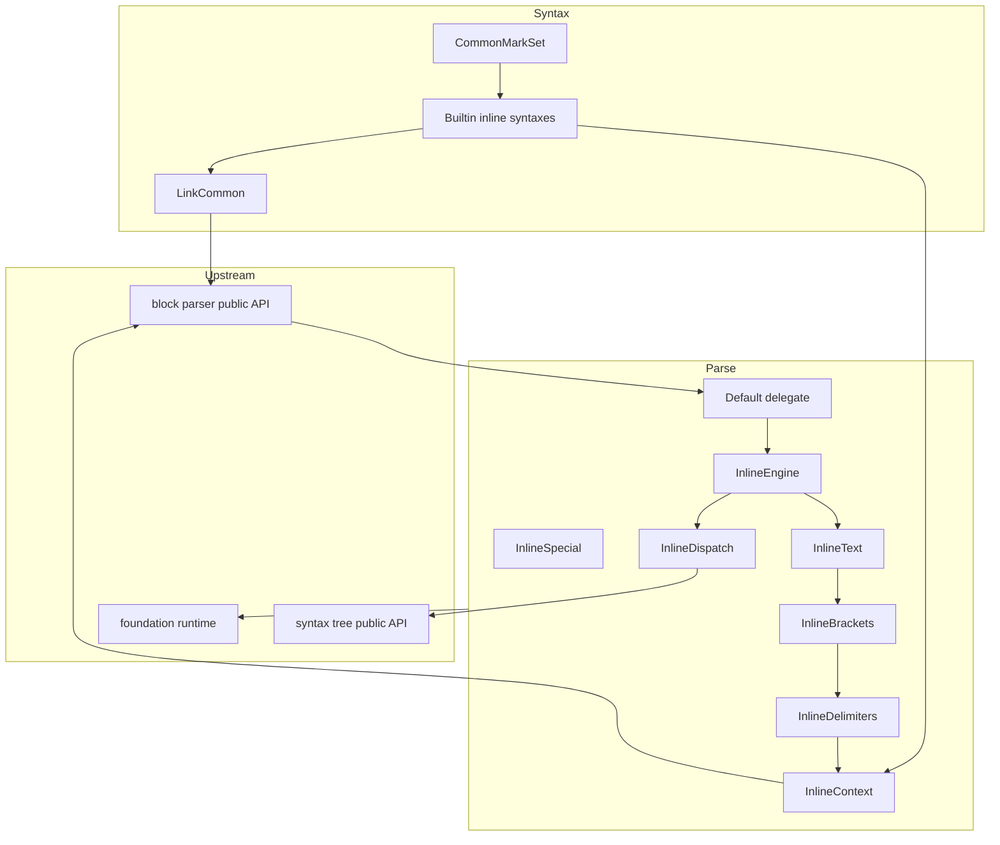
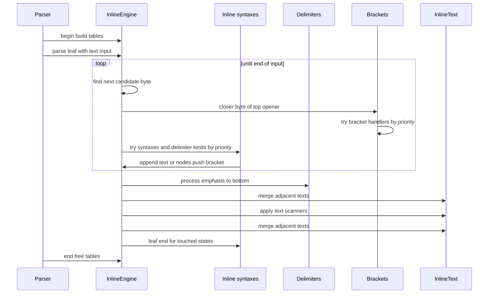
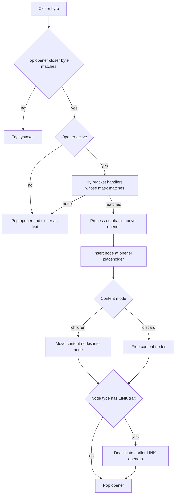
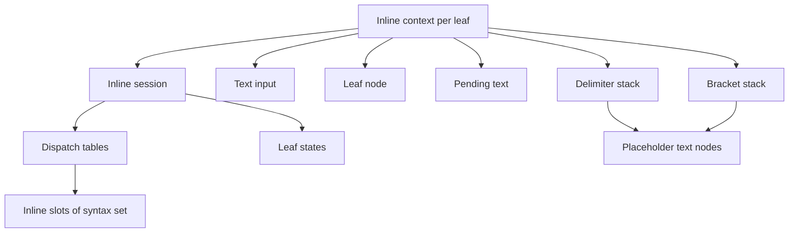

# Design Document: inline-parser

## Overview
**Purpose**：`inline-parser` は、Amark の利用者と拡張の実装者に、`block-parser` が確定させた葉（段落、見出し、拡張のブロックのセルなど）の中身をインライン要素として解析する汎用のインラインのエンジンと、公開のインライン構文 API を提供する。CommonMark 0.31.2 の全インライン構文は、この API の上の構文ごとの組み込み拡張として実装し、元の表記をすべて構文トークンとして記録する。あわせて、プロジェクト全体の受け入れゲートとして、spec.txt の全例の準拠テストと、GFM 相当の構文をテストの中だけの拡張で組み立てる表現力の検証を持つ。

**Users**：利用者は、`amark_parse_commonmark` などで、インラインまで解析された木を得る。拡張の実装者は、インライン構文・区切り文字の種類・ブラケットの後処理・テキストの走査・ノードの性質・エスケープに関わる文字のスロットと、インラインの文脈の API を使う。`markdown-renderer` は公開された役割の番号、エスケープに関わる文字の問い合わせ、区切り文字の開閉の判定と照合の関数、生の HTML の判定の関数を使う。

**Impact**：公開ヘッダ `inline.h` を追加し、`extension.h`、`commonmark.h`、`amark.h` に追記する。`src/parse/` にインラインのエンジン、`src/syntax/` にインラインの組み込み拡張を追加し、既定の委譲先をこのエンジンに変え、CommonMark の構文セットの構築関数にインラインの拡張を加える。`tests/inline/`、`tests/spec/`、`tests/extensions/`、`fuzz/inline_parse_fuzz.c`、`bench/inline_pathological.c` を追加する。

### Goals
- CommonMark 0.31.2 の spec.txt の 652 例すべてで、パースと HTML 出力（生の HTML を許可）がバイト単位で一致する。
- エンジンは個別の構文を知らず、組み込みの構文も公開のスロットと文脈の API だけで書かれる。
- 無編集の文書のすべてのバイトを、インラインのノードの構文トークンを含めて抜けも重なりもなく覆う。
- cmark の病的な入力のすべてで時間が入力の大きさにほぼ比例し、呼び出しのスタックがインラインの入れ子の深さに比例しない。
- 表、取り消し線、タスクリスト、拡張オートリンク、タグフィルタ、脚注を、テストの中だけの拡張の組み合わせで cmark-gfm と同じ形の HTML にできる。

### Non-Goals
- ブロック構造の解析、HTML の出力の規則、Markdown への書き戻しとエスケープの方式
- GFM の配布、GFM spec への準拠の主張、smart punctuation などの CommonMark にない構文の組み込み
- インラインのオプション（CommonMark のインラインには選択肢がない）

## Boundary Commitments

### This Spec Owns
- 公開ヘッダ `include/amark/inline.h`（インラインの文脈の API、6 種類のスロットの構造体、エスケープに関わる文字の問い合わせ、パースの文脈なしで使える純粋な関数 `amark_inline_delimiter_flanks`・`amark_inline_match_delimiters`・`amark_inline_scan_raw_html`）と、`extension.h`・`commonmark.h`・`amark.h` への追記
- スロットの種類 `AMARK_SLOT_INLINE_SYNTAX`（0x0201）、`AMARK_SLOT_INLINE_DELIMITER`（0x0202）、`AMARK_SLOT_INLINE_BRACKET`（0x0203）、`AMARK_SLOT_INLINE_TEXT_SCANNER`（0x0204）、`AMARK_SLOT_INLINE_NODE_TRAITS`（0x0205）、`AMARK_SLOT_INLINE_SPECIAL`（0x0206）。範囲 0x0200–0x02FF
- `src/parse/inline_*.c` のインラインのエンジン（スロットの表、文脈、区切り文字、ブラケット、テキストのまとめと走査、委譲先の本体、文字の問い合わせ）と、既定の委譲先をこのエンジンにする変更
- `src/syntax/` のインラインの組み込み拡張（構文ごとに 1 ファイル）と、`amark_syntax_set_add_commonmark` に加えるインラインの拡張の一覧と順
- インラインの構文トークンの役割の番号（`AMARK_CM_ROLE_*` の 0x0100–0x01FF）と、インラインのエンジンの役割の値（`block-parser` が割り当てた 0xFF10–0xFF1F の中で定める）、インラインの優先度（`AMARK_CM_INLINE_PRIORITY_*`）
- 区切り文字の flanking の判定と process emphasis の唯一の実装（`src/parse/inline_delims.c`。エンジンと公開の関数が共有する）と、生の HTML のコメント・処理命令・宣言・CDATA の規則の唯一の実装（`src/syntax/raw_html.c`。構文と公開の関数が共有する）
- テスト：`tests/inline/`、`tests/spec/`（spec.txt、版の固定、準拠テスト）、`tests/extensions/`（GFM 相当のインラインの検証用拡張と組み合わせ）、`tests/support/inline_check.{h,c}`（INTERFACE ライブラリ `amark_test_inline`）、`tests/support/gen_examples.cmake` への追加の拡張（`EXPECT=html`・`FACTORY=`・`CHECK=`。ファイルと基本の契約は `block-parser`）、`tests/spec/spec_version.cmake`（`markdown-renderer` などが include して再利用できる版の固定の唯一の場所）、`fuzz/inline_parse_fuzz.c`、`bench/inline_pathological.c` への追記
- `.gitattributes` の spec.txt の `export-ignore` と、CI の準拠テストを必須にする設定
- `tests/extensions/gfm_set.{h,c}`、`tests/extensions/gfm_inline_ext.{h,c}`（検証用のトークンの役割の番号 `AMARK_TEST_GFM_ROLE_*` の 0x0E40–0x0E61 を含む）と `amark_test_gfm` の作成（`amark_test_gfm` は Naos に依存しない。部品の並びの一覧は、`markdown-renderer` のタスク 4.2 が Markdown の検証用部品 `amark_test_md_gfm` を HTML の部品の後に足し、`amark_test_gfm` に依存を足す。その編集は `markdown-renderer` が行い、この spec のタスクは行わない）

### Out of Boundary
- ブロック構造、委譲の取り決めそのもの、区間の並びのテキスト、走査と解読の関数、ラベルの正規化と表、断片のパースの仕組み（`block-parser`。必要な変更は Upstream Changes に示す）
- `block-parser` が実装するもの（この spec は確かめて使うだけで、同じものを実装しない）：宛先の括弧の入れ子の上限 `AMARK_SCAN_MAX_LINK_PAREN_DEPTH`（32）とその走査、エンジンの役割の範囲の分け方（`block.h` の注記）、INTERFACE ライブラリ `amark_test_parse_gfm`（表・脚注の定義・タスクリストの検証用の構文、`amark_test_gfm_footnote_definitions`、セルの中の `\|` の扱い）、関数の形の `amark_test_parse_check`、HTML の開始タグと終了タグの走査（区間の並びの版と、バイト列の版 `amark_scan_html_open_tag_bytes` / `amark_scan_html_closing_tag_bytes`）
- `tests/support/gen_examples.cmake` の作成と、その基本の契約（データの形式、テストの名前 `ex<4 桁の番号>_<節の名前の C の識別子>`、開始の行の `n=<N>`、構成時の誤り、基本の ARGS `EXPECT=dump`・`DUMP_FLAGS=` と基本の検査の経路）。`block-parser`（タスク 1.4。design の SyntaxTests の「`gen_examples.cmake` の契約」）が spec.txt の形式の唯一のパーサとして作る。この spec は追加だけで拡張し、別のパーサを作らない
- `bench/CMakeLists.txt` と、その中の登録関数 `amark_add_bench(<name> SOURCES ... [INTERNAL])` とベンチマークの登録（`block-parser`）。オプション `AMARK_BUILD_BENCH` と `add_subdirectory(bench)` は最上位の `CMakeLists.txt` にある（`foundation` の拡張点として `block-parser` が追記する）。この spec は `bench/CMakeLists.txt` に `amark_add_bench(...)` の行を 1 つ追記するだけ
- `markdown-renderer` の検証用部品（`amark_test_md_gfm`）と、それを `gfm_set.c` に加える編集、`CHECK=` で指定する検査の関数（`amark_test_md_check_example`）
- ノード、トークンの種類、編集の追跡、レジストリ（`syntax-tree`）
- HTML の出力の表と GFM 相当の HTML の部品（`html-renderer`）。準拠テストで出力の不具合が見つかったら `html-renderer` を直す
- GFM 相当のブロックの構文（表、脚注の定義、タスクリスト）のパースの部品（`block-parser` のテストの中）
- エスケープの方式と、Markdown の出力のスロット（`markdown-renderer`）

### Allowed Dependencies
- `foundation` の公開 API（error、allocator、buffer、utf8、unicode）と内部 API（`runtime/alloc_internal.h`、`runtime/buffer_internal.h`）。`src/parse/inline_*.c` だけが内部 API を使う
- `syntax-tree` の公開 API（`node.h`、`document.h`、`token.h`、`dump.h`、`extension.h`）
- `block-parser` の公開 API（`parser.h`、`scan.h`、`entity.h`、`commonmark.h`）。`scan.h` の `AMARK_SCAN_MAX_LINK_PAREN_DEPTH`、`amark_scan_html_open_tag` / `_closing_tag`、そのバイト列の版 `amark_scan_html_open_tag_bytes` / `_closing_tag_bytes` を含む（名前と引数は `block-parser` の design に従う）。`src/parse/inline_*.c` は `parse_internal.h` を使わない（公開 API だけを使い、委譲先として呼ばれる）。例外は既定の委譲先を返す `inline_plain.c`（`block-parser` のファイル）が `inline_internal.h` の 1 つの宣言を使うこと
- テスト時：Naos、`amark_add_test`、`amark_add_generated_tests`、`AmarkTestGen.cmake`、`block-parser` の `tests/support/gen_examples.cmake`（拡張して使う）、`amark_test_support`、`amark_test_tree`、`amark_test_parse`（`amark_test_parse_check`。`block-parser` が関数の形で実装）、`amark_test_html_gfm`、`amark_test_parse_gfm`（`block-parser` が実装）、`amark_add_fuzzer`
- レイヤーの規則：`src/parse/inline_*.c` は `src/syntax/` と `src/render/` を参照しない。`src/syntax/` のインラインの拡張は、`include/amark/` の公開ヘッダと、同じ層（`src/syntax/`）の中だけで共有する内部ヘッダ `src/syntax/link_common_internal.h` だけを include する。同じ層の `*_internal.h` は steering（structure.md）が許す例外で、`src/tree/`・`src/parse/`・`src/render/` の内部ヘッダへの依存とは扱いが違う（後者は禁止）。`link_common_internal.h` を include するのは `link_common.c`、`link.c`、`image.c` だけ
- ファジング：`fuzz/inline_parse_fuzz.c` がリンクするテスト支援ライブラリ（`amark_test_gfm` と、その依存の `amark_test_parse_gfm`、`amark_test_html_gfm`、後で `markdown-renderer` が足す `amark_test_md_gfm`）は、`foundation` の規則に従い Naos に依存しない。Naos を使う検査の補助（`amark_test_inline`、`amark_test_parse` など）はファジングのターゲットにリンクしない

### Revalidation Triggers
独立した継ぎ目ごとに分ける。どの群の変更かで、確かめ直す相手を決める（spec は分けない）。

**A. インラインのエンジンと公開 API（`inline.h`、`commonmark.h` のインラインの部分）**
- 6 種類のスロットの構造体、コールバックの契約、優先度の値、区切り文字の規則の列挙の変更 → 利用者の拡張、`tests/extensions/`
- インラインの文脈の API（位置、テキストの追加、引き取り、記録、ブラケットの積み方）の意味の変更 → 利用者の拡張
- 役割の番号、トークンの所有の規則（どのノードが何を持つか）、リンクの書式の区別のトークンの規則の変更 → `markdown-renderer`
- エスケープに関わる文字の宣言と問い合わせの変更 → `markdown-renderer`
- 組み込みのインラインの拡張の名前と、構築関数に加えるインラインの拡張どうしの相対の順の変更 → `block-parser`（構築関数）、`markdown-renderer`
- テキストのまとめの規則（隣り合う text を 1 つにする）の変更 → `markdown-renderer`、利用者
- `amark_inline_delimiter_flanks`・`amark_inline_match_delimiters`（`amark_inline_run_t` と照合の結果の形、規則の意味）、`amark_inline_scan_raw_html` の名前と規則の変更 → `markdown-renderer`
- テキストの走査の一致を採らない規則（エスケープと文字参照を含む範囲）の変更 → `markdown-renderer`（拡張オートリンクになりうるテキストの保護）、利用者の拡張
- 上流の変更：`amark_text_input_t`、`amark_parse_add_decoded`、走査の関数、`amark_label_map_t` の契約、`AMARK_SCAN_MAX_LINK_PAREN_DEPTH`、HTML のタグの走査（区間の並びの版とバイト列の版）→ この spec（InlineContext、LinkCommon、RawHtml）

**B. 準拠ゲート（`tests/spec/`、`tests/support/inline_check.{h,c}`、`gen_examples.cmake` の拡張の引数）**
- 固定する spec の版と SHA-256（`spec_version.cmake`）の変更 → この spec の準拠テスト、`spec_version.cmake` を include する `markdown-renderer` のテスト
- `gen_examples.cmake` のこの spec の引数（`EXPECT=html`・`FACTORY=`・`CHECK=`、`DUMP_FLAGS=` との組み合わせの規則、`CHECK=` の関数の引数の形 `amark_test_example_check_fn_t`）の変更 → `markdown-renderer` のテスト
- `block-parser` の `gen_examples.cmake` の基本の契約（データの形式、テストの名前、`n=`、基本の ARGS と経路、予約した名前）と `amark_test_parse_check` の契約の変更 → この spec（InlineCheck、SpecTests）
- `html-renderer` の組み込みの出力の表の変更 → 準拠テスト
- `AMARK_REQUIRE_SPEC_TESTS`、スキップの報告、`.gitattributes` の `export-ignore` の変更 → CI、`foundation`

**C. GFM 相当の組み合わせのライブラリ（`tests/extensions/`、`amark_test_gfm`）**
- `amark_test_gfm_set_new` の部品の並び、`gfm_inline_ext.h` の拡張の名前と振る舞い、検証用の役割の番号 `AMARK_TEST_GFM_ROLE_*`（0x0E40–0x0E61）の変更 → `markdown-renderer` のテスト（`amark_test_md_gfm`）、`inline_parse_fuzz`
- `amark_test_gfm` とその依存が Naos に依存しない取り決め（`foundation` の規則）の変更 → `inline_parse_fuzz`、`markdown-renderer` のファジング
- 上流の検証用ライブラリ `amark_test_parse_gfm`（`block-parser`）と `amark_test_html_gfm`（`html-renderer`）の契約の変更 → この spec（GfmSet、GFM 相当のテスト、ファジング）

## Architecture

### Architecture Pattern & Boundary Map
**Selected pattern**：スロット駆動の汎用エンジン。エンジンは「特別な文字ごとの候補（インライン構文と区切り文字の種類）を優先度の順に試す走査」「テキストのまとめ」「区切り文字のスタックと process emphasis」「ブラケットのスタックと後処理」「組み立て後のテキストの走査」だけを知る。構文ごとの知識は `src/syntax/` のスロットに閉じる。



**Dependency direction（`src/parse/` の中）**：`inline_special` → `inline_dispatch` → `inline_context` → `inline_delims` → `inline_brackets` → `inline_text` → `inline_engine` → `inline_plain`（`block-parser` のファイル）。左のファイルは右のファイルの関数を呼ばない。`inline_*` は `block-parser` の他のファイルの内部関数を呼ばない。`src/syntax/` のインラインのファイルは公開ヘッダと、同じ層の内部ヘッダ `link_common_internal.h`（`link_common.c`、`link.c`、`image.c` だけ）だけを include する。違反はレビューでエラーとする。

**Architecture Integration**：
- Domain boundaries：エンジン（`src/parse/inline_*`）と構文（`src/syntax/`）。構文の知識をエンジンに置かない。エンジンが知る組み込みのノード型は、テキストのまとめに使う `text` と、改行の受け皿の `softbreak` だけ（`syntax-tree` の組み込みの型で、構文ではない）。
- Existing patterns preserved：エラーコードと出力引数、`struct_size`（スロットは `amark_slot_header_t`）、グローバルのアロケータの経由、その設定のほかにグローバルな可変状態なし、内部関数も `amark_`、ライセンスヘッダ、`block-parser` のパーサの失敗の例外（`Failed` の状態）。
- Steering compliance：構文ごとに 1 ファイル、組み込みも公開 API だけ、parse → tree の一方向、spec.txt はテストデータだけ。

### Technology Stack

| Layer | Choice / Version | Role in Feature | Notes |
|-------|------------------|-----------------|-------|
| Language | C99 | ライブラリ、テスト、ファジング、ベンチマーク | `amark_target_defaults()` |
| Upstream | `foundation`、`syntax-tree`、`block-parser`、`html-renderer` の公開 API | 確保、ノード、トークン、区間の並び、走査、解読、ラベルの表、HTML の出力 | 上流の変更は Integration & Upstream Changes |
| Reference | cmark 0.31.1 `inlines.c`（手順だけ）、CommonMark 0.31.2 | 振る舞いの基準 | コードは取り込まない |
| Test data | CommonMark spec.txt 0.31.2（CC-BY-SA 4.0、SHA-256 固定） | 準拠テスト | `export-ignore`、配布しない |
| Test | Naos v0.4.0、`amark_add_generated_tests` | 生成テストと単体テスト | — |
| Fuzz / Bench | `amark_add_fuzzer`、`bench/` | ファジング、倍々の時間 | — |

## File Structure Plan

### Directory Structure
```
include/amark/
└── inline.h                     # インラインの文脈の API、6 つのスロットの構造体、エスケープに関わる文字の問い合わせ
src/parse/
├── inline_internal.h            # struct amark_inline_context、表、区切り文字とブラケットの要素、amark_inline_engine_delegate
├── inline_special.c             # amark_inline_special_*：構文セットのスロットからの文字の宣言の列挙と和
├── inline_dispatch.c            # スロットの検査、バイトごとの候補の表、ブラケットの後処理とテキストの走査の整列、
│                                # 区切り文字のノード型の解決、ノードの性質の表、葉ごとの作業領域の配置
├── inline_context.c             # 文脈の API：位置と文字、未確定のテキストと引き取り、テキストとノードの追加、記録、ラベルの検索
├── inline_delims.c              # 区切り文字の並びの走査、区切り文字のスタック、flanking と照合の唯一の実装
│                                # （amark_inline_delimiter_flanks、amark_inline_match_delimiters と内部の amark_inline_match_runs）
├── inline_brackets.c            # ブラケットのスタック、閉じの検出、後処理の呼び出し、中身の移動と破棄、無効化
├── inline_text.c                # 隣り合う text のまとめ、テキストの走査の適用、リテラルの位置での分割とトークンの分配
└── inline_engine.c              # 委譲先の begin / parse / end、葉ごとの走査の本体、作業領域の寿命、改行の受け皿、内部のカウンタ
src/syntax/
├── backslash_escape.c           # commonmark.backslash_escape
├── char_ref.c                   # commonmark.char_ref（実体参照と数値文字参照）
├── code_span.c                  # commonmark.code_span（葉ごとのバッククォートの並びの索引）
├── emphasis.c                   # commonmark.emphasis（区切り文字の種類 * と _）
├── link_common_internal.h       # リンクと画像が共有する、後ろの部分の解析・参照の解決・トークンの記録の宣言
├── link_common.c                # その実装
├── link.c                       # commonmark.link（[ の開き、ブラケットの後処理、link の性質、] の宣言）
├── image.c                      # commonmark.image（![ の開き、ブラケットの後処理）
├── autolink.c                   # commonmark.autolink（URI とメール、link の性質）
├── raw_html.c                   # commonmark.raw_html と amark_inline_scan_raw_html（タグは block-parser の走査、コメント・処理命令・
│                                # 宣言・CDATA はこのファイルの唯一の走査を両方が使う）
├── hard_break.c                 # commonmark.hard_break（2 つ以上の空白か \ と改行）
└── soft_break.c                 # commonmark.soft_break（改行と、その前の行末の空白）
tests/support/
├── inline_check.h               # 例の照合の補助（構文セットの生成関数、ダンプか HTML の比較、被覆、逐次の一致）
├── inline_check.c               # INTERFACE ライブラリ amark_test_inline のソース
└── gen_examples.cmake           # block-parser が作る spec.txt の形式の唯一のパーサ。この spec は EXPECT=html・FACTORY=・CHECK= を追加で足す
tests/inline/
├── CMakeLists.txt
├── test_inline_syntaxes.h       # エンジンのテスト用の最小の構文（各スロットの種類、失敗、副作用のある NONE）
├── test_inline_syntaxes.c
├── engine_test.c                # 走査の順、優先度、テキストのまとめ、改行の受け皿、取り除いた構文、既定と単純な委譲先、失敗
├── context_test.c               # 区間をまたぐ文字と記録、未確定のテキストの引き取り、作業領域の寿命、ラベルの検索
├── delimiter_test.c             # flanking、3 の倍数、EXACT、最大の長さ、種類の混在、残りのトークン
├── bracket_test.c               # 後処理の順と対象、CHILDREN と DISCARD、無効化、bracket_after、閉じの文字
├── text_scanner_test.c          # 走査の範囲、直前の文字、in_link、分割のトークン、無視する境界、線形性
├── special_test.c               # 宣言、きっかけの文字と区切り文字の自動の追加、和
├── fragment_test.c              # インラインの文脈の断片、挿入先の定義
├── oom_test.c                   # 確保失敗の総当たり
├── scale_test.c                 # 内部のカウンタの倍々の比（INTERNAL）
├── pathological_test.c          # cmark の病的な入力（時間の上限つき）
└── data/
    ├── backslash_escape.txt     # 構文ごとの入力と期待するダンプ（トークンつき）
    ├── char_ref.txt
    ├── code_span.txt
    ├── emphasis.txt
    ├── link.txt
    ├── image.txt
    ├── autolink.txt
    ├── raw_html.txt
    ├── hard_break.txt
    ├── soft_break.txt
    ├── text.txt                 # テキストのまとめ、残りの区切り文字、受け皿
    └── lossless_inline.txt      # 引用やリストの中の複数行、タブ、CRLF、NUL、不正な UTF-8 を含むインライン
tests/spec/
├── CMakeLists.txt               # 版の照合、データがないときのスキップ、生成テストの登録
├── spec_version.cmake           # AMARK_COMMONMARK_SPEC_VERSION と SHA-256（1 か所。markdown-renderer も include して再利用する）
└── data/
    ├── spec.txt                 # CommonMark spec 0.31.2（CC-BY-SA 4.0、export-ignore）
    └── NOTICE.txt               # 出典と許諾、配布しないこと（export-ignore）
tests/extensions/
├── CMakeLists.txt               # amark_test_gfm（INTERFACE、Naos なし）、生成テスト、組み合わせのテスト（Naos あり）
├── gfm_inline_ext.h             # 取り消し線、拡張オートリンク、脚注の参照のインラインの検証用拡張と、その役割の番号（0x0E40–0x0E61）
├── gfm_inline_ext.c
├── gfm_set.h                    # CommonMark ＋ ブロック・インライン・HTML の GFM 相当の部品を並べた構文セットの生成
│                                # （markdown-renderer のタスク 4.2 が HTML の部品の後に Markdown の部品を足す）
├── gfm_set.c
├── gfm_compose_test.c           # 部品の取り除き、被覆、逐次の一致、組み合わせの順
└── data/gfm_cases.txt           # 自前の代表的な入力と期待する HTML（cmark-gfm と同じ形）
fuzz/
├── inline_parse_fuzz.c
└── corpus/inline_parse/
bench/
└── inline_pathological.c        # 病的な入力を 1、2、4、8 倍にした時間を表示する
```

### Modified Files
- `include/amark/extension.h` — スロットの種類 0x0201–0x0206 の名前と番号、範囲 0x0200–0x02FF の注記（`syntax-tree` が追加中の範囲の表の `inline-parser` の行）。
- `include/amark/amark.h` — `foundation` が定める正規の順（`foundation` のヘッダ → 木のヘッダ → `render.h`・`html.h` → `entity.h`・`scan.h`・`parser.h`・`block.h`・`inline.h`・`commonmark.h` → `markdown.h`）の `inline.h` の位置に追加する。順はこの spec では決めず、`foundation` の定めに従う。
- `include/amark/commonmark.h` — インラインの拡張の取得関数 10 個、インラインの役割の番号、インラインの優先度を追記する。
- `src/parse/inline_plain.c` — `amark_inline_delegate_default()` が `amark_inline_engine_delegate` を返すようにする（`block-parser` の design が予定する変更）。
- `src/syntax/commonmark.c` — 構築関数の「構文の拡張の一覧」の末尾にインラインの拡張を加える（順は CommonMarkSet）。
- `src/CMakeLists.txt` — `amark_objects` に `src/parse/inline_*.c` と `src/syntax/` のインラインのファイルを追加する。
- `tests/CMakeLists.txt` — INTERFACE ライブラリ `amark_test_inline`（`support/inline_check.c`。Naos を使う）を定義し、`add_subdirectory(inline)`、`add_subdirectory(spec)`、`add_subdirectory(extensions)` を追加する。`foundation` の規則どおり `tests/` とその下は `AMARK_FUZZ` だけが ON の構成でも入るので、Naos を使う `amark_test_inline` と `inline`・`spec` のテストは `if(AMARK_BUILD_TESTS)` の中に置き、`extensions` は常に加える（`tests/extensions/CMakeLists.txt` の中で、Naos を使わない `amark_test_gfm` は常に定義し、Naos を使う生成テストと組み合わせのテストは `if(AMARK_BUILD_TESTS)` の中に置く）。
- `tests/support/gen_examples.cmake` — `block-parser` が作ったファイルに、予約済みの `EXPECT=html`、`FACTORY=`、`CHECK=` を追加で足す（InlineCheck）。`FACTORY=` も `CHECK=` もないときに生成するソースは `block-parser` の版とバイト単位で同じに保つ。データの形式、テストの名前、`n=`、基本の ARGS の意味は変えない。
- `fuzz/CMakeLists.txt` — `amark_add_fuzzer(inline_parse SOURCES inline_parse_fuzz.c CORPUS corpus/inline_parse LIBRARIES amark_test_gfm)`。`amark_test_gfm` は Naos に依存しない（`-DAMARK_FUZZ=ON -DAMARK_BUILD_TESTS=OFF` でも構成できる。`LIBRARIES` のターゲットがなければ `amark_add_fuzzer` が構成を失敗させる）。
- `bench/CMakeLists.txt` — `amark_add_bench(inline_pathological SOURCES inline_pathological.c)` の 1 行を追記する（ファイルと `amark_add_bench` は `block-parser` が所有し、この spec は関数と構成を変えない。`AMARK_BUILD_BENCH` と `add_subdirectory(bench)` は最上位の `CMakeLists.txt` にあり、`block-parser` が `foundation` の拡張点として追記する）。
- `.gitattributes` — `tests/spec/data/spec.txt export-ignore`、`tests/spec/data/NOTICE.txt export-ignore`。
- `.github/workflows/ci.yml` — 構成に `-DAMARK_REQUIRE_SPEC_TESTS=ON` を加える（全ジョブ）。

## System Flows

### 1 つの葉のインラインの解析

- 走査は位置 `pos` から、候補の文字の表（インライン構文のきっかけの文字、区切り文字の文字、積まれた開きの閉じの文字）にある次のバイトまで進む。その間は未確定の素のテキスト（`pending_start` から）として持つ。
- 候補のバイトでは、(1) 最も上の開きの閉じの文字ならブラケットの閉じを処理する。(2) そうでなければ候補（構文と区切り文字の種類）を（優先度、構文セットの順）で試す。(3) どれも成立しなければ、そのバイトの文字（UTF-8 の 1 文字）を素のテキストに含めて進む。
- 構文が成立したら、まず `[pending_start, 引き取りの始まり)` をテキストとして確定させ、構文が追加したテキストとノードをその後ろに置き、`pos` を `out_end` に進める。
- 改行のバイトにどの候補も成立しなければ、エンジンが softbreak（`LINE_ENDING`、役割 `AMARK_ROLE_INLINE_FALLBACK_BREAK`）を作る（2.4）。

### ブラケットの閉じ

- 開きと閉じの間の区切り文字は、後処理を試す前ではなく、成立した後に処理する（cmark と同じ。後処理は中身を位置で参照する）。

## Requirements Traceability

| Requirement | Summary | Components | Interfaces | Flows |
|-------------|---------|------------|------------|-------|
| 1.1 | 既定のパースでインラインを解析 | InlineEngine, Default delegate | `amark_inline_delegate_default` | 葉の解析 |
| 1.2 | 既定の委譲先、単純な委譲先の維持 | Default delegate | `amark_inline_delegate_plain` | — |
| 1.3 | 区間をつないだ中身、隙間を含めない | InlineContext | `amark_text_input_t`, `amark_inline_record` | — |
| 1.4 | 逐次の入力の一致 | InlineEngine | 決定的な処理 | — |
| 1.5 | 失敗とメモリ不足 | InlineEngine, 全コンポーネント | エラーコードの伝播、`leaf_end` | 葉の解析 |
| 1.6 | スレッドと構文セットの共有 | InlineDispatch, InlineEngine | 表はパースごと、静的データは const | — |
| 2.1 | 位置ごとに優先度の順に試す | InlineDispatch, InlineEngine | `priority`, `trigger` | 葉の解析 |
| 2.2 | テキストのまとめ、空の text なし | InlineText, InlineContext | `amark_inline_append_text` | 葉の解析 |
| 2.3 | 取り除いた構文の文字はテキスト | InlineEngine, CommonMarkSet | 構文セットのスロット | — |
| 2.4 | 改行の受け皿 | InlineEngine | `AMARK_ROLE_INLINE_FALLBACK_BREAK` | 葉の解析 |
| 2.5 | 副作用のある NONE | InlineEngine, InlineContext | 変更の計数 | — |
| 2.6 | 構文の知識を持たない | InlineDispatch | スロットだけ | — |
| 3.1 | きっかけの文字の構文の登録 | InlineDispatch | `amark_inline_syntax_t` | — |
| 3.2 | 中身・位置・前後の文字 | InlineContext | `amark_inline_char_before` など | — |
| 3.3 | ノードの作成とトークンの記録 | InlineContext | `amark_inline_new_node`, `amark_inline_append_node`, `amark_inline_record` | — |
| 3.4 | 定義の表、拡張の状態、オプション | InlineContext | `amark_inline_parse_context` | — |
| 3.5 | 区切り文字と開きを後に回す | InlineDelimiters, InlineBrackets | `amark_inline_push_delimiter`, `amark_inline_push_bracket` | — |
| 4.1 | きっかけのない構文 | InlineText | `amark_inline_text_scanner_t` | 葉の解析 |
| 4.2 | 直前の文字と in_link | InlineText | `scan` の引数 | — |
| 4.3 | 分割後の被覆 | InlineText | 分割とトークンの分配 | — |
| 4.4 | 組み立て後に適用 | InlineEngine, InlineText | 処理の順 | 葉の解析 |
| 4.5 | エスケープと文字参照を含む一致を採らない | InlineText | 一致の採否の規則 | — |
| 5.1 | 区切り文字の種類の登録 | InlineDispatch | `amark_inline_delimiter_t` | — |
| 5.2 | CommonMark の手順で処理 | InlineDelimiters | process emphasis、下限の表 | — |
| 5.3 | 種類の違うものを一致させない | InlineDelimiters | 種類の索引 | — |
| 5.4 | ノードと区切りのトークン | InlineDelimiters | `open_role`, `close_role` | — |
| 5.5 | 残りをテキストに | InlineDelimiters, InlineText | `AMARK_ROLE_INLINE_UNMATCHED` | — |
| 5.6 | 強調も登録だけで | Emphasis | `commonmark.emphasis` | — |
| 5.7 | flanking と照合の公開の関数（唯一の実装） | InlineDelimiters | `amark_inline_delimiter_flanks`, `amark_inline_match_delimiters` | — |
| 6.1 | 1 つのスタックと後処理の順 | InlineBrackets | `amark_inline_bracket_t` | ブラケットの閉じ |
| 6.2 | 中身・後ろ・開きの種類 | InlineBrackets | `amark_bracket_info_t` | ブラケットの閉じ |
| 6.3 | 中の区切りの処理、子、DISCARD | InlineBrackets | `amark_bracket_result_t` | ブラケットの閉じ |
| 6.4 | リンクの中にリンクを作らない | InlineBrackets, InlineDispatch | `AMARK_INLINE_TRAIT_LINK`, `AMARK_BRACKET_OPENER_LINK` | ブラケットの閉じ |
| 6.5 | 不成立はテキスト | InlineBrackets | `AMARK_ROLE_INLINE_UNMATCHED` | ブラケットの閉じ |
| 6.6 | ラベルの解決と拡張の表 | InlineContext, LinkCommon | `amark_inline_lookup_label`, `amark_label_map_t` | — |
| 7.1 | 全インライン構文 | Builtin inline syntaxes, InlineEngine（テキスト） | 各拡張 | — |
| 7.2 | 構文ごとの拡張 | Builtin inline syntaxes | `commonmark.*` | — |
| 7.3 | CommonMark の構文セットに含める | CommonMarkSet | `amark_syntax_set_add_commonmark` | — |
| 7.4 | 値の規則 | Builtin inline syntaxes, LinkCommon | `amark_parse_add_decoded`, `amark_node_set_*` | — |
| 7.5 | 公開 API だけ | Builtin inline syntaxes | 公開ヘッダ | — |
| 7.6 | 構文の間の優先 | InlineEngine, Builtin inline syntaxes | 左から右の走査 | 葉の解析 |
| 7.7 | 生の HTML のバイト列の判定 | RawHtml | `amark_inline_scan_raw_html`, `amark_scan_html_open_tag_bytes`（上流） | — |
| 8.1 | 全バイトの被覆 | 全コンポーネント | `amark_document_check_tokens` | — |
| 8.2 | エスケープと文字参照の表記 | BackslashEscape, CharRef | `ESCAPE`, `CHAR_REF` | — |
| 8.3 | 区切り、コード、オートリンク、HTML | InlineDelimiters, CodeSpan, Autolink, RawHtml | 役割の番号 | — |
| 8.4 | リンクの書式の区別 | LinkCommon | `AMARK_CM_ROLE_LINK_*`（`LINK_OPEN`・`LINK_PAREN_*`・`LINK_REF_*`・`AUTOLINK_*` のどれもない link は拡張が定義するリンク） | — |
| 8.5 | 改行と置き換え | HardBreak, SoftBreak, InlineContext | `amark_inline_claim_preceding`, `REPLACED` | — |
| 8.6 | 役割の番号の公開 | CommonMarkSet（`commonmark.h`） | `AMARK_CM_ROLE_*` | — |
| 8.7 | 拡張も同じ方法 | InlineContext | `amark_inline_record` | — |
| 9.1 | 文字の宣言 | InlineSpecial | `amark_inline_special_t` | — |
| 9.2 | 問い合わせ | InlineSpecial | `amark_inline_special_at`, `amark_inline_special_chars` | — |
| 9.3 | 方式を決めない | InlineSpecial | 情報だけ | — |
| 10.1 | インラインの文脈の断片 | InlineEngine（Fragment は `block-parser`） | `amark_parse_fragment` | — |
| 10.2 | 挿入先の定義 | InlineEngine, LinkCommon | `AMARK_FRAGMENT_TARGET_DEFINITIONS` | — |
| 11.1 | 病的な入力で二次にしない | InlineDelimiters, InlineBrackets, InlineText, CodeSpan, RawHtml | 下限の表、無効化、作業領域 | — |
| 11.2 | スタックを使い果たさない | 全コンポーネント | 再帰なし | — |
| 11.3 | 許された制限の文書化 | LinkCommon（`block-parser` の走査と定数） | `AMARK_SCAN_MAX_LINK_PAREN_DEPTH`（32） | — |
| 11.4 | NUL と不正な UTF-8 | InlineContext | `amark_parse_add_decoded` | — |
| 11.5 | ファジングと計算量のテスト | Fuzz, ScaleTests, PathologicalTests | `inline_parse_fuzz` | — |
| 11.6 | ファジングだけの構成 | Fuzz, GfmSet | `amark_test_gfm`（Naos なし）、`amark_add_fuzzer` | — |
| 12.1 | 全例を名前つきで HTML 照合 | SpecTests, InlineCheck | `gen_examples.cmake`（`block-parser` の版を拡張） | — |
| 12.2 | 被覆・不変条件・逐次 | InlineCheck | `amark_test_parse_check` | — |
| 12.3 | 版の固定と照合 | SpecTests | `spec_version.cmake` | — |
| 12.4 | テストデータだけ、許諾 | SpecTests | `NOTICE.txt`, `export-ignore` | — |
| 12.5 | データがないときのスキップ | SpecTests | `AMARK_SKIP` | — |
| 12.6 | 必須にする選択 | SpecTests | `AMARK_REQUIRE_SPEC_TESTS` | — |
| 13.1 | インラインの検証用拡張 | GfmInlineExt | `test.inline.*` | — |
| 13.2 | 組み合わせと cmark-gfm の形 | GfmSet, GfmTests | `gfm_cases.txt` | — |
| 13.3 | 被覆と逐次の一致 | GfmTests, InlineCheck | `amark_test_parse_check` | — |
| 13.4 | 配布しない | GfmInlineExt | テストの中だけ | — |
| 13.5 | 不足は上流の変更 | — | Integration & Upstream Changes | — |
| 13.6 | 検証用の役割の番号と拡張が定義するリンク | GfmInlineExt, LinkCommon | `AMARK_TEST_GFM_ROLE_*`（0x0E40–0x0E61） | — |
| 14.1 | 構文ごとのダンプの照合 | InlineTests, InlineCheck | `tests/inline/data/*.txt` | — |
| 14.2 | エンジンの API のテスト | InlineTests | `test_inline_syntaxes` | — |
| 14.3 | 確保失敗の総当たり | InlineTests | `AMARK_CHECK_OOM_SWEEP` | — |
| 14.4 | 生成テストの検査の関数の指定 | InlineCheck | `gen_examples.cmake` の `CHECK=`, `amark_test_example_check_fn_t` | — |

## Components and Interfaces

| Component | Domain/Layer | Intent | Req Coverage | Key Dependencies (P0/P1) | Contracts |
|-----------|--------------|--------|--------------|--------------------------|-----------|
| InlineSpecial | Parse | 構文セットのエスケープに関わる文字の問い合わせ | 9.1–9.3 | syntax set (P0) | Service |
| InlineDispatch | Parse | スロットの検査と、パースごとの表 | 1.6, 2.1, 2.6, 3.1, 5.1, 6.4 | syntax set (P0) | Service |
| InlineContext | Parse | 構文に見せる文脈の API | 1.3, 2.2, 2.5, 3.2–3.4, 6.6, 8.5, 8.7, 11.4 | block-parser text input / decode (P0) | Service, State |
| InlineDelimiters | Parse | 区切り文字の並び、スタック、process emphasis、flanking と照合の公開の関数 | 3.5, 5.2–5.5, 5.7, 11.1 | InlineContext (P0) | Service |
| InlineBrackets | Parse | ブラケットのスタックと後処理 | 3.5, 6.1–6.5, 11.1 | InlineDelimiters (P0) | Service |
| InlineText | Parse | テキストのまとめ、走査、分割 | 2.2, 4.1–4.5, 5.5 | InlineBrackets (P1), syntax-tree (P0) | Service |
| InlineEngine | Parse | 委譲先の本体と葉ごとの走査 | 1.1, 1.4, 1.5, 2.1, 2.3, 2.4, 4.4, 7.6, 10.1, 10.2, 11.2 | 全 Parse コンポーネント (P0) | Service, State |
| Default delegate | Parse | 既定の委譲先をエンジンにする | 1.1, 1.2 | InlineEngine (P0) | Service |
| Builtin inline syntaxes | Syntax | CommonMark の各インライン構文（RawHtml の `amark_inline_scan_raw_html` を含む） | 5.6, 7.1, 7.2, 7.4–7.7, 8.2–8.5 | inline.h (P0), scan.h (P0) | Service |
| LinkCommon | Syntax | リンクと画像の後ろの部分と参照 | 6.6, 7.4, 8.4, 10.2, 11.3 | scan.h (P0), inline.h (P0) | Service |
| CommonMarkSet | Syntax | 構築関数への追加、役割と優先度の公開 | 2.3, 7.2, 7.3, 8.6 | commonmark.c (P0) | Service |
| InlineCheck | Test | 例の照合の補助と例の生成の手順 | 12.1, 12.2, 13.3, 14.1, 14.4 | amark_test_parse (P0) | Service |
| SpecTests | Test | 準拠テスト | 12.1–12.6 | InlineCheck (P0), html-renderer (P0) | Batch |
| GfmInlineExt / GfmSet / GfmTests | Test | GFM 相当の表現力の検証 | 11.6, 13.1–13.6 | amark_test_parse_gfm (P0), amark_test_html_gfm (P0) | Service, Batch |
| InlineTests / Fuzz / Bench | Test | 要件の検証 | 11.5, 14.1–14.3 | InlineCheck (P0) | Batch |

### 共通の規約
- `foundation`・`syntax-tree`・`block-parser` の規約に従う：失敗しうる関数は `amark_error_t` を返し、出力引数は最後で `out_` で始める。必須のポインタ引数が NULL なら `AMARK_ERROR_INVALID_ARGUMENT`。スロットの構造体は `amark_slot_header_t` の `struct_size` が v1 の最小（`user_data` の末尾）以上であること。6 種類のスロットの構造体は、どれも v1 の最後の欄を `void *user_data` にする（コールバックを持たない `amark_inline_special_t` と `amark_inline_node_traits_t` も、慣例をそろえ、後の版で欄を足しても v1 の最小が変わらないように持つ）。
- 位置はすべて葉の中身の論理的なバイトの位置（`amark_text_input_t` の位置、区間の隙間を数えない）。範囲は `[start, end)`。
- `amark_inline_context_t *` はコールバックの間だけ有効。コールバックが `AMARK_ERROR_NONE` 以外を返したら、エンジンは葉の解析を止め、そのエラーコードを委譲先から返す（パーサは `Failed` になる。`block-parser` の規約）。
- コールバックの中で作ったノードと、記録したトークンの所有者は、成立したときにエンジンへ渡すか、自分で解放する。不成立（`NONE`）のとき、文脈の変更（テキストとノードの追加、開きの積み、引き取り）をしてはならない（2.5）。

### Parse

#### InlineSpecial

| Field | Detail |
|-------|--------|
| Intent | 凍結した構文セットについて、テキストに現れると構文として解釈されうる文字の宣言を列挙する |
| Requirements | 9.1–9.3 |

**Responsibilities & Constraints**
- 列挙の要素は、構文セットの順に、各拡張の (a) `AMARK_SLOT_INLINE_SPECIAL` の宣言（`DECLARED`）、(b) インライン構文のきっかけの文字（`TRIGGER`）、(c) 区切り文字の種類の文字（`DELIMITER`）。拡張の中ではスロットの一覧の順。確保しない。
- 和は、すべての要素の文字の集合の和。並びの宣言（`sequences`）は和に含めない（要素で見る）。
- エスケープの方式は決めない（9.3）。利用者（`markdown-renderer`）は、和をエスケープの候補、並びを文脈つきの候補として使う。

**Contracts**: Service [x]
```c
/* include/amark/inline.h */
typedef struct amark_inline_special {
    amark_slot_header_t header;            /* kind = AMARK_SLOT_INLINE_SPECIAL */
    const unsigned char *chars;            /* 256 ビットの集合（32 バイト）。NULL 可 */
    const char *const *sequences;          /* 構文を始める文字の並び（例："![", "www."）。NULL 可 */
    size_t sequence_count;
    void *user_data;                       /* v1 のスロットの慣例どおり末尾に置く。エンジンは読まない */
} amark_inline_special_t;

typedef enum amark_inline_special_source {
    AMARK_INLINE_SPECIAL_DECLARED = 1, AMARK_INLINE_SPECIAL_TRIGGER = 2, AMARK_INLINE_SPECIAL_DELIMITER = 3
} amark_inline_special_source_t;

typedef struct amark_inline_special_info {
    size_t struct_size;
    const amark_extension_t *extension;
    amark_inline_special_source_t source;
    unsigned char chars[32];
    const char *const *sequences;          /* DECLARED のときだけ */
    size_t sequence_count;
} amark_inline_special_info_t;

AMARK_API size_t amark_inline_special_count(const amark_syntax_set_t *set);    /* 凍結前は 0 */
AMARK_API amark_error_t amark_inline_special_at(const amark_syntax_set_t *set, size_t index,
                                                amark_inline_special_info_t *out_info);
AMARK_API amark_error_t amark_inline_special_chars(const amark_syntax_set_t *set, unsigned char out_chars[32]);
```
- Preconditions：凍結していない構文セットは `AMARK_ERROR_INVALID_STATE`。`index` が範囲外は `AMARK_ERROR_INVALID_ARGUMENT`。

#### InlineDispatch

| Field | Detail |
|-------|--------|
| Intent | 構文セットのインラインのスロットを検査し、パースごとの候補の表を作る |
| Requirements | 1.6, 2.1, 2.6, 3.1, 5.1, 6.4 |

**Responsibilities & Constraints**
- 委譲先の `begin` で、構文セットの 6 種類のスロットを `amark_syntax_set_slot_at` で列挙して検査する。違反は `AMARK_ERROR_INVALID_ARGUMENT`（パースの失敗）。
  - インライン構文：`match` と `trigger` が NULL でない（きっかけのない構文はテキストの走査のスロットで書く）。
  - 区切り文字の種類：`flanking` と `rule` が既知、`node_types[0]` が NULL でなく、名前の型が構文セットにあってインラインで子を持てる。2 つの種類が同じ文字を使わない。
  - ブラケットの後処理：`match` が NULL でなく、`opener_mask` が 0 でない。テキストの走査：`scan` と `build` が NULL でない。ノードの性質：型の名前が構文セットにある。
  - 作業領域：`leaf_state_size` が `AMARK_INLINE_MAX_LEAF_STATE`（64 KiB）以下。
- 候補の表：バイトの値ごとに、そのバイトをきっかけにするインライン構文と、その文字の区切り文字の種類を、（優先度、構文セットの順、スロットの順）で整列した配列（CSR 形式）。候補の文字の 256 ビットの集合も作る。
- ブラケットの後処理とテキストの走査は、（優先度、構文セットの順）で整列する。ノードの性質は型の識別子で引く配列（性質のビットの和）。
- 葉ごとの作業領域は、各スロットの大きさを `max_align` の境界で並べた 1 つの領域として確保する。
- 表は委譲先のセッションが持ち、`end` で解放する。構文セットは読むだけ（1.6）。

**Contracts**: Service [x]
```c
/* src/parse/inline_internal.h */
amark_error_t amark_inline_tables_build(amark_parse_context_t *ctx, amark_inline_tables_t *out_tables);
void amark_inline_tables_free(amark_inline_tables_t *tables);
```

#### InlineContext

| Field | Detail |
|-------|--------|
| Intent | インライン構文・ブラケットの後処理・テキストの走査に見せる文脈の API |
| Requirements | 1.3, 2.2, 2.5, 3.2–3.4, 6.6, 8.5, 8.7, 11.4 |

**Responsibilities & Constraints**
- 文字の問い合わせ：`char_before` と `char_at` は UTF-8 を復号し（不正なバイトと NUL は U+FFFD）、区間の境目をまたぐ（論理的なテキストの上で）。中身の先頭の前は `AMARK_INLINE_NO_CHAR`。区切り文字の flanking と同じ判定を構文が使えるように、Unicode の空白と句読点の判定は `foundation` の `amark_unicode_is_whitespace` / `amark_unicode_is_punctuation` を使う。
- 未確定のテキスト：エンジンは、直前に成立した構文の終わり（または中身の先頭）から現在の位置までの素のテキストを、まだノードにせずに持つ（`pending_start`）。`claim_preceding(start)` は、`pending_start ≤ start ≤ pos` の範囲 `[start, pos)` をテキストから外し、呼び出した構文に渡す（構文はその範囲のトークンを記録する）。成立しなかったときは取り消される。
- テキストの追加：`append_text` は範囲を `amark_parse_add_decoded`（`decode_flags` は `AMARK_DECODE_ESCAPES` と `AMARK_DECODE_CHAR_REFS` の組）で、現在のテキストのノード（なければ作る）に記録し、値をまとめのバッファに足す。改行を含む範囲は `AMARK_ERROR_INVALID_ARGUMENT`（text は改行を持てない）。
- ノードの追加：`append_node` は、現在のテキストを確定させてから、切り離されたインラインのノードを葉の子の末尾に付ける（組み立ての間、ブラケットの中身も葉の直下に並ぶ）。
- 記録：`record(owner, start, end, kind, role)` は、範囲を区間の境目で分けて記録する。`MARKER` はそのまま、`SPACE` は空白とタブを `SPACE`・改行を `LINE_ENDING`、`TEXT` は `TEXT`・`REPLACED`・`LINE_ENDING`（`amark_parse_add_decoded` の解読なしと同じ）。他の種類と、改行の途中で切れる範囲は `AMARK_ERROR_INVALID_ARGUMENT`。
- ラベルの検索：`lookup_label` は範囲のバイト（区間をまたげば改行を含めてつなぐ）を `amark_label_normalize` で正規化し、`amark_label_map_find` で引く。範囲が 999 符号位置を超えれば確保せず「なし」。
- 変更の計数：`append_*`、`push_bracket`、`push_delimiter`、`claim_preceding` は文脈の変更の数を増やす。エンジンは `NONE` の前後で数が変われば `AMARK_ERROR_INVALID_STATE` にする（2.5）。

**Contracts**: Service [x] / State [x]

##### Service Interface
```c
/* include/amark/inline.h（parser.h を include する） */
typedef struct amark_inline_context amark_inline_context_t;
#define AMARK_INLINE_NO_CHAR 0xFFFFFFFFu
#define AMARK_INLINE_MAX_LEAF_STATE 65536u

AMARK_API amark_parse_context_t *amark_inline_parse_context(amark_inline_context_t *ctx);
AMARK_API const amark_text_input_t *amark_inline_input(const amark_inline_context_t *ctx);
AMARK_API amark_node_t *amark_inline_leaf(const amark_inline_context_t *ctx);
AMARK_API size_t amark_inline_length(const amark_inline_context_t *ctx);
AMARK_API uint32_t amark_inline_char_before(const amark_inline_context_t *ctx, size_t pos);
AMARK_API uint32_t amark_inline_char_at(const amark_inline_context_t *ctx, size_t pos, size_t *out_length);
AMARK_API size_t amark_inline_pending_start(const amark_inline_context_t *ctx);

AMARK_API amark_error_t amark_inline_claim_preceding(amark_inline_context_t *ctx, size_t start);
AMARK_API amark_error_t amark_inline_append_text(amark_inline_context_t *ctx, size_t start, size_t end,
                                                 uint32_t decode_flags, uint16_t role);
AMARK_API amark_error_t amark_inline_new_node(amark_inline_context_t *ctx, const char *type_name,
                                              amark_node_t **out_node);   /* 葉の文書に切り離して作る */
AMARK_API amark_error_t amark_inline_append_node(amark_inline_context_t *ctx, amark_node_t *node);
AMARK_API amark_error_t amark_inline_record(amark_inline_context_t *ctx, amark_node_t *owner, size_t start, size_t end,
                                            amark_token_kind_t kind, uint16_t role);
AMARK_API amark_error_t amark_inline_lookup_label(amark_inline_context_t *ctx, const amark_label_map_t *map,
                                                  size_t start, size_t end, void **out_value);
```
- Preconditions：位置は中身の長さ以下、`start ≤ end`。`append_text` と `append_node` は位置の昇順でしか呼べない（前に追加したものより前の範囲は `AMARK_ERROR_INVALID_ARGUMENT`）。`append_node` のノードは同じ文書の切り離されたインラインのノード。テキストの走査の `scan` の中では、追加・積み・引き取りは `AMARK_ERROR_INVALID_STATE`。
- Postconditions：成立した構文の範囲 `[引き取りの始まり, out_end)` は、その構文が記録したトークンで覆われていなければならない（エンジンは検査しない。テストの `amark_document_check_tokens` で確かめる）。
- 値の取り出し（リンクの宛先やタイトル）は `block-parser` の `amark_parse_add_decoded(amark_inline_parse_context(ctx), owner, amark_inline_input(ctx), start, end, role, flags, out_value)` を使う。

#### InlineDelimiters

| Field | Detail |
|-------|--------|
| Intent | 区切り文字の並びを積み、CommonMark の process emphasis を種類に依らずに行う。flanking と照合を純粋な関数としても公開する |
| Requirements | 3.5, 5.2–5.5, 5.7, 11.1 |

**Responsibilities & Constraints**
- 並びの走査：候補が区切り文字の種類のとき、エンジンが同じ文字の並びの長さを数え、直前と直後の文字から `amark_inline_delimiter_flanks` で開閉の可否を求める（エンジンも公開の関数を呼ぶ。判定の実装は 1 つ）。判定：left/right flanking（CommonMark 6.2。直前・直後がない `AMARK_INLINE_NO_CHAR` は空白とみなす）から、`ASTERISK` は `can_open = left`、`can_close = right`。`UNDERSCORE` は `can_open = left && (!right || 直前が句読点)`、`can_close = right && (!left || 直後が句読点)`。`max_run_length` を超える並びは、区切り文字にせず未確定のテキストに含める。開けも閉じもできない並びも同じ（区切り文字のスタックに積まない）。
- 構文は `amark_inline_push_delimiter` で、自分で判定した開閉の可否の並びを積める（3.5）。登録されていない文字は `AMARK_ERROR_INVALID_ARGUMENT`。
- 積んだ並びは、文字を値に持つ仮の text のノード（トークンなし）として葉に置き、スタックの要素 `{kind, start, length, 残りの範囲, can_open, can_close, placeholder}` を双方向の連結で持つ。
- 照合の唯一の実装：process emphasis の手順は、並びの配列 `amark_inline_run_t[]` の上で照合の列（開きの添字、閉じの添字、使った数）を返す内部の関数 `amark_inline_match_runs` だけが持つ。公開の `amark_inline_match_delimiters` はその薄い包み（区切り文字の比較の回数を数えない）で、エンジンの `amark_inline_process_emphasis(bottom)` は、`bottom` より上のスタックの要素から並びの配列を作り（種類の文字、規則、長さ、開閉の可否、使える数の印。`bottom` より上の要素はまだ照合に使われていないので、長さは元の並びの長さ）、`amark_inline_match_runs` を呼び、返った照合を順に木に適用する（下記の「一致したら」の操作）。照合は手順の中の一致の順に返るので、順に適用すると cmark の逐次の適用と同じ木になる。下限の表は 1 回の呼び出しの中だけのもの（cmark の `openers_bottom` と同じ）なので、配列の上の純粋な関数に分けても結果は変わらない。
- process emphasis の手順（`amark_inline_match_runs`）：閉じの候補を前から順に見て、同じ種類で開けて規則を満たす最も近い開きを、下限の表より上で探す。
  - 3 の倍数の規則と下限の鍵は元の長さ（`amark_inline_run_t.length`）で、使える数は手順の中の残りの長さで判定する（cmark と同じ）。
  - `EMPHASIS`：どちらかが開きと閉じの両方になれるとき、長さの和が 3 の倍数なら、両方が 3 の倍数でない限り一致しない。使う数は、両方の残りが 2 以上で使える数の印に 2 があれば（エンジンでは `node_types[1]` があれば）2、そうでなければ 1。下限の鍵は（種類、閉じが開けるか、閉じの長さ % 3）。
  - `EXACT`：残りの長さが等しく、その長さが使える数の印にあるとき（エンジンでは長さ 1 なら `node_types[0]`、2 なら `node_types[1]` が NULL でないとき）だけ一致し、すべて使う。下限の鍵は（種類、閉じの長さ）。
  - 種類は並びの文字で区別する（同じ文字の 2 つの種類はスロットの検査で拒否するので、文字が種類を一意に決める）。
  - 見つからなければ鍵の下限を閉じの位置にし、閉じが開けなければ以後の候補から除く。
- 照合の適用（エンジン）：一致したら、開きの残りの末尾と閉じの残りの先頭の使った文字を、新しいノードの `MARKER`（`open_role`、`close_role`）として記録し、間のノードを新しいノードの子に移し、間の区切り文字をスタックから除く。開きか閉じの残りが 0 なら仮のノードを解放して除く。
- 終わりに `bottom` より上の要素を除く。残った仮のノードの値は残りの文字に切り詰め、残りの範囲を `TEXT`（役割 `AMARK_ROLE_INLINE_UNMATCHED`）として記録して、普通の text にする（5.5）。
- 間のノードは葉（かブラケットの位置）の直下にあり、移す先も葉の直下にあるので、構造の編集の循環の検査は葉の深さに比例するだけである。再帰しない。

**Contracts**: Service [x]
```c
/* include/amark/inline.h */
typedef enum amark_delimiter_flanking {
    AMARK_DELIMITER_FLANKING_ASTERISK = 1, AMARK_DELIMITER_FLANKING_UNDERSCORE = 2
} amark_delimiter_flanking_t;
typedef enum amark_delimiter_rule {
    AMARK_DELIMITER_RULE_EMPHASIS = 1,   /* CommonMark の強調（3 の倍数の規則、1 か 2 を使う） */
    AMARK_DELIMITER_RULE_EXACT = 2       /* 同じ長さだけ一致し、すべて使う（GFM の取り消し線） */
} amark_delimiter_rule_t;

typedef struct amark_inline_delimiter {
    amark_slot_header_t header;          /* kind = AMARK_SLOT_INLINE_DELIMITER */
    const char *name;                    /* 診断用 */
    unsigned char character;
    int32_t priority;                    /* 同じバイトのインライン構文との順 */
    amark_delimiter_flanking_t flanking;
    amark_delimiter_rule_t rule;
    size_t max_run_length;               /* 0 なら上限なし。EXACT では 1 か 2 */
    const char *node_types[2];           /* 使った数（EXACT は長さ）1 と 2 のノード型の名前。[1] は NULL 可 */
    uint16_t open_role, close_role;
    void *user_data;
} amark_inline_delimiter_t;

/* CommonMark 6.2 の開閉の判定。before / after は直前・直後の符号位置（AMARK_INLINE_NO_CHAR は空白とみなす）。
   空白と句読点の判定は amark_unicode_is_whitespace / amark_unicode_is_punctuation。未知の flanking は両方 false */
AMARK_API void amark_inline_delimiter_flanks(amark_delimiter_flanking_t flanking, uint32_t before, uint32_t after,
                                             bool *out_can_open, bool *out_can_close);

#define AMARK_INLINE_RUN_USE_1 0x01u     /* EMPHASIS：1 を使える（emph）。EXACT：長さ 1 で一致できる */
#define AMARK_INLINE_RUN_USE_2 0x02u     /* EMPHASIS：2 を使える（strong）。EXACT：長さ 2 で一致できる */

typedef struct amark_inline_run {
    size_t struct_size;                  /* sizeof(amark_inline_run_t) 以上 */
    unsigned char character;             /* 種類（同じ文字の並びだけが一致する） */
    amark_delimiter_rule_t rule;
    size_t length;                       /* 1 以上 */
    bool can_open, can_close;
    uint8_t use_mask;                    /* AMARK_INLINE_RUN_USE_*。0 なら一致しない */
} amark_inline_run_t;

typedef struct amark_inline_run_match {
    size_t opener, closer;               /* runs の添字 */
    size_t count;                        /* 使った文字の数（開きは内側＝右端から、閉じは内側＝左端から） */
} amark_inline_run_match_t;

/* runs（ソース上の順）の上で process emphasis を行い、一致の順に照合を返す。capacity は
   runs の長さの合計の半分（切り捨て）以上（足りなければ AMARK_ERROR_INVALID_ARGUMENT）。
   作業の配列は amark_calloc で確保して返る前に解放する。時間は O(count + 照合の数) */
AMARK_API amark_error_t amark_inline_match_delimiters(const amark_inline_run_t *runs,
                                                      size_t count, amark_inline_run_match_t *out_matches,
                                                      size_t capacity, size_t *out_count);

/* 構文が独自の判定で並びを積む（例：文脈で flanking を変える構文）。character は登録済みの種類の文字。
   位置は pos から始まり、成立した構文の out_end までに収まること */
AMARK_API amark_error_t amark_inline_push_delimiter(amark_inline_context_t *ctx, unsigned char character, size_t start,
                                                    size_t length, bool can_open, bool can_close);

/* src/parse/inline_internal.h */
amark_error_t amark_inline_push_run(amark_inline_context_t *ctx, const amark_inline_delim_kind_t *kind, size_t pos,
                                    bool *out_pushed, size_t *out_end);
amark_error_t amark_inline_process_emphasis(amark_inline_context_t *ctx, size_t bottom);
/* 照合の唯一の実装。steps が NULL でなければ区切り文字の比較の回数を足す（INTERNAL のカウンタ） */
amark_error_t amark_inline_match_runs(const amark_inline_run_t *runs, size_t count,
                                      amark_inline_run_match_t *out_matches, size_t capacity, size_t *out_count,
                                      size_t *steps);
```
- Preconditions（公開の関数）：`runs` の各要素の `struct_size` が v1 の最小以上、`length` が 1 以上、`rule` が既知（違反は `AMARK_ERROR_INVALID_ARGUMENT`）。`count` が 0 なら確保せず `*out_count = 0`。
- Postconditions：同じ並びの列について、エンジンのパースと `amark_inline_match_delimiters` は同じ照合を返す（同じ関数を通るため。テストでも確かめる）。`markdown-renderer` は出力の区切り文字の検証にこれを使う。

#### InlineBrackets

| Field | Detail |
|-------|--------|
| Intent | ブラケットの開きの積み、閉じの検出、後処理の調停、リンクの入れ子の禁止 |
| Requirements | 3.5, 6.1–6.5, 11.1 |

**Responsibilities & Constraints**
- `push_bracket(start, length, opener_flags, closer)`：範囲を値に持つ仮の text のノードを置き、スタックに `{start, length, flags, closer, placeholder, delimiter の下限, bracket_after = false, 通し番号}` を積む。直前の開きの `bracket_after` を真にする。閉じの文字を候補の文字の集合に加える（開きの数を文字ごとに数える）。
- 閉じ：最も上の開きの `closer` と現在のバイトが一致したときだけ処理する。開きが `AMARK_BRACKET_OPENER_LINK` を持ち、無効（通し番号が LINK の無効化の境より小さい）なら、開きを除き、開きと閉じをテキスト（`AMARK_ROLE_INLINE_UNMATCHED`）にする。
- 後処理：`opener_mask & opener_flags` が 0 でない後処理を順に呼び、`amark_bracket_info_t` を渡す。最初に `result.node` を返したものを採る。後処理は切り離したノードを作り、開き・閉じ・後ろの部分（DISCARD のときは中身も）のトークンをそのノードに記録し、属性を設定して返す。`result.end` は `closer_end` 以上。
- 成立：開きより上の区切り文字を process emphasis で処理し（`bottom` は開きの位置）、新しいノードを仮のノードの位置に置き、仮のノードを解放する。CHILDREN なら、仮のノードの後ろの兄弟をすべて新しいノードの子へ移す。DISCARD なら解放する（そのトークンも消える）。ノードの型が `AMARK_INLINE_TRAIT_LINK` を持てば、LINK の無効化の境を現在の通し番号にする（cmark の `no_link_openers` と同じ）。開きを除き、`pos` を `result.end` にする。
- 不成立：開きを除き、仮のノードを `TEXT`（`AMARK_ROLE_INLINE_UNMATCHED`）にし、閉じの 1 文字をテキスト（同じ役割）にする。
- 中身の終わりまでに閉じがなかった開きは、仮のノードをテキストにする。

**Contracts**: Service [x]
```c
/* include/amark/inline.h */
#define AMARK_BRACKET_OPENER_LINK  0x01u      /* [：リンクができると無効になる */
#define AMARK_BRACKET_OPENER_IMAGE 0x02u      /* ![ */
#define AMARK_BRACKET_OPENER_USER  0x100u     /* これ以上のビットは利用者が使う */

AMARK_API amark_error_t amark_inline_push_bracket(amark_inline_context_t *ctx, size_t start, size_t length,
                                                  uint32_t opener_flags, unsigned char closer);

typedef struct amark_bracket_info {
    size_t struct_size;
    size_t opener_start, opener_length;
    uint32_t opener_flags;
    size_t content_start, content_end;        /* content_end は閉じの位置 */
    size_t closer_end;                        /* 閉じの直後 */
    bool bracket_after;                       /* この開きの後に別の開きが積まれた */
} amark_bracket_info_t;

typedef enum amark_bracket_content { AMARK_BRACKET_CHILDREN = 1, AMARK_BRACKET_DISCARD = 2 } amark_bracket_content_t;

typedef struct amark_bracket_result {
    size_t struct_size;
    amark_node_t *node;                         /* NULL なら不成立 */
    amark_bracket_content_t content;
    size_t end;
} amark_bracket_result_t;

typedef struct amark_inline_bracket {
    amark_slot_header_t header;                 /* kind = AMARK_SLOT_INLINE_BRACKET */
    const char *name;
    int32_t priority;
    uint32_t opener_mask;
    size_t leaf_state_size;
    amark_error_t (*match)(amark_inline_context_t *ctx, const amark_bracket_info_t *info, void *leaf_state,
                           void *user_data, amark_bracket_result_t *out_result);
    void (*leaf_end)(amark_inline_context_t *ctx, void *leaf_state, void *user_data);   /* 任意 */
    void *user_data;
} amark_inline_bracket_t;

#define AMARK_INLINE_TRAIT_LINK 0x01u   /* リンクを含めない。ブラケットで作られたら前の LINK の開きを無効にする。
                                           テキストの走査に in_link を伝える */
typedef struct amark_inline_node_traits {
    amark_slot_header_t header;           /* kind = AMARK_SLOT_INLINE_NODE_TRAITS */
    const char *node_type;
    uint32_t traits;
    void *user_data;                    /* v1 のスロットの慣例どおり末尾に置く。エンジンは読まない */
} amark_inline_node_traits_t;
```
- 後処理の `match` の中では、`amark_inline_record` と `amark_inline_new_node`、`amark_inline_lookup_label`、`amark_parse_add_decoded` が使える。追加・積み・引き取りは `AMARK_ERROR_INVALID_STATE`。

#### InlineText

| Field | Detail |
|-------|--------|
| Intent | 隣り合う text のまとめと、きっかけの文字を持たない構文の適用 |
| Requirements | 2.2, 4.1–4.5, 5.5 |

**Responsibilities & Constraints**
- まとめ：葉の部分木を反復でたどり、隣り合う text の並びごとに、リテラルを 1 つのバッファにつないで最初の text に 1 回だけ設定し、他の text のトークンを `amark_node_transfer_tokens` で移して解放する。空のリテラルでトークンもない text は解放する（2.2）。
- 走査：まとめの後、テキストの走査を優先度の順に、葉の部分木の各 text に適用する。たどりの中で、`AMARK_INLINE_TRAIT_LINK` の型の祖先の数を数えて `in_link` を求める（祖先をたどらない）。直前の文字は、text の最初のトークンのソース上の位置から求めた論理的な位置の `char_before`。
- 1 つの text について、`scan(from)` を繰り返して一致 `[s, e)`（リテラルの位置）を左から集める。各一致について、次の採否の規則を確かめ、採らない一致は飛ばして `from = e` から走査を続ける（一致はテキストのまま残る）：
  - 境界（`s` と `e`）がトークンの境目か `TEXT` のトークンの中にある（`ESCAPE`・`CHAR_REF`・`REPLACED` のトークンの途中でない）。
  - 範囲 `[s, e)` が `ESCAPE` か `CHAR_REF` のトークンで表された文字を 1 つも含まない（4.5）。エスケープや文字参照で書いた文字は「構文として読ませない」という書き手の意図なので、きっかけの文字を持たない構文（拡張オートリンクなど）もそれを構文にしない。これにより、`markdown-renderer` が構文になりうるテキストをエスケープ（か文字参照）で保護すれば、再パースでテキストのまま残ることが保証される。`REPLACED`（NUL と不正な UTF-8 の置き換え）は判定の対象にしない。
  - 判定は、text のトークンを先頭から順に見る 1 つのカーソル（リテラルの位置とトークンの対応）で行い、一致ごとに巻き戻さないので、1 つの text の全体で線形。
- 採った一致について、text を「前」「一致」「後」に分ける（トークンも分け、`TEXT` のトークンは境界で 2 つにする）。`build(match)` を呼び、返したノード（`match` を子に持つ切り離したノード）を元の位置に置く。NULL なら一致をテキストのまま戻す。分割は左から 1 回ずつ行い、リテラルの複製は各部分について 1 回だけにする（線形）。
- 適用の後にもう一度まとめる。
- リテラルの位置とトークンの対応：`TEXT` はバイト数、`ESCAPE` は 1、`CHAR_REF` は `amark_char_ref_decode` の結果の長さ、`REPLACED` は U+FFFD の 3 バイト × `amark_utf8_decode` で数えた不正な並びの数（`amark_parse_add_text` と同じ規則）。

**Contracts**: Service [x]
```c
/* include/amark/inline.h */
typedef struct amark_inline_text_scanner {
    amark_slot_header_t header;           /* kind = AMARK_SLOT_INLINE_TEXT_SCANNER */
    const char *name;
    int32_t priority;
    size_t leaf_state_size;
    /* text（リテラル）の from 以降で次の一致を探す。見つかれば *out_found を真にし、[*out_start, *out_end) を入れる */
    amark_error_t (*scan)(amark_inline_context_t *ctx, const char *text, size_t length, size_t from,
                          uint32_t prev_char, bool in_link, void *leaf_state, void *user_data,
                          bool *out_found, size_t *out_start, size_t *out_end);
    /* match（一致した部分だけの切り離した text）を子に持つノードを作って *out_node に返す。NULL ならやめる */
    amark_error_t (*build)(amark_inline_context_t *ctx, amark_node_t *match, void *leaf_state, void *user_data,
                           amark_node_t **out_node);
    void (*leaf_end)(amark_inline_context_t *ctx, void *leaf_state, void *user_data);   /* 任意 */
    void *user_data;
} amark_inline_text_scanner_t;

/* src/parse/inline_internal.h */
amark_error_t amark_inline_merge_texts(amark_inline_context_t *ctx);
amark_error_t amark_inline_apply_scanners(amark_inline_context_t *ctx);
```
- Preconditions：`*out_end > *out_start ≥ from`、`*out_end ≤ length`（違反は `AMARK_ERROR_INVALID_STATE`）。`build` が返したノードが `match` の親でなければ `AMARK_ERROR_INVALID_STATE`。
- 採らなかった一致について `build` は呼ばれない。`scan` は採否を知らずに次の一致を探すだけでよい（拡張の側で採否の規則を実装しない）。

#### InlineEngine

| Field | Detail |
|-------|--------|
| Intent | 委譲先の本体：表の構築、葉ごとの走査、組み立ての順、作業領域の寿命 |
| Requirements | 1.1, 1.4, 1.5, 2.1, 2.3, 2.4, 4.4, 7.6, 10.1, 10.2, 11.2 |

**Responsibilities & Constraints**
- `begin`：InlineDispatch で表を作り、作業領域と区切り文字・ブラケットの配列を確保して、セッションを返す。
- `parse(leaf, input)`：文脈を初期化し、葉の走査（System Flows）→ `process_emphasis(0)` → 残った開きをテキストに → まとめ → テキストの走査 → まとめ → この葉で使った作業領域の `leaf_end`（失敗のときも）。葉の中で最初に使う作業領域は 0 で埋める（世代の番号で判定）。
- 候補を試すとき、構文の `match` が `MATCHED` なら `out_end > pos` を確かめる（違反は `AMARK_ERROR_INVALID_STATE`）。区切り文字の種類の候補は InlineDelimiters に任せる。
- 改行の受け皿（2.4）：改行のバイト（LF、CR、CRLF）でどの候補も成立しないとき、softbreak を作り `LINE_ENDING`（`AMARK_ROLE_INLINE_FALLBACK_BREAK`）を記録する。
- 決定性：結果は入力のバイトと構文セットだけで決まる（区切りの位置によらない。1.4）。
- 再帰しない（11.2）。区切り文字とブラケットは配列、まとめと走査は親のポインタで戻る反復。
- `end`：表と配列を解放する。
- INTERNAL のカウンタ：候補の試行の回数、区切り文字の比較の回数、ブラケットの後処理の呼び出しの回数、テキストの走査の呼び出しの回数（11.5 のテスト用）。

**Contracts**: Service [x] / State [x]
```c
/* src/parse/inline_internal.h */
extern const amark_inline_delegate_t amark_inline_engine_delegate;   /* begin / parse / end */
```
- State model：セッション（パースの間）`{tables, leaf_states, generation}`、文脈（葉の間）`{input, leaf, pos, pending_start, text_node, text_value, delims[], brackets[], link_deactivated_below, mutations, phase}`。`phase` は `SCAN` / `BRACKET` / `TEXT_SCAN` で、文脈の API の可否を決める。

#### Default delegate
- `amark_inline_delegate_default()` は `&amark_inline_engine_delegate` を返す（`block-parser` の `inline_plain.c` を変える）。`amark_inline_delegate_plain()` は変えない（1.2）。`block-parser` のテストは単純な委譲先を明示して使うので影響を受けない。

### Syntax

#### Builtin inline syntaxes

| Field | Detail |
|-------|--------|
| Intent | CommonMark 0.31.2 の各インライン構文を公開 API だけで実装する |
| Requirements | 5.6, 7.1, 7.2, 7.4–7.7, 8.2–8.5 |

**Responsibilities & Constraints（構文ごと）**

| Extension（ファイル） | スロット・優先度・きっかけ | 成立の条件と値 | 記録するトークン（所有者） |
|----------------------|------------------------------|----------------|----------------------------|
| backslash_escape | 構文、100、`\` | 次が ASCII の句読点 | `append_text(pos, pos+2, ESCAPES)` → `ESCAPE`（text、`ESCAPE`） |
| char_ref | 構文、200、`&` | `amark_char_ref_decode` が成立（同じ区間の中） | `append_text(…, CHAR_REFS)` → `CHAR_REF`（text、`CHAR_REF`） |
| code_span | 構文、300、`` ` ``。作業領域：葉のバッククォートの並びの索引（最初の使用時に 1 回走査、`leaf_end` で解放） | 同じ長さの閉じの並び。中身の改行は空白、両端が空白で全部が空白でなければ 1 つずつ除く。リテラル（code） | 開き・閉じ（`MARKER`、`CODE_OPEN`/`CODE_CLOSE`）、除いた空白か改行（`SPACE`/`LINE_ENDING`、`CODE_PADDING`）、中身（`TEXT`/`LINE_ENDING`/`REPLACED`、`CODE_CONTENT`）（code）。閉じがなければ並び全体を `append_text`（`AMARK_ROLE_INLINE_UNMATCHED`） |
| emphasis | 区切り文字 `*`（ASTERISK）と `_`（UNDERSCORE）、600、EMPHASIS、`emph`/`strong` | process emphasis | `EMPH_OPEN`、`EMPH_CLOSE`（emph / strong） |
| autolink | 構文、400、`<`。性質：`link` に LINK | URI（scheme 2–32 文字、`<`・`>`・空白・制御文字なし）かメール。宛先は `cmark_clean_autolink` と同じ（メールは `mailto:`、URL の文字参照を解読）。子の text は文字参照を解読した値 | `<`・`>`（`MARKER`、`AUTOLINK_OPEN`/`AUTOLINK_CLOSE`、link）、中身（`AUTOLINK_URI` か `AUTOLINK_EMAIL`、子の text） |
| raw_html | 構文、500、`<`。作業領域：コメント・処理命令・宣言・CDATA の「閉じがない」の印 | 開始タグと終了タグは `block-parser` の `amark_scan_html_open_tag` / `_closing_tag`、コメント（`<!-->`、`<!--->` を含む 0.31.2 の規則）、処理命令、宣言、CDATA はこのファイルの唯一の走査（RawHtml を参照）。リテラル（html_inline、改行は LF） | 全体（`TEXT`/`LINE_ENDING`/`REPLACED`、`HTML_INLINE`、html_inline） |
| link | 構文、700、`[`（`push_bracket(LINK, ']')`）。後処理、mask LINK、100。性質：`link` に LINK。宣言：`]` | LinkCommon の後ろの部分（インライン → 完全参照 → 省略参照 → ショートカット）。CHILDREN | LinkCommon の表 |
| image | 構文、700、`!`（次が `[` のとき `push_bracket(IMAGE, ']')`）。後処理、mask IMAGE、100 | link と同じ。image のノード。CHILDREN（代替テキスト） | LinkCommon の表（開きは `![` の 2 文字） |
| hard_break | 構文、800、LF・CR・`\` | 改行の前の未確定のテキストの末尾が 2 つ以上の空白（`claim_preceding`）、または `\` の直後が改行 | 空白（`SPACE`、`HARDBREAK_SPACES`）か `\`（`MARKER`、`HARDBREAK_BACKSLASH`）、改行（`LINE_ENDING`、`BREAK_LINE_ENDING`）（linebreak） |
| soft_break | 構文、900、LF・CR | 改行。前の未確定のテキストの末尾の空白とタブを引き取る | 行末の空白（`SPACE`、`SOFTBREAK_TRAILING`）、改行（`LINE_ENDING`、`BREAK_LINE_ENDING`）（softbreak） |

- テキスト（CommonMark 6.11）はエンジンが作る（InlineEngine と InlineText）。
- 構文の間の優先（7.6）は、左から右の走査と、ブラケットの閉じでの後処理の手順で満たす（コードスパン・オートリンク・生の HTML は、開きの後でも位置が来た時点で消費するため、強調やリンクより強く結びつく）。
- 組み込みの構文は `include/amark/` のヘッダだけを include する（7.5）。各ファイルは静的な `slots[]` と `amark_extension_t` を持ち、取得の関数で返す。出力のスロットは持たない（`amark.core.html` が持つ）。

**Contracts**: Service [x]
```c
/* include/amark/commonmark.h（追記） */
AMARK_API const amark_extension_t *amark_commonmark_backslash_escape(void);
AMARK_API const amark_extension_t *amark_commonmark_char_ref(void);
AMARK_API const amark_extension_t *amark_commonmark_code_span(void);
AMARK_API const amark_extension_t *amark_commonmark_emphasis(void);
AMARK_API const amark_extension_t *amark_commonmark_autolink(void);
AMARK_API const amark_extension_t *amark_commonmark_raw_html(void);
AMARK_API const amark_extension_t *amark_commonmark_link(void);
AMARK_API const amark_extension_t *amark_commonmark_image(void);
AMARK_API const amark_extension_t *amark_commonmark_hard_break(void);
AMARK_API const amark_extension_t *amark_commonmark_soft_break(void);
```

#### RawHtml（`commonmark.raw_html` と `amark_inline_scan_raw_html`）

| Field | Detail |
|-------|--------|
| Intent | 生の HTML の判定の規則を 1 か所に保ち、構文とパースの文脈なしの判定の両方に使う |
| Requirements | 7.1, 7.7, 8.3, 11.1 |

**Responsibilities & Constraints**
- 規則の所有の分担（重複の実装をしない）：
  - 開始タグと終了タグ：`block-parser` が所有する（HTML ブロックの種類 7 と共有する規則）。区間の並びの版 `amark_scan_html_open_tag` / `_closing_tag` と、バイト列の版 `amark_scan_html_open_tag_bytes` / `_closing_tag_bytes` は `block-parser` の中で 1 つの実装を共有する。この spec はタグの規則を実装しない。
  - コメント・処理命令・宣言・CDATA：インラインの生の HTML だけの規則（HTML ブロックの開始と終わりの条件とは別の文法）なので、この spec が所有し、`src/syntax/raw_html.c` に 1 つだけ置く。
  - 種類の振り分け（`<` の次のバイトで、`/` は終了タグ、`!--` はコメント、`?` は処理命令、`![CDATA[` は CDATA、`!` と ASCII の英字は宣言、ASCII の英字は開始タグ）も同じファイルの 1 つの関数にする。
- 1 つの実装を 2 つの入力に使う：コメント・処理命令・宣言・CDATA の走査と振り分けは、バイトを前から読むだけの小さな読み手（`{次のバイト, 位置}` を返す静的な構造体）の上に書く。読み手は、連続するバイト列（公開の関数）と、`amark_text_input_chunk` で区間を順にたどる区間の並び（構文）の 2 通り。タグは、読み手の種類に応じて `block-parser` のバイト列の版か区間の並びの版を呼ぶ。
- `amark_inline_scan_raw_html(data, length, out_end)`：`data[0]` が `<` で、先頭から 1 つの生の HTML が成立すれば真を返し、`*out_end` にその直後の位置を入れる（`length` より前で終わってよい。呼び出し側は `*out_end == length` で「全体が 1 つの生の HTML」かを判定する）。不成立なら偽で `*out_end` を変えない。確保しない。時間は O(length)。改行（LF、CR、CRLF）はタグの中と各種類の中身で構文と同じに扱う。空行を含むかは判定しない（段落の中身は空行を含まないので構文では起きない。必要なら呼び出し側が確かめる）。
- 構文（`commonmark.raw_html`）：同じ振り分けと走査を区間の並びの上で行う。作業領域の「閉じがない」の印（コメント・処理命令・宣言・CDATA）で、閉じがないと分かった種類を葉の中で再び探さない（11.1）。この印は構文の側だけのもので、公開の関数は 1 回の判定なので持たない。印があるときに走査を省いた結果は、走査した場合と同じ（閉じがないので不成立）。
- 同値性：同じバイトについて、構文が成立する範囲と `amark_inline_scan_raw_html` の結果は一致する（同じ関数を通るため）。テストで、`raw_html.txt` の各入力を両方で判定して確かめる。

**Contracts**: Service [x]
```c
/* include/amark/inline.h */
/* data の先頭（'<'）から 1 つの生の HTML（開始タグ、終了タグ、コメント、処理命令、宣言、CDATA。CommonMark 0.31.2 の
   6.6）を判定する。成立すれば true と *out_end（直後の位置）。data か out_end が NULL なら false */
AMARK_API bool amark_inline_scan_raw_html(const char *data, size_t length, size_t *out_end);

/* include/amark/scan.h（block-parser が提供。名前と引数は block-parser の design に従う） */
AMARK_API bool amark_scan_html_open_tag_bytes(const char *data, size_t length, size_t *out_end);
AMARK_API bool amark_scan_html_closing_tag_bytes(const char *data, size_t length, size_t *out_end);
```
- 実装の場所：`amark_inline_scan_raw_html` は `src/syntax/raw_html.c` に置く（公開ヘッダだけを include する規則を守る。エンジンの `src/parse/` からは呼ばない）。
- 名前：`inline.h` で宣言するので、`inline.h` の名前の空間 `amark_inline_*` に揃える。`amark_scan_*` は `block-parser` の `scan.h` の走査の関数の名前の空間で、この spec は `scan.h` に宣言を足さない（2026-11-25 の cross-spec review r1 で `amark_scan_raw_html` から改名。`markdown-renderer` はこの名前で参照する）。

#### LinkCommon

| Field | Detail |
|-------|--------|
| Intent | リンクと画像の後処理が共有する、後ろの部分の解析、参照の解決、トークンの記録 |
| Requirements | 6.6, 7.4, 8.4, 10.2, 11.3 |

**Responsibilities & Constraints**
- 後ろの部分の解析（`closer_end` から）：
  1. インライン：`(`、空白（改行 1 つまで含む）、宛先（`amark_scan_link_destination`。山括弧か、括弧の入れ子が `AMARK_SCAN_MAX_LINK_PAREN_DEPTH`（32。`block-parser` が定め、リンク参照定義と同じ）以下の並び）、空白、タイトル（`amark_scan_link_title`。宛先との間に空白が必要）、空白、`)`。
  2. 完全参照：`amark_scan_link_label` が成立し、中身が空でない。ラベルで定義を引く。
  3. 省略参照：`[]`。開きの中身をラベルにする。
  4. ショートカット：`bracket_after` が偽のときだけ、開きの中身をラベルにする。
  - 2–4 で定義が見つからなければ不成立。完全参照のラベルの走査が失敗したときは、ショートカットとして中身を引く（cmark と同じ）。
- 参照：`amark_inline_lookup_label(ctx, amark_parse_link_definitions(pctx), …)` で link_definition のノードを得て、`amark_node_link_destination` / `amark_node_link_title` を値にする。断片のパースで `AMARK_FRAGMENT_TARGET_DEFINITIONS` のときは、`block-parser` が挿入先の定義を同じ表に登録しているので、同じ処理で解決できる（10.2）。
- 値：宛先とタイトルは `amark_parse_add_decoded(…, ESCAPES | CHAR_REFS)` で解読する（山括弧は除く）。
- トークン（所有者は link か image）：

| 表記 | Kind | 役割 |
|------|------|------|
| `[` / `![` | MARKER | `LINK_OPEN` |
| `]` | MARKER | `LINK_CLOSE` |
| `(` / `)` | MARKER | `LINK_PAREN_OPEN` / `LINK_PAREN_CLOSE` |
| 間の空白と改行 | SPACE / LINE_ENDING | `LINK_SPACE` |
| `<` / `>`（宛先） | MARKER | `LINK_DEST_ANGLE_OPEN` / `LINK_DEST_ANGLE_CLOSE` |
| 宛先 | TEXT / ESCAPE / CHAR_REF / REPLACED | `LINK_DEST` |
| タイトルの区切り（`"`、`'`、`(`、`)`） | MARKER | `LINK_TITLE_OPEN` / `LINK_TITLE_CLOSE` |
| タイトル | TEXT / ESCAPE / CHAR_REF / LINE_ENDING / REPLACED | `LINK_TITLE` |
| 参照の `[` / `]` | MARKER | `LINK_REF_OPEN` / `LINK_REF_CLOSE` |
| 参照のラベル | TEXT / ESCAPE / LINE_ENDING / REPLACED（解読しない） | `LINK_REF_LABEL` |

  - 書式の区別（8.4）：組み込みのリンクと画像は必ず `LINK_OPEN` と `LINK_CLOSE` を持つ。インラインは `LINK_PAREN_OPEN` を持つ。完全参照は `LINK_REF_LABEL` を持つ。省略参照は `LINK_REF_OPEN` を持ち `LINK_REF_LABEL` を持たない。ショートカットは `LINK_OPEN` と `LINK_CLOSE` だけを持ち、`LINK_PAREN_*` と `LINK_REF_*` を持たない。宛先の山括弧の有無、タイトルの区切りの文字はトークンのバイトで分かる。
  - オートリンクと拡張が定義するリンク：`commonmark.autolink` が作った link は `AUTOLINK_*` を持ち、`LINK_OPEN`・`LINK_PAREN_*`・`LINK_REF_*` を持たない（オートリンクの形）。テキストの走査などで拡張が作った link（例：検証用の `test.inline.autolink`）は、`LINK_OPEN`・`LINK_PAREN_*`・`LINK_REF_*`・`AUTOLINK_*` のどれも持たず、書式は拡張が記録する自分の役割のトークン（`test.inline.autolink` は `AMARK_TEST_GFM_ROLE_EXT_AUTOLINK`）で分かる。どちらも上の 4 つの書式のどれでもなく、ショートカットとも扱わない。分類の規則の全体（`LINK_PAREN_OPEN` があればインラインの形、`LINK_OPEN` を持ち `LINK_PAREN_*` がなければ参照の形（完全・省略・短縮）、`AUTOLINK_*` があればオートリンク、どれもなければ拡張の定めた形）は `markdown-renderer` の design（MdCore の「リンクの書式の分類」）が定め、この spec のトークンの規則はそれに合わせる。

**Contracts**: Service [x]
```c
/* src/syntax/link_common_internal.h（link.c と image.c だけが include する） */
amark_error_t amark_cm_link_match(amark_inline_context_t *ctx, const amark_bracket_info_t *info,
                                  const char *node_type, amark_bracket_result_t *out_result);
```

#### CommonMarkSet（追記分）
- `amark_syntax_set_add_commonmark` は、ブロックの構文の拡張の後に、`commonmark.backslash_escape`、`commonmark.char_ref`、`commonmark.code_span`、`commonmark.emphasis`、`commonmark.autolink`、`commonmark.raw_html`、`commonmark.link`、`commonmark.image`、`commonmark.hard_break`、`commonmark.soft_break` の順に加える（7.3）。どれかを取り除いても他は動く（2.3）。テストが確かめるのは、この 10 個のインラインの拡張どうしの相対の順だけ（構文セットの中の絶対の位置、ブロックの拡張との間の位置、他の spec が足す拡張の有無と位置は確かめない。`block-parser` や後の spec が構築関数に拡張を足しても壊れないようにする）。
- 役割の番号（8.6。`commonmark.h`、`AMARK_CM_ROLE_*`。インラインは 0x0100–0x01FF）：

| 値 | 名前 | 使う構文 |
|----|------|----------|
| 0x0100–0x0101 | `ESCAPE`、`CHAR_REF` | backslash_escape、char_ref |
| 0x0110–0x0113 | `CODE_OPEN`、`CODE_CLOSE`、`CODE_PADDING`、`CODE_CONTENT` | code_span |
| 0x0120–0x0121 | `EMPH_OPEN`、`EMPH_CLOSE` | emphasis |
| 0x0130–0x013D | `LINK_OPEN`、`LINK_CLOSE`、`LINK_PAREN_OPEN`、`LINK_PAREN_CLOSE`、`LINK_SPACE`、`LINK_DEST_ANGLE_OPEN`、`LINK_DEST_ANGLE_CLOSE`、`LINK_DEST`、`LINK_TITLE_OPEN`、`LINK_TITLE_CLOSE`、`LINK_TITLE`、`LINK_REF_OPEN`、`LINK_REF_CLOSE`、`LINK_REF_LABEL` | link、image |
| 0x0140–0x0143 | `AUTOLINK_OPEN`、`AUTOLINK_CLOSE`、`AUTOLINK_URI`、`AUTOLINK_EMAIL` | autolink |
| 0x0150 | `HTML_INLINE` | raw_html |
| 0x0160–0x0163 | `HARDBREAK_SPACES`、`HARDBREAK_BACKSLASH`、`BREAK_LINE_ENDING`、`SOFTBREAK_TRAILING` | hard_break、soft_break |
| 0xFF10–0xFF1F | `AMARK_ROLE_INLINE_*`（`inline.h`）：`UNMATCHED` 0xFF11、`FALLBACK_BREAK` 0xFF12 | インラインのエンジン |

- 素のテキストの `TEXT` の役割は 0。
- 優先度（`AMARK_CM_INLINE_PRIORITY_*`）：`ESCAPE` 100、`CHAR_REF` 200、`CODE_SPAN` 300、`AUTOLINK` 400、`RAW_HTML` 500、`EMPHASIS` 600、`LINK` 700、`IMAGE` 700、`HARD_BREAK` 800、`SOFT_BREAK` 900。ブラケットの後処理の `LINK` と `IMAGE` は 100。
- 宣言（9.1）：きっかけの文字（`\`、`&`、`` ` ``、`<`、`[`、`!`、LF、CR）と区切り文字（`*`、`_`）は自動。link は `]` を、image は並び `"!["` を宣言する。

### Test

#### InlineCheck

| Field | Detail |
|-------|--------|
| Intent | 生成テストと手書きのテストが共有する例の照合と、例の区切りのデータからのテストの生成 |
| Requirements | 12.1, 12.2, 13.3, 14.1, 14.4 |

**Contracts**: Service [x]
```c
/* tests/support/inline_check.h */
typedef amark_error_t (*amark_test_set_factory_t)(amark_syntax_set_t **out_set);
/* factory は凍結した構文セットを返す（amark_syntax_set_new_commonmark、amark_test_gfm_set_new） */
typedef enum amark_test_expect { AMARK_TEST_EXPECT_DUMP = 1, AMARK_TEST_EXPECT_HTML = 2 } amark_test_expect_t;

/* factory の構文セットと既定の委譲先で、amark_test_parse_check（被覆、不変条件、逐次の一致）を行い、
   一括の文書のダンプ（AMARK_DUMP_TOKENS）か HTML（AMARK_HTML_UNSAFE）を expected とバイト単位で比べる。
   違えば入力、期待、実際を表示して失敗する */
void amark_test_check_example(amark_test_set_factory_t factory, const unsigned char *input, size_t input_length,
                              amark_test_expect_t expect, const unsigned char *expected, size_t expected_length);

/* gen_examples.cmake の CHECK= で指定する検査の関数の形（例：markdown-renderer の amark_test_md_check_example）。
   失敗は Naos の検査で報告する */
typedef void (*amark_test_example_check_fn_t)(amark_test_set_factory_t factory, const unsigned char *input,
                                              size_t input_length, const unsigned char *expected,
                                              size_t expected_length);
```
- `amark_test_check_example` は `amark_test_parse_check`（`block-parser` が関数の形で提供。検査の後に一括の文書を返す）を呼び、返った文書のダンプか HTML を比べて解放する。検査の補助をこの spec で作り直さない。
- `tests/support/gen_examples.cmake` の所有の分担：ファイルと基本の契約は `block-parser`（タスク 1.4。design の SyntaxTests の「`gen_examples.cmake` の契約」）が持つ。spec.txt の例の形式の唯一のパーサで、データの形式（32 個のバッククォートと ` example` の行、`.` の行、閉じの行、`→` はタブ、CR と NUL を保つ）、テストの名前 `ex<4 桁の番号>_<節の名前の C の識別子>`、開始の行の `n=<N>`、閉じのない例・名前の重複・未知の語と ARGS の構成時の誤り、基本の ARGS（`EXPECT=dump`、`DUMP_FLAGS=<C の式>`）と基本の検査の経路（`AMARK_CHECK_PARSE` をテスト用の構文セットと単純な委譲先で呼ぶ）を定める。`FACTORY`、`CHECK`、`EXPECT=html` は `inline-parser` のために予約されている。この spec は別のパーサを作らず、同じファイルに追加だけで拡張する。
- この spec が足すもの（ARGS）：`EXPECT=html`、`FACTORY=<C の関数名>`、`CHECK=<C の関数名>`。
  - `FACTORY=` があるとき：各テストは `amark_test_check_example(FACTORY, input, len, EXPECT, expected, len)` を呼ぶ（`EXPECT=dump` は `AMARK_DUMP_TOKENS` つきのダンプ、`EXPECT=html` は `AMARK_HTML_UNSAFE` の HTML）。生成するソースは `inline_check.h` を include するので、呼び出し側は `LIBRARIES amark_test_inline amark_test_parse` をリンクする。
  - `CHECK=` があるとき：生成するソースに `amark_test_example_check_fn_t` の形の関数の宣言を出し、各テストは `<CHECK>(FACTORY, input, len, expected, len)` を呼ぶ（`FACTORY=` も必須）。関数の定義は呼び出し側が `LIBRARIES` でリンクする（`markdown-renderer` は `CHECK=amark_test_md_check_example` で `tests/spec/data/spec.txt` と自分のコーパスを登録する）。
  - `DUMP_FLAGS=` の意味（この spec が決める）：`FACTORY=` か `CHECK=` があるときは使わず、指定すれば `FATAL_ERROR`（`FACTORY=` の経路のダンプは常に `AMARK_DUMP_TOKENS`）。
  - 構成時の誤り（`FATAL_ERROR`）：`EXPECT=html` で `FACTORY=` がない、`CHECK=` と `EXPECT=` を両方指定、`CHECK=` で `FACTORY=` がない。
  - `FACTORY=` も `CHECK=` もないとき（基本の経路）に生成するソースは、`block-parser` の版とバイト単位で同じに保つ。データの形式、テストの名前の規則、`n=`、`EXPECT=dump` と `DUMP_FLAGS=` の基本の経路の意味は変えない。`block-parser` の自己テスト（`tests/support/data/gen_examples_selftest.txt`）は拡張の後も通る。テストの名前に例の番号が入るので、12.1 の章と例の番号で追える。

#### SpecTests
- `tests/spec/spec_version.cmake`：`set(AMARK_COMMONMARK_SPEC_VERSION 0.31.2)`、`set(AMARK_COMMONMARK_SPEC_SHA256 257c41ad946f7a1414a499aca402a1aa8fdac3678532266611348c1cf54f4b80)`（12.3）。この spec が所有し、変数の定義だけを置いて副作用を持たない（`include()` で読める）。`markdown-renderer` は同じ spec.txt を使うとき、版と SHA-256 を複製せずにこのファイルを include して再利用する。
- `tests/spec/CMakeLists.txt`：
  - `data/spec.txt` があれば `file(SHA256)` で照合し、違えば版と両方の値を示して `FATAL_ERROR`（12.3）。一致すれば `amark_add_generated_tests(spec GENERATOR ../support/gen_examples.cmake DATA data/spec.txt ARGS EXPECT=html FACTORY=amark_syntax_set_new_commonmark INTERNAL LIBRARIES amark_test_inline amark_test_parse)`（12.1、12.2）。
  - なければ `message(STATUS "CommonMark spec.txt not found: conformance tests skipped")` と、`AMARK_SKIP: spec.txt not found` を出して終わる CTest のテスト `spec.conformance_skipped`（`SKIP_REGULAR_EXPRESSION`、ラベル `spec`）を登録する。合格ではなくスキップとして報告される（12.5）。
  - オプション `AMARK_REQUIRE_SPEC_TESTS`（既定 OFF）が ON でデータがなければ `FATAL_ERROR`（12.6）。CI は ON にする。
- `data/NOTICE.txt`：出典（commonmark-spec のタグ 0.31.2）、許諾（CC-BY-SA 4.0）、テストデータとしてだけ使い配布物に含めないこと（12.4）。spec.txt と NOTICE.txt は `export-ignore`。ライブラリの install 規則は `tests/` を含まない（`foundation`）。

#### GfmInlineExt / GfmSet / GfmTests
- `tests/extensions/gfm_inline_ext.{h,c}`（公開 API だけ。ノード型は `amark_test_html_gfm` の記述子を使う）：

| 拡張 | スロット | 振る舞い | トークン |
|------|----------|----------|----------|
| `test.inline.strikethrough` | 区切り文字 `~`、ASTERISK、EXACT、`max_run_length` 2、`test.strikethrough`、優先度 600 | `~a~`、`~~a~~`、長さの違う並びは一致しない、`~~~` はテキスト | `MARKER`（開き・閉じ、`AMARK_TEST_GFM_ROLE_STRIKE_MARKER`） |
| `test.inline.autolink` | テキストの走査、優先度 100。性質なし | `www.`、`http://`、`https://`、メール。直前の文字（行頭、空白、`*`、`_`、`~`、`(`）、ドメインの検査（最後の 2 つの部分に `_` なし）、末尾の句読点と括弧の釣り合いと `&…;` の除外（GFM 6.9 の規則）。`in_link` なら探さない。`build` は link を作り（宛先は `www.` なら `http://` を前に、メールは `mailto:`）、長さ 0 の `TEXT`（役割 `AMARK_TEST_GFM_ROLE_EXT_AUTOLINK`）を link に記録する。`LINK_OPEN`・`LINK_PAREN_*`・`LINK_REF_*` のトークンは持たない（拡張が定義するリンク。LinkCommon） | 一致の text のトークンはそのまま |
| `test.inline.footnote_ref` | ブラケットの後処理、mask LINK、優先度 50 | 中身が `^` で始まり、`^` の後のラベルが `amark_test_parse_gfm` の脚注の定義の表にある（`amark_inline_lookup_label`）。`test.footnote_ref`（ラベル）、DISCARD | `[`、`^`、`]`（`MARKER`、`AMARK_TEST_GFM_ROLE_FOOTNOTE_REF_MARKER`）、ラベル（`TEXT`、`AMARK_TEST_GFM_ROLE_FOOTNOTE_REF_LABEL`） |

- 検証用の役割の番号（`gfm_inline_ext.h` で公開する。`block-parser` の `gfm_block_ext.h` と同じテスト用の範囲 0x0E00–0x0EFF を使い、`block-parser` の 0x0E01–0x0E20 と重ならない 0x0E40–0x0E61 に置く）：
```c
/* tests/extensions/gfm_inline_ext.h */
#define AMARK_TEST_GFM_ROLE_STRIKE_MARKER        0x0E40u  /* ~ / ~~ の開きと閉じ（MARKER） */
#define AMARK_TEST_GFM_ROLE_EXT_AUTOLINK         0x0E50u  /* 拡張オートリンクの link に記録する長さ 0 の TEXT（位置の印） */
#define AMARK_TEST_GFM_ROLE_FOOTNOTE_REF_MARKER  0x0E60u  /* 脚注の参照の [ ^ ]（MARKER） */
#define AMARK_TEST_GFM_ROLE_FOOTNOTE_REF_LABEL   0x0E61u  /* 脚注の参照のラベル（TEXT） */
```
  - 拡張オートリンクの link は、ブラケットや括弧のトークン（`LINK_OPEN`、`LINK_CLOSE`、`LINK_PAREN_*`、`LINK_REF_*`）を持たない。link が持つトークンは `AMARK_TEST_GFM_ROLE_EXT_AUTOLINK` の印だけで、元のバイトは子の text のトークンが覆う。`markdown-renderer` の検証用部品は、この印で拡張オートリンクを見分ける（無編集なら元のバイトのまま出せる）。
- `tests/extensions/gfm_set.{h,c}`：`amark_test_gfm_set_new(&set)` は、`amark_syntax_set_new` → `amark_syntax_set_add_commonmark` → `amark_test_parse_gfm` の `test.block.table`、`test.block.footnote_def`、`test.block.tasklist` → `test.inline.*` → `amark_test_html_gfm` の各部品（表、取り消し線、タスク項目、脚注、タグフィルタのフィルタ方式）→ 凍結、の順で作る。部品は `gfm_set.c` の中の 1 つの配列（取得関数の並び）に置き、後の spec が 1 か所に足せる形にする。`markdown-renderer` のタスク 4.2 が HTML の部品の後に `amark_test_md_gfm` の部品を足し、`amark_test_gfm` に依存を足す（その編集は `markdown-renderer` が行う。この spec の HTML の照合の結果は変わらない）。
- INTERFACE ライブラリ `amark_test_gfm`（`gfm_inline_ext.c`、`gfm_set.c`。`block-parser` が提供する `amark_test_parse_gfm` と、`amark_test_html_gfm` に依存）。配布物とインストールには含めない（13.4）。
  - Naos に依存しない（ファジングのターゲットがリンクする。11.6）：ソースは Naos のヘッダを include せず、依存にも Naos を使うターゲットを含めない。依存する上流の検証用ライブラリも Naos に依存しないことを前提にする（`foundation` の規則。各 spec が守る）。Naos を使う検査（`amark_test_check_example` などの照合、`gfm_compose_test.c` の検査）は `amark_test_gfm` に入れず、Naos を使う `amark_test_inline` とテストの実行ファイルの側に置く。GFM 相当に固有の Naos を使う検査の補助が要るときは、`amark_test_gfm` に足さず、別の INTERFACE ライブラリ（`amark_test_gfm_check`。ファジングはリンクしない）に分ける。
  - `foundation` の規則どおり、`AMARK_FUZZ` か `AMARK_BUILD_TESTS` が ON のときに定義される。Naos を使うテスト（生成テスト、組み合わせのテスト）の登録は `AMARK_BUILD_TESTS` が ON のときだけ。
- `data/gfm_cases.txt`：自前の代表的な入力（GFM spec の文章は写さない）と、cmark-gfm と同じ形の HTML。拡張オートリンクの範囲にエスケープか文字参照を含む入力は、4.5 の規則で cmark-gfm と結果が違いうるので、このデータには入れず `gfm_compose_test.c` と `text_scanner_test.c` で確かめる。節は 表、取り消し線、タスクリスト、拡張オートリンク、タグフィルタ、脚注、組み合わせ（表のセルの中の取り消し線とオートリンク、脚注の中のタスクリストと表、強調の中のオートリンク）。`gen_examples.cmake` で `EXPECT=html FACTORY=amark_test_gfm_set_new`（13.2、13.3）。
- `gfm_compose_test.c`：各部品を構文セットから取り除いたとき、残りの部品と CommonMark の結果が変わらないこと、組み合わせた文書の被覆と逐次の一致、エスケープに関わる文字の問い合わせに `~` と `"www."` などが出ること（13.2、13.3、9.2）。

## Data Models

### Domain Model

- 集約の境界は 1 回のパース（セッション）と 1 つの葉（文脈）。木のノードは文書が所有し、エンジンは組み立ての間だけ葉の子を並べ替える。
- 不変条件：(1) 区切り文字とブラケットの要素の仮のノードは葉の子孫で、要素は位置の昇順。(2) 未確定のテキストは `[pending_start, pos)` で、どのトークンにも記録されていない。(3) 葉の解析の終わりに、仮のノードはすべて普通の text になっているか解放されている。(4) 隣り合う text はない。

### Logical Data Model（内部）
```c
/* src/parse/inline_internal.h */
typedef struct amark_inline_candidate {
    uint8_t kind;                       /* SYNTAX か DELIMITER */
    uint32_t index;                     /* syntaxes[] か delim_kinds[] の添字 */
} amark_inline_candidate_t;

typedef struct amark_inline_delim_kind {
    const amark_inline_delimiter_t *slot;
    amark_node_type_t types[2];
} amark_inline_delim_kind_t;

typedef struct amark_inline_tables {
    uint32_t byte_first[257];           /* candidates[] の CSR の範囲 */
    amark_inline_candidate_t *candidates;
    unsigned char trigger_set[32];
    const amark_inline_syntax_t **syntaxes; size_t syntax_count;
    amark_inline_delim_kind_t *delim_kinds; size_t delim_kind_count;
    const amark_inline_bracket_t **brackets; size_t bracket_count;
    const amark_inline_text_scanner_t **scanners; size_t scanner_count;
    uint32_t *type_traits; size_t type_trait_count;
    size_t *state_offsets; size_t state_total;   /* 作業領域の配置 */
} amark_inline_tables_t;

typedef struct amark_inline_delim {
    uint32_t kind;
    size_t start, length;               /* 元の並び */
    size_t rest_start, rest_length;     /* まだ使っていない部分 */
    bool can_open, can_close;
    amark_node_t *placeholder;
    size_t prev, next;                  /* 連結（SIZE_MAX で終わり） */
} amark_inline_delim_t;

typedef struct amark_inline_open_bracket {
    size_t start, length, serial, delim_bottom;
    uint32_t flags;
    unsigned char closer;
    bool bracket_after;
    amark_node_t *placeholder;
} amark_inline_open_bracket_t;

struct amark_inline_context {
    amark_parse_context_t *parse;
    const amark_text_input_t *input;
    amark_node_t *leaf;
    size_t length, pos, pending_start;
    amark_node_t *text_node;            /* 現在のテキストのノード */
    amark_buffer_t text_value;          /* その値（amark_buffer_init で埋め込む） */
    amark_inline_delim_t *delims; size_t delim_count, delim_capacity, delim_last;
    amark_inline_open_bracket_t *brackets; size_t bracket_count, bracket_capacity;
    unsigned closer_counts[256];
    size_t serial, link_deactivated_below;
    uint64_t mutations;
    enum { AMARK_INLINE_SCAN, AMARK_INLINE_BRACKET, AMARK_INLINE_TEXT_SCAN } phase;
    struct amark_inline_session *session;
    size_t stat_candidates, stat_delim_steps, stat_bracket_calls, stat_scanner_calls;   /* INTERNAL */
};
```

## Error Handling

### Error Strategy
- スロットの誤り（必須の関数がない、未知の列挙、型が見つからない、同じ文字の区切り文字の種類、大きすぎる作業領域）は、`begin` で `AMARK_ERROR_INVALID_ARGUMENT` を返し、パースは失敗する。
- コールバックの誤り（副作用のある `NONE`、`out_end` が進まない、範囲外の位置、段階で許されない文脈の操作、`build` の返したノードが一致の親でない）は `AMARK_ERROR_INVALID_STATE` / `AMARK_ERROR_INVALID_ARGUMENT` で、葉の解析を止める。
- 確保の失敗とコールバックの失敗は、そのエラーコードを返す。`leaf_end` と `end` は失敗のときも呼び、リークしない。パーサは `block-parser` の規約で `Failed` になる（1.5）。
- 不正な入力（NUL、不正な UTF-8、閉じのない構文、深い入れ子）はエラーにしない（11.4）。

### Error Categories and Responses
- **拡張の誤り**：→ `INVALID_ARGUMENT` / `INVALID_STATE`、パースの失敗。
- **資源の不足**：→ `OUT_OF_MEMORY` / `OVERFLOW`、パースの失敗。
- **規定しない使い方（文書化する）**：文脈をコールバックの外で使うこと、成立した範囲をトークンで覆わないこと（ロスレス性の検証で見つかる）、コールバックの中で葉の外の木を変えること。

### Monitoring
- テストとファジングで、`amark_document_check_tokens` と `amark_tree_check`（INTERNAL）を常に行う。INTERNAL のカウンタで計算量を見る。

## Testing Strategy

### Unit Tests（`tests/inline/`、`test_inline_syntaxes`）
- **engine**：既定の委譲先で段落と見出しがインラインまで解析され、単純な委譲先を明示すると従来の木になること（1.1、1.2）。同じバイトの候補が優先度、次に構文セットの順で試されること（2.1）。隣り合うテキストが 1 つになり空の text がないこと（2.2）。`commonmark.emphasis` を取り除くと `*` がテキストになり他が変わらないこと（2.3）。改行の構文を取り除くと受け皿の softbreak になり被覆が保たれること（2.4）。副作用のある `NONE` と進まない `MATCHED` が状態の誤りになること（2.5）。コールバックの失敗と確保の失敗がパースの失敗として返り `leaf_end` が呼ばれること（1.5）。
- **context**：区間をまたぐ `char_before` と `record`（引用の中の 2 行）、`claim_preceding` の範囲の規則、作業領域が葉ごとに 0 で始まり `leaf_end` が使った葉だけで呼ばれること、`lookup_label` の正規化と 999 文字の上限（1.3、3.2–3.4、6.6）。
- **delimiter**：ASTERISK と UNDERSCORE の flanking（句読点と空白、語の中の `_`）、3 の倍数の規則、EXACT の長さの一致と `max_run_length`、2 つの種類が混ざっても一致しないこと、`amark_inline_push_delimiter` で積んだ並びが同じ規則で処理されること、使った文字の `MARKER` と残りの `UNMATCHED` のトークン、同じ文字の 2 つの種類の拒否（5.1–5.5）。`amark_inline_delimiter_flanks` の表（2 つの方式 × 直前・直後の空白・句読点・英数字・`AMARK_INLINE_NO_CHAR`）、`amark_inline_match_delimiters` の照合の列（`*a **b** c*`、3 の倍数の例、EXACT、使える数の印、`capacity` の不足と不正な並びの拒否、`count` 0）、パースした段落の区切り文字の並びから作った配列で公開の関数を呼んだ結果と、パースの木の照合が一致すること（5.7）。
- **bracket**：後処理の優先度と `opener_mask`、CHILDREN と DISCARD の木とトークン、LINK の性質による無効化（`[a [b](c) d](e)`）、`bracket_after`、利用者の開きのビットと閉じの文字（6.1–6.5）。
- **text_scanner**：一致の範囲の分割とトークンの分配、エスケープのトークンの途中の一致を飛ばすこと、範囲に `ESCAPE` か `CHAR_REF` のトークンの文字を含む一致を採らず `build` を呼ばずに範囲の後ろから続けること（同じ text の後ろの一致は採られる。`REPLACED` を含む一致は採られる）（4.5）、`prev_char`（強調の後、葉の先頭）、`in_link`（オートリンクとリンクの中）、1 つの text の 1 万の一致でカウンタが線形（4.1–4.4）。
- **special**：宣言、きっかけの文字と区切り文字の自動の追加、和、凍結前の誤り（9.1–9.3）。
- **fragment**：インラインの文脈で `*a* [b]` を挿入して強調とリンクになること、`AMARK_FRAGMENT_TARGET_DEFINITIONS` で挿入先の定義が解決されること（10.1、10.2）。

### Integration Tests
- **raw_html の同値性**：`raw_html.txt` の各入力と、各種類の成立と不成立・閉じのない種類・改行をまたぐタグの入力について、`amark_inline_scan_raw_html` の判定と構文の成立の範囲が一致すること（7.7）。
- **構文ごとのデータ**（`tests/inline/data/*.txt`、`EXPECT=dump FACTORY=<テスト用の構文セットの生成関数>`）：各構文の成立と不成立、値（宛先、タイトル、コードの中身、オートリンクの宛先）、トークン（役割、書式の区別、区切り文字の文字と長さ、改行の表記）（7.1、7.4、8.2–8.6、14.1）。`lossless_inline.txt`：引用やリストの中の複数行のリンクとコードスパン、CRLF、タブ、NUL、不正な UTF-8、行末の空白（1.3、8.1、8.5、11.4）。
- **準拠テスト**（`tests/spec/`）：spec.txt 0.31.2 の 652 例の HTML のバイト単位の一致と、被覆・不変条件・逐次の一致（7.1、7.6、12.1、12.2）。spec.txt を一時的に除いた構成でスキップが報告され、`AMARK_REQUIRE_SPEC_TESTS=ON` で構成が失敗すること、SHA-256 の不一致で構成が失敗することは、CMake のスクリプトのテスト（`tests/spec/CMakeLists.txt` の `spec.config_checks`、`cmake -P` で別の作業ディレクトリに構成する）で確かめる（12.3、12.5、12.6）。
- **GFM 相当**（`tests/extensions/`）：`gfm_cases.txt` の HTML、組み合わせのテスト（13.1–13.3）。`www\.example.com` や `www.example&#46;com` が拡張オートリンクにならないこと（4.5）。
- **生成の手順**：自己テストのデータで、`FACTORY=` と `EXPECT=dump`／`EXPECT=html` のテストと、`CHECK=` で数える検査の関数に渡したテストがビルドされて実行されること。`CHECK=` と `EXPECT=` の両方、`FACTORY=` のない `EXPECT=html`、`FACTORY=` と `DUMP_FLAGS=` の組み合わせで構成が失敗すること。`FACTORY=` も `CHECK=` もないときの生成ソースが `block-parser` の版とバイト単位で同じで、`block-parser` の自己テスト（`gen_examples_selftest.txt`）が通ること（14.4）。
- **構築関数の順**：`amark_syntax_set_add_commonmark` の構文セットで、10 個のインラインの拡張がこの順で現れること（相対の順だけ。絶対の位置やブロックの拡張との間は確かめない）（7.3）。
- **oom**：`AMARK_CHECK_OOM_SWEEP` で、すべてのインライン構文を含む文書の一括のパース、GFM の構文セットのパース、インラインの断片のパースが、メモリ不足を返してリークしないこと（14.3、1.5）。
- **エクスポートとヘッダ**：`inline.h` の単独コンパイル、公開シンボルの検査（`foundation` の仕組み）。

### Performance / Robustness
- **pathological**（`tests/inline/pathological_test.c`、ラベル `pathological`、TIMEOUT 30 秒）：cmark の病的な入力（入れ子の強調、閉じだけ・開きだけの強調とリンク、混在、#389、3 の倍数、`[ a_`、`[ (](`、``、入れ子のブラケット、U+0000、バッククォート、閉じないリンク A/B、閉じない `<!--`、深い引用の中の強調）を同じ大きさで解析し、HTML の形を確かめる（11.1、11.2、11.4）。
- **scale**（INTERNAL）：上記の入力を倍にしたときのカウンタ（候補の試行、区切り文字の比較、ブラケットの後処理、テキストの走査）の比が 2.2 倍以下（11.1）。深さ 5 万の強調の入れ子で、スタックを使い果たさないこと（11.2）。
- **fuzz**（`inline_parse_fuzz`。`amark_test_gfm` だけをリンクし Naos を使わない。`-DAMARK_FUZZ=ON -DAMARK_BUILD_TESTS=OFF` でも構成とビルドができる）：先頭のバイトで構文セット（CommonMark か GFM 相当）と区切りの規則を選び、一括と逐次でパースし、被覆、不変条件、ダンプの一致、HTML の出力の成功を確かめる。確保の失敗を注入する回もある（11.5）。
- **bench**：`inline_pathological` が入力の大きさを 1、2、4、8 倍にして時間を表示する（CI では実行しない）。

## Security Considerations
- 信頼できない入力に対し、再帰の不使用、区切り文字の下限の表、リンクの開きの無効化、作業領域による走査の記憶、宛先の括弧の深さの上限（32）、ラベルの長さの上限（999）で、時間とメモリを入力の大きさにほぼ比例させる。
- 生の HTML と危険な URL の扱いは `html-renderer` の安全モードの責務。このエンジンは値をそのまま木に置く。

## Performance & Scalability
- 1 つの葉の解析は O(n + d)。n は中身の長さ、d は区切り文字とブラケットの数（下限の表と無効化により、各要素は定数回だけ調べる）。テキストのまとめと走査は葉の部分木の大きさに線形。
- 確保：表はパースごとに 1 回、作業領域は 1 回、区切り文字とブラケットの配列は倍々に伸ばす。テキストの値のバッファは葉ごとに使い回す。
- 目安：1 MiB の一般的な Markdown を、一般的な開発機でブロックとインラインを合わせて 100 ms 以内にパースする（bench で確認し、CI では判定しない）。

## Integration & Upstream Changes
- **`block-parser` が予定している変更（この spec が行う）**：`amark_inline_delegate_default()` をこのエンジンに変える。`amark_syntax_set_add_commonmark` にインラインの拡張を足す。
- **`block-parser` への依頼 1–4（2026-11-25 に `block-parser` の spec に反映済み。`block-parser` が実装し、この spec は確かめて使うだけ）**：
  1. `amark_scan_link_destination` の括弧の入れ子の上限 32 を `scan.h` の `AMARK_SCAN_MAX_LINK_PAREN_DEPTH` として公開する（11.1、11.3。リンク参照定義とインラインのリンクで同じ値。cmark と同じ）。→ `block-parser` のタスク 1.1（定数の宣言）、3.3（走査と深さ 32/33 のテスト）、10.2（深い括弧の計算量）。
  2. 役割の番号のエンジン用の範囲を、ブロックのエンジン 0xFF00–0xFF0F、インラインのエンジン 0xFF10–0xFF1F に分け、0xFF20–0xFFFF を予約することを `block.h` の注記に書く。→ `block-parser` のタスク 1.1。この spec は 0xFF10–0xFF1F の中で `AMARK_ROLE_INLINE_*` の値を定めるだけ。
  3. `tests/parse/gfm_block_ext.{h,c}` を INTERFACE ライブラリ `amark_test_parse_gfm` として公開し、3 つの拡張の取得関数、`amark_test_gfm_footnote_definitions(amark_parse_context_t *ctx)`、表のセルの中の `\|` の `\` をセルの `MARKER`（`AMARK_TEST_GFM_ROLE_CELL_PIPE_ESCAPE`）として区間から除く扱いを提供する。→ `block-parser` のタスク 9.1、9.2、9.3。
  4. `amark_test_parse_check` を、検査（被覆、不変条件、逐次の一致）の後に一括でパースした文書を返す関数の形とし、`AMARK_CHECK_PARSE` をその上のマクロにする。→ `block-parser` のタスク 1.4。
  - この spec のタスク 1.2、1.3 は、これらを実装せず、公開 API とテストのライブラリをリンクして確かめる作業にした（実装の重複をなくす）。欠けていれば `block-parser` の不足として報告し、この spec の中で代わりを作らない（13.5）。
- **`block-parser` の HTML のタグのバイト列の走査（`markdown-renderer` の依頼。2026-11-25 に `block-parser` の spec に反映済み）**：`scan.h` の `amark_scan_html_open_tag_bytes` / `amark_scan_html_closing_tag_bytes`（区間の並びの版と同じ規則、同じ実装）。この spec の `amark_inline_scan_raw_html` はタグの判定にこれを使い、タグの規則を実装しない（RawHtml）。名前と引数は `block-parser` の design（Scanners の `scan_html.c`）に従い、変われば RawHtml の参照を揃える。→ `block-parser` のタスク 1.1（宣言）、3.4（実装）。
- **`markdown-renderer` からの依頼（2026-11-25 に反映。`markdown-renderer` の design の Integration & Upstream Changes の `inline-parser` の 1–4）**：
  1. `inline.h` に `amark_inline_delimiter_flanks` と `amark_inline_match_delimiters`（`amark_inline_run_t`、`amark_inline_run_match_t`）を公開し、InlineDelimiters が内部でも同じ実装（`amark_inline_match_runs`）を使う（5.7）。→ この spec のタスク 2.5、3.3。
  2. 生の HTML の判定の関数を公開する（依頼の時点の名前は `amark_scan_raw_html`。cross-spec review r1 で `inline.h` の名前の空間に揃えて `amark_inline_scan_raw_html` に改名。引数と規則は変えない）。所有の判断：タグの規則は `block-parser`（`scan_html.c` の 1 つの実装。バイト列の版と区間の並びの版）、コメント・処理命令・宣言・CDATA の規則と振り分けはこの spec の `raw_html.c` が持ち、構文と公開の関数が同じ実装を使う（7.7、RawHtml）。`markdown-renderer` は HTML ブロックの開始と終わりの条件を `block-parser` の `amark_scan_html_block_start` / `_end` から、インラインの生の HTML をこの関数から得る。→ この spec のタスク 1.2（前提の確認）、4.5。
  3. テキストの走査の一致の範囲に `ESCAPE` か `CHAR_REF` のトークンの文字が含まれるなら採らない規則を InlineText に加える（4.5）。→ この spec のタスク 2.7、3.4、7.2。
  4. `gen_examples.cmake` に `CHECK=` を足す（14.4、InlineCheck）。ファイルは `block-parser` のタスク 1.4 が先に作り、この spec のタスク 1.4 が予約済みの `EXPECT=html`・`FACTORY=`・`CHECK=` を追加で足す。→ この spec のタスク 1.4。`tests/extensions/gfm_set.c` に `amark_test_md_gfm` を加える編集と `amark_test_gfm` の依存の追加は、`markdown-renderer` のタスク 4.2 が行う（この spec は部品の並びを 1 か所の配列にしておくだけ）。
- **`syntax-tree`**：並行して追加中の `amark_document_take_syntax_set`、`amark_node_import_children`、スロットの範囲の表に依存する。範囲の表の `inline-parser` の行（0x0200–0x02FF、0x0201–0x0206 の名前）をこの spec が `extension.h` に追記する。それ以外の変更は要らない。
- **`html-renderer`**：変更は要らない。`gfm_html_ext.h` が公開する記述子（`test.strikethrough`、`test.footnote_ref` とそのラベルの設定）と部品の拡張をそのまま使う。準拠テストで出力の差が見つかったら、`html-renderer` の出力の表を直す。
- **`foundation`**：予定どおり、`.gitattributes` に spec.txt の `export-ignore` を加える。CI の構成に `AMARK_REQUIRE_SPEC_TESTS=ON` を加える。`amark.h` の `inline.h` の位置は `foundation` の正規の順に従う。ファジングのターゲットがリンクするテスト支援ライブラリの規則（Naos に依存しない、`AMARK_FUZZ` か `AMARK_BUILD_TESTS` で定義される、`LIBRARIES` のターゲットがなければ `amark_add_fuzzer` が構成を失敗させる）に `amark_test_gfm` を合わせる。
- **`block-parser`（例の生成の手順とベンチマーク）**：`tests/support/gen_examples.cmake` は `block-parser` のタスク 1.4 が spec.txt の形式の唯一のパーサとして先に作る（基本の契約は `block-parser` の design）。この spec は予約済みの名前を追加で足して拡張し、基本の経路の出力を変えない。`bench/CMakeLists.txt`（`amark_add_bench` の定義と登録）も `block-parser` が所有し（`AMARK_BUILD_BENCH` と `add_subdirectory(bench)` は最上位の `CMakeLists.txt` の `foundation` の拡張点）、この spec は `amark_add_bench(inline_pathological ...)` の 1 行を追記する。`amark_parser_new` は構文セットを借りるだけで、所有権を渡すのは `amark_parser_new_take_syntax_set`（`AMARK_PARSE_TAKE_SYNTAX_SET` の印はない）。この spec のテストと補助は、構文セットを渡すとき `block-parser` のこの取り決めに従う。
- **`markdown-renderer` への提供**：インラインの役割の番号、トークンの所有の規則（区切り文字は作ったノード、リンクの表記はリンク、改行の前の空白は改行のノード、残りの区切り文字とブラケットは text の `UNMATCHED`）、エスケープに関わる文字の問い合わせ、`amark_inline_delimiter_flanks`・`amark_inline_match_delimiters`・`amark_inline_scan_raw_html`（旧名 `amark_scan_raw_html`）、テキストの走査の採否の規則（4.5）、`gen_examples.cmake` の `CHECK=`、`tests/spec/spec_version.cmake`（include して再利用する）、リンクの書式の分類に使うトークンの規則（組み込みのリンクと画像は必ず `LINK_OPEN`・`LINK_CLOSE` を持ち、`LINK_PAREN_OPEN` があればインラインの形、`LINK_PAREN_*` がなければ参照の形（完全・省略・短縮）、`AUTOLINK_*` があればオートリンク、`LINK_OPEN`・`LINK_PAREN_*`・`LINK_REF_*`・`AUTOLINK_*` のどれも持たなければ拡張が定義するリンク（例：`AMARK_TEST_GFM_ROLE_EXT_AUTOLINK`）。分類の規則は `markdown-renderer` の design の「リンクの書式の分類」に従う）、Naos に依存しない `amark_test_gfm`。エスケープの方式はこの spec では決めない。
