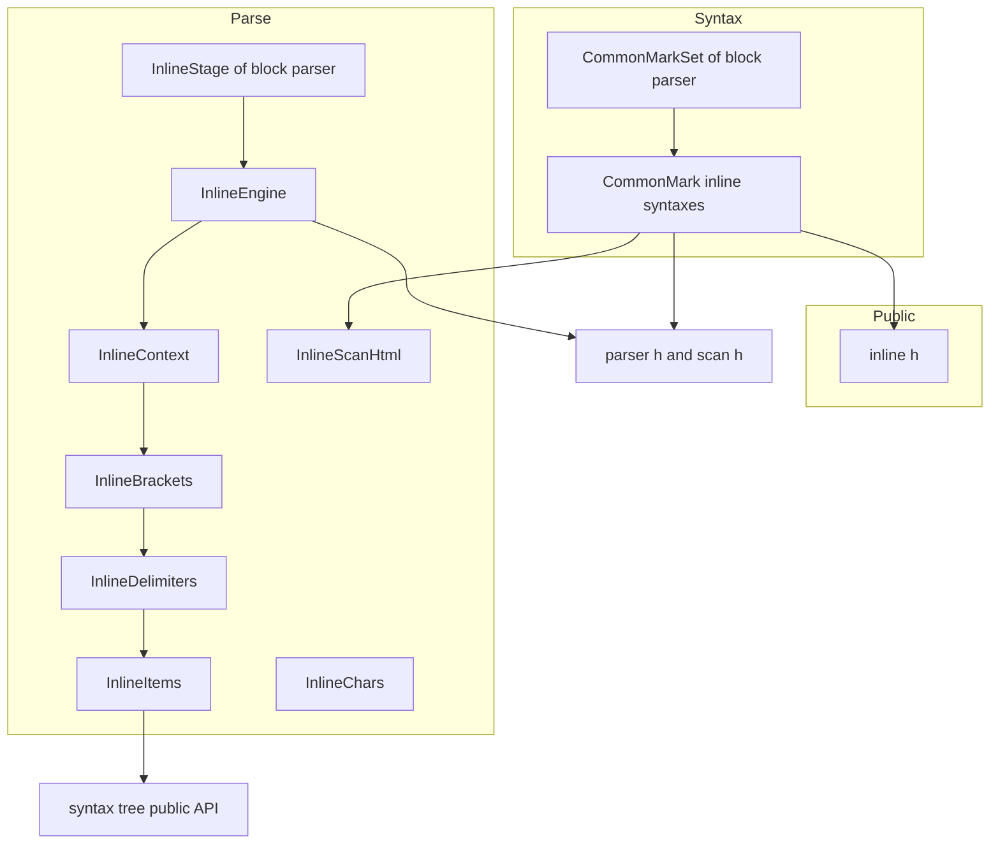
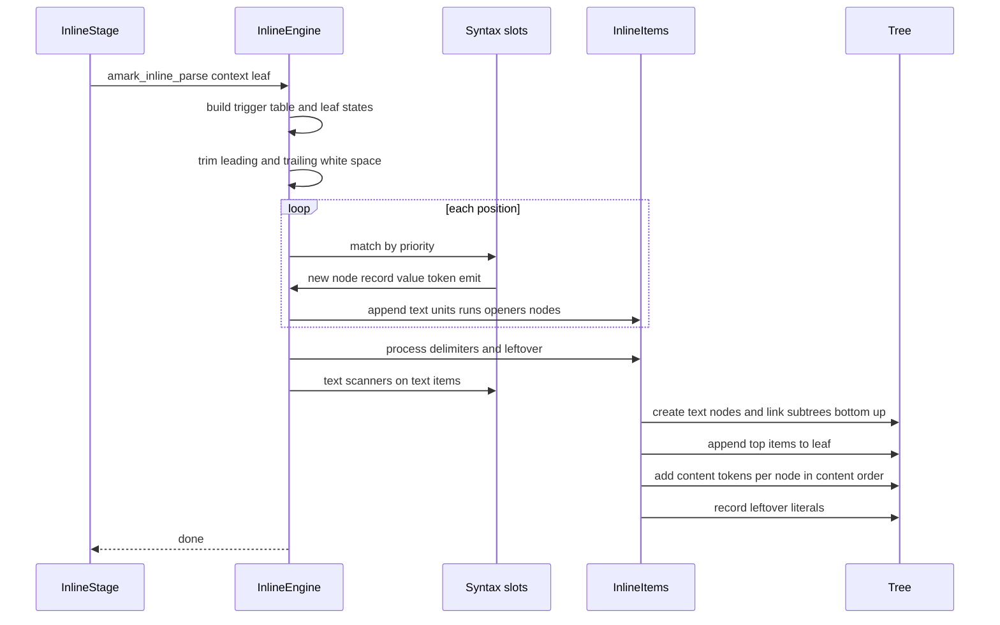
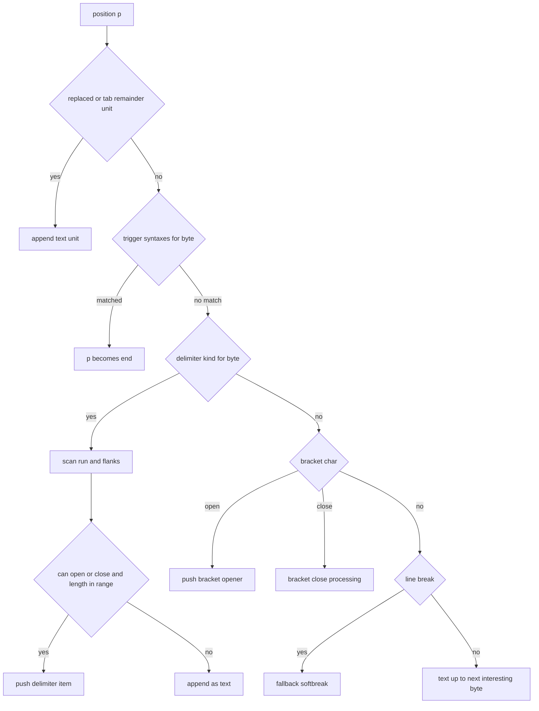
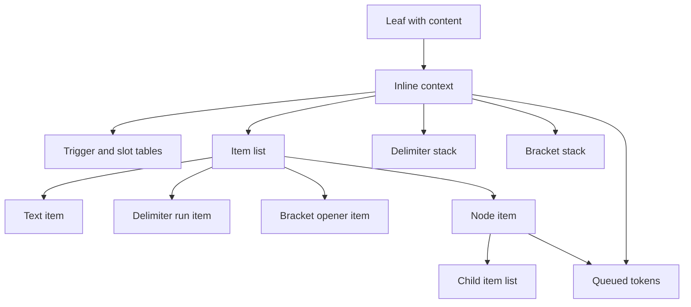

# Design Document: inline-parser

## Overview
**Purpose**：`inline-parser` は、`block-parser` が確定させた葉の中身を、CommonMark のインライン要素として解析し、葉の中身の上の綴りの層（中身のトークン）を作るエンジンを提供する。エンジンは個別の構文を知らず、構文セットに登録されたインライン構文のスロット（きっかけの文字の構文、区切り文字の種類、ブラケットの後処理、テキストの走査、ノード型の性質、文字の宣言）だけで動く。CommonMark の各インライン構文は、同じ公開 API の上の組み込み拡張として実装する。

**Users**：アプリケーションの開発者は、CommonMark の構文セットでパースし、インラインまで解析した木を得る。msgstr のようなインラインの断片を、表記のまま葉に差し込む。拡張の実装者は、公開のスロットでインライン構文を定義する。`markdown-renderer` は、この spec の記録の規約、役割の番号、文字の宣言、純粋な判定の関数を使う。

**Impact**：公開ヘッダ `inline.h`、`src/parse/` のインラインのエンジン、`src/syntax/` の CommonMark のインライン構文、`tests/inline/`、`tests/spec/`（CommonMark spec の準拠テスト）、`fuzz/inline_parse_fuzz.c`、`bench/inline_bench.c` を新しく作る。`block-parser` の Downstream Extension Points（構文セットの構築関数の表、既定の委譲先）に追記する。`syntax-tree`、`block-parser`、`html-renderer` の公開 API には何も足さない。前の版の design（構文トークンのモデル）は引き継がない（research.md）。

### Goals
- CommonMark 0.31.2 の全例が、既定の構文セットで HTML 出力に 100% 一致し、同時に木の不変条件、ロスレス性の検証、根の元の表記の判定、逐次の入力の一致に通る。
- 無編集の文書で、各葉の中身のすべてのバイトが、葉とインラインのトークンでちょうど 1 回ずつ覆われ、値はトークンから導かれる。
- 取り消し線、拡張オートリンク、脚注の参照を、公開 API だけの検証用拡張で書け、ブロックと HTML の部品と組み合わせて GFM 相当になる。
- 病的な入力でも、解析が中身の大きさにほぼ線形で、再帰で呼び出しのスタックを使い果たさない。

### Non-Goals
- ブロック構造の解析、委譲の取り決め、断片のパースの入口（`block-parser`）
- 記録の検査、値の導出、定義の索引、ラベルの正規化、ロスレス性の検証、元の表記の判定（`syntax-tree`）
- HTML の出力規則（`html-renderer`）、Markdown への書き戻しとエスケープの方式（`markdown-renderer`）
- GFM の配布

## Boundary Commitments

### This Spec Owns
- 公開ヘッダ `inline.h` と、そこで定める型、関数、マクロ（エンジンの委譲先、拡張の文脈の関数、スロットの構造体、純粋な判定の関数、文字の宣言の問い合わせ、組み込みのインライン構文の役割の番号）
- スロットの種類 5–10（`AMARK_SLOT_INLINE_SYNTAX`、`_DELIMITER`、`_BRACKET`、`_TEXT_SCANNER`、`_NODE_TRAITS`、`_SPECIAL`）の中身の構造体と意味
- インライン構文エンジン：反応の表、走査、テキストのまとめ、区切り文字のスタックとブラケットのスタック、テキストの走査の適用、中身の先頭と末尾の空白、構造の組み立てとトークンの記録
- CommonMark の 8 つのインライン構文の組み込み拡張と、その記録の規約（トークンの種類、項目、役割、style、値の記録）
- 既定の委譲先をこのエンジンにすること、CommonMark の構文セットの構築関数へのインライン構文の追加
- `tests/inline/`、`tests/spec/`（spec.txt、版の固定、ライセンスの表示、準拠テストの登録）、インラインの GFM 相当の検証用の部品（`amark_test_inline_gfm`）、インラインの検査の補助（`amark_test_inline`）、`fuzz/inline_parse_fuzz.c`、`bench/inline_bench.c`

### Out of Boundary
- 委譲の取り決め（`amark_inline_parse_fn_t`）、葉と中身の定義、パースの文脈の関数、インラインの断片のパースの入口（`amark_parse_inline_fragment`）、走査の関数（`scan.h`）、共有の生成手順、`amark_test_parse_check`、ブロックの GFM 相当の部品（`block-parser`）
- 中身とトークンの記録の検査、値の導出、定義の索引と参照の解決、ラベルの正規化、ロスレス性の検証、元の表記の判定（`syntax-tree`）
- 組み込みのノード型の HTML 出力、検証用のノード型の記述子と HTML の部品（`html-renderer`）
- 書き戻し、帯と綴りの合成、エスケープの方式（`markdown-renderer`）

### Allowed Dependencies
- `foundation` の公開 API と内部ヘッダ（`base/*_internal.h`）
- `syntax-tree` の公開 API（`node.h`、`document.h`、`value.h`、`spelling.h`、`extension.h`、`unicode.h`、`entity.h`、`utf8.h`）。`src/parse/inline_*.c` は `src/tree/` の内部ヘッダを使わない。
- `block-parser` の公開 API（`parser.h` の委譲の型とパースの文脈、`scan.h` の走査の関数、`commonmark.h` の構築関数）。`src/parse/inline_*.c` は `block-parser` の内部ヘッダ `parse/parse.h` を使わない（同じ層だが、別の spec の内部の構造に依存しない）。
- `html-renderer` の公開 API（`html.h`）。テストと検証用の部品だけが使う。
- テストだけ：`amark_test_support`、`amark_test_tree`、`amark_test_parse`、`amark_test_parse_gfm`、`amark_test_html_gfm`、`tests/support/gen_spec_examples.cmake`、Naos、`src/tree/tree.h` の `amark_tree_check`（INTERNAL のテストとファジング）
- 層の向き：`src/base` ← `src/tree` ← `src/parse` ← `src/syntax`。`src/syntax/` のインライン構文は公開ヘッダと `src/syntax/inline_syntaxes.h` だけを使う。
- `src/parse/` のインラインの中の向き（左が下位）：InlineItems ← InlineDelimiters ← InlineBrackets ← InlineContext ← InlineEngine。InlineScanHtml と InlineChars は、ほかのインラインの部品に依存しない。下位から上位の関数は呼ばない（InlineContext はエンジンの状態の構造体を操作するが、InlineEngine の関数を呼ばない。下位の部品がスロットのコールバックを呼び、その中で拡張が InlineContext の関数を使うのは、この向きの違反ではない）。違反はレビューでエラーとする。

### Revalidation Triggers
- スロットの構造体のフィールド、印、コールバックの契約、拡張の文脈の関数の意味の変更 → 利用者の拡張、`amark_test_inline_gfm`、`markdown-renderer` の検証用の部品
- 記録の規約（トークンの種類、項目、役割の番号、style、記録する値）の変更 → `markdown-renderer`
- 純粋な判定の関数（flanking、照合、生の HTML）と文字の宣言の規則の変更 → `markdown-renderer`
- 検証用の部品のノード型（`test.ext_autolink`）、役割の番号、構文セットの補助の形の変更 → `markdown-renderer` の検証用の部品とテスト
- spec の版、spec のデータの置き場所、検査の関数の形の変更 → `markdown-renderer`（同じデータを使う）
- 上流の変更：`syntax-tree` のトークンの種類、記録の検査、値の導出、元の表記の判定の規則、組み込みの型の項目 → この spec の記録の規約。`block-parser` の委譲の取り決め、中身の定義、走査の関数、構築関数の表 → エンジンと組み込みの構文。`html-renderer` の出力の表と検証用のノード型 → 準拠テストと GFM 相当の検証

## Architecture

### Existing Architecture Analysis
- `src/tree/` と `src/base/` は実装済み。`src/parse/`、`src/syntax/`、`include/amark/{scan,parser,block,commonmark}.h` は `block-parser` の承認済みの design だけがあり、この spec はその実装を前提にする（tasks の順で扱う）。
- `include/amark/amark.h` と `cmake/scripts/check_public_headers.cmake` は、4 番目の組の `scan.h parser.h block.h inline.h commonmark.h` に `inline.h` の位置を持つ。
- `syntax-tree` の早期検証（`tests/tree/msgstr_flow_test.c`）は、この spec の記録の形の基準である（research.md）。
- `foundation` の Downstream Extension Points は、この spec に `.gitattributes` の spec.txt の `export-ignore` と、CI の `-DAMARK_REQUIRE_SPEC_TESTS=ON` を割り当てている。`block-parser` は `AMARK_BUILD_BENCH` と `amark_add_bench` を定義する。

### Architecture Pattern & Boundary Map



**Architecture Integration**：
- **パターン**：構文定義駆動のエンジン。1 つの葉の解析は次の 4 つの段からなる。
  1. 準備：構文セットのスロットから反応の表を作り、中身の先頭と末尾の空白を葉の綴りにする。
  2. 走査：中身を先頭から調べ、内部の並び（項目の並び）にテキストの単位、区切り文字の並び、ブラケットの開き、構文が出したノードを積む。閉じのブラケットで後処理を試し、最後に区切り文字を処理する。
  3. テキストの走査：残ったテキストの項目に、きっかけの文字のない構文を適用する。
  4. 反映：項目の並びから部分木を下から組み、葉の子にしてから、ノードごとにトークンを中身の順に記録し、残った区切り文字の literal を記録する。
- **構造を先に**：トークンは段 4 で一度だけ記録する。`syntax-tree` の葉の覚えは構造の世代ごとに有効なので、記録は償却で定数になる。トークンの移動と分割は使わない。
- **拡張とエンジンの分担**：構文はノードを作り、値と style を `amark_node_record_*` で記録し、トークンを `amark_inline_token` でエンジンに預ける。エンジンは、預かったトークンが出した範囲をちょうど覆うかを、出した時点で確かめる。種類とバイトの一致は `syntax-tree` が記録の時点で確かめる。
- **Steering compliance**：C99、`amark_` / `AMARK_`、`AMARK_API`、不透明型（`amark_inline_context_t`）、公開の構造体の `struct_size`、グローバルな可変状態なし（構文の表は `static const`）、組み込みの構文も公開 API だけを使う、開いた集合（役割、印）は `#define`、閉じた集合（結果、flanking、規則）は `typedef enum`（0 は不正）。

### Technology Stack

| Layer | Choice / Version | Role in Feature | Notes |
|-------|------------------|-----------------|-------|
| Language | C99 | ライブラリ、テスト、ファジング、ベンチマーク | `amark_target_defaults()` |
| Tree | `syntax-tree`（実装済み） | 中身、トークンの記録、値の導出、索引、検証 | 公開 API だけ |
| Parser | `block-parser`（承認済みの design） | 委譲の取り決め、文脈、走査、構築関数、断片、テストの補助 | 実装の後に統合 |
| Renderer | `html-renderer`（承認済みの design） | 準拠テストの HTML、検証用のノード型と HTML の部品 | テストだけ |
| Reference | CommonMark Spec 0.31.2、cmark 0.31.x、cmark-gfm | 規則と手順の基準 | コードは取り込まない |
| Test data | CommonMark spec.txt 0.31.2（CC-BY-SA 4.0） | 準拠テストのデータ | テストデータだけ。`export-ignore` |
| Test | Naos v0.4.0、`amark_add_test`、`amark_add_generated_tests`、`gen_spec_examples.cmake` | 単体、生成テスト | 生成の手順は `block-parser` のもの |
| Fuzz / Bench | `amark_add_fuzzer`、`amark_add_bench` | 任意の入力、計算量 | |

## File Structure Plan

### Directory Structure
```
include/amark/
└── inline.h                    # InlineApi：委譲先、文脈の関数、スロット、純粋な関数、文字の宣言、役割の番号
src/parse/
├── inline_internal.h           # エンジンの内部の構造体（文脈、項目、区切り文字とブラケットのスタック、預かったトークン、統計）
├── inline_engine.c             # InlineEngine：amark_inline_parse、準備（反応の表、葉ごとの状態、先頭と末尾の空白）、走査、段の実行
├── inline_context.c            # InlineContext：拡張に渡す文脈の関数（問い合わせ、ノード、トークン、出す、テキスト、空白の取り込み）
├── inline_brackets.c           # InlineBrackets：ブラケットのスタック、閉じの処理、包む、置き換える、無効にする
├── inline_delims.c             # InlineDelimiters：flanking、区切り文字の並び、区切り文字の処理、純粋な照合の関数
├── inline_items.c              # InlineItems：項目の並び、テキストのまとめ、テキストの走査の適用、構造の組み立てと記録
├── inline_chars.c              # InlineChars：文字の宣言の問い合わせ
└── inline_scan_html.c          # InlineScanHtml：amark_inline_scan_raw_html
src/syntax/
├── inline_syntaxes.h           # src/syntax/ の中だけの共有：8 つの拡張の extern 宣言
├── backslash_escape.c          # commonmark.backslash_escape（エスケープ、`\` のハードブレーク）
├── char_ref.c                  # commonmark.char_ref
├── code_span.c                 # commonmark.code_span
├── emphasis.c                  # commonmark.emphasis（`*` と `_` の区切り文字の種類）
├── link.c                      # commonmark.link（リンクと画像のブラケットの後処理、link の性質）
├── autolink.c                  # commonmark.autolink
├── raw_html.c                  # commonmark.raw_html
└── line_break.c                # commonmark.line_break（ソフトブレークと空白のハードブレーク）
tests/inline/
├── CMakeLists.txt              # テストの登録、amark_test_inline（Naos、INTERNAL）、amark_test_inline_gfm（Naos なし、INTERFACE）
├── support/inline_check.{h,c}  # InlineTestSupport：生成テストの検査の関数とパースの補助
├── support/gfm_inline_ext.{h,c}# GfmInlineExt：取り消し線、拡張オートリンク、脚注の参照、構文セットの補助
├── data/<構文>_cases.txt       # 構文ごと（text、escape、char_ref、code_span、emphasis、link、image、autolink、raw_html、line_break）と combined_cases.txt、free_cases.txt
├── data/gfm_cases.txt          # GFM 相当の組み合わせの HTML とダンプ
├── engine_api_test.c           # テストの中の構文によるスロットと文脈の関数の契約
├── delimiter_test.c            # flanking と照合の純粋な関数
├── raw_html_test.c             # amark_inline_scan_raw_html
├── special_chars_test.c        # 文字の宣言の問い合わせ
├── commonmark_inline_set_test.c# 構築関数のインライン構文、取り除きと置き換え、既定の委譲先
├── fragment_test.c             # 自由な中身、インラインの断片、msgstr の差し込み、挿入先の定義
├── gfm_inline_test.c           # 検証用拡張の単体の契約（ノード型、役割、検索）
├── oom_test.c                  # 確保の失敗の総当たり（INTERNAL）
└── scale_test.c                # 病的な入力の統計（INTERNAL）
tests/spec/
├── CMakeLists.txt              # SpecConformance：版の照合、データの有無、準拠テストの登録
├── spec_version.cmake          # 版と SHA-256 の 1 か所の定義
└── data/spec.txt、data/NOTICE.txt  # CommonMark spec 0.31.2 とライセンス・出典（export-ignore）
fuzz/
├── inline_parse_fuzz.c         # 任意の入力、構文セット、区切り、断片
└── corpus/inline_parse/        # 種
bench/
└── inline_bench.c              # 病的な入力の時間
```

### Modified Files
- `include/amark/amark.h` — 4 番目の組の `block.h` と `commonmark.h` の間に `inline.h` を含める
- `src/CMakeLists.txt` — `src/parse/inline_*.c` と `src/syntax/` のインライン構文のファイルをライブラリのソースに足す
- `src/parse/inline_stage.c`（`block-parser` の Downstream Extension Point）— `amark_parse_default_inline()` が `amark_inline_parse` を返す
- `src/syntax/commonmark.c`（`block-parser` の Downstream Extension Point）— 構文の拡張の表のブロック構文の後に、8 つのインライン構文の拡張を足す
- `tests/CMakeLists.txt` — `add_subdirectory(inline)`（`amark_test_inline_gfm` はファジングだけの構成でも定義する）と `add_subdirectory(spec)`（`AMARK_BUILD_TESTS` のとき）
- `tests/headers/cxx_include_test.cpp` — `inline.h` の関数を呼ぶ
- `CMakeLists.txt`（最上位）— オプション `AMARK_REQUIRE_SPEC_TESTS`（既定 `OFF`）
- `fuzz/CMakeLists.txt` — `amark_add_fuzzer(inline_parse SOURCES inline_parse_fuzz.c CORPUS corpus/inline_parse LIBRARIES amark_test_inline_gfm amark_test_parse_gfm amark_test_html_gfm)`
- `bench/CMakeLists.txt` — `amark_add_bench(inline_bench SOURCES inline_bench.c)`
- `.gitattributes` — `tests/spec/data/spec.txt export-ignore`、`tests/spec/data/NOTICE.txt export-ignore`
- `.github/workflows/ci.yml` — 全ジョブの構成に `-DAMARK_REQUIRE_SPEC_TESTS=ON`

## System Flows

### 1 つの葉の解析



- 段 4 の前に失敗したら、まだ木に付けていないノードを解放して失敗を返す。段 4 の途中の失敗では葉の子が途中まで付いていることがあり、パーサが文書ごと捨てる（断片では一時の文書が捨てられる）。
- 委譲の呼び出しごとに準備をし直す（research.md の「エンジンの準備は委譲の呼び出しごとに行う」）。

### 1 つの位置の処理



- 構文が成立せず `amark_inline_set_text_end` で終わりを示したら、その範囲をテキストにして次へ進む。
- 「興味のある文字」は、反応の表に構文、区切り文字の種類、ブラケットのある ASCII の文字と改行である。テキストはその手前まで 1 回で進む。

## Requirements Traceability

| Requirement | Summary | Components | Interfaces | Flows |
|-------------|---------|------------|------------|-------|
| 1.1, 1.2 | 入口と既定の委譲先 | InlineEngine, InlineStage の変更 | `amark_inline_parse`、`amark_parse_default_inline` | 1 つの葉の解析 |
| 1.3, 1.4 | 中身の 2 つの状態、中身だけを読む | InlineEngine | `amark_block_content_bytes`、`amark_scan_content_run` | 1 つの葉の解析 |
| 1.5, 1.7 | 逐次の入力、スレッド | InlineEngine | — | — |
| 1.6 | 失敗の伝播 | InlineEngine, InlineContext | エラーの規約 | 1 つの葉の解析 |
| 2.1, 2.2, 2.3, 2.7 | 汎用の走査とテキスト | InlineEngine, InlineItems | 反応の表 | 1 つの位置の処理 |
| 2.4 | 改行の既定の扱い | InlineEngine | — | 1 つの位置の処理 |
| 2.5 | 中身の先頭と末尾の空白 | InlineEngine | — | 1 つの葉の解析 |
| 2.6 | 誤用の検出 | InlineContext | `amark_inline_emit` ほか | — |
| 3.1–3.7 | きっかけの文字の構文 | InlineApi, InlineContext | `amark_inline_syntax_slot_t`、文脈の関数 | 1 つの位置の処理 |
| 4.1–4.5 | きっかけの文字のない構文 | InlineApi, InlineItems | `amark_inline_text_scanner_slot_t`、`amark_inline_text_match`、`amark_inline_in_link` | 1 つの葉の解析 |
| 5.1–5.7 | 区切り文字の種類 | InlineApi, InlineDelimiters | `amark_inline_delimiter_slot_t` | 1 つの位置の処理 |
| 5.8 | 純粋な判定と照合 | InlineDelimiters | `amark_inline_delimiter_flanks`、`amark_inline_match_delimiters` | — |
| 6.1–6.6 | ブラケット | InlineApi, InlineBrackets | `amark_inline_bracket_slot_t`、`_wrap`、`_replace`、`amark_inline_node_traits_slot_t` | 1 つの位置の処理 |
| 6.7 | 参照の成否 | CommonMarkInline（link） | `amark_parse_context_find_definition` | — |
| 7.1–7.7 | CommonMark の組み込み拡張 | CommonMarkInline, CommonMarkSet の変更 | 拡張の名前、記録の規約 | — |
| 7.8 | 生の HTML の判定 | InlineScanHtml | `amark_inline_scan_raw_html` | — |
| 8.1, 8.2, 8.10 | 被覆、種類、構造を先に | InlineItems, InlineEngine | 段 4 | 1 つの葉の解析 |
| 8.3–8.7 | 組み込みの記録 | CommonMarkInline | 記録の規約の表 | — |
| 8.8 | 規約の公開 | InlineApi | 役割の番号のマクロ | — |
| 8.9 | 拡張の記録 | InlineContext | `amark_inline_token` | — |
| 9.1–9.3 | 文字の宣言 | InlineChars | `amark_inline_special_slot_t`、`amark_inline_special_chars` | — |
| 10.1–10.4 | 自由な中身と断片 | InlineEngine, InlineTests（fragment） | `amark_parse_inline_fragment`（上流） | — |
| 11.1–11.4 | 計算量、深さ、制限、不正なバイト | InlineEngine, InlineDelimiters, InlineBrackets, CommonMarkInline | 葉ごとの状態、飛ばす範囲 | — |
| 11.5, 11.6 | ファジング | InlineFuzz, GfmInlineExt | — | — |
| 12.1–12.6 | 準拠テスト | SpecConformance, InlineTestSupport | `inline_test_check_spec_example` | — |
| 13.1–13.6 | GFM 相当 | GfmInlineExt | `amark_test_gfm_set_create` | — |
| 14.1–14.4 | 検証 | InlineTests, InlineTestSupport | `inline_test_check_example` | — |

## Components and Interfaces

| Component | Domain | Intent | Req Coverage | Key Dependencies | Contracts |
|-----------|--------|--------|--------------|------------------|-----------|
| InlineApi | Public | `inline.h` の型、関数、マクロ | 3.1–3.7, 4.1, 5.1, 6.1, 8.8, 9.1 | InlineEngine (P0) | Service |
| InlineEngine | Parse | 入口、準備、走査、段の実行 | 1.1–1.7, 2.1–2.5, 2.7, 10.1–10.2, 11.1–11.4 | 上流の API (P0) | Service, State |
| InlineContext | Parse | 拡張に渡す文脈の関数と誤用の検出 | 2.6, 3.2–3.7, 8.9 | InlineBrackets (P0) | Service |
| InlineBrackets | Parse | ブラケットのスタックと後処理 | 6.1–6.6 | InlineDelimiters (P0) | State |
| InlineDelimiters | Parse | 区切り文字の処理と純粋な関数 | 5.1–5.8, 11.1 | InlineItems (P0) | Service, State |
| InlineItems | Parse | 項目の並び、テキストの走査、反映 | 2.2, 4.1–4.5, 8.1, 8.2, 8.10 | Tree (P0) | State |
| InlineChars | Parse | 文字の宣言の問い合わせ | 9.1–9.3 | Registry の API (P0) | Service |
| InlineScanHtml | Parse | 生の HTML の判定 | 7.8 | `scan.h` (P0) | Service |
| CommonMarkInline | Syntax | 8 つの組み込みのインライン構文と記録の規約 | 6.7, 7.1–7.7, 8.3–8.7, 11.3 | InlineApi (P0), `scan.h` (P0) | Service |
| InlineTestSupport | Tests | 検査の関数とパースの補助 | 12.2, 14.4 | `amark_test_parse` (P0) | Service |
| GfmInlineExt | Tests | GFM 相当のインラインの部品と構文セット | 13.1–13.6, 11.6 | `amark_test_html_gfm`、`amark_test_parse_gfm` (P0) | Service |
| SpecConformance | Tests | spec.txt の準拠テスト | 12.1–12.6 | SpecExampleGen (P0) | Batch |
| InlineTests / InlineFuzz / InlineBench | Tests | 単体、データ、OOM、計算量、ファジング | 11.5, 14.1–14.3, 全般 | InlineTestSupport (P0) | — |

### 共通の規約
- 失敗しうる関数は `amark_error_t` を返し、結果を出力引数で返す。必須の引数が NULL なら `AMARK_ERROR_INVALID_ARGUMENT`。公開の構造体は先頭に `size_t struct_size` を持ち、小さすぎる値は不正な引数とする。スロットの構造体は先頭に `amark_slot_t base` を持つ。
- 文脈（`amark_inline_context_t`）は、それを渡したコールバックの呼び出しの間だけ有効である。文脈の関数を、別のコールバックの種類や呼び出しの外で使うと `AMARK_ERROR_INVALID_STATE` を返す。
- コールバックが返したエラーは、そのまま解析の結果になり、パースの結果になる（1.6）。
- 記録はすべて `syntax-tree` の記録の関数で行い、値の設定の関数（`amark_node_set_*`）を使わない（8.10）。

### Public headers

#### InlineApi（`inline.h`）

| Field | Detail |
|-------|--------|
| Intent | エンジンの委譲先、拡張の文脈の関数、スロット、純粋な関数、文字の宣言、役割の番号 |
| Requirements | 3.1–3.7, 4.1, 5.1, 5.8, 6.1, 7.8, 8.8, 9.1, 9.2 |

**Contracts**: Service [x]

`inline.h` は `export.h`、`error.h`、`node.h`、`spelling.h`、`extension.h`、`parser.h` を include し、`AMARK_BEGIN_DECLS` / `AMARK_END_DECLS` で囲む。

```c
typedef struct amark_inline_context amark_inline_context_t;

/* エンジン（amark_inline_parse_fn_t の形）。既定の委譲先 */
AMARK_API amark_error_t amark_inline_parse(amark_parse_context_t *context, amark_node_t *leaf,
                                           void *user_data);

typedef enum amark_inline_result
{
    AMARK_INLINE_NO_MATCH = 1,
    AMARK_INLINE_MATCHED = 2
} amark_inline_result_t;

#define AMARK_INLINE_MAX_LEAF_STATE 65536u

/* きっかけの文字の構文（base.kind = AMARK_SLOT_INLINE_SYNTAX） */
typedef struct amark_inline_syntax_slot
{
    amark_slot_t base;
    const char *triggers;        /* NUL で終わる ASCII（0x01–0x7F）。空でない。改行は "\n" */
    int32_t priority;            /* 小さい順。同じなら構文セットの順 */
    size_t leaf_state_size;      /* 0–AMARK_INLINE_MAX_LEAF_STATE。葉ごとに 0 で埋める */
    amark_error_t (*match)(amark_inline_context_t *ctx, size_t position, void *user_data,
                           amark_inline_result_t *result);
    void *user_data;
} amark_inline_syntax_slot_t;

/* 区切り文字の種類（base.kind = AMARK_SLOT_INLINE_DELIMITER） */
typedef enum amark_inline_flanking
{
    AMARK_INLINE_FLANKING_ASTERISK = 1,   /* 開く＝左 flanking、閉じる＝右 flanking */
    AMARK_INLINE_FLANKING_UNDERSCORE = 2  /* `_` の語の中の規則を加える */
} amark_inline_flanking_t;

typedef enum amark_inline_delimiter_rule
{
    AMARK_INLINE_RULE_EMPHASIS = 1,  /* 3 の倍数の規則。使う長さは両方 2 以上なら 2、それ以外は 1 */
    AMARK_INLINE_RULE_EXACT = 2      /* 開きと閉じの長さが同じときだけ一致し、全体を使う */
} amark_inline_delimiter_rule_t;

typedef struct amark_inline_delimiter_slot
{
    amark_slot_t base;
    unsigned char character;              /* ASCII の句読点 */
    amark_inline_flanking_t flanking;
    amark_inline_delimiter_rule_t rule;
    uint32_t min_length;                  /* 1 以上 */
    uint32_t max_length;                  /* 0 は上限なし。それ以外は min_length 以上 */
    amark_error_t (*make)(amark_inline_context_t *ctx, size_t use, amark_node_t **out,
                          void *user_data);   /* use 文字ずつの一致のノードを作り、style を記録する */
    void *user_data;
} amark_inline_delimiter_slot_t;

/* ブラケットの後処理（base.kind = AMARK_SLOT_INLINE_BRACKET） */
#define AMARK_INLINE_BRACKET_LINK  0x01u   /* "[" */
#define AMARK_INLINE_BRACKET_IMAGE 0x02u   /* "![" */

typedef struct amark_inline_bracket
{
    size_t struct_size;
    uint32_t opener;            /* AMARK_INLINE_BRACKET_LINK か AMARK_INLINE_BRACKET_IMAGE */
    size_t open_start, open_end;   /* 開きのバイト */
    size_t close;               /* "]" の位置 */
    bool bracket_after;         /* この開きの後に別のブラケットが開いた */
} amark_inline_bracket_t;

typedef struct amark_inline_bracket_slot
{
    amark_slot_t base;
    uint32_t openers;           /* 扱う開きの印。0 は不正 */
    int32_t priority;
    size_t leaf_state_size;
    amark_error_t (*close)(amark_inline_context_t *ctx, const amark_inline_bracket_t *bracket,
                           void *user_data, amark_inline_result_t *result);
    void *user_data;
} amark_inline_bracket_slot_t;

/* テキストの走査（base.kind = AMARK_SLOT_INLINE_TEXT_SCANNER） */
typedef struct amark_inline_text_scanner_slot
{
    amark_slot_t base;
    int32_t priority;
    size_t leaf_state_size;
    amark_error_t (*scan)(amark_inline_context_t *ctx, size_t start, size_t end, void *user_data,
                          amark_inline_result_t *result);
    void *user_data;
} amark_inline_text_scanner_slot_t;

/* ノード型の性質（base.kind = AMARK_SLOT_INLINE_NODE_TRAITS） */
#define AMARK_INLINE_TRAIT_LINK 0x01u     /* 前の "[" の開きを無効にし、テキストの走査に「リンクの中」と伝える */
typedef struct amark_inline_node_traits_slot
{
    amark_slot_t base;
    const char *node_type;      /* ノード型の名前 */
    uint32_t traits;
} amark_inline_node_traits_slot_t;

/* 文字の宣言（base.kind = AMARK_SLOT_INLINE_SPECIAL） */
typedef struct amark_inline_special_slot
{
    amark_slot_t base;
    const char *characters;     /* NUL で終わる印字可能な ASCII（0x21–0x7E） */
} amark_inline_special_slot_t;

typedef struct amark_inline_char_set
{
    size_t struct_size;
    uint32_t bits[4];           /* ビット c が文字 c（0–127） */
} amark_inline_char_set_t;

AMARK_API amark_error_t amark_inline_special_chars(const amark_syntax_set_t *set,
                                                   const amark_extension_t *extension,
                                                   amark_inline_char_set_t *out);  /* extension が NULL なら全体 */
AMARK_API bool amark_inline_char_set_has(const amark_inline_char_set_t *chars, unsigned char c);

/* 文脈の関数（コールバックの中だけ） */
#define AMARK_INLINE_BOUNDARY 0x0Au   /* 中身の先頭と末尾の前後の文字 */
AMARK_API amark_parse_context_t *amark_inline_parse_context(const amark_inline_context_t *ctx);
AMARK_API const amark_node_t *amark_inline_leaf(const amark_inline_context_t *ctx);
AMARK_API void amark_inline_content(const amark_inline_context_t *ctx, const char **bytes, size_t *length);
AMARK_API size_t amark_inline_limit(const amark_inline_context_t *ctx);   /* 解析する範囲の終わり */
AMARK_API uint32_t amark_inline_char_before(const amark_inline_context_t *ctx, size_t position);
AMARK_API uint32_t amark_inline_char_after(const amark_inline_context_t *ctx, size_t position);
AMARK_API void *amark_inline_leaf_state(amark_inline_context_t *ctx);     /* 呼ばれているスロットの葉ごとの状態。なければ NULL */
AMARK_API bool amark_inline_in_link(const amark_inline_context_t *ctx);   /* テキストの走査の範囲がリンクの性質のノードの中 */

AMARK_API amark_error_t amark_inline_new_node(amark_inline_context_t *ctx, amark_node_type_t type,
                                              amark_node_t **out);
AMARK_API amark_error_t amark_inline_token(amark_inline_context_t *ctx, amark_node_t *node,
                                           size_t start, size_t end, amark_spell_kind_t kind,
                                           amark_facet_t facet, uint16_t role);
AMARK_API amark_error_t amark_inline_emit(amark_inline_context_t *ctx, amark_node_t *node, size_t end);
AMARK_API amark_error_t amark_inline_emit_text(amark_inline_context_t *ctx, size_t end,
                                               amark_spell_kind_t kind);
AMARK_API void amark_inline_set_text_end(amark_inline_context_t *ctx, size_t end);
AMARK_API amark_error_t amark_inline_take_trailing_space(amark_inline_context_t *ctx, size_t *start);
AMARK_API amark_error_t amark_inline_bracket_wrap(amark_inline_context_t *ctx, amark_node_t *node, size_t end);
AMARK_API amark_error_t amark_inline_bracket_replace(amark_inline_context_t *ctx, amark_node_t *node, size_t end);
AMARK_API amark_error_t amark_inline_text_match(amark_inline_context_t *ctx, size_t start, size_t end,
                                                amark_node_t *node);

/* 純粋な関数 */
AMARK_API void amark_inline_delimiter_flanks(amark_inline_flanking_t flanking, uint32_t before,
                                             uint32_t after, bool *can_open, bool *can_close);

typedef struct amark_inline_run
{
    size_t struct_size;
    unsigned char character;
    uint32_t length;
    bool can_open, can_close;
    amark_inline_delimiter_rule_t rule;
} amark_inline_run_t;

typedef struct amark_inline_run_match
{
    size_t struct_size;
    size_t opener, closer;      /* runs の添字 */
    uint32_t use;               /* 両側から使った文字の数 */
} amark_inline_run_match_t;

AMARK_API amark_error_t amark_inline_match_delimiters(const amark_inline_run_t *runs, size_t count,
                                                      amark_inline_run_match_t *matches,
                                                      size_t capacity, size_t *out_count);
AMARK_API bool amark_inline_scan_raw_html(const char *bytes, size_t length, size_t *end);

/* 記録の規約の役割の番号（CommonMarkInline の表） */
#define AMARK_INLINE_ROLE_OPEN 1u          /* エンジン：一致した開きの区切り文字、ブラケットの開き */
#define AMARK_INLINE_ROLE_CLOSE 2u         /* エンジン：一致した閉じの区切り文字 */
#define AMARK_CODE_ROLE_OPEN 1u
#define AMARK_CODE_ROLE_CLOSE 2u
#define AMARK_CODE_ROLE_PADDING 3u
#define AMARK_LINK_ROLE_TEXT_OPEN 1u       /* "[" と "!["（= AMARK_INLINE_ROLE_OPEN） */
#define AMARK_LINK_ROLE_TEXT_CLOSE 2u      /* "]" */
#define AMARK_LINK_ROLE_PAREN_OPEN 3u
#define AMARK_LINK_ROLE_PAREN_CLOSE 4u
#define AMARK_LINK_ROLE_ANGLE_OPEN 5u
#define AMARK_LINK_ROLE_ANGLE_CLOSE 6u
#define AMARK_LINK_ROLE_TITLE_OPEN 7u
#define AMARK_LINK_ROLE_TITLE_CLOSE 8u
#define AMARK_LINK_ROLE_LABEL_OPEN 9u
#define AMARK_LINK_ROLE_LABEL_CLOSE 10u
#define AMARK_LINK_ROLE_AUTOLINK_OPEN 11u
#define AMARK_LINK_ROLE_AUTOLINK_CLOSE 12u
#define AMARK_LINEBREAK_ROLE_BACKSLASH 1u
```

- **スロットの検査**（エンジンの準備。違反は `AMARK_ERROR_INVALID_ARGUMENT` で解析を失敗させる）：`base.struct_size` が構造体の大きさ以上、必須のコールバックが NULL でない、きっかけの文字が ASCII で空でない、`leaf_state_size` が上限以下、区切り文字が ASCII の句読点で長さの範囲が正しい、ブラケットの `openers` が 0 でない、性質のノード型の名前が構文セットにある、宣言の文字が印字可能な ASCII。同じ文字の区切り文字の種類が複数あれば、構文セットの後のものを使う。
- **純粋な関数**（5.8）：
  - `amark_inline_delimiter_flanks`：`before` と `after` は並びの前後の符号位置（中身の端は `AMARK_INLINE_BOUNDARY`）。CommonMark 0.31.2 の左右の flanking（Unicode の空白と句読点。句読点は P と S の分類）を求め、ASTERISK なら開く＝左、閉じる＝右。UNDERSCORE なら開く＝左かつ（右でないか、前が句読点）、閉じる＝右かつ（左でないか、後が句読点）。
  - `amark_inline_match_delimiters`：区切り文字の並びの配列（ブラケットなし）を、エンジンと同じ規則（InlineDelimiters）で照合し、一致を作った順に `matches` に書く。`capacity` は長さの合計の半分（切り捨て）以上を求める（不足は不正な引数）。各要素の `struct_size` を確かめる。
  - `amark_inline_scan_raw_html`：`bytes` の先頭から、開始タグと終了タグ（`amark_scan_html_open_tag`、`amark_scan_html_closing_tag`）、コメント（`<!-->`、`<!--->` を含む 0.31.2 の規則）、処理命令、宣言、CDATA のどれか 1 つが成り立つかを判定し、`*end` に終わりを入れる（7.8）。改行は LF として扱う。
- **文字の宣言**（9.1–9.3）：`amark_inline_special_chars` は、凍結した構文セットのスロットから、宣言の文字に、きっかけの文字のうち印字可能なもの、区切り文字の文字、ブラケットの文字（`[` `]`、画像を扱うなら `!`）を加えた集合を返す。`extension` を指定すれば、その拡張のスロットだけから作る。凍結していない構文セットは `AMARK_ERROR_INVALID_STATE`。エスケープの方式は決めない。

### Parse

#### InlineEngine

| Field | Detail |
|-------|--------|
| Intent | 委譲先の入口、準備、走査、段の実行 |
| Requirements | 1.1–1.7, 2.1–2.5, 2.7, 10.1, 10.2, 11.1–11.4 |

**Responsibilities & Constraints**
- **入口**（1.1、1.2）：`amark_inline_parse(context, leaf, user_data)` は、`leaf` が中身を持ち、インラインを受け入れる型の葉で、トークンとインラインの子を持たないことを確かめる（違反は不正な引数）。`user_data` は使わない。中身が空なら何もしない。
- **準備**：
  - 文書の構文セットから種類 5–10 のスロットを列挙して検査し、構文を優先度で安定に並べ（同じなら構文セットの順）、256 の文字ごとの構文の並びの表、区切り文字の種類の表、ブラケットの後処理の並び（開きの種類ごと）、テキストの走査の並び、性質の表（ノード型 → 性質）を作る。
  - `leaf_state_size` を持つスロットごとに、葉ごとの状態を 0 で確保する。
  - 中身の単位は `amark_scan_content_run`（`block-parser`）の規則で決める。エンジンは葉の中身の部分の表から、タブの残りの範囲を一度だけ求め、テキストの中で使う。
- **中身の先頭と末尾**（2.5）：解析の前に、先頭と末尾の空白（空白、タブ、タブの残り、改行）を求め、葉自身のトークン（空白とタブの連続は SPACE、タブの残りは TAB_REMAINDER、改行は LINE_BREAK。項目なし、役割 0）にする。その間 `[lo, hi)` だけを解析する（`amark_inline_limit` は `hi`）。
- **走査**（2.1、2.2、2.4、2.7）：位置 p で、次の順に処理する（System Flows の「1 つの位置の処理」）。
  1. p が置き換え（NUL、不正な UTF-8）かタブの残りの単位なら、その単位をテキストに足す。
  2. p のバイトに反応する構文を優先度の順に試す。成立したら、出した範囲の終わりへ進む。
  3. p のバイトが区切り文字の種類の文字なら、同じ文字の並び `[p, q)` を求め、前後の符号位置で flanking を判定する。長さが範囲にあり、開くか閉じることができれば区切り文字の項目を積み（InlineDelimiters）、そうでなければテキストにする。
  4. `[`（LINK を扱うブラケットの後処理があるとき）、`!` の後の `[`（IMAGE を扱うとき）はブラケットの開きを積み、`]`（ブラケットの後処理があるとき）は閉じの処理をする（InlineBrackets）。
  5. 改行の単位はソフトブレークのノード（LINE_BREAK のトークンだけ）にする（2.4）。
  6. それ以外は、次の興味のある文字か特別な単位の手前までをテキストにする（TEXT と REPLACED の単位は `amark_scan_value_run` の規則）。
- **終わり**：区切り文字の全体を処理し（下限なし）、残った区切り文字の並びとブラケットの開きを、残りのテキストの項目にする。テキストの走査を適用する（InlineItems）。反映する（InlineItems）。
- **自由な中身**（1.3、10.2）：改行は LF の 1 バイトで、配置済みの仮想の `\n` と同じ単位になる。タブの残りの単位は配置済みの中身にだけある。行頭の空白は改行の構文が扱う（CommonMarkInline の line_break）。
- **スレッド**（1.7）：表と状態は呼び出しの中だけに置き、グローバルな可変状態を持たない。逐次の入力（1.5）は、インラインの解析がすべての行の確定の後に行われるので、区切りによらない。

**Implementation Notes**
- Integration：`src/parse/inline_stage.c` の `amark_parse_default_inline()` が `amark_inline_parse` を返す（Downstream Extension Point）。`amark_parse_inline_plain` は引き続き明示して選べる（1.2）。
- Validation：`engine_api_test`、`commonmark_inline_set_test`、データのケース、`scale_test`。
- Risks：葉ごとの準備の費用（research.md）。`inline_bench` の多数の小さな葉で測る。

##### State Management
- 文脈の構造体（`inline_internal.h`）：パースの文脈、葉、中身、`[lo, hi)`、表、葉ごとの状態、項目の並び、区切り文字のスタック、ブラケットのスタック、預かったトークンの配列、作ったノードの配列、呼び出しの種類と現在のスロット、統計。呼び出しのたびに作り、終わりに解放する。

#### InlineContext

| Field | Detail |
|-------|--------|
| Intent | 拡張に渡す文脈の関数と、その誤用の検出 |
| Requirements | 2.6, 3.2–3.7, 8.9 |

**Responsibilities & Constraints**
- **問い合わせ**（3.2、3.7）：`amark_inline_parse_context`（定義の検索、拡張の状態、文書、オプション）、`amark_inline_leaf`、`amark_inline_content`（葉の中身の全体）、`amark_inline_limit`、`amark_inline_char_before` / `_after`（位置の前後の UTF-8 の符号位置。不正な列は U+FFFD、`[0, length)` の外は `AMARK_INLINE_BOUNDARY`）、`amark_inline_leaf_state`。中身の単位は `amark_scan_content_run(leaf, …)` で読める。
- **ノード**（3.3）：`amark_inline_new_node` は `amark_node_create` で切り離したノードを作り、エンジンが覚える（使われなかったものは反映の前に解放する）。構文は、作ったノードどうしを `amark_node_append_child` で組み、`amark_node_record_*` で値と style を記録してよい。木に付いたノードは変えてはならない。
- **トークン**（8.9）：`amark_inline_token` は、`node`（構文が作ったノード）と中身の上の空でない範囲と種類、項目、役割を預かる。範囲は今の呼び出しで出せる範囲（下）の中でなければ `AMARK_ERROR_INVALID_STATE`。種類とバイトの一致、項目の正しさは、反映で `amark_node_add_content_token` が確かめ、その誤りをそのまま返す。
- **出す**（3.3、3.4、3.6、2.6）：
  - `amark_inline_emit(ctx, node, end)`：きっかけの文字の構文の中で 1 回だけ。範囲は `[s, end)` で、`s` は位置か、`amark_inline_take_trailing_space` で取り込んだ始まり。`end` は `amark_inline_limit` 以下。`node` の部分木に、この呼び出しで預けたトークンが、範囲を重なりも抜けもなく覆わなければ `AMARK_ERROR_INVALID_STATE`。結果は MATCHED でなければならない。
  - `amark_inline_emit_text(ctx, end, kind)`：範囲 `[位置, end)` を、`kind`（TEXT、ESCAPE、CHAR_REF）のテキストの単位として足す（テキストのノードの literal を綴る）。出す関数はどちらか 1 つを 1 回だけ。
  - `amark_inline_set_text_end(ctx, end)`：NO_MATCH のとき、`[位置, end)` をテキストにする（3.5）。改行を越える `end` は `AMARK_ERROR_INVALID_STATE` として扱う。
  - `amark_inline_take_trailing_space(ctx, &start)`：直前の項目が通常のテキストなら、その末尾の空白とタブ（TEXT とタブの残りの単位の中）を取り出して `*start` に始まりを返す。取り出した範囲は、出すノードのトークンで覆わなければならない。
- **誤用**（2.6）：MATCHED なのに出していない、NO_MATCH なのに出した、出した範囲がトークンで覆われない、呼び出しの種類で使えない関数を使った（ブラケットの関数をブラケットの後処理の外で、`amark_inline_text_match` をテキストの走査の外で）は `AMARK_ERROR_INVALID_STATE` で解析を止める。

#### InlineBrackets

| Field | Detail |
|-------|--------|
| Intent | ブラケットのスタック、閉じの処理、包む・置き換える、無効にする |
| Requirements | 6.1–6.6 |

**Responsibilities & Constraints**
- **開き**：`[` か `![` の開きの項目を項目の並びに積み、ブラケットのスタックに積む（区切り文字のスタックの今の位置を覚える）。前の開きの `bracket_after` を立てる。
- **閉じ**（6.1、6.6）：スタックの最も上の開きを見る。
  - なければ `]` をテキストにする。
  - 無効なら、開きをスタックから外して残りのテキストの項目にし、`]` をテキストにする。
  - 有効なら、その開きの種類を扱うブラケットの後処理を優先度の順に呼ぶ。成立しなければ、開きを外して残りのテキストの項目にし、`]` をテキストにする。
- **包む**（6.3）：`amark_inline_bracket_wrap(ctx, node, end)`：開きより上の区切り文字を処理し（下限は開きの位置）、開きの後の項目をすべて `node` の子の並びに移し、開きの項目を `node` の項目に置き換える。開きのトークン（DELIMITER、項目なし、役割 `AMARK_INLINE_ROLE_OPEN`）はエンジンが `node` に預ける。後処理は `[close, end)` を `node` のトークンで覆う。
- **置き換える**（6.4）：`amark_inline_bracket_replace(ctx, node, end)`：開きより上の区切り文字とブラケットの開きをスタックから除き、開きの後の項目を捨て（その中で作ったノードを解放し、預かったトークンを捨てる）、開きの項目を `node` の項目にする。開きのトークンはエンジンが預ける。後処理は `[open_end, end)` を `node` の部分木のトークンで覆う。
- **無効にする**（6.5）：作ったノードの型が `AMARK_INLINE_TRAIT_LINK` を持てば、スタックのそれより前の `[` の開きを、すでに無効の `[` の開きに着くまで無効にする（`![` は飛ばす）。
- どちらの形でも、開きはブラケットのスタックから外れる。閉じの位置は `end` へ進む。`end` は `amark_inline_limit` 以下。

#### InlineDelimiters

| Field | Detail |
|-------|--------|
| Intent | 区切り文字の並び、区切り文字の処理、純粋な関数 |
| Requirements | 5.1–5.8, 11.1 |

**Responsibilities & Constraints**
- **並び**：文字、範囲 `[p, q)`、開けるか、閉じられるか、残りの文字の範囲、規則を持つ項目。区切り文字のスタックに積む。
- **処理**（5.2、5.3）：CommonMark の process emphasis と同じ手順で、下限より上の閉じを左から順に見る。開きは、同じ文字で、開けて、規則が一致を許す最も近いものを探す。
  - EMPHASIS：開きか閉じが両方できる並びのとき、長さの和が 3 の倍数で、両方が 3 の倍数でなければ一致しない。使う長さは、両方が 2 以上なら 2、それ以外は 1。
  - EXACT：同じ文字の最も近い開きを見て、長さが違えば一致しない（その閉じは開きになりうるものとして残る）。使う長さは全体。
  - 線形にするため、下限の表（`openers_bottom`）を、文字、閉じの長さの 3 の剰余、閉じが開けるかで分けて持つ（EXACT は文字だけ）。
- **一致**（5.4）：区切り文字の種類の `make(ctx, use, &node)` でノードを作る（style を記録する）。開きと閉じの間の項目を `node` の子の並びに移し、開きの内側の `use` 文字と閉じの先頭の `use` 文字を、1 文字ずつの DELIMITER のトークン（項目なし、役割 OPEN と CLOSE）として `node` に預ける。使い切った並びはスタックから除く。
- **残り**（5.5、5.6）：処理の後に残った文字は、残りの区切り文字の項目になる（反映で、1 文字ずつの DELIMITER のトークンと、その文字を literal として記録した text のノード）。開くことも閉じることもできない並びは、積まずに通常のテキストにする。
- **純粋な関数**（5.8）：`amark_inline_delimiter_flanks` と `amark_inline_match_delimiters` は、エンジンと同じ内部の関数（flanking、一致の可否、使う長さ、下限の表）を使う。照合の関数はブラケットのない 1 つの並びを処理する。

#### InlineItems

| Field | Detail |
|-------|--------|
| Intent | 項目の並び、テキストのまとめ、テキストの走査の適用、構造の組み立てと記録 |
| Requirements | 2.2, 4.1–4.5, 8.1, 8.2, 8.10 |

**Responsibilities & Constraints**
- **項目**：双方向の並び。種類は次のとおり。
  - テキスト：単位（TEXT、ESCAPE、CHAR_REF、REPLACED、TAB_REMAINDER の範囲）の並び
  - 区切り文字の並び、ブラケットの開き（処理の後に残れば、残りのテキスト）
  - ノード：構文が出したノード（部分木）と、そのトークンの区間。区切り文字とブラケットで作ったノードは、子の項目の並びを持つ。
- **テキストのまとめ**（2.2）：テキストを足すとき、直前の項目が通常のテキストならその項目に足し、隣り合う TEXT の単位は 1 つの単位にする（区切り文字の文字でも、開くことも閉じることもできずテキストになった並びは、前後のテキストと同じ単位になる）。同じ並びで隣り合う通常のテキストの項目（構文の処理の後に隣り合ったもの）は、反映で 1 つの text のノードになる。残りのテキストの項目は、それぞれ独立の text のノードにし、隣と 1 つにしない（5.5）。空のテキストは作らない。
- **テキストの走査**（4.1–4.5）：区切り文字とブラケットの処理の後、木の順に各通常のテキストの項目について、TEXT の単位だけが続く最大の範囲を、テキストの走査のスロットに優先度の順に渡す。
  - `scan(ctx, start, end, …)` が `amark_inline_text_match(ctx, ms, me, node)` で `[ms, me)`（`[start, end)` の中）を示して MATCHED を返したら、その範囲を `node` の項目に置き換え、テキストを前後に分ける。`node` の部分木のトークンが `[ms, me)` をちょうど覆わなければ `AMARK_ERROR_INVALID_STATE`。続きは `[me, end)` で、すべてのスロットを試し直す。
  - `amark_inline_in_link` は、その項目の祖先の項目に `AMARK_INLINE_TRAIT_LINK` の型のノードがあるかを返す。
  - エスケープ、文字参照、置き換え、タブの残りの単位は範囲を区切るので、それらを含む範囲は渡らない（4.3）。残りのテキストは渡さない（4.5）。
- **反映**（8.1、8.2、8.10）：
  1. 項目の木を、明示のスタックで後順にたどる（再帰しない）。テキストの項目を text のノードにし、区切り文字とブラケットのノードには子を `amark_node_append_child` で付ける（切り離したノードへの挿入なので、祖先をたどらない）。
  2. 最上位の項目のノードを、順に葉の子にする。
  3. トークンを記録する：葉の先頭と末尾の空白、text のノードの単位（項目 literal）、残りのテキストの DELIMITER、預かったトークン（区間ごとにノードと始まりの順に並べる）を、ノードごとに中身の順に `amark_node_add_content_token(node, leaf, …)` で記録する。
  4. 残りのテキストの literal を `amark_node_record_string` で記録する。
  - 構造の変更（1、2）はすべて 3 の前に終わるので、記録は葉の覚えが有効なまま行われる。記録は値の編集ではない。
  - 作ったが木に付けなかったノード（置き換えで捨てたものなど）は、1 の前に解放する。

### Syntax

#### CommonMarkInline（組み込みのインライン構文と記録の規約）

| Field | Detail |
|-------|--------|
| Intent | CommonMark 0.31.2 の 8 つのインライン構文と、その記録の規約（`markdown-renderer` との契約） |
| Requirements | 6.7, 7.1–7.7, 8.3–8.7, 11.3 |

**Responsibilities & Constraints**
- 各構文は `src/syntax/<名前>.c` の 1 ファイルに、スロットの `static const` の表と、拡張の記述子を持つ。公開 API と `inline_syntaxes.h` だけを使う（7.6）。規則は CommonMark 0.31.2 に従う（7.1）。
- 構文セットの構築（7.3）：`src/syntax/commonmark.c` の構文の拡張の表の、ブロック構文の後に、次の順で足す。`amark_syntax_set_create_commonmark` と `amark_syntax_set_add_commonmark` がこれらを含め、`amark_commonmark_extension_count` / `_at` / `amark_commonmark_extension` も 18 の拡張を返す。

| 拡張 | スロット | 優先度 | 宣言する文字 |
|---|---|---|---|
| `commonmark.backslash_escape` | 構文（`\`） | 100 | `\` |
| `commonmark.code_span` | 構文（`` ` ``）、葉ごとの状態 | 200 | `` ` `` |
| `commonmark.autolink` | 構文（`<`） | 300 | `<` |
| `commonmark.raw_html` | 構文（`<`）、葉ごとの状態 | 400 | `<` |
| `commonmark.char_ref` | 構文（`&`） | 500 | `&` |
| `commonmark.line_break` | 構文（`\n`） | 600 | なし |
| `commonmark.emphasis` | 区切り文字 `*`（ASTERISK）と `_`（UNDERSCORE）、EMPHASIS、長さ 1 以上 | — | `*` `_` |
| `commonmark.link` | ブラケット（LINK と IMAGE）、優先度 100、葉ごとの状態。性質：`link` に LINK | 100 | `[` `]` `!` |

- 取り除きと置き換え（7.2）は `amark_syntax_set_remove` と `_replace` で行う。取り除いた構文の文字はテキストになる（2.3）。
- **記録の規約**（8.3–8.7）：

| 構文（型） | トークン（種類：項目、役割） | 値と style |
|---|---|---|
| テキスト（text） | TEXT、ESCAPE、CHAR_REF、REPLACED、TAB_REMAINDER：literal、0 | literal は導く |
| 残りの区切り文字とブラケット（text） | 1 文字ごとの DELIMITER（`![` は 2 バイトの 1 つ）：なし、0 | literal を記録 |
| エスケープ（text の一部） | ESCAPE（`\` と ASCII の句読点）：literal | — |
| 文字参照（text の一部） | CHAR_REF：literal | — |
| コードスパン（code） | 開きのバッククォートの列 DELIMITER：なし、CODE_OPEN。詰め物の 1 バイト SPACE か LINE_BREAK：なし、CODE_PADDING。中 TEXT、LINE_BREAK、REPLACED、TAB_REMAINDER：literal。閉じ DELIMITER：なし、CODE_CLOSE | backticks、padded（詰め物を除いたか） |
| 強調（emph、strong） | 使った 1 文字ごとの DELIMITER：なし、OPEN / CLOSE | delimiter（`*` か `_`） |
| インラインのリンク・画像（link、image） | `[`（`![`）：TEXT_OPEN、`]`：TEXT_CLOSE、`(`：PAREN_OPEN、空白 SPACE・LINE_BREAK・TAB_REMAINDER：なし、`<` `>`：ANGLE_OPEN / ANGLE_CLOSE、宛先の単位 TEXT・ESCAPE・CHAR_REF・REPLACED：destination、引用符：TITLE_OPEN / TITLE_CLOSE、タイトルの単位（LINE_BREAK、TAB_REMAINDER を含む）：title、`)`：PAREN_CLOSE。すべての DELIMITER は項目なし | form=inline、angle（真か偽）、title_quote（タイトルがあるとき） |
| 完全参照 | `[`、`]`、`[`：LABEL_OPEN、ラベルの単位 TEXT・REPLACED・LINE_BREAK・TAB_REMAINDER：label、`]`：LABEL_CLOSE | form=full |
| 省略参照 | `[`、`]`、`[`：LABEL_OPEN、`]`：LABEL_CLOSE | form=collapsed、label を記録 |
| ショートカット | `[`、`]` | form=shortcut、label を記録 |
| オートリンク（link と子の text） | link：`<`：AUTOLINK_OPEN、`>`：AUTOLINK_CLOSE。text：TEXT・CHAR_REF・REPLACED：literal | form=autolink、destination を記録 |
| 生の HTML（html_inline） | TEXT、REPLACED、LINE_BREAK、TAB_REMAINDER：literal | — |
| ソフトブレーク（softbreak） | 前の空白 SPACE・TAB_REMAINDER、LINE_BREAK、後の空白 SPACE・TAB_REMAINDER：なし、0 | — |
| ハードブレーク（linebreak） | 空白の形：前の空白、LINE_BREAK、後の空白。`\` の形：MARKER `\`：なし、LINEBREAK_BACKSLASH、LINE_BREAK、後の空白 | form（spaces か backslash） |
| 葉の先頭と末尾の空白（葉） | SPACE、TAB_REMAINDER、LINE_BREAK：なし、0 | — |

- **値**（7.4、7.5）：
  - 値はトークンから導かれる（エスケープは 1 文字、文字参照は解読、REPLACED は U+FFFD、コードスパンの LINE_BREAK は FOLD_LINE_BREAKS で空白、生の HTML は RAW）。
  - 参照の形のリンクと画像は、ラベルと形だけを持つ。宛先とタイトルは記録せず、`amark_node_get` が文書の定義の索引で解決する（8.6）。省略参照とショートカットのラベルは、ブラケットの中のバイト列（NUL と不正な UTF-8 は U+FFFD）を記録する。
  - オートリンクの宛先は、中のバイト列の文字参照を解読し（cmark と同じ）、メールアドレスには `mailto:` を足した値を記録する。解読で LF か CR になる文字は `%0A`、`%0D` にする（research.md）。
- **各構文の手順**：
  - **backslash_escape**：`\` の後が ASCII の句読点なら、2 バイトを ESCAPE のテキストとして出す。後が改行なら linebreak（形 backslash）を出す：`\` の MARKER、LINE_BREAK、後の行頭の空白（自由な中身）。それ以外は NO_MATCH（`\` はテキスト）。
  - **char_ref**：`&` から `;` までを `amark_char_ref_decode` が解読できれば CHAR_REF のテキストとして出す。
  - **code_span**：開きのバッククォートの列の長さ n を数え、同じ長さの閉じを探す。なければ、列の全体を `amark_inline_set_text_end` でテキストにする。葉ごとの状態に「長さごとの、走査で見た最後の位置」と「最後まで走査したか」を持ち、閉じのない長さを二度探さない。中の値（改行を空白にした文字列）が空白で始まり空白で終わり、空白だけでなければ、両端の 1 バイトを詰め物にする。
  - **autolink**：`<` の後が URI（スキーム 2–32 文字、`:`、制御文字と空白と `<` `>` を含まない）かメールアドレス（0.31.2 の規則）で `>` で閉じれば、link と子の text を出す。エスケープは働かない。
  - **raw_html**：`amark_inline_scan_raw_html` が成り立てば html_inline を出す。葉ごとの状態に、閉じない構文（コメント、処理命令、宣言、CDATA、引用した属性の値）ごとの「この位置より後にない」の印を持ち、繰り返して最後まで走査しない。
  - **line_break**：改行の位置で、`amark_inline_take_trailing_space` で直前の空白を取り込む。取り込んだ範囲の最後の 2 バイトが空白（タブの残りは数えない）ならハードブレーク（形 spaces）、それ以外はソフトブレーク。改行の後の空白とタブ（自由な中身の行頭、10.2）も、ノードの SPACE（TAB_REMAINDER）にする。
  - **link**（6.7）：
    1. `]` の後が `(` なら、空白（改行を 1 つまで含む）、宛先（`amark_scan_link_destination`）、空白、タイトル（`amark_scan_link_title`）、空白、`)` を走査する。成り立てば包む。
    2. そうでなければ、`]` の後のラベル（`amark_scan_link_label`）を走査する。中が空でなければ完全参照として、そのラベルだけで引く。空（`[]`）か、ラベルがなく、`bracket_after` でなければ、ブラケットの中を省略参照かショートカットのラベルとして引く。
    3. 引くのは `amark_parse_context_find_definition` で、ラベルはリンクが持つ値と同じ文字列（NUL と不正な UTF-8 は U+FFFD）にする。見つからなければ NO_MATCH。
    4. 葉ごとの状態に、引用符ごとの「閉じの引用符がこの位置より後にない」の印を持ち、閉じないタイトルを繰り返して走査しない。
    - 開きの種類が IMAGE なら image を、LINK なら link を作る。`link` は LINK の性質を持つので、前の `[` の開きが無効になる（6.5）。
- **限度**（11.3）：宛先の括弧の深さ（32）とラベルの長さ（999 文字）は `block-parser` の走査の関数の値を使う。

**Implementation Notes**
- Integration：`markdown-renderer` は、この表を綴りの読み方の契約として使う。`block-parser` の `commonmark_set_test` が構文の拡張の数と順を数えているなら、表に足した 8 つの拡張の分をこの spec の統合のタスクで期待値に加える（ブロック構文の 10 の拡張の順は変えない）。
- Validation：`tests/inline/data/<構文>_cases.txt` が、表の各行に対応するケースで、トークンと style を含むダンプを照合する。
- Risks：表と実装のずれ。ケースを表の行ごとに置く。

### Test

#### InlineTestSupport（`tests/inline/support/inline_check.{h,c}`、`amark_test_inline`）

| Field | Detail |
|-------|--------|
| Intent | 生成テストの検査の関数と、パースの補助 |
| Requirements | 12.2, 14.4 |

**Contracts**: Service [x]
```c
amark_error_t inline_test_parse(const amark_syntax_set_t *set, const char *input, size_t length,
                                amark_document_t **out, char **reason);
amark_error_t inline_test_check_example(const char *name, const char *options, const char *markdown,
                                        size_t markdown_length, const char *expected, size_t expected_length);
amark_error_t inline_test_check_spec_example(const char *name, const char *options, const char *markdown,
                                             size_t markdown_length, const char *expected, size_t expected_length);
```
- `inline_test_parse`：委譲先に `amark_inline_parse` を明示したオプションで、`amark_test_parse_check`（`AMARK_TEST_PARSE_CHECK_LOSSLESS`）を呼ぶ。木の不変条件、ロスレス性、根の元の表記の判定、逐次の入力の一致が確かめられる（12.2）。
- `inline_test_check_example`：オプションの語 `values`、`layout`、`spelling`、`style`（ダンプの印。既定は `spelling style`）、`html`（期待値を `AMARK_HTML_UNSAFE` の HTML とする）、`gfm`（`amark_test_gfm_set_create` の構文セット）、`noeol`、`crlf`、`cr` を解釈する。既定は CommonMark の構文セット。未知の語は失敗にする。
- `inline_test_check_spec_example`：`html` と同じ照合（CommonMark の構文セット、`AMARK_HTML_UNSAFE`、`inline_test_parse` の検査）。
- 両方とも `gen_spec_examples.cmake` の `CHECK=` で使う（`INCLUDE=inline_check.h`）。`amark_tree_check` を使うので INTERNAL で登録する。

#### GfmInlineExt（`tests/inline/support/gfm_inline_ext.{h,c}`、`amark_test_inline_gfm`）

| Field | Detail |
|-------|--------|
| Intent | GFM 相当のインラインの部品と、組み合わせた構文セット |
| Requirements | 13.1–13.6, 11.6 |

**Responsibilities & Constraints**
- INTERFACE ライブラリ。公開 API と `gfm_html_ext.h`、`gfm_parse_ext.h` だけを使い、Naos と `src/` に依存しない（ファジングから使える）。`AMARK_FUZZ` か `AMARK_BUILD_TESTS` のときに定義する。配布物とインストールの対象に含めない（13.4）。
- **取り消し線**（`test.inline.strikethrough`）：区切り文字 `~`（ASTERISK、EXACT、長さ 1–2）。`make` は `test.strikethrough`（`amark_test_html_gfm` の記述子）を作り、tildes を記録する。
- **脚注の参照**（`test.inline.footnote_ref`）：ブラケット（LINK、優先度 200。`commonmark.link` の後）。ブラケットの中が `^` で始まり、後に 1 文字以上あり、`amark_test_parse_gfm_find_footnote(パースの文脈, ラベル)` で定義が見つかれば、`test.footnote_ref` で置き換える。トークン：`[`（エンジン、役割 1）、`^`：DELIMITER、`AMARK_TEST_GFM_FOOTNOTE_ROLE_CARET`、ラベルの単位：label、`]`：DELIMITER、`AMARK_TEST_GFM_FOOTNOTE_ROLE_CLOSE`。
- **拡張オートリンク**（`test.inline.ext_autolink`）：テキストの走査（優先度 100）。`www.`、`http://`、`https://`、メールアドレスを GFM の規則（前の文字、末尾の句読点と括弧の釣り合い、`&…;` の扱い）で探し、リンクの中（`amark_inline_in_link`）では探さない。見つけた範囲を、この拡張が登録する独自のノード型 `test.ext_autolink` のノードにする（research.md の決定）。
  - `test.ext_autolink`：INLINE、INLINE → なし。項目 1：text STRING V NO_LINE_BREAK（TEXT のトークンで綴る）、2：destination STRING V NO_LINE_BREAK（記録する。`www.` には `http://`、メールアドレスには `mailto:` を足す）。
  - この拡張は、同じ型の HTML の処理（`AMARK_SLOT_HTML_NODE`）を持つ：`<a href="` 宛先の URL の書き出し `">` テキストのエスケープ `</a>`。テキストだけのモードではテキストのエスケープ。
- **構文セット**：`amark_test_gfm_set_create(&set)`：`amark_test_parse_gfm_set_create`（CommonMark ＋ HTML の部品 ＋ ブロックの部品）に、まだなければ取り消し線とタグフィルタ（差し替え）の HTML の部品を足し、インラインの 3 つの部品を足す。凍結しない。
- **ヘッダ**（13.6）：拡張の取得関数、`test.ext_autolink` の記述子と項目の番号、役割の番号（`AMARK_TEST_GFM_FOOTNOTE_ROLE_*`）を公開する。
- 上流の公開 API に不足があれば、回避策を作らず、その spec の変更として扱う（13.5）。

#### SpecConformance（`tests/spec/`）

| Field | Detail |
|-------|--------|
| Intent | CommonMark spec 0.31.2 の全例の準拠テスト |
| Requirements | 12.1–12.6 |

**Contracts**: Batch [x]
- `spec_version.cmake`：`AMARK_SPEC_VERSION`（`0.31.2`）と `AMARK_SPEC_SHA256`（`data/spec.txt` の SHA-256）を 1 か所に定義する。`markdown-renderer` も include して使う（12.3）。
- `CMakeLists.txt`（`AMARK_BUILD_TESTS` のとき）：
  - `data/spec.txt` があれば `file(SHA256)` で照合し、違えば `FATAL_ERROR`（12.3）。`amark_add_generated_tests(spec GENERATOR ${PROJECT_SOURCE_DIR}/tests/support/gen_spec_examples.cmake DATA data/spec.txt ARGS CHECK=inline_test_check_spec_example INCLUDE=inline_check.h LIBRARIES amark_test_inline INTERNAL)` で例ごとのテスト `example_<番号>` を登録する（12.1）。
  - なければ、`AMARK_REQUIRE_SPEC_TESTS` が ON なら `FATAL_ERROR`（12.6）。OFF なら `spec.missing` のテストを登録し、`AMARK_SKIP: CommonMark spec.txt is not present` を出して `SKIP_REGULAR_EXPRESSION` でスキップとして報告する（12.5）。
- `data/NOTICE.txt`：出典（CommonMark spec 0.31.2、John MacFarlane）、CC-BY-SA 4.0、テストデータとしてだけ使うこと（12.4）。`.gitattributes` で spec.txt と NOTICE.txt に `export-ignore` を付け、インストールの規則に含めない。

### Data と InlineTests、InlineFuzz、InlineBench
- 内容は Testing Strategy を参照する。`tests/inline/CMakeLists.txt` は、`amark_add_test`（INTERNAL）と、`amark_add_generated_tests(inline_cases GENERATOR ${PROJECT_SOURCE_DIR}/tests/support/gen_spec_examples.cmake DATA data/*_cases.txt ARGS CHECK=inline_test_check_example INCLUDE=inline_check.h LIBRARIES amark_test_inline INTERNAL)` で登録する。
- `fuzz/inline_parse_fuzz.c` は `amark_test_inline_gfm`、`amark_test_parse_gfm`、`amark_test_html_gfm` と `amark_internal`（`amark_tree_check`）をリンクする。

## Data Models

### Domain Model



**不変条件**：
- 項目の並び（入れ子を含む）の範囲は、`[lo, hi)` を中身の順に重なりも抜けもなく覆う。
- ノードの項目の、預かったトークンと子の項目の範囲は、その項目の範囲を重なりも抜けもなく覆う。
- 区切り文字のスタックとブラケットのスタックの項目は、項目の並びの中にあり、中身の順に並ぶ。
- 反映が終わるまで、作ったノードは木に付かない。反映の後、預かったトークンはすべて記録されている。

### Logical Data Model（内部、`src/parse/inline_internal.h`）
- **テキストの単位**：`{ start, end, kind }`
- **項目**：`{ type, start, end, prev, next, parent, first_child, last_child, node, token_first, token_count, units[], run{ character, can_open, can_close, left, right, slot }, opener{ kind, active, bracket_after, delimiter_bottom } }`
- **預かったトークン**：`{ node, start, end, kind, facet, role }`
- **統計**（INTERNAL）：位置の処理の回数、構文の呼び出しの回数、区切り文字のスタックの手順、ブラケットの手順、テキストの走査の呼び出し
- 配列は倍々に伸ばす。

## Error Handling

### Error Strategy
- 準備でスロットを検査し、解析の途中の誤用は呼び出しの種類と出した範囲の検査で見つける。
- 失敗はそこで解析を止め、エラーを委譲先の結果として返す。`block-parser` はパースを止め、パーサを失敗の状態にする（1.6）。断片では挿入先は変わらない。
- 確保した内部の配列は、成功でも失敗でも解放する。

### Error Categories and Responses
- `AMARK_ERROR_INVALID_ARGUMENT`：NULL、小さい `struct_size`、スロットの検査の違反、すでにトークンや子を持つ葉、`syntax-tree` の記録の検査の違反（そのまま返す）、純粋な関数の不足した `capacity`
- `AMARK_ERROR_INVALID_STATE`：文脈の関数の誤用（呼び出しの外、種類の違い、出し方の矛盾、覆われない範囲、`limit` を越える範囲）、凍結していない構文セットの文字の宣言の問い合わせ
- `AMARK_ERROR_OUT_OF_MEMORY`、`AMARK_ERROR_OVERFLOW`、`AMARK_ERROR_LIMIT_EXCEEDED`：確保と大きさ、`syntax-tree` の上限
- 拡張のコールバックのエラー：そのまま返す

### Monitoring
- 統計は INTERNAL のテスト（`scale_test`）だけが読む。

## Testing Strategy

### Unit Tests（`tests/inline/`、INTERNAL）
- **engine_api_test**：テストの中の最小の構文で、優先度と構文セットの順、テキストのまとめ（隣り合うテキスト、空を作らない）、`set_text_end`、`take_trailing_space`、`emit_text` の種類、葉ごとの状態の 0 埋めと独立、区切り文字の種類（新しい文字、EXACT と EMPHASIS、長さの範囲、異なる文字が一致しない、後の種類が勝つ）、ブラケットの包むと置き換える（中の解析の破棄、作ったノードの解放）、LINK の性質の無効化、テキストの走査（範囲の分割、リンクの中、エスケープで区切られる、残りのテキストを渡さない）、誤用の 6 つの型（2.6）、コールバックの失敗の伝播（1.6）、スロットの検査の誤り（2.1–2.7、3.1–3.7、4.1–4.5、5.1–5.7、6.1–6.6、8.9）。
- **delimiter_test**：`amark_inline_delimiter_flanks` の CommonMark の flanking の表（空白、句読点、記号、境界、`_` の語の中）と、`amark_inline_match_delimiters` の 3 の倍数の規則、下限、EXACT、`capacity` の不足（5.8）。エンジンの結果と同じ照合になることを、同じ入力で比べる。
- **raw_html_test**：開始タグ、終了タグ、コメントの 0.31.2 の境界（`<!-->`、`<!--->`）、処理命令、宣言、CDATA、改行を含む属性、閉じない入力（7.8）。
- **special_chars_test**：組み込みの宣言、拡張の宣言、自動の追加、拡張ごとの問い合わせ、凍結していない構文セット（9.1–9.3）。
- **commonmark_inline_set_test**：構築関数の拡張の順と数、各インライン構文を取り除いたときに文字がテキストになり他が変わらないこと、置き換え、既定の委譲先が `amark_inline_parse` で、`amark_parse_inline_plain` を明示できること（1.1、1.2、2.3、7.2、7.3）。

### Integration Tests
- **data/<構文>_cases.txt**：記録の規約の表の各行のダンプ（トークン、項目、役割、style）と、値の規則（エスケープ、文字参照、コードスパンの改行と詰め物、残りの区切り文字の literal、参照の形のラベルと解決した値、オートリンクの宛先の `mailto:` と文字参照、NUL と不正な UTF-8 の REPLACED、タブの残り）（7.4、7.5、8.1–8.7、11.4、14.1）。
- **data/combined_cases.txt**：引用やリストの中の段落、遅延継続の行をまたぐ強調とリンク、見出し、表のセル以外の拡張の葉、段落の末尾の空白（1.3、1.4、2.5）。
- **data/free_cases.txt**：自由な中身の LF、行頭の空白、先頭と末尾の空白と LF（1.3、10.2）。
- **fragment_test**：`amark_parse_inline_fragment` で段落を msgstr に置き換え、中身が自由になり、インラインがトークンで覆われ、ロスレス性の検証に通り、行の範囲と帯と style が残ること。`AMARK_FRAGMENT_TARGET_DEFINITIONS` で挿入先の定義の参照が成り立ち、ないときは成り立たないこと（10.1–10.4）。
- **SpecConformance**：spec.txt の全例（12.1–12.6）。spec.txt のない構成と `AMARK_REQUIRE_SPEC_TESTS` の構成は、CI の構成の段で確かめる。
- **data/gfm_cases.txt と gfm_inline_test**：表、取り消し線、タスクリスト、拡張オートリンク、タグフィルタ、脚注と、それらを混ぜた文書の HTML（cmark-gfm と同じ形）とダンプ、すべての検査（13.1–13.3、13.6）。
- すべてのパースのテストは `inline_test_parse` を通す（12.2、14.4）。

### Robustness Tests
- **oom_test**：インラインを含むパース、断片、純粋な関数の確保を n 回目で失敗させ、メモリ不足が返り、リークがないことを確かめる（14.3、1.6）。
- **inline_parse_fuzz**：先頭のバイトで構文セット（CommonMark か GFM 相当）、区切りの位置、断片の有無を選び、`amark_tree_check`、ロスレス性の検証、根の元の表記の判定、逐次の入力のダンプの一致、HTML の出力が失敗しないことを確かめる（11.5、11.6）。

### Performance
- **scale_test**：大量の `*` と `_`（開きだけ、閉じだけ、交互）、深い入れ子の強調とブラケット（10 万段）、大量の `[` と `]`、`![` の並び、長さの違うバッククォートの大量の列、閉じない `<!--`、`<?`、`<![CDATA[`、引用した属性、閉じないタイトルの大量のリンク、大量の参照の形のリンク、1 MiB の 1 行で、統計が中身の大きさに線形であることと、スタックを使い果たさないことを確かめる（11.1、11.2）。
- **inline_bench**：同じ入力と、多数の小さな葉の時間を計る（CI では実行しない）。

## Security Considerations
- 入力は信頼しない。走査はすべて長さで境界を確かめ、NUL を終端として扱わない。オートリンクの宛先と生の HTML は値として記録するだけで、危険な URL の扱いと生の HTML の出力の可否は `html-renderer` が決める。

## Performance & Scalability
- 1 つの葉の解析は、位置の処理、区切り文字の処理（下限の表）、ブラケットの処理（無効にするのは各開きに 1 回）、テキストの走査、反映（後順のたどりとトークンの記録）のそれぞれが中身の大きさに線形である。預かったトークンの区間の並べ替えは、区間の大きさの対数倍である。
- 葉の子への挿入は、葉の祖先をたどるので、最上位の項目の数とブロックの深さの積になる。ブロックの深さはパースの上限で有界である。
- 葉ごとの準備は、スロットの数の対数倍と 256 の表の大きさで、葉の数に線形である。

## Downstream Extension Points
この spec が所有するファイルのうち、後続の spec が追加を行う箇所。追加の実装とテストは追加する spec が持つ。

| 追加する spec | ファイル | 追加の内容 | 受け入れる形 |
|---|---|---|---|
| `markdown-renderer` | `tests/inline/support/gfm_inline_ext.c` | `amark_test_gfm_set_create` に Markdown の出力の部品を足す | 関数の末尾への追加 |
| `markdown-renderer` | `tests/inline/CMakeLists.txt` | `amark_test_inline_gfm` が Markdown の部品のライブラリに依存する | リンクの追加 |
| `markdown-renderer` | `tests/spec/spec_version.cmake`、`data/spec.txt` を使う側 | 同じデータを別の検査の関数で生成テストにする | 再利用だけ |

## Migration Strategy
- 前の版の design のファイルは作られていないので、削除するものはない。新しいファイルは File Structure Plan のとおりに作る。
