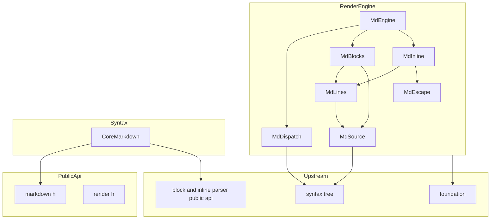
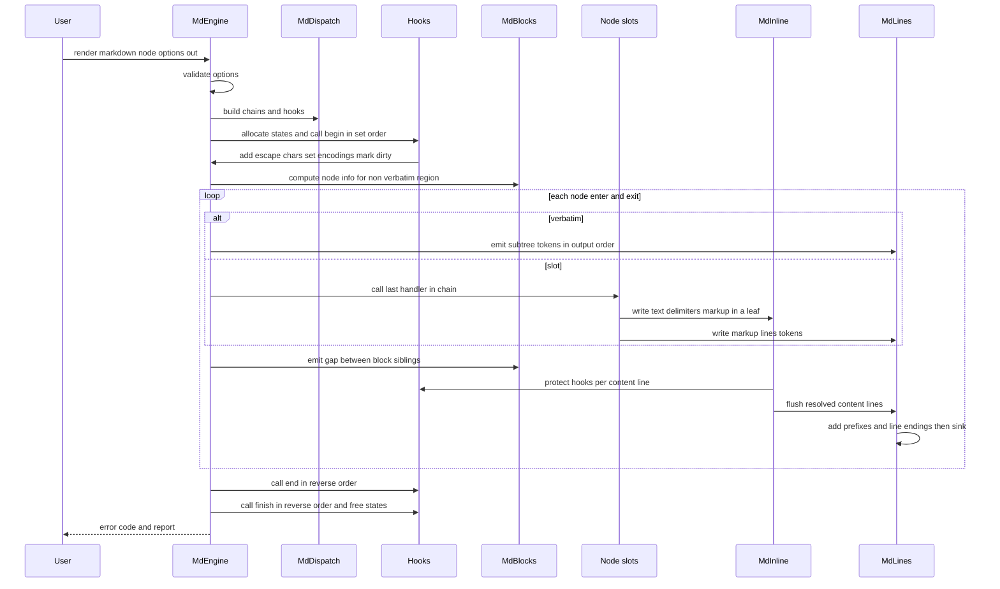
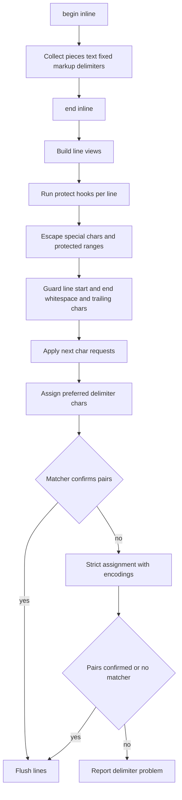
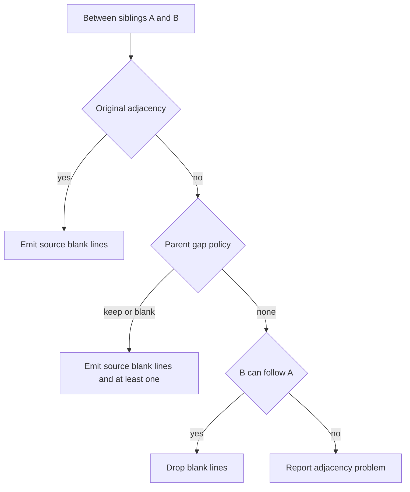
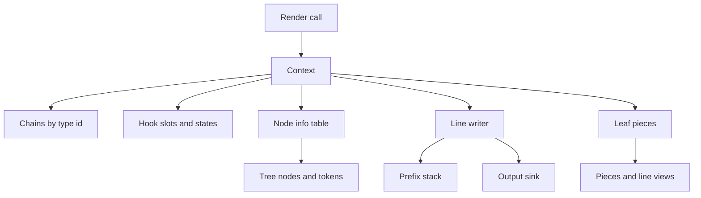

# Design Document: markdown-renderer

## Overview
**Purpose**：`markdown-renderer` は、Amark の利用者に、`syntax-tree` の構文木（パースしたもの、編集したもの、手で組み立てたもの）を Markdown に書き戻す手段を提供する。編集していない部分は構文トークンから元の表記をバイト単位で出し、編集した部分は、周りの元の表記と組み合わさっても編集後の木と同じ意味に再パースされるように作り直す。どの表記でも表せない木は、専用のエラーコードと理由で報告する。

**Users**：利用者（翻訳、リンクの書き換え、文書の生成のツールの開発者）は、出力の入口と、新しいノードの表記のオプションを使う。拡張の実装者は、ノード型ごとの Markdown 出力のスロット、前後のフック、出力の文脈（元の表記の出力、エスケープつきの書き出し、区切り文字、接頭辞、ブロックの区切りの規則、保護の要求、汚れの印）を使う。`block-parser` の CommonMark の構文セットの構築関数は、組み込みの出力の構文拡張 `amark.core.markdown` を `amark.core.html` の直後に加える。

**Impact**：公開ヘッダ `markdown.h`、`extension.h` へのスロットの種類の番号の追記、`src/render/` の Markdown のエンジン、`src/syntax/` の `amark.core.markdown`、`tests/markdown/`、2 つのファジングのターゲットを追加する。上流には、エラーコードの追加（`foundation`）、走査と照合の関数の公開とテキストの走査の規則の追加（`block-parser`、`inline-parser`）を求める（Integration & Upstream Changes）。

### Goals
- 構文トークンが全バイトを覆う無編集の文書を、タブ、CRLF、行末の空白、遅延継続、NUL、BOM を含めてバイト単位で同じに書き戻す。
- 編集した木の出力を再パースすると、編集後の木と `amark_node_equal(…, AMARK_EQUAL_NORMALIZE_TEXT)` で等しい。表せない木は `AMARK_ERROR_UNREPRESENTABLE` と理由で報告し、パースで作った木は報告しない。
- 出力の変化を、編集したノード、それを含む葉、区切りと隣のブロックの最小の変更、作り直した行の接頭辞、意味が編集に依存するノードに限る。
- エンジンは個別のノード型を知らず、組み込みの出力も拡張の出力も同じ公開のスロットと文脈で書かれる。エスケープと区切り文字の判断はエンジンにまとめ、後で方式を改善しても出力の処理を変えずに済む。

### Non-Goals
- 必要最小限のエスケープ、周りの文書からの表記の推定、フォーマッタとしての整形（後の改善。オプションのフラグとフィールドを末尾に足して選べるようにする）
- パース、断片のパースと挿入（`block-parser`）、HTML の出力（`html-renderer`）
- HTML の出力にある入れ子の出力とフィルタ（Markdown の要件にない。必要になればスロットとフックの構造体の末尾に足す）
- 出力を実行時に再パースして検証すること（検証はプロパティテストで行う）

## Boundary Commitments

### This Spec Owns
- 公開ヘッダ `include/amark/markdown.h`（オプション、報告、入口、2 種類のスロットの構造体、出力の文脈の API、エスケープのユーティリティ、`amark.core.markdown` の取得、CommonMark の補助関数）と、`amark.h`・`extension.h` への追記（`AMARK_SLOT_MARKDOWN_NODE` 0x0401、`AMARK_SLOT_MARKDOWN_HOOKS` 0x0402、範囲 0x0400–0x04FF の注記）
- `src/render/markdown_*` の Markdown のエンジンのすべて：元の表記と作り直しの判定、トークンの出力順の列挙、行と接頭辞、葉の中身の解決（エスケープ、保護、区切り文字）、ブロックの区切り、スロットの検査と連鎖、入口とたどり
- 組み込みの Markdown 出力の構文拡張 `amark.core.markdown`（19 のノード型のスロット、フック）と、その実装 `src/syntax/md_core.c`、`md_blocks.c`、`md_inlines.c`
- 元の表記の出力の規則、保守的なエスケープの規則、区切り文字の選び直しの規則、ブロックの区切りの規則、接頭辞の付け直しの規則（このファイルの各コンポーネント）
- `tests/markdown/` のテストと補助（Naos に依存しない検査の本体 `amark_test_md` と、Naos の検査 `amark_test_md_check` の 2 つの INTERFACE ライブラリ）、GFM 相当の Markdown の検証用の部品 `tests/markdown/support/gfm_md_ext.{h,c}`（INTERFACE ライブラリ `amark_test_md_gfm`。Naos に依存しない）、`fuzz/md_roundtrip_fuzz.c`、`fuzz/md_edit_fuzz.c`

### Out of Boundary
- 構文トークンの種類・印・編集の記録・比較の定義（`syntax-tree`）
- 構文トークンの記録と役割の番号の値、文字の宣言（`block-parser`、`inline-parser`）。このレンダラは公開された値を読むだけ
- HTML のブロックとタグの走査の規則、raw HTML の走査、区切り文字の flanking と照合の規則（上流が公開する関数を使い、ここでは作らない）
- 断片のパースと挿入（`block-parser` の `amark_parse_fragment`）
- GFM 相当の構文のパースと HTML の部品（`block-parser`、`inline-parser`、`html-renderer` のテストの中）
- 木の変更（出力は木を変えない）

### Allowed Dependencies
- `foundation` の公開 API（`export.h`、`error.h`、`allocator.h`、`buffer.h`、`utf8.h`、`unicode.h`）と内部 API（`runtime/alloc_internal.h`、`runtime/buffer_internal.h`）。内部 API は `src/render/` だけが使う
- `syntax-tree` の公開 API（`node.h`、`document.h`、`token.h`、`extension.h`）。`src/tree/` の内部ヘッダは使わない
- `html-renderer` の `render.h`（`amark_write_fn_t`）
- `src/syntax/md_*.c` だけが、`block-parser` の公開 API（`parser.h` の `amark_label_normalize`・`amark_label_map_*`、`scan.h` の走査、`commonmark.h` の役割の番号）と `inline-parser` の公開 API（`inline.h` の文字の宣言・ノードの性質・flanking と照合の関数・raw HTML の走査、役割の番号）を使う
- テスト時：Naos、`amark_add_test`、`amark_add_generated_tests`、`AmarkTestGen.cmake`、`amark_test_support`、`amark_test_tree`、`amark_test_parse`、`amark_test_inline`、`amark_test_gfm`、`tests/support/gen_examples.cmake`（ファイルと基本の契約は `block-parser`、`EXPECT=html`・`FACTORY=`・`CHECK=` の追加は `inline-parser`）、`html-renderer` の `gen_html_cases.cmake`（ケースの形式と生成の手順。`CHECK=`）、`inline-parser` の `tests/spec/spec_version.cmake`（spec.txt の版と SHA-256）、`inline-parser` の `tests/extensions/gfm_inline_ext.h`（拡張オートリンクの役割の定数）、`amark_add_fuzzer`
- ファジングの規則（`foundation`）：ファジングのターゲットがリンクするテストの補助ライブラリは Naos に依存せず、`AMARK_FUZZ` か `AMARK_BUILD_TESTS` のときに定義される。この spec の `amark_test_md` と `amark_test_md_gfm` はこの規則に従い、Naos に依存する検査は別のライブラリ `amark_test_md_check` に分ける（ファジングのターゲットはリンクしない）
- レイヤーの規則：`src/render/` は `src/parse/` と `src/syntax/` を参照せず、`parser.h`・`scan.h`・`inline.h`・`commonmark.h` も include しない（エンジンはパースの知識を持たない）。`src/syntax/md_*.c` は公開ヘッダだけを include する。公開ヘッダは他の公開ヘッダだけを include する

### Revalidation Triggers
- スロットの構造体、文脈の API の意味（状態の印、書き出しの分類、保護、区切り文字、空行の規則、汚れの印）、種類の番号の変更 → 利用者の拡張、`amark_test_md_gfm`、`inline-parser` の `gfm_set`
- `amark.core.markdown` の名前・取得関数・登録の規則の変更 → `block-parser`（構築関数）
- エスケープの方式の変更（必要最小限の方式の追加など）→ 期待する出力を書いたテスト（意味の保存のテストは変わらない）
- 上流：トークンの種類・印・編集の記録・比較（`syntax-tree`）、役割の番号・トークンの所有の規則・文字の宣言・照合と走査の関数（`block-parser`、`inline-parser`）、`amark_inline_run_t` / `amark_inline_run_match_t` の形と `capacity` の規則（`inline-parser`。MdDispatch の対応づけ）、`gfm_inline_ext.h` の拡張オートリンクの役割の定数と拡張オートリンクのトークンの形（`inline-parser`）、`gen_examples.cmake` の `CHECK=`・`spec_version.cmake`（`inline-parser`）、`render.h`・`gen_html_cases.cmake` のケースの形式と `CHECK=`（`html-renderer`）、エラーコード・`amark.h` の正準の順・テストの補助ライブラリとファジングの規則（`foundation`）の変更 → この spec
- `amark_test_md`・`amark_test_md_gfm` の依存の変更（Naos に依存しないことの維持）→ `fuzz/` の 2 つのターゲットと、`amark_test_gfm`（`inline-parser`）を通じてそれをリンクするファジングのターゲット

## Architecture

### Architecture Pattern & Boundary Map
**Selected pattern**：スロット駆動・行指向のレンダラ。エンジン（`src/render/`）は部分木を反復でたどり、無編集で文脈も元のままの部分木はトークンをソース上の順にそのまま出し、それ以外のノードは型ごとの連鎖の最後の処理を呼ぶ。出力はすべて「行」を通り、行の終わりに祖先のコンテナの接頭辞が付く。作り直す葉の中身は、いったん断片としてためてから、エスケープ・保護・区切り文字をまとめて解決して行に流す。エンジンは個別のノード型もパースの規則も知らず、CommonMark の知識はすべて `amark.core.markdown` のスロットとフックにある。



**Dependency direction（`src/render/` の中）**：`markdown_escape` → `markdown_source` → `markdown_lines` → `markdown_inline` → `markdown_blocks` → `markdown_dispatch` → `markdown_render`。左のファイルは右のファイルの関数を呼ばない。`markdown_internal.h` は構造体と、ファイルをまたぐ `amark__md_*` の宣言だけを持つ。`src/syntax/md_*.c` は `markdown.h` を通してだけエンジンを使う。違反はレビューでエラーとする。

**Architecture Integration**：
- Existing patterns preserved：`html-renderer` の Renderer slot conventions（ノード型ごとのスロットとフックのスロット、名前でのノード型の指定、構文セットの順の連鎖と `render_next`、子の省略、拡張ごとの状態、`begin` は順・`end` と `finish` は逆順、不透明な文脈、バッファと `amark_write_fn_t` の 2 つの入口、`struct_size` と未知のビットの拒否、組み込みの出力は 1 つの core 拡張）。`foundation` のエラーコード・アロケータ・`struct_size`。`syntax-tree` のトークンと編集の記録。
- New components rationale：行（接頭辞）、葉（エスケープと区切り文字）、ブロックの区切り（空行）の 3 つの境目は、ノードごとの処理では判断できないため、エンジンのコンポーネントにする。
- Steering compliance：C99、`amark_` / `AMARK_` / `amark__`、`AMARK_API`、不透明型、グローバルな可変状態なし、ライセンスヘッダ、組み込みも公開 API だけを使う、spec の境界を守るための回避策を作らない（上流の変更として示す）。

### ノードの扱いの判定
エンジンは、各ノードについて次の印（`amark_markdown_node_state` で処理にも渡す）を求める。

| 印 | 条件 |
|----|------|
| `TOKENS` | 部分木のどこかが構文トークンを持つ |
| `EDITED` | `CONTENT`、`CREATED`、未知のビットのどれか（`syntax-tree` の規則） |
| `STRUCTURE` | `CHILDREN` か `DESCENDANTS` |
| `RELOCATED` | `RELOCATED` |
| `DIRTY` | フックか処理が `amark_markdown_mark_dirty` で印を付けたノード、または汚れの印を持つ子孫を持つノード |
| `NEW_BEFORE` / `NEW_AFTER` | ブロック：前の兄弟／後ろの兄弟との隣接が「元の隣接」でない（MdBlocks） |
| `EDITED_LEAF` | インライン：祖先の葉のブロックが作り直し（エンジンが元の表記をそのまま出さない）になった |

- **元の表記をそのまま出す（verbatim）**：`TOKENS` があり、`EDITED`・`STRUCTURE`・`RELOCATED`・`DIRTY`・`NEW_BEFORE`・`NEW_AFTER`・`EDITED_LEAF` がどれもないノード。エンジンは処理を呼ばず、部分木のトークンを出力順に出す（MdSource、MdLines）。
- **処理を呼ぶ**：それ以外。処理は印を見て、元の表記を使う（`amark_markdown_write_verbatim`、`amark_markdown_write_own_tokens`、`amark_markdown_write_token`）か、作り直す。トークンを持つノードを作り直すときは、元の表記の選択（マーカーの文字など）を希望として使う（5.4）。
- **処理がない型**：部分木が無編集で `TOKENS` があれば元の表記を出す（9.9）。そうでなければ `AMARK_MARKDOWN_PROBLEM_NO_OUTPUT` で表現できないと報告する（4.4）。
- 葉のブロック（`amark_node_can_contain(node, AMARK_NODE_TEXT)` が真のブロック）が処理を呼ぶ扱いになったら、その子孫のインラインはすべて `EDITED_LEAF` になり、処理を呼ぶ扱いになる（局所性の単位は葉。5.2(b)）。

### 組み込みの Markdown 出力の登録の規則
1. 組み込みの 19 のノード型の Markdown の処理は、この spec が `src/syntax/md_blocks.c`（ブロックの 10 型）と `src/syntax/md_inlines.c`（インラインの 9 型）に実装し、`src/syntax/md_core.c` の構文拡張 `amark.core.markdown` のスロットとしてだけ登録する。
2. `amark.core.markdown` はノード型とパースのスロットを持たず、`AMARK_SLOT_MARKDOWN_NODE` を 19 個と `AMARK_SLOT_MARKDOWN_HOOKS` を 1 個持つ。公開の `amark_markdown_core_extension()` で取得する。
3. CommonMark の構文の構文拡張（`commonmark.*`）は Markdown のスロットを持たない。表記（ATX と setext、フェンスとインデント、インラインと参照とオートリンク）は、トークンの役割の番号で区別する。
4. `block-parser` の構築関数 `amark_syntax_set_add_commonmark` の「出力の core 拡張の一覧」に、`amark_html_core_extension()` の次として `amark_markdown_core_extension()` を 1 行足す（`block-parser` の design が予定する変更。この spec のタスクが行う）。
5. 利用者が `amark_syntax_set_new` から構文セットを作る場合は、`amark.core.markdown` を加える。加えなければ、組み込みのノード型は処理を持たない型として扱われる（無編集なら往復できる）。
6. 組み込みの出力を差し替える利用者は、`amark.core.markdown` より後に同じノード型のスロットを持つ構文拡張を加え、必要なら `amark_markdown_render_next` で元の処理を呼ぶ。

### Technology Stack

| Layer | Choice / Version | Role in Feature | Notes |
|-------|------------------|-----------------|-------|
| Language | C99 | ライブラリ、テスト、ファジング | `amark_target_defaults()` |
| Runtime | `foundation`（error、allocator、buffer、utf8、unicode） | 確保、出力の組み立て、空白と句読点の判定 | エラーコードを 1 つ追加（上流） |
| Tree | `syntax-tree`（node、document、token、extension） | トークン、編集の記録、ソースと位置、スロットの列挙 | 内部ヘッダは使わない |
| Parse rules | `block-parser`・`inline-parser` の公開 API | 役割の番号、文字の宣言、ラベルの正規化、HTML の走査、flanking と照合 | `src/syntax/md_*.c` だけが使う |
| Reference | CommonMark Spec 0.31.2 | エスケープ、ブロックの境目、flanking の規則 | 規則だけ |
| Test | Naos v0.4.0、`amark_test_*`、`gen_examples.cmake`、`gen_html_cases.cmake`、`spec_version.cmake` | 往復・作り直し・編集のプロパティテスト | `amark_test_md`、`amark_test_md_gfm`（どちらも Naos なし）、`amark_test_md_check`（Naos）を追加。生成の手順は上流のものを使い、作り直さない |
| Fuzz | `amark_add_fuzzer` | 往復と編集のファジング | 2 つのターゲット。リンクするのは Naos に依存しないライブラリだけ |

## File Structure Plan

### Directory Structure
```
include/amark/
└── markdown.h               # オプション、報告、入口、スロットの構造体、文脈の API、ユーティリティ、core 拡張の取得、CommonMark の補助
src/render/
├── markdown_internal.h      # struct amark_markdown_context、断片、行、ノードの情報の表、ファイル間の amark__md_* の宣言
├── markdown_escape.c        # MdEscape：エスケープと文字参照のユーティリティ（文脈なしの純粋な関数）、文字の分類の判定
├── markdown_source.c        # MdSource：部分木のトークンの出力順の列挙、元の行の特定、タブの元の幅、文書の改行コードの判定
├── markdown_lines.c         # MdLines：出力先、行のため置き、アンカー、接頭辞の積み重ねと選択、部分的なタブ、列の規則、改行
├── markdown_inline.c        # MdInline：葉の断片、エスケープ、行頭と行末の保護、保護のフック、次の文字の要求、区切り文字の解決
├── markdown_blocks.c        # MdBlocks：ノードの情報の表（事前の後順のたどり）、状態の印、汚れの伝播、ブロックの区切りと空行
├── markdown_dispatch.c      # MdDispatch：スロットの検査、型ごとの連鎖の表、フックの一覧と状態
└── markdown_render.c        # MdEngine：入口、オプションの検査、反復のたどり、呼び出しの文脈、render_next、報告、フックの寿命
src/syntax/
├── md_core_internal.h       # 19 のスロットとフックの extern 宣言、core の状態の構造体、ブロックの共通の判定（md_*.c だけが使う）
├── md_core.c                # amark.core.markdown の表と取得関数、フック（構文の有無、エスケープの集合、符号化、定義と参照の検査、行頭の保護、照合）
├── md_blocks.c              # document、block_quote、list、item、code_block、html_block、paragraph、heading、thematic_break、link_definition と amark_markdown_write_item_prefix
└── md_inlines.c             # text、softbreak、linebreak、code、html_inline、emph、strong、link、image と amark_markdown_commonmark_flanks
tests/markdown/
├── CMakeLists.txt           # amark_test_md・amark_test_md_gfm（Naos なし。AMARK_FUZZ か AMARK_BUILD_TESTS）、amark_test_md_check とテストの登録・生成テスト（AMARK_BUILD_TESTS）
├── support/
│   ├── md_test_support.h    # amark_test_md（Naos なし）：往復・全ノードの編集・編集の手順の判定を状態と失敗の説明で返す関数
│   ├── md_test_support.c
│   ├── md_edit_script.h     # amark_test_md（Naos なし）：決まった編集の手順（種から決まる操作の列）と局所性の追跡
│   ├── md_edit_script.c
│   ├── md_check.h           # amark_test_md_check（Naos）：作り直しの検査、生成テストの検査の関数、AMARK_CHECK_MD
│   ├── md_check.c
│   ├── gfm_md_ext.h         # 表、取り消し線、タスク項目、脚注の Markdown のスロット、拡張オートリンクと区切りの行の保護のフック
│   └── gfm_md_ext.c
├── data/
│   ├── block_cases.txt      # ブロックの組み込みの型の作り直しの表記（html-renderer の gen_html_cases.cmake の形式。S 式と期待する Markdown）
│   ├── inline_cases.txt     # インラインの組み込みの型の作り直しの表記、エスケープ、区切り文字
│   ├── corpus.txt           # 往復のコーパス（例の形式。タブ、CRLF、行末の空白、遅延継続、NUL、BOM、不正な UTF-8、深い入れ子）
│   └── gfm_corpus.txt       # GFM 相当の構文の往復のコーパス
├── entry_test.c             # 入口、出力先、失敗の扱い、決定性、部分木と切り離したノード、木を変えないこと
├── options_test.c           # オプションの既定・検査・各表記・改行コード・報告のポインタ
├── slot_test.c              # 登録、順、render_next、処理のない型、子の省略、不正なスロット、汚れの印、状態
├── lines_test.c             # 接頭辞の選択、遅延継続、移動、部分的なタブ、列の規則、マーカーの幅、改行コード（INTERNAL）
├── inline_test.c            # エスケープ、行頭と行末の保護、保護のフック、次の文字の要求、区切り文字の解決（INTERNAL）
├── blocks_test.c            # 元の隣接の判定、空行の規則、can_follow、末尾の空行の省略
├── core_blocks_test.c       # 組み込みのブロックの処理の分岐（表記の引き継ぎ、切り替え、表現できない木）
├── core_inlines_test.c      # 組み込みのインラインの処理の分岐（リンクの書式、参照の検査、コードの長さ、HTML の検査）
├── report_test.c            # 表現できない木の種類と報告
├── gfm_md_test.c            # GFM 相当の部品の往復・作り直し・編集
├── property_test.c          # コーパスに対する往復・作り直し・全ノードの編集・編集の手順・局所性
├── oom_test.c               # 確保失敗の総当たり
└── scale_test.c             # 深い木、計算量のカウンタ（INTERNAL）
fuzz/
├── md_roundtrip_fuzz.c      # 入力をパースして書き戻し、バイト単位の一致を確かめる
├── md_edit_fuzz.c           # 入力の後半を編集の手順として適用し、意味の保存か報告を確かめる
├── corpus/md_roundtrip/
└── corpus/md_edit/
```

### Modified Files
- `include/amark/amark.h` — `foundation` が定める正準の順に従い、`markdown.h` を最後に追加する。
- `include/amark/extension.h` — 範囲 0x0400–0x04FF の節に `AMARK_SLOT_MARKDOWN_NODE`（0x0401）、`AMARK_SLOT_MARKDOWN_HOOKS`（0x0402）を追記する。
- `src/CMakeLists.txt` — `amark_objects` に `src/render/markdown_*.c` と `src/syntax/md_*.c` を追加する。
- `src/syntax/commonmark.c` — 出力の core 拡張の一覧に `amark_markdown_core_extension()` を `amark_html_core_extension()` の次に 1 行足す（登録の規則 4）。
- `tests/CMakeLists.txt` — `add_subdirectory(markdown)` を `add_subdirectory(extensions)` の前に追加する（`foundation` の規則に従い、Naos に依存しない補助ライブラリは `AMARK_FUZZ` だけのときも定義される）。
- `tests/extensions/gfm_set.c`、`tests/extensions/CMakeLists.txt` — `amark_test_gfm_set_new` が HTML の部品の後に `amark_test_md_gfm` の拡張を加え、`amark_test_gfm` が `amark_test_md_gfm` に依存する（brief の Existing Spec Touchpoints）。
- `fuzz/CMakeLists.txt` — `amark_add_fuzzer(md_roundtrip …)`、`amark_add_fuzzer(md_edit …)`（どちらも `LIBRARIES amark_test_gfm amark_test_md`。どちらも Naos に依存しない。Naos に依存する `amark_test_md_check` はリンクしない）。
- `tests/support/gen_examples.cmake`（ファイルと基本の契約は `block-parser` が所有し、`inline-parser` は `EXPECT=html`・`FACTORY=`・`CHECK=` の追加だけを所有する）と `gen_html_cases.cmake`（`html-renderer`）は編集しない。`CHECK=` は、`gen_examples.cmake` では `inline-parser`、`gen_html_cases.cmake` では `html-renderer` が実装する（Integration & Upstream Changes）。

## System Flows

### 1 回の出力

- 失敗したら、たどりを止めて `end` を呼ばずに `finish` を呼び、表と状態を解放し、バッファを呼び出し前の長さに戻す。表現できないときは `AMARK_ERROR_UNREPRESENTABLE` を返し、オプションの `report` に理由とノードを書く。
- 書き出しの関数の出力先には、確定した行だけを渡す（作り直す葉の中身は解決が終わるまで渡さない）。

### 作り直す葉の解決


### ブロックの区切り

- 元の隣接：A と B がどちらも `RELOCATED` でなく、元の位置（トークン）を持ち、同じソースで、B の最初の行の番号が「A の最後の内容の行 ＋ 間の空行の数 ＋ 1」に等しい。間の行がトークンの空行だけなので、削除されたノードがあれば元の隣接にならない。
- 空行の規則が `BLANK` のときは、元の隣接でも空行がなければ 1 つ置く。`NONE` のときは、元の隣接でも間の空行（A の末尾の空行を含む）を出さない。

## Requirements Traceability

| Requirement | Summary | Components | Interfaces | Flows |
|-------------|---------|------------|------------|-------|
| 1.1–1.4 | 入口、部分木、2 つの出力先、書き出しの失敗 | MdEngine, MdLines | `amark_render_markdown`, `amark_render_markdown_to` | 1 回の出力 |
| 1.5 | 失敗時の巻き戻しとリークなし | MdEngine, MdLines | エラーコード | 1 回の出力 |
| 1.6, 1.7 | 木を変えない、決定性 | MdEngine, MdBlocks | const のノード、外部の表 | — |
| 2.1–2.5 | 無編集の往復 | MdSource, MdLines, MdBlocks | verbatim の判定、出力順の列挙 | 1 回の出力 |
| 2.6 | 無編集の部分木 | MdSource, MdEngine | 出力順の列挙 | — |
| 3.1, 3.2 | 意味の保存 | 全コンポーネント, CoreMarkdown | 判定、スロット | 全フロー |
| 3.3, 3.4 | 記号と空白の保護 | MdInline, MdEscape, CoreMarkdown | `amark_markdown_write_text`, `protect` | 葉の解決 |
| 3.5 | 区切り文字 | MdInline, CoreMarkdown | `amark_markdown_write_delimiter`, `match_delimiters` | 葉の解決 |
| 3.6 | ブロックの隣接 | MdBlocks, CoreMarkdown | `amark_markdown_set_gap`, `can_follow`, `NEW_BEFORE`/`NEW_AFTER` | ブロックの区切り |
| 3.7 | 参照の依存 | CoreMarkdown, MdBlocks | `begin`, `amark_markdown_mark_dirty` | 1 回の出力 |
| 3.8 | 構文の有無 | CoreMarkdown, MdInline | `amark_markdown_set_encodings`, `NO_SYNTAX` | — |
| 4.1–4.4 | 表現できない木の報告 | MdEngine, CoreMarkdown | `AMARK_ERROR_UNREPRESENTABLE`, `amark_markdown_report_t`, `amark_markdown_fail` | 1 回の出力 |
| 4.5 | パースで作った木は報告しない | CoreMarkdown, MdInline, MdBlocks | 構成的な割り当て、作り直しの規則 | 全フロー |
| 5.1, 5.2 | 局所性の範囲 | MdBlocks, MdInline, MdLines | 判定、元の隣接、行のアンカー | 全フロー |
| 5.3 | 葉の中の無編集のノード | MdInline, CoreMarkdown | `amark_markdown_write_text_tokens`, verbatim の書き出し | 葉の解決 |
| 5.4 | 元の表記の引き継ぎ | CoreMarkdown | トークンの役割による希望 | — |
| 6.1–6.5 | 新しいノード | CoreMarkdown, MdInline | 作り直し、オプション | — |
| 7.1–7.5 | オプション | MdEngine, CoreMarkdown | `amark_markdown_options_t` | — |
| 8.1–8.6 | 接頭辞 | MdLines, CoreMarkdown | `prefix`, `amark_markdown_write_item_prefix` | 1 回の出力 |
| 9.1–9.3 | スロットとフック | MdDispatch, MdEngine | `amark_markdown_node_slot_t`, `amark_markdown_hooks_slot_t` | 1 回の出力 |
| 9.4–9.7 | 文脈の API | MdEngine, MdInline, MdLines, MdBlocks | 文脈の関数 | 全フロー |
| 9.8 | 不正なスロット | MdDispatch | 検査 | — |
| 9.9 | 処理のない無編集の型 | MdEngine | 判定 | — |
| 9.10 | CommonMark の構文セット | CoreMarkdown | 登録の規則 4 | — |
| 10.1–10.5 | GFM 相当の部品 | GfmMdExt | 公開のスロットとフック | — |
| 11.1–11.6 | プロパティテスト | MdTestSupport, MdTests, MdFuzz | 往復、作り直し、編集の手順、局所性 | — |
| 12.1–12.4 | 計算量と堅牢性 | MdBlocks, MdSource, MdInline, MdEngine | 反復、表、カウンタ | — |
| 13.1–13.4 | API の規約 | MarkdownApi, MdEscape | 公開ヘッダ、`struct_size` | — |

## Components and Interfaces

| Component | Domain/Layer | Intent | Req Coverage | Key Dependencies (P0/P1) | Contracts |
|-----------|--------------|--------|--------------|--------------------------|-----------|
| MarkdownApi | Public headers | 公開の型・関数・定数の宣言 | 9.1, 13.1, 13.2 | extension.h (P0), render.h (P0) | Service |
| MdEscape | Render | エスケープと文字参照の純粋な関数 | 3.3, 13.4 | buffer (P0), utf8 (P0) | Service |
| MdSource | Render | トークンの出力順、元の行、タブの幅 | 2.1–2.6, 8.4, 12.1 | token.h (P0), document.h (P0) | Service |
| MdLines | Render | 出力先、行、接頭辞、改行 | 1.2–1.5, 2.1–2.4, 6.4, 8.1–8.5 | MdSource (P0), buffer (P0) | Service, State |
| MdInline | Render | 葉の断片、エスケープ、保護、区切り文字 | 3.3–3.5, 3.8, 5.3, 6.5, 9.4, 9.6, 9.7 | MdLines (P0), MdEscape (P0), unicode (P0) | Service, State |
| MdBlocks | Render | ノードの情報、状態の印、汚れ、ブロックの区切り | 3.6, 5.1, 5.2, 9.4, 12.1, 12.2 | MdSource (P0), MdLines (P0) | Service, State |
| MdDispatch | Render | スロットの検査と連鎖、フック | 9.1, 9.3, 9.8 | syntax set (P0) | Service |
| MdEngine | Render | 入口、たどり、呼び出しの文脈、報告 | 1.1–1.7, 4.1–4.4, 7.1–7.5, 9.1–9.3, 9.9, 12.2–12.4 | MdDispatch (P0), MdBlocks (P0), MdInline (P0) | Service, State |
| CoreMarkdown | Syntax | `amark.core.markdown` と 19 の型の出力、フック | 3.1–3.8, 4.3, 4.5, 5.4, 6.1–6.5, 7.4, 8.1, 8.5, 8.6, 9.2, 9.10 | markdown.h (P0), parser.h・scan.h・inline.h・commonmark.h (P0) | Service |
| MdTestSupport | Test | 往復・作り直し・編集の検査、出力の照合 | 11.1–11.4, 11.6 | amark_test_tree (P0), amark_test_inline (P0) | Service |
| GfmMdExt | Test | GFM 相当の Markdown の部品 | 10.1–10.5 | markdown.h (P0), amark_test_html_gfm (P0) | Service |
| MdTests / MdFuzz | Test / Fuzz | 要件の検証 | 全要件, 11.5 | MdTestSupport (P0) | Batch |

### 共通の規約
- `foundation` の規約に従う：失敗しうる関数は `amark_error_t` を返す。必須のポインタ引数が NULL なら `AMARK_ERROR_INVALID_ARGUMENT`。問い合わせの関数は値を直接返す。公開の構造体は先頭に `size_t struct_size`（スロットは `amark_slot_header_t`）を持ち、ライブラリは v1 の最小の大きさ以上であることを確かめ、知らない末尾のフィールドを読まない。
- 文脈の関数は、出力の処理・接頭辞の処理・`can_follow`・フックの呼び出しの間だけ使える。外での呼び出し、使えない場面での呼び出しは `AMARK_ERROR_INVALID_STATE`（void の関数は何もしない、問い合わせは「なし」を返す）。
- 表現できないことは、エンジンの検査か `amark_markdown_fail` で記録し、最初の 1 つを報告する。以後の書き出しは何もせずにその失敗を返す。

### Public headers

#### MarkdownApi

| Field | Detail |
|-------|--------|
| Intent | 公開の型・関数・定数を、依存の順に宣言する |
| Requirements | 9.1, 13.1, 13.2 |

**Responsibilities & Constraints**
- `markdown.h` は `node.h`、`token.h`、`buffer.h`、`extension.h`、`render.h` を include する。`AMARK_BEGIN_DECLS` / `AMARK_END_DECLS` で囲み、ガードは `AMARK_MARKDOWN_H`。
- 宣言は各コンポーネントの Contracts に分けて示す。スロットの種類の番号は `extension.h` に置く。

**Contracts**: Service [x]
```c
/* include/amark/extension.h（追記） */
/* 0x0400–0x04FF：markdown-renderer */
#define AMARK_SLOT_MARKDOWN_NODE  0x0401u   /* amark_markdown_node_slot_t */
#define AMARK_SLOT_MARKDOWN_HOOKS 0x0402u   /* amark_markdown_hooks_slot_t */
```

### Render

#### MdEscape

| Field | Detail |
|-------|--------|
| Intent | 文脈なしで使えるエスケープと文字参照の関数 |
| Requirements | 3.3, 13.4 |

**Responsibilities & Constraints**
- `amark_markdown_escape`：`chars`（256 ビットの集合）に含まれるバイトのうち、ASCII の句読点は `\` を前に置き、それ以外（空白、英数字など）は 10 進の数値文字参照 `&#N;` にする。UTF-8 の多バイトの並びは変えない。
- `amark_markdown_char_ref`：符号位置を `&#N;` で追加する（範囲外とサロゲートは `AMARK_ERROR_INVALID_ARGUMENT`）。
- 失敗時は出力のバッファを呼び出し前の長さに戻す。数の書式は内部の 10 進の変換で書く（ロケールに依存しない）。
- 内部の契約（`markdown_internal.h`）：`bool amark__md_is_ascii_punct(unsigned char c)`、`size_t amark__md_char_ref_length(uint32_t cp)`。

**Contracts**: Service [x]
```c
/* include/amark/markdown.h */
AMARK_API amark_error_t amark_markdown_escape(amark_buffer_t *out, const char *data, size_t length,
                                              const unsigned char chars[32]);
AMARK_API amark_error_t amark_markdown_char_ref(amark_buffer_t *out, uint32_t codepoint);
```

#### MdSource

| Field | Detail |
|-------|--------|
| Intent | 部分木のトークンを出力の順に並べ、元の行と列を求める |
| Requirements | 2.1–2.6, 8.4, 12.1 |

**Responsibilities & Constraints**
- 出力順の列挙（カーソル）：部分木のすべてのトークン（接頭辞の印のものを含む）を（ソース、オフセット、`tab_column_offset`）の順に返す。各ノードのトークンは整列済みなので、前順にたどりながら、子孫と位置が重なるコンテナのトークンだけを、深さで抑えた小さなヒープで合流させる（O(T log D)）。部分木が複数のソースを参照するときは、根の最初のトークンのソースだけを対象にし、他のソースのトークンがあればカーソルは「混在」を返す（呼び出し側は元の表記をそのまま出さない）。
- 元の行：オフセットの行の先頭は `amark_document_position` の列から求める（1 行目は BOM の後）。行ごとの「コンテナの接頭辞のトークン」は、コンテナのトークンの二分探索で `[行の先頭, アンカー]` の範囲から取り出す。
- タブの元の幅：行の先頭から 4 列のタブストップで列を数え、タブのバイトが表す列の数を返す。
- 文書の改行コード：根の文書のソース 0 の最初の LF・CR・CRLF（なければ LF）。
- 末尾の空行：部分木の、ソース上の最後の「SPACE と LINE_ENDING の種類だけからなる行」の並び（接頭辞のトークンを除く）とその最初のトークンの位置。

**Contracts**: Service [x]
```c
/* src/render/markdown_internal.h */
amark_error_t amark__md_cursor_init(amark__md_cursor_t *cursor, const amark_node_t *root, amark_markdown_context_t *ctx);
bool amark__md_cursor_next(amark__md_cursor_t *cursor, const amark_node_t **out_owner, amark_token_t *out_token);
size_t amark__md_line_start(const amark_document_t *doc, amark_source_id_t source, size_t offset);
unsigned amark__md_tab_width(const amark_document_t *doc, amark_source_id_t source, size_t offset);
```

#### MdLines

| Field | Detail |
|-------|--------|
| Intent | 現在の行をため、接頭辞と改行を付けて出力先に渡す |
| Requirements | 1.2–1.5, 2.1–2.4, 6.4, 8.1–8.5 |

**Responsibilities & Constraints**
- 出力先：バッファは開始時の長さを記録し、失敗で戻す。書き出しの関数は中継のバッファ（文書のアロケータ）にため、8 KiB を超えたら渡し、最後に残りを渡す。書き出しの関数の失敗は最初の失敗として保持する。
- 行：`{断片の列（バイト、分類、所有者、元の位置）、アンカー（最初の元の位置の断片のソースの行）、改行（トークンか合成）}`。改行のトークン（`LINE_ENDING`）か `amark_markdown_end_line` で行が閉じる。閉じていない行の後に新しい行の内容やブロックが来たら、合成した改行で閉じる。出力の最後の行は、元の最後の行が改行を持たなければ改行なしで終わる。
- 接頭辞の積み重ね：処理の `prefix` を持つノード（コンテナ）に入ると積み、出ると降ろす。元の表記をそのまま出す部分木の中のコンテナは積まない（その接頭辞はカーソルのトークンとして流れる）。各コンテナは「最初の行を出したか」を持つ。
- 接頭辞の付け方（行を閉じるとき、積み重ねの外側から順に）：各コンテナの `prefix` を、コンテナの最初の出力の行なら `FIRST`、内容のない行なら `BLANK`、それ以外は `NEXT` で呼ぶ。`prefix` は `amark_markdown_write_prefix_tokens` で元の接頭辞のトークンを書くか、`amark_markdown_write` で合成する（元の表記を使うかの判断は処理が持つ。例：項目はマーカーを変えたら合成する）。
- `amark_markdown_write_prefix_tokens` が書くトークン：`FIRST` では、コンテナの最初の元の行の接頭辞のトークン（その行がアンカーでなくても、表記の希望として使える）。`NEXT` と `BLANK` では、行のアンカーの元の行にコンテナが持つ接頭辞のトークン（`LAZY_CONTINUATION` を含む）。ただし、それがコンテナの最初の元の行のものなら書かない。同じ元の行をアンカーにできるのは最初の 1 つの出力の行だけ（2 つ目からはアンカーなしとして扱う）。書くトークンがなければ何も書かず、`*out_written` を偽にする。
- 葉の続く行の字下げ：作り直す葉の中身で改行の後に始まる行がアンカーを持ち、葉がその元の行の先頭に自分の接頭辞でない `SPACE` のトークン（段落の行頭の字下げなど）を持てば、接頭辞の後にそれを書く（中身の最初の行の字下げは、処理が `amark_markdown_write_own_tokens` で書く）。
- 部分的なタブ：同じタブのバイトの部分を、すべて元のトークンとして同じ行で続けて出すときだけタブのバイトを 1 回出す。それ以外は、出す部分を `tab_columns` 個の空白にする。
- 列の規則：行の中で、合成した接頭辞か、元と異なる長さの断片の後ろに来る、列に依存するトークン（`SPACE` と `PARTIAL_TAB` と接頭辞のトークン）のタブは、`amark__md_tab_width` の元の幅の空白にする（8.4）。テキストとコードの中身のタブはそのまま。
- 合成した改行は、オプション（`DOCUMENT` は文書の改行コード、`LF`、`CRLF`）。
- 内部のカウンタ（INTERNAL）：行の数、合成した接頭辞の数、元の表記の行の数。テスト用に、元の表記をそのまま出したブロックの（ノード、出力の範囲）を報告する追跡の関数を持つ。

**Contracts**: Service [x] / State [x]
```c
/* include/amark/markdown.h */
typedef enum amark_markdown_line_kind {
    AMARK_MARKDOWN_LINE_FIRST = 1,   /* コンテナの最初の行 */
    AMARK_MARKDOWN_LINE_NEXT = 2,    /* 続く行 */
    AMARK_MARKDOWN_LINE_BLANK = 3    /* 内容のない行 */
} amark_markdown_line_kind_t;

AMARK_API amark_error_t amark_markdown_write(amark_markdown_context_t *ctx, const char *data, size_t length);
    /* マークアップ（改行を含めない）。接頭辞の処理の中では接頭辞に書く */
AMARK_API amark_error_t amark_markdown_write_lines(amark_markdown_context_t *ctx, const char *data, size_t length);
    /* LF で区切った行をそのまま書く（コードの内容、HTML のリテラル）。LF ごとに合成した改行で行を閉じる */
AMARK_API amark_error_t amark_markdown_end_line(amark_markdown_context_t *ctx);   /* 合成した改行で行を閉じる */
AMARK_API amark_error_t amark_markdown_write_prefix_tokens(amark_markdown_context_t *ctx, bool *out_written);
    /* 接頭辞の処理の中だけ。現在のコンテナの、この行に使える元の接頭辞のトークンを書く */

/* 元の表記 */
#define AMARK_MARKDOWN_VERBATIM_NO_INDENT 0x01u   /* 最初の行の、接頭辞でない先頭の SPACE を出さない */
AMARK_API amark_error_t amark_markdown_write_verbatim(amark_markdown_context_t *ctx, const amark_node_t *node,
                                                      uint32_t flags);   /* 現在のノードの部分木。入るときだけ。子を省く */
AMARK_API amark_error_t amark_markdown_write_own_tokens(amark_markdown_context_t *ctx, const amark_node_t *node,
                                                        bool entering);
    /* 自分のトークン（接頭辞と空行を除く）のうち、入るときは最初の子より前、出るときは最後の子より後ろのもの */
AMARK_API amark_error_t amark_markdown_write_token(amark_markdown_context_t *ctx, const amark_node_t *node, size_t index);
```
- Preconditions：`write` と `end_line` は葉の中身の外では処理の中、中身の中では MdInline の断片として扱う。`write` の改行のバイト、`write_verbatim` の現在のノード以外の指定は `AMARK_ERROR_INVALID_ARGUMENT`。接頭辞の処理の中の `end_line` と元の表記の書き出しは `AMARK_ERROR_INVALID_STATE`。
- State model：`{sink, start_length, staging, current_line, prefix_stack[{node, slot, first_done}], used_anchors, line_ending, counters}`。

#### MdInline

| Field | Detail |
|-------|--------|
| Intent | 作り直す葉の中身を断片としてため、エスケープ・保護・区切り文字を解決して行に流す |
| Requirements | 3.3–3.5, 3.8, 5.3, 6.5, 9.4, 9.6, 9.7 |

**Responsibilities & Constraints**
- `amark_markdown_begin_inline` から `amark_markdown_end_inline` までの書き出しは、葉の中身の断片になる。断片の分類：`TEXT`（エスケープしうる値）、`FIXED`（元のエスケープ・文字参照・置換のトークン。表す文字は保護済み）、`MARKUP`（マークアップと元の表記の書き出し）、`DELIMITER`（区切り文字。文字は解決で決まる）。改行（`end_line` か改行のトークン）で中身の行が分かれる。`SINGLE_LINE` の葉での改行は `NESTING` で表現できない。
- **エスケープの集合 E**：フックの `begin` が `amark_markdown_add_escape_chars` で足した文字の和（`amark.core.markdown` は構文セットのインラインの文字の宣言の和を足す）と、葉の指定の `escape_chars`。符号化の手段（`amark_markdown_set_encodings`。既定はバックスラッシュと文字参照の両方）がない文字の保護が要るときは `NO_SYNTAX` で表現できない。
- 解決の手順（end_inline。System Flows の図）：
  1. **行の表示**：中身の各行について、`TEXT` は値、`FIXED` は表す文字、`MARKUP` と `DELIMITER` はバイトとした表示と、バイトごとの分類と所有者を作り、フックの `protect` を構文セットの順に呼ぶ。`protect` は `amark_markdown_protect(ctx, start, end)` で、構文として解釈されうる範囲を報告する。
  2. **エスケープ**：`TEXT` の E の文字をすべて符号化する（ASCII の句読点は `\`、それ以外は文字参照）。保護の範囲は、範囲の中の `TEXT` の ASCII の句読点を 1 つ（先頭に近いもの）、なければ最初の `TEXT` の文字を文字参照にする。範囲の中が `FIXED` を含めばすでに保護済みとする。範囲の中に `TEXT` がなく `FIXED` もなければ（マークアップだけ）`LITERAL` で表現できない。
  3. **端の保護**（葉の指定 `TRIM`、既定で有効）：各行の先頭の空白の並びの最初の `TEXT` の空白と、末尾の空白の並び（分類を問わない）の最後の `TEXT` の空白を文字参照にする。葉の指定の `trailing_chars` に含まれる文字が中身の最後の `TEXT` なら保護する（ATX の `#`）。
  4. **次の文字の要求**：`amark_markdown_guard_next(ctx, chars)` を書いた位置の直後の文字が `chars` に含まれ、`TEXT` なら符号化し、`MARKUP` なら `ADJACENT` で表現できない。
  5. **区切り文字**：
     - 希望の割り当て：各区切りの対（開きと閉じ、同じノード）に、`candidates` の先頭の文字を割り当てる。
     - 検証：同じ文字の隣り合う `DELIMITER` を 1 つの並びにまとめ、並びの前後の出力の文字から `flanks` で開閉の可否を求め、フックの `match_delimiters`（最初に提供したフックのもの）で照合する。照合の結果を、開きの並びは内側（右端）から、閉じの並びは内側（左端）から使った文字の数として断片に割り当て、すべての対がちょうど自分の文字の数で対になり、他の対も残りもなければ成功。
     - 失敗なら構成的な割り当て：開きの位置の順に、(a) 前に隣り合う区切りと、閉じの後ろに隣り合う割り当て済みの区切りと違う文字を `candidates` から選び、(b) 開きが「開くだけ」、閉じが「閉じるだけ」になるように、内側の隣の文字が空白なら文字参照にし、それでも足りなければ外側の隣の `TEXT` の文字を文字参照にする（文字参照は句読点として働く）。開きが閉じることもできる場合は、同じ文字の祖先の開きがないことを確かめる。満たせなければ `DELIMITER` で表現できない。割り当て直した後、照合があれば再び検証する。
     - 照合を提供するフックがなければ、構成的な割り当てだけを使う（構成上、元の構造に照合される）。
  6. 各文字の符号化は「素 → バックスラッシュ → 文字参照」の方向にだけ強め、1 文字につき高々 2 回なので、手順は中身の大きさに線形。
  7. 解決した各行を MdLines に流す（行のアンカーは最初の元の位置の断片）。
- `amark_markdown_write_text_tokens`：text のノードの元のトークンを、`TEXT` は値の断片、`ESCAPE`・`CHAR_REF`・`REPLACED` は `FIXED` として書く（5.3）。
- `amark_markdown_write_value`：リンクの宛先やタイトルなどの値を、E と `extra_chars` でエスケープした `TEXT` として書く（保護のフックの対象にしない）。

**Contracts**: Service [x] / State [x]
```c
/* include/amark/markdown.h */
#define AMARK_MARKDOWN_INLINE_BLOCK_GUARD 0x01u   /* 各行の行頭のブロックの構文を保護の対象にする（段落の類） */
#define AMARK_MARKDOWN_INLINE_SINGLE_LINE 0x02u   /* 中身に改行を許さない（ATX、表のセル） */
#define AMARK_MARKDOWN_INLINE_NO_TRIM     0x04u   /* 端の空白の保護をしない */

typedef struct amark_markdown_inline_options {
    size_t struct_size;
    uint32_t flags;
    const unsigned char *escape_chars;     /* 32 バイトの集合。この葉の TEXT で追加でエスケープする。NULL 可 */
    const unsigned char *trailing_chars;   /* 32 バイトの集合。中身の最後の TEXT の文字なら保護する。NULL 可 */
} amark_markdown_inline_options_t;

AMARK_API amark_error_t amark_markdown_begin_inline(amark_markdown_context_t *ctx,
                                                    const amark_markdown_inline_options_t *options);
AMARK_API amark_error_t amark_markdown_end_inline(amark_markdown_context_t *ctx);
AMARK_API amark_error_t amark_markdown_write_text(amark_markdown_context_t *ctx, const char *data, size_t length);
AMARK_API amark_error_t amark_markdown_write_text_tokens(amark_markdown_context_t *ctx, const amark_node_t *text);
AMARK_API amark_error_t amark_markdown_write_value(amark_markdown_context_t *ctx, const char *data, size_t length,
                                                   const unsigned char extra_chars[32]);   /* extra_chars は NULL 可 */
AMARK_API amark_error_t amark_markdown_guard_next(amark_markdown_context_t *ctx, const unsigned char chars[32]);

typedef void (*amark_markdown_flank_fn_t)(unsigned char character, uint32_t before, uint32_t after,
                                          bool *out_can_open, bool *out_can_close);
typedef struct amark_markdown_delimiter {
    size_t struct_size;
    const amark_node_t *node;              /* 区切りを持つノード。開きと閉じを対にする */
    bool opening;
    size_t length;                       /* 1 以上 */
    const char *candidates;              /* 使える文字（NUL 終端）。先頭が希望（元の文字かオプション） */
    amark_markdown_flank_fn_t flanks;    /* 必須 */
    uint32_t rule;                       /* 照合に渡す規則（組み込みは inline.h の amark_delimiter_rule_t の値） */
    size_t max_run_length;               /* 照合に渡す。0 は上限なし */
} amark_markdown_delimiter_t;
AMARK_API amark_error_t amark_markdown_write_delimiter(amark_markdown_context_t *ctx, const amark_markdown_delimiter_t *d);

/* フックの begin の中だけ */
#define AMARK_MARKDOWN_ENCODE_BACKSLASH 0x01u
#define AMARK_MARKDOWN_ENCODE_CHAR_REF  0x02u
AMARK_API amark_error_t amark_markdown_add_escape_chars(amark_markdown_context_t *ctx, const unsigned char chars[32]);
AMARK_API amark_error_t amark_markdown_set_encodings(amark_markdown_context_t *ctx, uint32_t encodings);

/* 保護のフックの中だけ */
#define AMARK_MARKDOWN_BYTE_TEXT 1u
#define AMARK_MARKDOWN_BYTE_FIXED 2u
#define AMARK_MARKDOWN_BYTE_MARKUP 3u
#define AMARK_MARKDOWN_BYTE_DELIMITER 4u
#define AMARK_MARKDOWN_LINE_CONTENT_START 0x01u  /* 葉の中身の最初の行 */
#define AMARK_MARKDOWN_LINE_BLOCK_GUARD   0x02u  /* 葉が BLOCK_GUARD を指定した */
typedef struct amark_markdown_line {
    size_t struct_size;
    const char *text;                    /* 行の表示 */
    size_t length;
    const unsigned char *kinds;          /* バイトごとの AMARK_MARKDOWN_BYTE_* */
    uint32_t flags;
    const amark_node_t *leaf;
} amark_markdown_line_t;
AMARK_API const amark_node_t *amark_markdown_line_owner(const amark_markdown_context_t *ctx, size_t position);
AMARK_API amark_error_t amark_markdown_protect(amark_markdown_context_t *ctx, size_t start, size_t end);
```
- Preconditions：`begin_inline` は葉のブロックの処理の入るときだけ、`end_inline` は同じ処理の出るときだけ（入れ子は `INVALID_STATE`）。`write_text` の改行のバイトは `INVALID_ARGUMENT`。区切りの `length` が 0、`flanks` か `candidates` が NULL か空、閉じの対になる開きがない場合は `INVALID_ARGUMENT`。
- State model：`{pieces[], lines[], escape_set, encodings, leaf_options, open_delimiters[], guards[], protect_ranges[]}`。葉ごとに使い回す。

#### MdBlocks

| Field | Detail |
|-------|--------|
| Intent | 処理を呼ぶ部分のノードの情報、状態の印、汚れ、ブロックの区切り |
| Requirements | 3.6, 5.1, 5.2, 9.4, 12.1, 12.2 |

**Responsibilities & Constraints**
- ノードの情報の表：フックの `begin` の後、処理を呼ぶ扱いになりうる部分（編集か汚れの印を持つノードの子）を後順に 1 回たどり、各ノードの `{状態の印, 最初の元の位置と行, 最後の内容の元の位置と行, 末尾の空行の数と位置, ソース}` を、ノードのポインタを鍵とする開番地の表（文書のアロケータ）に持つ。子の情報から親の情報を作るので、全体で O(n + T)。元の表記をそのまま出す部分木の内側は計算しない。
- 汚れの伝播：`amark_markdown_mark_dirty` は、印を付けたノードから根の方へ「汚れた子孫を持つ」の印を、すでに持つ祖先で止めながら付ける（償却で定数）。
- ブロックの区切り（System Flows）：親のブロックの子の間で、(1) 前の子の末尾の空行（前の子を元の表記で出したときはその中で出ている）と、(2) 親の自分の空行のトークン（接頭辞でない、SPACE と LINE_ENDING だけの元の行。親の子のうち、その行より前で最後に終わる子の後ろに属する。どの子より前なら最初の子の前）、を区切りとして出す。元の隣接でないときは、親の空行の規則に従って空行を足すか、`can_follow` を確かめる。
- 空行の規則（`amark_markdown_set_gap`）：`KEEP`（既定）、`NONE`（子の間と最後の子の後ろの空行を出さない。元の表記で出す子の末尾の空行も出さない）、`BLANK`（すべての子の間に 1 つ以上）。最初の子の前の空行（項目の最初の行が空のときなど）は規則にかかわらず元のまま出す。
- 合成した空行は、内容のない行として MdLines に渡す（祖先のコンテナが `BLANK` の接頭辞を付ける）。
- `NEW_BEFORE` / `NEW_AFTER` は、元の隣接の判定の結果を前後のノードに付ける。

**Contracts**: Service [x] / State [x]
```c
/* include/amark/markdown.h */
#define AMARK_MARKDOWN_STATE_TOKENS      0x01u
#define AMARK_MARKDOWN_STATE_EDITED      0x02u
#define AMARK_MARKDOWN_STATE_STRUCTURE   0x04u
#define AMARK_MARKDOWN_STATE_RELOCATED   0x08u
#define AMARK_MARKDOWN_STATE_DIRTY       0x10u
#define AMARK_MARKDOWN_STATE_NEW_BEFORE  0x20u
#define AMARK_MARKDOWN_STATE_NEW_AFTER   0x40u
#define AMARK_MARKDOWN_STATE_EDITED_LEAF 0x80u
AMARK_API uint32_t amark_markdown_node_state(const amark_markdown_context_t *ctx, const amark_node_t *node);

typedef enum amark_markdown_gap {
    AMARK_MARKDOWN_GAP_KEEP = 0, AMARK_MARKDOWN_GAP_NONE = 1, AMARK_MARKDOWN_GAP_BLANK = 2
} amark_markdown_gap_t;
AMARK_API amark_error_t amark_markdown_set_gap(amark_markdown_context_t *ctx, amark_markdown_gap_t gap);
    /* 現在のノード（コンテナ）に入るときだけ */
AMARK_API amark_error_t amark_markdown_mark_dirty(amark_markdown_context_t *ctx, const amark_node_t *node);
    /* begin の中か、まだ出力していないノードに対してだけ。出力の後のノードは INVALID_STATE */
```

#### MdDispatch

| Field | Detail |
|-------|--------|
| Intent | 構文セットの Markdown のスロットを検査し、型ごとの連鎖とフックの一覧を作る |
| Requirements | 9.1, 9.3, 9.8 |

**Responsibilities & Constraints**
- `AMARK_SLOT_MARKDOWN_NODE` を構文セットの順に列挙し、`struct_size` が v1 の最小以上、`node_type` と `render` が NULL でない、型が構文セットにあることを確かめる。型の識別子で引く連鎖の表を作る。
- `AMARK_SLOT_MARKDOWN_HOOKS` を構文セットの順に列挙し、`struct_size`、`state_size` が `AMARK_MARKDOWN_MAX_STATE_SIZE`（64 KiB）以下、1 つの構文拡張に 2 つ以上ないことを確かめる。
- 違反は `AMARK_ERROR_INVALID_ARGUMENT` で、何も出力しない。確保は文書のアロケータで、1 回の出力の中で作って壊す。

**Contracts**: Service [x]
```c
/* include/amark/markdown.h */
typedef struct amark_markdown_context amark_markdown_context_t;   /* 不透明。処理・接頭辞・can_follow・フックの間だけ有効 */

typedef amark_error_t (*amark_markdown_node_fn_t)(amark_markdown_context_t *ctx, const amark_node_t *node,
                                                  bool entering, void *user_data);
typedef amark_error_t (*amark_markdown_prefix_fn_t)(amark_markdown_context_t *ctx, const amark_node_t *node,
                                                    amark_markdown_line_kind_t kind, void *user_data);
typedef bool (*amark_markdown_follow_fn_t)(amark_markdown_context_t *ctx, const amark_node_t *node,
                                           const amark_node_t *previous, void *user_data);

typedef struct amark_markdown_node_slot {
    amark_slot_header_t header;             /* kind = AMARK_SLOT_MARKDOWN_NODE */
    const char *node_type;
    amark_markdown_node_fn_t render;       /* 必須。入るときと出るとき（葉も両方） */
    amark_markdown_prefix_fn_t prefix;     /* 任意。あれば子孫の行に接頭辞を付けるコンテナ */
    amark_markdown_follow_fn_t can_follow; /* 任意。空行なしで previous の直後に置けるか。NULL なら置けない */
    void *user_data;
} amark_markdown_node_slot_t;

#define AMARK_MARKDOWN_MAX_STATE_SIZE 65536u

typedef struct amark_markdown_run {
    size_t struct_size;
    unsigned char character;
    size_t length;
    bool can_open, can_close;
    uint32_t rule;
    size_t max_run_length;
} amark_markdown_run_t;
typedef struct amark_markdown_run_match { size_t opener, closer, count; } amark_markdown_run_match_t;

typedef struct amark_markdown_hooks_slot {
    amark_slot_header_t header;             /* kind = AMARK_SLOT_MARKDOWN_HOOKS */
    size_t state_size;
    amark_error_t (*begin)(amark_markdown_context_t *ctx, void *state, void *user_data);  /* 任意 */
    amark_error_t (*end)(amark_markdown_context_t *ctx, void *state, void *user_data);    /* 任意 */
    void (*finish)(amark_markdown_context_t *ctx, void *state, void *user_data);          /* 任意。後始末 */
    amark_error_t (*protect)(amark_markdown_context_t *ctx, void *state, const amark_markdown_line_t *line,
                             void *user_data);                                             /* 任意 */
    amark_error_t (*match_delimiters)(amark_markdown_context_t *ctx, void *state, const amark_markdown_run_t *runs,
                                      size_t count, amark_markdown_run_match_t *out_matches, size_t capacity,
                                      size_t *out_count, void *user_data);                 /* 任意 */
    void *user_data;
} amark_markdown_hooks_slot_t;
```
- `match_delimiters` は CommonMark の照合（`process emphasis`）を並びの配列の上で行い、照合の順に（開きの並び、閉じの並び、使った数）を返す。エンジンは `capacity` を並びの長さの合計以上にして呼ぶ（照合の数は長さの合計の半分を超えないので、どの照合の実装にも足りる）。`*out_count` は `capacity` 以下。
- **`amark_markdown_run(_match)_t` と `inline-parser` の `amark_inline_run(_match)_t` の対応**（`amark.core.markdown` の `match_delimiters` が行う。型は別なので、ポインタの読み替えはせず要素ごとに写す）：

| `amark_markdown_run_t` | `amark_inline_run_t` | 規則 |
|----------------------|--------------------|------|
| 添字 `i` | 添字 `i` | 同じ順・同じ数（照合の結果の添字をそのまま使える） |
| `struct_size`（エンジンが設定） | `struct_size` | `sizeof(amark_inline_run_t)` を設定する |
| `character`、`length`、`can_open`、`can_close` | 同じ名前 | そのまま写す |
| `rule`（`uint32_t`） | `rule`（`amark_delimiter_rule_t`） | 値は同じ（`AMARK_DELIMITER_RULE_EMPHASIS` = 1、`_EXACT` = 2）。それ以外の値はフックが `AMARK_ERROR_INVALID_ARGUMENT` を返す（出力の失敗） |
| `max_run_length`（0 は上限なし） | `use_mask` | 上限 L（0 なら上限なし）で、`length` > L なら 0。それ以外は L ≥ 1 で `AMARK_INLINE_RUN_USE_1`、L ≥ 2（か上限なし）で `AMARK_INLINE_RUN_USE_2` を立てる |

| `amark_inline_run_match_t` | `amark_markdown_run_match_t` | 規則 |
|--------------------------|----------------------------|------|
| `opener`、`closer`、`count` | 同じ名前 | 返った順にそのまま写す（添字は上の対応で同じ） |

  - `capacity`：`amark_inline_match_delimiters` は「長さの合計の半分（切り捨て）以上」を求める。フックは作業の配列（`amark_inline_run_t` を `count` 個、`amark_inline_run_match_t` を長さの合計の半分の個数）を、文書のアロケータ（`amark_document_allocator(amark_node_document(amark_markdown_root(ctx)))`）で確保して状態に持ち、葉の間で使い回して `finish` で解放する。受け取った `capacity`（長さの合計以上）は上流の要求を満たすので、上流の `INVALID_ARGUMENT` は起きない。写した `*out_count` は `capacity` 以下。
  - 失敗：確保の失敗は `AMARK_ERROR_OUT_OF_MEMORY`、上流の失敗はそのまま返す。`count` が 0 なら確保せず `*out_count = 0`。
- 内部の契約：`amark__md_dispatch_build(ctx)`、`amark__md_dispatch_free(ctx)`、`amark__md_chain_of(ctx, type)`。

#### MdEngine

| Field | Detail |
|-------|--------|
| Intent | 入口、オプション、たどり、呼び出しの文脈、フックの寿命、報告 |
| Requirements | 1.1–1.7, 4.1–4.4, 7.1–7.5, 9.1–9.3, 9.9, 12.2–12.4 |

**Responsibilities & Constraints**
- 入口：`node` と出力先を検査し、`options` が NULL なら既定。`struct_size` が v1 の最小未満、未知の `flags` のビット、選べない値（文字の種類、列挙の範囲外）は `AMARK_ERROR_INVALID_ARGUMENT` で何も出力しない。値 0 は既定（`-`、`.`、`*`、`*`、`` ` ``、`*`、ATX、文書に合わせる）。文脈は呼び出し側のスタックに置き、確保は文書のアロケータだけ。
- 手順：連鎖とフックの構築 → 状態の確保（0 で埋める）→ `begin` を構文セットの順 → ノードの情報の表 → 部分木のたどり → `end` を逆順 → `finish` を逆順（状態の確保に成功していれば成否にかかわらず全スロット）→ 解放 → 中継のバッファの残りを渡す。失敗の時点で以降の `begin` / たどり / `end` を飛ばす。
- たどり：親・最初の子・次の兄弟のリンクで反復し、根の部分木の外へ出ない。各ノードで「ノードの扱いの判定」を行い、元の表記なら MdSource のカーソルで部分木を出して出るときへ進み、処理なら入るときと出るときに連鎖の最後の処理を呼ぶ。ブロックの兄弟の間で MdBlocks の区切りを出す。根の `BOM` のトークンは、根が文書でそれを持てば最初に出す。
- 呼び出しの文脈：処理を呼ぶ前に `{node, entering, chain, position, extension}` を保存して設定し、戻ったら元に戻す。`render_next` は現在の `node` と `entering` に一致するときだけ `position - 1` の処理を呼ぶ（0 なら「処理がない型」の振る舞い）。
- 報告：最初の表現できない問題を `{problem, node, extension}` として保持し、オプションの `report` が NULL でなければ書く（成功のときは `problem = NONE`、`node = NULL`）。
- 部分木の出力：根でないノードは祖先の接頭辞なしに出す。インラインのノードを根にしたときは、`BLOCK_GUARD` のない暗黙の葉の中身として出す。
- 木を変更しない（const のノードだけを扱う。情報と印は文脈の表に持つ）。グローバルな可変状態を持たない。
- 深い木：たどり、接頭辞の積み重ね、区切りの対の開き、ノードの情報の表は配列か反復で持ち、呼び出しのスタックを深さに比例して使わない（12.2）。

**Contracts**: Service [x] / State [x]
```c
/* include/amark/markdown.h */
typedef enum amark_markdown_heading_style {
    AMARK_MARKDOWN_HEADING_ATX = 0, AMARK_MARKDOWN_HEADING_SETEXT = 1
} amark_markdown_heading_style_t;
typedef enum amark_markdown_line_ending {
    AMARK_MARKDOWN_EOL_DOCUMENT = 0, AMARK_MARKDOWN_EOL_LF = 1, AMARK_MARKDOWN_EOL_CRLF = 2
} amark_markdown_line_ending_t;

typedef enum amark_markdown_problem {
    AMARK_MARKDOWN_PROBLEM_NONE = 0,
    AMARK_MARKDOWN_PROBLEM_NO_OUTPUT = 1,  /* 元の表記を使えないノードの型に出力の処理がない */
    AMARK_MARKDOWN_PROBLEM_NO_SYNTAX = 2,  /* 必要な構文か符号化の手段が構文セットにない */
    AMARK_MARKDOWN_PROBLEM_EMPTY = 3,      /* 空の中身では表せない（段落、強調、リンクの文字のない参照など） */
    AMARK_MARKDOWN_PROBLEM_NESTING = 4,    /* 入れ子の文脈で表せない（リンクの中のリンク、ATX の改行） */
    AMARK_MARKDOWN_PROBLEM_ADJACENT = 5,   /* 隣り合うノードを区別できない */
    AMARK_MARKDOWN_PROBLEM_DELIMITER = 6,  /* 区切りの条件を満たせない */
    AMARK_MARKDOWN_PROBLEM_LITERAL = 7,    /* リテラルが構文として成立しない */
    AMARK_MARKDOWN_PROBLEM_ATTRIBUTE = 8,  /* 属性の組み合わせを表せない */
    AMARK_MARKDOWN_PROBLEM_EXTENSION_FIRST = 0x100   /* これ以上は拡張が定める */
} amark_markdown_problem_t;

typedef struct amark_markdown_report {
    size_t struct_size;
    uint32_t problem;
    const amark_node_t *node;
    const amark_extension_t *extension;      /* 報告した処理の構文拡張。エンジンの検査なら NULL */
} amark_markdown_report_t;

typedef struct amark_markdown_options {
    size_t struct_size;
    uint32_t flags;                        /* v1 で定義されたビットはない（将来：必要最小限のエスケープ、表記の推定） */
    char bullet;                           /* 0 か '-' '*' '+' */
    char ordered_delimiter;                /* 0 か '.' ')' */
    char emphasis;                         /* 0 か '*' '_' */
    char strong;                           /* 0 か '*' '_'（2 つ並べて書く） */
    char fence;                            /* 0 か '`' '~' */
    char thematic_break;                   /* 0 か '*' '-' '_' */
    amark_markdown_heading_style_t heading;
    amark_markdown_line_ending_t line_ending;
    amark_markdown_report_t *report;         /* NULL 可。成否を問わず書く */
} amark_markdown_options_t;

AMARK_API void amark_markdown_options_init(amark_markdown_options_t *options);  /* struct_size を設定し、他を 0 に */
AMARK_API amark_error_t amark_render_markdown(const amark_node_t *node, const amark_markdown_options_t *options,
                                              amark_buffer_t *out);
AMARK_API amark_error_t amark_render_markdown_to(const amark_node_t *node, const amark_markdown_options_t *options,
                                                 amark_write_fn_t write, void *user_data);

/* 出力の文脈 */
AMARK_API const amark_markdown_options_t *amark_markdown_get_options(const amark_markdown_context_t *ctx); /* 既定を補った値 */
AMARK_API const amark_node_t *amark_markdown_root(const amark_markdown_context_t *ctx);
AMARK_API amark_error_t amark_markdown_render_next(amark_markdown_context_t *ctx, const amark_node_t *node, bool entering);
AMARK_API void amark_markdown_skip_children(amark_markdown_context_t *ctx);
AMARK_API const amark_extension_t *amark_markdown_current_extension(const amark_markdown_context_t *ctx);
AMARK_API void *amark_markdown_state(amark_markdown_context_t *ctx, const amark_extension_t *extension);
AMARK_API amark_error_t amark_markdown_fail(amark_markdown_context_t *ctx, uint32_t problem, const amark_node_t *node);
    /* 表現できないことを記録し、AMARK_ERROR_UNREPRESENTABLE を返す */
```
- Postconditions：成功なら出力先に部分木の Markdown が追加されている。失敗なら、バッファは呼び出し前の長さで、確保したものはすべて解放されている（書き出しの関数には途中までの確定した行が渡っていてよい）。
- Invariants：出力は同じ木・構文セット・オプションに対して決定的（1.7）。
- State model：`{document, allocator, root, options, dispatch, hooks の状態, info の表, lines, inline, call, error, report}`。1 回の出力の呼び出しの中だけに存在する。

### Syntax

#### CoreMarkdown

| Field | Detail |
|-------|--------|
| Intent | 組み込みの 19 のノード型の Markdown 出力と、CommonMark の文脈の規則をフックとして提供する |
| Requirements | 3.1–3.8, 4.3, 4.5, 5.4, 6.1–6.5, 7.4, 8.1, 8.5, 8.6, 9.2, 9.10 |

**Responsibilities & Constraints**
- `amark.core.markdown`：名前 `"amark.core.markdown"`、ノード型 0、ノードのスロット 19 とフックのスロット 1、静的な `const` の記憶域。公開 API（`markdown.h`、`node.h`、`token.h`、`parser.h`、`scan.h`、`inline.h`、`commonmark.h`）だけを使う。
- **フック**（状態は `md_core_internal.h` の構造体）：
  - `begin`：(1) 構文の有無を `amark_syntax_set_find_extension` で `commonmark.*` の名前から求める。(2) `amark_inline_special_chars` の和を `amark_markdown_add_escape_chars` で足す。(3) `commonmark.backslash_escape` と `commonmark.char_ref` の有無から `amark_markdown_set_encodings`。(4) `AMARK_SLOT_INLINE_NODE_TRAITS` から LINK の性質の型を集める。(5) 文書の根に編集の記録があるときだけ、文書の link_definition を前順に集めて `amark_label_normalize` と `amark_label_map_t`（先勝ち）で表を作り、参照の形のリンクと画像（下の「リンクの書式の分類」で参照の形のもの）のラベルが、同じ宛先とタイトルの定義に解決されなければ `amark_markdown_mark_dirty`。link_definition に編集があれば、`AMARK_ROLE_INLINE_UNMATCHED` の `[` を持つ text に汚れの印を付ける。
  - **リンクの書式の分類**（`begin` と link / image の処理が同じ規則を使う）：自分のトークンの役割で決める。組み込みのリンクと画像は必ず `LINK_OPEN` と `LINK_CLOSE` を持つ。`LINK_OPEN` を持ち `LINK_PAREN_OPEN` を持てばインラインの形、`LINK_OPEN` を持ち `LINK_PAREN_*` を持たなければ参照の形（`LINK_REF_LABEL` があれば完全、`LINK_REF_OPEN` だけなら省略、`LINK_OPEN` と `LINK_CLOSE` だけなら短縮）。`AUTOLINK_*` を持てばオートリンク。`LINK_OPEN`・`LINK_PAREN_*`・`LINK_REF_*`・`AUTOLINK_*` をどれも持たないトークンつきのリンクは拡張の定めた形（例：`inline-parser` の `test.inline.autolink` の拡張オートリンク。長さ 0 の `TEXT` に `AMARK_TEST_GFM_ROLE_EXT_AUTOLINK` を持つ）とし、参照の検査の対象にせず汚れの印を付けない。トークンを持たない新しいリンクはこの分類の外（作り直す）。
  - `protect`：`BLOCK_GUARD` の行の先頭について、`#`・`>`・`-`・`+`・`=`・`~` なら `[0, 1)`、1–9 桁の数字に `.` か `)` が続けばその区切りを保護する。先頭が `MARKUP` で、`amark_scan_html_block_start`（上流）が段落を中断する HTML ブロックの開始と判定すれば `[0, 1)` を保護する（マークアップなので表現できない）。
  - `match_delimiters`：並びを MdDispatch の対応の表のとおり `amark_inline_run_t` に写して `amark_inline_match_delimiters`（上流）を呼び、結果を `amark_markdown_run_match_t` に写して返す（`capacity` と作業の配列の規則も同じ節）。
  - `finish`：定義の表を解放する。
- **ブロックの共通の判定**（`can_follow` が使う）：「自分で閉じる」ブロック（ATX と setext の見出し、区切り線、閉じたフェンスのコードブロック、種類 1–5 の HTML ブロック）の直後には、インデントのコードブロック以外を置ける。段落の類（段落、setext の見出し）の直後には、段落を中断できるもの（ATX の見出し、`*`／`_` の区切り線、フェンスのコードブロック、引用、種類 1–6 の HTML ブロック、空でない最初の項目を持つ箇条書きのリストと開始番号 1 の順序付きのリスト）だけを置ける。それ以外（リスト、引用、インデントのコード、種類 6・7 の HTML、リンク参照定義、拡張の型）の直後には置けない。
- **構文の有無**（3.8）：表記に必要な構文の拡張（例：setext の見出しには `commonmark.setext_heading`、強調には `commonmark.emphasis`）が構文セットにないときは、その表記を選ばず、他の表記もなければ `NO_SYNTAX` で表現できないと報告する。
- **ノードの処理**（表記の希望は、自分のトークンの役割とバイト → オプション、の順）：

| 型 | 元の表記を使う場合 | 作り直し | 検査と切り替え |
|----|--------------------|----------|----------------|
| document | — | 子だけ（区切りはエンジン） | — |
| block_quote | `write_prefix_tokens` | 接頭辞 FIRST/NEXT `> `、BLANK `>`（元の最初の行の接頭辞が `>` の後に空白を持たなければ空白なし） | `can_follow`：前が引用でない |
| list | 項目のトークン | 項目の間の空行の規則：tight は `NONE`、`EDITED` で loose なら `BLANK`、他は `KEEP`。マーカーは最初の項目のトークン、なければオプション | 前の兄弟が同じ種類のリストで同じマーカーなら別のマーカー（箇条書きは `-` `*` `+`、順序付きは `.` `)`）。直前に出したリストのマーカーを状態に持つ。`can_follow`：前が段落の類なら中断できる形のとき、前が自分で閉じるブロックなら真 |
| item | `write_prefix_tokens`（マーカーがリストの選んだものと同じで、`NEXT` ではマーカーの幅も同じとき） | FIRST：マーカー（箇条書きの文字か、番号と区切り）＋ 空白 1 つ（元の詰め物があればそれ）。NEXT：内容の幅の空白。BLANK：なし。子の間の空行の規則は、親のリストが tight なら `NONE`、それ以外は `KEEP` | 最初の項目の番号はリストの開始番号（8.6）。新しい項目の番号は前の項目 ＋ 1。マーカーの幅が元と違えば、続く行は合成（8.5）。`can_follow`：真（項目は項目の直後に置ける） |
| code_block | `NEW_*` だけなら元の表記（`NEW_BEFORE` でインデントの形ならフェンスへ切り替え、`NEW_AFTER` で閉じていないフェンスなら閉じのフェンスを足す） | フェンス：文字はトークンかオプション、情報文字列に `` ` `` があれば `~`。長さは max(3, 内容の行頭（3 列以下の空白の後）の同じ文字の最長の並び ＋ 1)。情報文字列は `\`・`&`（と `` ` ``）をエスケープし、端の空白は文字参照。インデント：トークンがインデントの形で、内容が空でなく最初と最後の行が空行でなく、前が段落の類でないとき | `can_follow`：フェンスは真、インデントは前が自分で閉じるブロックのとき |
| html_block | `NEW_*` だけなら元の表記 | リテラルを `write_lines` | `amark_scan_html_block_start` で最初の行の種類を求め、種類 1–5 は最後の行だけが終わりの条件を満たし、6・7 は空行を含まないこと。満たさなければ `LITERAL`。`NEW_BEFORE` で最初の行が字下げされ前の兄弟がリストなら `ADJACENT`。`NEW_AFTER` で種類 1–5 の終わりの条件がなければ `LITERAL`。`can_follow`：前が自分で閉じるブロック、または前が段落の類で種類 1–6 |
| paragraph | `NEW_BEFORE` だけなら元の表記（`NO_INDENT`）、中身の編集なら自分のトークン ＋ 中身 | `begin_inline(BLOCK_GUARD)`、中身、合成した改行 | 中身が空（子がないか空の text だけ）なら `EMPTY`。`can_follow`：前が自分で閉じるブロック |
| heading | 自分のトークン ＋ 中身 | ATX：`#` × レベル、中身があれば空白と中身、`begin_inline(SINGLE_LINE, trailing '#')`。setext：中身（`BLOCK_GUARD`）、改行、`=` か `-`（元の長さか 3） | setext はレベル 1–2 で中身が空でないときだけ。中身に改行があれば setext が要り、レベル 3 以上なら `NESTING`。`can_follow`：ATX は真、setext は段落と同じ |
| thematic_break | 元の表記 | 文字（トークンかオプション）× 3 | 前の兄弟が段落の類で空行なしに続くなら `-` を `*` に切り替え。`can_follow`：真 |
| link_definition | `NEW_*` だけなら元の表記 | `[ラベル]: 宛先`（タイトルがあれば空白と引用符で囲んだタイトル） | 宛先とタイトルは link と同じ規則。`can_follow`：前が自分で閉じるブロック |
| text | — | 編集：`write_text`。`EDITED_LEAF` で無編集：`write_text_tokens` | — |
| softbreak | 改行のトークンだけ（行末の空白のトークンは出さない） | `end_line` | — |
| linebreak | 自分のトークン | `\` と `end_line`（元が空白の形なら空白 2 つ） | 葉の中で後ろに空でないインラインがなければ `NESTING` |
| code | 元の表記 | フェンスの長さはリテラルにない最小のバッククォートの並びの長さ。先頭か末尾が `` ` `` なら、または両端が空白で全部が空白でなければ、両側に空白 1 つ | 出るときに `guard_next('`')`（隣り合うコードスパンは `ADJACENT`） |
| html_inline | 元の表記 | リテラル（改行は `end_line`） | `amark_inline_scan_raw_html`（`inline.h`。上流）がリテラル全体を 1 つの raw HTML と判定しなければ `LITERAL` |
| emph / strong | 区切り文字はトークンの文字を希望に | `write_delimiter`（候補は希望の文字 ＋ もう一方、長さ 1 か 2、`amark_markdown_commonmark_flanks`、規則 EMPHASIS） | 中身が空なら `EMPTY` |
| link / image | オートリンクの形と拡張の定めた形（ブラケットと括弧のトークンを持たない）で無編集なら `write_verbatim`。参照の形は、ラベルが同じ宛先とタイトルの定義に解決されれば形を保つ（中身が変わった短縮・省略の形は、元のラベルで完全参照に） | インライン：`[` 中身 `](宛先` タイトル `)`。宛先が空か空白・制御文字を含めば `<…>`（`<` `>` をエスケープ）、それ以外は `(` `)` もエスケープ。タイトルは `"`（元の区切りの文字があればそれ）で、区切りの文字をエスケープ | LINK の性質の型の中の link は `NESTING`。短縮の形で次の兄弟が text でなければ省略の形にし、text なら `guard_next('(' '[')`。オートリンクと拡張の定めた形（拡張オートリンクなど）は、編集したらインラインの形 |

- 公開の補助（GFM 相当の拡張などが使う）：
  - `amark_markdown_write_item_prefix`：項目と同じ規則（リストのマーカー、詰め物、内容の幅）で接頭辞を書き、FIRST のときはマーカーと詰め物の後に `extra` を足す。
  - `amark_markdown_commonmark_flanks`：`_` は UNDERSCORE、それ以外は ASTERISK の flanking を `amark_inline_delimiter_flanks`（上流）で求める。

**Contracts**: Service [x]
```c
/* include/amark/markdown.h */
AMARK_API const amark_extension_t *amark_markdown_core_extension(void);   /* "amark.core.markdown"。静的、解放しない */
AMARK_API amark_error_t amark_markdown_write_item_prefix(amark_markdown_context_t *ctx, const amark_node_t *item,
                                                         amark_markdown_line_kind_t kind,
                                                         const char *extra, size_t extra_length);
AMARK_API void amark_markdown_commonmark_flanks(unsigned char character, uint32_t before, uint32_t after,
                                                bool *out_can_open, bool *out_can_close);
```

**Implementation Notes**
- Integration：`block-parser` の構築関数に 1 行足す（登録の規則 4）。テストは `amark_syntax_set_new_commonmark`（`inline-parser` の後の構築関数）で作った構文セットを使う。
- Validation：`data/block_cases.txt`、`data/inline_cases.txt` が表の各分岐を照合する。意味の保存は property テストで確かめる。
- Risks：CommonMark の版を上げるときは、行頭の保護と `can_follow` の判定を再照合する。

### Test

#### MdTestSupport

| Field | Detail |
|-------|--------|
| Intent | 往復・作り直し・編集の手順の検査と、S 式からの出力の照合 |
| Requirements | 11.1–11.4, 11.6 |

**Responsibilities & Constraints**
- 2 つの INTERFACE ライブラリに分ける（`foundation` のファジングの規則。ファジングのターゲットがリンクするものは Naos に依存しない）：
  - `amark_test_md`（`support/md_test_support.c`、`support/md_edit_script.c`）：Naos に依存しない。凍結した構文セット（`const amark_syntax_set_t *`）と入力を受け取り、往復・全ノードの編集・編集の手順の各判定を `amark_error_t` と失敗の説明（どの検査がどのノードで違ったか）で返す関数と、編集の手順と局所性の追跡を持つ。依存は Amark のライブラリと Naos に依存しない補助だけで、`amark_test_tree`（`AMARK_CHECK_TREE_DUMP` を宣言し Naos に依存しうる）にはリンクしない（S 式の木の組み立てとダンプからの作り直しは `amark_test_md_check` に置く）。`AMARK_FUZZ` か `AMARK_BUILD_TESTS` のときに定義する。`md_roundtrip_fuzz` と `md_edit_fuzz` はこれをリンクする。
  - `amark_test_md_check`（`support/md_check.c`）：Naos に依存し、`amark_test_md`、`amark_test_tree`、`amark_test_inline`（`amark_test_set_factory_t`、`amark_test_example_check_fn_t` の形）に依存する。`amark_test_md` の判定を Naos の検査にし、トークンなしのダンプからの作り直し（`amark_test_tree_build` を使う）と、生成テストの検査の関数と `AMARK_CHECK_MD` を持つ。`AMARK_BUILD_TESTS` のときだけ定義し、ファジングのターゲットはリンクしない。
  - 公開 API だけを使う（局所性の追跡だけは INTERNAL の追跡の関数を使い、`amark_internal` と組むときだけ有効）。
- 検査（`factory` は凍結した構文セットを作る関数。`amark_test_set_factory_t`。下の作り直しは `amark_test_md_check`、他は `amark_test_md` の判定を `amark_test_md_check` が Naos の検査にしたもの）：
  - 往復：パースして根を出力し、入力とバイト単位で比べる。各トップレベルのブロックの部分木の出力が、そのトークンのバイトをつないだものと等しいことも比べる（2.6）。
  - 作り直し：トークンなしのダンプ（`AMARK_DUMP_*` なし）から `amark_test_tree_build` で同じ構文セットの別の文書に木を作り、出力して再パースし、元の木と `AMARK_EQUAL_NORMALIZE_TEXT` で等しいこと。表現できないと報告されたら失敗（4.5）。
  - 全ノードの編集：すべてのノードに `amark_node_mark_edited` を呼んでから同じ検査。
  - 編集の手順：`md_edit_script` の操作（テキストの置換、一括設定、ブロックの削除・移動・新しい引用への移動、新しいノードの挿入、インラインの包み込みと展開、属性の変更）を種から決まる順に 1 つずつ適用し、出力の再パースが編集後の木と等しいか、表現できないと報告されること。テキストの置換と一括設定では報告されないこと、局所性の追跡で編集の影響を受けないブロックが元の表記で出ていることを確かめる（11.4）。
- `amark_test_md_check`：`amark_test_md_check_example(factory, input, length, expected, expected_length)` は上の 4 つをまとめた生成テストの検査（`inline-parser` の `gen_examples.cmake` の `CHECK=`。形は `amark_test_example_check_fn_t`）。`void amark_test_md_check_case(const char *name, const char *options, const char *sexpr, size_t sexpr_length, const char *expected, size_t expected_length)` は、`html-renderer` の `gen_html_cases.cmake` の `CHECK=`（`INCLUDE=md_check.h`）で呼ばれるケースの検査で、`options`（見出しの `[options]` をスクリプトが解釈せずに 1 つの文字列で渡したもの。`bullet=*` などの空白で区切った `key=value`）をオプションに変え（未知の鍵や値はテストの失敗として拒否する）、CommonMark の構文セットで S 式から組み立てた木の出力と期待値を比べる。`AMARK_CHECK_MD(set, sexpr, options, expected_literal)`：手書きのテストの同じ照合。

#### GfmMdExt

| Field | Detail |
|-------|--------|
| Intent | GFM 相当の構文の Markdown を公開のスロットとフックだけで書く検証用の部品 |
| Requirements | 10.1–10.5 |

**Responsibilities & Constraints**
- INTERFACE ライブラリ `amark_test_md_gfm`（`support/gfm_md_ext.c`）。ノード型は `amark_test_html_gfm` の記述子を使い、`markdown.h` と `inline.h`・`parser.h` の公開 API と、`inline-parser` の `gfm_inline_ext.h` の役割の定数だけを使う。拡張の名前は `test.md.*`。Naos に依存しない（`amark_test_gfm` を通じてファジングのターゲットにリンクされる）。`AMARK_FUZZ` か `AMARK_BUILD_TESTS` のときに定義する。

| 部品 | スロット | 出力と検査 |
|------|----------|------------|
| 表 | `test.table`、`test.table_row`、`test.table_cell` | 無編集の行は元の表記。作り直し：見出しの行、揃えから作る区切りの行（`---` `:--` `--:` `:-:`）、本体の行を `| a | b |` で。セルは `begin_inline(SINGLE_LINE, escape '|')`。列の数より多いセルは `ATTRIBUTE`。`can_follow`：前が自分で閉じるブロック |
| 取り消し線 | `test.strikethrough` | `write_delimiter`（候補 `~`、長さはトークンか 2、`amark_markdown_commonmark_flanks`、規則 EXACT、最大 2）。中身が空なら `EMPTY` |
| タスクリスト | `test.task_item` | 接頭辞は `amark_markdown_write_item_prefix` に `[ ] ` か `[x] `（元のトークンがあればそれ）。最初の子が段落でなければ `ATTRIBUTE` |
| 拡張オートリンク | `link`（`amark.core.markdown` の後に登録し、後の処理として優先される） | `inline-parser` が `gfm_inline_ext.h` に公開する拡張オートリンクの役割の定数 `AMARK_TEST_GFM_ROLE_EXT_AUTOLINK`（0x0E50。長さ 0 の `TEXT`）のトークンを持つ link だけを扱い、他は `render_next`。無編集で汚れの印がなければ `write_verbatim`（元の表記。局所性を保つ）、編集されていれば `render_next`（組み込みのインラインの形）。CoreMarkdown のリンクの書式の分類でも拡張の定めた形として扱われ、汚れの印を受けない |
| 脚注 | `test.footnote_def`、`test.footnote_ref` | 定義の接頭辞 FIRST `[^ラベル]: `、NEXT は空白 4 つ、BLANK はなし。参照は `[^ラベル]`（定義の表にないラベルは `ATTRIBUTE`） |
| フック | `test.md.hooks` | `protect`：LINK の性質の祖先を持たない `TEXT` の `www.`・`http://`・`https://` で始まる語とメールの形の並び（GFM の拡張オートリンクの規則）、`BLOCK_GUARD` の行のうち表の区切りの行の形の行を保護する。`begin`：脚注の定義の表を作り、定義に編集があれば `UNMATCHED` の `[` を持つ text に汚れの印 |

- `tests/extensions/gfm_set.c` の `amark_test_gfm_set_new` が、HTML の部品の後にこの拡張を加える（Modified Files）。

#### MdTests / MdFuzz
- 内容は Testing Strategy を参照する。`tests/markdown/CMakeLists.txt` は `amark_add_test` でテストごとの実行ファイルを、`amark_add_generated_tests(md_cases GENERATOR ${PROJECT_SOURCE_DIR}/tests/html/gen_html_cases.cmake DATA data/block_cases.txt data/inline_cases.txt ARGS CHECK=amark_test_md_check_case INCLUDE=md_check.h LIBRARIES amark_test_md_check …)` で表記の照合を（生成の手順を複製しない）、`inline-parser` の `gen_examples.cmake` の `CHECK=amark_test_md_check_example` で `data/corpus.txt`（`FACTORY=amark_syntax_set_new_commonmark`）・`data/gfm_corpus.txt`（`FACTORY=amark_test_gfm_set_new`）・`tests/spec/data/spec.txt` を登録する。
- spec.txt の版：変数だけを定義する `include(${PROJECT_SOURCE_DIR}/tests/spec/spec_version.cmake)` で `AMARK_COMMONMARK_SPEC_VERSION` と `AMARK_COMMONMARK_SPEC_SHA256` を読み、`tests/spec` と同じ規則で照合する（データがあれば `file(SHA256)` で照合し、違えば版と両方の値を示して `FATAL_ERROR`。なければ `AMARK_SKIP: spec.txt not found` を出して終わる `md.spec_skipped` をスキップとして登録）。版と値をこの spec で持たない。
- `data/*_cases.txt` の形式は `html-renderer` の `gen_html_cases.cmake` の形式そのもの（`### <name> [options]`、S 式、`---`、期待する Markdown、`===`）。オプションは `bullet=*` などの空白で区切った `key=value` で、スクリプトは解釈せず 1 つの文字列として `CHECK=` の関数に渡す（検査の関数が未知のオプションを拒否する）。

## Data Models

### Domain Model

- 集約の境界は 1 回の出力の呼び出し。文脈・表・状態は呼び出しの中で作って壊す。木と構文セットは読むだけ。
- 不変条件：(1) 出力した各バイトは、元のトークンのバイトか、処理かエンジンが合成したバイトである。(2) 元の表記をそのまま出した部分木は、そのトークンのバイトを出力順に、接頭辞の付け替えと部分的なタブ・列の規則による空白への置き換えだけを加えて出す。(3) 作り直す葉の `TEXT` の E の文字は、すべて符号化されている。

### Logical Data Model（内部）
```c
/* src/render/markdown_internal.h（要点） */
typedef struct amark__md_piece {
    size_t start, length;            /* 葉のバッファの中の位置 */
    uint8_t kind;                    /* TEXT、FIXED、MARKUP、DELIMITER、LINE_BREAK */
    uint8_t encoding;                /* 0：素、1：バックスラッシュ、2：文字参照（TEXT の各文字は別の配列） */
    const amark_node_t *owner;
    amark_source_id_t source; size_t origin;   /* 元の位置（なければ SIZE_MAX） */
    uint32_t delimiter;              /* DELIMITER のとき：区切りの表の添字 */
} amark__md_piece_t;

typedef struct amark__md_info {     /* ノードの情報の表の要素 */
    const amark_node_t *node;
    uint32_t state;                  /* AMARK_MARKDOWN_STATE_* と、汚れた子孫を持つ印 */
    amark_source_id_t source;
    size_t first_offset, first_line, last_offset, last_line;
    size_t trailing_blank_lines, trailing_blank_offset;
} amark__md_info_t;

struct amark_markdown_context {
    const amark_document_t *document; amark_allocator_t allocator; const amark_node_t *root;
    amark_markdown_options_t options; /* 既定を補った値 */
    amark__md_dispatch_t dispatch;    /* 連鎖の表、フックの一覧と状態 */
    amark__md_info_t *info; size_t info_capacity;
    amark__md_lines_t lines;         /* 出力先、現在の行、接頭辞の積み重ね */
    amark__md_leaf_t leaf;           /* 断片、行の表示、区切りの表、要求 */
    amark__md_call_t call;           /* 現在の呼び出しの文脈 */
    amark_error_t error; amark_markdown_report_t report;
};
```

## Error Handling

### Error Strategy
- 引数とオプションの誤り、不正なスロットは `AMARK_ERROR_INVALID_ARGUMENT` で何も出力しない。文脈の誤用は `AMARK_ERROR_INVALID_STATE`。
- 表現できない木は `AMARK_ERROR_UNREPRESENTABLE`（上流で追加）で、最初の問題の `{problem, node, extension}` を報告する。黙って違う意味の出力を返す経路を持たない：エンジンの検査（処理のない型、保護できない範囲、区切り文字、隣接、改行を許さない葉の改行）と、処理の検査（CoreMarkdown の表）のどちらかで必ず失敗にする。
- 確保の失敗は `AMARK_ERROR_OUT_OF_MEMORY`、サイズの桁あふれは `AMARK_ERROR_OVERFLOW`。書き出しの関数と処理の失敗はその値を返す。どの失敗でも、バッファを戻し、`finish` を呼び、確保したものを解放する。

### Error Categories and Responses
- **利用者の誤り**：NULL、未知のフラグ、選べない値、大きさの不足 → `INVALID_ARGUMENT`。
- **拡張の誤り**：不正なスロット → `INVALID_ARGUMENT`。文脈の誤用 → `INVALID_STATE`。
- **表現できない木**：→ `UNREPRESENTABLE` と報告。利用者は報告のノードを直して出力し直せる。
- **資源の不足**：→ `OUT_OF_MEMORY` / `OVERFLOW`。
- **規定しない使い方（文書化する）**：出力中の木の変更、文脈を処理の外へ持ち出すこと、追跡を無効にした状態での編集（元の表記が古いまま出力されうる。`syntax-tree` の規則）。

### Monitoring
- INTERNAL のカウンタ（行、合成した接頭辞、元の表記の行、符号化の回数、照合の呼び出し、情報の表の要素）と、元の表記で出したブロックの追跡を、テストが計算量と局所性の検査に使う。

## Testing Strategy

### Unit Tests（`tests/markdown/`）
- **entry**：根・途中・切り離したノードの出力（1.1）、バッファへの追加と書き出しの関数の一致（1.2、1.3）、書き出しの関数の失敗の伝播（1.4）、処理の失敗でバッファが戻りリークしないこと（1.5）、出力の前後で木のダンプ（トークンと編集の記録を含む）が同じこと（1.6）、2 回の出力の一致（1.7）。
- **options**：既定の表記（7.2）、各表記の選択（7.1、6.2）、改行コードの 3 つの選択と文書の改行コードの判定（6.4）、大きさの不足・未知のフラグ・選べない値の拒否（7.3）、段落の直後の `-` の区切り線が `*` になること（7.4）、`report` が成否で書かれること（4.2）、v1 の大きさのオプションが後の版でも同じ出力になる形（7.5）。
- **slot**：登録と構文セットの順の連鎖（9.1）、`render_next`、子の省略、`amark.core.markdown` の差し替え（9.2）、フックの `begin`/`end`/`finish` の順と状態（9.3）、不正なスロットの各種（9.8）、処理のない型の無編集と編集（9.9、4.4）、汚れの印で元の表記が使われないこと（9.6）。
- **lines**（INTERNAL）：移動したノードの接頭辞の合成と移動元の接頭辞が出ないこと（8.1、8.3）、遅延継続の保持（8.2、2.3）、部分的なタブの分割と空白への置き換え（8.4、2.2）、合成した接頭辞の後ろのタブの幅（8.4）、マーカーの幅の変化と続く行（8.5）、同じ元の行の 2 回目のアンカー、改行のない最後の行。
- **inline**（INTERNAL）：E のエスケープと既存のエスケープの保持（3.3、5.3）、行頭と行末の空白（3.4）、`BLOCK_GUARD` の行頭、`trailing_chars`、保護の範囲、`guard_next`、区切り文字の希望の割り当ての検証と構成的な割り当て（3.5、6.5）、`*foo**bar**baz*` を編集した葉の中でそのまま保つこと（5.3）、符号化の手段がない構文セット（3.8）。
- **blocks**：元の隣接の判定（削除・移動・挿入）、`KEEP`/`NONE`/`BLANK`、`can_follow` の偽での報告、末尾の空行の省略（3.6、5.2）。
- **core_blocks / core_inlines**：CoreMarkdown の表の各行の分岐（`data/*_cases.txt` と手書き）。リスト参照定義の編集・追加・削除・移動で参照のリンクと `UNMATCHED` のテキストが正しく出ること（3.7）、元の表記の引き継ぎ（5.4）、新しい項目のマーカー（6.3）、最初の項目の番号（8.6）、構文を取り除いた構文セット（3.8）。
- **report**：4.3 の各木が対応する `problem` とノードで報告されること（4.1–4.3）。

### Integration Tests
- **property**（`data/corpus.txt`、`data/gfm_corpus.txt`、spec.txt の全例）：往復（2.1–2.6、11.1）、作り直し（4.5、6.1、11.2）、全ノードの編集（4.5、5.4）、編集の手順（3.1、3.2、11.3）、テキストの置換と一括設定の成功と局所性（5.1、5.2、11.4）。spec.txt がないときのスキップ（11.6）。
- **gfm_md**：GFM 相当の部品の往復、作り直し、編集、拡張オートリンクになりうるテキスト、セルの `|`（10.1–10.5）。
- **oom**：`AMARK_CHECK_OOM_SWEEP` で、元の表記の出力、作り直しを含む出力、表現できない木の出力のそれぞれで、メモリ不足が返りリークがなくバッファが戻ること（12.3）。
- 公開ヘッダの単独コンパイルと C++ からの利用、エクスポートの検査（`foundation` の仕組み。13.1、13.2）。

### Performance / Robustness
- **scale**（INTERNAL）：深さ 10 万の手で組み立てた引用の鎖と強調の鎖が、スタックを使い果たさずに出力か報告で終わること（12.2）。1 MiB 級の文書の往復と、葉の 1 つを編集した出力で、入力を倍にしたときのカウンタの比が 2.2 倍以下（12.1）。2 つの文書を 2 つのスレッドで同時に出力して結果が単独と同じ（12.4）。
- **fuzz**：`md_roundtrip_fuzz`（CommonMark と GFM 相当の構文セットで往復の一致）、`md_edit_fuzz`（入力の後半を編集の手順として適用し、意味の保存か報告。確保の失敗も注入）（11.5）。

## Security Considerations
- 信頼できない木と入力に対して、範囲の検査、サイズの桁あふれの検査、再帰の不使用で、時間とメモリを入力の大きさにほぼ比例させる。
- Markdown の出力は HTML の安全性を持たない（生の HTML はリテラルのまま出る）。安全性は HTML の出力の責務であることを文書化する。

## Performance & Scalability
- 元の表記の出力は O(T log D)（D は接頭辞を持つコンテナの深さ）、作り直しは葉ごとに中身の大きさに線形（符号化は各文字で高々 2 回、照合は並びの数に線形）。ノードの情報の表は処理を呼ぶ部分の大きさに線形。全体で、木のノードとトークンの数と出力の大きさにほぼ比例する。
- 確保：表と状態は出力ごとに 1 回、葉の断片と行の表示は葉の間で使い回す、中継のバッファは 8 KiB。
- 目安：1 MiB の無編集の文書の書き戻しを、一般的な開発機で 20 ms 以内（CI では判定しない）。

## Integration & Upstream Changes
この spec の実装の前に、次の上流の spec を更新する（spec の境界を守るための回避策は作らない）。

- **`foundation`**：`amark_error_t` の末尾に `AMARK_ERROR_UNREPRESENTABLE = 6`（「表現できない」）を追加し、`amark_error_string` に文字列を足す（エラーコードの追加は既定の Revalidation Trigger）。
- **`syntax-tree`**：API の変更は要らない。`extension.h` の範囲の表の `markdown-renderer` の行に `AMARK_SLOT_MARKDOWN_NODE`（0x0401）、`AMARK_SLOT_MARKDOWN_HOOKS`（0x0402）を記す（予定どおりの追記）。
- **`block-parser`**：
  1. `scan.h` に、`amark_text_input_t` を作らずに使えるバイト列の走査を追加する：`bool amark_scan_html_block_start(const char *line, size_t length, bool interrupting, int *out_kind)`（7 種類の開始の条件。段落を中断する場面では種類 7 を不成立にする）、`bool amark_scan_html_block_end(int kind, const char *line, size_t length)`（種類 1–5 の終わりの条件）、`bool amark_scan_html_open_tag_bytes` / `amark_scan_html_closing_tag_bytes`（同じ規則のバイト列の版）。`commonmark.html_block` と既存の走査はこれらを使い、規則を 1 か所に保つ。
  2. 構築関数の出力の core 拡張の一覧に `amark_markdown_core_extension()` を足す（予定どおり。この spec のタスクが 1 行を足す）。
- **`inline-parser`**：
  1. `inline.h` に純粋な関数を公開し、InlineDelimiters がそれを内部でも使う：`void amark_inline_delimiter_flanks(amark_delimiter_flanking_t flanking, uint32_t before, uint32_t after, bool *out_can_open, bool *out_can_close)`（CommonMark 6.2 の判定）と、`amark_error_t amark_inline_match_delimiters(const amark_allocator_t *allocator, const amark_inline_run_t *runs, size_t count, amark_inline_run_match_t *out_matches, size_t capacity, size_t *out_count)`（区切りの並びの配列の上の process emphasis。規則 EMPHASIS と EXACT、下限の表を含む）。
  2. `inline.h` に `bool amark_inline_scan_raw_html(const char *data, size_t length, size_t *out_end)`（開始タグ、終了タグ、コメント、処理命令、宣言、CDATA）を公開し、`commonmark.raw_html` がそれを使う。
  3. InlineText の規則を追加する：テキストの走査の一致の範囲に `ESCAPE` か `CHAR_REF` のトークンで表された文字が含まれるなら、その一致を採らない（範囲の後ろから走査を続ける）。エスケープしたテキストが拡張オートリンクなどのきっかけの文字のない構文にならないようにするため。
  4. テストの基盤：`tests/support/gen_examples.cmake` の `CHECK=` は `inline-parser` が所有して実装する（`inline-parser` のタスク 1.4。2026-11-25 に取り込み済み）。この spec が `inline-parser` の所有するファイルに行う編集は、`tests/extensions/gfm_set.c`（`amark_test_gfm_set_new` が HTML の部品の後に `amark_test_md_gfm` の拡張を加える）と `tests/extensions/CMakeLists.txt`（`amark_test_gfm` が `amark_test_md_gfm` に依存する）だけ（この spec のタスク 4.2。brief の Extends）。
  5. 検証用拡張：`test.inline.autolink` が作る link の長さ 0 の `TEXT` の役割を、拡張オートリンクの役割の定数 `AMARK_TEST_GFM_ROLE_EXT_AUTOLINK`（0x0E50u）として `tests/extensions/gfm_inline_ext.h` に公開する（同じヘッダに `AMARK_TEST_GFM_ROLE_STRIKE_MARKER` 0x0E40u、`AMARK_TEST_GFM_ROLE_FOOTNOTE_REF_MARKER` 0x0E60u、`AMARK_TEST_GFM_ROLE_FOOTNOTE_REF_LABEL` 0x0E61u）。`amark_test_gfm` は Naos に依存せず、Naos の補助は `amark_test_gfm_check` に分ける（`foundation` のファジングの規則）。この spec の生成テストは `amark_test_gfm`（構文セット）だけを使い、ファジングのターゲットは `amark_test_gfm_check` をリンクしない。
  6. `amark_inline_match_delimiters` の `capacity` は「長さの合計の半分（切り捨て）以上」、`amark_inline_run_t` は `use_mask` を持つ（取り込み済みの形）。この spec は MdDispatch の対応の表でそれに合わせる。
- **`html-renderer`**：`render.h` の `amark_write_fn_t` を共有する。テストの基盤として、`html-renderer` が定める共有のケースの生成の契約（`tests/html/gen_html_cases.cmake`。形式 `### name [options]`・S 式・`---`・期待する出力・`===`。オプションは解釈せず 1 つの文字列で渡す。ARGS `CHECK=`（既定 `html_test_check_case`）と `INCLUDE=`（既定 `html_test_support.h`）。生成テストは `CHECK(name, options, sexpr, sexpr_length, expected, expected_length)` を呼ぶ）をそのまま使う。この spec は `CHECK=amark_test_md_check_case`、`INCLUDE=md_check.h` を指定するだけで、`gen_md_cases.cmake` を作らない（2026-11-25 に `html-renderer` の design に定義済み）。
- **断片のパース**：Markdown の断片を木に差し込む編集 API は `block-parser` の `amark_parse_fragment` が担う（brief の Out of Boundary の決定）。挿入したノードはトークンを持ち `RELOCATED` になるので、このレンダラは元の表記を保ったまま出力する。
