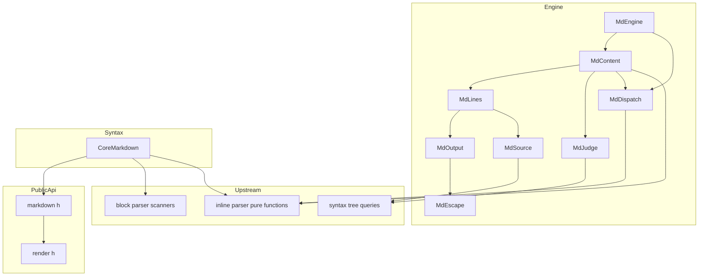
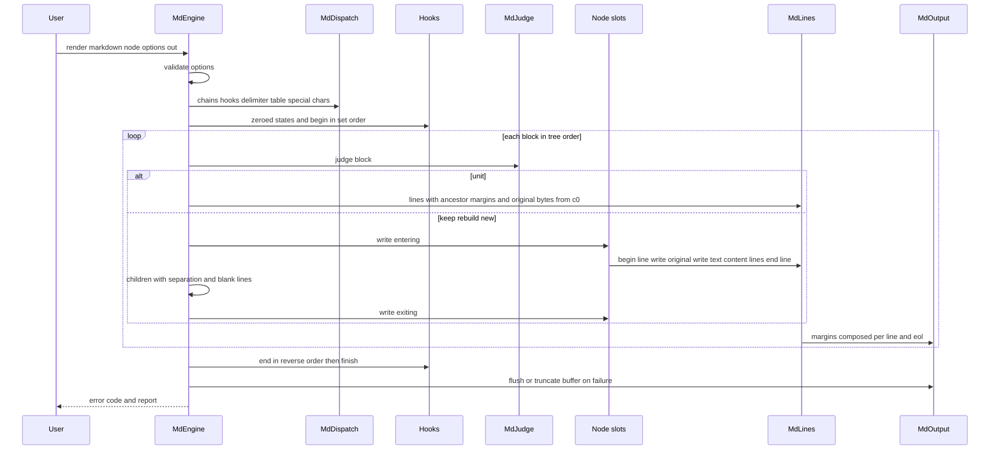
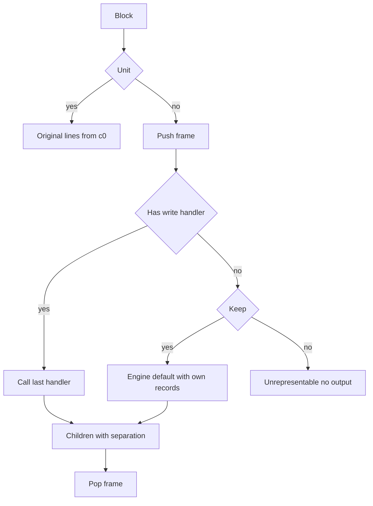
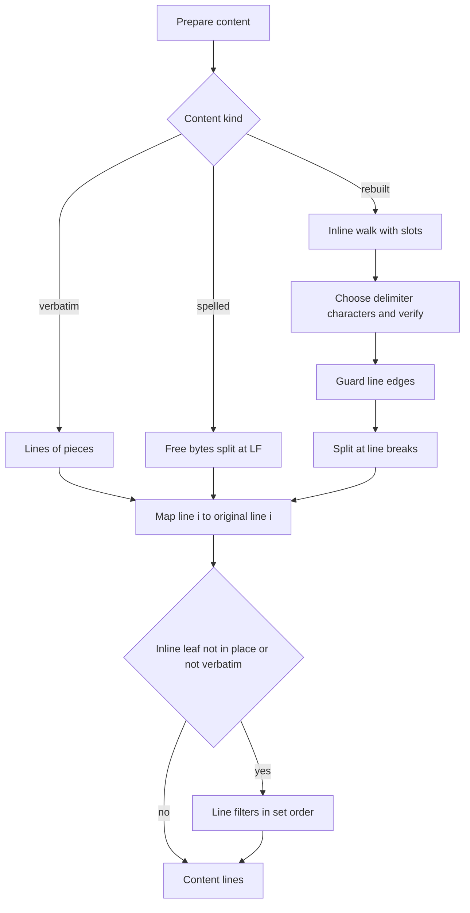
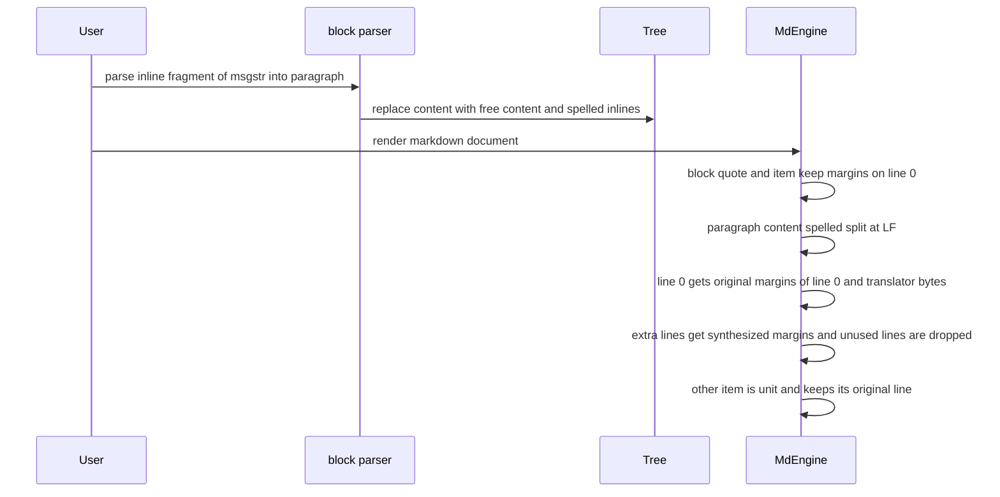
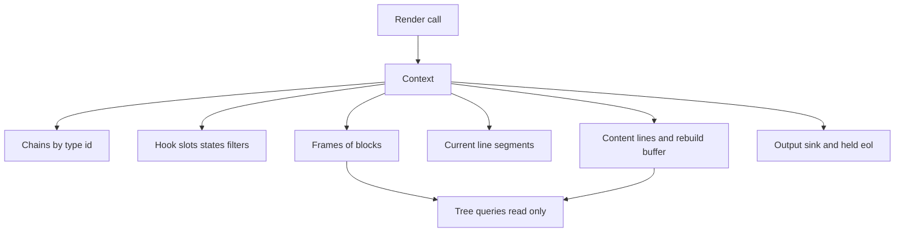

# Design Document: markdown-renderer

## Overview
**Purpose**：`markdown-renderer` は、`syntax-tree` の構文木（パースしたもの、編集したもの、手で組み立てたもの）を Markdown に書き戻す手段を、利用者と拡張の実装者に提供する。書き戻しは行の単位で進める。各出力の行で、祖先の帯、空行、葉自身の表記、中身を並べ、元の表記が残る部分は元のバイトを、残らない部分は style と値から合成したバイトを出す。どの部分に元の表記が残るかは、`syntax-tree` の問い合わせ（綴りの状態、帯の検索、中身と部分木を元の表記で出せるか、新しいノードか）だけで決め、編集の記録は使わない。

**Users**：
- 利用者（翻訳、po との相互変換、リンクの書き換えなどの編集ツールの開発者）は、出力の入口、新しいノードの表記のオプション、表現できない木の報告を使う。主な流れは msgstr の差し込みである。原文の段落の中身を、インラインの断片のパースで作った自由な中身と置き換え（`amark_block_replace_content`）、書き戻す。
- 拡張の実装者は、ノード型ごとの出力のスロット（種類 13）、前後のフックと中身の行のフィルタ（種類 14）、出力の文脈の API を使う。
- `block-parser` の CommonMark の構文セットの構築関数は `amark.core.markdown` を含め、`inline-parser` の GFM 相当の構文セットの補助は、この spec の検証用の部品を含める。

**Impact**：公開ヘッダ `markdown.h`、`src/render/` の Markdown のエンジン、`src/syntax/` の組み込みの Markdown 出力の構文拡張 `amark.core.markdown`、`tests/markdown/`、`fuzz/markdown_render_fuzz.c` を新しく作る。`block-parser` と `inline-parser` の拡張点に追記する。`syntax-tree`、`html-renderer`、`block-parser`、`inline-parser` の公開 API には何も足さない。前の版の design（構文トークンのヒープによる合流の MdSource、接頭辞の探索の MdLines、編集の状態の印の表）は引き継がない（research.md の「前の版の design を持ち込まない」）。

### Goals
- 無編集の文書の根を出力すると、入力とバイト単位で同じになる（BOM、タブ、改行の種類、遅延継続、NUL を含む）。根拠は `amark_node_verbatim` の判定だけである。
- 編集した木の出力を同じ構文セットで再パースすると、`amark_node_equal(AMARK_EQUAL_NORMALIZE_TEXT)` で編集後の木と等しい。表せない木は `AMARK_ERROR_UNREPRESENTABLE` と報告で知らせる。
- 元の表記で出せる部分木の行は、祖先の帯が元のまま出せる限り、元の行のまま出る。作り直すのは編集した葉の中身と、その前後の区切りだけである。
- msgstr の差し込みで、置き換えた段落は祖先の元の帯（i 行目は元の i 行目の帯）と翻訳者のバイトで出る。
- エンジンは個別のノード型を知らず、組み込みの 19 の型も拡張と同じ公開のスロットで出力する。
- 深さ 10 万の木を、スタックを深さに比例して使わずに出力する。

### Non-Goals
- 整形（編集していない部分の正規化）、必要最小限のエスケープ（オプションの選択肢を後で足す）
- パース、断片のパース、中身の置き換えの操作（`block-parser`、`inline-parser`、`syntax-tree`）
- 値の導出、参照の解決、タイトの導出、元の表記の判定（`syntax-tree`）
- 入れ子の出力（`html-renderer` の `render_subtree` に当たるもの）。要件がないので持たない（後で足せる）

## Boundary Commitments

### This Spec Owns
- 公開ヘッダ `include/amark/markdown.h`（オプション、報告、入口、スロットの構造体、出力の文脈の API、ユーティリティ、組み込みの構文拡張の取得）
- スロットの種類 `AMARK_SLOT_MARKDOWN_NODE`（13）と `AMARK_SLOT_MARKDOWN_HOOKS`（14）の意味と構造体（番号は `extension.h` にある）
- `src/render/` の Markdown のエンジンのすべて：判断の表、元の行の読み取り、行の組み立て（帯の決定と合成の呼び出し、タブの展開、改行）、中身の準備（元の部分、綴りの揃った自由な中身、作り直し）、エスケープと位置の保護、区切り文字の並びの決定、子の区切りとリストの空行、フックとフィルタ、報告
- 表現できない木の理由の分類（`AMARK_MARKDOWN_PROBLEM_*`）と報告の形
- 組み込みの Markdown 出力の構文拡張 `amark.core.markdown`（19 の型のスロット、前後のフックと行頭の保護のフィルタ）と、その実装 `src/syntax/md_*.c`
- `tests/markdown/` のテスト、テスト専用の Markdown の検証用の部品（`amark_test_markdown_gfm`）、編集の操作と検査の補助（`amark_test_markdown_edit`）、`fuzz/markdown_render_fuzz.c`

### Out of Boundary
- 行の表、帯、空行、表記、中身、トークンの形と検査、値と style、定義の索引、意味の比較、元の表記の判定（`syntax-tree`）。この spec は問い合わせるだけで、同じ判定を持たない。
- 記録の規約、区切り文字の規則と照合、文字の宣言、HTML ブロックと生の HTML とリンクの部品の走査（`block-parser`、`inline-parser`）。この spec は公開の関数を呼ぶだけである。
- CommonMark の構文セットの構築関数の本体（`block-parser`）と GFM 相当の構文セットの補助の本体（`inline-parser`）。この spec は拡張点に 1 行ずつ足すだけである。
- 検証用のノード型の登録（`html-renderer` の `amark_test_html_gfm` と `inline-parser` の `test.ext_autolink`）
- 出力先の型（`render.h`）、ケースの生成の手順（`gen_html_cases.cmake`、`gen_spec_examples.cmake`）、spec のデータと版の定義（`tests/spec/`）

### Allowed Dependencies
- `foundation`：公開 API（`export.h`、`error.h`、`allocator.h`、`buffer.h`、`utf8.h`）。内部 API（`base/allocator_internal.h` の `amark_size_add`・`amark_size_mul`、`base/buffer_internal.h`）は `src/render/` だけが使う。
- `syntax-tree` の公開 API：`node.h`、`document.h`（行の表、列とバイトの変換、既定の改行、ソースと BOM、`amark_label_normalize`）、`value.h`、`spelling.h`（帯、空行、表記、中身、トークンの読み取り、綴りの状態、判定、`amark_node_content_base`）、`extension.h`（スロットの列挙）。`src/tree/` の内部ヘッダは使わない。
- `inline-parser` の公開 API：`inline.h` の `amark_inline_delimiter_flanks`、`amark_inline_match_delimiters`、`amark_inline_special_chars`、`amark_inline_scan_raw_html`、区切り文字のスロットの構造体（`AMARK_SLOT_INLINE_DELIMITER`）。`src/render/md_dispatch.c`、`md_content.c` と `src/syntax/md_*.c` が使う。
- `block-parser` の公開 API：`scan.h` の `amark_scan_html_block_start`・`_end`、`amark_scan_link_label`・`_destination`、`commonmark.h` の役割の番号。`src/syntax/md_*.c` だけが使う。
- `src/render/` から `src/parse/` の公開の関数を呼ぶのは上の純粋な関数とスロットの構造体の読み取りだけで、内部ヘッダは使わない（`src/parse/` を include しない）。上流の spec が「書き戻しが使う」として公開したものである（research.md の「エンジンから区切り文字の照合を呼ぶ」）。
- `html-renderer` の公開 API：`render.h` の `amark_write_fn_t`
- テスト時：Naos、`amark_add_test`、`amark_add_generated_tests`、`amark_test_support`、`amark_test_tree`、`amark_test_parse`、`amark_test_inline`、`amark_test_html_gfm`、`amark_test_parse_gfm`、`amark_test_inline_gfm`、`tests/spec/spec_version.cmake` と `data/spec.txt`、`amark_add_fuzzer`
- 層の向き：`src/render/md_*.c` は `src/syntax/` を参照しない。`src/syntax/md_*.c` は公開ヘッダと `src/syntax/` の中の内部ヘッダ（`md_core.h`）だけを include する。公開ヘッダは他の公開ヘッダだけを include する。

### Revalidation Triggers
- `amark_markdown_node_slot_t` / `amark_markdown_hooks_slot_t` のフィールド、連鎖とフックとフィルタの順の規則 → 利用者の拡張、`amark_test_markdown_gfm`
- 出力の文脈の API の意味（行、元の列、中身の準備、区切り文字の並び、区切り、報告）→ 利用者の拡張、検証用の部品
- 判断の表（UNIT、KEEP、REBUILD、NEW と中身の 4 つの種類）の規則 → 拡張の出力の処理
- `AMARK_MARKDOWN_PROBLEM_*` の値 → 利用者
- `amark.core.markdown` の名前と取得関数 → `block-parser`（構築関数）、`inline-parser`（GFM 相当の構文セット）
- 上流からの見直し：`syntax-tree` の判定（`amark_node_verbatim`、`amark_block_content_verbatim`）、帯の印と遅延継続の列、空行の持ち主、タイトの導出、綴りを捨てる操作の値の保ち方。`block-parser` と `inline-parser` の記録の規約と役割の番号、区切り文字の照合と文字の宣言の関数。`html-renderer` の `render.h` とケースの形式。

## Architecture

### Existing Architecture Analysis
- `src/render/` と `src/syntax/` はまだない。`include/amark/amark.h` と `cmake/scripts/check_public_headers.cmake` は、正規の順の 5 番目の組として `markdown.h` の位置を持つ（組がないうちは飛ばされる）。
- `syntax-tree` は実装済みである。判定の関数はキャッシュを持ち、文書のすべてのノードの判定の合計がノードと記録の数に比例する。`amark_node_verbatim` は部分木の根の外の帯（c0 より左の列）を判定しない。`amark_block_content_verbatim` は配置済みの中身だけを真とする。
- 中身の置き換えの後の段落（`tests/tree/msgstr_flow_test.c`）は、行の範囲（元の行）と帯を保ち、自由な中身を持ち、インラインはすべての綴りを保つ（`complete`）が、`amark_node_verbatim` は偽である。この spec は、この状態を「綴りの揃った自由な中身」として扱う。
- 綴りを捨てた値（改行を含む text など）と、すべての綴りを捨てる操作が写す list の tight の上書きは、設定の関数の検査を通らない形でも残る（`syntax-tree` の Implementation Notes）。

### Architecture Pattern & Boundary Map
**Selected pattern**：スロット駆動の、行の単位の書き戻し。エンジンは文書の構文セットからスロットを集め、ブロックの木を反復でたどる。各ブロックを判断の表で分類し、元の行のまま出せる部分木はエンジンが元のバイトで出し、それ以外はノード型の出力の処理を呼ぶ。出力の処理は、行の開始と終わり、元の列の範囲、表記、中身の行を、出力の文脈の関数で書く。エンジンは帯を行ごとに決め、元の帯がなければコンテナの型の帯の合成の処理を呼ぶ。



**Dependency direction（`src/render/` の中）**：`md_escape.c` → `md_output.c` → `md_dispatch.c` → `md_source.c` → `md_judge.c` → `md_lines.c` → `md_content.c` → `md_render.c`。左のファイルは右のファイルの関数を呼ばない。`md_internal.h` は文脈の構造体とファイル間の内部関数の宣言を持つ。`src/syntax/md_blocks.c` と `md_inlines.c` → `md_core.c`。違反はレビューでエラーとする。

**Architecture Integration**：
- **境界**：判断の材料（綴りと帯の有無）は `syntax-tree`、構文の規則（区切り文字、HTML、リンクの部品）は `block-parser` と `inline-parser` の公開の関数が持つ。エンジンは「どこを元のバイトにし、どこを合成し、どう行に並べるか」だけを持つ。CommonMark の個別の型の表記の決め方は `amark.core.markdown` が持つ。
- **受け継ぐ形**：`html-renderer` のスロットの規約（2 種類のスロット、名前による型の指定、構文セットの順の連鎖と前の処理の呼び出し、子の省略、拡張ごとの状態、`begin` は順・`end` と `finish` は逆の順、不透明な文脈、2 つの入口）。Markdown に固有のもの（帯の合成、隣接の判断、行、中身、区切り文字、報告）は、スロットの任意の関数と文脈の API として足す。
- **Steering compliance**：C99、`amark_` / `AMARK_`、`AMARK_API`、不透明型、`struct_size`、アロケータの設定のほかにグローバルな可変状態なし、組み込みも公開 API だけを使う、開いた集合（理由の分類、行の印）は `#define`、閉じた集合（状態、中身の種類、帯の種類、空行の扱い、エスケープの方式）は `typedef enum`。

### 判断の表（状態の表）
エンジンは、ブロックと中身を、`syntax-tree` の問い合わせだけで次のように分類する（MdJudge）。`amark_markdown_judge` で出力の処理にも渡す。

| 状態 | 条件 | 出力 |
|---|---|---|
| UNIT | `amark_node_verbatim` が真、親が SHARE_LINES でない、行の範囲 R のすべての行で、出力中のすべての祖先のコンテナが元の帯を出せる（下の「元の帯を出せる」）。親の枠が TIGHT（list）なら、そのブロック（item）が子の間の空行の記録を持たない | エンジンが R の各行を「祖先の帯 ＋ 元の行の c0 から行の終わり」で出す。出力の処理は呼ばない |
| KEEP | UNIT でなく、`amark_node_spelling_state` の `has_spelling` が真で `complete` が真 | 出力の処理（なければエンジンの既定）が、残った帯と表記を使い、子と中身を出す |
| REBUILD | 綴りを持ち、`complete` が偽（項目の綴りか構造の綴りを捨てた） | 出力の処理が、残った綴りのうち使えるものと、style と値から合成する |
| NEW | `amark_node_is_new` が真 | 出力の処理が、style（未設定ならオプション）と値から合成する |

| 中身の種類 | 条件 | 中身の行 |
|---|---|---|
| VERBATIM | `amark_block_content_verbatim` が真で、作り直しを求められていない | 元の部分（仮想の改行で分けた中身。i 行目は i 番目の部分の行） |
| SPELLED | 中身が自由で、子孫のインラインがすべて `complete` でトークンを持ち、トークンの土台がこの葉の今の中身で（`amark_node_content_base` の `is_own_leaf_content`）、トークンが中身をちょうど 1 回、入れ子の順に覆う | 中身のバイト（LF で分けた行。i 行目は行の範囲の i 番目の行） |
| REBUILT | ほかのすべて（インラインを持たない葉では、値の設定で中身が自由になった場合を含む） | インラインを持つ葉はインラインの CST から作り直す。持たない葉は中身のバイトを LF で分ける |
| NONE | 中身がない | なし |

- **元の帯を出せる**：祖先のコンテナ A が行 L で元の帯を出せるのは、次のすべてが成り立つときである。
  - A が構造の綴りを捨てておらず（`structure_dropped` が偽）、`amark_block_find_margin(A, L)` が帯を返す。
  - 帯が `AMARK_MARGIN_FIRST` なら、L が A の最初の出力の行である。A の最初の出力の行に使える元の帯は、`FIRST` の帯か、A が `FIRST` の帯を 1 つも持たないときのその行の帯である（項目の記号の行が重ならないため）。
  - 帯が LAZY なら、L がインラインを持つ葉の 2 行目以降の中身の行として出力される（UNIT の部分木の行では、部分木も祖先の帯も元のままなので常に成り立つ）。
- **c0**：UNIT の部分木の行 L の始まりの列は、出力中の一番内側の祖先のコンテナの L の帯の終わりの列（なければ 0）とする。部分木の根を出力するときの根の祖先の帯も、同じ規則で除く（1.8）。
- **作り直しを求められた葉**：`amark.core.markdown` の `begin` のフックが、`amark_markdown_force_rebuild` で指定する（3.8）。
- 判定は `syntax-tree` のキャッシュを使うので、文書のすべてのブロックと葉の判断の合計は、ノードと記録の数に比例する。祖先の帯の条件の確かめは、行の数と深さの積に比例する。

### 組み込みの Markdown 出力の登録の規則
1. 組み込みの 19 のノード型の Markdown の出力の処理は、`src/syntax/md_blocks.c`（ブロックの 10 型）と `src/syntax/md_inlines.c`（インラインの 9 型）に実装し、`src/syntax/md_core.c` の構文拡張 `amark.core.markdown` のスロットとしてだけ登録する。
2. `amark.core.markdown` はノード型とパースのスロットを持たず、`AMARK_SLOT_MARKDOWN_NODE` のスロット 19 と、`AMARK_SLOT_MARKDOWN_HOOKS` のスロット 1（文字の宣言、定義の確かめ、行頭の保護のフィルタ）を持つ。公開の `amark_markdown_core_extension()` で取得する。
3. `commonmark.*` 拡張は Markdown のスロットを持たない。
4. `block-parser` の構築関数の出力の拡張の表に、`amark.core.html` の後に `amark.core.markdown` を 1 行足す（`block-parser` の Downstream Extension Point）。
5. 自分で構文セットを作る利用者は `amark.core.markdown` を追加する。追加しなければ、組み込みの型は出力の処理を持たない型になる（10.3）。
6. 差し替える利用者は、`amark.core.markdown` より後に同じ型のスロットを持つ構文拡張を追加する（10.4）。

### Technology Stack

| Layer | Choice / Version | Role in Feature | Notes |
|-------|------------------|-----------------|-------|
| Language | C99 | ライブラリ、テスト、ファジング | `amark_target_defaults()` |
| Base | `foundation`（error、allocator、buffer、utf8） | 確保、出力の組み立て | 新しい依存なし |
| Tree | `syntax-tree`（node、document、value、spelling、extension） | 判断、元の行、値、style | 公開 API だけ |
| Syntax rules | `inline-parser`（`inline.h`）、`block-parser`（`scan.h`） | 区切り文字の照合、文字の宣言、HTML とリンクの部品の判定 | 公開 API だけ |
| Reference | CommonMark 0.31.2、cmark 0.31.1 | 再パースの規則の基準 | コードは取り込まない |
| Test | Naos v0.4.0、上流のテストの補助と生成の手順 | 往復と意味の保存のプロパティテスト | `amark_test_markdown_gfm`、`amark_test_markdown_edit` を追加 |
| Fuzz | `amark_add_fuzzer` | 入力と編集の操作列 | `fuzz/markdown_render_fuzz.c` |

## File Structure Plan

### Directory Structure
```
include/amark/
└── markdown.h              # MarkdownApi：オプション、報告、入口、スロット、文脈の API、ユーティリティ、amark_markdown_core_extension()
src/render/
├── md_internal.h           # struct amark_markdown_context、枠、行と中身のバッファ、並び、ファイル間の内部関数の宣言
├── md_escape.c             # MdEscape：エスケープと文字参照（文脈を使わない）
├── md_output.c             # MdOutput：出力先、中継のバッファ、最初の失敗、BOM、改行の保留（CR と LF の結合の回避）
├── md_dispatch.c           # MdDispatch：スロットの検査、型ごとの連鎖、フックとフィルタの一覧、区切り文字の表、エスケープする文字
├── md_source.c             # MdSource：元の行の読み取り（列の範囲のバイト、タブの途中、葉の行の対応、ブロックの記録の列）
├── md_judge.c              # MdJudge：判断の表、綴りの揃った自由な中身の確かめ、祖先の帯の条件
├── md_lines.c              # MdLines：祖先の枠、行の組み立て、帯の決定と合成の呼び出し、記号だけの行、タブの展開、改行
├── md_content.c            # MdContent：中身の準備、インラインのたどり、エスケープと端の保護、区切り文字の並びの決定、フィルタ
└── md_render.c             # MdEngine：入口、オプションの検査、ブロックのたどり、子の区切り、空行、フック、報告
src/syntax/
├── md_core.h               # 19 のスロットの extern 宣言、値と style を読む補助（src/syntax/md_*.c だけが使う）
├── md_core.c               # amark.core.markdown の表、amark_markdown_core_extension()、フック（文字の宣言、定義の確かめ、行頭の保護）
├── md_blocks.c             # document、block_quote、list、item、code_block、html_block、paragraph、heading、thematic_break、link_definition
└── md_inlines.c            # text、softbreak、linebreak、code、html_inline、emph、strong、link、image
tests/markdown/
├── CMakeLists.txt          # テストの登録、amark_test_markdown_gfm と amark_test_markdown_edit（INTERFACE、Naos なし）、生成テスト
├── support/
│   ├── md_test_support.h   # 構文セットと文書の用意、出力の照合、生成テストの検査の関数（Naos）
│   ├── md_test_support.c
│   ├── md_edits.h          # MdEdits：決まった編集の操作、意味の保存と局所性の検査（Naos なし）
│   ├── md_edits.c
│   ├── gfm_md_ext.h        # GfmMdExt：GFM 相当の Markdown の部品の拡張の取得関数
│   └── gfm_md_ext.c
├── data/new_block_cases.txt    # 新しいブロックの S 式と期待する Markdown（gen_html_cases の形式）
├── data/new_inline_cases.txt   # 新しいインラインと値の S 式と期待する Markdown
├── data/roundtrip_cases.txt    # 往復の入力（spec の例の形式。期待値は入力と同じ）
├── data/edit_cases.txt         # 編集の操作と期待する出力（spec の例の形式）
├── data/gfm_cases.txt          # GFM 相当の往復と編集
├── output_test.c           # MdOutput（INTERNAL）
├── dispatch_test.c         # MdDispatch（INTERNAL）
├── lines_test.c            # MdSource と MdLines（INTERNAL）：帯の決定、遅延継続、記号だけの行、タブの展開、改行
├── content_test.c          # MdContent（INTERNAL）：中身の 4 つの種類、エスケープと端の保護、区切り文字の決定
├── escape_test.c           # ユーティリティ
├── render_entry_test.c     # 入口、出力先、失敗、決定性、部分木、木を変えないこと
├── options_test.c          # オプションの検査と新しいノードの表記
├── slot_test.c             # 登録、連鎖、write_next、処理のない型、不正なスロット、amark.core.markdown の有無と差し替え
├── context_test.c          # 文脈の API の契約と誤用
├── hooks_filter_test.c     # 前後のフック、状態、フィルタ、文字の宣言、作り直しの指定
├── msgstr_test.c           # msgstr の差し込みの流れ（6.1–6.6）
├── separation_test.c       # 子の区切り、リストの空行、タイトの上書き、移動、削除、挿入
├── unrepresentable_test.c  # 表現できない木の報告
├── gfm_md_test.c           # GFM 相当の部品
├── oom_test.c              # 確保の失敗の総当たり
└── scale_test.c            # 深い木、計算量
fuzz/
├── markdown_render_fuzz.c  # 入力と編集の操作列から出力し、再パースで確かめる
└── corpus/markdown_render/ # 種
```

### Modified Files
- `include/amark/amark.h` — 5 番目の組（Markdown output）に `markdown.h` を含める。
- `src/CMakeLists.txt` — `src/render/md_*.c` と `src/syntax/md_*.c` をライブラリのソースに足す。
- `src/syntax/commonmark.c`（`block-parser` の Downstream Extension Point）— 出力の拡張の表の `amark_html_core_extension()` の後に `amark_markdown_core_extension()` を 1 行足す。`tests/syntax/commonmark_set_test.c` が出力の拡張の数か順を数えているなら、期待値に 1 つ足す。
- `tests/inline/support/gfm_inline_ext.c`（`inline-parser` の Downstream Extension Point）— `amark_test_gfm_set_create` の末尾で、Markdown の部品の拡張（`gfm_md_ext.h`）を足す。
- `tests/inline/CMakeLists.txt` — `amark_test_inline_gfm` が `amark_test_markdown_gfm` に依存する。
- `tests/CMakeLists.txt` — `add_subdirectory(markdown)`（`AMARK_FUZZ` だけの構成でも INTERFACE の部品を定義するので条件なし。Naos を使うターゲットは中で `AMARK_BUILD_TESTS` のときだけ）。`inline` より前に置く。
- `tests/headers/cxx_include_test.cpp` — `markdown.h` の関数を呼ぶ。
- `fuzz/CMakeLists.txt` — `amark_add_fuzzer(markdown_render SOURCES markdown_render_fuzz.c CORPUS corpus/markdown_render LIBRARIES amark_test_markdown_edit amark_test_inline_gfm amark_test_parse_gfm amark_test_html_gfm amark_test_markdown_gfm)`。

## System Flows

### 1 回の出力

- 失敗したら、たどりを止めて `end` を呼ばずに `finish` を呼び、バッファを呼び出し前の長さに戻す。表現できない木は `AMARK_ERROR_UNREPRESENTABLE` で同じ経路をたどり、報告先があれば最初の報告を書く。

### ブロックの判断


### 中身の準備


### msgstr の差し込みの書き戻し


## Requirements Traceability

| Requirement | Summary | Components | Interfaces | Flows |
|-------------|---------|------------|------------|-------|
| 1.1, 1.8 | 部分木の出力（インラインの根を含む）、根の祖先の帯を除く | MdEngine, MdJudge, MdContent | `amark_render_markdown`、c0 の規則 | 1 回の出力 |
| 1.2, 1.3, 1.4, 1.5 | 出力先と失敗 | MdOutput, MdEngine | `amark_buffer_t`、`amark_write_fn_t` | 1 回の出力 |
| 1.6, 1.7 | 木を変えない、決定性 | MdEngine | const のノード、読み取りの問い合わせ | — |
| 2.1, 2.2, 2.3, 2.4 | 無編集の往復 | MdJudge, MdLines, MdSource, MdOutput | UNIT、`amark_node_verbatim`、元の帯 | ブロックの判断 |
| 2.5 | BOM | MdOutput | `amark_document_source_data` | — |
| 3.1 | 意味の保存 | MdContent, MdEngine, CoreMarkdown | 判断の表、作り直し | 中身の準備 |
| 3.2, 3.3 | エスケープ、残った値 | MdContent, MdEscape, CoreMarkdown | `amark_markdown_write_text`、`_write_char_ref` | 中身の準備 |
| 3.4 | 区切り文字の並び | MdContent, MdDispatch | `amark_markdown_write_run`、`_scope` | 中身の準備 |
| 3.5 | 区切りの選び方 | CoreMarkdown | 出力の表 | — |
| 3.6 | ブロックの区切り | MdEngine, CoreMarkdown | 子の区切りの規則、`follow` | — |
| 3.7, 3.8 | 参照と定義 | CoreMarkdown, MdJudge | `amark_markdown_force_rebuild`、`amark_markdown_guard_next` | — |
| 3.9 | タイト | MdEngine, CoreMarkdown | `amark_markdown_set_spacing` | — |
| 3.10 | 遅延継続に頼った行 | MdContent, CoreMarkdown | 行頭の保護のフィルタ | 中身の準備 |
| 4.1, 4.2, 4.3, 4.4 | 表現できない木 | MdEngine, CoreMarkdown | `amark_markdown_report_t`、`amark_markdown_unrepresentable` | 1 回の出力 |
| 5.1 | UNIT の行 | MdJudge, MdLines | UNIT と元の帯の条件 | ブロックの判断 |
| 5.2, 5.4 | 葉の中だけの作り直し | MdContent | 中身の種類 | 中身の準備 |
| 5.3 | 残った綴りの再利用 | CoreMarkdown, MdLines | KEEP、REBUILD、`amark_markdown_write_original`、`_write_spelling` | — |
| 5.5 | style に従う | CoreMarkdown | 出力の表 | — |
| 6.1, 6.2, 6.3, 6.4 | msgstr の差し込み | MdContent, MdLines, MdJudge | SPELLED、行の対応 | msgstr |
| 6.5 | 翻訳者のバイトの保護 | MdContent, CoreMarkdown | フィルタ、`force_rebuild` | 中身の準備 |
| 6.6 | 置き換えていない部分 | MdJudge | UNIT | msgstr |
| 7.1, 7.2, 7.3 | 新しいノードの表記 | CoreMarkdown, MdEngine | `amark_markdown_styles_t` | — |
| 7.4 | 既定の改行 | MdOutput | `amark_document_default_eol` | — |
| 7.5, 7.6 | オプションの検査、エスケープの方式 | MdEngine | `amark_markdown_options_t` | 1 回の出力 |
| 8.1, 8.2, 8.3, 8.7 | 帯の決定 | MdLines, MdJudge | 元の帯の条件、`margin` | — |
| 8.4 | タブの展開 | MdLines, MdSource | 元の範囲の連結 | — |
| 8.5, 8.6 | 合成する帯 | CoreMarkdown, MdLines | `amark_markdown_margin_kind_t`、`marker_only` | — |
| 8.8, 8.9 | 改行 | MdOutput | 改行の保留 | — |
| 9.1, 9.2, 9.3, 9.4 | スロット | MdDispatch, MdEngine | `amark_markdown_node_slot_t`、`amark_markdown_write_next` | ブロックの判断 |
| 9.5 | フック、状態、フィルタ | MdDispatch, MdEngine, MdContent | `amark_markdown_hooks_slot_t` | 1 回の出力 |
| 9.6 | 文脈の API | MdLines, MdContent, MdEngine | 文脈の関数 | — |
| 9.7 | 文字の宣言と行頭の保護 | MdDispatch, MdContent | `amark_markdown_declare_special`、`filter` | 中身の準備 |
| 9.8 | HTML と揃える | MarkdownApi | 規約 | — |
| 10.1, 10.2, 10.3, 10.4 | 組み込みの出力 | CoreMarkdown, MdDispatch | `amark_markdown_core_extension`、登録の規則 | — |
| 11.1, 11.2, 11.3, 11.4 | GFM 相当 | GfmMdExt, MdTests | 公開のスロット | — |
| 12.1, 12.2, 12.3, 12.4, 12.5 | プロパティテスト | MdTestSupport, MdEdits, MdTests, MdFuzz | 生成テスト | — |
| 13.1 | 規約 | MarkdownApi と全コンポーネント | `struct_size`、不透明型 | — |
| 13.2 | アロケータ | 全コンポーネント | `amark_malloc` | — |
| 13.3 | 深い木 | MdEngine, MdContent | 反復のたどり、枠の配列 | — |
| 13.4 | 計算量 | 全コンポーネント | 判定のキャッシュ、行ごとの帯 | — |
| 13.5 | NUL と不正な UTF-8 | MdEscape, MdContent | バイトを変えない書き出し | — |

## Components and Interfaces

| Component | Domain/Layer | Intent | Req Coverage | Key Dependencies (P0/P1) | Contracts |
|-----------|--------------|--------|--------------|--------------------------|-----------|
| MarkdownApi | Public headers | 公開の型と関数 | 9.8, 13.1 | extension.h (P0), render.h (P0) | Service |
| MdEscape | Render | エスケープと文字参照 | 3.2, 13.5 | buffer (P0) | Service |
| MdOutput | Render | 出力先、BOM、改行 | 1.2–1.5, 2.5, 7.4, 8.8, 8.9 | buffer (P0), line table (P0) | Service, State |
| MdDispatch | Render | スロットと区切り文字と文字の表 | 9.1–9.5, 9.7, 10.3, 10.4 | syntax set (P0), inline.h (P0) | Service |
| MdSource | Render | 元の行の読み取り | 2.2, 8.4 | spelling.h (P0), document.h (P0) | Service |
| MdJudge | Render | 判断の表 | 2.1, 2.3, 2.4, 5.1, 6.6 | spelling.h (P0) | Service |
| MdLines | Render | 行の組み立てと帯 | 2.4, 8.1–8.7 | MdSource (P0), MdOutput (P0) | Service, State |
| MdContent | Render | 中身の準備と作り直し | 3.1–3.4, 3.10, 5.2, 5.4, 6.1–6.5, 9.6, 9.7 | MdLines (P0), MdJudge (P0), inline.h (P0) | Service, State |
| MdEngine | Render | 入口、たどり、区切り、フック、報告 | 1.1, 1.5–1.8, 3.6, 3.9, 4.1–4.4, 7.5, 7.6, 9.2, 9.5, 13.2–13.4 | すべて (P0) | Service, State |
| CoreMarkdown | Syntax | `amark.core.markdown` と 19 の型 | 3.2–3.10, 4.1, 5.3, 5.5, 7.1–7.3, 8.5, 8.6, 10.1, 10.2 | markdown.h (P0), scan.h (P1), inline.h (P1) | Service |
| MdTestSupport | Test | 照合と生成テストの検査 | 12.1–12.3, 12.5 | 上流のテストの補助 (P0) | Service |
| MdEdits | Test | 編集の操作と検査 | 12.2–12.4 | 公開 API (P0) | Service |
| GfmMdExt | Test | GFM 相当の Markdown の部品 | 11.1–11.4 | markdown.h (P0), gfm_html_ext.h (P0) | Service |
| MdTests / MdFuzz | Test / Fuzz | 要件の検証 | 全要件 | MdTestSupport (P0) | Batch |

### 共通の規約
- 失敗しうる関数は `amark_error_t` を返し、結果を出力引数で返す。必須の引数が NULL なら `AMARK_ERROR_INVALID_ARGUMENT`。
- 公開の構造体は先頭に `size_t struct_size` を持つ（スロットは `amark_slot_t` の `struct_size`）。最初の版の最小の大きさより小さければ不正な引数とし、知らない末尾のフィールドは読まない。
- 出力の文脈は、出力の処理、帯の合成、隣接の判断、フック、フィルタの呼び出しの間だけ有効である。文書は同時に 1 つのスレッドだけが使う（出力も値の問い合わせでキャッシュを書く）。この規約を `markdown.h` の冒頭のコメントに書く。

### Public headers

#### MarkdownApi

| Field | Detail |
|-------|--------|
| Intent | 公開の型、関数、定数を、依存の順に宣言する |
| Requirements | 9.8, 13.1 |

**Responsibilities & Constraints**
- `markdown.h` は `node.h`、`buffer.h`、`extension.h`、`render.h` を include し、`AMARK_BEGIN_DECLS` / `AMARK_END_DECLS` で囲む。ガードは `AMARK_MARKDOWN_H`。
- 入口と出力先の形は `html-renderer` と同じ（`amark_render_<format>` と `_to`）。

**Contracts**: Service [x]
```c
/* include/amark/markdown.h */
typedef struct amark_markdown_context amark_markdown_context_t;   /* 不透明。呼び出しの間だけ有効 */

/* 表現できない理由の分類（開いた集合） */
#define AMARK_MARKDOWN_PROBLEM_NO_OUTPUT  1u   /* 元の表記で出せない型に出力の処理がない */
#define AMARK_MARKDOWN_PROBLEM_EMPTY      2u   /* 空では表せない（段落、コード、強調、HTML） */
#define AMARK_MARKDOWN_PROBLEM_NESTING    3u   /* その位置に置けない（リンクの中のリンク、末尾の改行、ATX の中の改行） */
#define AMARK_MARKDOWN_PROBLEM_LITERAL    4u   /* リテラルが構文として成り立たない（HTML ブロック、生の HTML、保護できない行頭） */
#define AMARK_MARKDOWN_PROBLEM_DELIMITER  5u   /* 区切り文字の並びが意図した対にならない */
#define AMARK_MARKDOWN_PROBLEM_ADJACENT   6u   /* 隣と区別できない（空行なしのタイトな文脈、隣り合うコードスパン） */
#define AMARK_MARKDOWN_PROBLEM_UNRESOLVED 7u   /* 参照の形のリンクが定義で解決できない */
#define AMARK_MARKDOWN_PROBLEM_ATTRIBUTE  8u   /* 値の組み合わせを表せない（ルーズにできないリスト） */
#define AMARK_MARKDOWN_PROBLEM_EXTENSION_FIRST 0x100u   /* これ以上は拡張が定める */

typedef struct amark_markdown_report
{
    size_t struct_size;
    const amark_node_t *node;      /* 原因のノード */
    uint32_t problem;              /* AMARK_MARKDOWN_PROBLEM_* */
} amark_markdown_report_t;

/* エスケープの方式。0 は保守的な方式。後の版で選択肢を足す */
typedef enum amark_markdown_escape
{
    AMARK_MARKDOWN_ESCAPE_CONSERVATIVE = 0
} amark_markdown_escape_t;

/* 新しいノードと style が未設定のノードの表記。0 は既定、それ以外は value.h の列挙の値 */
typedef struct amark_markdown_styles
{
    int32_t list_bullet;           /* AMARK_LIST_BULLET_*（既定 DASH） */
    int32_t list_delimiter;        /* AMARK_LIST_DELIMITER_*（既定 PERIOD） */
    int32_t emph_delimiter;        /* AMARK_EMPH_DELIMITER_*（既定 ASTERISK） */
    int32_t strong_delimiter;      /* AMARK_STRONG_DELIMITER_*（既定 ASTERISK） */
    int32_t code_block_form;       /* AMARK_CODE_BLOCK_FORM_*（既定 FENCED） */
    int32_t fence_char;            /* AMARK_CODE_BLOCK_FENCE_CHAR_*（既定 BACKTICK） */
    int32_t fence_length;          /* 0 は 3。3–100 */
    int32_t heading_form;          /* AMARK_HEADING_FORM_*（既定 ATX） */
    int32_t thematic_break_char;   /* AMARK_THEMATIC_BREAK_CHAR_*（既定 ASTERISK） */
    int32_t thematic_break_count;  /* 0 は 3。3–100 */
    bool thematic_break_spaced;    /* 既定 false */
    int32_t linebreak_form;        /* AMARK_LINEBREAK_FORM_*（既定 BACKSLASH） */
    int32_t title_quote;           /* AMARK_LINK_TITLE_QUOTE_*（既定 DOUBLE） */
} amark_markdown_styles_t;

typedef struct amark_markdown_options
{
    size_t struct_size;
    uint32_t flags;                     /* 予約。0 以外は不正な引数 */
    amark_markdown_escape_t escape;
    amark_markdown_styles_t styles;
    amark_markdown_report_t *report;    /* NULL 可。表現できないときに書く（struct_size は呼び出し側） */
} amark_markdown_options_t;

AMARK_API void amark_markdown_options_init(amark_markdown_options_t *options);
AMARK_API amark_error_t amark_render_markdown(const amark_node_t *node, const amark_markdown_options_t *options,
                                              amark_buffer_t *out);
AMARK_API amark_error_t amark_render_markdown_to(const amark_node_t *node, const amark_markdown_options_t *options,
                                                 amark_write_fn_t write, void *user_data);
AMARK_API const amark_extension_t *amark_markdown_core_extension(void);  /* "amark.core.markdown"。静的 */
```
- スロットと文脈の API は、MdDispatch、MdLines、MdContent、MdEngine の各節に示す（すべて `markdown.h` で宣言する）。

### Render

#### MdEscape

| Field | Detail |
|-------|--------|
| Intent | 文脈を使わないエスケープと文字参照 |
| Requirements | 3.2, 13.5 |

**Responsibilities & Constraints**
- `amark_markdown_escape`：`characters`（NUL で終わる ASCII の句読点の列）に含まれるバイトの前に `\` を置き、LF を `&#10;`、CR を `&#13;` にする。ほかのバイト（NUL、不正な UTF-8 を含む）はそのまま。
- `amark_markdown_char_ref`：符号位置を 10 進の `&#N;` で足す（0、サロゲート、0x10FFFF を超える値は不正な引数）。数の書式は内部の 10 進の変換で書く。
- 失敗したら出力のバッファを呼び出し前の長さに戻す。

**Contracts**: Service [x]
```c
AMARK_API amark_error_t amark_markdown_escape(amark_buffer_t *out, const char *data, size_t length,
                                              const char *characters);
AMARK_API amark_error_t amark_markdown_char_ref(amark_buffer_t *out, uint32_t codepoint);
```
- 内部の契約（`md_internal.h`）：`bool amark_md_is_ascii_punct(unsigned char c)`、`size_t amark_md_write_decimal(char *buffer, uint32_t value)`。

#### MdOutput

| Field | Detail |
|-------|--------|
| Intent | 出力先への書き出し、BOM、改行の保留、最初の失敗 |
| Requirements | 1.2–1.5, 2.5, 7.4, 8.8, 8.9 |

**Responsibilities & Constraints**
- 出力先：バッファは開始時の長さを記録して直接追加し、失敗で終われば `amark_buffer_truncate` で戻す。書き出しの関数は 8 KiB の中継のバッファにため、超えたら渡し、終わりに残りを渡す。最初の失敗を保持し、以後は何もせずにその失敗を返す。
- BOM：出力の根が文書のノードで、行の表の行 0 のソースが BOM を持てば（`amark_document_source_data`）、最初に EF BB BF を書く（2.5）。
- 改行：行の終わりの改行は、次の行の始まりまで保留する。
  - 元の行の改行はその種類（LF、CRLF、CR）、新しい行の改行は `amark_document_default_eol`（7.4）。
  - 保留した改行が CR で、次の行が空で LF で終わるなら、保留した改行を CRLF にする（8.8）。
  - 元の改行が NONE の行の後に行が続くなら、既定の改行にする。出力の最後の行の NONE はそのまま（8.9）。
- 内部の契約：`amark_md_output_init(ctx, buffer | write)`、`amark_md_output_bytes(ctx, data, length)`、`amark_md_output_eol(ctx, line)`、`amark_md_output_finish(ctx, error)`。

#### MdDispatch

| Field | Detail |
|-------|--------|
| Intent | 構文セットのスロットを検査し、型ごとの連鎖、フックとフィルタ、区切り文字の表、エスケープする文字を作る |
| Requirements | 9.1–9.5, 9.7, 10.3, 10.4 |

**Responsibilities & Constraints**
- `AMARK_SLOT_MARKDOWN_NODE` を構文セットの順に列挙し、検査する：`struct_size` が最小以上、`node_type` と `write` が NULL でない、`amark_syntax_set_find_node_type` で型が見つかる。違反は `AMARK_ERROR_INVALID_ARGUMENT` で何も出力しない（9.4）。
- 連鎖の表：型の識別子で引く配列。`write` の連鎖（構文セットの順）と、`margin` と `follow` を持つものの最後。
- `AMARK_SLOT_MARKDOWN_HOOKS` を構文セットの順に列挙し、検査する：大きさ、`state_size` が `AMARK_MARKDOWN_MAX_STATE_SIZE` 以下、1 つの拡張に 2 つ以上ない。`filter` を持つものを順に並べる。
- 区切り文字の表：`AMARK_SLOT_INLINE_DELIMITER` のスロットから、文字ごとの flanking と規則（同じ文字は構文セットの後のもの）。
- エスケープする文字：`begin` のフックが `amark_markdown_declare_special` で宣言した文字の和。`amark.core.markdown` の `begin` は `amark_inline_special_chars(set, NULL)` の文字を宣言する。

**Contracts**: Service [x]
```c
typedef amark_error_t (*amark_markdown_write_fn_t)(amark_markdown_context_t *ctx, const amark_node_t *node,
                                                   bool entering, void *user_data);

typedef enum amark_markdown_margin_kind
{
    AMARK_MARKDOWN_MARGIN_FIRST = 1,         /* コンテナの最初の出力の行 */
    AMARK_MARKDOWN_MARGIN_CONTINUATION = 2,  /* 続く行 */
    AMARK_MARKDOWN_MARGIN_BLANK = 3,         /* 空の空行 */
    AMARK_MARKDOWN_MARGIN_BLANK_SPACE = 4    /* 空白だけの空行 */
} amark_markdown_margin_kind_t;

/* 帯を合成して amark_markdown_write で書く。rest はその帯より右に出す行のバイト。
 * *marker_only を真にすると、エンジンは帯だけの行を出し、rest を続く行の帯の後に置く（FIRST のときだけ） */
typedef amark_error_t (*amark_markdown_margin_fn_t)(amark_markdown_context_t *ctx, const amark_node_t *container,
                                                    amark_markdown_margin_kind_t kind, const char *rest,
                                                    size_t rest_length, bool *marker_only, void *user_data);

/* node を previous の直後に空行なしで置いても、どちらの意味も変わらないか */
typedef amark_error_t (*amark_markdown_follow_fn_t)(amark_markdown_context_t *ctx, const amark_node_t *node,
                                                    const amark_node_t *previous, bool *direct, void *user_data);

typedef struct amark_markdown_node_slot
{
    amark_slot_t base;                      /* kind = AMARK_SLOT_MARKDOWN_NODE */
    const char *node_type;                  /* ノード型の名前 */
    amark_markdown_write_fn_t write;        /* 必須。入るときと出るときに呼ぶ */
    amark_markdown_margin_fn_t margin;      /* 任意。MARGINS の型の帯の合成 */
    amark_markdown_follow_fn_t follow;      /* 任意。ないときは空行が要るとみなす */
    void *user_data;
} amark_markdown_node_slot_t;

#define AMARK_MARKDOWN_MAX_STATE_SIZE 65536u

typedef enum amark_markdown_line_kind
{
    AMARK_MARKDOWN_LINE_FIRST = 1,          /* 葉の中身の最初の行 */
    AMARK_MARKDOWN_LINE_CONTINUATION = 2
} amark_markdown_line_kind_t;

typedef struct amark_markdown_hooks_slot
{
    amark_slot_t base;                      /* kind = AMARK_SLOT_MARKDOWN_HOOKS */
    size_t state_size;
    amark_error_t (*begin)(amark_markdown_context_t *ctx, void *state, void *user_data);
    amark_error_t (*end)(amark_markdown_context_t *ctx, void *state, void *user_data);
    void (*finish)(amark_markdown_context_t *ctx, void *state, void *user_data);
    /* 中身の行のフィルタ。amark_markdown_filter_forward で次へ渡す。渡さなければ行は空になり、
     * MdContent の空の行の規則で報告される */
    amark_error_t (*filter)(amark_markdown_context_t *ctx, void *state, amark_markdown_line_kind_t kind,
                            const char *data, size_t length, void *user_data);
    void *user_data;
} amark_markdown_hooks_slot_t;

AMARK_API amark_error_t amark_markdown_declare_special(amark_markdown_context_t *ctx, const char *characters);
```
- 内部の契約：`amark_md_dispatch_init(ctx, set)`、`amark_md_dispatch_deinit(ctx)`、`amark_md_chain_of(ctx, type)`、`amark_md_delimiter_of(ctx, c, &flanking, &rule)`、`amark_md_is_special(ctx, c)`。

#### MdSource

| Field | Detail |
|-------|--------|
| Intent | 元の行のバイトと、ブロックの記録の列の読み取り |
| Requirements | 2.2, 8.4 |

**Responsibilities & Constraints**
- 元の範囲：行 L の列 `[s, e)` を、`amark_document_column_to_byte` でバイトに変える。始まりがタブの途中なら、そのタブの残りの列を空白にし、終わりがタブの途中なら、そのタブの中の列を空白にする。それ以外はバイトのまま。
- 葉の行の対応：中身を持つ葉について、中身を持つ元の行の列（部分のある行。配置済みでなければ行の範囲の行）と、中身を持たない表記だけの行（setext の下線、フェンスの行）を返す。
- 記録の列：ブロックの行 L の上のレイアウトのトークンと中身の部分を、列の順に返す（`amark_block_token_at`、`amark_block_content_piece_at` を行の順の添字で進める。葉ごとに 1 回の走査）。
- 確保をしない（呼び出し側の作業領域を使う）。

**Contracts**: Service [x]（内部）
```c
amark_error_t amark_md_source_range(ctx, amark_line_id_t line, uint32_t start, uint32_t end, amark_md_range_t *out);
amark_error_t amark_md_source_leaf_lines(ctx, const amark_node_t *leaf, amark_md_leaf_lines_t *out);
```

#### MdJudge

| Field | Detail |
|-------|--------|
| Intent | 判断の表の分類 |
| Requirements | 2.1, 2.3, 2.4, 5.1, 6.6 |

**Responsibilities & Constraints**
- 「判断の表」の規則で、ブロックの状態、インラインのノードの状態（KEEP は `complete` でトークンを持つ、REBUILD は綴りを捨てた、NEW は新しい）、葉の中身の種類を決める。
- SPELLED の確かめは、葉の子孫のインラインを 1 回たどり、トークンの範囲で被覆と入れ子の順を確かめる（`amark_block_content_verbatim` の規則を自由な中身に当てる。確保は作業領域だけ）。
- 「元の帯を出せる」の判定 `amark_md_judge_original_margin(ctx, frame, line, &margin)` を持つ。枠の配列（`md_internal.h`）を読むだけで、MdLines も帯の決定にこの判定を使う（MdJudge は MdLines の関数を呼ばない）。
- `amark_markdown_judge` で出力の処理に渡す。`in_place` は、そのブロックのすべての行で祖先の帯が元の帯を出せるときに真。

**Contracts**: Service [x]
```c
typedef enum amark_markdown_state
{
    AMARK_MARKDOWN_UNIT = 1, AMARK_MARKDOWN_KEEP = 2, AMARK_MARKDOWN_REBUILD = 3, AMARK_MARKDOWN_NEW = 4
} amark_markdown_state_t;

typedef enum amark_markdown_content_kind
{
    AMARK_MARKDOWN_CONTENT_NONE = 1, AMARK_MARKDOWN_CONTENT_VERBATIM = 2,
    AMARK_MARKDOWN_CONTENT_SPELLED = 3, AMARK_MARKDOWN_CONTENT_REBUILT = 4
} amark_markdown_content_kind_t;

typedef struct amark_markdown_judgment
{
    size_t struct_size;
    amark_markdown_state_t state;
    amark_markdown_content_kind_t content;  /* 中身を持つ葉だけ。ほかは NONE */
    uint32_t dropped_facets;                /* amark_spelling_state_t から写す */
    bool structure_dropped;
    bool in_place;
} amark_markdown_judgment_t;

AMARK_API amark_error_t amark_markdown_judge(amark_markdown_context_t *ctx, const amark_node_t *node,
                                             amark_markdown_judgment_t *out);
```

#### MdLines

| Field | Detail |
|-------|--------|
| Intent | 祖先の枠、出力の行の組み立て、帯の決定、タブの展開 |
| Requirements | 2.4, 8.1–8.7 |

**Responsibilities & Constraints**
- **枠**：出力中のブロックごとに 1 つ（動的な配列）。持つもの：ノード、種類（帯を持つコンテナ、通り抜け、葉）、最初の出力の行を出したか、子の出力の順、空行の扱い（spacing）、出力の処理が置く値（`set_frame_value`）。
- **行の組み立て**：`begin_line(L)` から `end_line` までの書き出しを、区切り（元の範囲 `{L, s, e, 展開できる}` か、バイト）の列としてためる。`end_line` で、内側の枠から外側の枠の順に帯を決める。
  1. 元の帯を出せる（判断の表の条件）なら、PRESENT は元の範囲（展開できる）、LAZY は何も足さない。
  2. そうでなければ、その型の `margin` を呼ぶ。種類は、最初の出力の行なら FIRST、空行の行なら空白の有無で BLANK か BLANK_SPACE、それ以外は CONTINUATION。`rest` はその枠より右に出す行のバイト。`margin` がなければ、表現できない（NO_OUTPUT）。
  3. FIRST で `marker_only` が返れば、帯だけの行（それより外の枠の帯を付ける）を出してから、同じ行を CONTINUATION で組み直す（8.6）。
- **タブの展開**（8.4）：区切りを左から出し、出力の列を追う。同じ行の、列が連続する元の範囲はまとめる（分けたタブが 1 つのタブに戻る）。まとめた範囲の始まりの出力の列が元の列と等しければ元のバイトを出し、等しくなければ、帯と葉自身の表記の範囲（展開できる）のタブを元の幅の空白に、中身の範囲のタブはそのまま出す。タブの途中の端は MdSource の規則で空白にする。
- 空行：`begin_line` に空行の印を付けた行（エンジンが空行の記録と合成する空行に使う）は、帯の決定で BLANK / BLANK_SPACE を使う。
- **最初の行の規則**（8.7）：枠の最初の出力の行に、元の帯が `FIRST` でない（その型が `FIRST` の帯を持つとき）か、元の `FIRST` の帯が最初の出力の行でない行にあれば、元の帯を使わず合成する。

- `margin` の関数の中では、`amark_markdown_write` と `amark_markdown_write_original` で帯を書く（行の組み立ての中の書き出しになる）。

**Contracts**: Service [x]
```c
AMARK_API amark_error_t amark_markdown_begin_line(amark_markdown_context_t *ctx, amark_line_id_t line);  /* AMARK_LINE_NONE は新しい行 */
AMARK_API amark_error_t amark_markdown_end_line(amark_markdown_context_t *ctx);
AMARK_API amark_error_t amark_markdown_write(amark_markdown_context_t *ctx, const char *data, size_t length);  /* 表記をそのまま */
AMARK_API amark_error_t amark_markdown_write_original(amark_markdown_context_t *ctx, amark_line_id_t line,
                                                      uint32_t column_start, uint32_t column_end);
AMARK_API void amark_markdown_set_frame_value(amark_markdown_context_t *ctx, int64_t value);
AMARK_API bool amark_markdown_frame_value(const amark_markdown_context_t *ctx, const amark_node_t *node,
                                          int64_t *value);   /* 出力中の祖先か、直前に出した兄弟 */
AMARK_API size_t amark_markdown_child_index(const amark_markdown_context_t *ctx, const amark_node_t *node);
```
- Preconditions：行の外での書き出し、行の中での `begin_line`、中身の作り直しの中での `begin_line` / `end_line` / `write_original` は `AMARK_ERROR_INVALID_STATE`。行の表にない行は不正な引数。
- State model：`{frames[], line: {original, blank, segments[], bytes}, output_column}`。

#### MdContent

| Field | Detail |
|-------|--------|
| Intent | 葉の中身の行の準備、インラインの作り直し、エスケープと位置の保護、区切り文字の並びの決定、行頭のフィルタ |
| Requirements | 3.1–3.4, 3.10, 5.2, 5.4, 6.1–6.5, 9.6, 9.7 |

**Responsibilities & Constraints**
- `amark_markdown_prepare_content(leaf)` は、中身の種類（MdJudge）で中身の行の列を作る。
  - VERBATIM：仮想の改行で分けた中身。i 行目は i 番目の部分の行に置き、印 ORIGINAL。
  - SPELLED：自由な中身を LF で分ける（6.1）。
  - REBUILT：インラインを持つ葉は、子孫のインラインを反復の前順でたどり、各ノードの連鎖の最後の `write` を呼ぶ（処理がなければ、KEEP のノードは `amark_markdown_write_spelling` の既定、そうでなければ表現できない）。インラインを持たない葉は、中身のバイトを LF で分ける。
  - 中身の i 行目の元の行は、MdSource の葉の行の対応の i 番目とする。超えた行は `AMARK_LINE_NONE`（6.2–6.4）。
  - 各行に印 RELOCATED（その行の祖先の帯のどれかが元の帯を出せない）、REBUILT、RAW_START（行頭が生のバイトの中）を付ける。
- **作り直しのバッファ**：バイトと、バイトごとの分類（TEXT：エスケープしたテキスト、RAW：表記と綴りのバイト、RUN：区切り文字の仮の位置）、改行の位置、区切り文字の並び、範囲、次の文字の保護の列を持つ。
- **テキスト**（3.2、3.3）：`write_text` はエスケープする文字の前に `\` を置き、LF と CR を文字参照にする。
- **端の保護**：作り直しの終わりに、各行の先頭と末尾の TEXT の空白とタブを `&#32;` / `&#9;` にする（段落の類の行の端の空白は値から除かれ、末尾の 2 つの空白はハードブレークになるため）。
- **空の行**：インラインを持つ葉の作り直しで、空の行（中身の最初か最後の改行、続けて 2 つの改行、フィルタが渡さなかった行）ができたら、その行で段落が切れるので表現できない（NESTING。原因は空の行の前の改行のノード、なければ葉）。
- **区切り文字の並び**（3.4）：`write_run` は仮の位置を置く。作り直しの終わりに、範囲（`scope`）ごとに次を行う。
  1. 各並びに、候補の文字のうち、すぐ隣の並びの文字と違う最初の文字を割り当てる。
  2. 各並びの前後の文字（中身と行の端は `AMARK_INLINE_BOUNDARY`）から `amark_inline_delimiter_flanks` で開閉を求め、`amark_inline_match_delimiters` で照合し、すべての対が意図した開きと閉じで、使った長さが並びの長さに等しいかを確かめる。
  3. 合わなければ、合わない並びの内側、次に外側の隣の TEXT の 1 文字を文字参照にして確かめ直し、次に候補の別の文字を試す。どれも合わなければ表現できない（DELIMITER）。文字が構文セットの区切り文字の表にないときも同じ。
- **次の文字の保護**：`guard_next(forbidden, insert)` は、作り直しの終わりに、その位置の次の文字が `forbidden` にあれば `insert` を挿す（ショートカットの参照のリンクの後の `[` と `(`）。
- **綴りの再利用**：`write_spelling(node, entering)` は、KEEP のノードの自分のトークンのバイトを、トークンの土台（`amark_node_content_base`）から RAW として写す。入るときは最初の子の範囲より前のトークン、出るときは最後の子の範囲より後のトークン。子の間のトークンは、エンジンが子の間に写す。
- **フィルタ**（3.10、6.5、9.7）：インラインを持つ葉の行で、中身が VERBATIM で RELOCATED でない行を除き、各行をフィルタの連鎖（構文セットの順）に通す。行の種類は、葉の最初の中身の行なら FIRST、それ以外は CONTINUATION。フィルタが行を変えたら、印 ORIGINAL を外す。
- `write_content_line(k)`：ORIGINAL で出力の列が元の列に等しければ、その行の最初の部分の始まりから最後の部分の終わりまでを元の範囲として書く（部分の間の葉自身の表記を含む）。そうでなければ中身のバイトとして書く（タブを残す）。行が LAZY の帯の下で段落の類の 2 行目以降なら、MdLines に遅延継続を許す。

**Contracts**: Service [x]
```c
#define AMARK_MARKDOWN_LINE_ORIGINAL  0x01u   /* 元の部分と同じバイト */
#define AMARK_MARKDOWN_LINE_REBUILT   0x02u   /* 作り直した */
#define AMARK_MARKDOWN_LINE_RELOCATED 0x04u   /* 祖先の帯のどれかを合成する */
#define AMARK_MARKDOWN_LINE_RAW_START 0x08u   /* 行頭がエスケープできない生のバイトの中 */

typedef struct amark_markdown_content_line
{
    size_t struct_size;
    amark_line_id_t line;                   /* 置く元の行。AMARK_LINE_NONE は新しい行 */
    const char *bytes;                      /* 次の prepare_content まで有効 */
    size_t length;
    uint32_t flags;
} amark_markdown_content_line_t;

AMARK_API amark_error_t amark_markdown_prepare_content(amark_markdown_context_t *ctx, const amark_node_t *leaf,
                                                       size_t *line_count);
AMARK_API amark_error_t amark_markdown_content_line(amark_markdown_context_t *ctx, size_t index,
                                                    amark_markdown_content_line_t *out);
AMARK_API amark_error_t amark_markdown_write_content_line(amark_markdown_context_t *ctx, size_t index);

/* 作り直しの中（インラインの出力の処理）で使う */
AMARK_API amark_error_t amark_markdown_write_text(amark_markdown_context_t *ctx, const char *data, size_t length);
AMARK_API amark_error_t amark_markdown_write_char_ref(amark_markdown_context_t *ctx, uint32_t codepoint);
AMARK_API amark_error_t amark_markdown_write_line_break(amark_markdown_context_t *ctx);
AMARK_API amark_error_t amark_markdown_write_spelling(amark_markdown_context_t *ctx, const amark_node_t *node,
                                                      bool entering);
AMARK_API amark_error_t amark_markdown_write_run(amark_markdown_context_t *ctx, const amark_node_t *node,
                                                 bool opening, const char *candidates, uint32_t length);
AMARK_API amark_error_t amark_markdown_scope(amark_markdown_context_t *ctx, bool open);
AMARK_API amark_error_t amark_markdown_guard_next(amark_markdown_context_t *ctx, const char *forbidden,
                                                  const char *insert);
AMARK_API uint32_t amark_markdown_previous_char(const amark_markdown_context_t *ctx);  /* 行の始まりは AMARK_INLINE_BOUNDARY と同じ 0x0A */

/* フィルタの中で使う */
AMARK_API const amark_node_t *amark_markdown_filter_leaf(const amark_markdown_context_t *ctx);
AMARK_API uint32_t amark_markdown_filter_flags(const amark_markdown_context_t *ctx);
AMARK_API amark_error_t amark_markdown_filter_forward(amark_markdown_context_t *ctx, amark_markdown_line_kind_t kind,
                                                      const char *data, size_t length);
```
- `write_text` と `write_char_ref` と `write` は、作り直しの外（表記）でも使える（情報文字列、ラベル）。`write_line_break`、`write_spelling`、`write_run`、`scope`、`guard_next` を作り直しの外で呼ぶと `AMARK_ERROR_INVALID_STATE`。フィルタの外の `filter_forward` も同じ。
- `prepare_content` は、出力中の葉か、その子孫の葉（表のセルのように出力の処理が子を自分で出すとき）に使える。作り直しの中での入れ子の `prepare_content` は `AMARK_ERROR_INVALID_STATE`。

#### MdEngine

| Field | Detail |
|-------|--------|
| Intent | 入口、ブロックのたどり、子の区切りと空行、前後のフック、報告 |
| Requirements | 1.1, 1.5–1.8, 3.6, 3.9, 4.1–4.4, 7.5, 7.6, 9.2, 9.5, 13.2–13.4 |

**Responsibilities & Constraints**
- **入口**：`node` と出力先を検査する。構文セットは `amark_document_syntax_set(amark_node_document(node))`。`options` が NULL なら既定。`struct_size` が小さい、`flags` が 0 でない、`escape` が未知、`styles` の値が範囲の外、`report` の `struct_size` が小さいなら不正な引数で何も出力しない（7.5）。文脈は呼び出し側のスタックに置く。
- **手順**：スロットの表 → 状態の確保（0 で埋める）→ `begin`（構文セットの順）→ たどり → `end`（逆の順）→ `finish`（逆の順。状態を確保できていれば成否によらず）→ 出力の終わり。
- **インラインの根**：出力の根がインラインのノードなら、その部分木を 1 つの中身として出す。根が KEEP で、トークンがその葉の配置済みの中身の上にあり、部分木が元の表記で出せる（`amark_node_verbatim`）なら、根の最初のトークンから最後のトークンまでの中身のバイトを書く。そうでなければ、根の部分木を作り直しの規則で書く（端の保護と区切り文字の決定を含む）。行は帯を持たず、改行は文書の既定の改行にする（1.1）。
- **たどり**：`amark_node_first_child`、`amark_node_next`、`amark_node_parent` で反復し、根の部分木の外へ出ない。ブロックごとに判断の表で分ける。UNIT なら行を出して次へ進む。そうでなければ枠を積み、`write` の連鎖の最後を入るときに呼び、ブロックの子を持てる型なら子を区切りの規則で出し、出るときに呼び、枠を降ろす。出力の処理がない型は、KEEP ならエンジンの既定（コンテナは元の帯、葉は元の記録と中身の行）、そうでなければ表現できない（NO_OUTPUT、4.3）。
- **子の区切り**（3.6）：ブロックの子を持てる P の、出力する子の並びで、隣り合う A と B ごとに決める。
  - P の空行の記録は、行の順に、P の行の範囲の中にある（in place の）子の間に置く。
  - **元の隣接**：A と B がどちらも P の行の範囲の中にあり、A の最後の行と B の最初の行の間の行が P の空行の記録だけなら、その空行をそのまま出す。
  - **新しい隣接**：それ以外。間にある P の空行の記録を出し、1 つもなければ空行を 1 つ合成する。
  - **空行の扱い**（3.9）：出力の処理が `amark_markdown_set_spacing` で TIGHT を置いた P（list）とその子（item）の子の並びでは、空行を出さない。A と B の間に空行が要る（B の `follow` が偽か、ないか）なら表現できない（ADJACENT）。LOOSE を置いた P では、子と孫の並びの区切りに出す元の空行を子を出す前に数え、1 つもなければ子の最初の区切り（子が 1 つなら孫の最初の区切り）に空行を 1 つ合成する。区切りがなければ表現できない（ATTRIBUTE）。NONE（ほかの型）では上の 2 つの規則だけを使う。
  - `previous_block` は B の直前に出した兄弟、`separated` は B の前に空行を出したかを返す（出力の処理が表記を選ぶため）。
- **報告**（4.1–4.4）：`amark_markdown_unrepresentable(node, problem)` は、最初の報告を文脈に記録し、`AMARK_ERROR_UNREPRESENTABLE` を返す。出力の処理はそれを返す。入口は、報告先があれば `node` と `problem` を書く。
- **作り直しの指定**：`amark_markdown_force_rebuild(leaf)` は、`begin` のフックの中だけで、葉を文脈の集合（並べた配列）に足す。
- 木を変更しない（const のノードと、読み取りの問い合わせだけを使う）。

**Contracts**: Service [x] / State [x]
```c
typedef enum amark_markdown_spacing
{
    AMARK_MARKDOWN_SPACING_NONE = 0, AMARK_MARKDOWN_SPACING_TIGHT = 1, AMARK_MARKDOWN_SPACING_LOOSE = 2
} amark_markdown_spacing_t;

AMARK_API amark_error_t amark_markdown_write_next(amark_markdown_context_t *ctx, const amark_node_t *node,
                                                  bool entering);
AMARK_API void amark_markdown_skip_children(amark_markdown_context_t *ctx);
AMARK_API void amark_markdown_set_spacing(amark_markdown_context_t *ctx, amark_markdown_spacing_t spacing);
AMARK_API const amark_node_t *amark_markdown_previous_block(const amark_markdown_context_t *ctx);
AMARK_API bool amark_markdown_separated(const amark_markdown_context_t *ctx);
AMARK_API const amark_markdown_options_t *amark_markdown_options(const amark_markdown_context_t *ctx);  /* 既定を補ったもの */
AMARK_API const amark_node_t *amark_markdown_root(const amark_markdown_context_t *ctx);
AMARK_API const amark_extension_t *amark_markdown_current_extension(const amark_markdown_context_t *ctx);
AMARK_API void *amark_markdown_state(amark_markdown_context_t *ctx, const amark_extension_t *extension);
AMARK_API amark_error_t amark_markdown_force_rebuild(amark_markdown_context_t *ctx, const amark_node_t *leaf);
AMARK_API amark_error_t amark_markdown_unrepresentable(amark_markdown_context_t *ctx, const amark_node_t *node,
                                                       uint32_t problem);
```
- Preconditions：処理の外の `write_next` は `AMARK_ERROR_INVALID_STATE`、現在のノードでない `node` は不正な引数。`begin` の外の `force_rebuild` と `declare_special` は `AMARK_ERROR_INVALID_STATE`。`problem` が 0 は不正な引数。
- Postconditions：成功なら出力先に部分木の Markdown が追加されている。失敗なら、バッファは呼び出し前の長さで、確保したものはすべて解放されている。
- Invariants：出力は、木、構文セット、オプションだけで決まる。

### Syntax

#### CoreMarkdown

| Field | Detail |
|-------|--------|
| Intent | 組み込みの 19 のノード型の Markdown の出力と、CommonMark の行頭の保護 |
| Requirements | 3.2–3.10, 4.1, 5.3, 5.5, 7.1–7.3, 8.5, 8.6, 10.1, 10.2 |

**Responsibilities & Constraints**
- `amark.core.markdown`：名前 `"amark.core.markdown"`、ノード型 0、`AMARK_SLOT_MARKDOWN_NODE` のスロット 19（識別子の順）とフックのスロット 1。静的な `const` の記憶域。公開 API（`markdown.h`、`node.h`、`value.h`、`spelling.h`、`document.h`、`scan.h`、`inline.h`、`commonmark.h` の役割の番号）だけを使う。
- 値と style は `amark_node_get` で読む（補助 `amark_md_core_get`）。style が UNSET なら `amark_markdown_options` の既定を使う（7.1–7.3、5.5）。
- 「元のトークン」は、KEEP か REBUILD のブロックの、捨てていない項目に関わるレイアウトのトークン（`amark_block_token_at`）を `write_original` で書くことを指す。RELOCATED の行では、行頭の字下げの SPACE のトークンを書かない（移した先で字下げが別の意味になるため）。
- **フック**：
  - `begin`：`amark_inline_special_chars(set, NULL)` の文字を宣言する。文書の link_definition のどれかが元の表記のまま出せなければ（`amark_node_verbatim` が偽。追加、編集）、文書の葉のうち、ブラケットの残りのテキスト（DELIMITER のトークンが `[`、`]`、`![` の text）を持つものを `force_rebuild` で指定する（3.8）。
  - `filter`：paragraph と heading の中身の行に、下の行頭の保護を当てる。ほかの型の葉の行はそのまま渡す。保護が要る行が RAW_START なら表現できない（LITERAL）。
- **行頭の保護**（3.10、6.5）：行の最初の文字の前に `\` を置く（数字の並びの後の `.` `)` は、その文字の前）。

| 行 | 保護する形 |
|---|---|
| FIRST（段落、setext の見出しの最初の行） | ATX の開き（`#`×1–6 と空白か行末）、`>`、リストの記号（`-` `+` `*` と空白か行末、数字 1–9 桁と `.` `)` と空白か行末）、フェンスの開き、区切り線、`amark_scan_html_block_start(行, false)` が 0 でない `<`、リンク参照定義の形（`amark_scan_link_label` の後が `:`） |
| CONTINUATION（同じ葉の 2 行目以降） | setext の下線の形（`=` か `-` の並びと末尾の空白）、区切り線、ATX の開き、`>`、フェンスの開き、`amark_scan_html_block_start(行, true)` が 0 でない `<`、空でない箇条書きの記号と `1.` `1)` の開き（段落を中断するもの） |
| ATX の見出しの行 | 末尾の空白と `#` の並び、`#` だけの中身（閉じの並びとして除かれる）の最初の `#` |

- **ブロックの出力の表**：

| 型 | KEEP の出力 | 合成（REBUILD、NEW） | `margin` / `follow` |
|---|---|---|---|
| document | 何も書かない（子はエンジン） | 同じ | — / — |
| block_quote | エンジンが元の帯を使う | — | FIRST・CONTINUATION は `> `、BLANK は `>`、BLANK_SPACE は `> ` / 真 |
| list | 入るときに tight を読み `set_spacing`、記号と区切りを決めて `set_frame_value` | 記号は style か既定。直前に出した兄弟が同じ種類のリストで、その値の記号が同じなら別の記号（`-`↔`*`、`.`↔`)`。空行があってもリストはつながるため） | — / 前が段落なら、最初の項目が空でなく、順序付きなら start が 1 のときだけ真。それ以外は真 |
| item | エンジンが元の帯を使う | — | FIRST は、元の FIRST の帯があればそのバイト（`write_original`）、なければ記号（順序付きは `start + child_index` と区切り）と空白 1 つ。CONTINUATION と BLANK_SPACE は項目の幅の空白、BLANK は空。項目の幅は、元の続く行の帯があればその幅、なければ FIRST の帯の幅（記号で終わる帯なら ＋1）。FIRST で `rest` が空白で始まるか、記号と `rest` が区切り線になるなら `marker_only`（8.6） / 真 |
| paragraph | 中身の行ごとに、元の行なら字下げのトークン、中身の行。中身が空なら EMPTY | 中身の行だけ。中身が空なら EMPTY | — / 前が ATX の見出し、区切り線、フェンスのコードのときだけ真（段落、引用、リストの後は遅延継続になり、定義の後は title として読まれうる） |
| heading | ATX：開きのトークン、中身の行、閉じのトークン（level と closing の綴りが残るとき）。setext：中身の行と下線の行のトークン（level の綴りが残るとき） | ATX：`#`×level、中身があれば空白と中身、closing なら空白と `#`×level。setext（level が 1–2 で中身が 1 行以上）：中身の行と `=`×3 か `-`×3。中身が 2 行以上なら setext（level 3 以上は NESTING）、中身が空なら ATX | — / ATX は真、setext は段落と同じ |
| thematic_break | トークン（前が空行なしの段落で char が `-` なら合成にする） | char を count 回（spaced なら空白を挟む）。前が空行なしの段落なら `-` を使わない（setext の下線になるため） | — / 真 |
| code_block（fenced） | 開きと閉じのフェンスの行のトークン、中身の行（元の行なら字下げのトークン）。元に閉じのフェンスがなく、最後のブロックでなければ閉じを合成する | フェンスの文字と長さは style か既定。長さは、中身の行頭（3 列まで）の同じ文字の並びの最長 ＋ 1 以上。情報文字列は `write_text`、情報文字列が `` ` `` を含むなら `~`。元のフェンスは、長さと文字が中身に対して成り立つときだけ使う | — / 真 |
| code_block（indented） | 中身の行ごとに字下げのトークン | 中身の行ごとに空白 4 つ。中身が空、最初か最後の行が空白だけ、前が空行なしの段落か、前がリスト（項目に取り込まれる）なら fenced にする | — / 真（使えないときは fenced にするため） |
| html_block | 中身の行 | 中身の行。literal の最初の行が `amark_scan_html_block_start` で種類を持ち、種類 1–5 の終わりの条件が最後の行だけにあり（最後のブロックなら終わりの条件はなくてよい）、種類 6・7 が空行を含まないときだけ。前がリストで literal が空白で始まるなら（項目に取り込まれる）LITERAL。空なら EMPTY | — / 前が段落で種類が 7 なら偽 |
| link_definition | トークンと中身の行 | `[` label `]:` 空白 宛先（下のリンクの宛先の規則、angle の style）、title があれば空白と引用符で囲んだ title | — / 前が段落なら偽 |

- **隣接の共通の規則**：組み込みの `follow` は、前が種類 6・7 の HTML ブロックか、閉じのないフェンスのコードなら、どの型でも偽を返す（後のブロックが取り込まれるため）。

- **インラインの出力の表**（作り直しの中だけで呼ばれる）：

| 型 | 出力 |
|---|---|
| text | KEEP：TEXT・TAB_REMAINDER・DELIMITER のトークンは `write_text`（残りの区切り文字もエスケープされる）、ESCAPE・CHAR_REF・REPLACED のトークンは元のバイト。そうでなければ literal を `write_text`（改行は文字参照になる、3.3） |
| softbreak | `write_line_break`（中身の最初か最後、続く改行は MdContent の空の行の規則で NESTING） |
| linebreak | form が backslash なら `\` と `write_line_break`、spaces なら空白 2 つと `write_line_break`。中身の最後なら NESTING（空の行の規則でも検出される）。ATX の見出しの中なら見出しが setext を選ぶ |
| code | バッククォートの数 n は、backticks の style か 1 以上で、literal に長さ n の並びがない最小の値。literal が `` ` `` で始まるか終わる、または空白で始まり空白で終わり空白だけでないなら、両端に空白を足す（padded の style が真でも、空白だけの literal には足さない）。`previous_char` が `` ` `` なら ADJACENT。空なら EMPTY |
| html_inline | `amark_inline_scan_raw_html(literal)` が literal の全体で成り立つときだけ、literal を書く。そうでなければ LITERAL |
| emph、strong | `write_run`（候補は style の文字、次に別の文字。長さは 1 と 2） |
| link、image | KEEP なら `write_spelling`（入るときと出るとき）、shortcut なら `guard_next("[(", "[]")`。合成：`[`（image は `![`）、`scope` の開き、子、`scope` の閉じ、`]` の後に形ごとの部分。full は `[` label `]`、collapsed は `[]`、shortcut は `guard_next`。参照の形で宛先が UNRESOLVED なら UNRESOLVED。inline は `(` 宛先 [空白 title] `)`。autolink は、子が 1 つの text で literal が宛先（か `mailto:` を除いた宛先）に等しく、オートリンクとして成り立つときだけ `<literal>`、そうでなければ inline。link の祖先に link があれば NESTING |

- **リンクの宛先と title**（3.5）：宛先が空、空白か制御文字か `<` を含む、括弧が釣り合わない、style の angle が真なら `<` `>` で囲み、中の `<` `>` `\` をエスケープする。それ以外は `\` `(` `)` をエスケープする。オートリンクから inline の形に変わったリンクも、宛先は値から書き、元のトークンのバイトを写さない（オートリンクでは `\` が文字どおりなので）。title は style の引用符（未設定なら既定）で囲み、その引用符と `\` をエスケープし、改行はそのまま行を分ける。

**Contracts**: Service [x]
```c
/* src/syntax/md_core.h（src/syntax/md_*.c だけが include する） */
extern const amark_markdown_node_slot_t amark_md_slot_document;   /* … 19 の型のそれぞれ */
extern const amark_markdown_hooks_slot_t amark_md_core_hooks;
amark_error_t amark_md_core_get(const amark_node_t *node, amark_facet_t facet, amark_value_t *out);
```

**Implementation Notes**
- Integration：`block-parser` の構築関数の表に 1 行足す（登録の規則 4）。この spec のテストは `amark_syntax_set_create_commonmark` と、`amark_markdown_core_extension()` だけを足した構文セットの両方を使う。
- Validation：`new_block_cases.txt`、`new_inline_cases.txt` が表の各分岐を、spec の全例のプロパティテストが組み合わせを確かめる。
- Risks：行頭の保護の表の漏れ。プロパティテストとファジングで見つけ、表に足す。

### Test

#### MdTestSupport

| Field | Detail |
|-------|--------|
| Intent | 構文セットと文書の用意、出力の照合、生成テストの検査の関数 |
| Requirements | 12.1–12.3, 12.5 |

**Contracts**: Service [x]
```c
amark_error_t md_test_make_set(bool gfm, amark_syntax_set_t **out);   /* CommonMark か amark_test_gfm_set_create、凍結 */
amark_error_t md_test_check_case(const char *name, const char *options, const char *sexpr, size_t sexpr_length,
                                 const char *expected, size_t expected_length);
amark_error_t md_test_check_example(const char *name, const char *options, const char *markdown,
                                    size_t markdown_length, const char *expected, size_t expected_length);
amark_error_t md_test_check_spec_example(const char *name, const char *options, const char *markdown,
                                         size_t markdown_length, const char *expected, size_t expected_length);
/* AMARK_CHECK_MARKDOWN(root, options, expected_literal) */
```
- `md_test_check_case`（`gen_html_cases.cmake` の `CHECK=`）：`amark_test_tree_build` で S 式から木を組み立てて出力し、期待値と比べる。オプションの語：`gfm`、`crlf`（文書の既定の改行のためのソース）、`problem=<名前>`（`AMARK_ERROR_UNREPRESENTABLE` と報告の分類を期待する）、`style.<名前>=<値>`（新しいノードの表記）。未知の語は失敗。成功した出力は、再パースして組み立てた木と意味的に等しいことも確かめる。
- `md_test_check_example`（`gen_spec_examples.cmake` の `CHECK=`）：Markdown をパースし、オプションの `edit=<操作>`（MdEdits の名前付きの操作）を行って出力し、期待値と比べる。`edit` がなければ往復（期待値は入力と同じ）。`gfm`、`noeol`、`crlf`、`cr`、`bom` を解釈する。意味の保存と局所性の検査（MdEdits）も行う。
- `md_test_check_spec_example`（`tests/spec/data/spec.txt` の `CHECK=`）：往復（12.1）と、MdEdits のすべての決まった操作の意味の保存と局所性（12.2、12.3）を確かめる。表現できないと報告した操作は、報告のノードと分類を記録して成功とする。
- パースは `amark_test_parse_check` を使う（木の不変条件とロスレス性も確かめる）。`amark_tree_check` を使うので INTERNAL で登録する。

#### MdEdits（`amark_test_markdown_edit`）

| Field | Detail |
|-------|--------|
| Intent | 決まった編集の操作と、意味の保存と局所性の検査（Naos に依存しない） |
| Requirements | 12.2–12.4 |

**Contracts**: Service [x]
```c
typedef enum amark_test_md_edit
{
    AMARK_TEST_MD_EDIT_REPLACE_TEXT = 1,   /* n 番目の text の literal を別の文字列（記号、改行、空白を含む）に */
    AMARK_TEST_MD_EDIT_DISCARD_NODE,       /* n 番目のノードの綴りを捨てる */
    AMARK_TEST_MD_EDIT_DISCARD_ALL,        /* すべてのノードの綴りを捨てる */
    AMARK_TEST_MD_EDIT_INSERT_BLOCK,       /* n 番目のブロックの前に新しい段落か区切り線かコードを入れる */
    AMARK_TEST_MD_EDIT_REMOVE_BLOCK,
    AMARK_TEST_MD_EDIT_MOVE_BLOCK,         /* n 番目のブロックを別のコンテナの末尾へ */
    AMARK_TEST_MD_EDIT_SET_STYLE,          /* n 番目のノードの style を別の値に */
    AMARK_TEST_MD_EDIT_REPLACE_CONTENT,    /* n 番目の段落の中身を、断片のパースの中身に（msgstr） */
    AMARK_TEST_MD_EDIT_ADD_DEFINITION      /* 文書のブラケットのテキストと同じラベルの定義を足す */
} amark_test_md_edit_t;

amark_error_t amark_test_md_edit_apply(amark_document_t *document, amark_test_md_edit_t edit, size_t n,
                                       uint32_t seed, const amark_node_t **edited);  /* 対象がなければ INVALID_ARGUMENT */
amark_error_t amark_test_md_edit_by_name(amark_document_t *document, const char *spec);
amark_error_t amark_test_md_check_meaning(const amark_node_t *root, const char *output, size_t length,
                                          char **reason);  /* 再パースして amark_node_equal(NORMALIZE_TEXT) */
amark_error_t amark_test_md_check_locality(const char *before, size_t before_length, const char *after,
                                           size_t after_length, uint32_t first_line, uint32_t last_line,
                                           char **reason);
void amark_test_md_free_reason(char *reason);
```
- 局所性（12.3）：編集の前の出力（入力）と後の出力の、共通の先頭の行と末尾の行が、編集したブロック（`edited` の最も外のブロック）の元の行の範囲 `[first_line, last_line]` より前のすべての行と後のすべての行を、それぞれ最大 1 行（区切りの空行）を除いて含むことを確かめる。

#### GfmMdExt（`amark_test_markdown_gfm`）

| Field | Detail |
|-------|--------|
| Intent | GFM 相当のノード型の Markdown の出力の部品 |
| Requirements | 11.1–11.4 |

**Responsibilities & Constraints**
- INTERFACE ライブラリ（`support/gfm_md_ext.c`、インクルード `support/`）。公開 API と `gfm_html_ext.h`、`gfm_inline_ext.h` の記述子だけを使い、Naos と `src/` に依存しない。型を登録しない（HTML の部品とインラインの部品が登録する）。
- 部品（拡張の取得関数をそれぞれ公開する）：

| 型 | 出力 |
|---|---|
| `test.table`（表、行、セル） | UNIT でなければ、表のスロットが行ごとに出す：UNIT の行は、その行の最初の記録の列から行の終わりまでの元の範囲、そうでない行は `|`、セルごとに `prepare_content`（1 行。2 行以上なら NESTING）と ` | `、`|`。見出しの行の後に区切りの行（KEEP なら表のトークン、そうでなければ align から `---` `:--` `:-:` `--:`）。子を省く。フックの `begin` で `|` を宣言する |
| `test.strikethrough` | `write_run`（候補 `~`、長さは tildes） |
| `test.task_item` | `margin` は item と同じ規則（記号は親の list の style）。paragraph のスロット（連鎖）：親が task_item で、checked か mark の綴りがないか段落が新しいなら、最初の行に `[ ] ` か `[x] `（mark の style）を書き、最初の行の MARKER と続く SPACE のトークンを書かない。それ以外は `write_next` |
| `test.footnote_def` | `margin`：FIRST は `[^` label `]: `、ほかは空白 4 つ（BLANK は空） |
| `test.footnote_ref` | `[^` label（RAW）`]` |
| `test.ext_autolink` | KEEP なら `write_spelling`。合成は text を `write` で書く。text が拡張オートリンクとして検出され、宛先（`www.` には `http://`、メールアドレスには `mailto:` を足したもの）が destination に等しく、`previous_char` が検出の前の文字の条件を満たすときだけ。そうでなければ拡張に割り当てた分類で報告する |
| text（連鎖） | literal が拡張オートリンクとして検出されうる部分（`www.`、`http://`、`https://`、`@` の前後）を含むなら、その最初の文字を `write_char_ref` にし、残りを `write_text`。それ以外は `write_next` |
| フィルタ | 段落の CONTINUATION の行が表の区切りの行の形なら、最初の文字の前に `\` を置く |

#### MdTests / MdFuzz
- 内容は Testing Strategy を参照する。`tests/markdown/CMakeLists.txt` は次を登録する。
  - `amark_add_test` で単体のテスト。`output_test`、`dispatch_test`、`lines_test`、`content_test` は `md_internal.h` を含めるので INTERNAL。
  - `amark_add_generated_tests(md_new GENERATOR ${PROJECT_SOURCE_DIR}/tests/html/gen_html_cases.cmake DATA data/new_block_cases.txt data/new_inline_cases.txt ARGS CHECK=md_test_check_case INCLUDE=md_test_support.h SOURCES support/md_test_support.c LIBRARIES amark_test_tree amark_test_parse amark_test_markdown_edit INTERNAL)`
  - `amark_add_generated_tests(md_cases GENERATOR ${PROJECT_SOURCE_DIR}/tests/support/gen_spec_examples.cmake DATA data/roundtrip_cases.txt data/edit_cases.txt data/gfm_cases.txt ARGS CHECK=md_test_check_example INCLUDE=md_test_support.h ...)`
  - `include(${PROJECT_SOURCE_DIR}/tests/spec/spec_version.cmake)` の後、`data/spec.txt` があれば `amark_add_generated_tests(md_spec GENERATOR .../gen_spec_examples.cmake DATA ${PROJECT_SOURCE_DIR}/tests/spec/data/spec.txt ARGS CHECK=md_test_check_spec_example INCLUDE=md_test_support.h ...)`。なければ `tests/spec/` と同じ規則で飛ばす（`AMARK_REQUIRE_SPEC_TESTS`）。
- `fuzz/markdown_render_fuzz.c` は、入力の先頭のバイトを構文セット（CommonMark か GFM 相当）と編集の操作の列にし、残りをパースして操作を行い、バッファと書き出しの関数へ出力する。確保の失敗を注入するアロケータを使う。成功した出力は `amark_test_md_check_meaning` で確かめ、無編集なら入力と比べる。

## Data Models

### Domain Model

- 集約の境界は 1 回の出力の呼び出し。木と構文セットは読むだけ。
- 不変条件：(1) 枠は根から現在のブロックまでの出力中のブロックと一致する。(2) 行は `begin_line` から `end_line` の間だけ開いている。(3) 作り直しのバッファの区切り文字の仮の位置は、作り直しの終わりにすべて決まる。(4) 最初の失敗の後は何も出力先に渡らない。(5) バッファの出力先は、失敗で終われば呼び出し前の長さ。

### Logical Data Model（内部、`src/render/md_internal.h`）
```c
typedef struct amark_md_frame
{
    const amark_node_t *node;
    uint8_t kind;                    /* 帯を持つコンテナ、通り抜け、葉 */
    bool first_line_done, has_first_margins;
    amark_markdown_spacing_t spacing;
    size_t child_index;
    int64_t value;
    const amark_markdown_node_slot_t *margin_slot;
} amark_md_frame_t;

typedef struct amark_md_segment     /* 行の区切り */
{
    amark_line_id_t line;            /* AMARK_LINE_NONE ならバイト */
    uint32_t column_start, column_end;
    size_t byte_start, byte_length;  /* ctx->line_bytes の中 */
    bool expandable;                 /* 帯と葉自身の表記 */
} amark_md_segment_t;

typedef struct amark_md_run
{
    const amark_node_t *node;
    size_t position;                 /* 作り直しのバッファの中 */
    uint32_t length;
    char candidates[4];
    bool opening;
    size_t scope;
} amark_md_run_t;

struct amark_markdown_context
{
    const amark_document_t *document; const amark_node_t *root;
    amark_markdown_options_t options;                 /* 既定を補ったもの */
    /* MdDispatch */ void *chains; size_t chain_count; void *hooks; size_t hook_count;
    uint32_t special[4]; void *delimiters;
    /* MdLines */ amark_md_frame_t *frames; size_t frame_count, frame_capacity;
    amark_md_segment_t *segments; size_t segment_count; amark_buffer_t line_bytes;
    amark_line_id_t line; bool line_open, line_blank;
    /* MdContent */ amark_buffer_t content; unsigned char *content_kind; amark_md_run_t *runs;
    void *content_lines; size_t content_line_count; bool rebuilding;
    /* MdEngine */ const amark_node_t **forced; size_t forced_count; const amark_node_t *previous_block;
    bool separated; amark_markdown_report_t first_report; void *call;
    /* MdOutput */ amark_buffer_t *out; size_t out_start; amark_write_fn_t write; void *write_user_data;
    amark_buffer_t staging; amark_eol_t held_eol; bool held, line_was_empty;
    amark_error_t error;
};
```

## Error Handling

### Error Strategy
- 入口は、オプションとスロットの検査を出力の前にすべて行い、違反なら何も出力しない。
- 出力の途中の失敗（確保、問い合わせ、書き出しの関数、出力の処理、フック、フィルタ、表現できない木）は、最初の失敗を文脈に保持して以降を止め、`finish` と解放を行ってから返す。バッファの出力先は呼び出し前の長さに戻す。
- サイズの計算は `amark_size_add` / `amark_size_mul` で検査し、桁あふれは `AMARK_ERROR_OVERFLOW`。

### Error Categories and Responses
- **利用者の誤り**：NULL、未知のオプション、範囲外の style、不正なスロット、現在のノードでない `write_next`、行の表にない行 → `AMARK_ERROR_INVALID_ARGUMENT`。
- **状態の誤り**：処理やフィルタやフックの外での文脈の操作、行の外の書き出し、作り直しの外のインラインの関数 → `AMARK_ERROR_INVALID_STATE`。
- **表現できない**：`AMARK_ERROR_UNREPRESENTABLE`（報告に原因のノードと分類）。
- **資源**：`AMARK_ERROR_OUT_OF_MEMORY`（`syntax-tree` の問い合わせからのものを含む）、`AMARK_ERROR_OVERFLOW`。
- **利用者の関数の失敗**：書き出しの関数、出力の処理、フック、フィルタが返した値をそのまま返す。
- **規定しない使い方**（文書化する）：文脈を呼び出しの外で使うこと、出力の処理の中での木の変更、同じ文書の同時の出力。

## Testing Strategy

### Unit Tests（Naos、`tests/markdown/`）
- **output（INTERNAL）**：バッファと書き出しの関数の出力が一致し 8 KiB を超えると分かれること（1.2、1.3）、書き出しの関数の失敗が直ちに返ること（1.4）、BOM（2.5）、新しい行の改行が既定の改行であること（7.4）、CR の後の空の LF の行で CRLF になること（8.8）、改行のない行の後に行が続けば既定の改行が入ること（8.9）。
- **dispatch（INTERNAL）**：連鎖が構文セットの順に並ぶこと、`margin` と `follow` の最後のものの選び方、区切り文字の表が後のスロットを使うこと、宣言の文字の和、不正なスロットの拒否（9.1–9.4、9.7）。
- **lines（INTERNAL）**：引用の中のリストの帯が元のバイトで出ること（8.1）、帯のない行と新しい行の合成（8.2）、遅延継続の行が段落の 2 行目以降でだけ省かれること（8.3）、`>\t\tfoo` を新しい引用へ移したときのタブの展開と、ずれていない範囲で元のタブが戻ること（8.4）、空行の 4 つの合成（8.5）、記号だけの行（空白で始まる中身、`- ---`）（8.6）、最初の出力の行が元の記号の行でないときの合成（8.7）。
- **content（INTERNAL）**：中身の 4 つの種類の選び方と行の対応（6.2–6.4）、続く 2 つのソフトブレークと末尾のハードブレークの空の行の報告（4.1）、特別な文字と LF・CR のエスケープ（3.2、3.3）、行の端の空白の文字参照、区切り文字の決定（`* a*`、`a_b_`、入れ子の同じ文字、`***a***` の作り直し）と照合で合わないときの報告（3.4）、`guard_next`、フィルタが RELOCATED と作り直した行にだけ当たること（3.10）、`write_spelling` の子の間のトークン。
- **escape**：0x00–0xFF の全バイトのエスケープ、文字参照の範囲（13.5）。
- **render_entry**：木の途中と切り離したノードの出力、インラインの根（無編集の元のバイトと、編集した強調）、根の祖先の帯を除くこと（1.1、1.8）、処理の失敗でバッファが戻ること（1.5）、出力の前後で `AMARK_DUMP_STYLE | AMARK_DUMP_LAYOUT | AMARK_DUMP_SPELLING` のダンプが同じこと（1.6）、2 回の出力が同じこと（1.7）。
- **options**：小さい `struct_size`、未知の印、範囲外の style、未知のエスケープの方式の拒否（7.5）、既定と各 style のオプションの出力（7.1–7.3、7.6）。
- **slot / context / hooks_filter**：拡張の型の処理と後の拡張の処理と `write_next` の包み込み（9.1–9.3）、不正なスロット（9.4）、フックの順と状態と `finish`、フィルタの順と転送と省略（9.5）、文脈の関数の契約と誤用の拒否（9.6）、`declare_special` と拡張のフィルタ（9.7）、`amark.core.markdown` のない構文セットで UNIT の部分だけが出て、合成が要るところで NO_OUTPUT になること（10.3）、差し替え（10.4）、`amark_markdown_core_extension()` の取得（10.1）、CommonMark の構文セットに含まれること（10.2）。

### Integration Tests
- **msgstr（msgstr_test）**：`> - one *two\n>   three* four\n> - five\n` の最初の段落を `いち *に さん* よん` の断片で置き換えると `> - いち *に さん* よん\n> - five\n` になること（6.1、6.4、6.6）。3 行の msgstr で 3 行目に `>   ` が合成されること（6.3）。遅延継続の段落で 2 行目の帯が省かれたままになること（6.2）。行頭が `# ` や `1. ` の msgstr、ブラケットが新しい定義に当たる msgstr がエスケープされ、断片の木と意味が等しいこと（6.5）。コードブロック、HTML、定義、空行を含む文書で、置き換えていない行が同じこと（6.6）。
- **separation**：段落の後の新しい段落、リストの後のインデントのコード、引用の後の段落、同じ記号のリストの隣接、削除で生まれた隣接（3.6）、タイトの上書きで空行を足すことと取り除くこと、すべての綴りを捨てたリスト（3.9）、空行なしで区切れないタイトな項目と、ルーズにできない 1 項目のリスト（4.1）。
- **unrepresentable**：4.1 の各場合で `AMARK_ERROR_UNREPRESENTABLE` と報告のノードと分類、報告先がないときも同じエラー（4.2）、処理のない拡張の型（4.3）、拡張の分類（4.4）。
- **生成テスト**：`new_block_cases.txt` と `new_inline_cases.txt` で、新しいノードと値の出力と再パースの一致（3.2–3.5、5.5、7.1–7.3、8.5、8.6）。`roundtrip_cases.txt` で、タブ、改行の混在、改行のない最後の行、行末の空白、遅延継続、NUL、不正な UTF-8、BOM の往復（2.1、2.2）、処理のない拡張の型を含む往復（2.3）。`edit_cases.txt` で、編集の期待する出力（3.7、3.8、3.10、5.1–5.4、8.7）。
- **spec の全例（md_spec）**：往復（12.1）、MdEdits のすべての操作の意味の保存（12.2）と局所性（12.3）。
- **gfm_md**：`gfm_cases.txt` と単体のテストで、表、取り消し線、タスクリスト、脚注、拡張オートリンクの往復と編集（11.1–11.3）。部品のソースが `src/` を include せず Naos にリンクしないことを CMake で保証する（11.4）。

### Robustness / Performance
- **oom_test**：`AMARK_CHECK_OOM_SWEEP` で、無編集と編集した文書、作り直し、フックの状態、報告の経路について、メモリ不足が返りリークがなくバッファが元の長さであること（1.5、13.2）。
- **scale_test**：深さ 10 万の引用の鎖（下から組み立てる）と強調の鎖を出力すること（13.3）。10 万行の平らな文書と、深さ 100 の入れ子で 1 万行の文書の時間が、行の数と深さの積におおむね比例すること（13.4）。
- **ファジング**：`markdown_render_fuzz` で異常終了、リーク、意味の保存の不一致がないこと（12.4、13.5）。
- 公開ヘッダの単独コンパイルと C++ からの利用、ヘッダの順、エクスポート、ライセンスヘッダの検査（13.1）。

## Security Considerations
- 入力と木は信頼しない。走査は長さで境界を確かめ、NUL を終端として扱わない。生の HTML の値は、HTML として成り立つ形でだけ書き、成り立たなければ報告する（違う構文を作らない）。危険な URL の判断は HTML の出力の責任であり、Markdown の出力では値をそのまま保つ。

## Performance & Scalability
- 判断は `syntax-tree` のキャッシュで、すべてのノードの合計がノードと記録の数に比例する。帯の決定は出力の行ごとに枠の数だけ行い、`amark_block_find_margin` は二分探索である。合計は「出力の行の数 × 深さ × log（帯の数）」、ノードの数、記録の数、出力の大きさの和に比例する（13.4）。
- 作り直しは葉ごとに、中身の大きさと区切り文字の並びの数に比例する（照合の関数は並びの数に線形）。区切り文字の文字参照による直し直しは並びごとに定数回である。
- 呼び出しのスタックは木の深さによらず、同じ型のスロットの数に比例する（13.3）。

## Migration Strategy
- 前の版の design のファイルは作られていないので、削除するものはない。新しいファイルは File Structure Plan のとおりに作る。
