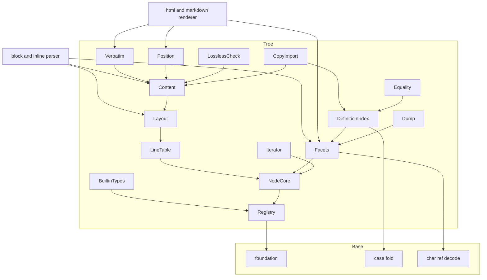
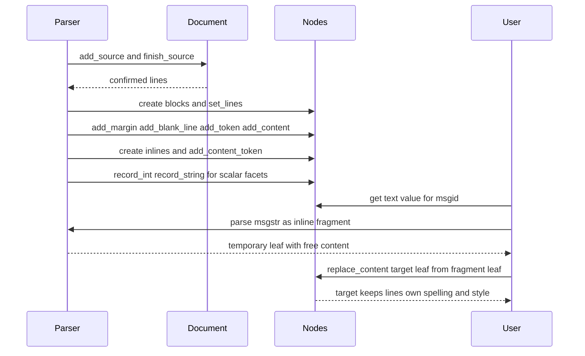
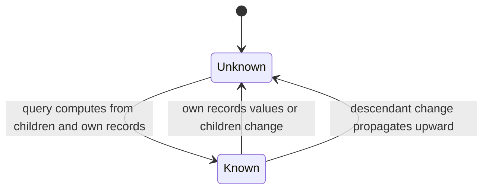
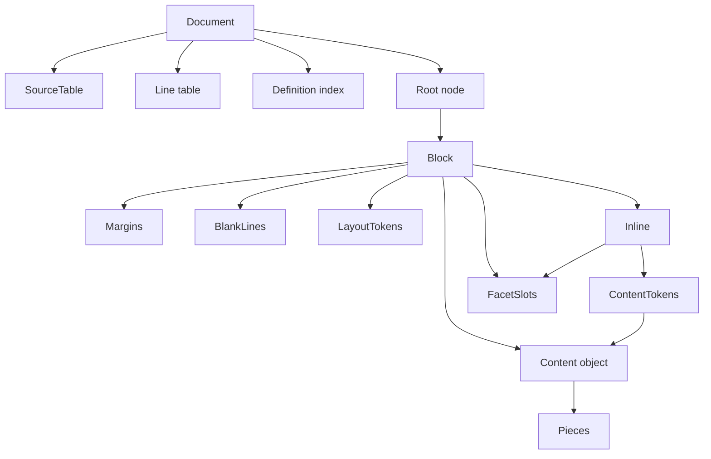

# Design Document: syntax-tree

## Overview
**Purpose**：`syntax-tree` は、Markdown の構文木と、その元の表記を持つ土台を提供する。木は意味の単位のノードからなり、元の表記は Markdown の形に合わせた 2 層で持つ。ブロックの 2 次元の配置（行 × 帯）と、葉の中身の上の 1 次元のインラインの綴りである。どの部分を元の表記で出せるかは、綴りと帯が残っているかで決まり、編集の記録は持たない。

**Users**：パーサ（`block-parser`、`inline-parser`）は、配置と綴りを記録して木を作る。レンダラ（`html-renderer`、`markdown-renderer`）は、値、位置、元の表記を出せるかを問い合わせる。利用者は、木を参照・編集し、msgstr のような断片を葉の中身として差し込む。拡張の実装者は、ノード型と、その値と style の項目を宣言する。

**Impact**：最初の設計（ソースの絶対位置の構文トークンと編集の追跡）による `src/tree/`、`tests/tree/`、`include/amark/token.h` を全面的に置き換える。旧設計の概念は持ち込まない（research.md の「最初の設計の概念を持ち込まない」）。`src/base/` に case fold と文字参照の表を足す。

### Goals
- 無編集の文書について、元のソースのすべてのバイトが配置と綴りのちょうど 1 つの持ち主に属することを、行の数と記録の数に線形の局所的な検査で保証する。
- 値と style を変えたとき、その値の綴りだけを失い、ほかの表記を残す。
- msgstr の差し込み（葉の中身の置き換え）と、ブロックの移動と取り込みで、インラインの部分木を帯や行から独立に扱う。
- 組み込みの型と拡張の型を、同じ記述子（値と style の項目の宣言を含む）で扱う。

### Non-Goals
- パースの規則、HTML と Markdown の出力の規則、書き戻しでの帯と綴りの合成、エスケープ
- msgid の空白の正規化、po の形式
- 1 つの文書を複数のスレッドで同時に使うこと

## Boundary Commitments

### This Spec Owns
- 文書の寿命、ソースの保持、行の表（逐次の入力、BOM、改行の種類、列とバイトの対応、文書の既定の改行）
- ノードの寿命、関係、走査、構造の編集、複製、取り込み、子をまとめた取り込み
- ノード型の記述子、値と style の項目（facet）の記述子、構文拡張の記述子、構文セット、スロットの種類の通し番号の一覧（公開ヘッダのマクロ）
- 組み込みの 19 のノード型と、その項目、包含の規則、項目の変更の規則（フック）
- 配置の記録（ブロックの行の範囲、帯、空行、葉自身の表記）、中身（content オブジェクト）、中身の上のトークン
- 意味の値の導出（トークンの種類ごとの解読）とキャッシュ、style の未設定の状態
- ラベルの正規化、リンク参照定義の索引、参照の形のリンクの解決
- ロスレス性の検証、元の表記を出せるかの問い合わせ（内部のキャッシュを含む）、リストのタイトの導出
- 位置の問い合わせ、意味の比較、S 式のダンプ、テスト用の S 式からの組み立て、内部の不変条件の検査器
- `src/base/` に置く case fold（`amark_unicode_case_fold`）と文字参照の解読（`amark_char_ref_decode`）、その表と生成の手順

### Out of Boundary
- 行をブロックへ割り振る規則、インラインの解析、記録の内容を決める規則（`block-parser`、`inline-parser`）。この spec は、記録の形と検査だけを持つ。
- HTML の出力（`html-renderer`）。ソース位置の属性の書式（終わりの列を含めるかなど）は `html-renderer` が決める。
- Markdown の書き戻し、帯と綴りの合成、エスケープ、区切り文字の選び直し、新しいノードの表記の既定（`markdown-renderer`）
- 断片をパースする関数（`block-parser`、`inline-parser`）。この spec は、その結果を差し込む操作（子をまとめた取り込み、中身の置き換え）だけを持つ。
- 各スロットの中身の型と、その種類の番号の意味（それぞれの spec）

### Allowed Dependencies
- `foundation` の公開 API と内部ヘッダ（`base/*_internal.h`）：アロケータ、バッファ、エラー、UTF-8、Unicode の分類
- C 標準ライブラリ
- 依存の向き：`src/base` ← `src/tree`。`src/tree` は `src/parse`、`src/render`、`src/syntax` を参照しない。`src/base` に足す case fold と文字参照は、`src/tree` を参照しない。
- `src/tree` の中の向き：Registry → NodeCore → { LineTable, Facets, Layout, Content } → { DefinitionIndex, Verbatim, Position, LosslessCheck, CopyImport } → { Iterator, Equality, Dump }。右から左への参照は、NodeCore の変更の通知（`amark_tree_changed`）を通してだけ行う。

### Revalidation Triggers
- ノード型の記述子、項目の記述子、`on_change` のフックの契約の変更 → すべての下流の spec と、拡張を定義するテスト
- トークンの種類（`amark_spell_kind_t`）、帯の状態と印、記録の順序の規則、記録の検査の規則の変更 → `block-parser`、`inline-parser`、`markdown-renderer`
- 組み込みの型の項目の番号、種類、既定の値、フックの規則の変更 → `inline-parser`、`block-parser`、両方のレンダラ
- 値の導出の規則（トークンの種類ごとの解読、項目の印）の変更 → `inline-parser`、`html-renderer`
- 「元の表記のまま出せるか」の判定の規則の変更 → `markdown-renderer`
- 行の表、列の数え方、逐次の入力の確定の規則の変更 → `block-parser`、`markdown-renderer`、`html-renderer`（位置）
- ラベルの正規化、`amark_unicode_case_fold`、`amark_char_ref_decode`、その表の版の変更 → `block-parser`、`inline-parser`、両方のレンダラ
- スロットの種類の通し番号の一覧の変更 → 番号を使うすべての spec
- 公開ヘッダの追加・削除と、その順の変更 → `foundation`（ヘッダの検査）、`amark.h` を含める spec

## Architecture

### Existing Architecture Analysis
- `src/tree/` と `tests/tree/` には、最初の設計による実装がある。ノードの構造体と型の記述子が、ソースのオフセットのトークン、編集の印、リテラルのモードを直接持つ。この design では、どのファイルも新しい契約の土台として残さない。走査や包含の検査のように規則が変わらない部分も、新しいノードの構造の上で書き直す。旧コードの手順（再帰なしの解放や比較の手順など）を参考にするのはよいが、旧設計の型、フィールド、関数を持ち込まない。
- 公開ヘッダの順は `cmake/scripts/check_public_headers.cmake` が、すべての公開関数の呼び出しは `tests/headers/cxx_include_test.cpp` が検査する。どちらも変更が要る。

### Architecture Pattern & Boundary Map



**Architecture Integration**：
- **パターン**：
  - 1 つの文書が、行の表とすべてのノードを持つ。ノードは 3 つの面を持つ。
    - 構造：型、子、項目の値
    - 配置：行の範囲、帯、空行、葉自身の表記
    - 綴り：中身と、その上のトークン
  - 派生する情報（値の導出、元の表記を出せるか、タイト）は、内部のキャッシュに置く。
- **新しい概念**：
  - **項目（facet）**：型が宣言する値と style の単位。トークンは、自分が綴る項目の番号を持つ。
  - **content オブジェクト**：中身のバイト列。インラインのトークンの土台になる。
  - **行の表**
- **Steering compliance**：
  - C99、不透明型、構造体の大きさのフィールド、グローバルのアロケータ、`/* */` のコメント、Allman
  - 開いた集合は `#define`（ノード型の識別子、項目の番号、スロットの種類、印）、閉じた集合は `typedef enum`（トークンの種類、帯の状態、改行の種類、値の状態）とする。0 は不正な値にする。

### Technology Stack

| Layer | Choice / Version | Role in Feature | Notes |
|-------|------------------|-----------------|-------|
| Language | C99 | ライブラリ本体 | コンパイラ固有の拡張なし |
| Build | CMake 3.21+ | `src/CMakeLists.txt` のソースの一覧、テストの登録 | ファイルの一覧を更新する |
| Test | Naos v0.4.0、CTest | 単体テスト、性能のテスト | `amark_add_test` |
| Fuzz | libFuzzer | 編集の操作列のファジング | `fuzz/tree_edit_fuzz.c` を書き直す |
| Data | Unicode 17.0.0 `CaseFolding.txt`（状態 C と F）、WHATWG `entities.json` | case fold、文字参照の表 | 生成物をリポジトリに入れ、`--check` で照合する |

## File Structure Plan

### Directory Structure
```
include/amark/
├── node.h          # 書き直し：不透明型、識別子の型、組み込みのノード型の識別子、関係、構造の編集、複製、取り込み、比較
├── document.h      # 書き直し：文書の寿命、構文セットの所有、ソースと行の表、位置、ラベルの正規化と定義の検索、ロスレス性の検証
├── value.h         # 新規：項目の値の取得・設定・未設定・記録、組み込みの型の項目の番号と列挙の値、テキストの一括設定
├── spelling.h      # 新規：トークンの種類、帯と空行と表記と中身の記録と読み取り、綴りを捨てる操作、元の表記を出せるかの問い合わせ
├── iterator.h      # 書き直し：走査（入る/出るイベント）
├── dump.h          # 書き直し：S 式のダンプとダンプの書き手、ダンプの印
├── extension.h     # 書き直し：項目の記述子、ノード型の記述子、構文拡張、スロット、スロットの種類の通し番号、構文セット
├── entity.h        # 新規（src/base）：文字参照の解読
├── unicode.h       # 変更：case fold を足す
├── amark.h         # 変更：ヘッダの一覧
└── token.h         # 削除
src/base/
├── unicode.c               # 変更：amark_unicode_case_fold
├── case_fold_tables.inc    # 新規（生成物）
├── entity.c                # 新規：amark_char_ref_decode
└── entity_tables.inc       # 新規（生成物）
src/tree/                   # 既存のファイルはすべて削除し、次のファイルで置き換える
├── tree.h          # 内部の構造体（文書、ノード、記録の配列、content オブジェクト、行）と、モジュールをまたぐ内部関数
├── registry.c      # Registry：構文セット、凍結、識別子の割り当て、検索、スロット
├── builtin_types.c # BuiltinTypes：19 の記述子、項目の表、on_change の規則、ラベルの検査、amark.core
├── document.c      # Document：生成と解放、構文セットの所有、全ノードの環
├── line_table.c    # LineTable：ソース、行への分割、逐次の確定、BOM、改行の種類、列とバイト
├── node.c          # NodeCore：ノードの確保と解放、関係、利用者のポインタ、型のデータ、変更の通知
├── structure.c     # NodeCore：挿入、切り離し、置換、包含と循環の検査
├── facet.c         # Facets：項目の格納、取得・設定・未設定・記録、フックの呼び出し、項目の綴りを捨てる操作
├── derive.c        # Facets：トークンからの値の導出（種類ごとの解読、項目の印）と文字列のキャッシュ
├── layout.c        # Layout：行の範囲、帯、空行、葉自身の表記、行の移し替え、記録の検査
├── content.c       # Content：content オブジェクト、配置済みの中身の実体化、中身のトークン、移動と分割、中身の置き換え
├── label.c         # DefinitionIndex：ラベルの正規化
├── def_index.c     # DefinitionIndex：ラベルの索引、文書の順の決定、参照の解決
├── copy_import.c   # CopyImport：複製、別の文書からの取り込み、子をまとめた取り込み、行の取り込み
├── position.c      # Position：ソース上の範囲
├── lossless.c      # LosslessCheck：行ごとの分割と中身の被覆
├── verbatim.c      # Verbatim：綴りの状態、元の表記を出せるかの判定とキャッシュ、タイトの導出
├── iterator.c      # Iterator
├── equal.c         # Equality
├── dump.c          # Dump
└── tree_check.c    # 内部の不変条件の検査器（テストとファジング用、amark_tree_check）
tests/base/
├── case_fold_test.c
└── entity_test.c
tests/tree/                 # 既存のテストはすべて削除し、コンポーネントごとに作り直す
├── registry_test.c、builtin_types_test.c、document_test.c、line_table_test.c、structure_test.c
├── facet_test.c、derive_test.c、layout_test.c、content_test.c、label_index_test.c
├── copy_import_test.c、position_test.c、lossless_test.c、verbatim_test.c、iterator_test.c
├── equal_test.c、dump_test.c、extension_type_test.c、msgstr_flow_test.c
├── oom_test.c      # すべての変更の操作の確保失敗の総当たり
└── scale_test.c    # 深さ 10 万段と計算量のカウンタ
tests/support/tree_builder.{h,c}  # 書き直し：新しいダンプの形式から木を組み立てる
fuzz/tree_edit_fuzz.c             # 書き直し
tools/gen_unicode_tables.py       # 変更：CaseFolding.txt から case_fold_tables.inc を作る
tools/gen_entity_table.py         # 新規：entities.json から entity_tables.inc を作る
```

### Modified Files
- `src/CMakeLists.txt` — `src/tree/` と `src/base/` のソースの一覧を新しいファイルにする
- `tests/tree/CMakeLists.txt`、`tests/base/CMakeLists.txt` — テストの登録を新しいファイルにする
- `cmake/scripts/check_public_headers.cmake` — 正規の順を、foundation の組 `… utf8.h unicode.h entity.h`（`entity.h` を `unicode.h` の後に入れ、ほかの位置は変えない） と木の組 `node.h document.h value.h spelling.h iterator.h dump.h extension.h` にする（`token.h` を除く）
- `include/amark/amark.h` — 上の順で含める
- `tests/headers/cxx_include_test.cpp` — 新しい公開関数を呼ぶ形にする（旧ヘッダの関数を除く）
- `fuzz/CMakeLists.txt`、`fuzz/corpus/tree_edit/` — 新しい操作列の形式に合わせてコーパスを作り直す

## System Flows

### パーサによる組み立てと msgstr の差し込み



- パーサの記録は、値の編集として扱わない（6.14）。記録の関数は項目の綴りを捨てず、`on_change` のフックを呼ばない。
- 差し込んだ中身は自由な中身になる。そのインラインは綴りを保つので、書き戻しは翻訳者が書いたバイトを出す（8.6）。

### 元の表記を出せるかのキャッシュ



- 変更は、そのノードから根へ向かって、すでに Unknown の祖先に着くまで伝わる。祖先が Unknown なら、さらに上の祖先も Unknown である（計算は子の結果を先に求めるため）。

## Requirements Traceability

| Requirement | Summary | Components | Interfaces | Flows |
|-------------|---------|------------|------------|-------|
| 1.1, 1.2, 1.3, 1.4, 1.5, 1.6, 1.7, 1.8, 1.9 | 文書とメモリの所有 | Document, NodeCore, LineTable | `amark_document_create`、`_destroy`、`_take_syntax_set`、`amark_document_add_source`、`amark_node_unlink`、`amark_node_destroy` | 組み立て |
| 2.1, 2.2, 2.3, 2.4, 2.5, 2.6, 2.7, 2.8 | 行の表 | LineTable | `amark_document_add_source`、`_append_source`、`_finish_source`、`_line`、`_column_to_byte`、`_byte_to_column`、`_default_eol` | 組み立て |
| 2.9, 2.10, 2.11 | 位置 | Position | `amark_node_source_range` | — |
| 3.1, 3.8, 3.9 | 組み込みの型と包含 | BuiltinTypes, Registry | 識別子、`amark_node_can_contain` | — |
| 3.2, 3.3, 3.4, 3.5, 3.6, 3.10 | 値と style | Facets, BuiltinTypes | `amark_node_get`、`_set_int`、`_set_string`、`_unset` | — |
| 3.7 | タイトの導出 | Verbatim | `amark_node_get`（`AMARK_LIST_TIGHT`） | キャッシュ |
| 4.1, 4.2, 4.3, 4.4, 4.5 | 参照と走査 | NodeCore, Iterator | 関係の関数、`amark_iter_*`、`amark_node_user_data` | — |
| 5.1, 5.2, 5.3, 5.4, 5.5, 5.10 | 構造の編集 | NodeCore | `amark_node_create`、挿入の関数、`amark_node_replace` | キャッシュ |
| 5.6, 5.7, 5.8, 5.9 | 複製と取り込み | CopyImport | `amark_node_copy`、`_import`、`_import_children` | — |
| 6.1, 6.2, 6.3, 6.4, 6.5, 6.6, 6.7, 6.8, 6.9 | 値と style の編集 | Facets | setter、項目の記述子の検査 | — |
| 6.10 | 参照の形のリンクへの宛先の設定 | BuiltinTypes, Facets | link と image の `on_change` | — |
| 6.11 | タイトの上書き | Facets, Verbatim | `amark_node_set_int`、`amark_node_unset` | — |
| 6.12 | テキストの一括設定 | Facets | `amark_node_set_inline_text` | — |
| 6.13, 6.14 | 綴りを捨てる操作、記録は編集でない | Facets, Layout, Content | `amark_node_discard_spelling`、`amark_node_record_*` | 組み立て |
| 7.1, 7.2, 7.3, 7.4, 7.5, 7.6, 7.7, 7.8, 7.9, 7.10, 7.11 | 配置の記録 | Layout | `amark_block_set_lines`、`_add_margin`、`_add_blank_line`、`_add_token`、`_add_content`、`_move_lines`、`_remove_lines`、`_trim_content_start` | 組み立て |
| 8.1, 8.2, 8.3, 8.4, 8.5, 8.6, 8.7, 8.8 | 中身と綴り | Content, Facets | `amark_block_content_*`、`amark_node_add_content_token`、`_move_content_tokens`、`_split_content_token`、`amark_block_replace_content`、`amark_node_content_base` | 差し込み |
| 9.1, 9.2, 9.3, 9.4, 9.5, 9.6 | ラベルと定義の索引 | DefinitionIndex | `amark_label_normalize`、`amark_document_find_definition`、`amark_node_get` | — |
| 10.1, 10.2, 10.3, 10.4, 10.5 | ロスレス性の検証 | LosslessCheck | `amark_document_check_lossless` | — |
| 11.1, 11.2, 11.3, 11.4, 11.5, 11.6 | 元の表記を出せるか | Verbatim, Layout | `amark_node_spelling_state`、`amark_block_find_margin`、`amark_block_content_verbatim`、`amark_node_verbatim`、`amark_node_is_new` | キャッシュ |
| 12.1, 12.2, 12.3, 12.4, 12.5, 12.6, 12.7, 12.8, 12.9, 12.10, 12.11, 12.12, 12.13 | レジストリ | Registry, Facets | `extension.h` | — |
| 13.1, 13.2, 13.3 | 比較 | Equality | `amark_node_equal` | — |
| 13.4, 13.5, 13.6, 13.7, 13.8 | ダンプとテストの補助 | Dump, TestSupport | `amark_node_dump`、`amark_test_tree_build` | — |
| 14.1, 14.2 | API の規約 | すべて | — | — |
| 14.3, 14.4 | 並行性 | Document, Registry | ヘッダの文書 | — |
| 14.5, 14.6, 14.7, 14.8, 14.9 | 計算量 | NodeCore, Layout, Content, LosslessCheck, DefinitionIndex, Verbatim | — | キャッシュ |

## Components and Interfaces

| Component | Domain | Intent | Req Coverage | Key Dependencies | Contracts |
|-----------|--------|--------|--------------|------------------|-----------|
| CaseFold | Base | Unicode の case fold | 9.1 | 生成された表 (P0) | Service |
| CharRef | Base | 文字参照の解読 | 3.3 | 生成された表 (P0) | Service |
| Registry | Tree | 記述子と構文セット | 12.1–12.13, 14.3 | foundation (P0) | Service, State |
| BuiltinTypes | Tree | 組み込みの型と規則 | 3.1, 3.5, 3.8, 3.9, 6.6, 6.10 | Registry (P0), Facets (P0) | Service |
| Document | Tree | 文書の寿命と所有 | 1.1–1.4, 1.7–1.9, 14.4 | NodeCore (P0) | Service, State |
| LineTable | Tree | ソースと行 | 2.1–2.8 | foundation (P0) | Service, State |
| NodeCore | Tree | ノード、関係、構造の編集、変更の通知 | 1.5, 1.6, 4.1, 4.5, 5.1–5.5, 5.10, 14.5 | Registry (P0) | Service |
| Facets | Tree | 値と style の格納、導出、編集 | 3.2–3.6, 3.10, 6.1–6.14 | NodeCore (P0), CharRef (P0) | Service |
| Layout | Tree | 配置の記録 | 7.1–7.11, 14.6 | LineTable (P0) | Service |
| Content | Tree | 中身と中身のトークン | 8.1–8.8, 5.6, 14.6 | Layout (P0) | Service |
| DefinitionIndex | Tree | ラベルと定義の索引 | 9.1–9.6, 14.8 | Facets (P0), CaseFold (P0) | Service, State |
| CopyImport | Tree | 複製と取り込み | 5.6–5.9 | Content (P0), LineTable (P0) | Service |
| Position | Tree | ソース上の範囲 | 2.9–2.11 | Content (P0) | Service |
| LosslessCheck | Tree | ロスレス性の検証 | 10.1–10.5, 14.7 | Content (P0) | Service |
| Verbatim | Tree | 綴りの状態、出せるかの判定、タイト | 3.7, 11.1–11.6, 14.9 | Content (P0) | Service, State |
| Iterator | Tree | 走査 | 4.2–4.4 | NodeCore (P0) | Service, State |
| Equality | Tree | 意味の比較 | 13.1–13.3 | DefinitionIndex (P0) | Service |
| Dump | Tree | S 式のダンプ | 13.4–13.7 | Facets (P0) | Service |
| TreeCheck | Tree（内部） | 不変条件の検査 | 14.2 の検証 | すべて (P1) | Service |
| TestSupport | Tests | S 式からの組み立て | 13.8 | 公開 API (P0) | Service |

### 共通の規約
- すべての失敗しうる関数は `amark_error_t` を返し、結果を出力引数で返す。必須の引数が NULL なら `AMARK_ERROR_INVALID_ARGUMENT` を返す。失敗した関数は、文書とノードを呼び出し前の状態のまま保つ（1.7）。
- 公開する構造体は先頭に `size_t struct_size` を持ち、呼び出し側が `sizeof` を入れる。小さすぎる値は不正な引数とする。
- 文書は、同時に 1 つのスレッドだけが使う（14.4）。値の取得も、内部のキャッシュを書くので、読み取りだけの操作とは見なさない。凍結した構文セットは不変で、複数の文書とスレッドで共有できる（14.3）。この規約は `document.h` と `node.h` の冒頭のコメントに書く。
- 取得した文字列の指す先は、その文書を次に変更するか、文書を解放するまで有効とする。
- 基本の型（`amark_document_t`、`amark_node_t`、`amark_syntax_set_t`、`amark_node_type_desc_t`、`amark_node_type_t`、`amark_node_level_t`、`amark_facet_t`、`amark_source_id_t`、`amark_line_id_t`）とその定数は `node.h` が定める。ほかの木のヘッダは `node.h` を含め、公開ヘッダの正規の順（node → document → value → spelling → iterator → dump → extension）の前のヘッダだけに依存する。`amark_value_t` は `value.h` が、`amark_dump_writer_t` は `dump.h` が定め、`extension.h` はその両方を含める。

### Base

#### CaseFold、CharRef

| Field | Detail |
|-------|--------|
| Intent | ラベルの正規化と値の導出が使う文字データ |
| Requirements | 9.1, 3.3 |

```c
/* unicode.h：Unicode 17.0.0 の CaseFolding.txt の状態 C と F。結果の符号位置の数（1–3）を返す */
AMARK_API size_t amark_unicode_case_fold(uint32_t codepoint, uint32_t out[3]);

/* entity.h：text は "&" から ";" までの文字参照の全体。成功なら true と符号位置（1–2）を返す。
 * 数値の参照で 0、サロゲート、0x10FFFF を超える値は U+FFFD とする（CommonMark） */
AMARK_API bool amark_char_ref_decode(const char *text, size_t length,
                                     uint32_t codepoints[2], size_t *count);
```
- 表は生成物で、`tools/gen_unicode_tables.py --check` と `tools/gen_entity_table.py --check` で元のデータと照合する。

### Registry

#### 項目、ノード型、構文拡張の記述子

| Field | Detail |
|-------|--------|
| Intent | ノード型、その値と style の項目、構文拡張、構文セットを定義する |
| Requirements | 12.1–12.13, 14.3 |

```c
typedef uint32_t amark_facet_t;               /* 型ごとの項目の番号。1–31。0 はなし */
#define AMARK_FACET_NONE 0u
#define AMARK_FACET_MAX  31u

typedef enum amark_facet_role { AMARK_FACET_VALUE = 1, AMARK_FACET_STYLE = 2 } amark_facet_role_t;
typedef enum amark_facet_kind
{
    AMARK_FACET_STRING = 1, AMARK_FACET_INT = 2, AMARK_FACET_ENUM = 3, AMARK_FACET_BOOL = 4
} amark_facet_kind_t;

/* 項目の印 */
#define AMARK_FACET_RAW              0x0001u /* 導出で、エスケープと文字参照を解読しない */
#define AMARK_FACET_FOLD_LINE_BREAKS 0x0002u /* 導出で、仮想の改行を空白にする */
#define AMARK_FACET_LINES            0x0004u /* 複数行：設定で LF に揃え、空でなければ LF で終える */
#define AMARK_FACET_NO_LINE_BREAK    0x0008u /* 改行を含められない */
#define AMARK_FACET_NO_BLANK_LINE    0x0010u /* 空行を含められない */
#define AMARK_FACET_NONEMPTY         0x0020u /* 空の文字列を設定できない */
#define AMARK_FACET_OVERRIDABLE      0x0040u /* 導出する値。設定は上書き、未設定にすると導出に戻る */
#define AMARK_FACET_CONTENT          0x0080u /* 値の正は葉の中身（code_block と html_block の literal） */

typedef struct amark_facet_desc
{
    size_t struct_size;
    const char *name;                 /* [a-z][a-z0-9_]*、型の中で一意 */
    amark_facet_role_t role;
    amark_facet_kind_t kind;
    uint32_t flags;
    int64_t int_min, int_max;         /* INT のときの範囲 */
    const char *const *enum_names;    /* ENUM のときの名前。値は 1 から enum_count */
    size_t enum_count;
    int64_t default_number;           /* INT、ENUM、BOOL の既定の値（VALUE のとき） */
    const char *default_text;         /* STRING の既定の値（NULL は空） */
    amark_error_t (*validate)(const amark_node_t *node, amark_facet_t facet,
                              const amark_value_t *value, void *user_data);
    amark_error_t (*on_change)(amark_node_t *node, amark_facet_t facet,
                               const amark_value_t *new_value, void *user_data);
    void *user_data;
} amark_facet_desc_t;

/* ノード型の印 */
#define AMARK_NODE_TYPE_CONTENT     0x01u /* 葉が中身を持つ（paragraph、heading、code_block、html_block など） */
#define AMARK_NODE_TYPE_SHARE_LINES 0x02u /* 子のブロックが同じ行を重ならない列で分け合える（7.8） */
#define AMARK_NODE_TYPE_MARGINS     0x04u /* 覆う行ごとに帯を持つコンテナ（block_quote、item、拡張のコンテナ） */

struct amark_node_type_desc
{
    size_t struct_size;
    const char *name;                 /* [a-z0-9][a-z0-9_.-]* */
    amark_node_level_t level;         /* AMARK_NODE_LEVEL_BLOCK = 1、AMARK_NODE_LEVEL_INLINE = 2 */
    uint32_t provides;                /* AMARK_CONTENT_BLOCK、_INLINE、_LIST_ITEM のどれか */
    uint32_t accepts;                 /* 子として受け入れる種類の印 */
    uint32_t flags;
    const amark_facet_desc_t *facets; /* facets[i] が項目 i + 1 */
    size_t facet_count;               /* 0–31 */
    size_t data_size;                 /* 拡張のデータ。0–AMARK_NODE_TYPE_MAX_DATA_SIZE */
    bool (*can_contain)(const amark_node_t *self, amark_node_type_t child);
    amark_error_t (*init)(amark_node_t *node, void *data);
    void (*deinit)(amark_node_t *node, void *data);
    amark_error_t (*copy)(amark_node_t *dst, void *dst_data, const amark_node_t *src, const void *src_data);
    bool (*equal)(const amark_node_t *a, const void *a_data, const amark_node_t *b, const void *b_data);
    amark_error_t (*dump)(const amark_node_t *node, const void *data, amark_dump_writer_t *writer);
    void *user_data;
};
```
- **ブロックの分類**：
  - **ブロックの子を持てるブロック**（`accepts` に BLOCK か LIST_ITEM を持つ。document、list、block_quote、item、拡張の表など）：空行を持てる。
  - **コンテナ**：そのうち `AMARK_NODE_TYPE_MARGINS` の型。覆う行ごとに帯を持つ。MARGINS でないもの（document、list）は帯を持たず、各行を子と空行にそのまま任せる（通り抜け）。
  - **葉**：ブロックの子を持てないブロック。中身は `AMARK_NODE_TYPE_CONTENT` のときだけ持つ。
  - ブロック型はすべて、自身の表記（レイアウトのトークン）を持てる。
- **`on_change`**：項目を設定する関数（6.7–6.11）は、次の順で処理する。
  1. 新しい値を検査する（項目の印、`validate`）。
  2. 新しい値を確保して用意する。
  3. `on_change` を呼ぶ。フックの中で、ほかの項目の設定、項目の綴りを捨てる操作、帯を捨てる操作をしてよい。
  4. フックが成功したら、値を確定し、その項目の綴りを捨てる。
  
  フックは自分の変更を全か無かで行い、失敗したらエラーを返す。設定の関数はそのとき用意した値を捨てて、同じエラーを返す。パーサの記録（`amark_node_record_*`）はフックを呼ばない。
- 構文拡張と構文セットの契約は次のとおり。
  - 構文拡張：`amark_extension_t { struct_size, name, node_types, node_type_count, slots, slot_count, user_data }`
  - スロット：`amark_slot_t { struct_size, kind }`。具体的なスロットはこれを先頭に埋め込む。
  - 構文セットの関数：
    - 生成、複製、解放：`amark_syntax_set_create` / `_clone` / `_destroy`
    - 静的な組み込みのセット：`_core`
    - 拡張の追加と変更：`_append`、`_insert_before`（名前を指定）、`_remove`、`_replace`
    - 凍結：`_freeze`、`_is_frozen`
    - 拡張の列挙：`_extension_count`、`_extension_at`、`_find_extension`
    - 凍結後だけ使える検索：`_find_node_type`、`_node_type_of`、`_node_type_desc`、`_slot_count`、`_slot_at`
  - 項目の検索：`amark_node_type_find_facet(desc, name)` と `amark_node_type_facet(desc, facet)`
- スロットの種類の番号は `extension.h` のマクロの一覧で定める（12.10）。
  - 範囲：`AMARK_SLOT_KIND_AMARK_FIRST` 1、`_AMARK_LAST` 255、`_USER_FIRST` 256
  - 1–4：block-parser（BLOCK_SYNTAX、PARAGRAPH_CONSUMER、POSTPROCESS、PARSE_STATE）
  - 5–10：inline-parser（INLINE_SYNTAX、INLINE_DELIMITER、INLINE_BRACKET、INLINE_TEXT_SCANNER、INLINE_NODE_TRAITS、INLINE_SPECIAL）
  - 11–12：html-renderer（HTML_NODE、HTML_HOOKS）
  - 13–14：markdown-renderer（MARKDOWN_NODE、MARKDOWN_HOOKS）
  - 番号の意味と中身の型は、それぞれの spec が定める。
- 凍結は、名前の重複を検出し、拡張の型に構文セットの順で 256 から識別子を割り当てる（12.7）。

**Implementation Notes**
- 検査：記述子の検査は、追加のときに行う。項目の数が 31 を超える、ENUM で名前がない、INT で範囲が逆、STYLE に OVERRIDABLE がある、などは不正な引数とする。

### Tree：BuiltinTypes

| Field | Detail |
|-------|--------|
| Intent | 19 の組み込みの型を、拡張と同じ記述子で定義する |
| Requirements | 3.1, 3.5, 3.8, 3.9, 6.6, 6.10 |

ノード型の識別子は、NONE 0、DOCUMENT 1、BLOCK_QUOTE 2、LIST 3、ITEM 4、CODE_BLOCK 5、HTML_BLOCK 6、PARAGRAPH 7、HEADING 8、THEMATIC_BREAK 9、LINK_DEFINITION 10、TEXT 11、SOFTBREAK 12、LINEBREAK 13、CODE 14、HTML_INLINE 15、EMPH 16、STRONG 17、LINK 18、IMAGE 19 とする。組み込みの識別子の範囲は 255 まで（BUILTIN_LAST）、拡張の型は 256 から（DYNAMIC_FIRST）。

| 型 | 項目（番号：名前 種類 役割 印） | `on_change` の規則 |
|---|---|---|
| list | 1：type ENUM(bullet, ordered) V、2：start INT(0–999999999) V、3：tight BOOL V OVERRIDABLE、4：bullet ENUM(`-` `*` `+`) S、5：delimiter ENUM(`.` `)`) S | type、bullet、delimiter：すべての子の item の帯を（FIRST だけでなく続く行も）すべて捨てる。start：最初の item の帯をすべて捨てる。記号の幅が変わると、続く行のインデントも合わなくなるため |
| code_block | 1：info STRING V NO_LINE_BREAK、2：literal STRING V LINES CONTENT、3：form ENUM(indented, fenced) S、4：fence_char ENUM(`` ` `` `~`) S、5：fence_length INT(3–) S | info を空でない値にするとき form が indented なら、form を fenced にする |
| html_block | 1：literal STRING V LINES RAW CONTENT | — |
| heading | 1：level INT(1–6) V、2：form ENUM(atx, setext) S、3：closing BOOL S | level を 3 以上にするとき form が setext なら、form を atx にする |
| thematic_break | 1：char ENUM(`*` `-` `_`) S、2：count INT(3–) S、3：spaced BOOL S | — |
| link_definition | 1：label STRING V RAW NONEMPTY（CommonMark のラベルの検査）、2：destination STRING V NO_LINE_BREAK、3：title STRING V NO_BLANK_LINE、4：angle BOOL S、5：title_quote ENUM(`"` `'` `(`) S | label の変更で索引のキーを汚れにする（DefinitionIndex） |
| text | 1：literal STRING V NO_LINE_BREAK | — |
| code | 1：literal STRING V NO_LINE_BREAK NONEMPTY FOLD_LINE_BREAKS、2：backticks INT(1–) S、3：padded BOOL S | — |
| html_inline | 1：literal STRING V NO_BLANK_LINE RAW | — |
| linebreak | 1：form ENUM(spaces, backslash) S | — |
| emph、strong | 1：delimiter ENUM(`*` `_`) S | — |
| link、image | 1：destination STRING V NO_LINE_BREAK、2：title STRING V NO_BLANK_LINE、3：label STRING V RAW、4：form ENUM(inline, full, collapsed, shortcut, autolink) S、5：angle BOOL S、6：title_quote ENUM S | destination か title の設定で、form が full、collapsed、shortcut、autolink なら、form を inline にし、label と form の綴りを捨て、もう一方の値をその時点の解決した値で保持する（6.10） |
| document、block_quote、item、paragraph、softbreak | なし | — |

- 公開ヘッダ `value.h` は、各型の項目の番号のマクロ（`AMARK_LIST_TYPE` 1 など）と、列挙の値のマクロ（`AMARK_LIST_TYPE_BULLET` 1、`AMARK_LINK_FORM_INLINE` 1 など）を定める。image の項目の番号は link と同じである。
- 包含の規則は CommonMark に従う（3.8）。
  - document と block_quote と item は、ブロックを受け入れる。
  - list は item だけを受け入れる。
  - paragraph と heading は、インラインを受け入れる（CONTENT）。
  - code_block、html_block、link_definition は CONTENT で、子を持たない。link_definition のラベル、宛先、タイトルは、中身のトークン（項目 label、destination、title）で綴る。複数行にまたがるラベルとタイトルの改行は、LINE_BREAK のトークンになる。
  - thematic_break は、中身も子も持たない。
  - block_quote と item は MARGINS を持つ。
  - emph、strong、link、image はインラインを受け入れる。link は link を子孫に持てない（can_contain）。
- 新しいノードの既定の値（3.4）は、次のとおり。それ以外の文字列は空、style はすべて未設定（3.6）。
  - level 1
  - list の type は bullet、start は 1
  - tight は導出（上書きなし）

### Tree：Document と LineTable

| Field | Detail |
|-------|--------|
| Intent | 文書の寿命、構文セットの所有、ソースと行の表 |
| Requirements | 1.1–1.4, 1.7–1.9, 2.1–2.8 |

```c
typedef uint32_t amark_source_id_t;
typedef uint32_t amark_line_id_t;              /* 文書の行の表の通し番号。0 から */
#define AMARK_LINE_NONE UINT32_MAX
#define AMARK_SOURCE_FINISHED 0x01u            /* add_source の印：入力の終わりも通知する */

typedef enum amark_eol { AMARK_EOL_NONE = 1, AMARK_EOL_LF, AMARK_EOL_CRLF, AMARK_EOL_CR } amark_eol_t;

typedef struct amark_line_info
{
    size_t struct_size;
    amark_source_id_t source;
    uint32_t number;      /* ソースの中の 1 から数える行の番号 */
    size_t offset;        /* ソースの中のバイトの位置（BOM の後） */
    size_t length;        /* 改行を含まないバイト数 */
    amark_eol_t eol;
    uint32_t width;       /* 列の幅 */
} amark_line_info_t;

AMARK_API amark_error_t amark_document_create(const amark_syntax_set_t *set, amark_document_t **out);
AMARK_API void amark_document_destroy(amark_document_t *document);
AMARK_API amark_node_t *amark_document_root(const amark_document_t *document);
AMARK_API const amark_syntax_set_t *amark_document_syntax_set(const amark_document_t *document);
AMARK_API amark_error_t amark_document_take_syntax_set(amark_document_t *document, amark_syntax_set_t *set);

AMARK_API amark_error_t amark_document_add_source(amark_document_t *document, const char *bytes,
                                                  size_t length, uint32_t flags, amark_source_id_t *out);
AMARK_API amark_error_t amark_document_append_source(amark_document_t *document, amark_source_id_t source,
                                                     const char *bytes, size_t length);
AMARK_API amark_error_t amark_document_finish_source(amark_document_t *document, amark_source_id_t source);
AMARK_API size_t amark_document_source_count(const amark_document_t *document);
AMARK_API amark_error_t amark_document_source_data(const amark_document_t *document, amark_source_id_t source,
                                                   const char **data, size_t *length, bool *has_bom);
AMARK_API size_t amark_document_line_count(const amark_document_t *document);
AMARK_API amark_error_t amark_document_line(const amark_document_t *document, amark_line_id_t line,
                                            amark_line_info_t *out);
AMARK_API amark_error_t amark_document_column_to_byte(const amark_document_t *document, amark_line_id_t line,
                                                      uint32_t column, size_t *byte, uint32_t *tab_offset);
AMARK_API amark_error_t amark_document_byte_to_column(const amark_document_t *document, amark_line_id_t line,
                                                      size_t byte, uint32_t *column);
AMARK_API amark_eol_t amark_document_default_eol(const amark_document_t *document);
```
- **行への分割**（2.1、2.5–2.7）：
  - 改行は LF、CRLF、CR とする。行の範囲は改行を含まない。
  - 行は、改行まで読めたときに確定する。CR で終わり、次のバイトがまだないときは、次の追加か入力の終わりで確定する。
  - 入力の終わりでは、最後の改行の後に 1 バイト以上が残っていれば、それを `AMARK_EOL_NONE` の行として確定する。
  - 確定した行には、行の表の末尾の通し番号を付ける。`append_source` は確定した行を変えない。
  - 入力の終わりを通知したソースへの追加は、不正な状態とする。
- **列**（2.3）：
  - タブ以外のバイトは 1 列、タブは次の 4 の倍数の列まで進める。
  - `column_to_byte` は、列を含む文字のバイトの位置を返す。列がタブの途中なら、そのタブの位置と、タブの中の列のずれ（`tab_offset`）を返す。
  - 行の幅を超える列は、不正な引数とする。
- **BOM**（2.4）：ソースの先頭の EF BB BF は、ソースが持つ印にし、最初の行の `offset` を 3 にする。
- **既定の改行**（2.8）：行の表で最初に現れる `AMARK_EOL_NONE` でない改行の種類とする。なければ LF。
- **解放**（1.3）：文書は、全ノードの環（木から切り離したノードを含む）、content オブジェクト、ソース、行の表を解放し、最後に、所有する構文セットを解放する（1.8）。

**Implementation Notes**
- 行の記録は `{ source, number, offset, length, eol, width, tab_index }` の配列とする。`tab_index` は、タブを含む行についてだけ、最初の列の変換のときにタブのバイトの位置の配列を作る。
- ソースの番号の中の行の番号は、ソースごとに数える。ソースごとの行の番号の配列も持ち、検証（LosslessCheck）がソースの行を順に引けるようにする。
- 内部関数 `amark_line_table_append_lines`：CopyImport のために、バイト列と、各行の範囲と改行の種類の列を受け取り、分け直さずに 1 つの新しいソースと行を足す。失敗したら何も足さない。

### Tree：NodeCore

| Field | Detail |
|-------|--------|
| Intent | ノードの確保、関係、構造の編集、変更の通知 |
| Requirements | 1.5, 1.6, 4.1, 4.5, 5.1–5.5, 5.10, 14.5 |

```c
AMARK_API amark_error_t amark_node_create(amark_document_t *document, amark_node_type_t type, amark_node_t **out);
AMARK_API void amark_node_destroy(amark_node_t *node);
AMARK_API amark_node_type_t amark_node_get_type(const amark_node_t *node);
AMARK_API const amark_node_type_desc_t *amark_node_type_desc(const amark_node_t *node);
AMARK_API amark_document_t *amark_node_document(const amark_node_t *node);
AMARK_API amark_node_t *amark_node_parent(const amark_node_t *node);          /* first_child、last_child、next、previous も同じ形 */
AMARK_API bool amark_node_is_block(const amark_node_t *node);                 /* is_inline、is_container、has_content も同じ形 */
AMARK_API bool amark_node_can_contain(const amark_node_t *parent, amark_node_type_t child);
AMARK_API void *amark_node_user_data(const amark_node_t *node);
AMARK_API void amark_node_set_user_data(amark_node_t *node, void *user_data);
AMARK_API void *amark_node_data(amark_node_t *node);                           /* 拡張のデータ */
AMARK_API amark_error_t amark_node_unlink(amark_node_t *node);
AMARK_API amark_error_t amark_node_insert_before(amark_node_t *anchor, amark_node_t *node);   /* insert_after も同じ */
AMARK_API amark_error_t amark_node_prepend_child(amark_node_t *parent, amark_node_t *node);   /* append_child も同じ */
AMARK_API amark_error_t amark_node_replace(amark_node_t *old_node, amark_node_t *new_node);
```
- **ノードの構造体**（内部）：
  - 関係とリスト：文書、記述子、型、親、最初と最後の子、前後の兄弟、全ノードの環の前後
  - 利用者のポインタ
  - 状態の印：キャッシュの有効、判定の結果、綴りを捨てた項目の印（ビット 1–31、ビット 0 は構造の綴り）
  - 行の範囲：最初の行と行の数。行の数 0 は範囲なし。
  - 項目の格納：記述子の項目の数の配列。生成のときに確保する。
  - 記録：配置と綴りの記録の構造体。最初の記録のときに確保する。
  - 拡張のデータ
- **挿入、移動、置換**：配置と綴りを保ったまま、関係だけを変える（5.3）。包含の規則、自身の子孫の下への挿入、文書ノードの移動、別の文書のノードは、不正な引数とする（5.5）。循環の検査は、挿入先から根までをたどる（挿入先の深さに比例、14.5）。
- **変更の通知**（内部関数 `amark_tree_changed(node, kind)`）：構造の編集、記録、項目の設定から呼ぶ。次の 2 つを行う。
  - Verbatim のキャッシュを、そのノードから根へ、すでに無効な祖先に着くまで無効にする。
  - 構造の変更なら、文書の構造の世代を進める。DefinitionIndex が文書の順の結果を捨てるのに使う。
- **解放**：
  - 関係と全ノードの環をたどり、再帰もスタックも使わない（5.10）。
  - 解放するノードが link_definition なら索引から除く。
  - 型の `deinit` を呼ぶ。
  - content オブジェクトの持ち主の数と土台の数を減らす。

### Tree：Facets

| Field | Detail |
|-------|--------|
| Intent | 値と style の格納、綴りからの導出、編集の意味論 |
| Requirements | 3.2–3.6, 3.10, 6.1–6.14 |

```c
typedef enum amark_value_state
{
    AMARK_VALUE_PRESENT = 1, AMARK_VALUE_UNSET = 2, AMARK_VALUE_UNRESOLVED = 3
} amark_value_state_t;

typedef struct amark_value
{
    size_t struct_size;
    amark_value_state_t state;
    int64_t number;          /* INT、ENUM（1 から）、BOOL（0 か 1） */
    const char *text;        /* STRING。NUL で終わる */
    size_t length;
} amark_value_t;

AMARK_API amark_error_t amark_node_get(const amark_node_t *node, amark_facet_t facet, amark_value_t *out);
AMARK_API amark_error_t amark_node_set_int(amark_node_t *node, amark_facet_t facet, int64_t number);
AMARK_API amark_error_t amark_node_set_string(amark_node_t *node, amark_facet_t facet, const char *text, size_t length);
AMARK_API amark_error_t amark_node_unset(amark_node_t *node, amark_facet_t facet);
AMARK_API amark_error_t amark_node_record_int(amark_node_t *node, amark_facet_t facet, int64_t number);
AMARK_API amark_error_t amark_node_record_string(amark_node_t *node, amark_facet_t facet, const char *text, size_t length);
AMARK_API amark_error_t amark_node_set_inline_text(amark_node_t *node, const char *text, size_t length);
AMARK_API amark_error_t amark_node_discard_facet_spelling(amark_node_t *node, amark_facet_t facet);
AMARK_API amark_error_t amark_node_discard_spelling(amark_node_t *node);
```
- **格納**：項目ごとに次の 3 つを持つ。
  - 状態：未設定 / 設定済み / 記録済み
  - 数値か文字列
  - 導出した文字列のキャッシュ
- **取得**（3.3、3.4、3.6、9.4、9.5）：次の順に決める。
  1. 参照の形（full、collapsed、shortcut）の link と image の destination と title は、DefinitionIndex で解決する。定義がなければ `UNRESOLVED` を返す。
  2. OVERRIDABLE の項目（tight）は、上書きの値がなければ Verbatim の導出を返す。
  3. STRING の項目で、その項目を綴るトークンがあれば、トークンから導いた値を返す（下の表）。導いた値はキャッシュし、その項目のトークンが変わったら捨てる。
  4. CONTENT の項目は、トークンの有無によらず、常に葉の中身から導く。
     - 導出の規則：中身のバイト列のうち、REPLACED のトークンが覆う範囲を U+FFFD にし、それ以外はバイトのまま連結する。中身の行の数が 1 以上なら、最後に LF を 1 つ足す。
     - 例：`"a"` は `"a\n"`、空の行で終わる `"a"` と `""` の 2 行は `"a\n\n"`、空の行 1 つは `"\n"`、行が 0 なら `""` になる。
     - CONTENT の項目は、設定された値を別に持たず、手順 3 の一般の導出も使わない。
  5. 設定か記録された値があれば、それを返す。
  6. VALUE なら既定の値を、STYLE なら `UNSET` を返す。
- **導出**（3.3）：項目を綴るトークンを、中身の上の順（レイアウトのトークンは行と列の順）に連結する。STRING の項目のトークンが、レイアウトのトークンと中身のトークンに混ざることはない（記録の検査で不正な引数にする）。

| トークンの種類 | 導出への寄与 | RAW の項目 |
|---|---|---|
| TEXT | バイトそのもの | 同じ |
| ESCAPE | `\` の後の 1 文字 | バイトそのもの |
| CHAR_REF | `amark_char_ref_decode` の結果 | バイトそのもの |
| REPLACED | 置き換えた単位ごとに U+FFFD | 同じ |
| LINE_BREAK | `\n`（FOLD_LINE_BREAKS なら空白） | 同じ |
| TAB_REMAINDER | 中身の上の空白 | 同じ |
| MARKER、SPACE、DELIMITER | 寄与しない（構造の表記） | 同じ |

  LINES の項目は、結果が空でなく LF で終わっていなければ LF を足す。コードスパンの両端の空白の除去のような構文ごとの規則は、パーサが除く空白を SPACE として記録すれば、導出に入らない。
- **設定**（6.1–6.9）：
  1. 種類、範囲、列挙、項目の印、`validate` で検査する。不正な値はノードを変えずに不正な引数とする。
  2. 現在の値と同じなら、何もしない（6.9）。
  3. LINES の項目は、CRLF と CR を LF に揃える（6.5）。
  4. 新しい値を確保し、`on_change` を呼ぶ。
  5. 値を確定し、`amark_node_discard_facet_spelling` と同じ処理で、その項目を綴るトークンだけを除いて、捨てた項目の印を立てる（6.7、6.8）。CONTENT の項目は、下の「CONTENT の項目の設定」に従う。
  6. 変更を通知する。
- **未設定にする操作**：STYLE の項目は未設定に戻し、その綴りを捨てる。OVERRIDABLE の項目は上書きを取り除く（6.11）。それ以外は不正な引数とする。
- **記録**（6.14）：パーサと拡張の実装者のための操作。検査は設定と同じで、`on_change` を呼ばず、綴りを捨てず、状態を「記録済み」にする。shortcut と collapsed のリンクのラベルのように、トークンを持たない値に使う。
- **テキストの一括設定**（6.12）：子をすべて切り離して解放し、改行で分けた text と softbreak を、綴りのない新しいノードとして置く。
- **ノードのすべての綴りを捨てる操作**（6.13）：
  1. 捨てる前に、トークンから導いていた STRING の値を、設定済みの値として写す（確保に失敗したら何も変えない）。
  2. ノード自身のレイアウトのトークン、中身のトークン、帯、空行を除く。
  3. 中身が配置済みなら、同じバイト列を持つ新しい自由な content オブジェクトを作って葉の中身にする（共有している元のオブジェクトは変えない）。その葉の中身を土台にしていた、葉と子孫のトークンの土台を新しいオブジェクトに付け替える。
  4. 構造の綴りの印を立てる。行の範囲は残す（位置の問い合わせに使う）。
- **CONTENT の項目の設定**（8.7）：code_block と html_block の literal の正は、葉の中身だけである。
  - 設定するもの：LF に揃えた値 V から、新しい自由な content オブジェクトを作って葉の中身にする。
    - V が空なら、中身は空で、行の数は 0 とする。
    - そうでなければ、V の末尾の LF を 1 つ（あれば）除いたものを中身にし、行の数を「中身の LF の数 + 1」とする。
    
    中身のトークンは置かない。
  - 残すもの：葉自身の表記（フェンスの行など）。
  - 印：項目 literal の綴りを捨てた印を立てる（元の行の綴りではなく、その項目を綴るトークンもない）。
  - 往復：取得の規則と合わせると、`"\n"`、`"a\n\n"`、`"a"` は、それぞれ `"\n"`、`"a\n\n"`、`"a\n"` として取り出せる。
  
  取得は常に中身から導く。`amark_block_set_free_content` と `amark_block_replace_content` で中身を変えたときも、次の取得から新しい中身の値になる。

### Tree：Layout

| Field | Detail |
|-------|--------|
| Intent | ブロックの行の範囲、帯、空行、葉自身の表記を、行と列で記録・参照する |
| Requirements | 7.1–7.11, 11.2, 14.6 |

```c
typedef enum amark_spell_kind
{
    AMARK_SPELL_TEXT = 1, AMARK_SPELL_MARKER, AMARK_SPELL_SPACE, AMARK_SPELL_DELIMITER, AMARK_SPELL_ESCAPE,
    AMARK_SPELL_CHAR_REF, AMARK_SPELL_REPLACED, AMARK_SPELL_LINE_BREAK, AMARK_SPELL_TAB_REMAINDER
} amark_spell_kind_t;

typedef enum amark_margin_state { AMARK_MARGIN_PRESENT = 1, AMARK_MARGIN_LAZY = 2 } amark_margin_state_t;
#define AMARK_MARGIN_FIRST 0x01u                      /* 項目の最初の行 */

typedef struct amark_margin
{
    size_t struct_size;
    amark_line_id_t line;
    amark_margin_state_t state;
    uint32_t flags;
    uint32_t column_start, column_end;                /* LAZY は空の範囲 */
    uint16_t role;
} amark_margin_t;

typedef struct amark_blank_line
{
    size_t struct_size;
    amark_line_id_t line;
    uint32_t column_start, column_end;                /* 空行の中の空白。行の終わりまで */
} amark_blank_line_t;

typedef struct amark_layout_token
{
    size_t struct_size;
    amark_line_id_t line;
    uint32_t column_start, column_end;
    amark_spell_kind_t kind;                          /* LINE_BREAK と TAB_REMAINDER は不可 */
    amark_facet_t facet;                              /* 綴る項目。NONE は構造の表記 */
    uint16_t role;                                    /* 型ごとの意味。0 はなし */
} amark_layout_token_t;

AMARK_API amark_error_t amark_block_set_lines(amark_node_t *block, amark_line_id_t first, uint32_t count);
AMARK_API amark_error_t amark_block_lines(const amark_node_t *block, amark_line_id_t *first, uint32_t *count);
AMARK_API amark_error_t amark_block_add_margin(amark_node_t *container, const amark_margin_t *margin);
AMARK_API amark_error_t amark_block_add_blank_line(amark_node_t *container, const amark_blank_line_t *blank);
AMARK_API amark_error_t amark_block_add_token(amark_node_t *block, const amark_layout_token_t *token);
AMARK_API amark_error_t amark_block_move_lines(amark_node_t *from, amark_node_t *to,
                                               amark_line_id_t first, uint32_t count);
AMARK_API amark_error_t amark_block_remove_lines(amark_node_t *leaf, amark_line_id_t first, uint32_t count);
AMARK_API amark_error_t amark_block_trim_content_start(amark_node_t *leaf, uint32_t columns,
                                                       amark_spell_kind_t kind, amark_facet_t facet, uint16_t role);
AMARK_API amark_error_t amark_block_discard_margin(amark_node_t *container, amark_line_id_t line);
AMARK_API size_t amark_block_margin_count(const amark_node_t *container);     /* blank_line、token も同じ形 */
AMARK_API amark_error_t amark_block_margin_at(const amark_node_t *container, size_t index, amark_margin_t *out);
AMARK_API amark_error_t amark_block_find_margin(const amark_node_t *container, amark_line_id_t line,
                                                amark_margin_t *out, bool *found);
```
- **記録の順序**：
  - 帯：行の順に、1 行に 1 つ。
  - 空行：行の順に、1 行に 1 つ。
  - 葉自身の表記：行と列の順。
  
  順序に反する追加は不正な引数とする。これで、追加は記録の数に線形になる（14.6）。
- **記録の検査**（7.7）：次の記録は、ノードを変えずに不正な引数とする。
  - 行の表にない行や、ソースの入力の終わりを通知していない行で確定前のもの
  - 行の幅を超える列
  - 範囲の境界がタブ以外の UTF-8 の文字の途中にあるもの（タブの途中は認める）
  - LAZY で空でない範囲、PRESENT で空の範囲を持つ帯（空行での item の帯は、PRESENT で空を認める）
  - MARGINS でない型への帯、ブロックの子を持てない型への空行
  - 行の範囲の外の行
- **遅延継続の帯の列**：LAZY の帯の列（空の範囲の位置）は、その行で外側の祖先のコンテナの帯が終わる列とする。外側に帯がなければ 0 とする。例えば `> - a` の次の行 `b` では、block_quote の帯も item の帯も、列 0 の LAZY になる。
- **空行の持ち主**（7.4）：空行は、ブロックの子を持てるブロック（document、list、コンテナ）のうち、その行を含み、その行を行の範囲に含む子を持たない一番内側のものが持つ。ブロックの行の範囲には、末尾の空行を含めない。したがって、リストの項目の間の空行は list が、1 つの項目の中の子の間の空行は item が持つ。
- **同じ行の分け合い**（7.8）：`AMARK_NODE_TYPE_SHARE_LINES` の型の子は、同じ行を、兄弟の順に重ならない列の範囲で記録できる。それ以外の兄弟が同じ行を記録するのは、Verbatim の判定で「出せない」になる（記録の時点では検査しない。複製は同じ行を持つため）。
- **中身の中の表記**（7.9）：葉の中身は、1 つの行に複数の部分（piece）を持てる。部分の間の列は、葉自身の表記のトークンが持つ。
- **行の移し替え**（7.10）：葉 `from` の行の範囲の先頭か末尾にある行を、新しい葉 `to` に移す（段落の先頭の行をリンク参照定義に、setext の下線の前の行を見出しにするなど）。
  - 移すもの：その行の葉自身の表記と、中身の部分。`from` の中身は残りの部分から、`to` の中身は移した部分から作り直す。
  - 前提：`from` と `to` はどちらも CONTENT の葉である。`from` に中身のトークンとインラインの子がない（ブロックの段階の操作）。`to` は行の範囲を持たず、まだ記録がない。
  - 帯はコンテナのものなので、移さない。
- **行の取り除き**（7.11）：葉の行の範囲の先頭か末尾の行について、その行の葉自身の表記と中身の部分を除き、行の範囲を縮め、中身を作り直す。前提は行の移し替えと同じである。段落の行を表（コンテナ）として記録し直すときは、段落から行を取り除き、表の行とセルに改めて記録する。
- **中身の先頭の削り**（7.11）：中身の最初の部分の先頭から `columns` 列を、指定した種類、項目、役割を持つ葉自身の表記のトークンに変え、中身を作り直す。タスクリストの記号（`[ ] `）やブロックの段階で消費する先頭の記法に使う。前提は、中身のトークンとインラインの子がないことである。したがって、この操作を使う後処理はインラインの解析の前に行う（block-parser の改訂で明記する）。作ったトークンが綴れるのはその葉の項目だけなので、ほかのノードの値（タスクリストの item の「済み」など）は、そのノードに記録の関数で記録する。
- **帯を捨てる操作**：帯を取り除き、そのコンテナの構造の綴りの印を立てる。組み込みの list の `on_change` と、拡張のフックが使う。
- **帯の検索**（11.2）：行の順の配列を二分探索する。

### Tree：Content

| Field | Detail |
|-------|--------|
| Intent | 葉の中身（content オブジェクト）と、その上のトークン |
| Requirements | 8.1–8.8, 5.6, 14.6 |

```c
typedef enum amark_content_state
{
    AMARK_CONTENT_NONE = 1, AMARK_CONTENT_LAID = 2, AMARK_CONTENT_FREE = 3
} amark_content_state_t;

typedef struct amark_content_piece
{
    size_t struct_size;
    amark_line_id_t line;
    uint32_t column_start, column_end;
    size_t content_start, content_length;   /* 中身の上の範囲（タブの途中は空白に広げた長さ） */
} amark_content_piece_t;

typedef struct amark_content_token
{
    size_t struct_size;
    size_t start, end;                      /* 中身の上のバイトの範囲。空でない */
    amark_spell_kind_t kind;
    amark_facet_t facet;
    uint16_t role;
} amark_content_token_t;

AMARK_API amark_error_t amark_block_add_content(amark_node_t *leaf, amark_line_id_t line,
                                                uint32_t column_start, uint32_t column_end);
AMARK_API amark_error_t amark_block_set_free_content(amark_node_t *leaf, const char *bytes, size_t length);
AMARK_API amark_content_state_t amark_block_content_state(const amark_node_t *leaf);
AMARK_API amark_error_t amark_block_content_bytes(const amark_node_t *leaf, const char **bytes, size_t *length);
AMARK_API size_t amark_block_content_piece_count(const amark_node_t *leaf);
AMARK_API amark_error_t amark_block_content_piece_at(const amark_node_t *leaf, size_t index, amark_content_piece_t *out);
AMARK_API amark_error_t amark_node_add_content_token(amark_node_t *node, const amark_node_t *leaf,
                                                     const amark_content_token_t *token);
AMARK_API size_t amark_node_content_token_count(const amark_node_t *node);
AMARK_API amark_error_t amark_node_content_token_at(const amark_node_t *node, size_t index, amark_content_token_t *out);
AMARK_API amark_error_t amark_node_move_content_tokens(amark_node_t *from, amark_node_t *to, size_t first, size_t count);
AMARK_API amark_error_t amark_node_split_content_token(amark_node_t *node, size_t index, size_t at);
AMARK_API amark_error_t amark_block_replace_content(amark_node_t *target, const amark_node_t *source_leaf);
AMARK_API amark_error_t amark_node_content_base(const amark_node_t *node, const char **bytes, size_t *length,
                                               amark_content_state_t *state, bool *is_own_leaf_content);
```
- **content オブジェクト**（内部）：
  - 持つもの：持ち主の数、土台の数、バイト列、行の数、状態（配置済み / 自由）、部分の配列（配置済みのとき）
  - 参照するもの：葉は自分の中身を参照する。トークンを持つノードは、トークンの土台の中身を参照する。content オブジェクトはノードを参照しない。
  - 参照の数え方：参照カウントを 2 つに分ける。
    - 持ち主の数：そのオブジェクトを中身とする葉の数
    - 土台の数：そのオブジェクトを土台とするノードの数
    
    オブジェクトは、両方が 0 になったときに解放する。
  - 書き込みのときの写し（5.6）：共有しているオブジェクトだけを、変える前に写す。
    - 部分の追加（末尾への追加なので、既存のバイトの位置と状態を変えない）：持ち主の数が 2 以上のときだけ写す。
    - 行の移し替え・取り除き、先頭の削り（既存の位置を変える）：持ち主の数が 2 以上か、土台の数が 1 以上のときに写す。前提により、その葉と子孫はトークンを持たないので、土台は外のノードのものである。
    - 配置済みから自由への変更（綴りを捨てる操作）：常に新しい自由なオブジェクトを作り、元のオブジェクトは変えない（Facets の 6.13）。
    
    写したら、新しいオブジェクトをその葉の中身にし、その葉と子孫のトークンのうち元のオブジェクトを土台にしていたものを付け替える。共有していなければ写さないので、行ごとの記録は記録の数に線形のままである（14.6）。複製したノードは元のオブジェクトを使い続けるので、一方への操作がもう一方の綴りと位置を変えない。
  - 行の数：オブジェクトは中身の行の数を持つ。
    - 配置済みの中身：部分を持つ行の数。空の行も長さ 0 の部分として数える。
    - 自由な中身：バイト列が空なら 0、そうでなければ LF の数 + 1。CONTENT の項目の設定は、この規則によらず行の数を明示する。
    
    行が 0 の中身と、空の行が 1 つの中身を区別するために使う。
- **配置済みの中身の実体化**（8.1、8.2）：`amark_block_add_content` は、部分を行の順に足すたびに、中身のバイト列を延ばす。
  - 部分の範囲の元のバイトを写す。
  - 範囲の端がタブの途中なら、そのタブの中の範囲の列の数だけ空白を写す。
  - 前の部分と別の行なら、先に仮想の `\n` を 1 バイト足す。同じ行なら足さない（7.9）。
  
  `amark_block_content_bytes` は、このバイト列を返す。
- **自由な中身**（8.1）：`amark_block_set_free_content` は、CRLF と CR を LF に揃えて持つ。自由な中身では、各 LF が改行の位置で、LINE_BREAK のトークンはそこだけを指せる。
- **土台の読み取り**（8.8）：`amark_node_content_base` は、ノードのトークンの土台（別の葉へ移したノードや、取り込んだノードでは元の中身）のバイト列と状態を返す。`is_own_leaf_content` は、土台がそのノードの祖先の葉（ノード自身が葉ならその葉）の今の中身であるかを返す。`markdown-renderer` は、綴りの残るノードのバイトを、この土台とトークンの範囲から出す。
- **トークンの記録**（8.3、8.4）：
  - 土台：`leaf` の中身を土台とする。ノードがすでに別の土台のトークンを持つなら、不正な引数とする。
  - 記録の順序：中身の上の始まりの順に、重ならずに足す。
  - 不正な引数とする記録：
    - 範囲が中身の外にあるか、UTF-8 の文字の途中に境界がある
    - LINE_BREAK が改行の位置（配置済みなら仮想の `\n`、自由な中身なら LF）でない位置を指す
    - TAB_REMAINDER が、タブを広げた空白でない位置を指す
    - REPLACED が NUL でも不正な UTF-8 の列でもない位置を指す
    - ESCAPE が `\` と ASCII の句読点の 2 バイトでない
    - CHAR_REF が `amark_char_ref_decode` で解読できない
  - 記録できるノード：葉自身と、その葉の子孫のインラインのノード。
- **移動と分割**（8.5）：
  - `move_content_tokens`：`from` のトークンの連続した範囲を `to` に移す。`to` が空か同じ土台で、移した後も `to` のトークンが中身の上の順になるときだけ認める。
  - `split_content_token`：TEXT のトークンを中身の上の位置 `at` で 2 つに分ける（`at` は文字の境界）。
  
  どちらも、関わるノードの導出のキャッシュを捨てる。
- **中身の置き換え**（8.6）：`source_leaf`（同じ文書か別の文書の、中身を持つ葉）の中身とインラインの子で、`target` の中身と子を置き換える。
  - 置き換えた後の中身：`source_leaf` の中身のバイト列を写した、新しい自由な content オブジェクトになる。
  - インラインの子：複製する（別の文書なら取り込む）。トークンの土台が `source_leaf` の中身なら新しい中身に、それ以外の土台は CopyImport の規則で写す。
  - `target` に残すもの：行の範囲、葉自身の表記、style、値の項目。
  - 確保に失敗したら何も変えない。

### Tree：DefinitionIndex

| Field | Detail |
|-------|--------|
| Intent | ラベルの正規化、定義の索引、参照の解決 |
| Requirements | 9.1–9.6, 14.8 |

```c
AMARK_API amark_error_t amark_label_normalize(const char *label, size_t length, amark_buffer_t *out);
AMARK_API amark_error_t amark_document_find_definition(const amark_document_t *document, const char *label,
                                                       size_t length, amark_node_t **out);   /* なければ *out = NULL */
```
- **正規化**（9.1）：
  1. 前後の Unicode の空白を除く。
  2. 内側の空白の連続を 1 つの空白にする。
  3. 各符号位置を `amark_unicode_case_fold` で畳み込む。
- **索引**：文書は、正規化したラベルから、そのラベルを持つ link_definition（切り離したものを含む）の列への表を持つ。
  - **汚れの印**：link_definition のラベルの値が変わりうる操作は、そのノードに汚れの印を付けて、文書の汚れの列に入れるだけにする。対象の操作は次のとおり。
    - label の項目のトークンの記録、移動、分割
    - label の記録と設定
    - 綴りを捨てる操作
    - 中身の置き換え
    - 複製と取り込みで作ったノード
  - **解放**：解放したノードは表と汚れの列から除く。
  - **検索の前の処理**：検索の前に汚れの列を処理し、各ノードの今のラベルを正規化して表のキーを付け替える。空のラベルは表に入れない。1 つのノードにつき、ラベルの長さに比例する時間で済む。
  - 挿入と切り離しでは更新しない（14.5）。
- **検索**（9.2、9.3）：
  1. ラベルを正規化し、表を引く。
  2. 各候補について、親をたどって文書の根につながるかを確かめる（木の深さに比例）。
  3. 残った候補が 1 つならそれを返す。
  4. 複数なら、文書の順で最初のものを選び、ラベルごとに「構造の世代」とともに覚える。構造の世代が同じ間は、覚えた結果を返す。決め直すときは、候補の対ごとに共通の祖先を求めて兄弟の順を比べる（14.8 のただし書き）。
- **参照の解決**（9.4–9.6）：
  - 参照の形のリンクの destination と title の取得は、ラベルの項目の値で検索する。
  - ラベルを変えたら、次の取得から新しいラベルで引く。

### Tree：CopyImport

| Field | Detail |
|-------|--------|
| Intent | 部分木の複製と、別の文書からの取り込み |
| Requirements | 5.6–5.9 |

```c
AMARK_API amark_error_t amark_node_copy(const amark_node_t *node, amark_node_t **out);
AMARK_API amark_error_t amark_node_import(amark_document_t *target, const amark_node_t *node, amark_node_t **out);
AMARK_API amark_error_t amark_node_import_children(amark_node_t *target_parent, amark_node_t *before,
                                                   const amark_node_t *source_parent);   /* before が NULL なら末尾 */
```
- **複製**（5.6）：型、項目の値、style、行の範囲、配置の記録、トークン、拡張のデータ（`copy`）、子孫を写す。content オブジェクトは共有する（持ち主の数と土台の数を増やす）。複製したノードは切り離された状態になる。
- **取り込み**（5.7–5.9）：
  1. 部分木が参照する行（行の範囲、帯、空行、レイアウトのトークン、中身の部分の行）を集める。
  2. その行のバイト列を、元の行の順と改行の種類のまま、取り込み先の文書の新しいソース（取り込み 1 回につき 1 つ。入力の終わりを通知した状態）に写す。行は、LineTable の内部関数で、各行の範囲と改行の種類を明示して行の表に足す。バイト列を分け直さないので、改行のない行の次の行や、CR の行の次の空の LF の行が 1 行につながることはない。確保に失敗したら、足した行とソースを取り除く。
  3. 行の番号を写し替える。
  4. content オブジェクトは、取り込み 1 回の中で 1 つにつき 1 回だけ写す。
  
  型は名前で取り込み先の構文セットから引き、なければ何もせずに不正な引数とする。子をまとめた取り込みは、すべての子を先に写してから 1 回で挿入する（全か無か）。

### Tree：Position

| Field | Detail |
|-------|--------|
| Intent | ノードのソース上の範囲 |
| Requirements | 2.9–2.11 |

```c
typedef struct amark_source_range
{
    size_t struct_size;
    amark_source_id_t source;
    size_t start_offset, end_offset;          /* ソースの中のバイトの位置。end は含まない */
    uint32_t start_line, start_column;        /* 1 から。列は行の先頭からのバイトの位置 + 1 */
    uint32_t end_line, end_column;            /* 最後のバイトの行と列 */
} amark_source_range_t;

AMARK_API amark_error_t amark_node_source_range(const amark_node_t *node, amark_source_range_t *out, bool *has_position);
```
- **ブロック**（2.9）：
  - 始まり：行の範囲の最初の行の上で、そのブロックと子孫の記録（帯、空行、表記、中身の部分）のうち最も左の列。
  - 終わり：最後の行の上で最も右の列。
  
  列は行の表でバイトに変える。
- **インライン**（2.10）：ノードと子孫の中身のトークンのうち、最も前の位置と最も後ろの位置を、土台の中身の部分で行と列に写す。
- **位置がないことを返す場合**（2.11）：
  - 行の範囲も記録もない。
  - インラインのトークンが自身にも子孫にもない。
  - 土台の中身が自由である。
  
  記録が複数のソースにまたがるときは、最初の記録のソースだけで範囲を作る。

### Tree：LosslessCheck

| Field | Detail |
|-------|--------|
| Intent | ロスレス性の検証 |
| Requirements | 10.1–10.5, 14.7 |

```c
typedef enum amark_lossless_problem
{
    AMARK_LOSSLESS_GAP = 1, AMARK_LOSSLESS_OVERLAP, AMARK_LOSSLESS_SPLIT_CHARACTER, AMARK_LOSSLESS_FOREIGN_TOKEN
} amark_lossless_problem_t;

typedef struct amark_lossless_report
{
    size_t struct_size;
    amark_lossless_problem_t problem;
    amark_line_id_t line;                     /* 行の分割の不整合のとき */
    uint32_t column;
    const amark_node_t *leaf;                 /* 中身の被覆の不整合のとき */
    size_t content_offset;
} amark_lossless_report_t;

AMARK_API amark_error_t amark_document_check_lossless(const amark_document_t *document, amark_source_id_t source,
                                                      amark_lossless_report_t *report);  /* report は NULL 可 */
```
- **行ごとの分割**（10.1、10.3、10.5）：
  1. 木（根につながるノードだけ）を 1 回たどり、指定したソースの行の上の記録を、行ごとに集める。記録は帯、空行の空白、レイアウトのトークン、中身の部分である。
  2. 各行で、列の範囲を差分の配列で数え、すべての列がちょうど 1 回覆われるかを確かめる。
  3. 長さ 0 の行も、少なくとも 1 つの記録（空行か中身の部分）が指すことを求める。
  4. 範囲の境界が、タブ以外の文字の途中にないことを確かめる。
  
  BOM はソースの印、改行は行の表が持つので、これで全バイトが覆われる。
- **中身の被覆**（10.2）：中身を持つ各葉について、葉と子孫のインラインの中身のトークンを差分の配列で数え、中身の全体がちょうど 1 回覆われるかを確かめる。土台がその葉の中身でないトークンは FOREIGN_TOKEN とする。
- **報告**（10.4）：最初の不整合（行の表の順、同じ行なら列の順。中身は文書の順の葉、中身の上の位置の順）を報告し、`AMARK_ERROR_NOT_LOSSLESS` を返す。
- **計算量**：差分の配列は行の幅と中身の長さの最大で 1 つだけ確保して使い回す。合計は行の数、列の数、記録の数に比例する（14.7）。

### Tree：Verbatim

| Field | Detail |
|-------|--------|
| Intent | 綴りの状態、元の表記を出せるかの判定、タイトの導出 |
| Requirements | 3.7, 11.1–11.6, 14.9 |

```c
typedef struct amark_spelling_state
{
    size_t struct_size;
    bool has_spelling;          /* 行の範囲以外の記録かトークンを持つ */
    bool complete;              /* 捨てた綴りがない */
    uint32_t dropped_facets;    /* ビット n が項目 n */
    bool structure_dropped;     /* 帯や表記を捨てた（6.13、帯を捨てる操作） */
} amark_spelling_state_t;

AMARK_API amark_error_t amark_node_spelling_state(const amark_node_t *node, amark_spelling_state_t *out);
AMARK_API amark_error_t amark_block_content_verbatim(const amark_node_t *leaf, bool *out);
AMARK_API amark_error_t amark_node_verbatim(const amark_node_t *node, bool *out);
AMARK_API bool amark_node_is_new(const amark_node_t *node);
```
- **中身を元の行のまま出せる**（11.3）：次がすべて成り立つときに真とする。
  - 中身が配置済みである。
  - 葉と子孫のインラインのノードが、どれも綴りを捨てていない。
  - 子孫のインラインのノードが、どれもトークンを持ち、その土台がこの葉の中身である。
  - トークンが中身をちょうど 1 回覆う。
  - 入れ子の順が保たれている。各インラインのノードのトークンの範囲（最初から最後まで）は親の範囲に含まれ、兄弟の範囲は兄弟の順に重ならない。
- **部分木を元の表記のまま出せる**（11.4）：ブロック n について、次がすべて成り立つときに真とする。子の結果はキャッシュを使う。
  1. n が綴りを捨てておらず、行の範囲 R を持つ。
  2. 中身を持つ葉なら、11.3 が真である。
  3. 子がすべて真で、それぞれの行の範囲が R の中にあり、兄弟の順に並ぶ。同じ行を持つのは、n が SHARE_LINES で、列の範囲が兄弟の順に重ならないときだけとする。
  4. R の各行 L について、n の記録と子が、ある列 c0 から行の終わりまでをすき間も重なりもなく覆う。
     - コンテナ（MARGINS）なら、n が L に帯を持つ。帯の終わり（LAZY なら、その空の範囲の位置）から先を、n の表記、L の空行の記録、L を持つ子が続けて覆う。
     - 通り抜けのブロック（document、list など MARGINS でない、ブロックの子を持てるブロック）なら、帯を求めない。L を、n の表記、L の空行の記録、L を持つ子が、c0 から続けて覆う。
     - 子が L で始まる列は、次のとおりとする。
       - 子がコンテナなら、子の帯の位置
       - 子が通り抜けのブロックなら、その最初の子か空行か表記の列（子の判定の計算のときに、行ごとの始まりの列として覚える）
       - 子が葉なら、子の最初の記録の列
     - 葉なら、n の表記と中身の部分が L の上で続けて行の終わりまで覆う。
  5. インラインのノードには 11.3 を使う。部分木の根がインラインなら、その祖先の葉の中身の上で、根の部分木のトークンが入れ子の順を保ち、綴りを捨てていないことで判定する。

  この規則で、根の外の祖先の帯（c0 より左）は判定に入らない。`markdown-renderer` は、真の部分木の各行を「祖先の帯 ＋ 元の行の c0 から先」として出せる。
- **祖先の帯**（11.5）：`amark_block_find_margin` を祖先ごとに呼ぶ。移動したブロックの行には、移動先の祖先の帯がない。
- **新しいノード**（11.6）：行の範囲も記録もトークンも持たず、構造の綴りの印もない。
- **タイトの導出**（3.7）：list 自身と、その直下の item が持つ空行だけを見る。
  - list が持つ空行が、兄弟の item の間にあればルーズとする。
  - item が持つ空行が、その item の兄弟の子の間にあればルーズとする。
  - 「間」は、前のブロックの最後の行より後で、次のブロックの最初の行より前を指す。
  
  空行の持ち主の規則（Layout）により、これは INPUT.md の 4.3 の規則と同じ結果になる。4.3 の規則は、引用以外のブロックが持つ空行をリストの部分木から集めるものである。入れ子のリストの中の空行は入れ子のリストか、その item が持つので、外のリストの兄弟の間に来ない。引用の中の空行は block_quote が持つので、数えない。計算は list ごとに直下の子と空行の数に比例し、文書のすべての list の合計はノードと記録の数に比例する（14.9）。
- **キャッシュ**（14.9）：
  - ノードは、判定の結果とタイトの導出の結果と、その有効の印を持つ。
  - 計算は子の結果を先に求め、再帰を使わずに後順でたどる。
  - 変更の通知で、そのノードと祖先を無効にする。
  - 各ノードの計算は自分の記録と子の最初の列の記録だけを見るので、文書のすべてのノードの判定の合計は、ノードの数と記録の数に比例する。

### Tree：Iterator、Equality、Dump、TreeCheck

| Field | Detail |
|-------|--------|
| Intent | 走査、意味の比較、ダンプ、内部の検査 |
| Requirements | 4.2–4.4, 13.1–13.7 |

```c
typedef enum amark_event { AMARK_EVENT_DONE = 1, AMARK_EVENT_ENTER, AMARK_EVENT_EXIT } amark_event_t;
AMARK_API amark_error_t amark_iter_create(amark_node_t *root, amark_iter_t **out);
AMARK_API void amark_iter_destroy(amark_iter_t *iter);
AMARK_API amark_event_t amark_iter_next(amark_iter_t *iter);
AMARK_API amark_node_t *amark_iter_node(const amark_iter_t *iter);
AMARK_API amark_error_t amark_iter_reset(amark_iter_t *iter, amark_node_t *node, amark_event_t event);

#define AMARK_EQUAL_STYLE          0x01u
#define AMARK_EQUAL_NORMALIZE_TEXT 0x02u
AMARK_API bool amark_node_equal(const amark_node_t *a, const amark_node_t *b, uint32_t flags);

#define AMARK_DUMP_STYLE     0x01u
#define AMARK_DUMP_LAYOUT    0x02u   /* 行の範囲、帯、空行、葉自身の表記、中身の部分 */
#define AMARK_DUMP_SPELLING  0x04u   /* 中身のトークン、捨てた項目 */
#define AMARK_DUMP_POSITIONS 0x08u
#define AMARK_DUMP_LINES     0x10u   /* 文書のノードに行の表 */
AMARK_API amark_error_t amark_node_dump(const amark_node_t *node, uint32_t flags, amark_buffer_t *out);
```
- **走査**（4.2–4.4）：現在のノードとイベントだけを持ち、子を持てるノード（ブロックの子かインラインの子を受け入れる型）には入る・出るの 2 つ、それ以外には入るだけを返す。根の外へ出ない。
- **比較**（13.1–13.3）：
  - 比べるもの：型、VALUE の項目、子の並び、拡張の `equal`。
  - 参照の形のリンクの destination と title は、それぞれの文書で解決した値で比べる。
  - `AMARK_EQUAL_STYLE` を指定したら、STYLE の項目（未設定を含む）と、参照の形の label も比べる。
  - テキストの正規化を指定したら、隣り合う text を連結して比べ、空の text を無視する。
  - 再帰を使わない。
- **ダンプの形式**（13.4–13.7）：
  - 形式は `node = "(" type-name {" " attr} [" " literal] {LF indent node} ")"`。字下げは 2 つの空白で、LF で終える。
  - 値の項目：`:name value` の形で出す。`literal` という名前の項目だけは、最後に文字列として出す。
  - `AMARK_DUMP_STYLE`：`:style (:name value ...)` を出す。未設定の項目は出さない。
  - `AMARK_DUMP_LAYOUT`：次を出す。
    - `:lines (first count)`
    - `:margins ((line start end present|lazy [first] [:role n]) ...)`
    - `:blanks ((line start end) ...)`
    - `:tokens ((kind line start end [:facet name] [:role n]) ...)`
    - `:content laid ((line start end) ...)` か `:content free "..."`
  - `AMARK_DUMP_SPELLING`：`:spelling ((kind start end [:facet name] [:role n]) ...)` と `:dropped (name ...)` を出す。
  - `AMARK_DUMP_POSITIONS`：`:pos (sl sc el ec)` を出す。
  - `AMARK_DUMP_LINES`：文書のノードに `:line_table ((source number offset length eol width) ...)` を出す。
  - 文字列のエスケープ：`\"`、`\\`、`\n`、`\r`、`\t` を使い、ほかの制御文字、0x7F、不正な UTF-8 のバイトは `\xHH` にする。
  - 拡張の型は、`dump` の関数で書き手に属性を書く。
- **TreeCheck**（内部、`amark_tree_check`）：次の不変条件を確かめ、テストとファジングが各操作の後に呼ぶ。
  - 関係が対称である。
  - 全ノードの環がそろっている。
  - 包含の規則が守られている。
  - 記録が順序と範囲を守っている。
  - content オブジェクトの持ち主の数と土台の数が、実際の参照の数と一致する。
  - キャッシュの不変条件が成り立つ（有効なノードの子はすべて有効）。
  - 索引の候補がすべて link_definition で、汚れの印のないものは今のラベルのキーにある。

### Tests：TestSupport

| Field | Detail |
|-------|--------|
| Intent | ダンプと同じ形式の S 式から木を組み立てる |
| Requirements | 13.8 |

```c
amark_error_t amark_test_tree_build(amark_document_t *document, amark_node_t *parent, const char *sexpr,
                                    char **reason);
void amark_test_tree_free_reason(char *reason);
/* AMARK_CHECK_TREE_DUMP(node, flags, expected)：ダンプを期待値と照合し、不一致を表示する */
```
- 値の項目と style は、記録の関数（`amark_node_record_*`）で入れる。配置と綴りの属性（`:lines`、`:margins`、`:tokens`、`:content`、`:spelling`）は、Layout と Content の記録の関数で入れる。行の番号は、文書にあらかじめ登録したソースの行を指す。
- 失敗したら作ったノードをすべて解放し、理由（位置を含む）を返す。

## Data Models

### Domain Model



**不変条件**：
- **ノードと文書**：ノードは 1 つの文書に属し、別の文書のノードと関係を持たない。
- **行の範囲**：ブロックの行の範囲、帯、空行、レイアウトのトークン、中身の部分は、その文書の確定した行を指す。
- **帯と空行**：コンテナの帯は、行の順に 1 行に 1 つある。空行も、行の順に 1 行に 1 つある。
- **トークンの順**：レイアウトのトークンは行と列の順に、中身のトークンは中身の上の順に、重ならずに並ぶ。
- **トークンの土台**：トークンを持つインラインのノードは、ちょうど 1 つの content オブジェクトを土台にする。
- **content オブジェクト**：持ち主の数は、それを中身とする葉の数に、土台の数は、それを土台とするノードの数に一致する。共有しているオブジェクトの既存のバイトと状態は変更しない（Content の書き込みのときの写し）。
- **項目と綴り**：項目の綴りを捨てた印が立っているなら、その項目を綴るトークンはない。STRING の項目の値は、CONTENT の項目なら葉の中身から導いた値である。それ以外は、トークンがあれば導出値、なければ設定か記録の値か既定の値である。
- **キャッシュ**：有効なノードの子は、すべて有効である。

### Logical Data Model
- **行**：`{ source u32, number u32, offset size_t, length size_t, eol u8, width u32, tab_index ptr }`
- **帯**：`{ line u32, start u32, end u32, state u8, flags u8, role u16 }`（16 バイト）
- **空行**：`{ line u32, start u32, end u32 }`
- **レイアウトのトークン**：`{ line u32, start u32, end u32, kind u8, facet u8, role u16 }`（16 バイト）
- **中身の部分**：`{ line u32, start u32, end u32, content_start size_t, content_length size_t }`
- **中身のトークン**：`{ start u32, end u32, kind u8, facet u8, role u16 }`（12 バイト）。1 つの中身は 4 GiB 未満とし、超える中身は `AMARK_ERROR_LIMIT_EXCEEDED` とする（Q9）。
- **項目**：`{ state u8, number i64, text ptr, length size_t, cache ptr, cache_length size_t }`
- 記録の配列は倍々に伸ばす。ノードの記録の構造体は、最初の記録のときに確保する。新しいノードは、関係、印、項目の配列だけを持つ。

## Error Handling

### Error Strategy
- 引数の検査を先に行い、確保を伴う処理は、確保をすべて終えてから状態を変える（1.7）。フックを伴う設定は、値の用意 → フック → 確定の順にし、フックが失敗したら用意した値を捨てる。
- 内部の不変条件が壊れたときは、デバッグのビルドで `amark_tree_check` が検出する。公開の関数は、壊れた状態を入力として受け取らない前提で動く。

### Error Categories and Responses
- `AMARK_ERROR_INVALID_ARGUMENT` を返すもの：
  - NULL、範囲の外の番号、型にない項目
  - 不正な値（6.2–6.6）、記録の順序と範囲の違反（7.7、8.4）
  - 包含の規則の違反（5.5）、構文セットにない型（5.9）
  - 構文セットの所有の受け渡しの違反（1.9）
- `AMARK_ERROR_INVALID_STATE` を返すもの：
  - 凍結した構文セットの変更と、凍結していない構文セットでの文書の作成（12.8）
  - 入力の終わりを通知したソースへの追加
- `AMARK_ERROR_OUT_OF_MEMORY`、`AMARK_ERROR_OVERFLOW` を返すもの：確保と大きさの計算。どちらも呼び出し前の状態を保つ。
- `AMARK_ERROR_LIMIT_EXCEEDED` を返すもの：1 つの中身が 4 GiB 以上、または行の数が `UINT32_MAX - 1` を超える。
- `AMARK_ERROR_NOT_LOSSLESS` を返すもの：ロスレス性の検証の不整合（10.4）。

## Testing Strategy

### Unit Tests
- **LineTable**：
  - LF、CRLF、CR、なしの行と、BOM の有無
  - 1 バイトずつ追加したとき（CR と LF の間の境界を含む）、一度の登録と同じ行の表になる（2.5–2.7）。
  - 列とバイトの変換（タブの途中、行の幅の境界）
- **Facets と BuiltinTypes**：
  - 19 の型のすべての項目の既定の値と、検査（6.2–6.6）
  - 同じ値の設定で綴りが残る（6.9）。
  - 値の設定で、その項目のトークンだけが消え、ほかの項目と隣のノードのトークンが残る（6.7、6.8）。
  - 参照の形のリンクへの宛先の設定で、インラインの形になり、同じラベルのほかのリンクと定義が変わらない（6.10）。
  - list と heading と code_block の `on_change` の規則、タイトの上書きと取り消し（6.11）
- **値の導出**：エスケープ、文字参照（名前付き、10 進、16 進、0 と範囲外）、REPLACED、仮想の改行、FOLD_LINE_BREAKS（コードスパン）、LINES（コードブロック）、RAW（ラベル、HTML）、TAB_REMAINDER（`>\t\tfoo`）
- **Layout と Content**：
  - 記録の順序と範囲の違反（7.7、8.4）、同じ行の分け合い（7.8）、中身の中の表記（7.9）
  - 行の移し替え（複数行のタイトルを持つリンク参照定義、7.10）、行の取り除きと中身の先頭の削り（7.11）
  - トークンの移動と分割（8.5）、中身の置き換え（同じ文書と別の文書、8.6）
  - 自由な中身の CRLF と CR の揃えと、LF の位置の LINE_BREAK（8.1、8.4）
  - 土台の読み取り（移動したノード、8.8）
  - 複製した葉の一方の綴りを捨て、中身を追加しても、もう一方の綴り、判定、位置が変わらない（5.6、書き込みのときの写し）
- **CONTENT の項目**：
  - literal の設定の後、`amark_block_set_free_content` で中身を変えると、取得が新しい中身の値を返す（8.7）。
  - `""`、`"\n"`、`"a"`、`"a\n\n"` の設定と取得の往復を確かめる。
  - 空の行で終わるフェンスのコードで、記録した中身から `"a\n\n"` を導く（3.3）。
- **書き込みのときの写し**：トークンを持つ段落と、トークンを持つコードブロックに行を 1 行ずつ足しても写しが起きず、記録の計算量のカウンタが線形になる（14.6）。
- **CopyImport の行**：改行のない最後の行と、CR の行の次の空の LF の行を含む部分木を取り込んでも、行の数と改行の種類が保たれる（5.7）。
- **リストの判定とタイト**：
  - 引用の中のリスト（遅延継続を含む）を持つ無編集の文書で、根の判定が真になる（11.4）。
  - 項目の間の空行は list が持つ。入れ子のリストと引用の中の空行は、外のリストのタイトに効かない（3.7）。
  - 開始番号を 9 から 10 にすると、最初の項目の帯がすべて捨てられる（list の on_change）。
- **DefinitionIndex**：
  - 正規化（ß、ẞ、空白の連続）
  - 同じラベルの定義が複数あるとき、文書の順で最初のものを返す。構造を変えた後に結果が変わる。
  - 切り離した定義は対象にしない。定義がなければ UNRESOLVED を返す（9.2–9.6）。
- **Registry**：記述子の検査、凍結と識別子の割り当て、スロットの列挙、組み込みの拡張を取り除けないこと（12.3–12.11）

### Integration Tests
- **INPUT.md の 3 章の例**：3.1（引用の中のリストの中の段落）、3.3（部分的なタブ）、3.4（遅延継続）を、テストの補助で配置と綴りを含めて組み立てる。行ごとの分割と中身の被覆の検証に通り、ダンプが期待どおりになる。
- **msgstr の流れ**（msgstr_flow_test）：段落の中身を取り出し、別の文書で作った自由な中身の葉で置き換える。次を確かめる。
  - 段落の行の範囲、帯、style が残る。
  - インラインの綴りが翻訳者のバイトのまま残る。
  - 祖先の判定が「出せない」に、ほかの段落が「出せる」のままになる。
- **移動**：引用の中の段落をリストの項目へ移すと、移動先の祖先の帯がなく（11.5）、移した段落自身の判定は真のままになる。
- **拡張の型**：項目（STRING、INT、ENUM、BOOL）と `on_change` を持つ検証用の型と、SHARE_LINES を持つ表の行の型を使う。登録、記録、設定、比較、ダンプ、ロスレス性の検証を通す（12.1、12.2、12.13、7.8）。

### Robustness Tests
- **oom_test**：すべての変更の操作（記録、設定、フックを伴う設定、中身の置き換え、取り込み、子をまとめた取り込み、索引の更新）で、n 回目の確保を失敗させる。失敗の後のダンプ（全印）が呼び出し前と一致し、リークがないことを確かめる。
- **tree_edit_fuzz**：
  - 操作列：生成、挿入、移動、置換、切り離し、解放、記録、設定、未設定、綴りを捨てる操作、中身の置き換え、複製、取り込み、索引の検索、判定、検証
  - 各操作の後に `amark_tree_check` を呼ぶ。
  - 失敗した操作の前後で、ダンプが一致することを確かめる。

### Performance
- **scale_test**：深さ 10 万段の木で、走査、複製、取り込み、解放、比較、ダンプ、判定（5.10）を行う。
- **計算量のカウンタ**（内部の統計）で、次を確かめる。
  - n 行の文書の記録、検証、すべてのノードの判定が O(n) である（14.6、14.7、14.9）。
  - 連続する挿入が深さに比例する（14.5）。
  - 同じラベルの定義が 1 つの検索が深さに比例する（14.8）。

## Performance & Scalability
- 挿入と切り離しは、循環の検査とキャッシュの無効化の両方で、挿入先の深さに比例する。無効化は、すでに無効な祖先で止まる。
- 記録の追加は、順序の条件により償却で定数である。
- 値の導出は、項目ごとに 1 回で、キャッシュする。
- 中身の実体化で、文書のテキストの部分を 1 回複製する。

## Migration Strategy
- `src/tree/` の既存のファイル（`attr.c`、`builtin_types.c`、`copy_import.c`、`document.c`、`dump.c`、`edit_tracking.c`、`equal.c`、`iterator.c`、`literal.c`、`node.c`、`span.c`、`structure_edit.c`、`syntax_set.c`、`syntax_set.h`、`token.c`、`token_check.c`、`tree.h`、`tree_check.c`）は、すべて削除する。
- 同じく削除するもの：`tests/tree/` の既存のテスト、`include/amark/token.h`、`fuzz/corpus/tree_edit/` の既存のコーパス。
- 新しいファイルは File Structure Plan のとおりに作る。同じ名前のファイル（`document.c`、`node.c`、`iterator.c`、`equal.c`、`dump.c`、`tree.h`、`tree_check.c`、`builtin_types.c`、`copy_import.c`）も、旧ファイルを編集せずに新しく書く。
- 下流の spec は、まだ実装がない。roadmap.md の Existing Spec Updates の順で、この design の契約に合わせて改訂する。
