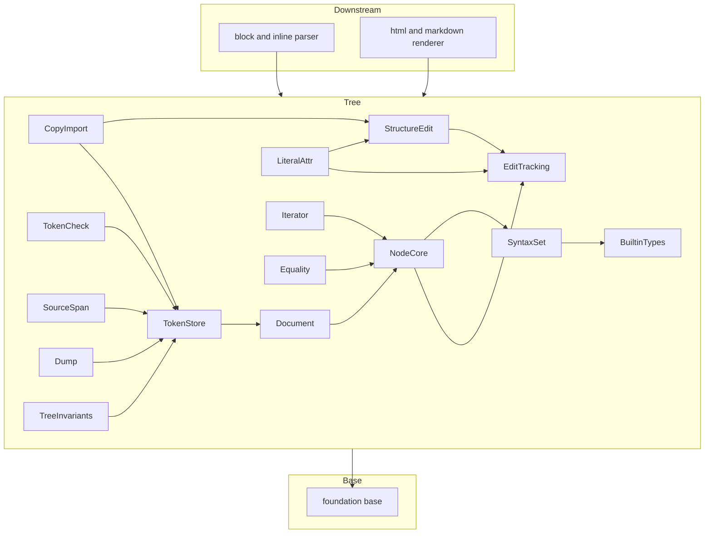
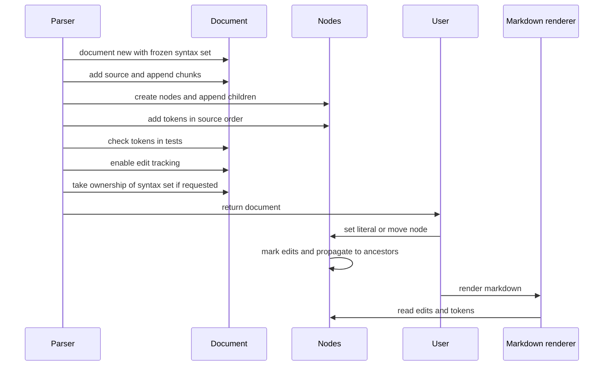
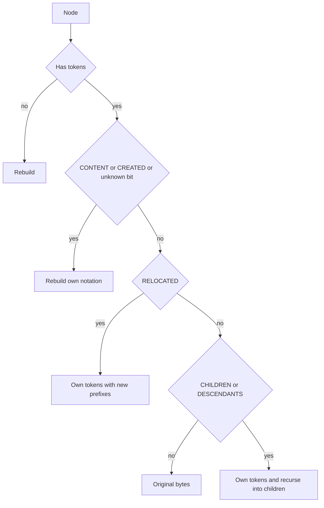
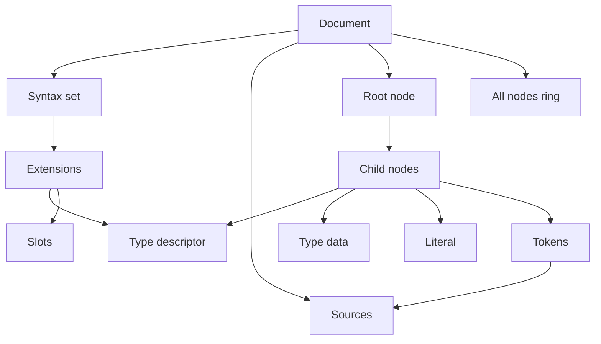

# Design Document: syntax-tree

## Overview
**Purpose**：`syntax-tree` は、Amark の利用者と後続の spec に、意味の単位で参照・編集でき、元の表記を構文トークンとして保持する構文木を提供する。あわせて、ノード型の登録・構文拡張の記述子・構文セットからなる拡張のレジストリを提供し、パーサとレンダラがスロットを足す土台にする。

**Users**：利用者（翻訳、リンクの書き換え、Lint などのツールの開発者）は、木の参照・走査・編集の API を使う。`block-parser` と `inline-parser` は、木を組み立てて構文トークンを記録する。`html-renderer` は木とレジストリのスロットを使って出力する。`markdown-renderer` は、構文トークンと編集の記録から、元の表記を出す部分と作り直す部分を判断する。拡張の実装者は、ノード型と構文拡張の記述子を書く。

**Impact**：`foundation` の共通基盤の上に、公開ヘッダ 6 つ（`node.h`、`document.h`、`token.h`、`iterator.h`、`dump.h`、`extension.h`）と `src/tree/` を追加する。

### Goals
- CommonMark の全ノード（とリンク参照定義）を、拡張と同じ記述子で登録した組み込みの型として提供する。
- パーサが無編集の文書の全バイトを構文トークンで覆えるモデルと、その検証の関数を提供する（コンテナの接頭辞、遅延継続、部分的なタブ、CRLF、NUL、BOM、エスケープ、文字参照）。
- 編集の記録で、`markdown-renderer` が各ノードについて「元の表記を出せるか」を定数時間で判定できる。
- 下流の spec がスロットの種類を足しても、レジストリの API を変えずに済む。

### Non-Goals
- パース、HTML と Markdown の出力の処理、エスケープの方式、区切りの選び直し
- 各スロットの具体的なインタフェース（ブロック構文、インライン構文、後処理、HTML、Markdown）
- CommonMark の組み込み構文をまとめた構文セットの構築関数（組み込みの構文拡張を最初に定義する `block-parser` が `src/syntax/` に置く）
- ソースの借用（ゼロコピー）、編集の記録の消去、テキストの範囲の単位の編集の記録（後から追加できる形にだけする）

## Boundary Commitments

### This Spec Owns
- 公開ヘッダ `include/amark/{node,document,token,iterator,dump,extension}.h` と、`amark.h` への追加
- `src/tree/` のすべて：文書、ソースと行の索引、ノード、構造の編集、複製と取り込み、リテラルと属性、組み込みのノード型の記述子、編集の追跡、構文トークン、ロスレス性の検証、走査、ソース上の位置、比較、ダンプ、構文セット（レジストリ）、木の不変条件の検査
- 木の意味の不変条件：包含の規則、リテラルと属性の値の規則（LF への正規化を含む）
- 構文トークンの種類と印の定義、編集の記録のビットの定義、スロットの種類の番号の範囲（Amark と利用者）と、Amark の種類の通し番号の一覧
- 文書による構文セットの所有（`amark_document_take_syntax_set`）と、子をまとめた取り込み（`amark_node_import_children`）の意味論
- テスト用の補助 `tests/support/tree_builder.{h,c}`（S 式から木を組み立てる）と INTERFACE ライブラリ `amark_test_tree`
- `tests/tree/` のテストと、`fuzz/tree_edit_fuzz.c` のファジングターゲット

### Out of Boundary
- 構文トークンを実際に記録する処理、トークンの役割の番号の値（構文ごとに `block-parser`、`inline-parser` が定める）
- スロットの種類ごとの構造体と、その番号の名前と値（スロットを実行する spec が、一覧で割り当てた番号で `extension.h` に追記する）
- 編集した部分の作り直し、出力時の表現可否の判定（例：リンクの中のリンク）、エスケープ（`markdown-renderer`）
- HTML の出力（リンク参照定義を出さないことを含む。`html-renderer`）
- CommonMark の構文セットの構築関数、パーサの入口

### Allowed Dependencies
- `foundation` の公開 API：`error.h`、`allocator.h`、`buffer.h`、`utf8.h`、`export.h`。内部 API：`base/allocator_internal.h`（`amark_size_add`、`amark_size_mul`）、`base/buffer_internal.h`（`amark_buffer_init`、`amark_buffer_deinit`）
- テスト時：Naos、`amark_add_test()`、`amark_test_support`（`AMARK_CHECK_OOM_SWEEP`、`AMARK_CHECK_BUFFER_EQ`）、`amark_add_fuzzer()`
- C99 の標準ライブラリ（`<stddef.h>`、`<stdint.h>`、`<stdbool.h>`、`<string.h>`、`<limits.h>`）
- レイヤーの規則：`src/tree/` は `src/parse/`、`src/render/`、`src/syntax/` を参照しない。公開ヘッダは他の公開ヘッダだけを include する

### Revalidation Triggers
- 構文トークンの種類・印・フィールドの追加や意味の変更 → `block-parser`、`inline-parser`、`markdown-renderer`
- 編集の記録のビットの追加や伝播の規則の変更 → `markdown-renderer`
- 組み込みのノード型の追加、属性・リテラルの規則（LF の正規化、検査）の変更 → すべての下流の spec
- 包含の規則、`amark_node_type_desc_t` / `amark_extension_t` / `amark_slot_t` の形、識別子の割り当て規則、スロットの番号の範囲と種類の一覧の変更 → すべての下流の spec と利用者の拡張
- ソースの扱い（追加、取り込み時の複製）の変更 → `block-parser`、`markdown-renderer`
- 構文セットの所有の受け渡しの規則（受け付ける条件、解放の順序）、子をまとめた取り込みの規則（検査の順、全か無か、編集の記録）の変更 → `block-parser`（便宜の関数と断片のパース）と、同じ関数を使う上位の spec
- ダンプの形式の変更 → ダンプで期待値を書くすべての spec のテスト
- 下流の spec のスロットの種類の追加・番号の変更 → この spec の種類の一覧と `extension.h` の注記
- `foundation` の `amark.h` の正規の include の順の変更 → この spec（`amark.h` への追加の位置）

## Architecture

### Architecture Pattern & Boundary Map
**Selected pattern**：レイヤードな C のモジュール。`src/tree/` は共通基盤の上にあり、パーサとレンダラを知らない。レジストリは組み込みの型の記述子を「拡張の 1 つ」として持ち、スロットの中身を解釈しない。



**Dependency direction（`src/tree/` の中）**：`builtin_types` → `syntax_set` → `edit_tracking` → `node` → `document` → `token` → `structure_edit` → `literal` / `attr` → `copy_import` → `token_check` / `span` / `iterator` / `equal` / `dump` / `tree_check`。左のファイルは右のファイルの関数を呼ばない。`edit_tracking.c` と `node.c` は文書の状態（追跡の有無、構文セット）を `tree.h` の構造体のフィールドとして読むだけで、`document.c` の関数を呼ばない。`document.c` は根の生成と全ノードの解放に `node.c` を使う。例外として `builtin_types` の関数表は、拡張と同じ立場で公開の `node.h` / `document.h` と `tree.h` の構造体だけを使う。違反はレビューでエラーとする。

**Architecture Integration**：
- Domain boundaries：公開ヘッダは機能ごとに 1 つ。実装は 1 ファイル 1 責務。
- Steering compliance：C99、`amark_` / `AMARK_`、`AMARK_API`、`AMARK_BEGIN_DECLS`、不透明型、`struct_size`、アロケータの経由、エラーコード、アロケータの設定のほかにグローバルな可変状態なし（静的なデータは `const`）、ライセンスヘッダ。

### Technology Stack

| Layer | Choice / Version | Role in Feature | Notes |
|-------|------------------|-----------------|-------|
| Language | C99 | ライブラリ、テスト、ファジング | `foundation` の `amark_target_defaults()` |
| Base | `foundation`（error、allocator、buffer、utf8） | 確保、文字列の検査、ダンプの出力 | 新しい依存なし |
| Test | Naos v0.4.0、`amark_add_test`、`amark_test_support` | 単体テスト、確保失敗の総当たり | `amark_test_tree`（INTERFACE）を追加 |
| Fuzz | `amark_add_fuzzer` | 編集の操作列のファジング | `fuzz/tree_edit_fuzz.c` |

## File Structure Plan

### Directory Structure
```
include/amark/
├── node.h            # 型の識別子と組み込みの型、参照、構造の編集、リテラルと属性、編集の記録、比較、位置
├── document.h        # 文書、ソース、行と列、編集の追跡の切り替え、ロスレス性の検証
├── token.h           # 構文トークンの型・種類・印と操作
├── iterator.h        # 走査（入る/出るイベント）
├── dump.h            # S 式のダンプとダンプの書き手
└── extension.h       # ノード型の記述子、構文拡張の記述子、スロットの基底、構文セット
src/tree/
├── tree.h            # struct amark_document / amark_node / amark_token_record / amark_source と、モジュール間の内部関数
├── syntax_set.h      # struct amark_syntax_set、識別子から記述子を引く内部関数、組み込みの記述子の表の宣言
├── builtin_types.c   # 組み込みの 19 の型の記述子（関数表を含む）と amark.core 拡張
├── syntax_set.c      # 構文セットの生成・変更・複製・凍結・検索・スロットの索引、静的な core の構文セット
├── document.c        # 文書の生成と解放、ソースの登録と追加、行の先頭の索引、位置、追跡の切り替え
├── node.c            # ノードの生成・部分木の解放（内部）・参照・型の問い合わせ・関連付けたポインタ・型のデータ
├── edit_tracking.c   # 編集の記録と祖先への伝播（amark_edit_mark）
├── token.c           # 構文トークンの検査・整列した挿入・削除・移動・取得
├── literal.c         # 文字列の検査と正規化、リテラルの取得と設定、テキストの一括設定
├── attr.c            # 組み込みの属性の取得と設定
├── structure_edit.c  # 挿入・切り離し・置換・解放（公開）・包含の規則・循環の検査
├── copy_import.c     # 複製と、別の文書からの取り込み（ソースの複製と識別子の付け替え）
├── token_check.c     # ロスレス性の検証
├── span.c            # ノードのソース上の範囲
├── iterator.c        # 走査
├── equal.c           # 意味の比較（テキストの正規化を含む）
├── dump.c            # ダンプとダンプの書き手
└── tree_check.c      # 木の不変条件の検査（amark_tree_check。テストとファジング用）
tests/
├── support/
│   ├── tree_builder.h     # S 式から木を組み立てる補助と AMARK_CHECK_TREE_DUMP
│   └── tree_builder.c
└── tree/
    ├── CMakeLists.txt
    ├── document_test.c          # 文書、ソース、位置、追跡の切り替え
    ├── builtin_types_test.c     # 組み込みの型の名前・識別子・分類・包含・既定の属性
    ├── syntax_set_test.c        # 構文セットの操作、凍結、識別子、スロットの列挙
    ├── extension_type_test.c    # 検証用の拡張の型（データ、関数表、包含の上書き、ダンプ、取り込み）
    ├── structure_edit_test.c    # 挿入、移動、置換、切り離し、解放、拒否の規則
    ├── literal_attr_test.c      # リテラルと属性の設定の規則、テキストの一括設定
    ├── edit_tracking_test.c     # 記録の種類、伝播、同じ値、追跡の無効
    ├── token_test.c             # トークンの検査、順序、削除、移動
    ├── token_check_test.c       # ロスレス性の検証（接頭辞、遅延継続、部分的なタブ、CRLF、NUL、BOM）
    ├── copy_import_test.c       # 複製、取り込み、ソースの付け替え
    ├── iterator_span_test.c     # 走査、走査中の編集、位置の再設定、ソース上の範囲
    ├── equal_dump_test.c        # 比較、正規化、ダンプの形式とエスケープ
    ├── tree_builder_test.c      # S 式から組み立てた木とダンプの往復
    ├── oom_test.c               # 全操作の確保失敗の総当たり
    └── scale_test.c             # 深い木、計算量のカウンタ（INTERNAL）
fuzz/
├── tree_edit_fuzz.c        # 入力を編集の操作列として解釈し、各操作の後に不変条件を検査する
└── corpus/tree_edit/       # 種のファイル
```

### Modified Files
- `include/amark/amark.h` — `foundation` の design が定める `amark.h` の正規の include の順（`foundation` のヘッダ → 木のヘッダ → `render.h`、`html.h` → `entity.h`、`scan.h`、`parser.h`、`block.h`、`inline.h`、`commonmark.h` → `markdown.h`）の「木のヘッダ」の位置に、`node.h`、`document.h`、`token.h`、`iterator.h`、`dump.h`、`extension.h` をこの順で追加する。
- `src/CMakeLists.txt` — `amark_objects` に `src/tree/*.c` を追加する。
- `tests/CMakeLists.txt` — `if(AMARK_BUILD_TESTS)` の中で、INTERFACE ライブラリ `amark_test_tree`（INTERFACE のソース `support/tree_builder.c`、インクルード `support/`）を定義し、`add_subdirectory(tree)` を追加する。`tree_builder.h` は Naos のマクロ `AMARK_CHECK_TREE_DUMP` を宣言するので、`amark_test_tree` は Naos に依存する。`foundation` の規則 7.7 により `tests/` は `AMARK_FUZZ` だけが ON の構成でも入るため、Naos に依存するターゲットは `if(AMARK_BUILD_TESTS)` の中に置く（ファジングターゲットは `amark_test_tree` をリンクしない）。
- `fuzz/CMakeLists.txt` — `amark_add_fuzzer(tree_edit SOURCES tree_edit_fuzz.c CORPUS corpus/tree_edit)` を追加する。

## System Flows

### パーサによる組み立てと利用者の編集

- 追跡を有効にする前の変更（パース中の後処理を含む）は記録されない。後処理がノードを作り直すときは、トークンを新しいノードへ移す（`amark_node_transfer_tokens`）。
- 構文セットを内部で作った便宜の関数は、文書を返す直前に `amark_document_take_syntax_set` で所有権を文書へ渡す。以後、利用者は文書を解放するだけでよい。

### 編集の記録の判定（`markdown-renderer` から見た規則）

- この図は判定に必要な情報が揃っていることを示す。実際の出力の方式は `markdown-renderer` が決める。

## Requirements Traceability

| Requirement | Summary | Components | Interfaces | Flows |
|-------------|---------|------------|------------|-------|
| 1.1, 1.2 | 文書の生成、既定の構文セット | Document, SyntaxSet | `amark_document_create`, `amark_syntax_set_core` | 組み立て |
| 1.3 | 文書の解放ですべて解放 | Document, NodeCore | `amark_document_destroy` | — |
| 1.4, 1.5 | ソースの登録と追加 | Document | `amark_document_add_source`, `amark_document_append_source` | 組み立て |
| 1.6, 1.7 | 切り離しと解放 | StructureEdit, NodeCore | `amark_node_unlink`, `amark_node_destroy`, `amark_node_destroy_subtree` | — |
| 1.8 | 確保失敗時の強い保証 | 全コンポーネント | エラーコード | — |
| 1.9 | スレッドと構文セットの共有 | SyntaxSet, Document | 凍結、`const` の静的データ | — |
| 1.10, 1.11 | 文書による構文セットの所有 | Document, SyntaxSet | `amark_document_take_syntax_set` | 組み立て |
| 2.1, 2.5 | 組み込みの型と同じ登録の仕組み | BuiltinTypes, SyntaxSet | `AMARK_NODE_*`, `amark.core` | — |
| 2.2, 2.3, 2.6 | 属性とリテラル | LiteralAttr | `amark_node_set_*` | — |
| 2.4 | 分類と包含の問い合わせ | NodeCore, BuiltinTypes | `amark_node_is_block`, `amark_node_can_contain` | — |
| 3.1, 3.7 | 関係の参照、ポインタの関連付け | NodeCore | `amark_node_parent` など | — |
| 3.2, 3.3, 3.4 | 走査と走査中の編集、再設定 | Iterator | `amark_iter_*` | — |
| 3.5, 3.6 | ソース上の範囲と行・列 | SourceSpan, Document | `amark_node_source_span`, `amark_document_position` | — |
| 4.1 | ノードの生成 | NodeCore, BuiltinTypes | `amark_node_create` | — |
| 4.2, 4.3, 4.4, 4.5 | 挿入、移動、置換、拒否 | StructureEdit | `amark_node_insert_*`, `amark_node_replace` | — |
| 4.6, 4.7, 4.8 | 複製と取り込み | CopyImport | `amark_node_copy`, `amark_node_import` | — |
| 4.9 | 深い木 | Iterator, CopyImport, NodeCore, Equality, Dump | 再帰しない実装 | — |
| 4.10, 4.11 | 子をまとめた取り込み（全か無か） | CopyImport, StructureEdit | `amark_node_import_children` | — |
| 5.1, 5.2, 5.3, 5.4, 5.5, 5.6, 5.8 | 値の規則と正規化、トークンの保持 | LiteralAttr | `amark_node_set_literal` など | — |
| 5.7 | テキストの一括設定 | LiteralAttr | `amark_node_set_inline_text` | — |
| 6.1, 6.2, 6.3, 6.4, 6.5, 6.6, 6.7, 6.8 | トークンのモデルと操作 | TokenStore | `amark_token_t`, `amark_node_add_token` など | 組み立て |
| 6.9 | ロスレス性の検証 | TokenCheck | `amark_document_check_tokens` | 組み立て |
| 7.1, 7.2, 7.3, 7.4, 7.5, 7.6, 7.7, 7.9 | 記録と伝播 | EditTracking, LiteralAttr, StructureEdit, CopyImport | `amark_node_edits`, `amark_node_mark_edited` | 判定 |
| 7.8 | 追跡の切り替え | Document | `amark_document_set_edit_tracking` | 組み立て |
| 7.10 | 記録の種類の追加 | EditTracking | 未知のビットの規則 | 判定 |
| 8.1, 8.2, 8.9 | 記述子とスロット | SyntaxSet | `amark_node_type_desc_t`, `amark_extension_t`, `amark_slot_t` | — |
| 8.3, 8.4, 8.5, 8.6, 8.7, 8.8, 8.10, 8.11 | 構文セットの操作、凍結、問い合わせ | SyntaxSet | `amark_syntax_set_*` | — |
| 8.12 | 関数表の呼び出し | NodeCore, CopyImport, Equality, Dump | 記述子の関数表 | — |
| 8.13 | Amark のスロットの種類の通し番号の一覧 | SyntaxSet | `AMARK_SLOT_KIND_AMARK_FIRST` / `_LAST`、種類の一覧 | — |
| 9.1, 9.2 | 比較 | Equality | `amark_node_equal` | — |
| 9.3, 9.4, 9.5, 9.6 | ダンプ | Dump | `amark_node_dump`, `amark_dump_attr_*` | — |
| 9.7 | S 式から木を組み立てる | TreeBuilder | `amark_test_tree_build` | — |
| 10.1, 10.2 | 規約 | 全コンポーネント | 不透明型、`struct_size` | — |
| 10.3, 10.4, 10.5 | 計算量 | StructureEdit, EditTracking, TokenStore | 内部のカウンタ | — |

## Components and Interfaces

| Component | Domain/Layer | Intent | Req Coverage | Key Dependencies (P0/P1) | Contracts |
|-----------|--------------|--------|--------------|--------------------------|-----------|
| SyntaxSet | Registry | 構文拡張の並び、凍結、識別子、スロットの索引、スロットの種類の一覧 | 1.2, 1.9, 1.11, 2.5, 8.1–8.13 | BuiltinTypes (P0), allocator (P0) | Service, State |
| BuiltinTypes | Registry | 組み込みの 19 の型の記述子と `amark.core` | 2.1–2.5, 4.1 | NodeCore (P1) | Service |
| Document | Tree | 文書、ソース、行の索引、位置、追跡の切り替え、構文セットの所有 | 1.1–1.5, 1.9–1.11, 3.5, 7.8 | NodeCore (P0), SyntaxSet (P0), buffer (P0) | Service, State |
| NodeCore | Tree | ノードの生成・部分木の解放・参照・型のデータ | 1.3, 2.4, 3.1, 3.7, 4.1, 8.12 | SyntaxSet (P0), EditTracking (P0) | Service, State |
| EditTracking | Tree | 記録と伝播 | 7.1–7.10, 10.4 | tree.h の構造体 (P0) | Service |
| TokenStore | Tree | トークンの保持と検査 | 6.1–6.8, 10.5 | NodeCore (P0), Document (P0) | Service |
| LiteralAttr | Tree | リテラルと属性の規則 | 2.2, 2.3, 2.6, 5.1–5.8 | EditTracking (P0), StructureEdit (P0), utf8 (P0) | Service |
| StructureEdit | Tree | 挿入・移動・置換・切り離し・解放 | 1.6, 1.7, 4.2–4.5, 4.11, 10.3 | NodeCore (P0), EditTracking (P0) | Service |
| CopyImport | Tree | 複製と取り込み（部分木、子をまとめて） | 4.6–4.11 | StructureEdit (P0), TokenStore (P0) | Service |
| TokenCheck | Tree | ロスレス性の検証 | 6.9 | TokenStore (P0) | Service |
| SourceSpan | Tree | ノードの範囲と行・列 | 3.5, 3.6 | TokenStore (P0), Document (P0) | Service |
| Iterator | Tree | 走査 | 3.2–3.4, 4.9 | NodeCore (P0) | Service, State |
| Equality | Tree | 意味の比較 | 9.1, 9.2, 4.9 | NodeCore (P0) | Service |
| Dump | Tree | S 式のダンプ | 9.3–9.6, 4.9 | TokenStore (P0), buffer (P0) | Service |
| TreeInvariants | Tree（内部） | 不変条件の検査 | 4.5, 7.5, 6.1 の検証 | TokenStore (P0) | Service |
| TreeBuilder | Test | S 式から木を組み立てる | 9.7 | 公開 API (P0) | Service |
| TreeTests / TreeFuzz | Test / Fuzz | 要件の検証 | 1.8, 4.9, 10.3–10.5 ほか | TreeBuilder (P0) | Batch |

### 共通の規約
- `foundation` の規約に従う：失敗しうる関数は `amark_error_t` を返し、出力引数は最後で `out_` で始める。失敗時は対象を変えない（強い保証）。必須のポインタ引数が NULL なら `AMARK_ERROR_INVALID_ARGUMENT`。解放の関数は NULL を受け付ける。問い合わせの関数は値を直接返し、NULL のノードには「なし」（NULL、0、false、空文字列）を返す。
- 公開の構造体は先頭に `size_t struct_size` を持つ。ライブラリが値を書く構造体（`amark_token_t`、`amark_source_span_t`、`amark_token_check_t`）は、呼び出し側が `struct_size` を設定し、ライブラリはその大きさまでだけ書く。
- 文字列を返す関数は NUL 終端の文字列を返し、長さを `out_length`（NULL でもよい）で返す。返した文字列は、そのノードの次の変更か解放まで有効。
- ノードを受け取る関数で、ノードが別の文書のもの、または型が合わないときは `AMARK_ERROR_INVALID_ARGUMENT`。

### 公開ヘッダの構成
- 依存の順（左は右を include しない）：`node.h` → `document.h` → `token.h` → `iterator.h` → `dump.h` → `extension.h`。`amark.h` は、`foundation` の design が定める正規の include の順の「木のヘッダ」の位置で、この順に include する（他の spec のヘッダとの前後は `foundation` の順に従い、この spec では定めない）。
- `node.h` は `error.h`、`<stddef.h>`、`<stdint.h>`、`<stdbool.h>` を include し、次の前方宣言を 1 か所で持つ（C99 は同じ typedef の重複を許さないため、他のヘッダは繰り返さない）。
  ```c
  typedef struct amark_document amark_document_t;
  typedef struct amark_node amark_node_t;
  typedef struct amark_syntax_set amark_syntax_set_t;
  typedef struct amark_node_type_desc amark_node_type_desc_t;
  typedef uint32_t amark_node_type_t;
  typedef uint32_t amark_source_id_t;
  ```
- `document.h` は `node.h`、`token.h` は `document.h`、`iterator.h` は `node.h`、`dump.h` は `node.h` と `buffer.h`、`extension.h` は `node.h`、`dump.h` を include する。各ヘッダは `AMARK_BEGIN_DECLS` / `AMARK_END_DECLS` で宣言を囲み、ガードは `AMARK_<NAME>_H`。
- `amark_node_source_span` と `amark_source_span_t` は `node.h`、`amark_token_check_t` は `document.h` に置く。

### Registry

#### SyntaxSet

| Field | Detail |
|-------|--------|
| Intent | 構文拡張を順序付きで組み合わせ、凍結後に識別子とスロットの索引を提供する |
| Requirements | 1.2, 1.9, 1.11, 2.5, 8.1–8.13 |

**Responsibilities & Constraints**
- 構文セットは作成時に `amark.core`（組み込みの型だけを持つ拡張）を先頭に持つ。`amark.core` の削除・置換・前への挿入は `AMARK_ERROR_INVALID_ARGUMENT`。
- 追加・挿入・置換のとき記述子を検査する：`struct_size` が v1 の最小以上、名前が `[a-z0-9][a-z0-9_.-]*`、拡張の名前が構文セットの中で重複しない、ノード型の記述子の検査（下記）、スロットの `kind` が 0 でなく `struct_size >= sizeof(amark_slot_t)`。
- ノード型の記述子の検査：拡張の型の名前は `.` を含む（`.` のない名前は組み込みに予約）。`flags` は `BLOCK` か `INLINE` のどちらか一方。`literal_mode` が既知の値。`data_size` が `AMARK_NODE_TYPE_MAX_DATA_SIZE`（64 KiB）以下。
- 凍結：すべての型の名前の重複を検査し（重複は `AMARK_ERROR_INVALID_ARGUMENT`、構文セットは凍結されないまま）、拡張の型に 256 から順に識別子を割り当て、名前の索引とスロットの索引（種類ごとに構文セットの順）を作る。凍結後の変更は `AMARK_ERROR_INVALID_STATE`。
- 記述子と拡張は構文セットより長く生きること（通常は静的な記憶域）。構文セットはそれを使うすべての文書より長く生きること。凍結した構文セットは読み取りだけなので、複数のスレッドから同時に使える。
- `amark_syntax_set_core()` は、凍結済みで `amark.core` だけを持つ静的な `const` の構文セットを返す。解放しても何もしない。内部の印（`is_static`）を持ち、`amark_document_take_syntax_set` はこの印で静的な構文セットを拒否する（1.11）。
- スロットの種類の番号（8.9、8.13）：0 は不正。1–255 は Amark の spec が使い、256 以上は利用者の独自のスロット（ノード型の識別子と同じ境界）。Amark の種類は、spec ごとの範囲を設けず、次の 1 つの一覧で重ならない通し番号を割り当てる。新しい種類は、この一覧の末尾に次の番号で加え（この spec を更新する）、その種類を実行する spec が名前と値を `extension.h` に追記する。レジストリは一覧を強制しない（`kind` が 0 でなければ受け付ける）。一覧は番号の衝突を spec の間で防ぐための約束である。一覧の名前は、各 spec の承認済みの design が定める種類の名前の写しである（構造体の定義の正本は各 spec の design。種類を足す・変える spec は、この一覧と `extension.h` の注記も合わせて更新する）。

| 番号 | 種類 | 定義する spec |
|------|------|---------------|
| 1 | `AMARK_SLOT_BLOCK_SYNTAX` | `block-parser` |
| 2 | `AMARK_SLOT_PARAGRAPH_CONSUMER` | `block-parser` |
| 3 | `AMARK_SLOT_POSTPROCESS` | `block-parser` |
| 4 | `AMARK_SLOT_PARSE_STATE` | `block-parser` |
| 5 | `AMARK_SLOT_INLINE_SYNTAX` | `inline-parser` |
| 6 | `AMARK_SLOT_INLINE_DELIMITER` | `inline-parser` |
| 7 | `AMARK_SLOT_INLINE_BRACKET` | `inline-parser` |
| 8 | `AMARK_SLOT_INLINE_TEXT_SCANNER` | `inline-parser` |
| 9 | `AMARK_SLOT_INLINE_NODE_TRAITS` | `inline-parser` |
| 10 | `AMARK_SLOT_INLINE_SPECIAL` | `inline-parser` |
| 11 | `AMARK_SLOT_HTML_NODE` | `html-renderer` |
| 12 | `AMARK_SLOT_HTML_HOOKS` | `html-renderer` |
| 13 | `AMARK_SLOT_MARKDOWN_NODE` | `markdown-renderer` |
| 14 | `AMARK_SLOT_MARKDOWN_HOOKS` | `markdown-renderer` |
| 15–255 | 将来の Amark の spec（予約） | — |
| 256 以上 | 利用者 | — |

**Contracts**: Service [x] / State [x]

##### Service Interface
```c
/* include/amark/extension.h（node.h と dump.h を include する。型名の typedef は node.h と dump.h にだけ置く） */

/* 分類（provides / accepts のビット） */
#define AMARK_CONTENT_BLOCK      0x01u
#define AMARK_CONTENT_INLINE     0x02u
#define AMARK_CONTENT_LIST_ITEM  0x04u

/* 型の性質 */
#define AMARK_NODE_TYPE_BLOCK    0x01u
#define AMARK_NODE_TYPE_INLINE   0x02u

typedef enum amark_literal_mode {
    AMARK_LITERAL_NONE = 0,   /* リテラルを持たない */
    AMARK_LITERAL_LINE = 1,   /* 改行を含めない（text、code） */
    AMARK_LITERAL_SPAN = 2,   /* 改行可、空行不可、LF に揃える（html_inline） */
    AMARK_LITERAL_LINES = 3   /* 改行可、LF に揃え、空でなければ末尾を LF にする（code_block、html_block） */
} amark_literal_mode_t;

#define AMARK_NODE_TYPE_MAX_DATA_SIZE 65536u

struct amark_node_type_desc {         /* typedef は node.h が前方宣言で行う（C99 は typedef の重複を許さない） */
    size_t struct_size;
    const char *name;                 /* 組み込みは "paragraph" など。拡張は "gfm.table" のように . を含む */
    uint32_t flags;                   /* AMARK_NODE_TYPE_BLOCK か AMARK_NODE_TYPE_INLINE */
    uint32_t provides;                /* この型が属する分類 */
    uint32_t accepts;                 /* 子として受け入れる分類。0 かつ can_contain が NULL なら葉 */
    amark_literal_mode_t literal_mode;
    size_t data_size;                 /* 型ごとのデータの大きさ。0 も可。生成時に 0 で埋める */
    /* 以下はすべて任意（NULL 可） */
    bool (*can_contain)(const struct amark_node_type_desc *self, const struct amark_node_type_desc *child);
    amark_error_t (*validate_literal)(const amark_node_t *node, const char *text, size_t length);
    amark_error_t (*init)(amark_node_t *node, void *data);
    void (*deinit)(amark_node_t *node, void *data);
    amark_error_t (*copy)(amark_node_t *dst, void *dst_data, const amark_node_t *src, const void *src_data);
    bool (*equal)(const amark_node_t *a, const void *a_data, const amark_node_t *b, const void *b_data);
    amark_error_t (*dump)(const amark_node_t *node, const void *data, amark_dump_writer_t *writer);
    void *user_data;
};

/* スロットの基底：種類ごとの構造体は、先頭のメンバー base にこの型を置く */
typedef struct amark_slot {
    size_t struct_size;               /* 種類ごとの構造体全体の大きさ */
    uint32_t kind;
} amark_slot_t;

#define AMARK_SLOT_KIND_AMARK_FIRST   1u   /* 1–255：Amark の spec が使う */
#define AMARK_SLOT_KIND_AMARK_LAST  255u
#define AMARK_SLOT_KIND_USER_FIRST  256u   /* 256 以上：利用者の独自のスロット */

/* Amark のスロットの種類の一覧（8.13）。spec ごとの範囲は設けず、通し番号で末尾に加える。
   各種類の定義は、それを実行する spec が次の番号で追記する。15–255 は将来の Amark の spec のために予約
   （割り当てるときは syntax-tree の spec の一覧を更新する）
     1 AMARK_SLOT_BLOCK_SYNTAX、2 AMARK_SLOT_PARAGRAPH_CONSUMER、3 AMARK_SLOT_POSTPROCESS、
     4 AMARK_SLOT_PARSE_STATE（block-parser）
     5 AMARK_SLOT_INLINE_SYNTAX、6 AMARK_SLOT_INLINE_DELIMITER、7 AMARK_SLOT_INLINE_BRACKET、
     8 AMARK_SLOT_INLINE_TEXT_SCANNER、9 AMARK_SLOT_INLINE_NODE_TRAITS、10 AMARK_SLOT_INLINE_SPECIAL（inline-parser）
     11 AMARK_SLOT_HTML_NODE、12 AMARK_SLOT_HTML_HOOKS（html-renderer）
     13 AMARK_SLOT_MARKDOWN_NODE、14 AMARK_SLOT_MARKDOWN_HOOKS（markdown-renderer） */

typedef struct amark_extension {
    size_t struct_size;
    const char *name;                                  /* 例："commonmark.atx_heading" */
    const amark_node_type_desc_t *const *node_types;
    size_t node_type_count;
    const amark_slot_t *const *slots;
    size_t slot_count;
    void *user_data;
} amark_extension_t;

AMARK_API amark_error_t amark_syntax_set_create(amark_syntax_set_t **out_set);
AMARK_API amark_error_t amark_syntax_set_clone(const amark_syntax_set_t *set,
                                               amark_syntax_set_t **out_set);   /* 凍結していない複製 */
AMARK_API void amark_syntax_set_destroy(amark_syntax_set_t *set);
AMARK_API const amark_syntax_set_t *amark_syntax_set_core(void);

AMARK_API amark_error_t amark_syntax_set_append(amark_syntax_set_t *set, const amark_extension_t *extension);
AMARK_API amark_error_t amark_syntax_set_insert_before(amark_syntax_set_t *set, const char *anchor_name,
                                                       const amark_extension_t *extension);
AMARK_API amark_error_t amark_syntax_set_remove(amark_syntax_set_t *set, const char *name);
AMARK_API amark_error_t amark_syntax_set_replace(amark_syntax_set_t *set, const char *name,
                                                 const amark_extension_t *extension);
AMARK_API amark_error_t amark_syntax_set_freeze(amark_syntax_set_t *set);
AMARK_API bool amark_syntax_set_is_frozen(const amark_syntax_set_t *set);

AMARK_API size_t amark_syntax_set_extension_count(const amark_syntax_set_t *set);
AMARK_API const amark_extension_t *amark_syntax_set_extension_at(const amark_syntax_set_t *set, size_t index);
AMARK_API const amark_extension_t *amark_syntax_set_find_extension(const amark_syntax_set_t *set, const char *name);

/* 以下は凍結後に使う。凍結前は「なし」を返す */
AMARK_API bool amark_syntax_set_find_node_type(const amark_syntax_set_t *set, const char *name,
                                               amark_node_type_t *out_type);
AMARK_API bool amark_syntax_set_node_type_of(const amark_syntax_set_t *set, const amark_node_type_desc_t *desc,
                                             amark_node_type_t *out_type);
AMARK_API const amark_node_type_desc_t *amark_syntax_set_node_type_desc(const amark_syntax_set_t *set,
                                                                        amark_node_type_t type);
AMARK_API size_t amark_syntax_set_slot_count(const amark_syntax_set_t *set, uint32_t kind);
AMARK_API const amark_slot_t *amark_syntax_set_slot_at(const amark_syntax_set_t *set, uint32_t kind,
                                                       size_t index, const amark_extension_t **out_extension);
```
- Preconditions：`remove` / `replace` / `insert_before` の名前が見つからなければ `AMARK_ERROR_INVALID_ARGUMENT`。`replace` は同じ名前でなくてもよい（新しい名前も重複の検査をする）。
- Postconditions：凍結に成功した構文セットでは、同じ拡張の並びから作った別の構文セットと同じ識別子が割り当たる（8.6）。`slot_at` は構文セットの順、拡張の中ではスロットの一覧の順に返す。
- Invariants：組み込みの型の識別子は 1–19 で固定。拡張の型の識別子は 256 以上。一覧の Amark のスロットの種類の番号は重ならず、すべて `AMARK_SLOT_KIND_AMARK_FIRST`–`AMARK_SLOT_KIND_AMARK_LAST` に含まれる（テストで確かめる）。

##### State Management
- State model：`{frozen, is_static, extensions[], 凍結後: dynamic_types[], name_index[], slot_index[]}`。状態は「編集可能」→（freeze）→「凍結」の一方向。
- Concurrency strategy：凍結後は読み取りだけ。静的な core の構文セットは `const` のデータ。

**Implementation Notes**
- Integration：`syntax_set.h` は `amark_syntax_set_desc(set, type)`（文書とノードが使う定数時間の検索）を宣言する。組み込みの型は `amark_builtin_types[]`（識別子で添字）から引く。
- Validation：`syntax_set_test.c` と `oom_test.c`。
- Risks：下流の spec が包含やスロットに不足を見つけたら、この spec を更新する（回避策をとらない）。

#### BuiltinTypes

| Field | Detail |
|-------|--------|
| Intent | 組み込みの型を、拡張と同じ記述子で定義する |
| Requirements | 2.1–2.5, 4.1 |

**Responsibilities & Constraints**
- `amark.core` 拡張は、次の 19 の型の記述子を識別子の順に持ち、スロットを持たない。

| ID | Name | Flags | provides | accepts | literal_mode | 型のデータ（既定値） |
|----|------|-------|----------|---------|--------------|----------------------|
| 1 | document | BLOCK | — | BLOCK | NONE | — |
| 2 | block_quote | BLOCK | BLOCK | BLOCK | NONE | — |
| 3 | list | BLOCK | BLOCK | LIST_ITEM | NONE | type（bullet）、start（1）、tight（true） |
| 4 | item | BLOCK | LIST_ITEM | BLOCK | NONE | — |
| 5 | code_block | BLOCK | BLOCK | — | LINES | info（""） |
| 6 | html_block | BLOCK | BLOCK | — | LINES | — |
| 7 | paragraph | BLOCK | BLOCK | INLINE | NONE | — |
| 8 | heading | BLOCK | BLOCK | INLINE | NONE | level（1） |
| 9 | thematic_break | BLOCK | BLOCK | — | NONE | — |
| 10 | link_definition | BLOCK | BLOCK | — | NONE | label、destination、title（""） |
| 11 | text | INLINE | INLINE | — | LINE | — |
| 12 | softbreak | INLINE | INLINE | — | NONE | — |
| 13 | linebreak | INLINE | INLINE | — | NONE | — |
| 14 | code | INLINE | INLINE | — | LINE（空を拒否する `validate_literal`） | — |
| 15 | html_inline | INLINE | INLINE | — | SPAN | — |
| 16 | emph | INLINE | INLINE | INLINE | NONE | — |
| 17 | strong | INLINE | INLINE | INLINE | NONE | — |
| 18 | link | INLINE | INLINE | INLINE | NONE | destination、title（""） |
| 19 | image | INLINE | INLINE | INLINE | NONE | destination、title（""） |

- 文字列の属性を持つ型は、`deinit` / `copy` / `equal` / `dump` の関数表で、`amark_malloc` などで確保した文字列を管理する。`equal` は list の start を type が ordered のときだけ比べる。
- `document` 型のノードは文書の生成時に 1 つだけ作る。`amark_node_create` で document を指定すると `AMARK_ERROR_INVALID_ARGUMENT`。

**Contracts**: Service [x]
```c
/* include/amark/node.h */
/* amark_node_type_t（uint32_t）の値。拡張で増える開いた集合なので enum にしない */
#define AMARK_NODE_NONE              0u
#define AMARK_NODE_DOCUMENT          1u
#define AMARK_NODE_BLOCK_QUOTE       2u
#define AMARK_NODE_LIST              3u
#define AMARK_NODE_ITEM              4u
#define AMARK_NODE_CODE_BLOCK        5u
#define AMARK_NODE_HTML_BLOCK        6u
#define AMARK_NODE_PARAGRAPH         7u
#define AMARK_NODE_HEADING           8u
#define AMARK_NODE_THEMATIC_BREAK    9u
#define AMARK_NODE_LINK_DEFINITION  10u
#define AMARK_NODE_TEXT             11u
#define AMARK_NODE_SOFTBREAK        12u
#define AMARK_NODE_LINEBREAK        13u
#define AMARK_NODE_CODE             14u
#define AMARK_NODE_HTML_INLINE      15u
#define AMARK_NODE_EMPH             16u
#define AMARK_NODE_STRONG           17u
#define AMARK_NODE_LINK             18u
#define AMARK_NODE_IMAGE            19u
#define AMARK_NODE_BUILTIN_LAST    255u   /* 1–255 は組み込みに予約 */
#define AMARK_NODE_DYNAMIC_FIRST   256u   /* 拡張の型の識別子の始まり */
```

### Tree

#### Document

| Field | Detail |
|-------|--------|
| Intent | ノード・ソース・構文セット・追跡の状態を所有する |
| Requirements | 1.1–1.5, 1.9–1.11, 3.5, 7.8 |

**Responsibilities & Constraints**
- 生成：凍結済みの構文セット（NULL なら `amark_syntax_set_core()`）を参照し、document 型の根のノードを作る。凍結していない構文セットは `AMARK_ERROR_INVALID_STATE`。編集の追跡は無効で始まる。
- 解放：根を含むすべてのノード（切り離したものも）を、内部の全ノードの環から順に解放する（各ノードの型の `deinit` を呼ぶ）。次にソースを解放する。文書が構文セットを所有していれば、その後で `amark_syntax_set_destroy` で解放し、最後に文書の構造体を解放する。ノードの `deinit` は記述子と構文セットを参照してよい（解放の順序で保証する）。
- 構文セットの所有（`amark_document_take_syntax_set`、1.10、1.11）：
  - 受け付ける条件：`set` が、文書が使っている構文セットそのもの（`set == amark_document_syntax_set(document)`）で、静的な構文セット（`is_static`）でなく、文書がまだ構文セットを所有していない。どれかに反すれば `AMARK_ERROR_INVALID_ARGUMENT`（NULL の引数も同じ）で、文書は変わらず、所有権は呼び出し側に残る。文書が使うのは凍結済みの構文セットだけなので、受け取る構文セットは常に凍結済み（凍結の規則はそのまま）。
  - 成功の後：構文セットは文書のものになる。呼び出し側は `amark_syntax_set_destroy` を呼んではならない。凍結済みなので内容は変わらない。
  - 共有：同じ構文セットを使う他の文書があってよいが、それらを所有する文書より先に解放する（構文セットは使うすべての文書より長く生きる、という既存の規則の言い換え。破ったときの振る舞いは規定しない）。
  - 確保をしないので、メモリ不足で失敗しない。編集の記録とは無関係。
  - `set` の引数は `const` でない（所有権の受け渡しで解放の責任が移るため。`const` にはしない）。`amark_document_syntax_set` の戻り値や `const amark_syntax_set_t *` の引数など、`const` のポインタしか持たない呼び出し側は所有権を渡してはならない（`const` を外すキャストで渡さない）。渡せるのは、構文セットを自分で作り `const` でないポインタを持ち続けている呼び出し側（例：`block-parser` の便宜の関数）だけである。
- ソース：識別子は 0 から登録の順。`add_source` は複製して登録する（長さ 0 も可）。`append_source` は末尾に追加し、既存のバイトの位置を変えない（返したポインタは無効になりうる）。各ソースは行の先頭のオフセットの索引を持ち、追加のたびに更新する（チャンクの境目の CRLF を 1 つの改行として扱う）。
- 位置：`offset`（0 ≤ offset ≤ 長さ）を 1 から数える行と列（バイト単位）に変換する。行の区切りは LF、CR、CRLF。範囲外は `AMARK_ERROR_INVALID_ARGUMENT`。

**Contracts**: Service [x] / State [x]
```c
/* include/amark/document.h */
AMARK_API amark_error_t amark_document_create(const amark_syntax_set_t *syntax,
                                              amark_document_t **out_document);
AMARK_API void amark_document_destroy(amark_document_t *document);
AMARK_API amark_node_t *amark_document_root(const amark_document_t *document);
AMARK_API const amark_syntax_set_t *amark_document_syntax_set(const amark_document_t *document);

AMARK_API amark_error_t amark_document_add_source(amark_document_t *document, const char *data, size_t length,
                                                  amark_source_id_t *out_source);
AMARK_API amark_error_t amark_document_append_source(amark_document_t *document, amark_source_id_t source,
                                                     const char *data, size_t length);
AMARK_API size_t amark_document_source_count(const amark_document_t *document);
AMARK_API const char *amark_document_source_data(const amark_document_t *document, amark_source_id_t source,
                                                 size_t *out_length);   /* 未登録なら NULL */
AMARK_API amark_error_t amark_document_position(const amark_document_t *document, amark_source_id_t source,
                                                size_t offset, size_t *out_line, size_t *out_column);

AMARK_API void amark_document_set_edit_tracking(amark_document_t *document, bool enabled);
AMARK_API bool amark_document_edit_tracking(const amark_document_t *document);

/* 文書が使っている、ヒープに作られた構文セットの所有権を受け取る。成功したら、amark_document_destroy が
   ノードとソースの後でこの構文セットを解放する。失敗したら所有権は呼び出し側に残る。
   const のポインタしか持たない呼び出し側は渡さない（const を外すキャストをしない） */
AMARK_API amark_error_t amark_document_take_syntax_set(amark_document_t *document, amark_syntax_set_t *set);
```
- `data` が NULL で `length` が 0 なら空のソースとして扱う。`data` が NULL で `length` が 0 でなければ `AMARK_ERROR_INVALID_ARGUMENT`。

##### State Management
- State model：`{syntax, owned_syntax（所有していれば syntax と同じ、なければ NULL）, root, all_nodes の環, sources[{bytes: 埋め込みの amark_buffer_t, line_starts[], pending_cr}], tracking, 内部のカウンタ}`。`owned_syntax` は NULL →（take）→ 非 NULL の一方向で、解放まで変わらない。
- Concurrency strategy：文書は 1 つのスレッドから使う。異なる文書は独立（共有するのは凍結した構文セット、`const` の静的データ、グローバルのアロケータの設定だけ）。

#### NodeCore

| Field | Detail |
|-------|--------|
| Intent | ノードの生成・部分木の解放・参照、型のデータと関連付けたポインタ |
| Requirements | 1.3, 2.4, 3.1, 3.7, 4.1, 8.12 |

**Responsibilities & Constraints**
- ノードは 1 回の確保で、ヘッダと型のデータ（`data_size`、`max_align` の境界）を持つ。型のデータは 0 で埋めてから `init` を呼ぶ。`init` が失敗したら確保を戻して失敗を返す。
- 部分木の解放の内部関数 `amark_node_destroy_subtree`：切り離されたノードの部分木を後順に反復で解放する（各ノードの `deinit`、リテラル、トークン、全ノードの環からの除去）。公開の `amark_node_destroy` は StructureEdit が実装する。
- 生成時、追跡が有効なら `CREATED` を記録する。
- 子を持てるかは `accepts != 0 || can_contain != NULL` で決まる。

**Contracts**: Service [x] / State [x]
```c
/* include/amark/node.h（続き。前方宣言は公開ヘッダの構成を参照） */

AMARK_API amark_error_t amark_node_create(amark_document_t *document, amark_node_type_t type, amark_node_t **out_node);

AMARK_API amark_node_type_t amark_node_get_type(const amark_node_t *node);
AMARK_API const char *amark_node_type_name(const amark_node_t *node);
AMARK_API const amark_node_type_desc_t *amark_node_desc(const amark_node_t *node);
AMARK_API amark_document_t *amark_node_document(const amark_node_t *node);
AMARK_API amark_node_t *amark_node_parent(const amark_node_t *node);
AMARK_API amark_node_t *amark_node_first_child(const amark_node_t *node);
AMARK_API amark_node_t *amark_node_last_child(const amark_node_t *node);
AMARK_API amark_node_t *amark_node_next(const amark_node_t *node);
AMARK_API amark_node_t *amark_node_previous(const amark_node_t *node);
AMARK_API bool amark_node_is_block(const amark_node_t *node);
AMARK_API bool amark_node_is_inline(const amark_node_t *node);
AMARK_API bool amark_node_can_have_children(const amark_node_t *node);
AMARK_API bool amark_node_can_contain(const amark_node_t *parent, amark_node_type_t child_type);

AMARK_API void *amark_node_user_data(const amark_node_t *node);
AMARK_API void amark_node_set_user_data(amark_node_t *node, void *user_data);   /* 編集を記録しない、複製しない */
AMARK_API void *amark_node_data(amark_node_t *node);                 /* 型のデータ。data_size が 0 なら NULL */
AMARK_API const void *amark_node_data_const(const amark_node_t *node);
```
- `amark_node_desc` のために `node.h` は `typedef struct amark_node_type_desc amark_node_type_desc_t;` を前方宣言し、`extension.h` は `struct amark_node_type_desc` の定義だけを持つ。

#### EditTracking

| Field | Detail |
|-------|--------|
| Intent | 編集の記録とその祖先への伝播 |
| Requirements | 7.1–7.10, 10.4 |

**Responsibilities & Constraints**
- 記録のビット：

| Bit | 値 | 記録する場面 |
|-----|----|--------------|
| `AMARK_EDIT_CONTENT` | 0x01 | 自分のリテラルか属性（型のデータ）が変わった |
| `AMARK_EDIT_CHILDREN` | 0x02 | 直接の子の挿入・削除・移動・置換（並べ替えを含む） |
| `AMARK_EDIT_DESCENDANTS` | 0x04 | 子孫のどれかに記録がある |
| `AMARK_EDIT_RELOCATED` | 0x08 | 自分が移動・複製・取り込みの結果として挿入された（自分のトークンは有効だが、周りの文脈が変わった） |
| `AMARK_EDIT_CREATED` | 0x10 | 追跡中に作られた（トークンを持たない） |
| 0x20 以上 | 予約 | 将来の追加。利用者は未知のビットを `CONTENT` として扱う |

- `amark_edit_mark(node, bits)`：追跡が無効なら何もしない。有効なら `node->edits |= bits` とし、親から順に `DESCENDANTS` を付け、すでに `DESCENDANTS` を持つ祖先で止める。
- 不変条件：`DESCENDANTS` を持つノードの祖先はすべて `DESCENDANTS` を持つ。記録を持つ部分木を挿入するときは、追跡の有無にかかわらず、挿入先の祖先に `DESCENDANTS` を伝播してこの条件を保つ。
- 値が同じ設定（バイト列が同じ、数値が同じ）は記録しない。トークンの操作と関連付けたポインタの変更は記録しない。
- 切り離されたノードは、再び挿入されるときに `RELOCATED` を受ける（`CREATED` を持つノードを除く）。

**Contracts**: Service [x]
```c
/* include/amark/node.h（続き） */
#define AMARK_EDIT_CONTENT     0x01u
#define AMARK_EDIT_CHILDREN    0x02u
#define AMARK_EDIT_DESCENDANTS 0x04u
#define AMARK_EDIT_RELOCATED   0x08u
#define AMARK_EDIT_CREATED     0x10u

AMARK_API uint32_t amark_node_edits(const amark_node_t *node);
AMARK_API void amark_node_mark_edited(amark_node_t *node);   /* 拡張の設定関数が呼ぶ。CONTENT を記録する */
```

#### TokenStore

| Field | Detail |
|-------|--------|
| Intent | 構文トークンの検査・保持・順序・移動 |
| Requirements | 6.1–6.8, 10.5 |

**Responsibilities & Constraints**
- 各ノードのトークンは、（ソース、オフセット、`tab_column_offset`、追加の順）の昇順に並ぶ。末尾への追加は償却定数時間、途中への挿入は二分探索と移動。
- 種類と、追加時の検査：

| Kind | 値 | 意味 | 追加時の検査 |
|------|----|------|--------------|
| `TEXT` | 1 | 意味の内容（リテラルや属性）にそのまま現れるバイト | — |
| `MARKER` | 2 | 構文の記号（`#`、`>`、`*`、フェンス、括弧、リストのマーカー、setext の下線など） | 長さ 1 以上 |
| `SPACE` | 3 | 意味に含まれない空白（インデント、詰め物、行末の空白） | バイトが空白かタブだけ |
| `LINE_ENDING` | 4 | 改行 | バイトが `\n`、`\r\n`、`\r` のどれか |
| `ESCAPE` | 5 | バックスラッシュのエスケープ（意味では 1 文字） | 長さ 2 で先頭が `\` |
| `CHAR_REF` | 6 | 実体参照と数値文字参照 | 先頭が `&`、末尾が `;` |
| `REPLACED` | 7 | 意味では別の文字に置き換えたバイト（NUL、不正な UTF-8） | 長さ 1 以上 |
| `BOM` | 8 | 先頭の UTF-8 の BOM | オフセット 0、バイトが `EF BB BF` |
| `LAZY_CONTINUATION` | 9 | 遅延継続行でこのコンテナの接頭辞が省かれた印 | 長さ 0 |

- 印：`AMARK_TOKEN_FLAG_CONTAINER_PREFIX`（コンテナが行の先頭、子の内容の前に置く表記。引用の `>` と任意の空白、リスト項目の最初の行のマーカーと空白、続く行のインデント、`LAZY_CONTINUATION`）。`AMARK_TOKEN_FLAG_PARTIAL_TAB`（1 つのタブの一部の列だけを表す。長さ 1 でバイトがタブ、`tab_columns` が 1–4、`tab_column_offset + tab_columns` ≤ 4）。未知の印は `AMARK_ERROR_INVALID_ARGUMENT`。
- 役割（`role`）は所有するノードの型を扱う構文拡張が決める 16 ビットの番号。0 は「指定なし」。
- 共通の検査：種類が既知、ソースが登録済み、`offset + length` がソースの長さ以下（桁あふれも拒否）。
- 移動（`transfer`）：同じ文書のノード間で、`from` の `[first, first + count)` を `to` に整列して移す。確保の失敗時はどちらも変えない。
- 長さ 0 のトークンも保持する（`LAZY_CONTINUATION` のほか、パーサが位置の印に使ってよい）。

**Contracts**: Service [x]
```c
/* include/amark/token.h */
typedef enum amark_token_kind {
    AMARK_TOKEN_TEXT = 1, AMARK_TOKEN_MARKER = 2, AMARK_TOKEN_SPACE = 3, AMARK_TOKEN_LINE_ENDING = 4,
    AMARK_TOKEN_ESCAPE = 5, AMARK_TOKEN_CHAR_REF = 6, AMARK_TOKEN_REPLACED = 7, AMARK_TOKEN_BOM = 8,
    AMARK_TOKEN_LAZY_CONTINUATION = 9
} amark_token_kind_t;

#define AMARK_TOKEN_FLAG_CONTAINER_PREFIX 0x01u
#define AMARK_TOKEN_FLAG_PARTIAL_TAB      0x02u

typedef struct amark_token {
    size_t struct_size;
    amark_token_kind_t kind;
    uint16_t role;
    uint32_t flags;
    amark_source_id_t source;
    size_t offset;
    size_t length;
    unsigned tab_column_offset;   /* PARTIAL_TAB のとき：同じタブで先行するトークンが使った列の数 */
    unsigned tab_columns;         /* PARTIAL_TAB のとき：このトークンが表す列の数 */
} amark_token_t;

AMARK_API size_t amark_node_token_count(const amark_node_t *node);
AMARK_API amark_error_t amark_node_token_at(const amark_node_t *node, size_t index, amark_token_t *out_token);
AMARK_API amark_error_t amark_node_add_token(amark_node_t *node, const amark_token_t *token);
AMARK_API amark_error_t amark_node_remove_token(amark_node_t *node, size_t index);
AMARK_API amark_error_t amark_node_transfer_tokens(amark_node_t *from, size_t first, size_t count, amark_node_t *to);
AMARK_API const char *amark_token_kind_name(amark_token_kind_t kind);   /* "text" など。未知は "unknown" */
```

#### LiteralAttr

| Field | Detail |
|-------|--------|
| Intent | リテラルと組み込みの属性の取得と設定、値の規則、テキストの一括設定 |
| Requirements | 2.2, 2.3, 2.6, 5.1–5.8 |

**Responsibilities & Constraints**
- 文字列の共通の検査（すべての設定）：`amark_utf8_validate` で正しい UTF-8、NUL を含まない。違反は `AMARK_ERROR_INVALID_ARGUMENT`。
- 改行は LF、CR、CRLF。「空行」は、2 つの改行の間に空白とタブしかない行。
- リテラルの方式（`literal_mode`）ごとの規則：`LINE` は改行を拒否。`SPAN` は空行を拒否し、改行を LF に揃える。`LINES` は改行を LF に揃え、空でなければ末尾に LF がなければ足す。`NONE` の型への設定は拒否。その後、型の `validate_literal` を呼ぶ（code は空を拒否）。
- 属性の規則：

| 属性 | 対象の型 | 規則 |
|------|----------|------|
| level | heading | 1–6 |
| list type | list | `AMARK_LIST_BULLET` か `AMARK_LIST_ORDERED` |
| start | list | 0–999999999 |
| tight | list | 真偽 |
| info | code_block | 改行を拒否 |
| destination | link、image、link_definition | 改行を拒否 |
| title | link、image、link_definition | 空行を拒否 |
| label | link_definition | 1–999 の符号位置、空白以外の文字を含む、エスケープされていない `[` `]` を含まない、空行を拒否 |

- 比較して同じ値なら、変更も記録もしない（成功を返す）。異なれば新しい値を確保してから古い値を解放し、`CONTENT` を記録する。構文トークンは変えない（5.8）。
- テキストの一括設定：対象は `amark_node_can_contain(node, AMARK_NODE_TEXT)` が真のノード。文字列を改行で分け、text（空の部分は作らない）と softbreak の列を、切り離した状態ですべて作ってから、既存の子を解放し、新しい子を付ける（確保の失敗時は何も変えない）。記録：対象に `CHILDREN`、新しい子に `CREATED`。

**Contracts**: Service [x]
```c
/* include/amark/node.h（続き） */
AMARK_API const char *amark_node_literal(const amark_node_t *node, size_t *out_length);   /* なければ "" */
AMARK_API amark_error_t amark_node_set_literal(amark_node_t *node, const char *text, size_t length);
AMARK_API amark_error_t amark_node_set_inline_text(amark_node_t *node, const char *text, size_t length);

AMARK_API int amark_node_heading_level(const amark_node_t *node);          /* 見出しでなければ 0 */
AMARK_API amark_error_t amark_node_set_heading_level(amark_node_t *node, int level);

typedef enum amark_list_type { AMARK_LIST_NONE = 0, AMARK_LIST_BULLET = 1, AMARK_LIST_ORDERED = 2 } amark_list_type_t;
AMARK_API amark_list_type_t amark_node_list_type(const amark_node_t *node);
AMARK_API amark_error_t amark_node_set_list_type(amark_node_t *node, amark_list_type_t type);
AMARK_API long amark_node_list_start(const amark_node_t *node);
AMARK_API amark_error_t amark_node_set_list_start(amark_node_t *node, long start);
AMARK_API bool amark_node_list_tight(const amark_node_t *node);
AMARK_API amark_error_t amark_node_set_list_tight(amark_node_t *node, bool tight);

AMARK_API const char *amark_node_code_info(const amark_node_t *node, size_t *out_length);
AMARK_API amark_error_t amark_node_set_code_info(amark_node_t *node, const char *text, size_t length);
AMARK_API const char *amark_node_link_destination(const amark_node_t *node, size_t *out_length);
AMARK_API amark_error_t amark_node_set_link_destination(amark_node_t *node, const char *text, size_t length);
AMARK_API const char *amark_node_link_title(const amark_node_t *node, size_t *out_length);
AMARK_API amark_error_t amark_node_set_link_title(amark_node_t *node, const char *text, size_t length);
AMARK_API const char *amark_node_link_label(const amark_node_t *node, size_t *out_length);   /* link_definition */
AMARK_API amark_error_t amark_node_set_link_label(amark_node_t *node, const char *text, size_t length);
```
- 型が合わないノードの取得は既定値（0、`AMARK_LIST_NONE`、false、""）、設定は `AMARK_ERROR_INVALID_ARGUMENT`（2.6）。

#### StructureEdit

| Field | Detail |
|-------|--------|
| Intent | 包含の規則を守った挿入・移動・置換・切り離し・解放 |
| Requirements | 1.6, 1.7, 4.2–4.5, 4.11, 10.3 |

**Responsibilities & Constraints**
- 検査の順（どれかに反すれば `AMARK_ERROR_INVALID_ARGUMENT`、木は変えない）：
  1. 両方のノードが同じ文書に属する。
  2. 挿入するノードが根でない。兄弟を基準にするとき、基準のノードが親を持つ。
  3. 包含：親の型の `can_contain` があればその結果、なければ `parent.accepts & child.provides` が 0 でない。
  4. 循環：挿入するノードが子を持つときだけ、挿入先の親から根まで祖先をたどり、挿入するノードがないことを確かめる（挿入先の深さに比例）。
  5. `insert_before(x, x)` などの自分自身を基準にする操作は、何もせず成功する。
- 挿入するノードが木にあれば、先に元の位置から外す（元の親に `CHILDREN`）。挿入後、新しい親に `CHILDREN`、挿入したノードに `RELOCATED`（`CREATED` でなければ）。
- `replace(old, new)`：`new` を `old` の位置に置き、`old` を切り離す。`old` が切り離されていれば `AMARK_ERROR_INVALID_ARGUMENT`。
- `unlink`：根なら `AMARK_ERROR_INVALID_ARGUMENT`、切り離し済みなら何もせず成功。
- `destroy`：木にあれば切り離し（親に `CHILDREN`）、`amark_node_destroy_subtree` で解放する。根を渡したときは何もしない。
- 包含の判定（検査の順の 3）と、検査を済ませた切り離しのノードを親の指定の位置（兄弟の前、NULL なら末尾）につなぐ処理（記録つき）は、`tree.h` の内部関数（`amark_node_allows_child`、`amark_node_link_child`）として、CopyImport の子をまとめた取り込みからも使う（規則を 1 か所に保つ）。

**Contracts**: Service [x]
```c
/* include/amark/node.h（続き） */
AMARK_API amark_error_t amark_node_unlink(amark_node_t *node);
AMARK_API void amark_node_destroy(amark_node_t *node);
AMARK_API amark_error_t amark_node_insert_before(amark_node_t *sibling, amark_node_t *node);
AMARK_API amark_error_t amark_node_insert_after(amark_node_t *sibling, amark_node_t *node);
AMARK_API amark_error_t amark_node_prepend_child(amark_node_t *parent, amark_node_t *node);
AMARK_API amark_error_t amark_node_append_child(amark_node_t *parent, amark_node_t *node);
AMARK_API amark_error_t amark_node_replace(amark_node_t *old_node, amark_node_t *new_node);
```

#### CopyImport

| Field | Detail |
|-------|--------|
| Intent | 部分木の複製と、別の文書からの取り込み（部分木の単位と、子をまとめた単位） |
| Requirements | 4.6–4.11 |

**Responsibilities & Constraints**
- 複製：同じ文書に、型、型のデータ（`copy`。なければバイトの複製）、リテラル、トークン、編集の記録、子孫を複製した、切り離されたノードを作る。関連付けたポインタは複製しない。
- 取り込み：
  1. 取り込み先の構文セットで、部分木のすべての型の記述子を `amark_syntax_set_node_type_of`（記述子のポインタ）で対応付ける。見つからなければ `AMARK_ERROR_INVALID_ARGUMENT`。
  2. 部分木のトークンが参照するソースを集め、それぞれを取り込み先に複製して登録し、識別子の対応表を作る。
  3. 複製と同じ手順でノードを作り、トークンのソースの識別子を付け替える。
  4. 取り込み元が取り込み先と同じ文書なら、複製と同じ。
- 失敗したとき：作りかけのノードを解放し、追加したソースを取り除く（強い保証）。
- 反復で実装する（親のポインタで戻る）。
- 子をまとめた取り込み（`amark_node_import_children(parent, before, source_parent)`、4.10、4.11）：`source_parent` の子の部分木をすべて複製し、`parent` の `before` の前（NULL なら末尾）に元の順で挿入する。一時的な文書でパースした断片を既存の文書に差し込む用途（`block-parser` の断片のパース）を想定する。手順は次のとおりで、木を変える前にすべての検査と確保を終える。
  1. 引数の検査：`parent` と `source_parent` が NULL でない。`before` は NULL か、`parent` の子（`before->parent == parent`）。違反は `AMARK_ERROR_INVALID_ARGUMENT`。
  2. 型の対応付け：`source_parent` のすべての子の部分木の型の記述子を、取り込み先の構文セットで対応付ける（単一の取り込みの手順 1 と同じ）。見つからなければ `AMARK_ERROR_INVALID_ARGUMENT`。
  3. 包含の検査：直接の子のそれぞれについて、StructureEdit と同じ規則（`amark_node_allows_child`：`parent` の型の `can_contain`、なければ `accepts & provides`）で `parent` に置けることを確かめる。1 つでも反すれば `AMARK_ERROR_INVALID_ARGUMENT`。複製は新しいノードなので循環の検査は要らない。
  4. ソースの複製：すべての子の部分木のトークンが参照するソースを、識別子で重複を除いて集め、それぞれを取り込み先に 1 回だけ複製して登録し、識別子の対応表を作る（取り込み元と取り込み先が同じ文書なら複製しない）。
  5. ノードの複製：子ごとに、切り離された複製を作る（単一の取り込みの手順 3 と同じ）。呼び出しの時点の子の並びを写すので、`source_parent` が `parent` やその祖先でもよい。
  6. 挿入：作った複製を順に `amark_node_link_child` で `before` の前へつなぐ（確保なし、失敗しない）。`parent` に `CHILDREN` を 1 回、各複製に `RELOCATED`（`CREATED` でなければ）を記録し、複製が編集の記録を持てば祖先へ `DESCENDANTS` を伝播する（EditTracking の不変条件）。
- 子をまとめた取り込みの失敗（手順 4、5 の確保の失敗）：作った複製をすべて解放し、追加したソースを取り除いて、取り込み先の文書を呼び出し前の状態に戻す（全か無か）。取り込み元は変えない。
- `source_parent` が子を持たなければ、何もせず成功する（記録もしない）。計算量は、子の部分木のノードとトークンの数と、複製するソースのバイト数に比例する。

**Contracts**: Service [x]
```c
AMARK_API amark_error_t amark_node_copy(const amark_node_t *node, amark_node_t **out_copy);
AMARK_API amark_error_t amark_node_import(amark_document_t *document, const amark_node_t *node, amark_node_t **out_copy);
/* source_parent の子をすべて複製し、parent の before の前（NULL なら末尾）に順に挿入する。全か無か */
AMARK_API amark_error_t amark_node_import_children(amark_node_t *parent, amark_node_t *before,
                                                   const amark_node_t *source_parent);
```
- `amark_node_import` に根（document）を渡したときは `AMARK_ERROR_INVALID_ARGUMENT`。文書の全体を取り込むには、根を `source_parent` にして `amark_node_import_children` を使う。

#### TokenCheck

| Field | Detail |
|-------|--------|
| Intent | 無編集の文書の構文トークンがソースを過不足なく覆うかを検証する |
| Requirements | 6.9 |

**Responsibilities & Constraints**
- 対象：根から到達できるノードのトークンのうち、指定したソースを参照するもの。切り離したノードは対象外。編集の記録の有無は問わない（診断の道具）。
- 手順：トークンを（オフセット、`tab_column_offset`）で整列し、先頭から走査する。行頭からの列を数えながら（タブは 4 列のタブストップ、1 行目は BOM の後から数える）、次を検出する。
  - `GAP`：どのトークンにも覆われないバイトがある。
  - `OVERLAP`：同じバイトを 2 つ以上のトークンが覆う（部分的なタブを除く）。
  - `TAB_COLUMNS`：部分的なタブの列が 0 から連続しないか、合計がそのタブの幅と一致しないか、部分的なタブと通常のトークンが同じタブを覆う。
- 確保（整列の作業領域）が失敗したら `AMARK_ERROR_OUT_OF_MEMORY`。

**Contracts**: Service [x]
```c
/* include/amark/document.h（続き） */
typedef enum amark_token_check_error {
    AMARK_TOKEN_CHECK_OK = 0, AMARK_TOKEN_CHECK_GAP = 1, AMARK_TOKEN_CHECK_OVERLAP = 2,
    AMARK_TOKEN_CHECK_TAB_COLUMNS = 3
} amark_token_check_error_t;

typedef struct amark_token_check {
    size_t struct_size;
    amark_token_check_error_t error;
    size_t offset;              /* 最初の不整合のバイトの位置 */
    const amark_node_t *node;   /* 不整合に関わるトークンの所有者（GAP では直前のトークンの所有者。なければ NULL） */
} amark_token_check_t;

AMARK_API amark_error_t amark_document_check_tokens(const amark_document_t *document, amark_source_id_t source,
                                                    amark_token_check_t *out_result);
```

#### SourceSpan

| Field | Detail |
|-------|--------|
| Intent | ノードと子孫のトークンが覆う範囲を返す |
| Requirements | 3.5, 3.6 |

**Responsibilities & Constraints**
- 部分木を前順にたどり、最初に見つかったトークンのソースと同じソースのトークンの最小のオフセットと最大の終わりを求める（別のソースのトークンは無視する）。行と列は `amark_document_position` で求める。計算量は部分木の大きさとトークンの数に比例する。
- トークンがなければ false。

**Contracts**: Service [x]
```c
typedef struct amark_source_span {
    size_t struct_size;
    amark_source_id_t source;
    size_t start_offset, end_offset;    /* [start, end) */
    size_t start_line, start_column;    /* 1 から数える。列はバイト単位 */
    size_t end_line, end_column;        /* end_offset の位置 */
} amark_source_span_t;

AMARK_API bool amark_node_source_span(const amark_node_t *node, amark_source_span_t *out_span);
```

#### Iterator

| Field | Detail |
|-------|--------|
| Intent | 部分木を文書順に、入る/出るイベントで走査する |
| Requirements | 3.2–3.4, 4.9 |

**Responsibilities & Constraints**
- 状態は（根、現在のノード、現在のイベント）だけ。`next` は呼ばれた時点のリンクから次を決める：初回は（根、ENTER）。ENTER で子を持てる型なら、最初の子があれば（子、ENTER）、なければ（自分、EXIT）。それ以外（EXIT、または葉の ENTER）では、自分が根なら DONE、次の兄弟があれば（兄弟、ENTER）、親があれば（親、EXIT）、なければ DONE。
- 走査中の編集の規則（3.3）：現在のノードの内容や子の変更、現在のノードとその祖先以外の編集は安全。現在のノードかその祖先の切り離し・移動・解放の後は、`next` の前に `amark_iter_reset` で位置を設定し直す（しなければ結果は規定しない）。
- `reset`：ノードが根の部分木にあること（祖先をたどって確かめる）、葉に EXIT を指定しないこと。違反は `AMARK_ERROR_INVALID_ARGUMENT`。

**Contracts**: Service [x] / State [x]
```c
/* include/amark/iterator.h */
typedef struct amark_iter amark_iter_t;
typedef enum amark_event {
    AMARK_EVENT_NONE = 0, AMARK_EVENT_DONE = 1, AMARK_EVENT_ENTER = 2, AMARK_EVENT_EXIT = 3
} amark_event_t;

AMARK_API amark_error_t amark_iter_create(amark_node_t *root, amark_iter_t **out_iter);
AMARK_API void amark_iter_destroy(amark_iter_t *iter);
AMARK_API amark_event_t amark_iter_next(amark_iter_t *iter);
AMARK_API amark_node_t *amark_iter_node(const amark_iter_t *iter);
AMARK_API amark_event_t amark_iter_event(const amark_iter_t *iter);
AMARK_API amark_node_t *amark_iter_root(const amark_iter_t *iter);
AMARK_API amark_error_t amark_iter_reset(amark_iter_t *iter, amark_node_t *node, amark_event_t event);
```

#### Equality

| Field | Detail |
|-------|--------|
| Intent | 2 つの部分木の意味の比較 |
| Requirements | 9.1, 9.2, 4.9 |

**Responsibilities & Constraints**
- 比べるもの：型の記述子のポインタ（別の文書・別の構文セットでも、同じ記述子なら同じ型）、型のデータ（`equal`。なければバイトの比較）、リテラル、子の並び。無視するもの：トークン、位置、編集の記録、関連付けたポインタ。
- `AMARK_EQUAL_NORMALIZE_TEXT`：隣り合う text の並びを 1 つの文字列として、確保なしに 2 つのカーソルで比べる。空の text は無視する（子がすべて空の text のノードと、子のないノードは等しい）。
- 2 つの部分木を同時に反復でたどる。確保しない。

**Contracts**: Service [x]
```c
#define AMARK_EQUAL_NORMALIZE_TEXT 0x01u
AMARK_API bool amark_node_equal(const amark_node_t *a, const amark_node_t *b, uint32_t flags);
```

#### Dump

| Field | Detail |
|-------|--------|
| Intent | 決定的な S 式のダンプ |
| Requirements | 9.3–9.6, 4.9 |

**Responsibilities & Constraints**
- 形式（LF で行を区切り、最後に LF を 1 つ置く。1 段につき空白 2 つで字下げする）：
```
node    = "(" type-name { " " attr } [ " " string ] { LF indent node } ")"
attr    = ":" attr-name " " value
value   = string | integer | symbol | "(" value { " " value } ")"
string  = DQUOTE { char } DQUOTE
```
- 属性の順：組み込みの属性（heading は `:level`、list は `:type` `:start`（ordered のときだけ）`:tight`、code_block は `:info`、link と image は `:destination` `:title`、link_definition は `:label` `:destination` `:title`）→ 拡張の `dump` が書く属性 → `:edits`（指定時、記録があるときだけ。`(content children descendants relocated created)` のうち立っているものをこの順に。未知のビットは `bitN`）→ `:span`（指定時、`(開始行 開始列 終了行 終了列)`）→ `:tokens`（指定時、トークンがあるときだけ）→ リテラルの文字列（リテラルを持つ型だけ）。
- トークンの書式：`(kind offset length {flag} [:role n] [:source s] [:tab o w])`。kind は `amark_token_kind_name`、flag は `prefix`、`partial_tab`。`:role` は 0 以外、`:source` は 0 以外のときだけ。
- 文字列のエスケープ：`"` → `\"`、`\` → `\\`、LF → `\n`、CR → `\r`、タブ → `\t`、その他の 0x00–0x1F と 0x7F、不正な UTF-8 のバイト → `\xHH`（小文字の 16 進）。正しい非 ASCII の UTF-8 はそのまま。
- 例：
```
(document
  (heading :level 2
    (text "Hello"))
  (list :type bullet :tight true
    (item
      (paragraph
        (text "a")
        (softbreak)
        (code "x")))))
```
- 書き手は属性名が `[a-z][a-z0-9_]*` であることを確かめる（違反は `AMARK_ERROR_INVALID_ARGUMENT`）。拡張の `dump` の失敗はそのまま返す。出力のバッファは失敗時に呼び出し前の長さに戻す。

**Contracts**: Service [x]
```c
/* include/amark/dump.h */
#define AMARK_DUMP_TOKENS 0x01u
#define AMARK_DUMP_EDITS  0x02u
#define AMARK_DUMP_SPANS  0x04u

typedef struct amark_dump_writer amark_dump_writer_t;   /* 不透明。拡張の dump の間だけ有効 */

AMARK_API amark_error_t amark_node_dump(const amark_node_t *node, uint32_t flags, amark_buffer_t *out);
AMARK_API amark_error_t amark_dump_attr_string(amark_dump_writer_t *writer, const char *name,
                                               const char *value, size_t length);
AMARK_API amark_error_t amark_dump_attr_int(amark_dump_writer_t *writer, const char *name, long long value);
AMARK_API amark_error_t amark_dump_attr_bool(amark_dump_writer_t *writer, const char *name, bool value);
AMARK_API amark_error_t amark_dump_attr_symbol(amark_dump_writer_t *writer, const char *name, const char *symbol);
```

#### TreeInvariants（内部）

| Field | Detail |
|-------|--------|
| Intent | 木の不変条件をまとめて検査する（テストとファジング用） |
| Requirements | 4.5, 6.1, 7.5 の検証 |

**Responsibilities & Constraints**
- `amark_error_t amark_tree_check(const amark_document_t *document, const char **out_reason)`（`tree.h`）：親子と兄弟のリンクの対称性、包含の規則、`DESCENDANTS` の不変条件、トークンの整列と範囲、全ノードの環に属すること、を反復で検査する。違反は `AMARK_ERROR_INVALID_STATE` と理由の静的な文字列。
- 文書は内部のカウンタ（祖先への伝播の段数、トークンの移動の回数）を持ち、INTERNAL のテストが計算量（10.3–10.5）を確かめる。公開しない。

### Test

#### TreeBuilder

| Field | Detail |
|-------|--------|
| Intent | ダンプと同じ形式の S 式から木を組み立てる |
| Requirements | 9.7 |

**Responsibilities & Constraints**
- `tests/support/tree_builder.c` を INTERFACE ライブラリ `amark_test_tree` の INTERFACE のソースにし、リンクした各テストの設定でコンパイルする（`amark` と `amark_internal` のどちらとも組める。`amark_test_support` は Amark の関数を呼ばない約束のため、そこには入れない）。
- Naos に依存する（`AMARK_CHECK_TREE_DUMP`）ので、`tests/CMakeLists.txt` の `if(AMARK_BUILD_TESTS)` の中で定義する（`foundation` の規則 7.7）。ファジングターゲットはこのライブラリをリンクしない。
- 型の名前は文書の構文セットで引く。組み込みの属性と `:tokens`（文書に登録済みのソースを参照する）を設定する。拡張の属性はコールバックに渡す。`:edits` と `:span` は無視する。組み立て中は追跡を無効にし、終わったら元の状態に戻す。根が `document` なら文書の根に子を付ける。
- 構文の誤りは `AMARK_ERROR_INVALID_ARGUMENT` と、位置を含む理由（`out_reason`）で返す。

**Contracts**: Service [x]
```c
/* tests/support/tree_builder.h */
typedef amark_error_t (*amark_test_tree_attr_fn_t)(amark_node_t *node, const char *name,
                                                   const char *value, size_t length, void *context);
amark_error_t amark_test_tree_build(amark_document_t *document, const char *sexpr,
                                    amark_test_tree_attr_fn_t attr_fn, void *context,
                                    amark_node_t **out_node, const char **out_reason);
/* ダンプと期待値の文字列を比べ、違えば両方を表示して失敗する */
#define AMARK_CHECK_TREE_DUMP(node, flags, expected_literal) /* ... */
```

## Data Models

### Domain Model

- 集約の境界は文書。ノード、トークン、ソースは文書に属し、文書をまたがない（取り込みは複製）。
- 不変条件：(1) 親子と兄弟のリンクは対称。(2) すべての親子が包含の規則を満たす。(3) 各ノードのトークンは整列し、登録済みのソースの範囲内。(4) `DESCENDANTS` は祖先へ閉じている。(5) リテラルと文字列の属性は正しい UTF-8 で NUL を含まず、方式ごとの規則（LF、空行、末尾の LF）を満たす。

### Logical Data Model（内部）
```c
/* src/tree/tree.h */
typedef struct amark_token_record {
    size_t offset;
    size_t length;
    uint32_t source;
    uint16_t role;
    uint8_t kind;
    uint8_t flags;
    uint8_t tab_column_offset;
    uint8_t tab_columns;
} amark_token_record_t;

struct amark_node {
    amark_document_t *document;
    const amark_node_type_desc_t *desc;
    amark_node_type_t type;
    uint32_t edits;
    amark_node_t *parent, *first_child, *last_child, *prev, *next;
    amark_node_t *ring_prev, *ring_next;    /* 文書の全ノードの環 */
    char *literal;                          /* NULL なら "" */
    size_t literal_length;
    amark_token_record_t *tokens;
    size_t token_count, token_capacity;
    void *user_data;
    /* 型のデータはこの後ろ（max_align の境界） */
};

typedef struct amark_source {
    amark_buffer_t bytes;                     /* amark_buffer_init で埋め込む */
    size_t *line_starts;
    size_t line_count, line_capacity;
    bool pending_cr;                        /* 末尾が CR で終わった（次の追加の LF と組む） */
} amark_source_t;

struct amark_document {
    const amark_syntax_set_t *syntax;
    amark_syntax_set_t *owned_syntax;         /* take_syntax_set で受け取った構文セット。なければ NULL */
    amark_node_t *root;
    amark_node_t *ring;
    amark_source_t *sources;
    size_t source_count, source_capacity;
    bool tracking;
    size_t stat_propagation_steps;          /* INTERNAL のテスト用のカウンタ */
    size_t stat_token_moves;
};
```

## Error Handling

### Error Strategy
- すべての公開の関数は `foundation` の規約に従う。表現できない値の設定、包含の規則の違反、循環、別の文書のノード、型の合わない操作は `AMARK_ERROR_INVALID_ARGUMENT` で、木を変えない。
- 凍結した構文セットの変更、凍結していない構文セットでの文書の生成は `AMARK_ERROR_INVALID_STATE`。
- 構文セットの所有の受け渡しで、文書が使っていない構文セット、静的な構文セット、2 回目の受け渡しは `AMARK_ERROR_INVALID_ARGUMENT`（所有権は呼び出し側に残る）。
- サイズの計算（トークンの配列、ソースの追加、リテラルの複製）は `amark_size_add` / `amark_size_mul` で検査し、桁あふれは `AMARK_ERROR_OVERFLOW`。
- 確保の失敗は `AMARK_ERROR_OUT_OF_MEMORY`。複数の確保を伴う操作（一括設定、複製、取り込み、子をまとめた取り込み、凍結）は、確保をすべて先に行ってから木を変える。

### Error Categories and Responses
- **利用者の誤り**：NULL の必須引数、範囲外の値、表現できない文字列、型の不一致、構造の規則の違反 → `INVALID_ARGUMENT`。
- **状態の誤り**：凍結の前後の取り違え → `INVALID_STATE`。
- **資源の不足**：→ `OUT_OF_MEMORY` / `OVERFLOW`。
- **規定しない使い方（文書化する）**：解放したノードの使用、構文セットや記述子の寿命の違反（所有を渡した構文セットを呼び出し側が解放する、所有する文書を同じ構文セットを使う他の文書より先に解放する、を含む）、走査中に現在のノードを動かした後の `next`、追跡を無効にした状態での利用者の編集（元の表記が古いまま出力されうる）。

### Monitoring
- 内部の不変条件の検査（`amark_tree_check`）とロスレス性の検証を、テストとファジングで使う。

## Testing Strategy

### Unit Tests（Naos、`tests/tree/`）
- **document**：既定の構文セットが core であること（1.2）、凍結していない構文セットの拒否（8.7）、ソースの複製と追加でオフセットが保たれること（1.4, 1.5）、チャンクの境目の CRLF を含む行と列（3.5）、追跡が無効で始まること（7.8）、2 つの文書の交互の操作が干渉しないこと（1.9）、構文セットの所有の受け渡し（テスト用アロケータを設定して作った構文セットが文書の解放で解放されブロック数が 0 になること、`deinit` が構文セットを参照する拡張の型でサニタイザが解放の順序の誤りを検出しないこと。1.10）、静的な構文セット・文書が使っていない構文セット・2 回目の拒否で所有権が呼び出し側に残ること（1.11）。
- **builtin_types**：19 の型の識別子・名前・ブロック/インライン・葉かどうか・既定の属性（2.1, 2.4, 4.1）、core の構文セットから記述子を引けること（2.5）。
- **syntax_set**：追加・挿入・削除・置換の順序（8.4）、core の削除の拒否（8.3）、名前の重複と不正な記述子の拒否（8.5）、型の名前の重複の凍結での検出と識別子の決定性（8.6）、凍結後の変更の拒否（8.7）、スロットの種類ごとの順の列挙（8.8）、利用者の範囲の種類（8.9）、名前・記述子・識別子の相互の検索（8.10）、複製が凍結されていないこと（8.11）、一覧の種類の番号が重ならず Amark の範囲に含まれること（8.13）。
- **extension_type**：表のような検証用の型（データに所有する文字列、`can_contain` の上書き、`validate_literal`、`dump`）で、生成・解放・複製・比較・ダンプで関数表が呼ばれること（8.1, 8.12, 9.6）、`amark_node_mark_edited`（7.9）。
- **structure_edit**：4 つの挿入の位置（4.2）、移動（4.3）、置換（4.4）、包含・循環・根・別の文書の拒否で木が変わらないこと（4.5）、切り離しと再挿入（1.6）、木にあるノードの解放（1.7）。
- **literal_attr**：NUL・不正な UTF-8 の拒否（5.2）、改行と空行の規則（5.3, 5.4）、LF への正規化と末尾の LF（5.5）、範囲外の属性とラベルの規則（5.6）、型の不一致（2.6）、一括設定の text と softbreak の並び（5.7）、トークンが残ること（5.8）。
- **edit_tracking**：記録の種類ごとの場面（7.1–7.4）、祖先への伝播（7.5）、同じ値（7.6）、無効のとき（7.7）、未知のビットの規則を文書の注釈と一致させる（7.10）。
- **token**：種類ごとの検査と不正なトークンの拒否（6.2, 6.8）、CRLF/CR/LF の区別（6.3）、接頭辞の印（6.4）、長さ 0 の遅延継続（6.5）、部分的なタブ（6.6）、順の保持・削除・移動（6.1, 6.7）。
- **token_check**：手で組み立てたトークンで、`> a\n> b\r\n`（接頭辞と CRLF）、`> a\nb`（遅延継続）、`>\t\tfoo`（部分的なタブ）、`- a\n\n  b`（リストの続きのインデント）、BOM で始まる入力、NUL を含む入力、エスケープと文字参照がすべて OK になること、意図的な抜け・重なり・タブの列の誤りがそれぞれの位置で検出されること（6.9）。
- **copy_import**：複製が切り離され、記録とトークンを保つこと（4.6）、取り込みで元の文書を解放してもトークンのソースが読めること（4.7）、型のない構文セットへの取り込みの拒否（4.8）。子をまとめた取り込みで、子の順と位置（`before` が NULL と非 NULL）、複数の子が同じソースを参照してもソースが 1 回だけ追加されること、取り込み元の文書を解放した後もトークンのソースが読めること、根を `source_parent` にした文書の全体の取り込み、子のない `source_parent`、記録（親に `CHILDREN`、各子に `RELOCATED`）（4.10）、包含に反する子・型のない子・親の子でない `before` の拒否で何も挿入されないこと（4.11）。
- **iterator_span**：イベントの並び（3.2）、走査中の text の変更と子の置き換え（3.3）、`reset`（3.4）、ソース上の範囲と行・列（3.5）、トークンなし（3.6）、関連付けたポインタ（3.7）、関係の参照（3.1）。
- **equal_dump**：トークン・位置・記録を無視すること（9.1）、テキストの正規化（9.2）、ダンプの決定性と例（9.3）、エスケープ（9.4）、トークン・記録・位置の出力（9.5）。
- **tree_builder**：組み立てた木のダンプが入力と一致する往復（9.7）。

### Integration / Robustness Tests
- **oom_test**：`AMARK_CHECK_OOM_SWEEP` で、文書の生成、ソースの追加、ノードの生成、リテラルと属性の設定、一括設定、トークンの追加と移動、複製、取り込み、子をまとめた取り込み、構文セットの凍結と複製、ダンプ、ロスレス性の検証のそれぞれについて、メモリ不足が返りリークがなく、対象が変わらないこと（1.8）。
- **scale_test**：深さ 10 万の鎖の走査・複製・取り込み（子をまとめた取り込みを含む）・解放・比較（4.9）と、深さ 1 万のダンプ。INTERNAL のカウンタで、深い葉への 10 万回の編集で伝播の段数が編集の回数の定数倍以下（10.4）、10 万のトークンを順に追加して移動の回数が 0（10.5）、子を持たないノードの挿入が祖先をたどらないこと（10.3）。
- 公開ヘッダの単独コンパイルと C++ からの利用、エクスポートの検査（`foundation` の仕組み。10.1, 10.2）。

### Fuzzing
- `tree_edit_fuzz`：入力のバイトを操作列（生成、挿入、移動、置換、切り離し、解放、リテラルの設定、一括設定、トークンの追加と移動、複製、取り込み、子をまとめた取り込み、追跡の切り替え）として解釈し、確保の失敗を注入するアロケータを `amark_allocator_set` で設定して実行する（終わりに既定へ戻す）。各操作の後に `amark_tree_check` が成功し、最後にダンプと複製の比較が一致することを確かめる。

## Performance & Scalability
- 挿入・切り離し・兄弟と親への移動は定数時間（子を持つノードの挿入だけ、循環の検査で挿入先の深さに比例）。
- 編集の記録の伝播は、すでに `DESCENDANTS` を持つ祖先で止まるため、連続する編集の全体で償却定数時間。
- トークンの追加は、ソース上の順の追加で償却定数時間。
- 走査の 1 歩は定数時間、比較は確保なしで線形、ダンプは出力の大きさに線形、ロスレス性の検証は O(T log T)（T はトークンの数）、位置の問い合わせは行の索引の二分探索。
- 目安：1 MiB の Markdown（約 10 万ノード、30 万トークン）の木で、ノードとトークンの内部の大きさの合計が入力の 16 倍以下になるように内部の構造を詰める。
